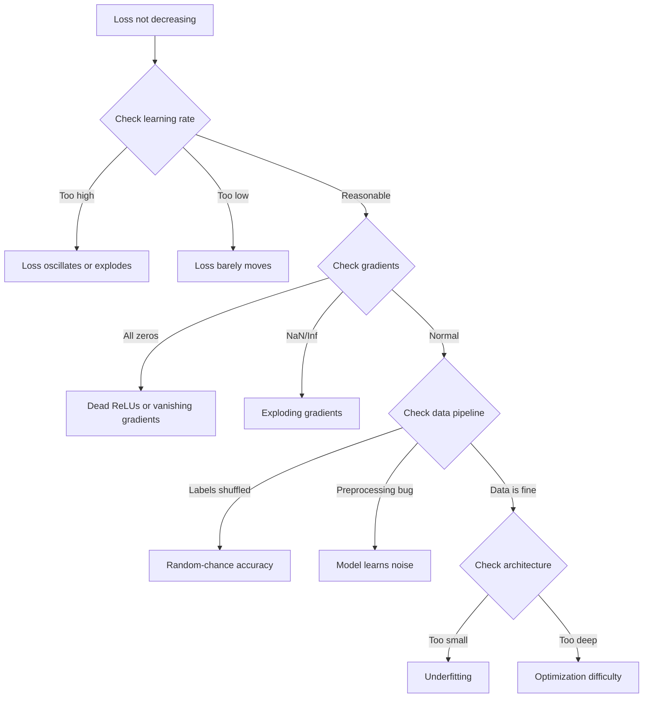
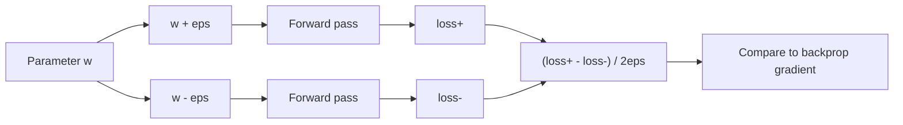
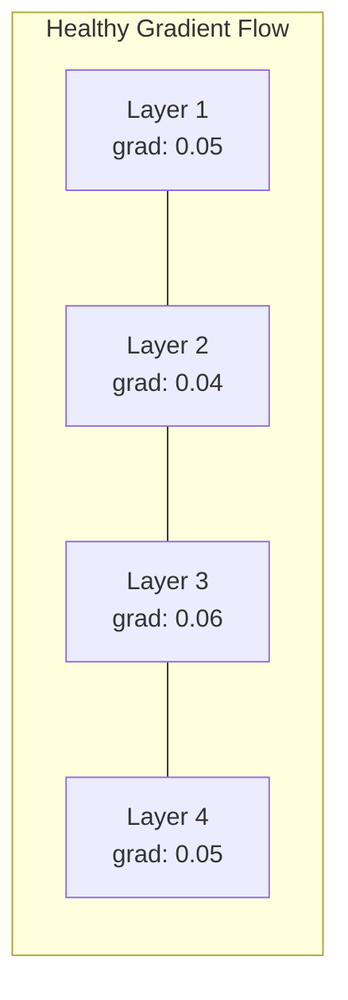
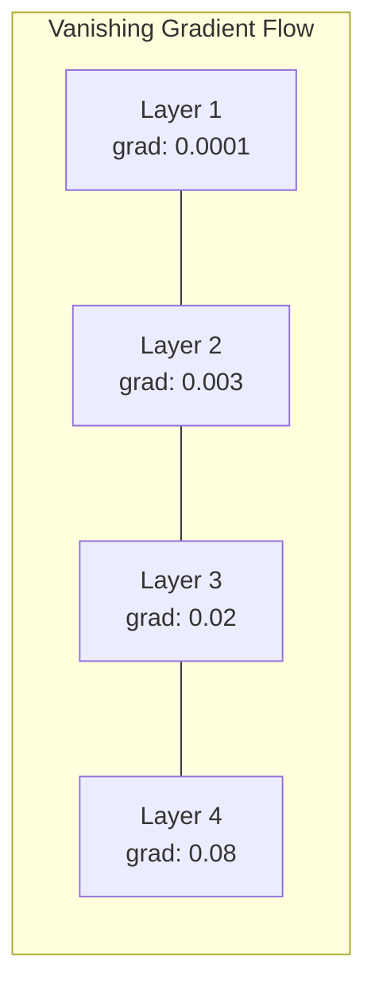
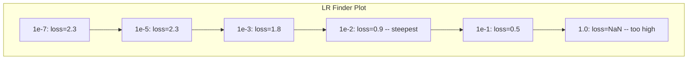

# Debugging Neural Networks · 调试神经网络

> Your network compiled. It ran. It produced a number. The number is wrong and nothing crashed. Welcome to the hardest kind of debugging -- the kind where there is no error message.

**Type:** Build
**Languages:** Python, PyTorch
**Prerequisites:** Phase 03 Lessons 01-10 (especially backpropagation, loss functions, optimizers)
**Time:** ~90 minutes

## Learning Objectives · 学习目标

- 用系统化的调试策略诊断常见的神经网络故障（NaN loss、loss 曲线平坦、过拟合、震荡）
- 应用「过拟合一个 batch」技术，验证模型架构和训练循环是否正确
- 检查梯度幅值、激活分布和权重范数，识别梯度消失/爆炸问题
- 建立一份覆盖数据管道、模型架构、损失函数、优化器和学习率问题的调试清单

> Diagnose common neural network failures (NaN loss, flat loss curve, overfitting, oscillation) using systematic debugging strategies
> Apply the "overfit one batch" technique to verify that your model architecture and training loop are correct
> Inspect gradient magnitudes, activation distributions, and weight norms to identify vanishing/exploding gradient problems
> Build a debugging checklist that covers data pipeline, model architecture, loss function, optimizer, and learning rate issues

---

## The Problem · 问题在哪

传统软件坏了会崩。空指针抛异常，类型不匹配在编译期报错，off-by-one 错误产出明显错误的输出。

神经网络不给你这种奢侈。

坏掉的神经网络会跑完全程，打印一个 loss 值，输出预测。loss 可能在降，预测可能看起来像模像样。但模型在悄悄地错——学捷径、背噪声，或者收敛到一个没用的局部极小。Google 研究者估计，ML 调试时间的 60-70% 花在那些不报错、但拉低模型质量的「静默」bug 上。

能用的模型和坏掉的模型之间，往往只差一行放错位置的代码：漏掉一个 `zero_grad()`、一个转置错的维度、一个差 10 倍的学习率。经典的「Recipe for Training Neural Networks」（2019）开篇就说：「The most common neural net mistakes are bugs that don't crash.」

本课教你找出这些 bug。

> Traditional software crashes when it is broken. A null pointer throws an exception. A type mismatch fails at compile time. An off-by-one error produces a clearly wrong output.
> Neural networks do not give you that luxury.
> A broken neural network runs to completion, prints a loss value, and outputs predictions. The loss might decrease. The predictions might look plausible. But the model is silently wrong -- learning shortcuts, memorizing noise, or converging to a useless local minimum. Google researchers estimated that 60-70% of ML debugging time is spent on "silent" bugs that produce no errors but degrade model quality.
> The difference between a working model and a broken one is often a single misplaced line: a missing `zero_grad()`, a transposed dimension, a learning rate off by 10x. the canonical "Recipe for Training Neural Networks" (2019) opens with this: "The most common neural net mistakes are bugs that don't crash."
> This lesson teaches you to find those bugs.

---

## The Concept · 概念

### The Debugging Mindset · 调试心态

忘掉「print 然后祈祷」式调试。神经网络调试需要系统化的方法，因为反馈环很慢（每次训练要几分钟到几小时），症状又模糊（一个难看的 loss 可能有 20 种含义）。

黄金法则：**从简单开始，一次只加一件复杂度，并独立验证每一件。**



> Forget print-and-pray debugging. Neural network debugging requires a systematic approach because the feedback loop is slow (minutes to hours per training run) and the symptoms are ambiguous (bad loss could mean 20 different things).
> The golden rule: **start simple, add complexity one piece at a time, and verify each piece independently.**

---

### Symptom 1: Loss Not Decreasing · 症状 1：loss 不下降

这是最常见的抱怨。训练循环在跑，epoch 在走，loss 却纹丝不动或剧烈震荡。

**学习率不对。** 太高：loss 震荡或跳成 NaN。太低：loss 降得慢到看起来是平的。Adam 从 1e-3 起步，SGD 从 1e-1 或 1e-2 起步。在断定别处有问题之前，永远先试 3 个每个相差 10 倍的学习率（例如 1e-2、1e-3、1e-4）。

**死 ReLU。** 如果 ReLU 神经元收到一个大的负输入，它输出 0 且梯度为 0，从此再也不会被激活。死掉的神经过多，网络就无法学习。检查方法：打印每个 ReLU 层之后恰好为 0 的激活比例。如果超过 50% 死了，换成 LeakyReLU 或降低学习率。

**梯度消失。** 在用 sigmoid 或 tanh 激活的深网络里，梯度反向传播时指数级缩小。等传到第一层时已经约等于 0，前几层停止学习。修复：用 ReLU/GELU、加残差连接、或用 batch normalization。

**梯度爆炸。** 反过来的问题——梯度指数级增长。RNN 和超深网络常见。loss 跳成 NaN。修复：梯度裁剪（`torch.nn.utils.clip_grad_norm_`）、更低的学习率、或加归一化。

> This is the most common complaint. The training loop runs, epochs tick by, and the loss stays flat or oscillates wildly.
> **Wrong learning rate.** Too high: loss oscillates or jumps to NaN. Too low: loss decreases so slowly it looks flat. For Adam, start at 1e-3. For SGD, start at 1e-1 or 1e-2. Always try 3 learning rates spanning 10x each (e.g., 1e-2, 1e-3, 1e-4) before concluding something else is wrong.
> **Dead ReLUs.** If a ReLU neuron receives a large negative input, it outputs 0 and its gradient is 0. It never activates again. If enough neurons die, the network cannot learn. Check: print the fraction of activations that are exactly 0 after each ReLU layer. If >50% are dead, switch to LeakyReLU or reduce the learning rate.
> **Vanishing gradients.** In deep networks with sigmoid or tanh activations, gradients shrink exponentially as they propagate backward. By the time they reach the first layer, they are ~0. The first layers stop learning. Fix: use ReLU/GELU, add residual connections, or use batch normalization.
> **Exploding gradients.** The opposite problem -- gradients grow exponentially. Common in RNNs and very deep networks. Loss jumps to NaN. Fix: gradient clipping (`torch.nn.utils.clip_grad_norm_`), lower learning rate, or add normalization.

---

### Symptom 2: Loss Decreasing But Model is Bad · 症状 2：loss 在降，模型却很差

loss 在降，训练准确率到 99%，但测试准确率只有 55%。或者模型在真实数据上输出莫名其妙的东西。

**过拟合。** 模型在背训练数据，而不是学规律。训练 loss 与验证 loss 的差距随时间拉大。修复：更多数据、dropout、weight decay、早停、数据增强。

**数据泄漏。** 测试数据漏进了训练。准确率高得可疑。常见原因：先打乱再切分、用全量数据集的统计量做预处理、切分之间存在重复样本。修复：先切分、后预处理、检查重复。

**标签错误。** 大多数真实数据集里 5-10% 的标签是错的（Northcutt et al., 2021 —— "Pervasive Label Errors in Test Sets"）。模型学的是噪声。修复：用 confident learning 找出并修正错标样本，或用 loss 截断忽略高损失样本。

> The loss goes down. Training accuracy hits 99%. But test accuracy is 55%. Or the model produces nonsensical outputs on real data.
> **Overfitting.** The model memorizes training data instead of learning patterns. Gap between training and validation loss grows over time. Fix: more data, dropout, weight decay, early stopping, data augmentation.
> **Data leakage.** Test data leaked into training. Accuracy is suspiciously high. Common causes: shuffling before splitting, preprocessing with statistics from the full dataset, duplicate samples across splits. Fix: split first, preprocess second, check for duplicates.
> **Label errors.** 5-10% of labels in most real datasets are wrong (Northcutt et al., 2021 -- "Pervasive Label Errors in Test Sets"). The model learns the noise. Fix: use confident learning to find and fix mislabeled examples, or use loss truncation to ignore high-loss samples.

---

### Symptom 3: NaN or Inf in Loss · 症状 3：loss 里出现 NaN 或 Inf

loss 值变成 `nan` 或 `inf`。训练已经死了。

**学习率太高。** 梯度更新冲得太远，权重爆炸。修复：缩小 10 倍。

**log(0) 或 log(负数)。** 交叉熵损失要计算 `log(p)`。如果模型输出的概率恰好是 0 或负数，log 会爆炸。修复：把预测夹到 `[eps, 1-eps]` 区间，`eps=1e-7`。

**除以零。** Batch normalization 要除以标准差。一个数值恒定的 batch 标准差为 0。修复：分母加 epsilon（PyTorch 默认做了，但手写实现未必）。

**数值溢出。** 大激活值喂进 `exp()` 会产出 Inf。softmax 尤其容易中招。修复：指数化之前先减去最大值（log-sum-exp 技巧）。

> The loss value becomes `nan` or `inf`. Training is dead.
> **Learning rate too high.** Gradient updates overshoot so far that weights explode. Fix: reduce by 10x.
> **log(0) or log(negative).** Cross-entropy loss computes `log(p)`. If your model outputs exactly 0 or a negative probability, the log explodes. Fix: clamp predictions to `[eps, 1-eps]` where `eps=1e-7`.
> **Division by zero.** Batch normalization divides by standard deviation. A batch with constant values has std=0. Fix: add epsilon to the denominator (PyTorch does this by default, but custom implementations might not).
> **Numerical overflow.** Large activations fed into `exp()` produce Inf. Softmax is especially prone. Fix: subtract the max before exponentiating (the log-sum-exp trick).

---

### Technique 1: Gradient Checking · 技术 1：梯度检查

把你的解析梯度（来自反向传播）和数值梯度（来自有限差分）做对比。如果不一致，你的 backward pass 有 bug。

参数 `w` 的数值梯度：

```
grad_numerical = (loss(w + eps) - loss(w - eps)) / (2 * eps)
```

一致性度量（相对差）：

```
rel_diff = |grad_analytical - grad_numerical| / max(|grad_analytical|, |grad_numerical|, 1e-8)
```

`rel_diff < 1e-5`：正确。`rel_diff > 1e-3`：几乎可以肯定有 bug。



> Compare your analytical gradients (from backprop) to numerical gradients (from finite differences). If they disagree, your backward pass has a bug.
> If `rel_diff < 1e-5`: correct. If `rel_diff > 1e-3`: almost certainly a bug.

---

### Technique 2: Activation Statistics · 技术 2：激活统计

训练时监控每一层之后激活的均值和标准差。健康的网络（归一化之后）激活均值接近 0、标准差接近 1，至少是有界的。

| 健康指标 | 均值 | 标准差 | 诊断 |
|-----------------|------|-----|-----------|
| 健康 | ~0 | ~1 | 网络在正常学习 |
| 饱和 | >>0 或 <<0 | ~0 | 激活卡在极端值上 |
| 死亡 | 0 | 0 | 神经元已死（全为零） |
| 爆炸 | >>10 | >>10 | 激活无界增长 |

> Monitor the mean and standard deviation of activations after each layer during training. Healthy networks maintain activations with mean near 0 and std near 1 (after normalization) or at least bounded.

---

### Technique 3: Gradient Flow Visualization · 技术 3：梯度流可视化

画出每层的平均梯度幅值。健康的网络里，各层梯度幅值应该大致相近。如果前几层的梯度比后几层小 1000 倍，你就遇到了梯度消失。





> Plot the average gradient magnitude for each layer. In a healthy network, gradient magnitudes should be roughly similar across layers. If early layers have gradients 1000x smaller than later layers, you have vanishing gradients.

---

### Technique 4: The Overfit-One-Batch Test · 技术 4：过拟合单 batch 测试

深度学习里最重要的单个调试技术。

取一个小 batch（8-32 个样本），在上面训练 100+ 步。loss 应该降到接近零，训练准确率应该达到 100%。如果达不到，你的模型或训练循环有根本性的 bug——不要进入完整训练。

这个测试能抓住：
- 坏掉的损失函数
- 坏掉的 backward pass
- 小到无法表达数据的架构
- 优化器没有接到模型参数上
- 数据与标签错位

它只要 30 秒就能跑完，却能省下几个小时的全量训练调试。

> The single most important debugging technique in deep learning.
> Take one small batch (8-32 samples). Train on it for 100+ iterations. The loss should go to nearly zero and training accuracy should hit 100%. If it does not, your model or training loop has a fundamental bug -- do not proceed to full training.
> This takes 30 seconds to run and saves hours of debugging full training runs.

---

### Technique 5: Learning Rate Finder · 技术 5：学习率查找器

Leslie Smith（2017）提出：在一个 epoch 内把学习率从极小（1e-7）扫到极大（10），同时记录 loss。画出 loss 对学习率的曲线。最优学习率大约是「loss 开始下降最快处」再小 10 倍的那个值。



这个例子里最好的 LR：约 1e-3（最陡点之前一个数量级）。

> Leslie Smith (2017) proposed sweeping the learning rate from very small (1e-7) to very large (10) over one epoch while recording the loss. Plot loss vs learning rate. The optimal learning rate is roughly 10x smaller than the rate where loss starts decreasing fastest.
> Best LR in this example: ~1e-3 (one order of magnitude before the steepest point).

---

### Common PyTorch Bugs · 常见 PyTorch bug

这些是 PyTorch 社区里浪费集体工时最多的 bug：

| Bug | 症状 | 修复 |
|-----|---------|---------|
| 忘记 `optimizer.zero_grad()` | 梯度跨 batch 累积，loss 震荡 | 在 `loss.backward()` 之前加 `optimizer.zero_grad()` |
| 测试时忘记 `model.eval()` | dropout 和 batch norm 行为不同，测试准确率在多次运行间波动 | 加上 `model.eval()` 和 `torch.no_grad()` |
| 张量形状错误 | 广播悄悄产出错误结果，不报错 | 调试时在每个操作之后打印形状 |
| CPU/GPU 不匹配 | `RuntimeError: expected CUDA tensor` | 对模型和数据都用 `.to(device)` |
| 张量未 detach | 计算图无限增长，OOM | 用 `.detach()` 或 `with torch.no_grad()` |
| 原地操作破坏 autograd | `RuntimeError: modified by in-place operation` | 把 `x += 1` 换成 `x = x + 1` |
| 数据未归一化 | loss 卡在随机水平 | 把输入归一化到 mean=0、std=1 |
| 标签 dtype 错误 | 交叉熵期望 `Long`，拿到 `Float` | 转换标签：`labels.long()` |

> These are the bugs that waste the most collective hours in the PyTorch community:

---

### The Master Debugging Table · 调试总表

| 症状 | 可能原因 | 第一件该试的事 |
|---------|-------------|-------------------|
| loss 卡在 -log(1/num_classes) | 模型在输出均匀分布 | 检查数据管道，确认标签与输入对应 |
| 几步之后 loss 变 NaN | 学习率太高 | 学习率缩小 10 倍 |
| loss 立刻变 NaN | log(0) 或除以零 | 给 log/除法操作加 epsilon |
| loss 剧烈震荡 | 学习率太高或 batch 太小 | 降学习率，加大 batch |
| loss 下降后进入平台期 | 微调阶段学习率太高 | 加学习率调度（cosine 或 step decay） |
| 训练准确率高、测试准确率低 | 过拟合 | 加 dropout、weight decay、更多数据 |
| 训练准确率 = 测试准确率 = 随机水平 | 模型什么都没学到 | 跑 overfit-one-batch 测试 |
| 训练准确率 = 测试准确率但都很低 | 欠拟合 | 更大的模型、更多层、更多特征 |
| 梯度全为零 | 死 ReLU 或计算图被 detach | 换 LeakyReLU，检查 `.requires_grad` |
| 训练中内存耗尽 | batch 太大或计算图未释放 | 减小 batch，评估时用 `torch.no_grad()` |

```figure
learning-curves
```

> | Symptom | Likely cause | First thing to try |
> |---------|-------------|-------------------|
> | Loss stuck at -log(1/num_classes) | Model predicting uniform distribution | Check data pipeline, verify labels match inputs |
> | Loss NaN after a few steps | Learning rate too high | Reduce LR by 10x |
> | Loss NaN immediately | log(0) or division by zero | Add epsilon to log/division operations |
> | Loss oscillating wildly | LR too high or batch size too small | Reduce LR, increase batch size |
> | Loss decreasing then plateaus | LR too high for fine-tuning phase | Add LR schedule (cosine or step decay) |
> | Training acc high, test acc low | Overfitting | Add dropout, weight decay, more data |
> | Training acc = test acc = chance | Model not learning anything | Run overfit-one-batch test |
> | Training acc = test acc but both low | Underfitting | Bigger model, more layers, more features |
> | Gradients all zero | Dead ReLUs or detached computation graph | Switch to LeakyReLU, check `.requires_grad` |
> | Out of memory during training | Batch too large or graph not freed | Reduce batch size, use `torch.no_grad()` for eval |

---

## Build It · 动手造

一个监控激活、梯度和 loss 曲线的诊断工具箱。你会故意弄坏一个网络，然后用工具箱诊断每个问题。

> A diagnostic toolkit that monitors activations, gradients, and loss curves. You will deliberately break a network and use the toolkit to diagnose each problem.

### Step 1: The NetworkDebugger Class · 步骤 1：NetworkDebugger 类

挂进 PyTorch 模型，按层记录激活和梯度统计。

```python
import torch
import torch.nn as nn
import math


class NetworkDebugger:
    def __init__(self, model):
        self.model = model
        self.activation_stats = {}
        self.gradient_stats = {}
        self.loss_history = []
        self.lr_losses = []
        self.hooks = []
        self._register_hooks()

    def _register_hooks(self):
        for name, module in self.model.named_modules():
            if isinstance(module, (nn.Linear, nn.Conv2d, nn.ReLU, nn.LeakyReLU)):
                hook = module.register_forward_hook(self._make_activation_hook(name))
                self.hooks.append(hook)
                hook = module.register_full_backward_hook(self._make_gradient_hook(name))
                self.hooks.append(hook)

    def _make_activation_hook(self, name):
        def hook(module, input, output):
            with torch.no_grad():
                out = output.detach().float()
                self.activation_stats[name] = {
                    "mean": out.mean().item(),
                    "std": out.std().item(),
                    "fraction_zero": (out == 0).float().mean().item(),
                    "min": out.min().item(),
                    "max": out.max().item(),
                }
        return hook

    def _make_gradient_hook(self, name):
        def hook(module, grad_input, grad_output):
            if grad_output[0] is not None:
                with torch.no_grad():
                    grad = grad_output[0].detach().float()
                    self.gradient_stats[name] = {
                        "mean": grad.mean().item(),
                        "std": grad.std().item(),
                        "abs_mean": grad.abs().mean().item(),
                        "max": grad.abs().max().item(),
                    }
        return hook

    def record_loss(self, loss_value):
        self.loss_history.append(loss_value)

    def check_loss_health(self):
        if len(self.loss_history) < 2:
            return "NOT_ENOUGH_DATA"
        recent = self.loss_history[-10:]
        if any(math.isnan(v) or math.isinf(v) for v in recent):
            return "NAN_OR_INF"
        if len(self.loss_history) >= 20:
            first_half = sum(self.loss_history[:10]) / 10
            second_half = sum(self.loss_history[-10:]) / 10
            if second_half >= first_half * 0.99:
                return "NOT_DECREASING"
        if len(recent) >= 5:
            diffs = [recent[i+1] - recent[i] for i in range(len(recent)-1)]
            if max(diffs) - min(diffs) > 2 * abs(sum(diffs) / len(diffs)):
                return "OSCILLATING"
        return "HEALTHY"

    def check_activations(self):
        issues = []
        for name, stats in self.activation_stats.items():
            if stats["fraction_zero"] > 0.5:
                issues.append(f"DEAD_NEURONS: {name} has {stats['fraction_zero']:.0%} zero activations")
            if abs(stats["mean"]) > 10:
                issues.append(f"EXPLODING_ACTIVATIONS: {name} mean={stats['mean']:.2f}")
            if stats["std"] < 1e-6:
                issues.append(f"COLLAPSED_ACTIVATIONS: {name} std={stats['std']:.2e}")
        return issues if issues else ["HEALTHY"]

    def check_gradients(self):
        issues = []
        grad_magnitudes = []
        for name, stats in self.gradient_stats.items():
            grad_magnitudes.append((name, stats["abs_mean"]))
            if stats["abs_mean"] < 1e-7:
                issues.append(f"VANISHING_GRADIENT: {name} abs_mean={stats['abs_mean']:.2e}")
            if stats["abs_mean"] > 100:
                issues.append(f"EXPLODING_GRADIENT: {name} abs_mean={stats['abs_mean']:.2e}")
        if len(grad_magnitudes) >= 2:
            first_mag = grad_magnitudes[0][1]
            last_mag = grad_magnitudes[-1][1]
            if last_mag > 0 and first_mag / last_mag > 100:
                issues.append(f"GRADIENT_RATIO: first/last = {first_mag/last_mag:.0f}x (vanishing)")
        return issues if issues else ["HEALTHY"]

    def print_report(self):
        print("\n=== NETWORK DEBUGGER REPORT ===")
        print(f"\nLoss health: {self.check_loss_health()}")
        if self.loss_history:
            print(f"  Last 5 losses: {[f'{v:.4f}' for v in self.loss_history[-5:]]}")
        print("\nActivation diagnostics:")
        for item in self.check_activations():
            print(f"  {item}")
        print("\nGradient diagnostics:")
        for item in self.check_gradients():
            print(f"  {item}")
        print("\nPer-layer activation stats:")
        for name, stats in self.activation_stats.items():
            print(f"  {name}: mean={stats['mean']:.4f} std={stats['std']:.4f} zero={stats['fraction_zero']:.1%}")
        print("\nPer-layer gradient stats:")
        for name, stats in self.gradient_stats.items():
            print(f"  {name}: abs_mean={stats['abs_mean']:.2e} max={stats['max']:.2e}")

    def remove_hooks(self):
        for hook in self.hooks:
            hook.remove()
        self.hooks.clear()
```

> Hooks into a PyTorch model to record activation and gradient statistics per layer.

### Step 2: The Overfit-One-Batch Test · 步骤 2：过拟合单 batch 测试

```python
def overfit_one_batch(model, x_batch, y_batch, criterion, lr=0.01, steps=200):
    optimizer = torch.optim.Adam(model.parameters(), lr=lr)
    model.train()
    print("\n=== OVERFIT ONE BATCH TEST ===")
    print(f"Batch size: {x_batch.shape[0]}, Steps: {steps}")

    for step in range(steps):
        optimizer.zero_grad()
        output = model(x_batch)
        loss = criterion(output, y_batch)
        loss.backward()
        optimizer.step()

        if step % 50 == 0 or step == steps - 1:
            with torch.no_grad():
                preds = (output > 0).float() if output.shape[-1] == 1 else output.argmax(dim=1)
                targets = y_batch if y_batch.dim() == 1 else y_batch.squeeze()
                acc = (preds.squeeze() == targets).float().mean().item()
            print(f"  Step {step:3d} | Loss: {loss.item():.6f} | Accuracy: {acc:.1%}")

    final_loss = loss.item()
    if final_loss > 0.1:
        print(f"\n  FAIL: Loss did not converge ({final_loss:.4f}). Model or training loop is broken.")
        return False
    print(f"\n  PASS: Loss converged to {final_loss:.6f}")
    return True
```

### Step 3: Learning Rate Finder · 步骤 3：学习率查找器

```python
def find_learning_rate(model, x_data, y_data, criterion, start_lr=1e-7, end_lr=10, steps=100):
    import copy
    original_state = copy.deepcopy(model.state_dict())
    optimizer = torch.optim.SGD(model.parameters(), lr=start_lr)
    lr_mult = (end_lr / start_lr) ** (1 / steps)

    model.train()
    results = []
    best_loss = float("inf")
    current_lr = start_lr

    print("\n=== LEARNING RATE FINDER ===")

    for step in range(steps):
        optimizer.zero_grad()
        output = model(x_data)
        loss = criterion(output, y_data)

        if math.isnan(loss.item()) or loss.item() > best_loss * 10:
            break

        best_loss = min(best_loss, loss.item())
        results.append((current_lr, loss.item()))

        loss.backward()
        optimizer.step()

        current_lr *= lr_mult
        for param_group in optimizer.param_groups:
            param_group["lr"] = current_lr

    model.load_state_dict(original_state)

    if len(results) < 10:
        print("  Could not complete LR sweep -- loss diverged too quickly")
        return results

    min_loss_idx = min(range(len(results)), key=lambda i: results[i][1])
    suggested_lr = results[max(0, min_loss_idx - 10)][0]

    print(f"  Swept {len(results)} steps from {start_lr:.0e} to {results[-1][0]:.0e}")
    print(f"  Minimum loss {results[min_loss_idx][1]:.4f} at lr={results[min_loss_idx][0]:.2e}")
    print(f"  Suggested learning rate: {suggested_lr:.2e}")

    return results
```

### Step 4: Gradient Checker · 步骤 4：梯度检查器

```python
def _flat_to_multi_index(flat_idx, shape):
    multi_idx = []
    remaining = flat_idx
    for dim in reversed(shape):
        multi_idx.insert(0, remaining % dim)
        remaining //= dim
    return tuple(multi_idx)


def gradient_check(model, x, y, criterion, eps=1e-4):
    model.train()
    x_double = x.double()
    y_double = y.double()
    model_double = model.double()

    print("\n=== GRADIENT CHECK ===")
    overall_max_diff = 0
    checked = 0

    for name, param in model_double.named_parameters():
        if not param.requires_grad:
            continue

        layer_max_diff = 0

        model_double.zero_grad()
        output = model_double(x_double)
        loss = criterion(output, y_double)
        loss.backward()
        analytical_grad = param.grad.clone()

        num_checks = min(5, param.numel())
        for i in range(num_checks):
            idx = _flat_to_multi_index(i, param.shape)
            original = param.data[idx].item()

            param.data[idx] = original + eps
            with torch.no_grad():
                loss_plus = criterion(model_double(x_double), y_double).item()

            param.data[idx] = original - eps
            with torch.no_grad():
                loss_minus = criterion(model_double(x_double), y_double).item()

            param.data[idx] = original

            numerical = (loss_plus - loss_minus) / (2 * eps)
            analytical = analytical_grad[idx].item()

            denom = max(abs(numerical), abs(analytical), 1e-8)
            rel_diff = abs(numerical - analytical) / denom

            layer_max_diff = max(layer_max_diff, rel_diff)
            checked += 1

        overall_max_diff = max(overall_max_diff, layer_max_diff)
        status = "OK" if layer_max_diff < 1e-5 else "MISMATCH"
        print(f"  {name}: max_rel_diff={layer_max_diff:.2e} [{status}]")

    model.float()

    print(f"\n  Checked {checked} parameters")
    if overall_max_diff < 1e-5:
        print("  PASS: Gradients match (rel_diff < 1e-5)")
    elif overall_max_diff < 1e-3:
        print("  WARN: Small differences (1e-5 < rel_diff < 1e-3)")
    else:
        print("  FAIL: Gradient mismatch detected (rel_diff > 1e-3)")
    return overall_max_diff
```

### Step 5: Deliberately Broken Networks · 步骤 5：故意弄坏的网络

现在把工具箱用到坏掉的网络 上，逐个诊断。

```python
def demo_broken_networks():
    torch.manual_seed(42)
    x = torch.randn(64, 10)
    y = (x[:, 0] > 0).long()

    print("\n" + "=" * 60)
    print("BUG 1: Learning rate too high (lr=10)")
    print("=" * 60)
    model1 = nn.Sequential(nn.Linear(10, 32), nn.ReLU(), nn.Linear(32, 2))
    debugger1 = NetworkDebugger(model1)
    optimizer1 = torch.optim.SGD(model1.parameters(), lr=10.0)
    criterion = nn.CrossEntropyLoss()
    for step in range(20):
        optimizer1.zero_grad()
        out = model1(x)
        loss = criterion(out, y)
        debugger1.record_loss(loss.item())
        loss.backward()
        optimizer1.step()
    debugger1.print_report()
    debugger1.remove_hooks()

    print("\n" + "=" * 60)
    print("BUG 2: Dead ReLUs from bad initialization")
    print("=" * 60)
    model2 = nn.Sequential(nn.Linear(10, 32), nn.ReLU(), nn.Linear(32, 32), nn.ReLU(), nn.Linear(32, 2))
    with torch.no_grad():
        for m in model2.modules():
            if isinstance(m, nn.Linear):
                m.weight.fill_(-1.0)
                m.bias.fill_(-5.0)
    debugger2 = NetworkDebugger(model2)
    optimizer2 = torch.optim.Adam(model2.parameters(), lr=1e-3)
    for step in range(50):
        optimizer2.zero_grad()
        out = model2(x)
        loss = criterion(out, y)
        debugger2.record_loss(loss.item())
        loss.backward()
        optimizer2.step()
    debugger2.print_report()
    debugger2.remove_hooks()

    print("\n" + "=" * 60)
    print("BUG 3: Missing zero_grad (gradients accumulate)")
    print("=" * 60)
    model3 = nn.Sequential(nn.Linear(10, 32), nn.ReLU(), nn.Linear(32, 2))
    debugger3 = NetworkDebugger(model3)
    optimizer3 = torch.optim.SGD(model3.parameters(), lr=0.01)
    for step in range(50):
        out = model3(x)
        loss = criterion(out, y)
        debugger3.record_loss(loss.item())
        loss.backward()
        optimizer3.step()
    debugger3.print_report()
    debugger3.remove_hooks()

    print("\n" + "=" * 60)
    print("HEALTHY NETWORK: Correct setup for comparison")
    print("=" * 60)
    model_good = nn.Sequential(nn.Linear(10, 32), nn.ReLU(), nn.Linear(32, 2))
    debugger_good = NetworkDebugger(model_good)
    optimizer_good = torch.optim.Adam(model_good.parameters(), lr=1e-3)
    for step in range(50):
        optimizer_good.zero_grad()
        out = model_good(x)
        loss = criterion(out, y)
        debugger_good.record_loss(loss.item())
        loss.backward()
        optimizer_good.step()
    debugger_good.print_report()
    debugger_good.remove_hooks()

    print("\n" + "=" * 60)
    print("OVERFIT-ONE-BATCH TEST (healthy model)")
    print("=" * 60)
    model_test = nn.Sequential(nn.Linear(10, 32), nn.ReLU(), nn.Linear(32, 2))
    overfit_one_batch(model_test, x[:8], y[:8], criterion)

    print("\n" + "=" * 60)
    print("LEARNING RATE FINDER")
    print("=" * 60)
    model_lr = nn.Sequential(nn.Linear(10, 32), nn.ReLU(), nn.Linear(32, 2))
    find_learning_rate(model_lr, x, y, criterion)

    print("\n" + "=" * 60)
    print("GRADIENT CHECK")
    print("=" * 60)
    model_grad = nn.Sequential(nn.Linear(10, 8), nn.ReLU(), nn.Linear(8, 2))
    gradient_check(model_grad, x[:4], y[:4], criterion)
```

> Now apply the toolkit to broken networks and diagnose each one.

---

## Use It · 实战用法

### PyTorch Built-in Tools · PyTorch 内置工具

```python
import torch
import torch.nn as nn

model = nn.Sequential(
    nn.Linear(768, 256),
    nn.ReLU(),
    nn.Linear(256, 10),
)

with torch.autograd.detect_anomaly():
    output = model(input_tensor)
    loss = criterion(output, target)
    loss.backward()

for name, param in model.named_parameters():
    if param.grad is not None:
        print(f"{name}: grad_mean={param.grad.abs().mean():.2e}")
```

### Weights & Biases Integration · Weights & Biases 集成

```python
import wandb

wandb.init(project="debug-training")

for epoch in range(100):
    loss = train_one_epoch()
    wandb.log({
        "loss": loss,
        "lr": optimizer.param_groups[0]["lr"],
        "grad_norm": torch.nn.utils.clip_grad_norm_(model.parameters(), float("inf")),
    })

    for name, param in model.named_parameters():
        if param.grad is not None:
            wandb.log({f"grad/{name}": wandb.Histogram(param.grad.cpu().numpy())})
```

### TensorBoard

```python
from torch.utils.tensorboard import SummaryWriter

writer = SummaryWriter("runs/debug_experiment")

for epoch in range(100):
    loss = train_one_epoch()
    writer.add_scalar("Loss/train", loss, epoch)

    for name, param in model.named_parameters():
        writer.add_histogram(f"weights/{name}", param, epoch)
        if param.grad is not None:
            writer.add_histogram(f"gradients/{name}", param.grad, epoch)
```

### The Debug Checklist (Before Full Training) · 调试清单（完整训练之前）

1. 跑 overfit-one-batch 测试。失败就停。
2. 打印模型摘要——确认参数量合理。
3. 用随机数据跑一次前向——检查输出形状。
4. 训练 5 个 epoch——确认 loss 在下降。
5. 检查激活统计——没有死层，没有爆炸。
6. 检查梯度流——没有消失，没有爆炸。
7. 验证数据管道——打印 5 个带标签的随机样本。

> Run overfit-one-batch test. If it fails, stop.
> Print model summary -- verify parameter count is reasonable.
> Run a single forward pass with random data -- check output shape.
> Train for 5 epochs -- verify loss decreases.
> Check activation statistics -- no dead layers, no explosions.
> Check gradient flow -- no vanishing, no exploding.
> Verify data pipeline -- print 5 random samples with labels.

---

## Ship It · 交付

本课产出：
- `outputs/prompt-nn-debugger.md` —— 诊断神经网络训练失败的提示词
- `outputs/skill-debug-checklist.md` —— 调试训练问题的决策树清单

调试的关键落地模式：
- 给生产训练脚本加监控 hook
- 每 N 步把激活和梯度统计记录到 W&B 或 TensorBoard
- 对 NaN loss、死神经元（>80% 为零）或梯度爆炸实现自动告警
- 每次改架构或数据管道，都跑一遍 overfit-one-batch 测试

---

## Exercises · 练习

1. **加一个梯度爆炸检测器。** 修改 `NetworkDebugger`，让它在梯度超过阈值时检测出来，并自动建议一个梯度裁剪值。在一个没有归一化的 20 层网络上测试它。

2. **造一个死神经元复活器。** 写一个函数，识别死掉的 ReLU 神经元（永远输出 0），并用 Kaiming 初始化重新初始化它们的入边权重。证明它能救活一个超过 70% 神经元已死的网络。

3. **实现带绘图的学习率查找器。** 扩展 `find_learning_rate`，把结果存成 CSV，再写一个独立脚本读取 CSV 并用 matplotlib 画出 LR 对 loss 的曲线。找出 ResNet-18 在 CIFAR-10 上的最优 LR。

4. **造一个数据管道验证器。** 写一个函数检查：训练/测试切分间的重复样本、标签分布失衡（>10:1 比例）、输入归一化（mean 接近 0、std 接近 1），以及数据中的 NaN/Inf 值。在一个故意污染的数据集上运行它。

5. **调试一个真实故障。** 拿 Lesson 10 的迷你框架，引入一个隐蔽的 bug（例如把 backward 里的权重矩阵转置），然后用梯度检查精确定位哪个参数的梯度不对。把调试过程记录下来。

---

## Key Terms · 术语表

| 术语 | 大家怎么说 | 实际含义 |
|------|----------------|----------------------|
| Silent bug | 「能跑但结果不对」 | 不报错但拉低模型质量的 bug——ML 中占主导的失败模式 |
| Dead ReLU | 「神经元死了」 | 输入永远为负的 ReLU 神经元：输出 0，且永远收到 0 梯度 |
| Vanishing gradients | 「前几层不学了」 | 梯度穿过各层时指数缩小，使前几层的权重实际上被冻结 |
| Exploding gradients | 「loss 变 NaN 了」 | 梯度穿过各层时指数增长，权重更新大到溢出 |
| Gradient checking | 「验证 backprop 对不对」 | 把反向传播的解析梯度与有限差分的数值梯度做对比 |
| Overfit-one-batch | 「最重要的调试测试」 | 在一个小 batch 上训练，验证模型确实「能学」——如果不能，一定有根本性的问题 |
| LR finder | 「扫出合适的学习率」 | 在一个 epoch 内指数增大学习率，取 loss 发散之前刚好前一个值 |
| Data leakage | 「测试数据漏进了训练」 | 测试集信息污染训练，产出虚高的准确率 |
| Activation statistics | 「监控层的健康」 | 跟踪每层输出的均值、标准差和零值比例，发现死亡、饱和或爆炸的神经元 |
| Gradient clipping | 「给梯度幅值封顶」 | 当梯度范数超过阈值时按比例缩小，防止梯度爆炸式更新 |

---

## Further Reading · 延伸阅读

- Smith, "Cyclical Learning Rates for Training Neural Networks" (2017) —— 提出学习率范围测试（LR finder）的论文
- Northcutt et al., "Pervasive Label Errors in Test Sets Destabilize Machine Learning Benchmarks" (2021) —— 证明 ImageNet、CIFAR-10 等主要基准中有 3-6% 的标签是错的
- Zhang et al., "Understanding Deep Learning Requires Rethinking Generalization" (2017) —— 证明神经网络能记住随机标签的论文，这正是 overfit-one-batch 测试有效的原因
- PyTorch 文档中的 `torch.autograd.detect_anomaly` 与 `torch.autograd.set_detect_anomaly`，内置的 NaN/Inf 检测
