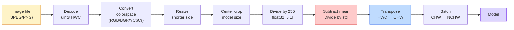
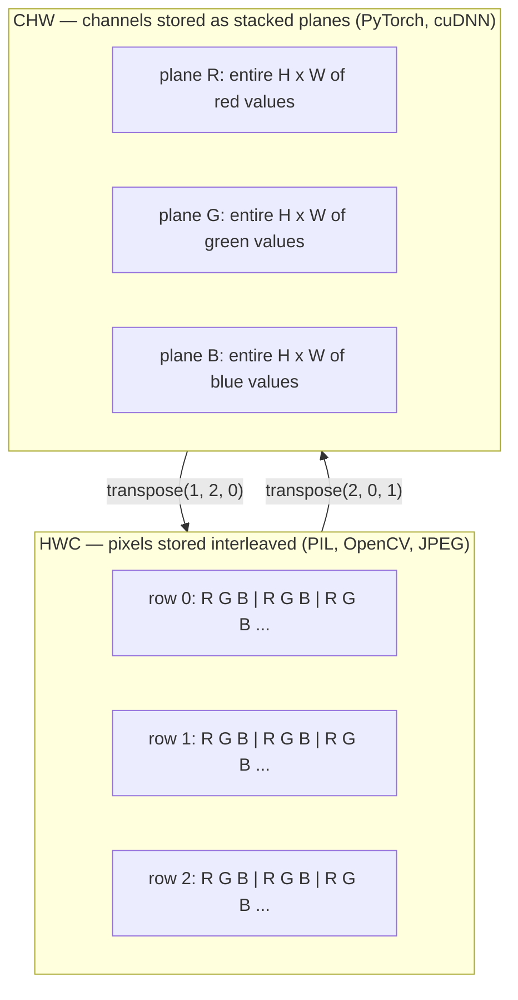

# Image Fundamentals — Pixels, Channels, Color Spaces · 图像基础：像素、通道与色彩空间

> An image is a tensor of light samples. Every vision model you will ever use starts from this one fact.

**Type:** Build
**Languages:** Python
**Prerequisites:** Phase 1 Lesson 12 (Tensor Operations), Phase 3 Lesson 11 (Intro to PyTorch)
**Time:** ~45 minutes

## Learning Objectives · 学习目标

- 解释连续场景如何被离散化为像素，以及采样/量化决策为什么给所有下游模型定了上限
- 把图像当作 NumPy 数组来读取、切片和检查，并在 HWC 与 CHW 两种布局之间自如切换
- 在 RGB、灰度、HSV、YCbCr 之间相互转换，并说清每种色彩空间存在的理由
- 严格按预训练 PyTorch 视觉模型期望的方式做像素级预处理（归一化、标准化、缩放、通道前置）

> Explain how a continuous scene gets discretized into pixels and why sampling/quantization decisions set the ceiling on every downstream model
> Read, slice, and inspect images as NumPy arrays and switch fluently between HWC and CHW layouts
> Convert between RGB, grayscale, HSV, and YCbCr and justify why each color space exists
> Apply pixel-level preprocessing (normalize, standardize, resize, channel-first) exactly as pretrained PyTorch vision models expect it

## The Problem · 问题在哪

你读的每一篇论文、下载的每一份预训练权重、调用的每一个视觉 API，都对输入的编码方式有明确假设。把 `uint8` 图像喂给想要 `float32` 的模型，它照样能跑——然后悄悄产出垃圾结果。把 BGR 喂给在 RGB 上训练的网络，精度直接掉十个百分点。模型期望 channels-first，你却给它 channels-last，第一个卷积层就会把高度当成特征通道。这些情况没有一个会报错。它们只是毁掉你的指标，然后你花一周时间去抓那个其实藏在你读取文件方式里的 bug。

卷积本身并不复杂，只要你清楚它在什么东西上滑动。难的是「一张图像」在相机、JPEG 解码器、PIL、OpenCV、torchvision 和 CUDA kernel 眼里是完全不同的东西。每一层工具栈都有自己的轴顺序、字节范围和通道约定。理不清这些的视觉工程师，交付的就是坏掉的流水线。

本课把这个地基修牢，让本阶段剩下的课程都能盖在上面。学完你将明白：像素是什么、为什么每个像素是三个数而不是一个、「用 ImageNet 统计量做归一化」到底做了什么，以及如何在本阶段后续每课都会默认的那两三种布局之间来回切换。

> Every paper you will read, every pretrained weight you will download, every vision API you will call assumes a specific encoding of the input. Pass a `uint8` image where the model wants `float32` and it will still run — and silently produce garbage. Feed BGR to a network trained on RGB and accuracy collapses by ten points. None of this throws an error. It just ruins your metrics and you spend a week hunting for a bug that lives in how you loaded the file.
> Each stack has its own axis order, byte range, and channel convention. A vision engineer who cannot keep these straight ships broken pipelines.
> This lesson fixes the foundation so the rest of the phase can build on it.

## The Concept · 概念

### The full preprocessing pipeline at a glance · 预处理流水线一览

每一个生产级视觉系统都是同一串可逆变换。搞错其中一步，模型看到的输入就和它训练时见过的不一样了。



图中红色和蓝色的两个框，是 80% 静默失败的藏身处：漏掉标准化、搞错布局。

> Every production vision system is the same sequence of reversible transforms. Get one step wrong and the model sees a different input than it was trained on.
> The two red and blue boxes are where 80% of silent failures live: missing standardization and wrong layout.

### A pixel is a sample, not a square · 像素是一个采样点，不是一个方块

相机传感器统计落在微小探测器网格上的光子。每个探测器在一小段时间内积分光线，输出一个与命中光子数成正比的电压。传感器再把这个电压离散成整数。一个探测器就是一个像素。

```
Continuous scene                 Sensor grid                     Digital image
(infinite detail)                (H x W detectors)               (H x W integers)

    ~~~~~                        +--+--+--+--+--+                 210 198 180 155 120
   ~   ~   ~                     |  |  |  |  |  |                 205 195 178 152 118
  ~ light ~      ---->           +--+--+--+--+--+     ---->       200 190 175 150 115
   ~~~~~                         |  |  |  |  |  |                 195 185 170 148 112
                                 +--+--+--+--+--+                 188 180 165 145 108
```

这一步做出两个选择，它们给下游的一切定了上限：

- **空间采样（spatial sampling）** 决定场景每一度对应多少个探测器。太少，边缘变锯齿（走样，aliasing）。太多，存储和计算爆炸。
- **强度量化（intensity quantization）** 决定电压被分成多细的档位。8 bit 给 256 级，是显示的标准。10、12、16 bit 提供更平滑的渐变，对医学影像、HDR 和 raw 传感器流水线很重要。

像素不是一块有面积的有色方块。它是一次单独的测量。当你缩放或旋转时，你是在对这张测量网格重新采样。

> A camera sensor counts photons that land on a grid of tiny detectors. Each detector integrates light for a fraction of a second and emits a voltage proportional to how many photons hit it. The sensor then discretizes that voltage into an integer. One detector becomes one pixel.
> Two choices happen at this step and they fix the ceiling on everything downstream.
> A pixel is not a coloured square with area. It is a single measurement. When you resize or rotate, you are resampling that measurement grid.

### Why three channels · 为什么是三个通道

单个探测器统计整个可见光谱的光子——那就是灰度。要得到彩色，传感器在网格上覆盖一层红、绿、蓝滤镜的马赛克。去马赛克（demosaicing）之后，每个空间位置都有三个整数：红滤镜探测器的响应，以及附近绿滤镜、蓝滤镜探测器的响应。这三个整数就是像素的 RGB 三元组。

```
One pixel in memory:

    (R, G, B) = (210, 140, 30)   <- reddish-orange

An H x W RGB image:

    shape (H, W, 3)     stored as   H rows of W pixels of 3 values
                                    each in [0, 255] for uint8
```

三并不是什么魔法。深度相机加一个 Z 通道。卫星加红外和紫外波段。医学扫描常常只有一个通道（X 光、CT）或很多通道（高光谱）。通道数是最后一个轴；卷积层学着在它上面做混合。

> One detector counts photons across the whole visible spectrum — that is grayscale. To get colour, the sensor covers the grid with a mosaic of red, green, and blue filters. After demosaicing, every spatial location has three integers: the response of the red-filtered detector, green-filtered, and blue-filtered nearby. Those three integers are a pixel's RGB triplet.
> The number of channels is the last axis; conv layers learn to mix across it.

### Two layout conventions: HWC and CHW · 两种布局约定：HWC 与 CHW

同一个张量，两种排列。每个库各选其一。

```
HWC (height, width, channels)           CHW (channels, height, width)

   W ->                                    H ->
  +-----+-----+-----+                     +-----+-----+
H |R G B|R G B|R G B|                   C |R R R R R R|
| +-----+-----+-----+                   | +-----+-----+
v |R G B|R G B|R G B|                   v |G G G G G G|
  +-----+-----+-----+                     +-----+-----+
                                          |B B B B B B|
                                          +-----+-----+

   PIL, OpenCV, matplotlib,              PyTorch, most deep learning
   almost every image file on disk       frameworks, cuDNN kernels
```

CHW 的存在是因为卷积核在 H 和 W 上滑动。把通道轴放在最前，意味着每个卷积核在每个通道上看到的是一块连续的 2D 平面，向量化非常干净。磁盘格式保留 HWC，因为它与传感器逐行输出扫描线的顺序一致。

那行你会写上一千次的转换代码：

```
img_chw = img_hwc.transpose(2, 0, 1)      # NumPy
img_chw = img_hwc.permute(2, 0, 1)        # PyTorch tensor
```

内存布局的可视化：



> CHW exists because convolution kernels slide across H and W. Keeping the channel axis first means each kernel sees a contiguous 2D plane per channel, which vectorizes cleanly. Disk formats keep HWC because that matches how scanlines come out of a sensor.

### Byte ranges and dtype · 字节范围与 dtype

三种约定最常见：

| 约定 | dtype | 范围 | 常见场景 |
|------------|-------|-------|------------------|
| 原始（Raw） | `uint8` | [0, 255] | 磁盘上的文件、PIL、OpenCV 输出 |
| 归一化（Normalized） | `float32` | [0.0, 1.0] | 执行 `img.astype('float32') / 255` 之后 |
| 标准化（Standardized） | `float32` | 约 [-2, +2] | 减均值、除以标准差之后 |

卷积网络是在标准化后的输入上训练的。ImageNet 统计量 `mean=[0.485, 0.456, 0.406]`、`std=[0.229, 0.224, 0.225]` 是三个通道在整个 ImageNet 训练集上的算术均值和标准差，在 [0, 1] 归一化像素上计算。把原始 `uint8` 喂给期望标准化浮点数的模型，是应用视觉中最常见的静默失败，没有之一。

> Convolutional networks were trained on standardized inputs. ImageNet stats `mean=[0.485, 0.456, 0.406]`, `std=[0.229, 0.224, 0.225]` are the arithmetic mean and standard deviation of the three channels over the full ImageNet training set, computed on [0, 1] normalized pixels.
> Feeding raw `uint8` into a model that expects standardized float is the single most common silent failure in applied vision.

### Color spaces and why they exist · 色彩空间，以及它们为何存在

RGB 是采集格式，但对模型来说它并不总是最有用的表示。

```
 RGB               HSV                       YCbCr / YUV

 R red             H hue (angle 0-360)       Y luminance (brightness)
 G green           S saturation (0-1)        Cb chroma blue-yellow
 B blue            V value/brightness (0-1)  Cr chroma red-green

 Linear to         Separates color from      Separates brightness from
 sensor output     brightness. Useful for    color. JPEG and most video
                   color thresholding, UI    codecs compress the chroma
                   sliders, simple filters   channels harder because the
                                             human eye is less sensitive
                                             to chroma detail than to Y.
```

对大多数现代 CNN，你喂 RGB。其他色彩空间出现在这些场合：

- **HSV** —— 传统 CV 代码、基于颜色的分割、白平衡。
- **YCbCr** —— 读 JPEG 内部结构、视频流水线、只在 Y 上运作的超分辨率模型。
- **灰度（Grayscale）** —— OCR、文档模型，以及一切颜色是干扰变量而非信号的场合。

从 RGB 得到灰度是加权和，不是平均，因为人眼对绿色比对红色或蓝色更敏感：

```
Y = 0.299 R + 0.587 G + 0.114 B       (ITU-R BT.601, the classic weights)
```

> RGB is the capture format but it is not always the most useful representation for a model.
> Grayscale from RGB is a weighted sum, not an average, because the human eye is more sensitive to green than to red or blue.

### Aspect ratio, resizing, and interpolation · 宽高比、缩放与插值

每个模型都有固定输入尺寸（大多数 ImageNet 分类器是 224x224，现代检测器是 384x384 或 512x512）。你的图像很少正好匹配。真正重要的三种缩放选择：

- **短边缩放后中心裁剪** —— 标准 ImageNet 配方。保持宽高比，丢掉一圈边缘像素。
- **缩放加填充（pad）** —— 保持宽高比和每一个像素，代价是加上黑边。检测和 OCR 的标准做法。
- **直接缩放到目标尺寸** —— 拉伸图像。便宜，几何会变形，对许多分类任务够用。

插值方法决定当新网格与旧网格没对齐时，中间像素怎么算：

```
Nearest neighbour     fastest, blocky, only choice for masks/labels
Bilinear              fast, smooth, default for most image resizing
Bicubic               slower, sharper on upscaling
Lanczos               slowest, best quality, used for final display
```

经验法则：训练用 bilinear，要给人看的素材用 bicubic 或 lanczos，凡含整数类别 ID 的一律用 nearest。

```figure
conv-output-size
```

> Every model has a fixed input size (224x224 for most ImageNet classifiers, 384x384 or 512x512 for modern detectors). Your images rarely match. The three resize choices that matter.
> Rule of thumb: bilinear for training, bicubic or lanczos for assets you will look at, nearest for anything containing integer class IDs.

## Build It · 动手造

### Step 1: Build an image tensor and inspect its shape · 第 1 步：构建图像张量并检查形状

先用一个确定性的合成图像，这样第一个实验只靠 NumPy 就能离线跑通。文件解码是另一条边界：只要 JPEG 或 PNG 解码器返回了 RGB 字节，下面的每个张量操作就都一样。

```python
import numpy as np

def synthetic_rgb(h=128, w=192, seed=0):
    rng = np.random.default_rng(seed)
    yy, xx = np.meshgrid(np.linspace(0, 1, h), np.linspace(0, 1, w), indexing="ij")
    r = (np.sin(xx * 6) * 0.5 + 0.5) * 255
    g = yy * 255
    b = (1 - yy) * xx * 255
    rgb = np.stack([r, g, b], axis=-1) + rng.normal(0, 6, (h, w, 3))
    return np.clip(rgb, 0, 255).astype(np.uint8)

arr = synthetic_rgb()

print(f"type:   {type(arr).__name__}")
print(f"dtype:  {arr.dtype}")
print(f"shape:  {arr.shape}     # (H, W, C)")
print(f"min:    {arr.min()}")
print(f"max:    {arr.max()}")
print(f"pixel at (0, 0): {arr[0, 0]}")
```

期望输出：`shape: (H, W, 3)`、`dtype: uint8`、范围 `[0, 255]`。无论字节来自相机、图像解码器还是这个合成生成器，这就是标准的解码后表示。

> Start with a deterministic synthetic image so the first lab runs offline with only NumPy. File decoding is a separate boundary: once a JPEG or PNG decoder returns RGB bytes, every tensor operation below is the same.
> Expected output: `shape: (H, W, 3)`, `dtype: uint8`, range `[0, 255]`. That is the canonical decoded representation whether the bytes came from a camera, an image decoder, or this synthetic generator.

### Step 2: Split channels and re-order layout · 第 2 步：拆分通道并重排布局

分别取出 R、G、B，然后把 HWC 转成 PyTorch 用的 CHW。

```python
R = arr[:, :, 0]
G = arr[:, :, 1]
B = arr[:, :, 2]
print(f"R shape: {R.shape}, mean: {R.mean():.1f}")
print(f"G shape: {G.shape}, mean: {G.mean():.1f}")
print(f"B shape: {B.shape}, mean: {B.mean():.1f}")

arr_chw = arr.transpose(2, 0, 1)
print(f"\nHWC shape: {arr.shape}")
print(f"CHW shape: {arr_chw.shape}")
```

三张灰度平面，每个通道一张。CHW 只是重排了轴；只要内存布局允许，并不严格需要复制数据。

> Pull out R, G, B separately, then convert from HWC to CHW for PyTorch.
> Three grayscale planes, one per channel. CHW just reorders the axes; no data copy is strictly required when the memory layout allows it.

### Step 3: Grayscale and HSV conversions · 第 3 步：灰度与 HSV 转换

加权和灰度转换，然后手写一个 RGB 到 HSV。

```python
def rgb_to_grayscale(rgb):
    weights = np.array([0.299, 0.587, 0.114], dtype=np.float32)
    return (rgb.astype(np.float32) @ weights).astype(np.uint8)

def rgb_to_hsv(rgb):
    rgb_f = rgb.astype(np.float32) / 255.0
    r, g, b = rgb_f[..., 0], rgb_f[..., 1], rgb_f[..., 2]
    cmax = np.max(rgb_f, axis=-1)
    cmin = np.min(rgb_f, axis=-1)
    delta = cmax - cmin

    h = np.zeros_like(cmax)
    mask = delta > 0
    argmax = np.argmax(rgb_f, axis=-1)
    rmax = mask & (argmax == 0)
    gmax = mask & (argmax == 1)
    bmax = mask & (argmax == 2)
    h[rmax] = ((g[rmax] - b[rmax]) / delta[rmax]) % 6
    h[gmax] = ((b[gmax] - r[gmax]) / delta[gmax]) + 2
    h[bmax] = ((r[bmax] - g[bmax]) / delta[bmax]) + 4
    h = h * 60.0

    s = np.divide(delta, cmax, out=np.zeros_like(delta), where=cmax > 0)
    v = cmax
    return np.stack([h, s, v], axis=-1)

gray = rgb_to_grayscale(arr)
hsv = rgb_to_hsv(arr)
print(f"gray shape: {gray.shape}, range: [{gray.min()}, {gray.max()}]")
print(f"hsv   shape: {hsv.shape}")
print(f"hue range: [{hsv[..., 0].min():.1f}, {hsv[..., 0].max():.1f}] degrees")
print(f"sat range: [{hsv[..., 1].min():.2f}, {hsv[..., 1].max():.2f}]")
print(f"val range: [{hsv[..., 2].min():.2f}, {hsv[..., 2].max():.2f}]")
```

色相（hue）以度为单位输出，饱和度和明度在 [0, 1]。这与 OpenCV 的 `hsv_full` 约定一致。

> Weighted-sum grayscale, then a manual RGB-to-HSV.
> Hue comes out in degrees, saturation and value in [0, 1]. That matches the OpenCV `hsv_full` convention.

### Step 4: Normalize, standardize, and reverse it · 第 4 步：归一化、标准化，再还原回去

从原始字节出发，得到预训练 ImageNet 模型期望的张量，再变回去。

```python
mean = np.array([0.485, 0.456, 0.406], dtype=np.float32)
std = np.array([0.229, 0.224, 0.225], dtype=np.float32)

def preprocess_imagenet(rgb_uint8):
    x = rgb_uint8.astype(np.float32) / 255.0
    x = (x - mean) / std
    x = x.transpose(2, 0, 1)
    return x

def deprocess_imagenet(chw_float32):
    x = chw_float32.transpose(1, 2, 0)
    x = x * std + mean
    x = np.clip(x * 255.0, 0, 255).astype(np.uint8)
    return x

x = preprocess_imagenet(arr)
print(f"preprocessed shape: {x.shape}     # (C, H, W)")
print(f"preprocessed dtype: {x.dtype}")
print(f"preprocessed mean per channel:  {x.mean(axis=(1, 2)).round(3)}")
print(f"preprocessed std  per channel:  {x.std(axis=(1, 2)).round(3)}")

roundtrip = deprocess_imagenet(x)
max_diff = np.abs(roundtrip.astype(int) - arr.astype(int)).max()
print(f"roundtrip max pixel diff: {max_diff}    # should be 0 or 1")
```

每个通道的均值应接近 0，标准差接近 1。这对 preprocess/deprocess 正是每个 torchvision `transforms.Normalize` 调用背后在做的事。

> Go from raw bytes to the exact tensor a pretrained ImageNet model expects, then back.
> Per-channel mean should be close to zero, std close to one. The preprocess/deprocess pair is exactly what every torchvision `transforms.Normalize` call is doing under the hood.

### Step 5: Resize from scratch · 第 5 步：从零实现缩放

最近邻把每个输出坐标四舍五入到单个源像素。双线性插值找到周围四个像素，按距离混合它们。下面两个实现都用端点对齐的坐标，所以第一个和最后一个源像素保持不动。

```python
def resize_coordinates(source_length, target_length):
    if target_length == 1:
        return np.zeros(1, dtype=np.float32)
    return np.linspace(0, source_length - 1, target_length, dtype=np.float32)

def nearest_resize(image, target_height, target_width):
    y = np.rint(resize_coordinates(image.shape[0], target_height)).astype(int)
    x = np.rint(resize_coordinates(image.shape[1], target_width)).astype(int)
    return image[y[:, None], x[None, :]]

def bilinear_resize(image, target_height, target_width):
    y = resize_coordinates(image.shape[0], target_height)
    x = resize_coordinates(image.shape[1], target_width)
    y0 = np.floor(y).astype(int)
    x0 = np.floor(x).astype(int)
    y1 = np.minimum(y0 + 1, image.shape[0] - 1)
    x1 = np.minimum(x0 + 1, image.shape[1] - 1)
    wy = (y - y0)[:, None, None]
    wx = (x - x0)[None, :, None]

    source = image.astype(np.float32)
    top = source[y0[:, None], x0[None, :]] * (1 - wx)
    top += source[y0[:, None], x1[None, :]] * wx
    bottom = source[y1[:, None], x0[None, :]] * (1 - wx)
    bottom += source[y1[:, None], x1[None, :]] * wx
    result = top * (1 - wy) + bottom * wy
    return np.clip(np.rint(result), 0, 255).astype(image.dtype)

target_height = arr.shape[0] * 3
target_width = arr.shape[1] * 3
nearest = nearest_resize(arr, target_height, target_width)
bilinear = bilinear_resize(arr, target_height, target_width)

def local_roughness(x):
    gy = np.diff(x.astype(float), axis=0)
    gx = np.diff(x.astype(float), axis=1)
    return float(np.abs(gy).mean() + np.abs(gx).mean())

for name, out in [("nearest", nearest), ("bilinear", bilinear)]:
    print(f"{name:>8}  shape={out.shape}  roughness={local_roughness(out):6.2f}")
```

最近邻的粗糙度（roughness）得分最高，因为它保留了硬边缘。双线性更平滑，因为每个新像素在每个轴上混合两个位置。配套的可运行代码把同样的可分离思路扩展到每轴四个邻居（Catmull-Rom 三次核），然后不借助任何图像库打印全部三种结果。

> Nearest neighbor rounds each output coordinate to one source pixel. Bilinear interpolation finds the four surrounding pixels and blends them by distance. Both implementations below use endpoint-aligned coordinates so the first and last source pixels stay fixed.
> Nearest scores highest on roughness because it keeps hard edges. Bilinear is smoother because every new pixel blends two positions on each axis.

## Use It · 实战用法

PyTorch 在带批次、感知设备的张量上执行同样的操作。下面的代码缩放短边、中心裁剪、标准化每个通道，产出预训练模型期望的 NCHW 张量。

```python
import torch
import torch.nn.functional as F

image_hwc = torch.from_numpy(synthetic_rgb(256, 320))
batch = image_hwc.permute(2, 0, 1).unsqueeze(0).float() / 255.0

height, width = batch.shape[-2:]
scale = 256 / min(height, width)
resized_height = round(height * scale)
resized_width = round(width * scale)
batch = F.interpolate(
    batch,
    size=(resized_height, resized_width),
    mode="bilinear",
    align_corners=False,
    antialias=True,
)

top = (resized_height - 224) // 2
left = (resized_width - 224) // 2
batch = batch[:, :, top:top + 224, left:left + 224]

mean = torch.tensor([0.485, 0.456, 0.406]).view(1, 3, 1, 1)
std = torch.tensor([0.229, 0.224, 0.225]).view(1, 3, 1, 1)
batch = (batch - mean) / std

print(f"tensor dtype: {batch.dtype}")
print(f"batched shape: {tuple(batch.shape)}")
print(f"per-channel mean: {batch.mean(dim=(0, 2, 3)).tolist()}")
print(f"per-channel std:  {batch.std(dim=(0, 2, 3)).tolist()}")
```

四个步骤，严格按此顺序：字节转 float 并把 HWC 换成 NCHW；短边缩放到 256；取 224x224 中心裁剪；减 ImageNet 均值、除以其标准差。打乱这个顺序，送到模型面前的东西就悄悄变了。

> PyTorch performs the same operations on batched, device-aware tensors. The code below resizes the shorter side, takes a center crop, standardizes each channel, and produces the NCHW tensor a pretrained model expects.
> Four steps, in this exact order: convert bytes to float and swap HWC to NCHW, resize the shorter side to 256, take a 224x224 center crop, then subtract the ImageNet mean and divide by its standard deviation. Reversing that order silently changes what reaches the model.

## Ship It · 交付

本课产出：

- `outputs/prompt-vision-preprocessing-audit.md` —— 一个提示词，把任何模型卡或数据集卡变成一份清单，列出团队必须遵守的精确预处理不变量。
- `outputs/skill-image-tensor-inspector.md` —— 一个技能，给定任意图像形状的张量或数组，报告 dtype、布局、取值范围，以及它看起来是原始、归一化还是标准化数据。

> This lesson produces:
> - `outputs/prompt-vision-preprocessing-audit.md` — a prompt that turns any model card or dataset card into a checklist of the exact preprocessing invariants a team must honour.
> - `outputs/skill-image-tensor-inspector.md` — a skill that, given any image-shaped tensor or array, reports dtype, layout, range, and whether it looks raw, normalized, or standardized.

## Exercises · 练习

1. **（简单）** 创建一个 2x2 的 RGB `uint8` 数组，包含四种不同颜色。做 HWC→CHW 再转回来，打印两个形状，并证明往返之后每个值都不变。
2. **（中等）** 实现 `standardize(img, mean, std)` 及其逆变换，两者配合要在任意 uint8 图像上通过 `roundtrip_max_diff <= 1` 测试。同一个调用方式必须既适用于 HWC 的单张图像，也适用于 NCHW 的一个批次。
3. **（困难）** 取一个 3 通道 ImageNet 标准化张量，让它过一个 1x1 卷积，学出 RGB 到单通道灰度的加权混合。把权重初始化为 `[0.299, 0.587, 0.114]` 并冻结，验证输出与手写的 `rgb_to_grayscale` 在浮点误差内一致。还有哪些经典色彩空间变换可以写成 1x1 卷积？

## Key Terms · 术语表

| 术语 | 人们怎么说 | 它实际是什么意思 |
|------|----------------|----------------------|
| Pixel | 「一个有颜色的方块」 | 在网格某个位置上的一次光强采样——彩色是三个数，灰度是一个数 |
| Channel（通道） | 「就是颜色」 | 堆叠进图像张量的平行空间网格之一；HWC 里在最后一个轴，CHW 里在第一个轴 |
| HWC / CHW | 「那个 shape」 | 图像张量的轴排列方式；磁盘和 PIL 用 HWC，PyTorch 和 cuDNN 用 CHW |
| Normalize（归一化） | 「把图像缩放一下」 | 除以 255 让像素落在 [0, 1] —— 必要但不充分 |
| Standardize（标准化） | 「零中心化」 | 每个通道减均值、除以标准差，让输入分布对齐模型训练时见过的分布 |
| Grayscale conversion（灰度转换） | 「把通道平均一下」 | 系数 0.299/0.587/0.114 的加权和，对应人眼的亮度感知 |
| Interpolation（插值） | 「缩放时怎么取像素」 | 新旧网格没对齐时决定输出值的规则——标签用 nearest，训练用 bilinear，显示用 bicubic |
| Aspect ratio（宽高比） | 「宽比高」 | 区分「缩放加填充」与「缩放拉伸」的那个比值 |

## Further Reading · 延伸阅读

- [Charles Poynton — A Guided Tour of Color Space](https://web.archive.org/web/20251220000525/https://poynton.ca/PDFs/Guided_tour.pdf) —— 对「为什么有这么多色彩空间、各自何时重要」最清晰的技术论述
- [PyTorch Vision Transforms Docs](https://pytorch.org/vision/stable/transforms.html) —— 你在生产中真正会组合使用的完整变换流水线
- [How JPEG Works (Colt McAnlis)](https://www.youtube.com/watch?v=F1kYBnY6mwg) —— 关于色度子采样、DCT、以及 JPEG 为何编码 YCbCr 而非 RGB 的精彩视觉讲解
- [ImageNet Preprocessing Conventions (torchvision models)](https://pytorch.org/vision/stable/models.html) —— `mean=[0.485, 0.456, 0.406]` 的权威出处，以及模型库里每个模型都要求它的原因
