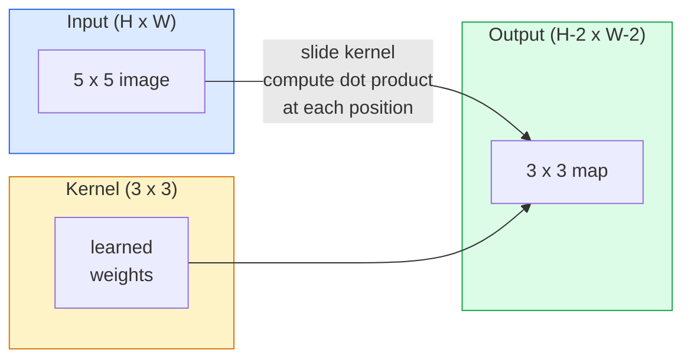
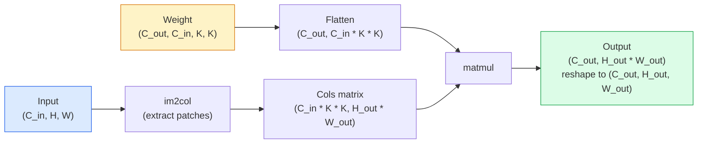

# Convolutions from Scratch · 从零实现卷积

> A convolution is a tiny dense layer you slide across an image, sharing the same weights at every location.

**Type:** Build
**Languages:** Python
**Prerequisites:** Phase 3 (Deep Learning Core), Phase 4 Lesson 01 (Image Fundamentals)
**Time:** ~75 minutes

## Learning Objectives · 学习目标

- 只用 NumPy 从零实现 2D 卷积，包括嵌套循环版和向量化的 `im2col` 版
- 对输入尺寸、核尺寸、填充、步长的任意组合计算输出空间尺寸，并能推导 `(H - K + 2P) / S + 1` 公式
- 手工设计卷积核（边缘、模糊、锐化、Sobel），并解释每个核为什么产生它那样的激活图样
- 把卷积堆叠成特征提取器，并把堆叠深度与感受野大小联系起来

> Implement 2D convolution from scratch using only NumPy, including the nested-loop version and a vectorised `im2col` version
> Compute output spatial size for any combination of input size, kernel size, padding, and stride, and justify the `(H - K + 2P) / S + 1` formula
> Hand-design kernels (edge, blur, sharpen, Sobel) and explain why each one produces the pattern of activations it does
> Stack convolutions into a feature extractor and connect the depth-of-the-stack to the size of the receptive field

## The Problem · 问题在哪

在 224x224 的 RGB 图像上，一个全连接层的每个神经元需要 224 * 224 * 3 = 150,528 个输入权重。一个 1,000 单元的隐藏层就已经 1.5 亿参数——这还是在你学到任何有用东西之前。更糟的是，这一层完全不知道左上角的狗和右下角的狗是同一个模式。它把每个像素位置当成独立的，这对图像来说是错得离谱：把猫平移三个像素，不该逼网络重学这个概念。

图像模型需要的两个性质是**平移等变性（translation equivariance）**（输入平移，输出跟着平移）和**参数共享（parameter sharing）**（同一个特征检测器到处复用）。稠密层一样都给不了。卷积两样白送。

卷积不是为深度学习发明的。驱动 JPEG 压缩、Photoshop 里的高斯模糊、工业视觉的边缘检测、以及有史以来所有音频滤波器的，正是同一个操作。CNN 能在 2012 到 2020 年统治 ImageNet，是因为对于「相邻取值相关、同一模式可以出现在任何地方」的数据，卷积就是正确的先验。

> A fully connected layer on a 224x224 RGB image would need 224 * 224 * 3 = 150,528 input weights per neuron. A single hidden layer with 1,000 units is already 150 million parameters — before you have learnt anything useful. Worse, that layer has no notion that a dog in the top-left and a dog in the bottom-right are the same pattern. It treats every pixel position as independent, which is exactly wrong for images: translating a cat by three pixels should not force the network to relearn the concept.
> The two properties an image model needs are translation equivariance (the output shifts when the input shifts) and parameter sharing (the same feature detector runs everywhere). Dense layers give you neither. Convolution gives you both for free.
> The reason CNNs dominated ImageNet from 2012 to 2020 is that convolution is the correct prior for data where nearby values are related and the same pattern can appear anywhere.

## The Concept · 概念

### One kernel, sliding · 一个核，滑过去

2D 卷积取一个小权重矩阵——叫做核（kernel）或滤波器（filter）——在输入上滑动，在每个位置计算逐元素乘积的和。这个和成为一个输出像素。



一个 5x5 输入上的具体 3x3 例子（无填充，步长 1）：

```
Input X (5 x 5):                Kernel W (3 x 3):

  1  2  0  1  2                   1  0 -1
  0  1  3  1  0                   2  0 -2
  2  1  0  2  1                   1  0 -1
  1  0  2  1  3
  2  1  1  0  1

The kernel slides across every valid 3 x 3 window. Output Y is 3 x 3:

 Y[0,0] = sum( W * X[0:3, 0:3] )
 Y[0,1] = sum( W * X[0:3, 1:4] )
 Y[0,2] = sum( W * X[0:3, 2:5] )
 Y[1,0] = sum( W * X[1:4, 0:3] )
 ... and so on
```

就这一个公式——**共享权重、局部性、滑动窗口**——就是全部思想。其余都是簿记工作。

> A 2D convolution takes a small weight matrix called the kernel (or filter), slides it across the input, and at each location computes the sum of element-wise products. That sum becomes one output pixel.
> That one formula — shared weights, locality, sliding window — is the entire idea. Everything else is bookkeeping.

### Output size formula · 输出尺寸公式

给定输入空间尺寸 `H`、核尺寸 `K`、填充 `P`、步长 `S`：

```
H_out = floor( (H - K + 2P) / S ) + 1
```

把它背下来。每个架构你都要算上几十次。

| 场景 | H | K | P | S | H_out |
|----------|---|---|---|---|-------|
| 有效卷积，无填充 | 32 | 3 | 0 | 1 | 30 |
| same 卷积（保持尺寸） | 32 | 3 | 1 | 1 | 32 |
| 2 倍下采样 | 32 | 3 | 1 | 2 | 16 |
| 2x2 池化 | 32 | 2 | 0 | 2 | 16 |
| 大感受野 | 32 | 7 | 3 | 2 | 16 |

「same 填充」指的是选一个 P，使得 S == 1 时 H_out == H。对奇数 K，就是 P = (K - 1) / 2。这就是 3x3 核统治一切的原因——它是仍然有「中心」的最小奇数核。

> Memorise this. You will compute it dozens of times per architecture.
> "Same padding" means pick P so that H_out == H when S == 1. For odd K, that is P = (K - 1) / 2. That is why 3x3 kernels dominate — they are the smallest odd kernel that still has a centre.

### Padding · 填充

没有填充，每次卷积都会缩小特征图。叠 20 层，你的 224x224 图像变成 184x184，既在边界上浪费算力，也让需要形状匹配的残差连接变复杂。

```
Zero padding (P = 1) on a 5 x 5 input:

  0  0  0  0  0  0  0
  0  1  2  0  1  2  0
  0  0  1  3  1  0  0
  0  2  1  0  2  1  0       Now the kernel can centre on pixel
  0  1  0  2  1  3  0       (0, 0) and still have three rows and
  0  2  1  1  0  1  0       three columns of values to multiply.
  0  0  0  0  0  0  0
```

实践中会遇到的模式：`zero`（最常见）、`reflect`（镜像边缘，在生成模型里避免硬边框）、`replicate`（复制边缘）、`circular`（环绕，用于环面问题）。

> Without padding, every convolution shrinks the feature map. Stack 20 of them and your 224x224 image becomes 184x184, which wastes compute on the border and complicates residual connections that need matching shapes.
> Modes you meet in practice: `zero` (most common), `reflect` (mirror the edge, avoids hard borders in generative models), `replicate` (copy the edge), `circular` (wrap around, used in toroidal problems).

### Stride · 步长

步长就是滑动的步幅。`stride=1` 是默认值。`stride=2` 让空间尺寸减半，是在 CNN 内部不靠独立池化层就完成下采样的经典方式——每个现代架构（ResNet、ConvNeXt、MobileNet）都在某处用带步长的卷积替代了 max-pool。

```
Stride 1 on a 5 x 5 input, 3 x 3 kernel:

  starts: (0,0) (0,1) (0,2)        -> output row 0
          (1,0) (1,1) (1,2)        -> output row 1
          (2,0) (2,1) (2,2)        -> output row 2

  Output: 3 x 3

Stride 2 on the same input:

  starts: (0,0) (0,2)              -> output row 0
          (2,0) (2,2)              -> output row 1

  Output: 2 x 2
```

> Stride is the step size of the slide. `stride=1` is the default. `stride=2` halves the spatial dimensions and is the classic way to downsample inside a CNN without a separate pooling layer — every modern architecture (ResNet, ConvNeXt, MobileNet) uses strided convs in place of max-pool somewhere.

### Multiple input channels · 多输入通道

真实图像有三个通道。RGB 输入上的 3x3 卷积实际上是一个 3x3x3 的体积：每个输入通道一个 3x3 切片。在每个空间位置，你对全部三个切片做乘法求和，再加一个偏置。

```
Input:   (C_in,  H,  W)        3 x 5 x 5
Kernel:  (C_in,  K,  K)        3 x 3 x 3 (one kernel)
Output:  (1,     H', W')       2D map

For a layer that produces C_out output channels, you stack C_out kernels:

Weight:  (C_out, C_in, K, K)   e.g. 64 x 3 x 3 x 3
Output:  (C_out, H', W')       64 x 3 x 3

Parameter count: C_out * C_in * K * K + C_out   (the + C_out is biases)
```

最后那一行就是你规划模型时要算的东西。3 通道输入上的 64 通道 3x3 卷积有 `64 * 3 * 3 * 3 + 64 = 1,792` 个参数。便宜。

> Real images have three channels. A 3x3 convolution on an RGB input is actually a 3x3x3 volume: one 3x3 slice per input channel. At each spatial position, you multiply and sum across all three slices and add a bias.
> That last line is the one you will calculate when planning a model. A 64-channel 3x3 conv on a 3-channel input has `64 * 3 * 3 * 3 + 64 = 1,792` parameters. Cheap.

### The im2col trick · im2col 技巧

嵌套循环好读但慢。GPU 要的是大矩阵乘法。技巧是：把输入的每个感受野窗口展平成大矩阵的一列，把核展平成一行，整个卷积就变成了一个 matmul。



每个生产级卷积实现都是这个方案的某种变体，再加上缓存分块技巧（direct conv、Winograd、大核用的 FFT conv）。理解了 im2col，你就理解了核心。

> Nested loops are easy to read but slow. GPUs want big matrix multiplies. The trick: flatten every receptive-field window of the input into one column of a big matrix, flatten the kernel into a row, and the whole convolution becomes a single matmul.
> Every production conv implementation is some variant of this plus cache-tiling tricks (direct conv, Winograd, FFT conv for large kernels). Understand im2col and you understand the core.

### Receptive field · 感受野

单个 3x3 卷积看 9 个输入像素。叠两个 3x3 卷积，第二层的神经元看 5x5 个输入像素。三个 3x3 卷积给 7x7。一般地：

```
RF after L stacked K x K convs (stride 1) = 1 + L * (K - 1)

With strides:   RF grows multiplicatively with stride along each layer.
```

「一路 3x3 到底」能成立（VGG、ResNet、ConvNeXt），全部原因就是：两个 3x3 卷积与一个 5x5 卷积看到同样的输入区域，但参数更少，中间还多了一次非线性。

```figure
convolution-kernel
```

> A single 3x3 conv looks at 9 input pixels. Stack two 3x3 convs and a neuron in the second layer looks at 5x5 input pixels. Three 3x3 convs give 7x7.
> The entire reason "3x3 all the way down" works (VGG, ResNet, ConvNeXt) is that two 3x3 convs see the same input area as one 5x5 conv but with fewer parameters and an extra non-linearity in between.

## Build It · 动手造

### Step 1: Pad an array · 第 1 步：给数组填充

从最小的原语开始：一个给 H x W 数组周围补零的函数。

```python
import numpy as np

def pad2d(x, p):
    if p == 0:
        return x
    h, w = x.shape[-2:]
    out = np.zeros(x.shape[:-2] + (h + 2 * p, w + 2 * p), dtype=x.dtype)
    out[..., p:p + h, p:p + w] = x
    return out

x = np.arange(9).reshape(3, 3)
print(x)
print()
print(pad2d(x, 1))
```

尾轴技巧 `x.shape[:-2]` 意味着同一个函数不加修改就能用于 `(H, W)`、`(C, H, W)` 或 `(N, C, H, W)`。

> Start with the smallest primitive: a function that pads with zeros around an H x W array.
> The trailing-axes trick `x.shape[:-2]` means the same function works on `(H, W)`, `(C, H, W)`, or `(N, C, H, W)` without modification.

### Step 2: 2D convolution with nested loops · 第 2 步：嵌套循环版 2D 卷积

参考实现——慢，但毫无歧义。这就是 `torch.nn.functional.conv2d` 原则上在做的事。

```python
def conv2d_naive(x, w, b=None, stride=1, padding=0):
    c_in, h, w_in = x.shape
    c_out, c_in_w, kh, kw = w.shape
    assert c_in == c_in_w

    x_pad = pad2d(x, padding)
    h_out = (h + 2 * padding - kh) // stride + 1
    w_out = (w_in + 2 * padding - kw) // stride + 1

    out = np.zeros((c_out, h_out, w_out), dtype=np.float32)
    for oc in range(c_out):
        for i in range(h_out):
            for j in range(w_out):
                hs = i * stride
                ws = j * stride
                patch = x_pad[:, hs:hs + kh, ws:ws + kw]
                out[oc, i, j] = np.sum(patch * w[oc])
        if b is not None:
            out[oc] += b[oc]
    return out
```

四层嵌套循环（输出通道、行、列，外加对 C_in、kh、kw 的隐式求和）。这是你用来校验每个更快实现的基准真值。

> The reference implementation — slow, but unambiguous. This is what `torch.nn.functional.conv2d` does in principle.
> Four nested loops (output channel, row, column, plus the implicit sum over C_in, kh, kw). This is the ground truth you will check every faster implementation against.

### Step 3: Verify with a hand-designed kernel · 第 3 步：用手工设计的核验证

构造一个垂直 Sobel 核，应用到合成阶跃图像上，看着垂直边缘亮起来。

```python
def synthetic_step_image():
    img = np.zeros((1, 16, 16), dtype=np.float32)
    img[:, :, 8:] = 1.0
    return img

sobel_x = np.array([
    [[-1, 0, 1],
     [-2, 0, 2],
     [-1, 0, 1]]
], dtype=np.float32)[None]

x = synthetic_step_image()
y = conv2d_naive(x, sobel_x, padding=1)
print(y[0].round(1))
```

期望在第 7 列看到大的正值（亮度从左到右增加），其他地方全为 0。那一次打印就是你确认数学没错的 sanity check。

> Build a vertical Sobel kernel, apply it to a synthetic step image, and watch the vertical edge light up.
> Expect large positive values on column 7 (left-to-right brightness increase) and zeros everywhere else. That single print is your sanity check that the math is right.

### Step 4: im2col · 第 4 步：im2col

把输入中每个核大小的窗口变成矩阵的一列。对 `C_in=3, K=3`，每列是 27 个数。

```python
def im2col(x, kh, kw, stride=1, padding=0):
    c_in, h, w = x.shape
    x_pad = pad2d(x, padding)
    h_out = (h + 2 * padding - kh) // stride + 1
    w_out = (w + 2 * padding - kw) // stride + 1

    cols = np.zeros((c_in * kh * kw, h_out * w_out), dtype=x.dtype)
    col = 0
    for i in range(h_out):
        for j in range(w_out):
            hs = i * stride
            ws = j * stride
            patch = x_pad[:, hs:hs + kh, ws:ws + kw]
            cols[:, col] = patch.reshape(-1)
            col += 1
    return cols, h_out, w_out
```

它仍是 Python 循环，但从此重活将交给一次向量化的 matmul。

> Convert every kernel-sized window in the input into a column of a matrix. For `C_in=3, K=3`, each column is 27 numbers.
> It is still a Python loop, but now the heavy lifting will be a single vectorised matmul.

### Step 5: Fast conv via im2col + matmul · 第 5 步：im2col + matmul 的快速卷积

用一次矩阵乘法替换四重循环。

```python
def conv2d_im2col(x, w, b=None, stride=1, padding=0):
    c_out, c_in, kh, kw = w.shape
    cols, h_out, w_out = im2col(x, kh, kw, stride, padding)
    w_flat = w.reshape(c_out, -1)
    out = w_flat @ cols
    if b is not None:
        out += b[:, None]
    return out.reshape(c_out, h_out, w_out)
```

正确性检查：跑两个实现并对比。

```python
rng = np.random.default_rng(0)
x = rng.normal(0, 1, (3, 16, 16)).astype(np.float32)
w = rng.normal(0, 1, (8, 3, 3, 3)).astype(np.float32)
b = rng.normal(0, 1, (8,)).astype(np.float32)

y_naive = conv2d_naive(x, w, b, padding=1)
y_im2col = conv2d_im2col(x, w, b, padding=1)

print(f"max abs diff: {np.max(np.abs(y_naive - y_im2col)):.2e}")
```

`max abs diff` 应该在 `1e-5` 附近——差别来自浮点累加顺序，不是 bug。

> Replace the quadruple loop with one matrix multiplication.
> Correctness check: run both implementations and compare.
> `max abs diff` should be around `1e-5` — the difference is floating-point accumulation order, not a bug.

### Step 6: A bank of hand-designed kernels · 第 6 步：一组手工设计的核

五个滤波器，展示单个卷积层在任何训练之前能表达什么。

```python
KERNELS = {
    "identity": np.array([[0, 0, 0], [0, 1, 0], [0, 0, 0]], dtype=np.float32),
    "blur_3x3": np.ones((3, 3), dtype=np.float32) / 9.0,
    "sharpen": np.array([[0, -1, 0], [-1, 5, -1], [0, -1, 0]], dtype=np.float32),
    "sobel_x": np.array([[-1, 0, 1], [-2, 0, 2], [-1, 0, 1]], dtype=np.float32),
    "sobel_y": np.array([[-1, -2, -1], [0, 0, 0], [1, 2, 1]], dtype=np.float32),
}

def apply_kernel(img2d, kernel):
    x = img2d[None].astype(np.float32)
    w = kernel[None, None]
    return conv2d_im2col(x, w, padding=1)[0]
```

应用到任何灰度图像上：blur 变柔和，sharpen 让边缘变锐利，Sobel-x 点亮垂直边缘，Sobel-y 点亮水平边缘。这些恰恰是 AlexNet 和 VGG 里*第一个*训练出来的卷积层最终学到的模式——因为无论后面接什么任务，好的图像模型都需要边缘和斑块检测器。

> Five filters that show what a single conv layer can express before any training.
> Applied to any grayscale image, blur softens, sharpen crisps up edges, Sobel-x lights up vertical edges, Sobel-y lights up horizontal edges. These are exactly the patterns that the *first* trained conv layer in AlexNet and VGG ended up learning — because a good image model needs edge and blob detectors no matter what task comes later.

## Use It · 实战用法

PyTorch 的 `nn.Conv2d` 把同一个操作包上了 autograd、CUDA kernel 和 cuDNN 优化。形状语义完全一致。

```python
import torch
import torch.nn as nn

conv = nn.Conv2d(in_channels=3, out_channels=64, kernel_size=3, stride=1, padding=1)
print(conv)
print(f"weight shape: {tuple(conv.weight.shape)}   # (C_out, C_in, K, K)")
print(f"bias shape:   {tuple(conv.bias.shape)}")
print(f"param count:  {sum(p.numel() for p in conv.parameters())}")

x = torch.randn(8, 3, 224, 224)
y = conv(x)
print(f"\ninput  shape: {tuple(x.shape)}")
print(f"output shape: {tuple(y.shape)}")
```

把 `padding=1` 换成 `padding=0`，输出掉到 222x222。把 `stride=1` 换成 `stride=2`，输出掉到 112x112。还是你上面背过的那个公式。

> PyTorch's `nn.Conv2d` wraps the same operation with autograd, CUDA kernels, and cuDNN optimisation. Shape semantics are identical.
> Swap `padding=1` for `padding=0` and the output drops to 222x222. Swap `stride=1` for `stride=2` and it drops to 112x112. Same formula you memorised above.

## Ship It · 交付

本课产出：

- `outputs/prompt-cnn-architect.md` —— 一个提示词：给定输入尺寸、参数预算和目标感受野，设计每一步 K/S/P 都正确的 `Conv2d` 层堆叠。
- `outputs/skill-conv-shape-calculator.md` —— 一个技能：逐层走一遍网络规格，返回每个块的输出形状、感受野和参数量。

> This lesson produces:
> - `outputs/prompt-cnn-architect.md` — a prompt that, given input size, parameter budget, and target receptive field, designs a stack of `Conv2d` layers with the right K/S/P at every step.
> - `outputs/skill-conv-shape-calculator.md` — a skill that walks a network spec layer by layer and returns the output shape, receptive field, and parameter count for every block.

## Exercises · 练习

1. **（简单）** 给定 128x128 灰度输入和堆叠 `[Conv3x3(s=1,p=1), Conv3x3(s=2,p=1), Conv3x3(s=1,p=1), Conv3x3(s=2,p=1)]`，手算每层的输出空间尺寸和感受野。用 PyTorch `nn.Sequential` 搭哑卷积验证。
2. **（中等）** 给 `conv2d_naive` 和 `conv2d_im2col` 加一个 `groups` 参数。证明 `groups=C_in=C_out` 复现深度卷积（depthwise convolution），且其参数量是 `C * K * K` 而不是 `C * C * K * K`。
3. **（困难）** 手写 `conv2d_im2col` 的反向传播：给定输出的梯度，算出 `x` 和 `w` 的梯度。在相同输入和权重上与 `torch.autograd.grad` 对拍。诀窍：im2col 的梯度是 `col2im`，而且必须累积重叠的窗口。

## Key Terms · 术语表

| 术语 | 人们怎么说 | 它实际是什么意思 |
|------|----------------|----------------------|
| Convolution（卷积） | 「滑动一个滤波器」 | 在每个空间位置以共享权重施用的可学习点积；数学上是互相关（cross-correlation），但所有人都叫它卷积 |
| Kernel / filter（核/滤波器） | 「特征检测器」 | 形状为 (C_in, K, K) 的小权重张量，与一个输入窗口做点积产生一个输出像素 |
| Stride（步长） | 「你跳多远」 | 相邻两次核放置之间的步幅；stride 2 让每个空间维度减半 |
| Padding（填充） | 「边缘补零」 | 在输入周围添加的额外值，让核能以边界像素为中心；`same` 填充保持输出尺寸等于输入尺寸 |
| Receptive field（感受野） | 「这个神经元能看多大」 | 某个输出激活所依赖的原始输入区域，随深度和步长增长 |
| im2col | 「GEMM 技巧」 | 把每个感受野窗口重排成列，让卷积变成一次大矩阵乘法——所有快速卷积核的核心 |
| Depthwise conv（深度卷积） | 「每个通道一个核」 | `groups == C_in` 的卷积，每个输出通道只由其对应的输入通道算出；MobileNet 和 ConvNeXt 的骨干 |
| Translation equivariance（平移等变性） | 「进多少移，出多少移」 | 输入平移 k 像素则输出平移 k 像素的性质；共享权重免费送 |

## Further Reading · 延伸阅读

- [A guide to convolution arithmetic for deep learning (Dumoulin & Visin, 2016)](https://arxiv.org/abs/1603.07285) —— 那些每门课都在悄悄照抄的 padding/stride/dilation 权威图示
- [CS231n: Convolutional Neural Networks for Visual Recognition](https://cs231n.github.io/convolutional-networks/) —— 经典讲义，包括 im2col 的原始讲解
- [The Annotated ConvNet (fast.ai)](https://nbviewer.org/github/fastai/fastbook/blob/master/13_convolutions.ipynb) —— 从手工卷积一路走到训练好的数字分类器的 notebook
- [Receptive Field Arithmetic for CNNs (Dang Ha The Hien)](https://distill.pub/2019/computing-receptive-fields/) —— 感受野计算的论文级交互式讲解
