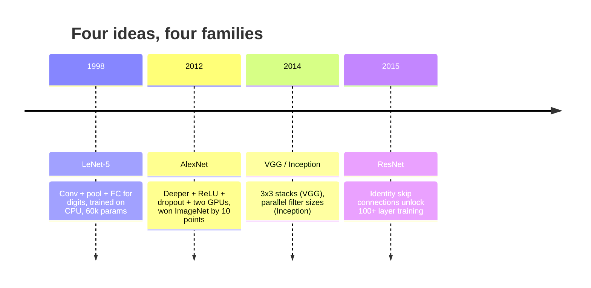
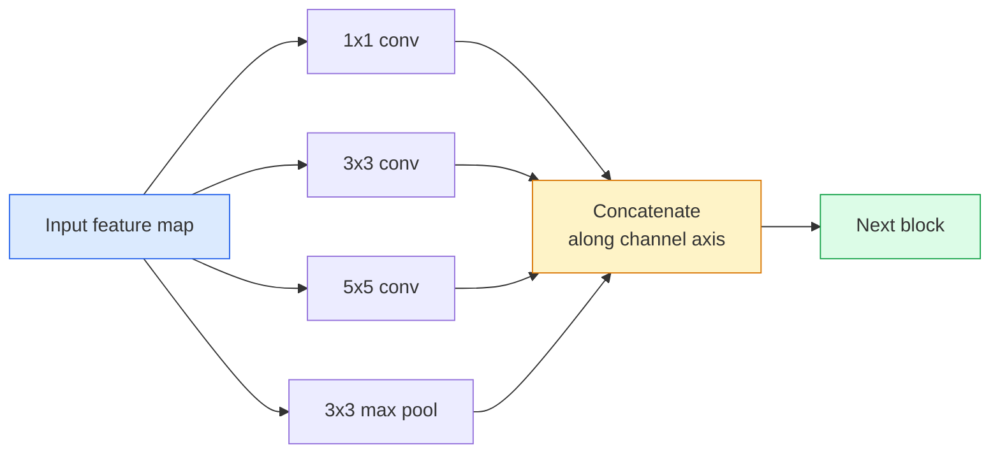
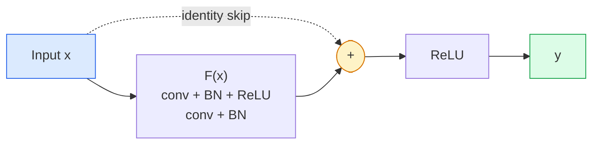

# CNNs — LeNet to ResNet · CNN：从 LeNet 到 ResNet

> Every major CNN of the last thirty years is the same conv–nonlinearity–downsample recipe with one new idea bolted on. Learn the ideas in order.

**Type:** Learn + Build
**Languages:** Python
**Prerequisites:** Phase 3 Lesson 11 (PyTorch), Phase 4 Lesson 01 (Image Fundamentals), Phase 4 Lesson 02 (Convolutions from Scratch)
**Time:** ~75 minutes

## Learning Objectives · 学习目标

- 梳理 LeNet-5 -> AlexNet -> VGG -> Inception -> ResNet 的架构谱系，说出每个家族贡献的那一个新想法
- 用 PyTorch 实现 LeNet-5、一个 VGG 风格的块和一个 ResNet BasicBlock，每个不超过 40 行
- 解释残差连接为什么能把 1,000 层网络从训不动变成最先进
- 读懂现代骨干网络（ResNet-18、ResNet-50），在看源码之前预测它的输出形状、感受野和参数量

> Trace the architectural lineage LeNet-5 -> AlexNet -> VGG -> Inception -> ResNet and state the single new idea each family contributed
> Implement LeNet-5, a VGG-style block, and a ResNet BasicBlock in PyTorch, each under 40 lines
> Explain why residual connections turn a 1,000-layer network from untrainable into state-of-the-art
> Read a modern backbone (ResNet-18, ResNet-50) and predict its output shape, receptive field, and parameter count before looking at the source

## The Problem · 问题在哪

2011 年，最好的 ImageNet 分类器 top-5 准确率约 74%。2012 年 AlexNet 拿到 85%。2015 年 ResNet 拿到 96%。没有新数据，没有新 GPU 世代。增益全部来自架构思想。一个职业视觉工程师必须知道哪个思想出自哪篇论文，因为你在 2026 年交付的每个生产级骨干都是这些同样部件的重新组合——而且这些思想还在不断迁移：分组卷积从 CNN 走向 transformer，残差连接从 ResNet 走进现存的所有 LLM，批归一化活在扩散模型里。

按顺序研究这些网络还能让你对一种常见错误免疫：明明一个 LeNet 尺寸的网络就能解决问题，却伸手去抓最大的现成模型。MNIST 不需要 ResNet。知道每个家族的缩放曲线，你才知道自己该坐在曲线上的哪个位置。

> In 2011, the best ImageNet classifier scored around 74% top-5 accuracy. In 2012 AlexNet scored 85%. In 2015 ResNet scored 96%. No new data. No new GPU generation. The gains came from architecture ideas. A working vision engineer has to know which idea came from which paper because every production backbone you ship in 2026 is a recombination of those same pieces — and because the ideas keep transferring: grouped convs went from CNNs to transformers, residual connections went from ResNet to every LLM in existence, batch normalisation lives in diffusion models.
> Studying these networks in order also immunises you against a common mistake: reaching for the biggest available model when a LeNet-sized network would solve the problem. MNIST does not need a ResNet. Knowing the scaling curve of each family tells you where to sit on it.

## The Concept · 概念

### The four ideas that changed vision · 改变视觉的四个思想



古典视觉里，再没有别的跳跃比这四次更重要。

> Nothing else in classical vision mattered as much as these four jumps.

### LeNet-5 (1998) · LeNet-5（1998 年）

Yann LeCun 的数字识别器。6 万参数。两个卷积-池化块、两个全连接层、tanh 激活。它定义了每个 CNN 都继承的模板：

```
input (1, 32, 32)
  conv 5x5 -> (6, 28, 28)
  avg pool 2x2 -> (6, 14, 14)
  conv 5x5 -> (16, 10, 10)
  avg pool 2x2 -> (16, 5, 5)
  flatten -> 400
  dense -> 120
  dense -> 84
  dense -> 10
```

现代世界称为 CNN 的一切——交替的卷积与下采样、后面接一个小分类头——就是层数更多、通道更宽、激活更好的 LeNet。

> Yann LeCun's digit recogniser. 60,000 parameters. Two conv-pool blocks, two fully connected layers, tanh activations. It defined the template every CNN inherits.
> Everything the modern world calls a CNN — alternating convolutions and downsampling feeding a small classifier head — is LeNet with more layers, bigger channels, and better activations.

### AlexNet (2012) · AlexNet（2012 年）

三个改动合在一起掀翻了 ImageNet：

1. 用 **ReLU** 换掉 tanh。梯度不再消失。训练提速六倍。
2. 全连接头里的 **Dropout**。正则化变成一层，而不是一个技巧。
3. **深度与宽度**。五个卷积层、三个稠密层、6000 万参数，模型切开分到两块 GPU 上训练。

论文的图 2 至今仍把 GPU 拆分画成两条并行流。那种并行是硬件上的权宜之计，不是架构洞见——但上面三个思想仍然存在于你用的每个模型里。

> Three changes that together broke ImageNet:
> 1. ReLU instead of tanh. Gradients stop vanishing. Training speeds up by a factor of six.
> 2. Dropout in the fully connected head. Regularisation becomes a layer, not a trick.
> 3. Depth and width. Five conv layers, three dense layers, 60M parameters, trained on two GPUs with the model split across them.
> The paper's Figure 2 still shows the GPU split as two parallel streams. That parallelism was a hardware workaround, not an architectural insight — but the three ideas above are still in every model you use.

### VGG (2014) · VGG（2014 年）

VGG 问的是：如果只用 3x3 卷积、并且往深里堆，会怎样？

```
stack:   conv 3x3 -> conv 3x3 -> pool 2x2
repeat:  16 or 19 conv layers
```

两个 3x3 卷积与一个 5x5 卷积看到同样的 5x5 输入区域，但参数更少（2*9*C^2 = 18C^2 vs 25*C^2），中间还多一个 ReLU。VGG 把这条观察变成了整个架构。这种简单——一种块类型，不断重复——让它成为后来一切的参照点。

代价：1.38 亿参数，训练慢，推理贵。

> VGG asked: what happens if you only use 3x3 convolutions and you go deep?
> Two 3x3 convs see the same 5x5 input area as one 5x5 conv but with fewer parameters (2*9*C^2 = 18C^2 vs 25*C^2) and an extra ReLU in between. VGG turned this observation into an entire architecture. The simplicity — one block type, repeated — made it the reference point for everything that came after.
> Cost: 138M parameters, slow to train, expensive at inference.

### Inception (2014, same year) · Inception（同年 2014）

Google 对「我该用什么核尺寸？」的回答是：全都要，并行。



每个分支各有所长——1x1 管通道混合，3x3 管局部纹理，5x5 管更大的模式，池化管平移不变特征——拼接（concat）让下一层自己挑有用的分支。Inception v1 在每个分支内部用 1x1 卷积做瓶颈，把参数量压在合理范围。

> Google's answer to "what kernel size should I use?" was: all of them, in parallel.
> Each branch specialises — 1x1 for channel mixing, 3x3 for local texture, 5x5 for larger patterns, pooling for shift-invariant features — and the concat lets the next layer pick whichever branch is useful. Inception v1 used 1x1 convolutions inside each branch as a bottleneck to keep parameter counts sane.

### The degradation problem · 退化问题

到 2015 年，VGG-19 能训出来，VGG-32 不行。深度本来应该有帮助，但过了约 20 层，训练损失和测试损失一起变差。这不是过拟合。这是优化器找不到有用的权重，因为梯度在每一层都被乘法式地缩小。

```
Plain deep network:
  y = f_L( f_{L-1}( ... f_1(x) ... ) )

Gradient wrt early layer:
  dL/dW_1 = dL/dy * df_L/df_{L-1} * ... * df_2/df_1 * df_1/dW_1

Each multiplicative term has magnitude roughly (weight magnitude) * (activation gain).
Stack 100 of them with gains < 1 and the gradient is effectively zero.
```

VGG 在 19 层能工作，是因为批归一化（batch norm，同期发表）让激活值保持良好的尺度。但即便批归一化也救不动 30 层往上的深度。

> By 2015, VGG-19 worked and VGG-32 did not. Depth was supposed to help, but past ~20 layers both training and test loss got worse. That is not overfitting. That is the optimiser failing to find useful weights because gradients shrink multiplicatively through every layer.
> VGG worked at 19 layers because batch norm (published simultaneously) kept activations well-scaled. But even batch norm could not rescue depth beyond 30-ish layers.

### ResNet (2015) · ResNet（2015 年）

He、Zhang、Ren、Sun 提出了一个修好一切的改动：

```
standard block:   y = F(x)
residual block:   y = F(x) + x
```

`+ x` 意味着这一层永远可以选择什么都不做——只要把 `F(x)` 压到零。1,000 层的 ResNet 至多和 1 层网络一样差，因为每个额外的块都有一个平凡的逃生通道。有了这个保证，优化器才愿意让每个块都*略微*有用——略微有用堆上 100 次，就是最先进。



这个块的两种变体无处不在：

- **BasicBlock**（ResNet-18、ResNet-34）：两个 3x3 卷积，skip 跳过两者。
- **Bottleneck**（ResNet-50、-101、-152）：1x1 降维、3x3 居中、1x1 升维，skip 跳过这三件套。通道数大时更便宜。

当 skip 必须跨越下采样（stride=2）时，恒等路径换成一个 stride=2 的 1x1 卷积来对齐形状。

> He, Zhang, Ren, Sun proposed one change that fixed everything.
> The `+ x` means the layer can always choose to do nothing by driving `F(x)` to zero. A 1,000-layer ResNet is now at most as bad as a 1-layer network, because every extra block has a trivial escape hatch. With that guarantee, the optimiser is willing to make every block *slightly* useful — and slightly useful, stacked 100 times, is state-of-the-art.
> Two variants of the block show up everywhere.
> When the skip has to cross a downsample (stride=2), the identity path is replaced with a 1x1 stride=2 conv to match shapes.

### Why residuals matter beyond vision · 残差为何在视觉之外也重要

这个思想其实无关图像分类。它关乎把深度网络从「祈求梯度活下来」变成可靠、可扩展的工程工具。下一阶段你要读的每个 transformer，每个块里都有这条一模一样的 skip connection。没有 ResNet，就没有 GPT。

```figure
pooling
```

> The idea was not really about image classification. It was about turning deep networks from "cross-your-fingers and hope gradients survive" into a reliable, scalable engineering tool. Every transformer you will read about next phase has the exact same skip connection in every block. Without ResNet, there is no GPT.

## Build It · 动手造

### Step 1: LeNet-5 · 第 1 步：LeNet-5

一个极简而忠实的 LeNet。tanh 激活、平均池化。唯一向现代妥协的地方，是下游用 `nn.CrossEntropyLoss` 而不是原始的高斯连接。

```python
import torch
import torch.nn as nn
import torch.nn.functional as F

class LeNet5(nn.Module):
    def __init__(self, num_classes=10):
        super().__init__()
        self.conv1 = nn.Conv2d(1, 6, kernel_size=5)
        self.conv2 = nn.Conv2d(6, 16, kernel_size=5)
        self.pool = nn.AvgPool2d(2)
        self.fc1 = nn.Linear(16 * 5 * 5, 120)
        self.fc2 = nn.Linear(120, 84)
        self.fc3 = nn.Linear(84, num_classes)

    def forward(self, x):
        x = self.pool(torch.tanh(self.conv1(x)))
        x = self.pool(torch.tanh(self.conv2(x)))
        x = torch.flatten(x, 1)
        x = torch.tanh(self.fc1(x))
        x = torch.tanh(self.fc2(x))
        return self.fc3(x)

net = LeNet5()
x = torch.randn(1, 1, 32, 32)
print(f"output: {net(x).shape}")
print(f"params: {sum(p.numel() for p in net.parameters()):,}")
```

期望输出：`output: torch.Size([1, 10])`、`params: 61,706`。这就是开启现代视觉的那整个数字分类器。

> A minimal, faithful LeNet. Tanh activations, average pooling. The only concession to modernity is that we use `nn.CrossEntropyLoss` downstream instead of the original Gaussian connections.
> Expected output: `output: torch.Size([1, 10])`, `params: 61,706`. That is the entire digit classifier that started modern vision.

### Step 2: A VGG block · 第 2 步：一个 VGG 块

一个可复用的块：两个 3x3 卷积、ReLU、批归一化、max pool。

```python
class VGGBlock(nn.Module):
    def __init__(self, in_c, out_c):
        super().__init__()
        self.conv1 = nn.Conv2d(in_c, out_c, kernel_size=3, padding=1)
        self.bn1 = nn.BatchNorm2d(out_c)
        self.conv2 = nn.Conv2d(out_c, out_c, kernel_size=3, padding=1)
        self.bn2 = nn.BatchNorm2d(out_c)
        self.pool = nn.MaxPool2d(2)

    def forward(self, x):
        x = F.relu(self.bn1(self.conv1(x)))
        x = F.relu(self.bn2(self.conv2(x)))
        return self.pool(x)

class MiniVGG(nn.Module):
    def __init__(self, num_classes=10):
        super().__init__()
        self.stack = nn.Sequential(
            VGGBlock(3, 32),
            VGGBlock(32, 64),
            VGGBlock(64, 128),
        )
        self.head = nn.Sequential(
            nn.AdaptiveAvgPool2d(1),
            nn.Flatten(),
            nn.Linear(128, num_classes),
        )

    def forward(self, x):
        return self.head(self.stack(x))

net = MiniVGG()
x = torch.randn(1, 3, 32, 32)
print(f"output: {net(x).shape}")
print(f"params: {sum(p.numel() for p in net.parameters()):,}")
```

CIFAR 尺寸输入上的三个 VGG 块、一个自适应池化、一个线性层。约 29 万参数。对 CIFAR-10 足够了。

> One reusable block: two 3x3 convs, ReLU, batch norm, max pool.
> Three VGG blocks on CIFAR-sized input, an adaptive pool, one linear layer. ~290k parameters. Plenty for CIFAR-10.

### Step 3: A ResNet BasicBlock · 第 3 步：ResNet BasicBlock

ResNet-18 和 ResNet-34 的核心构件。

```python
class BasicBlock(nn.Module):
    def __init__(self, in_c, out_c, stride=1):
        super().__init__()
        self.conv1 = nn.Conv2d(in_c, out_c, kernel_size=3, stride=stride, padding=1, bias=False)
        self.bn1 = nn.BatchNorm2d(out_c)
        self.conv2 = nn.Conv2d(out_c, out_c, kernel_size=3, stride=1, padding=1, bias=False)
        self.bn2 = nn.BatchNorm2d(out_c)
        if stride != 1 or in_c != out_c:
            self.shortcut = nn.Sequential(
                nn.Conv2d(in_c, out_c, kernel_size=1, stride=stride, bias=False),
                nn.BatchNorm2d(out_c),
            )
        else:
            self.shortcut = nn.Identity()

    def forward(self, x):
        out = F.relu(self.bn1(self.conv1(x)))
        out = self.bn2(self.conv2(out))
        out = out + self.shortcut(x)
        return F.relu(out)
```

卷积层上的 `bias=False` 是批归一化的惯例——BN 的 beta 参数已经承担了偏置，再带一个 conv bias 是浪费。`shortcut` 只有在 stride 或通道数变化时才需要真正的卷积；否则它就是无操作的恒等映射。

> The core building block of ResNet-18 and ResNet-34.
> `bias=False` on conv layers is a batch-norm convention — BN's beta parameter already handles the bias, so carrying conv bias as well is a waste. The `shortcut` only needs a real conv when stride or channel count changes; otherwise it is a no-op identity.

### Step 4: A tiny ResNet · 第 4 步：一个小 ResNet

堆四组 BasicBlock，得到一个能在 CIFAR 尺寸输入上工作的 ResNet。

```python
class TinyResNet(nn.Module):
    def __init__(self, num_classes=10):
        super().__init__()
        self.stem = nn.Sequential(
            nn.Conv2d(3, 32, kernel_size=3, stride=1, padding=1, bias=False),
            nn.BatchNorm2d(32),
            nn.ReLU(inplace=True),
        )
        self.layer1 = self._make_group(32, 32, num_blocks=2, stride=1)
        self.layer2 = self._make_group(32, 64, num_blocks=2, stride=2)
        self.layer3 = self._make_group(64, 128, num_blocks=2, stride=2)
        self.layer4 = self._make_group(128, 256, num_blocks=2, stride=2)
        self.head = nn.Sequential(
            nn.AdaptiveAvgPool2d(1),
            nn.Flatten(),
            nn.Linear(256, num_classes),
        )

    def _make_group(self, in_c, out_c, num_blocks, stride):
        blocks = [BasicBlock(in_c, out_c, stride=stride)]
        for _ in range(num_blocks - 1):
            blocks.append(BasicBlock(out_c, out_c, stride=1))
        return nn.Sequential(*blocks)

    def forward(self, x):
        x = self.stem(x)
        x = self.layer1(x)
        x = self.layer2(x)
        x = self.layer3(x)
        x = self.layer4(x)
        return self.head(x)

net = TinyResNet()
x = torch.randn(1, 3, 32, 32)
print(f"output: {net(x).shape}")
print(f"params: {sum(p.numel() for p in net.parameters()):,}")
```

四组、每组两个块。第 2、3、4 组开头 stride 2。每次下采样通道数翻倍。约 280 万参数。这就是能干净地一路扩展到 ResNet-152 的标准配方。

> Stack four groups of BasicBlocks to get a working ResNet for CIFAR-sized inputs.
> Four groups of two blocks each. Stride 2 at the start of groups 2, 3, 4. Channel count doubles at every downsample. Roughly 2.8M parameters. That is the standard recipe that scales cleanly up to ResNet-152.

### Step 5: Compare parameter-to-feature efficiency · 第 5 步：比较参数到特征的效率

把同样的输入跑过三个网络，比较参数量。

```python
def summary(name, net, x):
    y = net(x)
    params = sum(p.numel() for p in net.parameters())
    print(f"{name:12s}  input {tuple(x.shape)} -> output {tuple(y.shape)}  params {params:>10,}")

x = torch.randn(1, 3, 32, 32)
summary("LeNet5",     LeNet5(),       torch.randn(1, 1, 32, 32))
summary("MiniVGG",    MiniVGG(),      x)
summary("TinyResNet", TinyResNet(),   x)
```

三个模型、三个时代、参数量差三个数量级。CIFAR-10 精度大致是：训练几个 epoch 后，LeNet 60%、MiniVGG 89%、TinyResNet 93%。

> Run the same input through all three networks and compare parameter counts.
> Three models, three eras, three orders of magnitude in parameter count. For CIFAR-10 accuracy, you need roughly: LeNet 60%, MiniVGG 89%, TinyResNet 93% after a few epochs of training.

## Use It · 实战用法

`torchvision.models` 提供上述所有网络的预训练版。各家的调用签名一致——这正是骨干抽象的意义所在。

```python
from torchvision.models import resnet18, ResNet18_Weights, vgg16, VGG16_Weights

r18 = resnet18(weights=ResNet18_Weights.IMAGENET1K_V1)
r18.eval()

print(f"ResNet-18 params: {sum(p.numel() for p in r18.parameters()):,}")
print(r18.layer1[0])
print()

v16 = vgg16(weights=VGG16_Weights.IMAGENET1K_V1)
v16.eval()
print(f"VGG-16   params: {sum(p.numel() for p in v16.parameters()):,}")
```

ResNet-18 有 1170 万参数。VGG-16 有 1.38 亿。ImageNet top-1 精度却相近（69.8% vs 71.6%）。残差连接带来 12 倍的参数效率优势。这就是 ResNet 变体从 2016 年统治到 2021 年 ViT 出现的原因——而且在算力受限的真实部署里，它们至今仍在统治。

迁移学习的配方永远一样：加载预训练、冻结骨干、替换分类头。

```python
for p in r18.parameters():
    p.requires_grad = False
r18.fc = nn.Linear(r18.fc.in_features, 10)
```

三行代码。你现在拥有一个 10 类 CIFAR 分类器，继承了 ImageNet 花大价钱买来的表示。

> `torchvision.models` gives you pretrained versions of all of the above. The call signature is identical across families, which is exactly the point of the backbone abstraction.
> ResNet-18 has 11.7M parameters. VGG-16 has 138M. Similar ImageNet top-1 accuracy (69.8% vs 71.6%). Residual connections buy you a 12x parameter efficiency win. That is why ResNet variants dominated from 2016 until ViT arrived in 2021 — and still dominate real-world deployments where compute is the constraint.
> For transfer learning, the recipe is always the same: load pretrained, freeze the backbone, replace the classifier head.
> Three lines. You now have a 10-class CIFAR classifier that inherits the representations ImageNet paid for.

## Ship It · 交付

本课产出：

- `outputs/prompt-backbone-selector.md` —— 一个提示词：给定任务、数据集规模和算力预算，挑出合适的 CNN 家族（LeNet/VGG/ResNet/MobileNet/ConvNeXt）。
- `outputs/skill-residual-block-reviewer.md` —— 一个技能：读 PyTorch 模块并标记 skip-connection 错误（stride 变化时缺 shortcut、shortcut 的激活顺序、BN 相对相加的位置）。

> This lesson produces:
> - `outputs/prompt-backbone-selector.md` — a prompt that picks the right CNN family (LeNet/VGG/ResNet/MobileNet/ConvNeXt) given task, dataset size, and compute budget.
> - `outputs/skill-residual-block-reviewer.md` — a skill that reads a PyTorch module and flags skip-connection mistakes (missing shortcut on stride change, shortcut activation order, BN placement relative to addition).

## Exercises · 练习

1. **（简单）** 手算 `TinyResNet` 的逐层参数量，与 `sum(p.numel() for p in net.parameters())` 对比。参数预算的大头去了哪里——卷积、BN 还是分类头？
2. **（中等）** 实现 Bottleneck 块（1x1 -> 3x3 -> 1x1 带 skip），用它搭一个 ResNet-50 风格的 CIFAR 网络。参数量与 `TinyResNet` 对比。
3. **（困难）** 去掉 `BasicBlock` 的 skip connection，在 CIFAR-10 上各训练 10 个 epoch 的 34 块「plain」网络和 34 块 ResNet，画出两者的训练损失对 epoch 的曲线。复现 He 等人图 1 的结果：plain 深网络收敛到比它那个更浅的双胞胎更高的损失。

## Key Terms · 术语表

| 术语 | 人们怎么说 | 它实际是什么意思 |
|------|----------------|----------------------|
| Backbone（骨干） | 「就是那个模型」 | 产出特征图、交给任务头的卷积块堆叠 |
| Residual connection（残差连接） | 「skip connection」 | `y = F(x) + x`；让优化器可以通过把 F 置零来学恒等映射，从而使任意深度都可训练 |
| BasicBlock | 「两个 3x3 卷积加一条 skip」 | ResNet-18/34 的构件：conv-BN-ReLU-conv-BN-add-ReLU |
| Bottleneck | 「1x1 降、3x3、1x1 升」 | ResNet-50/101/152 的块；高通道数时更便宜，因为 3x3 跑在压缩后的宽度上 |
| Degradation problem（退化问题） | 「越深越差」 | 过了约 20 层 plain 卷积，训练误差和测试误差一起上升；靠残差连接解决，不是靠更多数据 |
| Stem | 「第一层」 | 把 3 通道输入转成基础特征宽度的起始卷积；ImageNet 通常 7x7 stride 2，CIFAR 通常 3x3 stride 1 |
| Head（头） | 「分类器」 | 最后一个骨干块之后的层：自适应池化、flatten、一个或多个线性层 |
| Transfer learning（迁移学习） | 「预训练权重」 | 加载在 ImageNet 上训练的骨干，只对你的任务微调头 |

## Further Reading · 延伸阅读

- [Deep Residual Learning for Image Recognition (He et al., 2015)](https://arxiv.org/abs/1512.03385) —— ResNet 论文；每张图都值得研究
- [Very Deep Convolutional Networks (Simonyan & Zisserman, 2014)](https://arxiv.org/abs/1409.1556) —— VGG 论文；「为什么 3x3」至今最好的参考
- [ImageNet Classification with Deep CNNs (Krizhevsky et al., 2012)](https://papers.nips.cc/paper_files/paper/2012/hash/c399862d3b9d6b76c8436e924a68c45b-Abstract.html) —— AlexNet；终结手工特征时代的论文
- [Going Deeper with Convolutions (Szegedy et al., 2014)](https://arxiv.org/abs/1409.4842) —— Inception v1；并行滤波器思想至今仍出现在视觉 transformer 里
