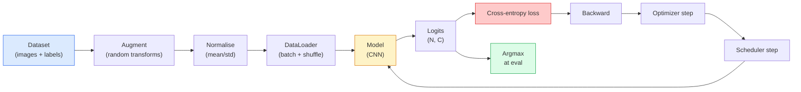

# Image Classification · 图像分类

> A classifier is a function from pixels to a probability distribution over classes. Everything else is plumbing.

**Type:** Build
**Languages:** Python
**Prerequisites:** Phase 2 Lesson 09 (Model Evaluation), Phase 3 Lesson 10 (Mini Framework), Phase 4 Lesson 03 (CNNs)
**Time:** ~75 minutes

## Learning Objectives · 学习目标

- 在 CIFAR-10 上搭建端到端的图像分类流水线：数据集、增强、模型、训练循环、评估
- 解释每个组件（dataloader、损失、优化器、调度器、增强）的角色，并预测破坏其中任何一个会在损失曲线上如何显现
- 从零实现 mixup、cutout 和 label smoothing，并说明各自在什么时候值得加
- 读懂混淆矩阵和逐类 precision/recall 表，在总体准确率之外诊断数据集与模型的失败

> Build an end-to-end image classification pipeline on CIFAR-10: dataset, augmentation, model, training loop, evaluation
> Explain the role of each component (dataloader, loss, optimizer, scheduler, augmentation) and predict how breaking any one of them manifests in the loss curve
> Implement mixup, cutout, and label smoothing from scratch and justify when each is worth adding
> Read a confusion matrix and a per-class precision/recall table to diagnose dataset and model failures beyond aggregate accuracy

## The Problem · 问题在哪

每个真正上线的视觉任务都在某个层面上归结为图像分类。检测是对区域分类。分割是对像素分类。检索按与类中心的相似度排序。把分类做对——数据集循环、增强策略、损失、评估——是能迁移到本阶段所有其他任务的技能。

大多数分类 bug 不在模型里。它们活在流水线里：坏掉的归一化、没打乱的训练集、扭曲标签的增强、被训练数据污染的验证集划分、30 个 epoch 之后才悄悄发散的学习率。配置正确时能在 CIFAR-10 上拿到 93% 的 CNN，配置坏了通常只有 70-75%，而且损失曲线全程看起来都很正常。

本课亲手接好整条流水线，让每个部件都可检查。你不会用到任何可能藏 bug 的 `torchvision.datasets` 里的东西。

> Every vision task that ships reduces to image classification at some level. Detection classifies regions. Segmentation classifies pixels. Retrieval ranks by similarity to class centroids. Getting classification right — the dataset loop, the augmentation policy, the loss, the evaluation — is the skill that transfers to every other task in the phase.
> Most classification bugs are not in the model. They live in the pipeline: a broken normalisation, an unshuffled training set, augmentation that distorts labels, a validation split contaminated by training data, a learning rate that silently diverges after epoch 30. A CNN that would hit 93% on CIFAR-10 with a correct setup commonly scores 70-75% with a broken one, and the loss curve looks plausible the whole time.
> This lesson wires the entire pipeline by hand so every part is inspectable. You will not use anything from `torchvision.datasets` that could hide a bug.

## The Concept · 概念

### The classification pipeline · 分类流水线



这个循环里的每一行都是 bug 可能藏身的地方。交叉熵吃原始 logits，不是 softmax 输出，所以在损失之前加任何 `model(x).softmax()` 都会悄悄算出错误的梯度。增强只作用于输入，不作用于标签——除了 mixup，它两者都混。`optimizer.zero_grad()` 每步必须执行一次；漏掉它会累积梯度，症状看起来像学习率极不稳定。这些 bug 每一个都会把学习曲线压平，而且不抛任何错误。

> Every line in this loop is where a bug can live. Cross-entropy takes raw logits, not softmax outputs, so any `model(x).softmax()` before the loss quietly computes the wrong gradient. Augmentations apply to inputs only, not labels — except for mixup, which mixes both. `optimizer.zero_grad()` must happen once per step; skipping it accumulates gradients and looks like a wildly unstable learning rate. Each of those bugs flattens the learning curve without throwing an error.

### Cross-entropy, logits, and softmax · 交叉熵、logits 与 softmax

分类器为每张图产出 `C` 个数，叫做 logits。套上 softmax 就变成概率分布：

```
softmax(z)_i = exp(z_i) / sum_j exp(z_j)
```

交叉熵度量正确类的负对数概率：

```
CE(z, y) = -log( softmax(z)_y )
        = -z_y + log( sum_j exp(z_j) )
```

右边那个形式是数值稳定的（log-sum-exp）。PyTorch 的 `nn.CrossEntropyLoss` 把 softmax + NLL 融合成一个算子，直接吃原始 logits。自己先做一遍 softmax 几乎总是 bug——你算出的是 log(softmax(softmax(z)))，一个没有意义的量。

> A classifier produces `C` numbers per image called logits. Applying softmax converts them into a probability distribution.
> Cross-entropy measures the negative log probability of the correct class.
> The right-hand form is the numerically stable one (log-sum-exp). PyTorch's `nn.CrossEntropyLoss` fuses softmax + NLL in one op and takes raw logits directly. Applying softmax yourself first is almost always a bug — you compute log(softmax(softmax(z))), a meaningless quantity.

### Why augmentation works · 增强为什么有效

CNN 对平移有归纳偏置（来自权重共享），但对裁剪、翻转、色彩抖动、遮挡没有内建的不变性。教会它这些不变性的唯一办法，是给它看能逼出这些不变性的像素。训练中的每个随机变换都是在说：「这两张图标签相同；去学那些忽略差异的特征。」

```
Original crop:  "dog facing left"
Flip:           "dog facing right"       <- same label, different pixels
Rotate(+15):    "dog, slight tilt"
Colour jitter:  "dog in warmer light"
RandomErasing:  "dog with patch missing"
```

规则：增强必须保住标签。对数字做 cutout 和旋转可能把「6」变成「9」；对那种数据集要用更小的旋转范围，挑选尊重数字特有不变性的增强。

> A CNN has inductive bias for translation (from weight sharing) but no built-in invariance to crops, flips, colour jitter, or occlusion. The only way to teach it those invariances is to show it pixels that exercise them. Every random transform during training is a way of saying: "these two images have the same label; learn the features that ignore the difference."
> The rule: augmentation must preserve the label. Cutout and rotation on a digit can flip "6" into "9"; for that dataset you use smaller rotation ranges and pick augmentations that respect digit-specific invariances.

### Mixup and cutmix · Mixup 与 cutmix

普通增强变换像素但保持标签 one-hot。**Mixup** 和 **cutmix** 打破这一点：两者都插值。

```
Mixup:
  lambda ~ Beta(a, a)
  x = lambda * x_i + (1 - lambda) * x_j
  y = lambda * y_i + (1 - lambda) * y_j

Cutmix:
  paste a random rectangle of x_j into x_i
  y = area-weighted mix of y_i and y_j
```

为什么有用：模型不再死记尖锐的 one-hot 目标，而是学会在类之间插值。训练损失上升，测试精度上升。这是任何分类器都能做的最便宜的鲁棒性升级。

> Ordinary augmentation transforms pixels but keeps labels one-hot. Mixup and cutmix break that by interpolating both.
> Why it helps: the model stops memorising spiky one-hot targets and learns to interpolate between classes. Training loss goes up, test accuracy goes up. It is the single cheapest robustness upgrade for any classifier.

### Label smoothing · 标签平滑

mixup 的表亲。不是对着 `[0, 0, 1, 0, 0]` 训练，而是对着 `[eps/C, eps/C, 1-eps, eps/C, eps/C]` 训练，`eps` 取 0.1 这样的值。阻止模型产出任意尖锐的 logits，几乎零成本地改善校准。PyTorch 1.10 起内置于 `nn.CrossEntropyLoss(label_smoothing=0.1)`。

> A cousin of mixup. Instead of training against `[0, 0, 1, 0, 0]`, train against `[eps/C, eps/C, 1-eps, eps/C, eps/C]` for a small `eps` like 0.1. Stops the model from producing arbitrarily sharp logits and improves calibration at almost no cost. Built into `nn.CrossEntropyLoss(label_smoothing=0.1)` since PyTorch 1.10.

### Evaluation beyond accuracy · 准确率之外的评估

总体准确率掩盖不均衡。一个 90-10 的二分类器，永远预测多数类就能得 90%。真正能告诉你发生了什么的工具：

- **逐类准确率（per-class accuracy）** —— 每类一个数；立刻暴露表现差的类别。
- **混淆矩阵（confusion matrix）** —— C x C 网格，第 i 行第 j 列 = 真实类 i 被预测为类 j 的次数；对角线是正确的，非对角线才是你模型真正「活着」的地方。
- **Top-1 / Top-5** —— 正确类是否落在前 1 或前 5 个预测里；Top-5 对 ImageNet 很重要，因为「Norwich terrier」和「Norfolk terrier」这类是真的难分。
- **校准（Calibration，ECE）** —— 置信度 0.8 的预测是否在 80% 的时候是对的？现代网络系统性地过度自信；用温度缩放（temperature scaling）或标签平滑来修。

```figure
receptive-field
```

> Aggregate accuracy hides imbalance. A 90-10 binary classifier that always predicts the majority class scores 90%. The tools that actually tell you what is happening.
> Calibration (ECE) — does a 0.8 confidence prediction get it right 80% of the time? Modern networks are systematically over-confident; fix with temperature scaling or label smoothing.

## Build It · 动手造

### Step 1: A deterministic synthetic dataset · 第 1 步：一个确定性合成数据集

CIFAR-10 在磁盘上。为了让本课可复现且快速，我们构造一个长得像 CIFAR 的合成数据集——32x32 RGB 图像，带有模型必须学出来的类特定结构。完全相同的流水线原封不动就能跑真实 CIFAR-10。

```python
import numpy as np
import torch
from torch.utils.data import Dataset


def synthetic_cifar(num_per_class=1000, num_classes=10, seed=0):
    rng = np.random.default_rng(seed)
    X = []
    Y = []
    for c in range(num_classes):
        centre = rng.uniform(0, 1, (3,))
        freq = 2 + c
        for _ in range(num_per_class):
            yy, xx = np.meshgrid(np.linspace(0, 1, 32), np.linspace(0, 1, 32), indexing="ij")
            r = np.sin(xx * freq) * 0.5 + centre[0]
            g = np.cos(yy * freq) * 0.5 + centre[1]
            b = (xx + yy) * 0.5 * centre[2]
            img = np.stack([r, g, b], axis=-1)
            img += rng.normal(0, 0.08, img.shape)
            img = np.clip(img, 0, 1)
            X.append(img.astype(np.float32))
            Y.append(c)
    X = np.stack(X)
    Y = np.array(Y)
    idx = rng.permutation(len(X))
    return X[idx], Y[idx]


class ArrayDataset(Dataset):
    def __init__(self, X, Y, transform=None):
        self.X = X
        self.Y = Y
        self.transform = transform

    def __len__(self):
        return len(self.X)

    def __getitem__(self, i):
        img = self.X[i]
        if self.transform is not None:
            img = self.transform(img)
        img = torch.from_numpy(img).permute(2, 0, 1)
        return img, int(self.Y[i])
```

每个类有自己的调色板和频率模式，再加高斯噪声，逼模型学信号而不是死记像素。十个类、每类一千张、已打乱。

> CIFAR-10 lives on disk. To make this lesson reproducible and fast we build a synthetic dataset that looks like CIFAR — 32x32 RGB images with class-specific structure the model must learn. The exact same pipeline works unchanged on real CIFAR-10.
> Each class gets its own colour palette and frequency pattern, plus Gaussian noise to force the model to learn the signal rather than memorise pixels. Ten classes, one thousand images each, permuted.

### Step 2: Normalisation and augmentation · 第 2 步：归一化与增强

每条视觉流水线都有的两个变换。

```python
def standardize(mean, std):
    mean = np.array(mean, dtype=np.float32)
    std = np.array(std, dtype=np.float32)
    def _fn(img):
        return (img - mean) / std
    return _fn


def random_hflip(p=0.5):
    def _fn(img):
        if np.random.random() < p:
            return img[:, ::-1, :].copy()
        return img
    return _fn


def random_crop(pad=4):
    def _fn(img):
        h, w = img.shape[:2]
        padded = np.pad(img, ((pad, pad), (pad, pad), (0, 0)), mode="reflect")
        y = np.random.randint(0, 2 * pad)
        x = np.random.randint(0, 2 * pad)
        return padded[y:y + h, x:x + w, :]
    return _fn


def compose(*fns):
    def _fn(img):
        for fn in fns:
            img = fn(img)
        return img
    return _fn
```

裁剪前用 reflect 填充，不用零填充，因为黑边是模型会以无用的方式学着去忽略的信号。

> The two transforms that every vision pipeline has.
> Reflect-pad before crop, not zero-pad, because black borders are a signal the model would learn to ignore in a non-useful way.

### Step 3: Mixup · 第 3 步：Mixup

在训练步骤内部混合两张图和两个标签。实现为批次级变换，让它待在前向传播旁边，而不是数据集里面。

```python
def mixup_batch(x, y, num_classes, alpha=0.2):
    if alpha <= 0:
        return x, torch.nn.functional.one_hot(y, num_classes).float()
    lam = float(np.random.beta(alpha, alpha))
    idx = torch.randperm(x.size(0), device=x.device)
    x_mixed = lam * x + (1 - lam) * x[idx]
    y_onehot = torch.nn.functional.one_hot(y, num_classes).float()
    y_mixed = lam * y_onehot + (1 - lam) * y_onehot[idx]
    return x_mixed, y_mixed


def soft_cross_entropy(logits, soft_targets):
    log_probs = torch.log_softmax(logits, dim=-1)
    return -(soft_targets * log_probs).sum(dim=-1).mean()
```

`soft_cross_entropy` 是对软标签分布的交叉熵。目标恰好 one-hot 时，它退化成平常的 one-hot 情形。

> Mixes two images and two labels inside the training step. Implemented as a batch transform so it lives next to the forward pass rather than inside the dataset.
> `soft_cross_entropy` is cross-entropy against a soft-label distribution. It reduces to the usual one-hot case when the target is exactly one-hot.

### Step 4: The training loop · 第 4 步：训练循环

完整配方：数据过一遍，每个批次做一次梯度，调度器每个 epoch 走一步。

```python
import torch
import torch.nn as nn
from torch.utils.data import DataLoader
from torch.optim import SGD
from torch.optim.lr_scheduler import CosineAnnealingLR

def train_one_epoch(model, loader, optimizer, device, num_classes, use_mixup=True):
    model.train()
    total, correct, loss_sum = 0, 0, 0.0
    for x, y in loader:
        x, y = x.to(device), y.to(device)
        if use_mixup:
            x_m, y_soft = mixup_batch(x, y, num_classes)
            logits = model(x_m)
            loss = soft_cross_entropy(logits, y_soft)
        else:
            logits = model(x)
            loss = nn.functional.cross_entropy(logits, y, label_smoothing=0.1)
        optimizer.zero_grad()
        loss.backward()
        optimizer.step()
        loss_sum += loss.item() * x.size(0)
        total += x.size(0)
        # Training accuracy vs the un-mixed labels `y` is only an approximation
        # when mixup is on (the model saw soft targets, not y). Treat it as a
        # rough progress signal; rely on val accuracy for real performance.
        with torch.no_grad():
            pred = logits.argmax(dim=-1)
            correct += (pred == y).sum().item()
    return loss_sum / total, correct / total


@torch.no_grad()
def evaluate(model, loader, device, num_classes):
    model.eval()
    total, correct = 0, 0
    loss_sum = 0.0
    cm = torch.zeros(num_classes, num_classes, dtype=torch.long)
    for x, y in loader:
        x, y = x.to(device), y.to(device)
        logits = model(x)
        loss = nn.functional.cross_entropy(logits, y)
        pred = logits.argmax(dim=-1)
        for t, p in zip(y.cpu(), pred.cpu()):
            cm[t, p] += 1
        loss_sum += loss.item() * x.size(0)
        total += x.size(0)
        correct += (pred == y).sum().item()
    return loss_sum / total, correct / total, cm
```

每次写训练循环都要检查的五条不变量：

1. 训练前 `model.train()`，评估前 `model.eval()` —— 切换 dropout 和 batchnorm 的行为。
2. `.backward()` 之前先 `.zero_grad()`。
3. 累积指标时用 `.item()`，别让任何东西把计算图吊着不放。
4. 评估时加 `@torch.no_grad()` —— 省内存省时间，防微妙的意外。
5. 对原始 logits 做 argmax，不是 softmax —— 结果一样，少一个算子。

> The complete recipe: one pass over the data, gradients once per batch, scheduler stepped once per epoch.
> Five invariants you check every time you write a training loop:
> 1. `model.train()` before training, `model.eval()` before evaluation — flips dropout and batchnorm behaviour.
> 2. `.zero_grad()` before `.backward()`.
> 3. `.item()` when accumulating metrics so nothing keeps the computation graph alive.
> 4. `@torch.no_grad()` during evaluation — saves memory and time, prevents subtle accidents.
> 5. Argmax against raw logits, not softmax — same result, one fewer op.

### Step 5: Put it together · 第 5 步：拼起来

用上一课的 `TinyResNet`，训练几个 epoch，评估。

```python
from main import synthetic_cifar, ArrayDataset
from main import standardize, random_hflip, random_crop, compose
from main import mixup_batch, soft_cross_entropy
from main import train_one_epoch, evaluate
# TinyResNet comes from the previous lesson (03-cnns-lenet-to-resnet).
# Adjust the import path to wherever you stored the previous lesson's code.
from cnns_lenet_to_resnet import TinyResNet  # example placeholder

X, Y = synthetic_cifar(num_per_class=500)
split = int(0.9 * len(X))
X_train, Y_train = X[:split], Y[:split]
X_val, Y_val = X[split:], Y[split:]

mean = [0.5, 0.5, 0.5]
std = [0.25, 0.25, 0.25]
train_tf = compose(random_hflip(), random_crop(pad=4), standardize(mean, std))
eval_tf = standardize(mean, std)

train_ds = ArrayDataset(X_train, Y_train, transform=train_tf)
val_ds = ArrayDataset(X_val, Y_val, transform=eval_tf)

train_loader = DataLoader(train_ds, batch_size=128, shuffle=True, num_workers=0)
val_loader = DataLoader(val_ds, batch_size=256, shuffle=False, num_workers=0)

device = "cuda" if torch.cuda.is_available() else "cpu"
model = TinyResNet(num_classes=10).to(device)
optimizer = SGD(model.parameters(), lr=0.1, momentum=0.9, weight_decay=5e-4, nesterov=True)
scheduler = CosineAnnealingLR(optimizer, T_max=10)

for epoch in range(10):
    tr_loss, tr_acc = train_one_epoch(model, train_loader, optimizer, device, 10, use_mixup=True)
    va_loss, va_acc, _ = evaluate(model, val_loader, device, 10)
    scheduler.step()
    print(f"epoch {epoch:2d}  lr {scheduler.get_last_lr()[0]:.4f}  "
          f"train {tr_loss:.3f}/{tr_acc:.3f}  val {va_loss:.3f}/{va_acc:.3f}")
```

在合成数据集上，五个 epoch 内验证精度就接近满分，这正是重点：流水线是对的，模型学得出可学的东西。把数据集换成真实 CIFAR-10，同一个循环不改一行就能训到约 90%。

> Use the `TinyResNet` from the previous lesson, train for a few epochs, evaluate.
> On the synthetic dataset, this gets to near-perfect validation accuracy within five epochs, which is the point: the pipeline is correct, the model can learn what is learnable. Swap the dataset for real CIFAR-10 and the same loop trains to ~90% without changes.

### Step 6: Read the confusion matrix · 第 6 步：读懂混淆矩阵

光看准确率永远不会告诉你模型在哪里失败。混淆矩阵会。

```python
def print_confusion(cm, labels=None):
    c = cm.shape[0]
    labels = labels or [str(i) for i in range(c)]
    print(f"{'':>6}" + "".join(f"{l:>5}" for l in labels))
    for i in range(c):
        row = cm[i].tolist()
        print(f"{labels[i]:>6}" + "".join(f"{v:>5}" for v in row))
    print()
    tp = cm.diag().float()
    fp = cm.sum(dim=0).float() - tp
    fn = cm.sum(dim=1).float() - tp
    prec = tp / (tp + fp).clamp_min(1)
    rec = tp / (tp + fn).clamp_min(1)
    f1 = 2 * prec * rec / (prec + rec).clamp_min(1e-9)
    for i in range(c):
        print(f"{labels[i]:>6}  prec {prec[i]:.3f}  rec {rec[i]:.3f}  f1 {f1[i]:.3f}")

_, _, cm = evaluate(model, val_loader, device, 10)
print_confusion(cm)
```

行是真实类，列是预测。类 3 和类 5 之间出现一簇非对角计数，说明模型分不清这两个类，也给了你一个起点：定向收集数据，或做类特定的增强。

> Accuracy alone never tells you where the model is failing. The confusion matrix does.
> Rows are true classes, columns are predictions. A cluster of off-diagonal counts between classes 3 and 5 means the model confuses those two and gives you a starting point for targeted data collection or a class-specific augmentation.

## Use It · 实战用法

`torchvision` 把上面的一切包成地道的组件。对真实 CIFAR-10，整条流水线是四行代码加一个训练循环。

```python
from torchvision.datasets import CIFAR10
from torchvision.transforms import Compose, RandomCrop, RandomHorizontalFlip, ToTensor, Normalize

mean = (0.4914, 0.4822, 0.4465)
std = (0.2470, 0.2435, 0.2616)
train_tf = Compose([
    RandomCrop(32, padding=4, padding_mode="reflect"),
    RandomHorizontalFlip(),
    ToTensor(),
    Normalize(mean, std),
])
eval_tf = Compose([ToTensor(), Normalize(mean, std)])

train_ds = CIFAR10(root="./data", train=True,  download=True, transform=train_tf)
val_ds   = CIFAR10(root="./data", train=False, download=True, transform=eval_tf)
```

两个要注意的点：mean/std 是**数据集特定的**——在 CIFAR-10 训练集上算的，不是 ImageNet——而 reflect 填充是社区默认的裁剪策略。在这里照抄 ImageNet 统计量是一个约 1% 的精度泄漏，没人会察觉，直到有人去剖析这个模型。

> `torchvision` wraps everything above into idiomatic components. For real CIFAR-10 the full pipeline is four lines plus a training loop.
> Two things to notice: the mean/std are dataset-specific — computed on the CIFAR-10 training set, not ImageNet — and the reflect pad is the community-default crop policy. Copy-pasting ImageNet stats here is a ~1% accuracy leak that nobody catches until someone profiles the model.

## Ship It · 交付

本课产出：

- `outputs/prompt-classifier-pipeline-auditor.md` —— 一个提示词：按上面五条不变量审计训练脚本，并揪出第一个违例。
- `outputs/skill-classification-diagnostics.md` —— 一个技能：给定混淆矩阵和类名列表，总结逐类失败并提出影响最大的那一个修复。

> This lesson produces:
> - `outputs/prompt-classifier-pipeline-auditor.md` — a prompt that audits a training script for the five invariants above and surfaces the first violation.
> - `outputs/skill-classification-diagnostics.md` — a skill that, given a confusion matrix and a list of class names, summarises per-class failures and proposes the single most impactful fix.

## Exercises · 练习

1. **（简单）** 在合成数据集上分别用和不 用 mixup 训练同一个模型五个 epoch，画出两者的 train 和 val 损失曲线。解释为什么开了 mixup 的 train loss 更高，val 精度却相近甚至更好。
2. **（中等）** 实现 Cutout——把每张训练图像上随机的 8x8 方块置零——做消融对比：无增强、hflip+crop、hflip+crop+cutout、hflip+crop+mixup。报告各自的 val 精度。
3. **（困难）** 搭一条 CIFAR-100 流水线（100 类，同输入尺寸），把 ResNet-34 训练复现到公开精度 1% 以内。附加：扫三个学习率、两个 weight decay，记录到本地 CSV，产出最终的「混淆矩阵 top 混淆对」表。

## Key Terms · 术语表

| 术语 | 人们怎么说 | 它实际是什么意思 |
|------|----------------|----------------------|
| Logits | 「原始输出」 | 每张图 softmax 之前的 C 个数；交叉熵吃的是它们，不是 softmax 之后的值 |
| Cross-entropy（交叉熵） | 「那个损失」 | 正确类的负对数概率；把 log-softmax 和 NLL 融合成一个稳定算子 |
| DataLoader | 「做批量的」 | 给数据集包上打乱、分批和（可选）多进程加载；一半的训练 bug 都赖它 |
| Augmentation（数据增强） | 「随机变换」 | 训练时任何保标签的像素级变换；教给 CNN 它天生没有的不变性 |
| Mixup / Cutmix | 「混合两张图」 | 输入和标签一起混，让分类器学平滑插值而不是硬边界 |
| Label smoothing（标签平滑） | 「软一点的标签」 | 用 (1-eps, eps/(C-1), ...) 替换 one-hot；改善校准，精度还略升 |
| Top-k accuracy | 「Top-5」 | 正确类出现在概率最高的 k 个预测中；用于类间确实模糊的数据集 |
| Confusion matrix（混淆矩阵） | 「错误都住在这」 | C x C 表，(i, j) 格统计真实类 i 被预测为 j 的图像数；对角线是对的，非对角线告诉你该修什么 |

## Further Reading · 延伸阅读

- [CS231n: Training Neural Networks](https://cs231n.github.io/neural-networks-3/) —— 单页讲完训练流水线、至今最清晰的导览
- [Bag of Tricks for Image Classification (He et al., 2019)](https://arxiv.org/abs/1812.01187) —— 每个小技巧合起来给 ResNet 在 ImageNet 上加 3-4% 的那篇
- [mixup: Beyond Empirical Risk Minimization (Zhang et al., 2017)](https://arxiv.org/abs/1710.09412) —— mixup 原始论文；三页理论加有说服力的实验
- [Why temperature scaling matters (Guo et al., 2017)](https://arxiv.org/abs/1706.04599) —— 证明现代网络校准失准、并用一个标量参数修好的论文
