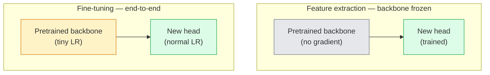

# Transfer Learning & Fine-Tuning · 迁移学习与微调

> 别人已经花了一百万 GPU 小时，教会一个网络认识边缘、纹理和物体部件长什么样。在你训练自己的网络之前，先把这些特征借来用。

> Somebody else spent a million GPU hours teaching a network what edges, textures, and object parts look like. You should borrow those features before training your own.

**类型：** Build
**语言：** Python
**前置课程：** Phase 4 Lesson 03（CNNs 卷积神经网络）、Phase 4 Lesson 04（Image Classification 图像分类）
**时间：** ~75 分钟

## Learning Objectives · 学习目标

- 区分特征提取（feature extraction）与微调（fine-tuning），并根据数据集规模、领域距离和算力预算选对方法
- 加载预训练 backbone、替换它的分类头，用不到 20 行代码把 head 训练到一个能用的基线
- 用判别式学习率（discriminative learning rates）渐进解冻各层，让早期的通用特征比后期的任务特定特征获得更小的更新
- 诊断三种常见失败：对未冻结模块用过高的学习率导致特征漂移、小数据集上 BN 统计量坍缩，以及灾难性遗忘（catastrophic forgetting）

> Distinguish feature extraction from fine-tuning and pick the right one based on dataset size, domain distance, and compute budget
> Load a pretrained backbone, replace its classifier head, and train only the head to a working baseline in under 20 lines
> Progressively unfreeze layers with discriminative learning rates so early generic features get smaller updates than late task-specific ones
> Diagnose the three common failures: feature drift from too-high LR on unfrozen blocks, BN statistics collapse on tiny datasets, and catastrophic forgetting

---

## The Problem · 问题在哪

在 ImageNet 上训练一个 ResNet-50 大约要花 2,000 个 GPU 小时。没有几个团队对每个要上线的任务都有这种预算。几乎所有团队实际交付的，是一个预训练 backbone 加一个新 head——用几百到几千张任务相关图片训练而成。

这不是偷懒的捷径。任何在 ImageNet 上训练的 CNN，第一个卷积块学到的都是边缘和类 Gabor 的滤波器；接下来几个块学到纹理和简单图案；中间的块学到物体部件；最后的块学到开始像那 1,000 个 ImageNet 类别的组合。这个层级的前 90% 几乎原封不动地迁移到医学影像、工业检测、卫星数据和其他所有视觉任务上——因为大自然关于边缘和纹理的词汇表是有限的。真正需要你训练的，只有最后那 10%。

把迁移做对的路上埋着三个 bug：用过高的学习率毁掉预训练特征；冻结太多让模型信息不足；放任 BatchNorm 的滑动统计量漂向一个网络其余部分从没学过的小数据集。本课会故意把每一个都走一遍。

> Training a ResNet-50 on ImageNet costs around 2,000 GPU-hours. Very few teams have that budget for every task they ship. What almost every team actually ships is a pretrained backbone with a new head trained on a few hundred or few thousand task-specific images.
> ... The first 90% of that hierarchy transfers almost unchanged to medical imaging, industrial inspection, satellite data, and every other vision task — because nature has a limited vocabulary of edges and textures. The last 10% is what you actually train.
> Getting transfer right has three bugs waiting for you: destroying pretrained features with a too-high learning rate, starving the model of information by freezing too much, and letting BatchNorm's running statistics drift toward a tiny dataset that the rest of the network never learnt from. This lesson walks each of them on purpose.

---

## The Concept · 概念

### Feature extraction vs fine-tuning · 特征提取 vs 微调

两种模式，按你对预训练特征的信任程度和数据量的多少来选。



经验法则：

| 数据集规模 | 领域距离 | 配方 |
|--------------|-----------------|--------|
| < 1k 张图 | 接近 ImageNet | 冻结 backbone，只训练 head |
| 1k-10k | 接近 | 冻结前 2-3 个 stage，微调其余 |
| 10k-100k | 任意 | 用判别式学习率端到端微调 |
| 100k+ | 远 | 全部微调；领域足够远时考虑从头训练 |

「接近 ImageNet」大致指内容以物体为主的自然 RGB 照片。医学 CT、俯视卫星影像、显微图像都是远领域——特征依然有用，但你需要让更多层参与适应。

> Two regimes, picked by how much you trust the pretrained features and how much data you have.
> "Close to ImageNet" roughly means natural RGB photos with object-like content. Medical CT scans, overhead satellite imagery, and microscopy are far domains — the features still help, but you will need to let more layers adapt.

### Why freezing works at all · 冻结为什么有效

CNN 在 ImageNet 上学到的特征并不是专门服务于那 1,000 个类别的，而是专门服务于自然图像的统计特性：特定朝向的边缘、纹理、对比度模式、形状基元。这些统计特性在几乎所有你能叫出名字的视觉领域里都保持稳定。这就是为什么一个在 ImageNet 上训练、只在 CIFAR-10 上换一个新线性 head 做零样本（zero-shot）评估的模型（backbone 完全不微调）能拿到 80%+ 的准确率。head 学的是：在这个任务上，该给那些已经学好的特征各分配多大权重。

> The ImageNet features a CNN learns are not specialised to the 1,000 categories. They are specialised to the statistics of natural images: edges at specific orientations, textures, contrast patterns, shape primitives. Those statistics are stable across almost every visual domain a human can name. That is why a model trained on ImageNet and evaluated zero-shot on CIFAR-10 with just a new linear head (no fine-tuning of the backbone) reaches 80%+ accuracy. The head is learning which of the already-learnt features to weight for this task.

### Discriminative learning rates · 判别式学习率

一旦解冻，浅层就应该比深层训练得更慢。浅层编码的是你想保留的通用特征；深层编码的是你需要大幅移动的任务特定结构。

```
Typical recipe:

  stage 0 (stem + first group): lr = base_lr / 100    (mostly fixed)
  stage 1:                       lr = base_lr / 10
  stage 2:                       lr = base_lr / 3
  stage 3 (last backbone group): lr = base_lr
  head:                          lr = base_lr  (or slightly higher)
```

在 PyTorch 里，这只是一个传给优化器的参数组列表。一个模型、五个学习率、零额外代码。

> When you do unfreeze, early layers should train slower than late layers. Early layers encode generic features that you want to preserve; late layers encode task-specific structure that you need to move a lot.
> In PyTorch this is just a list of parameter groups passed to the optimizer. One model, five learning rates, zero extra code.

### The BatchNorm problem · BatchNorm 问题

BN 层保存着 `running_mean` 和 `running_var` 缓冲区，它们是在 ImageNet 上算出来的。如果你的任务像素分布不同——光照不同、传感器不同、色彩空间不同——这些缓冲区就是错的。按优先级排序的三种做法：

1. **在 train 模式下带着 BN 微调。** 让 BN 和其他所有东西一起更新滑动统计量。任务数据集中等规模（>= 5k 样本）时的默认选择。
2. **把 BN 冻结在 eval 模式。** 保留 ImageNet 统计量，只训练权重。当数据集小到 BN 的滑动平均会充满噪声时，这才是正确做法。
3. **用 GroupNorm 替换 BN。** 彻底消除滑动平均问题。检测和分割 backbone 每张 GPU 的 batch size 都很小，所以它们用它。

这件事搞错，会神不知鬼不觉地掉 5-15% 的准确率。

> BN layers hold `running_mean` and `running_var` buffers that were computed on ImageNet. If your task has a different pixel distribution — different lighting, different sensor, different colour space — those buffers are wrong. Three options in order of preference:
> Getting this wrong silently tanks accuracy by 5-15%.

### Head design · Head 的设计

分类头就是 1-3 个线性层加一个可选的 dropout。每个 torchvision backbone 都自带一个默认 head，你要把它换掉：

```
backbone.fc = nn.Linear(backbone.fc.in_features, num_classes)          # ResNet
backbone.classifier[1] = nn.Linear(..., num_classes)                    # EfficientNet, MobileNet
backbone.heads.head = nn.Linear(..., num_classes)                       # torchvision ViT
```

小数据集上，单个线性层通常就够了。当任务分布离 backbone 的训练分布较远时，加一个隐藏层（Linear -> ReLU -> Dropout -> Linear）才有帮助。

> The classifier head is 1-3 linear layers plus an optional dropout. Every torchvision backbone ships a default head that you replace.
> For small datasets, a single linear layer is usually enough. Adding a hidden layer (Linear -> ReLU -> Dropout -> Linear) helps when the task distribution is farther from the backbone's training distribution.

### Layer-wise LR decay · 逐层学习率衰减

逐层学习率衰减（layer-wise LR decay）是判别式学习率的更平滑版本，用于现代微调（BEiT、DINOv2、ViT-B 微调）。它不把层分组成 stage，而是让每一层都比上一层的学习率略小：

```
lr_layer_k = base_lr * decay^(L - k)
```

取 decay = 0.75、L = 12 个 transformer 块时，第一个块的训练学习率是 head 的 `0.75^11 ≈ 0.04x`。这对 transformer 微调比对 CNN 更重要——CNN 用 stage 分组的学习率通常就够了。

> A smoother version of discriminative LR used in modern fine-tuning (BEiT, DINOv2, ViT-B fine-tunes). Instead of grouping layers into stages, give every layer a slightly smaller LR than the one above it.
> With decay = 0.75 and L = 12 transformer blocks, the first block trains at `0.75^11 ≈ 0.04x` the head's LR. Matters more for transformer fine-tunes than for CNNs, where stage-grouped LRs are usually enough.

### What to evaluate · 该评估什么

迁移学习实验需要跟踪两个在从头训练时不会看的数字：

- **仅预训练准确率（pretrained-only accuracy）**——backbone 冻结时 head 的准确率。这是你的下限。
- **微调后准确率（fine-tuned accuracy）**——同一个模型端到端训练之后的准确率。这是你的上限。

如果微调后反而低于仅预训练，说明你有学习率或 BN 的 bug。两个数都要打印。

```figure
transfer-learning
```

> Transfer-learning runs need two numbers you would not track on a scratch run.
> If fine-tuned is less than pretrained-only, you have a learning-rate or BN bug. Always print both.

---

## Build It · 动手造

### Step 1: Load a pretrained backbone and inspect it · 加载预训练 backbone 并查看它

```python
import torch
import torch.nn as nn
from torchvision.models import resnet18, ResNet18_Weights

backbone = resnet18(weights=ResNet18_Weights.IMAGENET1K_V1)
print(backbone)
print()
print("classifier head:", backbone.fc)
print("feature dim:", backbone.fc.in_features)
```

`ResNet18` 有四个 stage（`layer1..layer4`）外加一个 stem 和一个 `fc` head。每个 torchvision 分类 backbone 都有类似的结构。

> `ResNet18` has four stages (`layer1..layer4`) plus a stem and a `fc` head. Every torchvision classification backbone has an analogous structure.

### Step 2: Feature extraction — freeze everything, replace the head · 特征提取——全部冻结，只换 head

```python
def make_feature_extractor(num_classes=10):
    model = resnet18(weights=ResNet18_Weights.IMAGENET1K_V1)
    for p in model.parameters():
        p.requires_grad = False
    model.fc = nn.Linear(model.fc.in_features, num_classes)
    return model

model = make_feature_extractor(num_classes=10)
trainable = sum(p.numel() for p in model.parameters() if p.requires_grad)
frozen = sum(p.numel() for p in model.parameters() if not p.requires_grad)
print(f"trainable: {trainable:>10,}")
print(f"frozen:    {frozen:>10,}")
```

只有 `model.fc` 可训练。backbone 成了一个冻结的特征提取器。

> Only `model.fc` is trainable. The backbone is a frozen feature extractor.

### Step 3: Discriminative fine-tuning · 判别式微调

一个按 stage 构建不同学习率参数组的工具函数。

```python
def discriminative_param_groups(model, base_lr=1e-3, decay=0.3):
    stages = [
        ["conv1", "bn1"],
        ["layer1"],
        ["layer2"],
        ["layer3"],
        ["layer4"],
        ["fc"],
    ]
    groups = []
    for i, names in enumerate(stages):
        lr = base_lr * (decay ** (len(stages) - 1 - i))
        params = [p for n, p in model.named_parameters()
                  if any(n.startswith(k) for k in names)]
        if params:
            groups.append({"params": params, "lr": lr, "name": "_".join(names)})
    return groups

model = resnet18(weights=ResNet18_Weights.IMAGENET1K_V1)
model.fc = nn.Linear(model.fc.in_features, 10)
for p in model.parameters():
    p.requires_grad = True

groups = discriminative_param_groups(model)
for g in groups:
    print(f"{g['name']:>10s}  lr={g['lr']:.2e}  params={sum(p.numel() for p in g['params']):>8,}")
```

`decay=0.3` 表示每个 stage 的训练速率是下一个 stage 的 30%。`fc` 拿到 `base_lr`，`layer4` 拿到 `0.3 * base_lr`，`conv1` 拿到 `0.3^5 * base_lr ≈ 0.00243 * base_lr`。听着夸张；实证有效。

> A utility that builds parameter groups with stage-specific learning rates.
> `decay=0.3` means each stage trains at 30% of the rate of the next one. `fc` gets `base_lr`, `layer4` gets `0.3 * base_lr`, `conv1` gets `0.3^5 * base_lr ≈ 0.00243 * base_lr`. Extreme sounding; empirically it works.

### Step 4: BatchNorm handling · BatchNorm 处理

在不冻结 BN 权重的前提下冻结其滑动统计量的辅助函数。

```python
def freeze_bn_stats(model):
    for m in model.modules():
        if isinstance(m, (nn.BatchNorm1d, nn.BatchNorm2d, nn.BatchNorm3d)):
            m.eval()
            for p in m.parameters():
                p.requires_grad = False
    return model
```

在每个 epoch 开始、调用 `model.train()` 之后调用它。`model.train()` 把所有层都切成训练模式；这个函数只把 BN 层翻回来。

> Helper to freeze BN running statistics without freezing its weights.
> Call it after you set `model.train()` at the start of every epoch. `model.train()` flips everything to training mode; this reverses it only for BN layers.

### Step 5: A minimal end-to-end fine-tuning loop · 一个最小的端到端微调循环

```python
from torch.optim import SGD
from torch.utils.data import DataLoader
from torch.optim.lr_scheduler import CosineAnnealingLR
import torch.nn.functional as F

def fine_tune(model, train_loader, val_loader, device, epochs=5, base_lr=1e-3, freeze_bn=False):
    model = model.to(device)
    groups = discriminative_param_groups(model, base_lr=base_lr)
    optimizer = SGD(groups, momentum=0.9, weight_decay=1e-4, nesterov=True)
    scheduler = CosineAnnealingLR(optimizer, T_max=epochs)

    for epoch in range(epochs):
        model.train()
        if freeze_bn:
            freeze_bn_stats(model)
        tr_loss, tr_correct, tr_total = 0.0, 0, 0
        for x, y in train_loader:
            x, y = x.to(device), y.to(device)
            logits = model(x)
            loss = F.cross_entropy(logits, y, label_smoothing=0.1)
            optimizer.zero_grad()
            loss.backward()
            optimizer.step()
            tr_loss += loss.item() * x.size(0)
            tr_total += x.size(0)
            tr_correct += (logits.argmax(-1) == y).sum().item()
        scheduler.step()

        model.eval()
        va_total, va_correct = 0, 0
        with torch.no_grad():
            for x, y in val_loader:
                x, y = x.to(device), y.to(device)
                pred = model(x).argmax(-1)
                va_total += x.size(0)
                va_correct += (pred == y).sum().item()
        print(f"epoch {epoch}  train {tr_loss/tr_total:.3f}/{tr_correct/tr_total:.3f}  "
              f"val {va_correct/va_total:.3f}")
    return model
```

用上面的配方在 CIFAR-10 上跑 5 个 epoch，能把 `ResNet18-IMAGENET1K_V1` 从约 70% 的零样本线性探针（linear probe）准确率提到约 93% 的微调准确率。只训练 head 的话，不碰 backbone 会在 86% 左右停滞。

> Five epochs with the above recipe on CIFAR-10 takes `ResNet18-IMAGENET1K_V1` from ~70% zero-shot linear-probe accuracy to ~93% fine-tuned accuracy. The head alone would plateau around 86% without ever touching the backbone.

### Step 6: Progressive unfreezing · 渐进解冻

一个从末端向起点、每个 epoch 解冻一个 stage 的调度。以多花几个 epoch 为代价缓解特征漂移。

```python
def progressive_unfreeze_schedule(model):
    stages = ["layer4", "layer3", "layer2", "layer1"]
    yielded = set()

    def start():
        for p in model.parameters():
            p.requires_grad = False
        for p in model.fc.parameters():
            p.requires_grad = True

    def unfreeze(epoch):
        if epoch < len(stages):
            name = stages[epoch]
            yielded.add(name)
            for n, p in model.named_parameters():
                if n.startswith(name):
                    p.requires_grad = True
            return name
        return None

    return start, unfreeze
```

在第一个 epoch 之前调用一次 `start()`。在每个 epoch 开头调用 `unfreeze(epoch)`。每当可训练参数的集合发生变化，就重建优化器——否则被冻结的参数仍持有缓存的动量，会干扰优化器。

> A schedule that unfreezes one stage per epoch from the end toward the beginning. Mitigates feature drift at the cost of some extra epochs.
> Call `start()` once before the first epoch. Call `unfreeze(epoch)` at the start of each epoch. Rebuild the optimizer whenever the set of trainable parameters changes, otherwise the frozen params still hold cached moments that confuse it.

---

## Use It · 实战用法

对大多数真实任务，`torchvision.models` 加三行代码就够了。上面那些更重的机制，是在你撞上库默认值解决不了的问题时才派上用场。

```python
from torchvision.models import resnet50, ResNet50_Weights

model = resnet50(weights=ResNet50_Weights.IMAGENET1K_V2)
model.fc = nn.Linear(model.fc.in_features, num_classes)
optimizer = torch.optim.AdamW(model.parameters(), lr=1e-4, weight_decay=1e-4)
```

另外两个生产级默认选项：

- `timm` 提供约 800 个预训练视觉 backbone，API 一致（`timm.create_model("resnet50", pretrained=True, num_classes=10)`）。超出 torchvision 动物园之外的任何微调，它都是标准选择。
- 对 transformer，`transformers.AutoModelForImageClassification.from_pretrained(name, num_labels=N)` 让你用与文本模型相同的加载语义拿到 ViT / BEiT / DeiT。

> For most real tasks, `torchvision.models` + three lines is enough. The heavier machinery above matters when you run into the problems that library defaults cannot fix.
> `timm` ships ~800 pretrained vision backbones with a consistent API (`timm.create_model("resnet50", pretrained=True, num_classes=10)`). For any fine-tune beyond the torchvision zoo, it is the standard.
> For transformers, `transformers.AutoModelForImageClassification.from_pretrained(name, num_labels=N)` gives you ViT / BEiT / DeiT with the same loading semantics as text models.

---

## Ship It · 交付

本课产出：

- `outputs/prompt-fine-tune-planner.md` —— 一个提示词：根据数据集规模、领域距离和算力预算，在特征提取、渐进微调与端到端微调之间做选择。
- `outputs/skill-freeze-inspector.md` —— 一个技能：给定一个 PyTorch 模型，报告哪些参数可训练、哪些 BatchNorm 层处于 eval 模式，以及优化器是否真的被喂进了可训练参数。

> This lesson produces:
> `outputs/prompt-fine-tune-planner.md` — a prompt that picks feature-extraction vs progressive vs end-to-end fine-tuning based on dataset size, domain distance, and compute budget.
> `outputs/skill-freeze-inspector.md` — a skill that, given a PyTorch model, reports which parameters are trainable, which BatchNorm layers are in eval mode, and whether the optimizer is actually being fed the trainable parameters.

---

## Exercises · 练习

1. **（简单）** 在同一个合成 CIFAR 数据集上，把 `ResNet18` 分别作为线性探针（backbone 冻结）和完整微调来训练。并排报告两个准确率。解释哪个差距说明特征迁移得好、哪个说明迁移得不好。
2. **（中等）** 故意引入一个 bug：把 backbone stage 的 `base_lr` 设成 `1e-1`，而不是 head 的。展示训练 loss 爆炸，然后用 `discriminative_param_groups` 辅助函数恢复。记录每个 stage 开始发散时的学习率。
3. **（困难）** 拿一个医学影像数据集（如 CheXpert-small、PatchCamelyon 或 HAM10000），比较三种模式：(a) ImageNet 预训练冻结 backbone + 线性 head；(b) ImageNet 预训练端到端微调；(c) 从头训练。报告每种的准确率和算力成本。数据集到多大规模时，从头训练开始有竞争力？

> **(Easy)** Train a `ResNet18` as a linear probe (backbone frozen) and as a full fine-tune on the same synthetic-CIFAR dataset. Report both accuracies side by side. Explain which gap tells you the features transfer well and which tells you they do not.
> ... **(Hard)** Take a medical imaging dataset (e.g. CheXpert-small, PatchCamelyon, or HAM10000) and compare three regimes: (a) ImageNet-pretrained frozen backbone + linear head; (b) ImageNet-pretrained fine-tune end-to-end; (c) scratch training. Report accuracy and compute cost for each. At what dataset size does scratch training become competitive?

---

## Key Terms · 术语表

| 术语 | 人们怎么说 | 实际含义 |
|------|----------------|----------------------|
| Feature extraction | 「冻结只训 head」 | Backbone 参数冻结，只有新的分类头接收梯度 |
| Fine-tuning | 「端到端重训」 | 所有参数可训练，通常用比从头训练小得多的学习率 |
| Discriminative LR | 「浅层用更小的学习率」 | 优化器参数组，早期 stage 的学习率是后期 stage 的一个分数 |
| Layer-wise LR decay | 「平滑的学习率梯度」 | 每层学习率乘以 decay^(L - k)；transformer 微调中常见 |
| Catastrophic forgetting | 「模型把 ImageNet 忘了」 | 过高的学习率在新任务信号学进去之前就覆写了预训练特征 |
| BN statistics drift | 「滑动均值不对了」 | BatchNorm 的 running_mean/var 是在与当前任务不同的分布上算的，悄悄拖垮准确率 |
| Linear probe | 「冻结 backbone + 线性 head」 | 对预训练特征的评估——冻结表征之上最优线性分类器的准确率 |
| Catastrophic collapse | 「所有样本都预测成一类」 | 当微调学习率高到在 head 的梯度稳定之前就摧毁特征时发生 |

> Feature extraction | "Freeze and train head" | Backbone parameters frozen, only the new classifier head receives gradient
> ... Catastrophic forgetting | "The model lost ImageNet" | A too-high LR overwrites pretrained features before the new task signal is learnt
> ... Linear probe | "Frozen backbone + linear head" | Evaluation of pretrained features — accuracy of the best linear classifier on top of the frozen representation

---

## Further Reading · 延伸阅读

- [How transferable are features in deep neural networks? (Yosinski et al., 2014)](https://arxiv.org/abs/1411.1792) —— 量化逐层特征可迁移性的论文
- [Universal Language Model Fine-tuning (ULMFiT, Howard & Ruder, 2018)](https://arxiv.org/abs/1801.06146) —— 判别式学习率 / 渐进解冻配方的出处；这些思想可以直接搬到视觉
- [timm documentation](https://huggingface.co/docs/timm) —— 现代视觉 backbone 的参考文档，包括它们各自训练时用的确切微调默认值
- [A Simple Framework for Linear-Probe Evaluation (Kornblith et al., 2019)](https://arxiv.org/abs/1805.08974) —— 为什么线性探针准确率重要，以及如何正确地报告它

> the paper that quantified feature transferability across layers
> ... the original discriminative LR / progressive unfreezing recipe; the ideas transfer directly to vision
> ... why linear-probe accuracy matters and how to report it correctly
