# Object Detection — YOLO from Scratch · 目标检测——从零造 YOLO

> 检测就是分类加回归，在特征图的每个位置上跑一遍，再用非极大值抑制（NMS）清理结果。

> Detection is classification plus regression, run at every position in a feature map, then cleaned up with non-maximum suppression.

**类型：** Build
**语言：** Python
**前置课程：** Phase 4 Lesson 03（CNNs 卷积神经网络）、Phase 4 Lesson 04（Image Classification 图像分类）、Phase 4 Lesson 05（Transfer Learning 迁移学习）
**时间：** ~75 分钟

## Learning Objectives · 学习目标

- 解释「网格 + 锚框」的设计如何把检测变成稠密预测问题，并说出输出张量里每一个数的含义
- 计算两个框的交并比（IoU），并从零实现非极大值抑制（NMS）
- 在预训练 backbone 之上搭一个最小的 YOLO 风格 head，包括分类、objectness 和框回归三部分损失
- 读懂一行检测指标（precision@0.5、recall、mAP@0.5、mAP@0.5:0.95），并决定下一步该调哪个旋钮

> Explain the grid-and-anchor design that turns detection into a dense prediction problem and state what every number in the output tensor means
> Compute Intersection-over-Union between boxes and implement non-maximum suppression from scratch
> Build a minimal YOLO-style head on top of a pretrained backbone, including the classification, objectness, and box-regression losses
> Read a detection metric row (precision@0.5, recall, mAP@0.5, mAP@0.5:0.95) and pick which knob to turn next

---

## The Problem · 问题在哪

分类说的是「这张图里有一只狗」。检测说的是「在像素 (112, 40, 280, 210) 处有一只狗，在 (400, 180, 560, 310) 处有一只猫，画面里没有别的东西了」。就是这一个结构变化——从每张图一个标签，变成预测数量不定的带标签框——支撑起了每一套自动驾驶系统、每一个监控产品、每一个文档版面解析器、每一条工厂视觉产线。

检测也是视觉领域所有工程权衡同时登场的地方。你想要框准确（回归头），想要每个框类别正确（分类头），想要模型知道什么时候没东西可检（objectness 目标性得分），还想让每个真实物体恰好对应一个预测（非极大值抑制）。漏掉任何一项，流水线要么漏检物体，要么报出幻觉框，要么把同一个物体在略微不同的位置上预测十五遍。

YOLO（You Only Look Once，Redmon 等，2016）就是让这一切实时跑起来的那个设计：它用卷积网络的**单次前向传播**完成全部工作，而同样的结构决策至今仍是现代检测器（YOLOv8、YOLOv9、YOLO-NAS、RT-DETR）的主干。学会核心，每个变体都只是同一套零件的重新排列。

> Classification says "this image is a dog." Detection says "there is a dog at pixels (112, 40, 280, 210), there is a cat at (400, 180, 560, 310), and nothing else in the frame." That one structural change — predicting a variable number of labelled boxes instead of one label per image — is what every autonomous system, every surveillance product, every document layout parser, and every factory vision line depends on.
> ... YOLO (You Only Look Once, Redmon et al. 2016) was the design that made all of this run in real time by doing it with a single forward pass of a conv net, and the same structural decisions are still the backbone of modern detectors (YOLOv8, YOLOv9, YOLO-NAS, RT-DETR). Learn the core and every variant becomes a rearrangement of the same parts.

---

## The Concept · 概念

### Detection as dense prediction · 检测即稠密预测

分类器每张图输出 C 个数。YOLO 风格的检测器每张图输出 `(S x S x (5 + C))` 个数，其中 S 是空间网格尺寸。

```mermaid
flowchart LR
    IMG["Input 416x416 RGB"] --> BB["Backbone<br/>(ResNet, DarkNet, ...)"]
    BB --> FM["Feature map<br/>(C_feat, 13, 13)"]
    FM --> HEAD["Detection head<br/>(1x1 convs)"]
    HEAD --> OUT["Output tensor<br/>(13, 13, B * (5 + C))"]
    OUT --> DEC["Decode<br/>(grid + sigmoid + exp)"]
    DEC --> NMS["Non-max suppression"]
    NMS --> RESULT["Final boxes"]

    style IMG fill:#dbeafe,stroke:#2563eb
    style HEAD fill:#fef3c7,stroke:#d97706
    style NMS fill:#fecaca,stroke:#dc2626
    style RESULT fill:#dcfce7,stroke:#16a34a
```



`S * S` 个网格单元中的每一个都预测 `B` 个框。每个框：

- 4 个数描述几何：`tx, ty, tw, th`。
- 1 个数是 objectness 得分：「这个单元中心处有没有物体？」
- C 个数是类别概率。

每个单元合计 `B * (5 + C)`。对 VOC（`S=13, B=2, C=20`）来说，就是每单元 50 个数。

> A classifier outputs C numbers per image. A YOLO-style detector outputs `(S x S x (5 + C))` numbers per image, where S is the spatial grid size.
> ... Each of the `S * S` grid cells predicts `B` boxes. For each box: 4 numbers describe geometry: `tx, ty, tw, th`. 1 number is the objectness score: "is there an object centred in this cell?" C numbers are class probabilities.
> ... Total per cell: `B * (5 + C)`. For VOC with `S=13, B=2, C=20`, that is 50 numbers per cell.

### Why grids and anchors · 为什么要网格和锚框

朴素回归会为每个物体预测绝对坐标 `(x, y, w, h)`。这对卷积网络很难，因为平移图片不应该把所有预测平移同样的量——每个物体在空间上是被锚定的。网格解决了这个问题：把每个真值框（ground-truth box）分给它的中心落进去的那个网格单元；只有那个单元对这个物体负责。

锚框（anchor）解决第二个问题。一个 3x3 卷积很难从 16 像素感受野的特征单元里回归出 500 像素宽的框。所以我们为每个单元预定义 `B` 个先验框形状（锚框），只预测相对每个锚框的小偏移量。模型学会挑对锚框、再微调它，而不是从零开始回归。

```
Anchor box priors (example for 416x416 input):

  small:   (30,  60)
  medium:  (75,  170)
  large:   (200, 380)

At each grid cell, every anchor emits (tx, ty, tw, th, obj, c_1, ..., c_C).
```

现代检测器常用 FPN，在不同分辨率上配不同的锚框组——浅层高分辨率图配小锚框，深层低分辨率图配大锚框。同一个思想，更多尺度。

> Plain regression would predict `(x, y, w, h)` for every object as an absolute coordinate. That is hard for a conv network because translating the image should not translate all predictions by the same amount — each object is spatially anchored. The grid answers this by assigning each ground-truth box to the grid cell its centre falls in; only that cell is responsible for that object.
> ... Anchors address a second problem. A 3x3 conv cannot easily regress a 500-pixel-wide box out of a 16-pixel receptive field feature cell. Instead, we pre-define `B` prior box shapes (anchors) per cell and predict small deltas from each anchor. The model learns to pick the right anchor and nudge it rather than regress from nothing.
> Modern detectors often use FPN with different anchor sets per resolution — small anchors on shallow high-resolution maps, large anchors on deep low-resolution maps. Same idea, more scales.

### Decoding predictions · 解码预测

原始的 `tx, ty, tw, th` 不是框坐标；它们是要先经过变换才能画出来的回归目标：

```
centre x  = (sigmoid(tx) + cell_x) * stride
centre y  = (sigmoid(ty) + cell_y) * stride
width     = anchor_w * exp(tw)
height    = anchor_h * exp(th)
```

`sigmoid` 把中心偏移量保持在单元内。`exp` 让宽度相对锚框自由缩放而不用翻转符号。`stride` 把网格坐标缩放回像素。从 v2 起，每个 YOLO 版本的解码步骤都是这一个。

> The raw `tx, ty, tw, th` are not box coordinates; they are regression targets to be transformed before plotting.
> `sigmoid` keeps centre offsets inside the cell. `exp` lets the width scale freely from the anchor without a sign flip. `stride` scales the grid coordinates back to pixels. This decode step is the same in every YOLO version since v2.

### IoU · 交并比（IoU）

检测领域两个框之间的通用相似度度量：

```
IoU(A, B) = area(A intersect B) / area(A union B)
```

IoU = 1 表示完全重合；IoU = 0 表示没有重叠。预测框与真值框之间的 IoU 决定一个预测是否算真正例（true positive，通常要求 IoU >= 0.5）。两个预测框之间的 IoU 则是 NMS 用来去重的依据。

> Detection's universal similarity metric between two boxes.
> IoU = 1 means identical; IoU = 0 means no overlap. IoU between the prediction and the ground-truth box is what decides whether a prediction counts as a true positive (typically IoU >= 0.5). IoU between two predictions is what NMS uses to deduplicate.

### Non-maximum suppression · 非极大值抑制

在相邻锚框上训练的卷积网络，常常会给同一个物体预测出互相重叠的框。NMS 保留置信度最高的那个预测，删掉所有与它 IoU 超过阈值的其他预测。

```
NMS(boxes, scores, iou_threshold):
    sort boxes by score descending
    keep = []
    while boxes not empty:
        pick the top-scoring box, add to keep
        remove every box with IoU > iou_threshold to the picked box
    return keep
```

典型阈值：目标检测用 0.45。新近的检测器用 `soft-NMS`、`DIoU-NMS` 取代标准 NMS，或者直接学习抑制（RT-DETR），但结构上的目的是同一个。

> A conv network trained on adjacent anchors will often predict overlapping boxes for the same object. NMS keeps the highest-confidence prediction and deletes any other prediction with IoU above a threshold.
> Typical threshold: 0.45 for object detection. Recent detectors replace standard NMS with `soft-NMS`, `DIoU-NMS`, or learn the suppression directly (RT-DETR) but the structural purpose is the same.

### The loss · 损失函数

YOLO 损失是三项损失加权相加：

```
L = lambda_coord * L_box(pred, target, where obj=1)
  + lambda_obj   * L_obj(pred, 1,     where obj=1)
  + lambda_noobj * L_obj(pred, 0,     where obj=0)
  + lambda_cls   * L_cls(pred, target, where obj=1)
```

只有包含物体的单元才参与框回归损失和分类损失。没有物体的单元只贡献 objectness 损失（教模型保持沉默）。`lambda_noobj` 通常很小（约 0.5），因为绝大多数单元是空的，否则它们会主导总损失。

现代变体把 MSE 框损失换成 CIoU / DIoU（直接优化 IoU），用 focal loss 应对类别不平衡，用 quality focal loss 平衡 objectness。三组件结构不变。

> YOLO loss is three losses added with weights.
> ... Only cells that contain an object contribute to the box-regression and classification losses. Cells without objects contribute only to the objectness loss (teaching the model to stay silent). `lambda_noobj` is usually small (~0.5) because the vast majority of cells are empty and would otherwise dominate the total loss.
> Modern variants swap MSE box loss for CIoU / DIoU (which optimise IoU directly), use focal loss for class imbalance, and balance objectness with quality focal loss. The three-component structure is unchanged.

### Detection metrics · 检测指标

准确率（accuracy）这个指标在检测上行不通。行得通的是这四个数：

- **Precision@IoU=0.5** —— 被判为正例的预测里，有多少真的对了。
- **Recall@IoU=0.5** —— 真实物体里，我们找到了多少。
- **AP@0.5** —— IoU 阈值取 0.5 时的精确率-召回率曲线面积；每个类别一个数。
- **mAP@0.5:0.95** —— AP 在 IoU 阈值 0.5, 0.55, ..., 0.95 上的平均。这是 COCO 指标；最严格、信息量最大。

四个都要报。一个 mAP@0.5 强但 mAP@0.5:0.95 弱的检测器，是定位得「大概对」但「贴不紧」；用更好的框回归损失来修。一个高精度、低召回的检测器太保守；调低置信度阈值或加大 objectness 权重。

```figure
object-detection-nms
```

> Accuracy does not transfer to detection. Four numbers that do:
> ... Report all four. A detector that is strong on mAP@0.5 but weak on mAP@0.5:0.95 is localising roughly but not tightly; fix with better box-regression loss. A detector with high precision and low recall is too conservative; lower the confidence threshold or increase the objectness weight.

---

## Build It · 动手造

### Step 1: IoU · IoU

整课的主力函数。输入两组 `(x1, y1, x2, y2)` 格式的框数组。

```python
import numpy as np

def box_iou(boxes_a, boxes_b):
    ax1, ay1, ax2, ay2 = boxes_a[:, 0], boxes_a[:, 1], boxes_a[:, 2], boxes_a[:, 3]
    bx1, by1, bx2, by2 = boxes_b[:, 0], boxes_b[:, 1], boxes_b[:, 2], boxes_b[:, 3]

    inter_x1 = np.maximum(ax1[:, None], bx1[None, :])
    inter_y1 = np.maximum(ay1[:, None], by1[None, :])
    inter_x2 = np.minimum(ax2[:, None], bx2[None, :])
    inter_y2 = np.minimum(ay2[:, None], by2[None, :])

    inter_w = np.clip(inter_x2 - inter_x1, 0, None)
    inter_h = np.clip(inter_y2 - inter_y1, 0, None)
    inter = inter_w * inter_h

    area_a = (ax2 - ax1) * (ay2 - ay1)
    area_b = (bx2 - bx1) * (by2 - by1)
    union = area_a[:, None] + area_b[None, :] - inter
    return inter / np.clip(union, 1e-8, None)
```

返回一个 `(N_a, N_b)` 的两两 IoU 矩阵。把其中一个数组做成 `(1, 4)` 形状，就能对单个真值框使用。

> The workhorse of the whole lesson. Works on two arrays of boxes in `(x1, y1, x2, y2)` format.
> Returns an `(N_a, N_b)` matrix of pairwise IoUs. Use it against a single ground-truth box by making one of the arrays shape `(1, 4)`.

### Step 2: Non-max suppression · 非极大值抑制

```python
def nms(boxes, scores, iou_threshold=0.45):
    order = np.argsort(-scores)
    keep = []
    while len(order) > 0:
        i = order[0]
        keep.append(i)
        if len(order) == 1:
            break
        rest = order[1:]
        ious = box_iou(boxes[[i]], boxes[rest])[0]
        order = rest[ious <= iou_threshold]
    return np.array(keep, dtype=np.int64)
```

确定性实现，排序带来 `O(N log N)`，在相同输入上与 `torchvision.ops.nms` 行为一致。

> Deterministic, `O(N log N)` from the sort, and matches the behaviour of `torchvision.ops.nms` on identical inputs.

### Step 3: Box encoding and decoding · 框的编码与解码

在像素坐标和网络实际回归的 `(tx, ty, tw, th)` 目标之间来回转换。

```python
def encode(box_xyxy, cell_x, cell_y, stride, anchor_wh):
    x1, y1, x2, y2 = box_xyxy
    cx = 0.5 * (x1 + x2)
    cy = 0.5 * (y1 + y2)
    w = x2 - x1
    h = y2 - y1
    tx = cx / stride - cell_x
    ty = cy / stride - cell_y
    tw = np.log(w / anchor_wh[0] + 1e-8)
    th = np.log(h / anchor_wh[1] + 1e-8)
    return np.array([tx, ty, tw, th])


def decode(tx_ty_tw_th, cell_x, cell_y, stride, anchor_wh):
    tx, ty, tw, th = tx_ty_tw_th
    cx = (sigmoid(tx) + cell_x) * stride
    cy = (sigmoid(ty) + cell_y) * stride
    w = anchor_wh[0] * np.exp(tw)
    h = anchor_wh[1] * np.exp(th)
    return np.array([cx - w / 2, cy - h / 2, cx + w / 2, cy + h / 2])


def sigmoid(x):
    return 1.0 / (1.0 + np.exp(-x))
```

测试：先编码再解码一个框——你应该得到非常接近原框的结果（当 `tx` 不在 sigmoid 之后的取值范围内时，sigmoid 的逆并非完美可逆，会有微小误差）。

> Convert between pixel coordinates and the `(tx, ty, tw, th)` targets that the network actually regresses.
> Test: encode a box then decode — you should get back something very close to the original (up to the sigmoid inverse not being perfectly invertible when `tx` is not in the post-sigmoid range).

### Step 4: A minimal YOLO head · 一个最小的 YOLO head

在特征图上做一个 1x1 卷积，reshape 成 `(B, S, S, num_anchors, 5 + C)`。

```python
import torch
import torch.nn as nn

class YOLOHead(nn.Module):
    def __init__(self, in_c, num_anchors, num_classes):
        super().__init__()
        self.num_anchors = num_anchors
        self.num_classes = num_classes
        self.conv = nn.Conv2d(in_c, num_anchors * (5 + num_classes), kernel_size=1)

    def forward(self, x):
        n, _, h, w = x.shape
        y = self.conv(x)
        y = y.view(n, self.num_anchors, 5 + self.num_classes, h, w)
        y = y.permute(0, 3, 4, 1, 2).contiguous()
        return y
```

输出形状：`(N, H, W, num_anchors, 5 + C)`。最后一维是 `[tx, ty, tw, th, obj, cls_0, ..., cls_{C-1}]`。

> One 1x1 conv on a feature map, reshaping to `(B, S, S, num_anchors, 5 + C)`.
> Output shape: `(N, H, W, num_anchors, 5 + C)`. The last dimension holds `[tx, ty, tw, th, obj, cls_0, ..., cls_{C-1}]`.

### Step 5: Ground-truth assignment · 真值分配

为每个真值框决定由哪个 `(cell, anchor)` 负责。

```python
def assign_targets(boxes_xyxy, classes, anchors, stride, grid_size, num_classes):
    num_anchors = len(anchors)
    target = np.zeros((grid_size, grid_size, num_anchors, 5 + num_classes), dtype=np.float32)
    has_obj = np.zeros((grid_size, grid_size, num_anchors), dtype=bool)

    for box, cls in zip(boxes_xyxy, classes):
        x1, y1, x2, y2 = box
        cx, cy = 0.5 * (x1 + x2), 0.5 * (y1 + y2)
        gx, gy = int(cx / stride), int(cy / stride)
        bw, bh = x2 - x1, y2 - y1

        ious = np.array([
            (min(bw, aw) * min(bh, ah)) / (bw * bh + aw * ah - min(bw, aw) * min(bh, ah))
            for aw, ah in anchors
        ])
        best = int(np.argmax(ious))
        aw, ah = anchors[best]

        target[gy, gx, best, 0] = cx / stride - gx
        target[gy, gx, best, 1] = cy / stride - gy
        target[gy, gx, best, 2] = np.log(bw / aw + 1e-8)
        target[gy, gx, best, 3] = np.log(bh / ah + 1e-8)
        target[gy, gx, best, 4] = 1.0
        target[gy, gx, best, 5 + cls] = 1.0
        has_obj[gy, gx, best] = True
    return target, has_obj
```

锚框选择用的是「与真值形状 IoU 最大的那个」——一个廉价的代理策略，与 YOLOv2/v3 的分配方式一致。v5 及以后用更精细的策略（task-aligned matching、dynamic k），是对同一思想的改良。

> For every ground-truth box, decide which `(cell, anchor)` is responsible.
> Anchor selection is "best shape IoU with the ground truth" — a cheap proxy that matches the YOLOv2/v3 assignment. v5 and later use more sophisticated strategies (task-aligned matching, dynamic k) that refine the same idea.

### Step 6: The three losses · 三个损失

```python
def yolo_loss(pred, target, has_obj, lambda_coord=5.0, lambda_obj=1.0, lambda_noobj=0.5, lambda_cls=1.0):
    has_obj_t = torch.from_numpy(has_obj).bool()
    target_t = torch.from_numpy(target).float()

    # box-regression loss: only on cells with objects
    box_pred = pred[..., :4][has_obj_t]
    box_true = target_t[..., :4][has_obj_t]
    loss_box = torch.nn.functional.mse_loss(box_pred, box_true, reduction="sum")

    # objectness loss
    obj_pred = pred[..., 4]
    obj_true = target_t[..., 4]
    loss_obj_pos = torch.nn.functional.binary_cross_entropy_with_logits(
        obj_pred[has_obj_t], obj_true[has_obj_t], reduction="sum")
    loss_obj_neg = torch.nn.functional.binary_cross_entropy_with_logits(
        obj_pred[~has_obj_t], obj_true[~has_obj_t], reduction="sum")

    # classification loss on cells with objects
    cls_pred = pred[..., 5:][has_obj_t]
    cls_true = target_t[..., 5:][has_obj_t]
    loss_cls = torch.nn.functional.binary_cross_entropy_with_logits(
        cls_pred, cls_true, reduction="sum")

    total = (lambda_coord * loss_box
             + lambda_obj * loss_obj_pos
             + lambda_noobj * loss_obj_neg
             + lambda_cls * loss_cls)
    return total, {"box": loss_box.item(), "obj_pos": loss_obj_pos.item(),
                   "obj_neg": loss_obj_neg.item(), "cls": loss_cls.item()}
```

五个超参数，每个 YOLO 教程要么写死要么扫一遍。比例才是关键：`lambda_coord=5, lambda_noobj=0.5` 沿用了原始 YOLOv1 论文，至今仍是合理的默认值。

> Five hyper-parameters that every YOLO tutorial either hardcodes or sweeps. The ratios matter: `lambda_coord=5, lambda_noobj=0.5` mirrors the original YOLOv1 paper and still works as a reasonable default.

### Step 7: Inference pipeline · 推理流水线

解码 head 的原始输出，施加 sigmoid/exp，按 objectness 卡阈值，再做 NMS。

```python
def postprocess(pred_tensor, anchors, stride, img_size, conf_threshold=0.25, iou_threshold=0.45):
    pred = pred_tensor.detach().cpu().numpy()
    grid_h, grid_w = pred.shape[1], pred.shape[2]
    num_anchors = len(anchors)

    boxes, scores, classes = [], [], []
    for gy in range(grid_h):
        for gx in range(grid_w):
            for a in range(num_anchors):
                tx, ty, tw, th, obj, *cls = pred[0, gy, gx, a]
                score = sigmoid(obj) * sigmoid(np.array(cls)).max()
                if score < conf_threshold:
                    continue
                cls_idx = int(np.argmax(cls))
                cx = (sigmoid(tx) + gx) * stride
                cy = (sigmoid(ty) + gy) * stride
                w = anchors[a][0] * np.exp(tw)
                h = anchors[a][1] * np.exp(th)
                boxes.append([cx - w / 2, cy - h / 2, cx + w / 2, cy + h / 2])
                scores.append(float(score))
                classes.append(cls_idx)

    if not boxes:
        return np.zeros((0, 4)), np.zeros((0,)), np.zeros((0,), dtype=int)
    boxes = np.array(boxes)
    scores = np.array(scores)
    classes = np.array(classes)
    keep = nms(boxes, scores, iou_threshold)
    return boxes[keep], scores[keep], classes[keep]
```

这就是完整的评估路径：head -> 解码 -> 卡阈值 -> NMS。

> Decode the raw head output, apply sigmoid/exp, threshold on objectness, and NMS.
> That is the complete eval path: head -> decode -> threshold -> NMS.

---

## Use It · 实战用法

`torchvision.models.detection` 提供了概念结构相同的生产级检测器。加载一个预训练模型只要三行。

```python
import torch
from torchvision.models.detection import fasterrcnn_resnet50_fpn_v2

model = fasterrcnn_resnet50_fpn_v2(weights="DEFAULT")
model.eval()
with torch.no_grad():
    predictions = model([torch.randn(3, 400, 600)])
print(predictions[0].keys())
print(f"boxes:  {predictions[0]['boxes'].shape}")
print(f"scores: {predictions[0]['scores'].shape}")
print(f"labels: {predictions[0]['labels'].shape}")
```

要做实时推理流水线，`ultralytics`（YOLOv8/v9）是标准选择：`from ultralytics import YOLO; model = YOLO('yolov8n.pt'); model(img)`。模型内部处理解码和 NMS，返回的正是你上面亲手搭出来的 `boxes / scores / labels` 三件套。

> `torchvision.models.detection` ships production detectors with the same conceptual structure. Loading a pretrained model takes three lines.
> For real-time inference pipelines, `ultralytics` (YOLOv8/v9) is the standard: `from ultralytics import YOLO; model = YOLO('yolov8n.pt'); model(img)`. The model handles decoding and NMS internally and returns the same `boxes / scores / labels` triple you built above.

---

## Ship It · 交付

本课产出：

- `outputs/prompt-detection-metric-reader.md` —— 一个提示词：把一行 `precision, recall, AP, mAP@0.5:0.95` 变成一句话诊断，加上最有用的下一个实验。
- `outputs/skill-anchor-designer.md` —— 一个技能：给定一个真值框数据集，对 `(w, h)` 跑 k-means，返回每个 FPN 层级的锚框组和选择锚框数量所需的覆盖率统计。

> This lesson produces:
> `outputs/prompt-detection-metric-reader.md` — a prompt that turns a `precision, recall, AP, mAP@0.5:0.95` row into a one-line diagnosis and the single most useful next experiment.
> `outputs/skill-anchor-designer.md` — a skill that, given a dataset of ground-truth boxes, runs k-means on `(w, h)` and returns anchor sets per FPN level plus the coverage statistics you need to pick the right number of anchors.

---

## Exercises · 练习

1. **（简单）** 实现 `box_iou`，在 1,000 对随机框上与 `torchvision.ops.box_iou` 对拍。验证最大绝对差低于 `1e-6`。
2. **（中等）** 把 `yolo_loss` 移植成用 `CIoU` 框损失代替 MSE 的版本。在一个 100 张图的合成数据集上展示：相同 epoch 数下，CIoU 收敛到比 MSE 更好的最终 mAP@0.5:0.95。
3. **（困难）** 实现多尺度推理：把同一张图以三种分辨率喂进模型，合并所有框预测，最后做一次 NMS。在留出集上测量相对单尺度推理的 mAP 提升。

> **(Easy)** Implement `box_iou` and run it against `torchvision.ops.box_iou` on 1,000 random box pairs. Verify max absolute difference is below `1e-6`.
> ... **(Hard)** Implement multi-scale inference: feed the same image at three resolutions through the model, union the box predictions, and run a single NMS at the end. Measure the mAP lift vs single-scale inference on a held-out set.

---

## Key Terms · 术语表

| 术语 | 人们怎么说 | 实际含义 |
|------|----------------|----------------------|
| Anchor | 「框先验」 | 每个网格单元上预定义的框形状，网络预测相对它的偏移量，而不是绝对坐标 |
| IoU | 「重叠度」 | 两个框的交并比；检测领域通用的相似度度量 |
| NMS | 「去重」 | 贪心算法：保留得分最高的预测，删掉与其重叠度超过阈值的预测 |
| Objectness | 「这里有没有东西」 | 每个锚框、每个单元一个标量，预测该单元中心是否有一个物体 |
| Grid stride | 「下采样倍数」 | 每个网格单元对应多少像素；416 像素输入配 13 网格的 head，stride 就是 32 |
| mAP | 「平均精度均值」 | 精确率-召回率曲线下面积的平均值，再对类别（COCO 还要对 IoU 阈值）取平均 |
| AP@0.5 | 「PASCAL VOC AP」 | IoU 阈值取 0.5 的平均精度；宽松版指标 |
| mAP@0.5:0.95 | 「COCO AP」 | 对 0.5 到 0.95、步长 0.05 的 IoU 阈值取平均；严格版，也是当前社区标准 |

> IoU | "Overlap" | Intersection-over-union of two boxes; the universal similarity measure in detection
> ... Objectness | "Is there something here" | Per-anchor, per-cell scalar predicting whether an object is centred in that cell
> ... mAP@0.5:0.95 | "COCO AP" | Average over IoU thresholds 0.5..0.95 step 0.05; the strict version and current community standard

---

## Further Reading · 延伸阅读

- [YOLOv1: You Only Look Once (Redmon et al., 2016)](https://arxiv.org/abs/1506.02640) —— 开山之作；此后的每个 YOLO 都是对这个结构的改良
- [YOLOv3 (Redmon & Farhadi, 2018)](https://arxiv.org/abs/1804.02767) —— 引入多尺度 FPN 风格 head 的论文；图仍然画得最清楚
- [Ultralytics YOLOv8 docs](https://docs.ultralytics.com) —— 当前的生产级参考；覆盖数据集格式、数据增广、训练配方
- [The Illustrated Guide to Object Detection (Jonathan Hui)](https://jonathan-hui.medium.com/object-detection-series-24d03a12f904) —— 用平实英语遍历整个检测器动物园的最佳文章；对理解 DETR、RetinaNet、FCOS 与 YOLO 的关系价值连城

> the founding paper; every YOLO since is a refinement of this structure
> ... the paper that introduced multi-scale FPN-style heads; still the clearest diagram
> ... best plain-English tour of the full detector zoo; priceless for understanding how DETR, RetinaNet, FCOS, and YOLO relate
