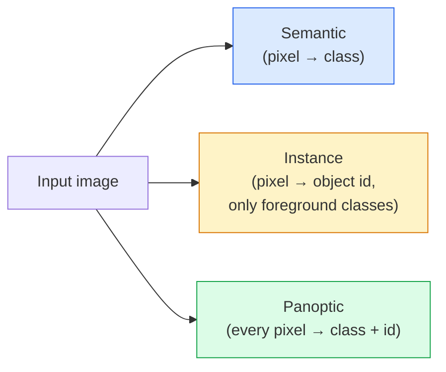
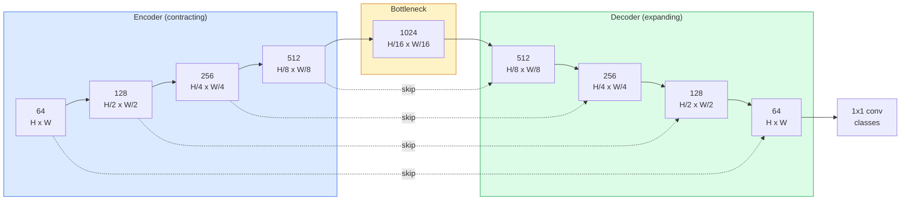

# Semantic Segmentation — U-Net · 语义分割——U-Net

> Segmentation is classification at every pixel. U-Net makes it work by pairing a downsampling encoder with an upsampling decoder and wiring skip connections between them.

> 分割就是逐像素做分类。U-Net 让这件事成立：把一个下采样编码器和一个上采样解码器配对，再在两者之间接上跳跃连接（skip connection）。

**类型：** Build
**语言：** Python
**前置课程：** Phase 4 Lesson 03（CNNs 卷积神经网络）、Phase 4 Lesson 04（Image Classification 图像分类）
**时间：** ~75 分钟

## Learning Objectives · 学习目标

- 区分语义分割、实例分割和全景分割，并为给定问题选对任务
- 在 PyTorch 里从零搭一个 U-Net：编码器块、瓶颈层、带转置卷积的解码器、跳跃连接
- 实现逐像素交叉熵、Dice 损失，以及当前医学和工业分割默认使用的组合损失
- 读懂每个类别的 IoU 和 Dice 指标，判断糟糕的分数来自小物体召回、边界精度还是类别不平衡

> Distinguish semantic, instance, and panoptic segmentation and pick the right task for a given problem
> Build a U-Net from scratch in PyTorch with encoder blocks, a bottleneck, a decoder with transposed convolutions, and skip connections
> Implement pixel-wise cross-entropy, Dice loss, and the combined loss that is the current default for medical and industrial segmentation
> Read IoU and Dice metrics per class and diagnose whether a bad score comes from small-object recall, boundary accuracy, or class imbalance

---

## The Problem · 问题在哪

分类每张图输出一个标签。检测每张图输出几个框。分割每个像素输出一个标签。对尺寸为 `H x W` 的输入，输出是形状 `H x W`（语义）或 `H x W x N_instances`（实例）的张量。这是每张图上百万个预测，不是一个。

分割的结构特性让它支撑起几乎所有稠密预测类视觉产品：医学影像（肿瘤 mask）、自动驾驶（道路、车道、障碍物）、卫星（建筑物轮廓、农田边界）、文档解析（版面区域）、机器人（可抓取区域）。这些任务没有一个能靠给物体画个框解决；它们要的是精确的轮廓。

架构上的问题说起来简单、解起来不简单：你需要网络**同时**看到图像的全局上下文（这是什么样的场景）和局部像素细节（到底哪个像素是马路、哪个是人行道）。标准 CNN 靠空间压缩换取上下文，细节就被丢掉了。U-Net 就是把两头都拿到的那个设计。

> Classification outputs one label per image. Detection outputs a handful of boxes per image. Segmentation outputs one label per pixel. For an input of size `H x W`, the output is a tensor of shape `H x W` (semantic) or `H x W x N_instances` (instance). That is millions of predictions per image, not one.
> ... The architectural problem is simple to state and not simple to solve: you need the network to see the global context of an image (what kind of scene is this) and the local pixel detail (exactly which pixel is road vs pavement) simultaneously. A standard CNN compresses spatially to gain context, which throws away the detail. U-Net was the design that got both.

---

## The Concept · 概念

### Semantic vs instance vs panoptic · 语义 vs 实例 vs 全景



- **语义分割**说「这个像素是马路，那个像素是汽车」。两辆相邻的车会融成一团。
- **实例分割**说「这个像素是 3 号车，那个像素是 5 号车」。忽略背景性的 stuff（「stuff」= 天空、马路、草地）。
- **全景分割（panoptic）**统一两者：每个像素都有类别标签，每个实例都有唯一 id，stuff 和 things 都被分割。

本课讲语义分割。下一课（Mask R-CNN）讲实例分割。

> **Semantic** says "this pixel is road, that pixel is car." Two cars next to each other collapse into a single blob.
> ... **Instance** says "this pixel is car #3, that pixel is car #5." Ignores background stuff ("stuff" = sky, road, grass).
> ... **Panoptic** unifies both: every pixel gets a class label, every instance gets a unique id, stuff and things both segmented.
> This lesson covers semantic. The next lesson (Mask R-CNN) covers instance.

### The U-Net shape · U-Net 的形状



编码器把空间分辨率减半四次、通道数翻倍。解码器反过来：空间分辨率翻倍四次、通道数减半。跳跃连接在每个分辨率上把对应的编码器特征与解码器特征拼接（concatenate）。最后的 1x1 卷积在全分辨率上做 `64 -> num_classes` 的映射。

为什么跳跃连接必不可少：解码器在试图输出像素级预测时，它见过的只是很小的特征图。没有跳跃连接，它无法精确定位边缘，因为那些信息在编码器里被压缩掉了。跳跃连接把编码器在下山途中算出的高分辨率特征图直接递给它。

> The encoder halves spatial resolution four times and doubles channels. The decoder reverses: doubles spatial resolution four times and halves channels. The skip connections concatenate matching encoder features with decoder features at every resolution. The final 1x1 conv maps `64 -> num_classes` at full resolution.
> ... Why skip connections are necessary: the decoder has seen only small feature maps by the time it tries to output pixel-level predictions. Without the skips it cannot localise edges accurately because that information was compressed away in the encoder. Skip connections hand it the high-resolution feature maps the encoder computed on the way down.

### Transposed vs bilinear upsample · 转置卷积 vs 双线性上采样

解码器必须扩大空间维度。两种选择：

- **转置卷积（transposed convolution）**（`nn.ConvTranspose2d`）——可学习的上采样。历史上的 U-Net 默认。当 stride 和 kernel size 不能整除时，会产生棋盘伪影（checkerboard artifacts）。
- **双线性上采样 + 3x3 卷积**——平滑上采样再接一个卷积。伪影更少、参数更少，是现在的现代默认。

两者在真实世界里都常见。第一个 U-Net，选双线性更稳妥。

> **Transposed convolution** (`nn.ConvTranspose2d`) — learnable upsample. Historical U-Net default. Can produce checkerboard artifacts if stride and kernel size do not divide evenly.
> ... **Bilinear upsample + 3x3 conv** — smooth upsample followed by a conv. Fewer artifacts, fewer parameters, now the modern default.
> Both appear in the wild. For a first U-Net, bilinear is safer.

### Cross-entropy on a pixel grid · 像素网格上的交叉熵

对有 C 类的语义分割，模型输出是 `(N, C, H, W)`。目标是 `(N, H, W)` 的整数类别 ID。交叉熵和分类情形完全一样，只是施加在每个空间位置上：

```
Loss = mean over (n, h, w) of -log( softmax(logits[n, :, h, w])[target[n, h, w]] )
```

PyTorch 的 `F.cross_entropy` 原生支持这种形状。不需要 reshape。

> For semantic segmentation with C classes, the model output is `(N, C, H, W)`. The target is `(N, H, W)` with integer class IDs. Cross-entropy is identical to the classification case, just applied at every spatial position.
> `F.cross_entropy` in PyTorch handles this shape natively. No reshape needed.

### Dice loss and why you need it · Dice 损失，以及为什么需要它

交叉熵把每个像素一视同仁。当一个类别主导整个画面时（医学影像：99% 背景、1% 肿瘤），这是错的。网络可以靠全预测背景拿到 99% 准确率，却毫无用处。

Dice 损失通过直接优化预测 mask 与真实 mask 的重叠来解决这个问题：

```
Dice(p, y) = 2 * sum(p * y) / (sum(p) + sum(y) + epsilon)
Dice_loss = 1 - Dice
```

其中 `p` 是某个类别的 sigmoid/softmax 概率图，`y` 是二值真值 mask。只有重叠完美时损失才为零。因为它是基于比例的，类别不平衡无关紧要。

实践中，用**组合损失**：

```
L = L_cross_entropy + lambda * L_dice       (lambda ~ 1)
```

交叉熵在训练早期给出稳定的梯度；Dice 让训练的后段聚焦到真正贴合 mask 的形状上。这个组合是医学影像的默认配置，在任何类别不平衡的数据集上都难以被击败。

> Cross-entropy treats every pixel equally. That is wrong when one class dominates the frame (medical imaging: 99% background, 1% tumour). The network can score 99% accuracy by predicting background everywhere and still be useless.
> ... Dice loss solves this by directly optimising the overlap between predicted and true mask.
> ... Cross-entropy gives stable gradients early in training; Dice focuses the tail of training on actually matching the mask shape. This combination is the medical-imaging default and hard to beat on any class-imbalanced dataset.

### Evaluation metrics · 评估指标

- **像素准确率（pixel accuracy）**——预测正确的像素百分比。便宜。在不平衡数据上，它和分类里的 accuracy 一样不靠谱。
- **每类 IoU** —— 每个类别 mask 的交并比；对类别取平均就是 mIoU。
- **Dice（像素上的 F1）** —— 和 IoU 相近；`Dice = 2 * IoU / (1 + IoU)`。医学影像圈偏爱 Dice，自动驾驶圈偏爱 IoU；两者单调相关。
- **Boundary F1** —— 衡量预测边界与真值边界的接近程度，很小的偏移也会被罚。对半导体检测这类高精度任务很重要。

要报每类 IoU，不要只报 mIoU。平均 IoU 会把一个 15% 的类，藏在九个 85% 的类后面。

> **Pixel accuracy** — percent of pixels predicted correctly. Cheap. Broken on imbalanced data for the same reason as accuracy in classification.
> ... **Boundary F1** — measures how close predicted boundaries are to ground-truth boundaries, penalising even small shifts. Important for high-precision tasks like semiconductor inspection.
> Report IoU per class, not just mIoU. Mean IoU hides a class at 15% when nine others are at 85%.

### Input resolution trade-off · 输入分辨率的权衡

U-Net 的编码器把分辨率减半四次，所以输入必须能被 16 整除。医学图像常见 512x512 或 1024x1024。自动驾驶裁剪图是 2048x1024。U-Net 的显存开销随 `H * W * C_max` 增长，1024x1024 输入配 1024 通道瓶颈时，一次前向传播就要吃掉好几个 GB 显存。

两个标准绕法：
1. 把输入切片（tile）——按 256x256 的 tile 带重叠处理，再拼接。
2. 用空洞卷积（dilated convolution）替换瓶颈层，保持更高分辨率的同时扩大感受野（DeepLab 一族）。

作为第一个模型，256x256 输入、64 通道基础的 U-Net，在 8 GB 显存上就能舒适训练。

```figure
segmentation-flood
```

> U-Net's encoder halves resolution four times, so the input must be divisible by 16. ... The memory cost of U-Net scales with `H * W * C_max`, and at 1024x1024 with 1024 bottleneck channels the forward pass already uses gigabytes of VRAM.
> For a first model, a 256x256 input with a 64-channel-base U-Net trains comfortably on 8 GB VRAM.

---

## Build It · 动手造

### Step 1: Encoder block · 编码器块

两个 3x3 卷积，带 batch norm 和 ReLU。第一个卷积改变通道数；第二个保持不变。

```python
import torch
import torch.nn as nn
import torch.nn.functional as F

class DoubleConv(nn.Module):
    def __init__(self, in_c, out_c):
        super().__init__()
        self.net = nn.Sequential(
            nn.Conv2d(in_c, out_c, kernel_size=3, padding=1, bias=False),
            nn.BatchNorm2d(out_c),
            nn.ReLU(inplace=True),
            nn.Conv2d(out_c, out_c, kernel_size=3, padding=1, bias=False),
            nn.BatchNorm2d(out_c),
            nn.ReLU(inplace=True),
        )

    def forward(self, x):
        return self.net(x)
```

这个块全程复用。`bias=False` 是因为 BN 的 beta 已经承担了偏置的角色。

> Two 3x3 convs with batch norm and ReLU. The first conv changes channel count; the second keeps it.
> This block is reused throughout. `bias=False` because BN's beta handles the bias.

### Step 2: Down and up blocks · 下采样与上采样块

```python
class Down(nn.Module):
    def __init__(self, in_c, out_c):
        super().__init__()
        self.net = nn.Sequential(
            nn.MaxPool2d(2),
            DoubleConv(in_c, out_c),
        )

    def forward(self, x):
        return self.net(x)


class Up(nn.Module):
    def __init__(self, in_c, out_c):
        super().__init__()
        self.up = nn.Upsample(scale_factor=2, mode="bilinear", align_corners=False)
        self.conv = DoubleConv(in_c, out_c)

    def forward(self, x, skip):
        x = self.up(x)
        if x.shape[-2:] != skip.shape[-2:]:
            x = F.interpolate(x, size=skip.shape[-2:], mode="bilinear", align_corners=False)
        x = torch.cat([skip, x], dim=1)
        return self.conv(x)
```

只比较空间维度的形状检查（`shape[-2:]`）能处理维度不能被 16 整除的输入；拼接前用一个保险的 `F.interpolate` 把张量对齐。如果比较完整 shape，通道数不同也会触发插值——那本该是一次响亮的报错，而不是一次无声的 interpolate。

> The spatial-only shape check (`shape[-2:]`) handles inputs whose dimensions are not divisible by 16; a safe `F.interpolate` aligns the tensor before the concat. Comparing the full shape would also trigger on channel-count differences, which should be a loud error, not a silent interpolate.

### Step 3: The U-Net · U-Net 本体

```python
class UNet(nn.Module):
    def __init__(self, in_channels=3, num_classes=2, base=64):
        super().__init__()
        self.inc = DoubleConv(in_channels, base)
        self.d1 = Down(base, base * 2)
        self.d2 = Down(base * 2, base * 4)
        self.d3 = Down(base * 4, base * 8)
        self.d4 = Down(base * 8, base * 16)
        self.u1 = Up(base * 16 + base * 8, base * 8)
        self.u2 = Up(base * 8 + base * 4, base * 4)
        self.u3 = Up(base * 4 + base * 2, base * 2)
        self.u4 = Up(base * 2 + base, base)
        self.outc = nn.Conv2d(base, num_classes, kernel_size=1)

    def forward(self, x):
        x1 = self.inc(x)
        x2 = self.d1(x1)
        x3 = self.d2(x2)
        x4 = self.d3(x3)
        x5 = self.d4(x4)
        x = self.u1(x5, x4)
        x = self.u2(x, x3)
        x = self.u3(x, x2)
        x = self.u4(x, x1)
        return self.outc(x)

net = UNet(in_channels=3, num_classes=2, base=32)
x = torch.randn(1, 3, 256, 256)
print(f"output: {net(x).shape}")
print(f"params: {sum(p.numel() for p in net.parameters()):,}")
```

输出形状 `(1, 2, 256, 256)`——空间尺寸与输入相同，`num_classes` 个通道。`base=32` 时约 7.7M 参数。

> Output shape `(1, 2, 256, 256)` — same spatial size as the input, `num_classes` channels. About 7.7M parameters at `base=32`.

### Step 4: Losses · 损失

```python
def dice_loss(logits, targets, num_classes, eps=1e-6):
    probs = F.softmax(logits, dim=1)
    targets_one_hot = F.one_hot(targets, num_classes).permute(0, 3, 1, 2).float()
    dims = (0, 2, 3)
    intersection = (probs * targets_one_hot).sum(dim=dims)
    denom = probs.sum(dim=dims) + targets_one_hot.sum(dim=dims)
    dice = (2 * intersection + eps) / (denom + eps)
    return 1 - dice.mean()


def combined_loss(logits, targets, num_classes, lam=1.0):
    ce = F.cross_entropy(logits, targets)
    dc = dice_loss(logits, targets, num_classes)
    return ce + lam * dc, {"ce": ce.item(), "dice": dc.item()}
```

Dice 按类别分别计算再取平均（macro Dice）。`eps` 防止 batch 里不存在的类别导致除零。

> Dice is computed per class then averaged (macro Dice). The `eps` prevents division by zero on classes absent from the batch.

### Step 5: IoU metric · IoU 指标

```python
@torch.no_grad()
def iou_per_class(logits, targets, num_classes):
    preds = logits.argmax(dim=1)
    ious = torch.zeros(num_classes)
    for c in range(num_classes):
        pred_c = (preds == c)
        true_c = (targets == c)
        inter = (pred_c & true_c).sum().float()
        union = (pred_c | true_c).sum().float()
        ious[c] = (inter / union) if union > 0 else torch.tensor(float("nan"))
    return ious
```

返回长度为 C 的向量。`nan` 标记 batch 里缺席的类别——计算 mIoU 时不要把它们平均进去。

> Returns a vector of length C. `nan` marks classes absent from the batch — do not average over those when computing mIoU.

### Step 6: Synthetic dataset for end-to-end verification · 用于端到端验证的合成数据集

在有颜色的背景上生成形状，逼网络去学形状而不是像素颜色。

```python
import numpy as np
from torch.utils.data import Dataset, DataLoader

def synthetic_segmentation(num_samples=200, size=64, seed=0):
    rng = np.random.default_rng(seed)
    images = np.zeros((num_samples, size, size, 3), dtype=np.float32)
    masks = np.zeros((num_samples, size, size), dtype=np.int64)
    for i in range(num_samples):
        bg = rng.uniform(0, 1, (3,))
        images[i] = bg
        masks[i] = 0
        num_shapes = rng.integers(1, 4)
        for _ in range(num_shapes):
            cls = int(rng.integers(1, 3))
            color = rng.uniform(0, 1, (3,))
            cx, cy = rng.integers(10, size - 10, size=2)
            r = int(rng.integers(4, 12))
            yy, xx = np.meshgrid(np.arange(size), np.arange(size), indexing="ij")
            if cls == 1:
                mask = (xx - cx) ** 2 + (yy - cy) ** 2 < r ** 2
            else:
                mask = (np.abs(xx - cx) < r) & (np.abs(yy - cy) < r)
            images[i][mask] = color
            masks[i][mask] = cls
        images[i] += rng.normal(0, 0.02, images[i].shape)
        images[i] = np.clip(images[i], 0, 1)
    return images, masks


class SegDataset(Dataset):
    def __init__(self, images, masks):
        self.images = images
        self.masks = masks

    def __len__(self):
        return len(self.images)

    def __getitem__(self, i):
        img = torch.from_numpy(self.images[i]).permute(2, 0, 1).float()
        mask = torch.from_numpy(self.masks[i]).long()
        return img, mask
```

三个类别：背景（0）、圆形（1）、方形（2）。网络必须学会区分形状。

> Generate shapes on coloured backgrounds so the network has to learn shape, not pixel colour.
> Three classes: background (0), circles (1), squares (2). The network must learn to distinguish shape.

### Step 7: Training loop · 训练循环

```python
def train_one_epoch(model, loader, optimizer, device, num_classes):
    model.train()
    loss_sum, total = 0.0, 0
    iou_sum = torch.zeros(num_classes)
    for x, y in loader:
        x, y = x.to(device), y.to(device)
        logits = model(x)
        loss, _ = combined_loss(logits, y, num_classes)
        optimizer.zero_grad()
        loss.backward()
        optimizer.step()
        loss_sum += loss.item() * x.size(0)
        total += x.size(0)
        iou_sum += iou_per_class(logits, y, num_classes).nan_to_num(0)
    return loss_sum / total, iou_sum / len(loader)
```

在合成数据集上跑 10-30 个 epoch，看形状类的 mIoU 爬过 0.9。注意 `nan_to_num(0)` 把 batch 里缺席的类当成零；要得到准确的每类 IoU，应按「类是否在场」做掩码，并在评估阶段跨 batch 用 `torch.nanmean`，而不是在这里平均。

> Run this for 10-30 epochs on the synthetic dataset and watch mIoU climb past 0.9 for the shape classes. Note the `nan_to_num(0)` treats classes absent from a batch as zero; for accurate per-class IoU, mask by presence and use `torch.nanmean` across batches at evaluation time rather than averaging here.

---

## Use It · 实战用法

生产环境里，`segmentation_models_pytorch`（「smp」）把每个标准分割架构和任意 torchvision 或 timm backbone 包装在一起。三行：

```python
import segmentation_models_pytorch as smp

model = smp.Unet(
    encoder_name="resnet34",
    encoder_weights="imagenet",
    in_channels=3,
    classes=3,
)
```

真实工作里还值得知道：
- **DeepLabV3+** 用空洞卷积替代基于最大池化的下采样，让瓶颈层保住分辨率；在卫星和驾驶数据上边界更快更好。
- **SegFormer** 把卷积编码器换成层级 transformer；当前许多基准上的 SOTA。
- **Mask2Former** / **OneFormer** 用单一架构统一语义、实例和全景分割。

三者都是 `smp` 或 `transformers` 里的即插即用替换，数据加载器不用改。

> For production, `segmentation_models_pytorch` ("smp") wraps every standard segmentation architecture with any torchvision or timm backbone. Three lines.
> ... **DeepLabV3+** replaces max-pool-based downsampling with dilated convs so the bottleneck keeps resolution; faster boundaries on satellite and driving data. ... **Mask2Former** / **OneFormer** unify semantic, instance, and panoptic segmentation in a single architecture.
> All three are drop-in replacements in `smp` or `transformers` with the same data loader.

---

## Ship It · 交付

本课产出：

- `outputs/prompt-segmentation-task-picker.md` —— 一个提示词：在语义、实例和全景分割之间做选择，并为给定任务点出该用的架构。
- `outputs/skill-segmentation-mask-inspector.md` —— 一个技能：报告类别分布、预测 mask 的统计量，以及哪些类别被欠预测或边界模糊。

> This lesson produces:
> `outputs/prompt-segmentation-task-picker.md` — a prompt that picks between semantic, instance, and panoptic segmentation and names the architecture for a given task.
> `outputs/skill-segmentation-mask-inspector.md` — a skill that reports class distribution, predicted-mask statistics, and the classes that are under-predicted or boundary-blurred.

---

## Exercises · 练习

1. **（简单）** 为二值分割任务（前景 vs 背景）实现 `bce_dice_loss`。在一个合成的两类数据集上验证：当前景只占 5% 像素时，组合损失比单独的 BCE 收敛得更快。
2. **（中等）** 把 `nn.Upsample + conv` 上采样块换成 `nn.ConvTranspose2d` 上采样块。两者都在合成数据集上训练并比较 mIoU。观察转置卷积版本里棋盘伪影出现的位置。
3. **（困难）** 拿一个真实分割数据集（Oxford-IIIT Pets、Cityscapes mini split 或某个医学子集），把 U-Net 训练到与 `smp.Unet` 参考成绩相差 2 个 IoU 点以内。报告每类 IoU，并指出哪些类别从「在损失里加 Dice」中获益最大。

> **(Easy)** Implement `bce_dice_loss` for a binary segmentation task (foreground vs background). Verify on a synthetic two-class dataset that the combined loss converges faster than BCE alone when the foreground is 5% of pixels.
> ... **(Hard)** Take a real segmentation dataset (Oxford-IIIT Pets, Cityscapes mini split, or a medical subset) and train the U-Net to within 2 IoU points of the `smp.Unet` reference. Report per-class IoU and identify which classes benefit most from adding Dice to the loss.

---

## Key Terms · 术语表

| 术语 | 人们怎么说 | 实际含义 |
|------|----------------|----------------------|
| Semantic segmentation | 「给每个像素打标签」 | 逐像素分到 C 个类别；同类别的实例会融在一起 |
| Instance segmentation | 「给每个物体打标签」 | 分开同类别的不用实例；只管前景 |
| Panoptic segmentation | 「语义 + 实例」 | 每个像素都有类别；每个 things 实例还有唯一 id |
| Skip connection | 「U-Net 的桥」 | 把编码器特征拼接到对应分辨率的解码器特征上；保留高频细节 |
| Transposed conv | 「反卷积」 | 可学习的上采样；可能产生棋盘伪影 |
| Dice loss | 「重叠损失」 | 1 - 2|A ∩ B| / (|A| + |B|)；直接优化 mask 重叠度，对类别不平衡稳健 |
| mIoU | 「平均交并比」 | 各类别 IoU 的平均值；分割领域的社区标准指标 |
| Boundary F1 | 「边界准确率」 | 只在边界像素上算的 F1 分数；对精度攸关的任务很重要 |

> Semantic segmentation | "Label every pixel" | Per-pixel classification into C classes; instances of the same class merge
> ... Dice loss | "Overlap loss" | 1 - 2|A ∩ B| / (|A| + |B|); optimises mask overlap directly and is robust to class imbalance
> ... mIoU | "Mean intersection over union" | Average IoU across classes; the community-standard metric for segmentation

---

## Further Reading · 延伸阅读

- [U-Net: Convolutional Networks for Biomedical Image Segmentation (Ronneberger et al., 2015)](https://arxiv.org/abs/1505.04597) —— 原始论文；人人都在抄的那张图在第 2 页
- [Fully Convolutional Networks (Long et al., 2015)](https://arxiv.org/abs/1411.4038) —— 第一篇把分割变成端到端卷积问题的论文
- [segmentation_models_pytorch](https://github.com/qubvel/segmentation_models.pytorch) —— 生产级分割的参考实现；每个标准架构加每个标准损失
- [iafoss, Unet34 submission with TTA (Kaggle notebook)](https://www.kaggle.com/code/iafoss/unet34-submission-tta-0-699-new-public-lb) —— 真实分割比赛上 U-Net 的测试时增强（TTA）

> the original paper; the figure everyone copies is on page 2
> ... the paper that first made segmentation an end-to-end conv problem
> ... test-time augmentation for a U-Net on a real segmentation competition
