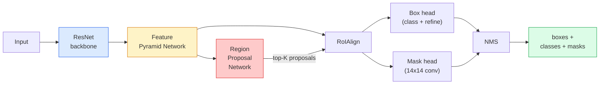

# Instance Segmentation — Mask R-CNN · 实例分割——Mask R-CNN

> Add a tiny mask branch to a Faster R-CNN detector and you have instance segmentation. The hard part is RoIAlign, and it is harder than it looks.

> 给 Faster R-CNN 检测器加一个很小的 mask 分支，你就得到了实例分割。难的部分是 RoIAlign，而它比看上去更难。

**类型：** Build + Learn
**语言：** Python
**前置课程：** Phase 4 Lesson 06（YOLO）、Phase 4 Lesson 07（U-Net）
**时间：** ~75 分钟

## Learning Objectives · 学习目标

- 端到端讲清 Mask R-CNN 架构：backbone、FPN、RPN、RoIAlign、box head、mask head
- 从零实现 RoIAlign，并解释为什么 RoIPool 已被弃用
- 用 torchvision 的 `maskrcnn_resnet50_fpn_v2` 预训练模型产出生产级实例 mask，并正确读懂它的输出格式
- 在小型自定义数据集上微调 Mask R-CNN：替换 box 和 mask 两个 head，同时保持 backbone 冻结

> Trace the Mask R-CNN architecture end-to-end: backbone, FPN, RPN, RoIAlign, box head, mask head
> Implement RoIAlign from scratch and explain why RoIPool is no longer used
> Use the torchvision `maskrcnn_resnet50_fpn_v2` pretrained model for production-quality instance masks and read its output format correctly
> Fine-tune Mask R-CNN on a small custom dataset by replacing the box and mask heads and keeping the backbone frozen

---

## The Problem · 问题在哪

语义分割给你每个类别一个 mask。实例分割给你每个物体一个 mask——即使两个物体同属一类。数个体、跨帧跟踪、测量东西（墙里每块砖的外接框、显微镜图像里每个细胞）都非实例分割不可。

Mask R-CNN（He 等，2017）把实例分割重新表述为「检测 + mask」，从而解决了这个问题。这个设计干净到此后五年里几乎所有实例分割论文都是 Mask R-CNN 的变体，而 torchvision 的实现至今仍是中小规模数据集的生产默认。

困难的工程问题是采样：怎么从一个角点不对齐像素边界的建议框（proposal box）里，裁出一个固定大小的特征区域？这件事做错，处处损失零点几个 mAP 点。RoIAlign 就是答案。

> Semantic segmentation gives you one mask per class. Instance segmentation gives you one mask per object, even when two objects share a class. Counting individuals, tracking across frames, and measuring things (the bounding box of each brick in a wall, each cell in a microscope image) all demand instance segmentation.
> ... The hard engineering problem is sampling: how do you crop a fixed-size feature region out of a proposal box whose corners do not align with pixel boundaries? Getting that wrong costs tenths of a mAP point everywhere. RoIAlign is the answer.

---

## The Concept · 概念

### The architecture · 架构



要理解五个部件：

1. **Backbone** —— 在 ImageNet 上训练的 ResNet-50 或 ResNet-101。产出一组 stride 分别为 4、8、16、32 的特征图层级。
2. **FPN（特征金字塔网络，Feature Pyramid Network）** —— 自顶向下 + 横向连接，让每个层级都拿到语义丰富的 C 通道特征。检测按物体尺寸查询 FPN 的对应层级。
3. **RPN（区域建议网络，Region Proposal Network）** —— 一个小的卷积头，在每个锚框位置预测「这里有没有物体」和「怎么把框修得更贴合」。每张图产出约 1000 个建议（proposal）。
4. **RoIAlign** —— 从任意 FPN 层级上的任意框，采样出一个固定大小（如 7x7）的特征块。双线性采样，不做量化。
5. **Heads** —— 两层 box head 负责修框和选类别，外加一个小卷积头，为每个建议输出 `28x28` 的二值 mask。

> **Backbone** — ResNet-50 or ResNet-101 trained on ImageNet. Produces a hierarchy of feature maps at strides 4, 8, 16, 32.
> ... **FPN (Feature Pyramid Network)** — top-down + lateral connections that give every level C channels of semantic-rich features. Detection queries the FPN level matching the object size.
> ... **RoIAlign** — samples a fixed-size (e.g. 7x7) feature patch from any box on any FPN level. Bilinear sampling, no quantisation.
> ... **Heads** — two-layer box head that refines the box and picks a class, plus a small conv head that outputs a `28x28` binary mask for each proposal.

### Why RoIAlign, not RoIPool · 为什么用 RoIAlign 而不是 RoIPool

最初的 Fast R-CNN 用的是 RoIPool：把建议框切成网格，每个格子里取最大特征，并把所有坐标四舍五入成整数。这个取整会让特征图与输入像素坐标错开最多整整一个特征图像素——在 224x224 的图上很小，在 stride 32 的特征图上是灾难。

```
RoIPool:
  box (34.7, 51.3, 98.2, 142.9)
  round -> (34, 51, 98, 142)
  split grid -> round each cell boundary
  misalignment accumulates at every step

RoIAlign:
  box (34.7, 51.3, 98.2, 142.9)
  sample at exact float coordinates using bilinear interpolation
  no rounding anywhere
```

RoIAlign 在 COCO 上白捡 3-4 个点的 mask AP。现在所有在乎定位的检测器都在用它——YOLOv7 seg、RT-DETR、Mask2Former 一视同仁。

> The original Fast R-CNN used RoIPool, which splits a proposal box into a grid, takes the maximum feature in each cell, and rounds all coordinates to integers. That rounding misaligns the feature map from the input pixel coordinates by up to a full feature-map pixel — small on a 224x224 image, catastrophic when the feature map is stride 32.
> RoIAlign lifts mask AP by 3-4 points on COCO for free. Every detector that cares about localisation now uses it — YOLOv7 seg, RT-DETR, Mask2Former alike.

### The RPN in one paragraph · 一段话讲完 RPN

在特征图的每个位置放 K 个不同大小和形状的锚框。为每个锚框预测一个 objectness 得分和一个回归偏移量，把锚框变成更贴合的框。按得分保留前约 1,000 个框，在 IoU 0.7 上做 NMS，把幸存者交给 heads。RPN 用自己的小损失训练——结构与第 6 课的 YOLO 损失相同，只是只有两个类（物体 / 非物体）。

> At every position of a feature map, place K anchor boxes of different sizes and shapes. Predict an objectness score for each anchor and a regression offset to turn the anchor into a better-fitting box. Keep the top ~1,000 boxes by score, apply NMS at IoU 0.7, and hand the survivors to the heads. The RPN is trained with its own mini-loss — the same structure as the YOLO loss from Lesson 6, just with two classes (object / no object).

### The mask head · mask 头

对每个建议（RoIAlign 之后），mask 头是一个微型 FCN：四个 3x3 卷积、一个 2 倍反卷积（deconv）、最后一个 1x1 卷积在 `28x28` 分辨率上输出 `num_classes` 个通道。只有对应预测类别的那个通道被保留；其余全部忽略。这把 mask 预测与分类解耦了。

把 28x28 的 mask 上采样到建议框的原始像素尺寸，就得到最终的二值 mask。

> For each proposal (after RoIAlign) the mask head is a tiny FCN: four 3x3 convs, a 2x deconv, a final 1x1 conv that produces `num_classes` output channels at `28x28` resolution. Only the channel corresponding to the predicted class is kept; the others are ignored. This decouples mask prediction from classification.
> Upsample the 28x28 mask to the proposal's original pixel size to produce the final binary mask.

### Losses · 损失

Mask R-CNN 有四项损失加在一起：

```
L = L_rpn_cls + L_rpn_box + L_box_cls + L_box_reg + L_mask
```

- `L_rpn_cls`、`L_rpn_box` —— RPN 建议的 objectness + 框回归。
- `L_box_cls` —— head 分类器在 (C+1) 个类别（含背景）上的交叉熵。
- `L_box_reg` —— head 框修正上的 smooth L1。
- `L_mask` —— 28x28 mask 输出上的逐像素二值交叉熵。

每个损失都有自己的默认权重；torchvision 实现把它们暴露为构造函数参数。

> Mask R-CNN has four losses added together.
> ... `L_box_cls` — cross-entropy over (C+1) classes (including background) on the head's classifier. ... `L_mask` — per-pixel binary cross-entropy on the 28x28 mask output.
> Each loss has its own default weight; the torchvision implementation exposes them as constructor arguments.

### Output format · 输出格式

`torchvision.models.detection.maskrcnn_resnet50_fpn_v2` 返回一个 dict 列表，每张图一个：

```
{
    "boxes":  (N, 4) in (x1, y1, x2, y2) pixel coordinates,
    "labels": (N,) class IDs, 0 = background so indices are 1-based,
    "scores": (N,) confidence scores,
    "masks":  (N, 1, H, W) float masks in [0, 1] — threshold at 0.5 for binary,
}
```

mask 已经是全图分辨率。28x28 的 head 输出已在内部完成上采样。

```figure
cv3-roialign-sampling
```

> `torchvision.models.detection.maskrcnn_resnet50_fpn_v2` returns a list of dicts, one per image.
> The mask is full image resolution already. The 28x28 head output has been upsampled internally.

---

## Build It · 动手造

### Step 1: RoIAlign from scratch · 从零实现 RoIAlign

这是 Mask R-CNN 里唯一一个「看代码比看文字更好懂」的组件。

```python
import torch
import torch.nn.functional as F

def roi_align_single(feature, box, output_size=7, spatial_scale=1 / 16.0):
    """
    feature: (C, H, W) single-image feature map
    box: (x1, y1, x2, y2) in original image pixel coordinates
    output_size: side of the output grid (7 for box head, 14 for mask head)
    spatial_scale: reciprocal of the feature map stride
    """
    C, H, W = feature.shape
    x1, y1, x2, y2 = [c * spatial_scale - 0.5 for c in box]
    bin_w = (x2 - x1) / output_size
    bin_h = (y2 - y1) / output_size

    grid_y = torch.linspace(y1 + bin_h / 2, y2 - bin_h / 2, output_size)
    grid_x = torch.linspace(x1 + bin_w / 2, x2 - bin_w / 2, output_size)
    yy, xx = torch.meshgrid(grid_y, grid_x, indexing="ij")

    gx = 2 * (xx + 0.5) / W - 1
    gy = 2 * (yy + 0.5) / H - 1
    grid = torch.stack([gx, gy], dim=-1).unsqueeze(0)
    sampled = F.grid_sample(feature.unsqueeze(0), grid, mode="bilinear",
                            align_corners=False)
    return sampled.squeeze(0)
```

每个数都取在双线性采样的位置上。没有取整，没有量化，没有断掉的梯度。

> This is the one component of Mask R-CNN that is simpler to understand as code than as prose.
> Every number is at a bilinearly-sampled position. No rounding, no quantisation, no dropped gradients.

### Step 2: Compare to torchvision's RoIAlign · 与 torchvision 的 RoIAlign 对比

```python
from torchvision.ops import roi_align

feature = torch.randn(1, 16, 50, 50)
boxes = torch.tensor([[0, 10, 20, 100, 90]], dtype=torch.float32)  # (batch_idx, x1, y1, x2, y2)

ours = roi_align_single(feature[0], boxes[0, 1:].tolist(), output_size=7, spatial_scale=1/4)
theirs = roi_align(feature, boxes, output_size=(7, 7), spatial_scale=1/4, sampling_ratio=1, aligned=True)[0]

print(f"shape ours:   {tuple(ours.shape)}")
print(f"shape theirs: {tuple(theirs.shape)}")
print(f"max|diff|:    {(ours - theirs).abs().max().item():.3e}")
```

在 `sampling_ratio=1` 且 `aligned=True` 的条件下，两者误差在 `1e-5` 以内。

> With `sampling_ratio=1` and `aligned=True`, the two match to within `1e-5`.

### Step 3: Load a pretrained Mask R-CNN · 加载预训练 Mask R-CNN

```python
import torch
from torchvision.models.detection import maskrcnn_resnet50_fpn_v2, MaskRCNN_ResNet50_FPN_V2_Weights

model = maskrcnn_resnet50_fpn_v2(weights=MaskRCNN_ResNet50_FPN_V2_Weights.DEFAULT)
model.eval()
print(f"params: {sum(p.numel() for p in model.parameters()):,}")
print(f"classes (including background): {len(model.roi_heads.box_predictor.cls_score.out_features * [0])}")
```

46M 参数，91 类（COCO）。第一个类（id 0）是背景；模型真正检测的类从 id 1 开始。

> 46M parameters, 91 classes (COCO). The first class (id 0) is background; everything the model actually detects starts at id 1.

### Step 4: Run inference · 跑一次推理

```python
with torch.no_grad():
    x = torch.randn(3, 400, 600)
    predictions = model([x])
p = predictions[0]
print(f"boxes:  {tuple(p['boxes'].shape)}")
print(f"labels: {tuple(p['labels'].shape)}")
print(f"scores: {tuple(p['scores'].shape)}")
print(f"masks:  {tuple(p['masks'].shape)}")
```

mask 张量形状是 `(N, 1, H, W)`。在 0.5 处卡阈值，得到每个物体的二值 mask：

```python
binary_masks = (p['masks'] > 0.5).squeeze(1)  # (N, H, W) boolean
```

> The mask tensor is shape `(N, 1, H, W)`. Threshold at 0.5 to get a binary mask per object.

### Step 5: Swap the heads for a custom class count · 换 head 适配自定义类别数

常见的微调配方：复用 backbone、FPN 和 RPN；替换两个分类头。

```python
from torchvision.models.detection.faster_rcnn import FastRCNNPredictor
from torchvision.models.detection.mask_rcnn import MaskRCNNPredictor

def build_custom_maskrcnn(num_classes):
    model = maskrcnn_resnet50_fpn_v2(weights=MaskRCNN_ResNet50_FPN_V2_Weights.DEFAULT)
    in_features = model.roi_heads.box_predictor.cls_score.in_features
    model.roi_heads.box_predictor = FastRCNNPredictor(in_features, num_classes)
    in_features_mask = model.roi_heads.mask_predictor.conv5_mask.in_channels
    hidden_layer = 256
    model.roi_heads.mask_predictor = MaskRCNNPredictor(in_features_mask, hidden_layer, num_classes)
    return model

custom = build_custom_maskrcnn(num_classes=5)
print(f"custom cls_score.out_features: {custom.roi_heads.box_predictor.cls_score.out_features}")
```

`num_classes` 必须包含背景类，所以 4 个物体类的数据集要用 `num_classes=5`。

> The common fine-tuning recipe: reuse the backbone, FPN, and RPN; replace the two classifier heads.
> `num_classes` must include the background class, so a dataset with 4 object classes uses `num_classes=5`.

### Step 6: Freeze what does not need training · 冻结不需要训练的部分

小数据集上，冻结 backbone 和 FPN。只让 RPN 的 objectness + 回归和两个 head 学习。

```python
def freeze_backbone_and_fpn(model):
    # torchvision Mask R-CNN packs the FPN inside `model.backbone` (as
    # `model.backbone.fpn`), so iterating `model.backbone.parameters()` covers
    # both the ResNet feature layers and the FPN lateral/output convs.
    for p in model.backbone.parameters():
        p.requires_grad = False
    return model

custom = freeze_backbone_and_fpn(custom)
trainable = sum(p.numel() for p in custom.parameters() if p.requires_grad)
print(f"trainable after freeze: {trainable:,}")
```

在 500 张图的数据集上，这就是收敛与过拟合之间的差别。

> On small datasets, freeze the backbone and the FPN. Only the RPN objectness + regression and the two heads learn.
> On 500-image datasets this is the difference between convergence and overfitting.

---

## Use It · 实战用法

torchvision 里 Mask R-CNN 的完整训练循环是 40 行，且在不同任务之间没有实质差别——换数据集就能跑。

```python
def train_step(model, images, targets, optimizer):
    model.train()
    loss_dict = model(images, targets)
    losses = sum(loss for loss in loss_dict.values())
    optimizer.zero_grad()
    losses.backward()
    optimizer.step()
    return {k: v.item() for k, v in loss_dict.items()}
```

`targets` 列表的每个元素是每张图一个 dict，包含 `boxes`、`labels` 和 `masks`（形状 `(num_instances, H, W)` 的二值张量）。训练时模型返回四个损失的 dict，评估时返回预测列表，依据 `model.training` 切换。

`pycocotools` 评估器会同时给出框和 mask 的 mAP@IoU=0.5:0.95；两个数都要看，才能知道瓶颈在 box head 还是 mask head。

> The full training loop for Mask R-CNN in torchvision is 40 lines and does not change meaningfully between tasks — swap datasets and go.
> The `targets` list must have per-image dicts with `boxes`, `labels`, and `masks` (as `(num_instances, H, W)` binary tensors). The model returns a dict of four losses during training and a list of predictions during eval, keyed on `model.training`.
> The `pycocotools` evaluator produces mAP@IoU=0.5:0.95 both for boxes and for masks; you need both numbers to know if the box head or the mask head is the bottleneck.

---

## Ship It · 交付

本课产出：

- `outputs/prompt-instance-vs-semantic-router.md` —— 一个提示词：问三个问题，然后在实例 / 语义 / 全景之间做出选择，并给出该从哪个模型起步。
- `outputs/skill-mask-rcnn-head-swapper.md` —— 一个技能：给定新的 `num_classes`，生成在任意 torchvision 检测模型上换 head 的那 10 行代码。

> This lesson produces:
> `outputs/prompt-instance-vs-semantic-router.md` — a prompt that asks three questions and picks instance vs semantic vs panoptic plus the exact model to start with.
> `outputs/skill-mask-rcnn-head-swapper.md` — a skill that generates the 10 lines of code for swapping heads on any torchvision detection model, given the new `num_classes`.

---

## Exercises · 练习

1. **（简单）** 在 100 个随机框上，把你的 RoIAlign 与 `torchvision.ops.roi_align` 对拍。报告最大绝对差。再跑一遍 RoIPool（2017 年前的行为），展示它在靠近边界的框上偏差约 1-2 个特征图像素。
2. **（中等）** 在一个 50 张图的自定义数据集上（任意两个类：气球、鱼、坑洞、logo）微调 `maskrcnn_resnet50_fpn_v2`。冻结 backbone，训练 20 个 epoch，报告 mask AP@0.5。
3. **（困难）** 把 Mask R-CNN 的 mask 头换成在 56x56 而不是 28x28 上预测的版本。测量前后两次的 mAP@IoU=0.75。解释为什么这个增益（或没有增益）符合预期的边界精度 / 显存权衡。

> **(Easy)** Verify your RoIAlign against `torchvision.ops.roi_align` on 100 random boxes. Report the max absolute difference. Also run RoIPool (pre-2017 behaviour) and show it diverges by ~1-2 feature-map pixels on boxes near the border.
> ... **(Hard)** Replace Mask R-CNN's mask head with one that predicts at 56x56 instead of 28x28. Measure mAP@IoU=0.75 before and after. Explain why the gain (or lack of one) matches the expected boundary-precision / memory trade-off.

---

## Key Terms · 术语表

| 术语 | 人们怎么说 | 实际含义 |
|------|----------------|----------------------|
| Mask R-CNN | 「检测加 mask」 | Faster R-CNN + 一个小 FCN 头，为每个建议的每个类别预测一个 28x28 mask |
| FPN | 「特征金字塔」 | 自顶向下 + 横向连接，让每个 stride 层级都拿到语义丰富的 C 通道特征 |
| RPN | 「出建议的」 | 一个小卷积头，每张图产出约 1000 个物体 / 非物体建议 |
| RoIAlign | 「不取整的裁剪」 | 从任意浮点坐标的框中双线性采样出固定大小的特征网格 |
| RoIPool | 「2017 年前的裁剪」 | 目的与 RoIAlign 相同，但会对框坐标取整；已过时 |
| Mask AP | 「实例 mAP」 | 用 mask IoU 而不是框 IoU 计算的平均精度；COCO 实例分割指标 |
| Binary mask head | 「每类一个 mask」 | 为每个建议的每个类别预测一个二值 mask；只保留预测类别对应的通道 |
| Background class | 「第 0 类」 | 兜底的「无物体」类；真实类别的索引从 1 开始 |

> Mask R-CNN | "Detection plus masks" | Faster R-CNN + a small FCN head that predicts a 28x28 mask per proposal per class
> ... RoIAlign | "No-rounding crop" | Bilinearly samples a fixed-size feature grid from any float-coordinate box
> ... Mask AP | "Instance mAP" | Average precision computed with mask IoU instead of box IoU; the COCO instance segmentation metric

---

## Further Reading · 延伸阅读

- [Mask R-CNN (He et al., 2017)](https://arxiv.org/abs/1703.06870) —— 原始论文；第 3 节讲 RoIAlign，是必读部分
- [FPN: Feature Pyramid Networks (Lin et al., 2017)](https://arxiv.org/abs/1612.03144) —— FPN 论文；每个现代检测器都在用它
- [torchvision Mask R-CNN tutorial](https://pytorch.org/tutorials/intermediate/torchvision_tutorial.html) —— 微调循环的参考实现
- [Detectron2 model zoo](https://github.com/facebookresearch/detectron2/blob/main/MODEL_ZOO.md) —— 生产级实现，带几乎每种检测和分割变体的训练好的权重

> the paper; section 3 on RoIAlign is the critical read
> ... the FPN paper; every modern detector uses it
> ... production implementations with trained weights for nearly every detection and segmentation variant
