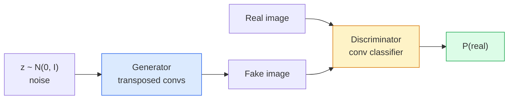
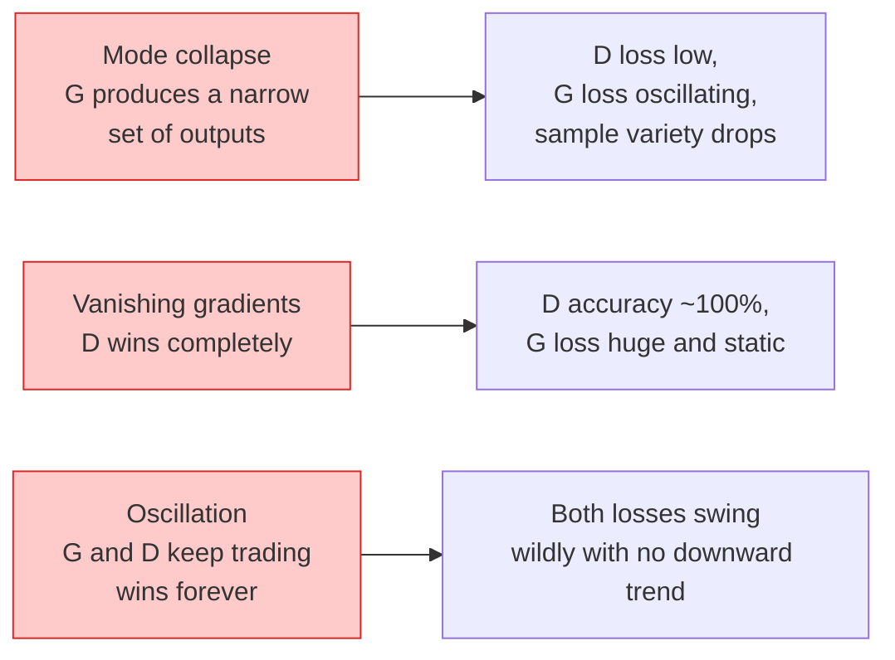

# Image Generation — GANs · 图像生成——GAN

> A GAN is two neural networks in a fixed game. One draws, one critiques. They get better together until the drawings fool the critic.

> GAN 是两个神经网络在玩一场规则固定的博弈。一个负责画，一个负责挑刺。它们一起变强，直到画出来的东西能骗过裁判。

**类型：** Build
**语言：** Python
**前置课程：** Phase 4 Lesson 03（CNNs 卷积神经网络）、Phase 3 Lesson 06（Optimizers 优化器）、Phase 3 Lesson 07（Regularization 正则化）
**时间：** ~75 分钟

## Learning Objectives · 学习目标

- 解释生成器与判别器之间的极小极大博弈（minimax game），以及为什么均衡对应 p_model = p_data
- 在 PyTorch 里实现一个 DCGAN，用不到 60 行代码生成连贯的 32x32 合成图像
- 用三个标准技巧稳定 GAN 训练：非饱和损失（non-saturating loss）、谱归一化（spectral norm）、TTUR（双时间尺度更新规则）
- 读懂训练曲线，区分健康收敛与模式坍缩（mode collapse）、震荡和「判别器完全赢」

> Explain the minimax game between generator and discriminator and why the equilibrium corresponds to p_model = p_data
> Implement a DCGAN in PyTorch and get it to generate coherent 32x32 synthetic images in under 60 lines
> Stabilise GAN training with the three standard tricks: non-saturating loss, spectral norm, TTUR (two-timescale update rule)
> Read training curves that distinguish healthy convergence from mode collapse, oscillation, and discriminator-wins-completely

---

## The Problem · 问题在哪

分类教网络把图像映射到标签。生成把问题反过来：采样出看起来像来自同一分布的新图像。没有一个可以拿来做 diff 的「正确」输出；只有你想模仿的一个分布。

标准损失函数（MSE、交叉熵）无法度量「这个样本是不是来自真实分布」。最小化逐像素误差得到的是模糊的平均，不是逼真的样本。突破在于把损失本身学出来：训练第二个网络，它的任务是分辨真假，再用它的判断去推动生成器。

GAN（Goodfellow 等，2014）定义了这个框架。到 2018 年，StyleGAN 已经能生成与照片难以区分的 1024x1024 人脸。此后扩散模型在质量和可控性上登顶，但让扩散变得实用的每一个技巧——归一化选择、隐空间（latent space）、特征损失——最早都是在 GAN 上搞明白的。

> Classification teaches a network to map images to labels. Generation inverts the problem: sample new images that look like they came from the same distribution. There is no "correct" output you can diff against; there is only a distribution you want to mimic.
> ... The breakthrough was to learn the loss: train a second network whose job is to tell real from fake, and use its judgement to push the generator.
> GANs (Goodfellow et al., 2014) defined that framework. By 2018 StyleGAN was producing 1024x1024 faces indistinguishable from photographs. Diffusion models have since taken the throne on quality and controllability, but every trick that makes diffusion practical — normalisation choices, latent spaces, feature losses — was first understood on GANs.

---

## The Concept · 概念

### The two networks · 两个网络



**生成器（generator）** G 接收一个噪声向量 `z`，输出一张图像。**判别器（discriminator）** D 接收一张图像，输出单个标量：这张图是真实图像的概率。

> The **generator** G takes a vector of noise `z` and outputs an image. The **discriminator** D takes an image and outputs a single scalar: the probability that the image is real.

### The game · 博弈

G 想让 D 犯错。D 想让自己正确。形式化写出来：

```
min_G max_D  E_x[log D(x)] + E_z[log(1 - D(G(z)))]
```

从右往左读：D 在最大化对真图（`log D(real)`）和假图（`log (1 - D(fake))`）的判别准确率。G 在最小化 D 对假图的准确率——它想让 `D(G(z))` 变高。

Goodfellow 证明了这个极小极大博弈存在一个全局均衡：`p_G = p_data`，D 到处输出 0.5，生成分布与真实分布之间的 Jensen-Shannon 散度为零。难的是怎么走到那里。

> G wants D to be wrong. D wants to be right. Formally:
> Read right to left: D is maximising accuracy on real (`log D(real)`) and fake (`log (1 - D(fake))`) images. G is minimising D's accuracy on fakes — it wants `D(G(z))` to be high.
> Goodfellow proved that this minimax has a global equilibrium where `p_G = p_data`, D outputs 0.5 everywhere, and the Jensen-Shannon divergence between generated and real distributions is zero. The hard part is getting there.

### Non-saturating loss · 非饱和损失

上面的形式在数值上不稳定。训练早期，每张假图的 `D(G(z))` 都接近零，于是 `log(1 - D(G(z)))` 对 G 的梯度趋于消失。修法：把 G 的损失翻转过来。

```
L_D = -E_x[log D(x)] - E_z[log(1 - D(G(z)))]
L_G = -E_z[log D(G(z))]                          # non-saturating
```

这样当 `D(G(z))` 接近零时，G 的损失很大、梯度有信息量。每个现代 GAN 都用这个变体训练。

> The form above is numerically unstable. Early in training, `D(G(z))` is near zero for every fake, so `log(1 - D(G(z)))` has vanishing gradients with respect to G. The fix: flip G's loss.
> Now when `D(G(z))` is near zero, G's loss is large and its gradient is informative. Every modern GAN trains with this variant.

### DCGAN architecture rules · DCGAN 架构规则

Radford、Metz、Chintala（2015）把多年的失败实验浓缩成五条规则，让 GAN 训练稳定下来：

1. 两个网络都用带步幅的卷积（strided conv）替换池化。
2. 生成器和判别器都用 batch norm，G 的输出层和 D 的输入层除外。
3. 更深的架构上去掉全连接层。
4. G 除输出层外全用 ReLU（输出层用 tanh 映射到 [-1, 1]）。
5. D 所有层用 LeakyReLU（negative_slope=0.2）。

每个现代卷积 GAN（StyleGAN、BigGAN、GigaGAN）仍然从这五条规则出发，一次替换一个部件。

> Radford, Metz, Chintala (2015) distilled years of failed experiments into five rules that make GAN training stable:
> ... Every modern conv-based GAN (StyleGAN, BigGAN, GigaGAN) still starts from these rules and replaces pieces one at a time.

### Failure modes and their signatures · 失败模式及其特征



- **模式坍缩（mode collapse）**：G 找到一张能骗过 D 的图，然后只产出这一张。修法：加 minibatch discrimination、谱归一化，或做标签条件化。
- **判别器赢**：D 变得太强太快，G 的梯度消失。修法：缩小 D、调低 D 的学习率，或对真标签做 label smoothing。
- **震荡（oscillation）**：两个网络轮流赢，永远不接近均衡。修法：TTUR（D 比 G 学得快 2-4 倍），或换成 Wasserstein 损失。

> **Mode collapse**: G finds one image that fools D and produces only that. Fix: add minibatch discrimination, spectral norm, or label-conditioning.
> ... **Discriminator wins**: D becomes too strong too fast, G's gradients vanish. Fix: smaller D, lower D learning rate, or apply label smoothing on the real labels.
> ... **Oscillation**: the two nets trade wins without ever approaching equilibrium. Fix: TTUR (D learns faster than G by a factor of 2-4), or switch to Wasserstein loss.

### Evaluation · 评估

GAN 没有真值，那怎么知道它在正常工作？

- **看样本** —— 每个 epoch 结束时直接看 64 个样本。没有商量余地。
- **FID（Fréchet Inception Distance）** —— 真实集与生成集在 Inception-v3 特征分布之间的距离。越低越好。社区标准。
- **Inception Score** —— 更老、更脆；优先用 FID。
- **生成模型的 Precision/Recall** —— 分别度量质量（precision）和覆盖（recall）。比单独的 FID 信息量更大。

小规模合成数据实验，看样本就够了。

```figure
cv-gan-image
```

> GANs have no ground truth, so how do you know they are working?
> ... **FID (Fréchet Inception Distance)** — distance between Inception-v3 feature distributions of real and generated sets. Lower is better. Community standard.
> For a small synthetic-data run, sample inspection is enough.

---

## Build It · 动手造

### Step 1: Generator · 生成器

一个小型 DCGAN 生成器：吃 64 维噪声，产出 32x32 图像。

```python
import torch
import torch.nn as nn

class Generator(nn.Module):
    def __init__(self, z_dim=64, img_channels=3, feat=64):
        super().__init__()
        self.net = nn.Sequential(
            nn.ConvTranspose2d(z_dim, feat * 4, kernel_size=4, stride=1, padding=0, bias=False),
            nn.BatchNorm2d(feat * 4),
            nn.ReLU(inplace=True),
            nn.ConvTranspose2d(feat * 4, feat * 2, kernel_size=4, stride=2, padding=1, bias=False),
            nn.BatchNorm2d(feat * 2),
            nn.ReLU(inplace=True),
            nn.ConvTranspose2d(feat * 2, feat, kernel_size=4, stride=2, padding=1, bias=False),
            nn.BatchNorm2d(feat),
            nn.ReLU(inplace=True),
            nn.ConvTranspose2d(feat, img_channels, kernel_size=4, stride=2, padding=1, bias=False),
            nn.Tanh(),
        )

    def forward(self, z):
        return self.net(z.view(z.size(0), -1, 1, 1))
```

四个转置卷积，每个都是 `kernel_size=4, stride=2, padding=1`，干净地把空间尺寸翻倍。输出经 tanh 落在 [-1, 1]。

> A small DCGAN generator that takes 64-dim noise and produces a 32x32 image.
> Four transposed convs, each with `kernel_size=4, stride=2, padding=1` so they cleanly double spatial size. Output activations in [-1, 1] via tanh.

### Step 2: Discriminator · 判别器

生成器的镜像。LeakyReLU、带步幅的卷积，以一个标量 logit 收尾。

```python
class Discriminator(nn.Module):
    def __init__(self, img_channels=3, feat=64):
        super().__init__()
        self.net = nn.Sequential(
            nn.Conv2d(img_channels, feat, kernel_size=4, stride=2, padding=1),
            nn.LeakyReLU(0.2, inplace=True),
            nn.Conv2d(feat, feat * 2, kernel_size=4, stride=2, padding=1, bias=False),
            nn.BatchNorm2d(feat * 2),
            nn.LeakyReLU(0.2, inplace=True),
            nn.Conv2d(feat * 2, feat * 4, kernel_size=4, stride=2, padding=1, bias=False),
            nn.BatchNorm2d(feat * 4),
            nn.LeakyReLU(0.2, inplace=True),
            nn.Conv2d(feat * 4, 1, kernel_size=4, stride=1, padding=0),
        )

    def forward(self, x):
        return self.net(x).view(-1)
```

最后一个卷积把 `4x4` 特征图缩到 `1x1`。每张图输出一个标量；只在计算损失时才施加 sigmoid。

> Mirror of the generator. LeakyReLU, strided convs, ends with a scalar logit.
> The last conv reduces a `4x4` feature map to `1x1`. Output is a single scalar per image; apply sigmoid only during loss computation.

### Step 3: Training step · 训练步

交替进行：每个 batch 先更新 D 一次，再更新 G 一次。

```python
import torch.nn.functional as F

def train_step(G, D, real, z, opt_g, opt_d, device):
    real = real.to(device)
    bs = real.size(0)

    # D step
    opt_d.zero_grad()
    d_real = D(real)
    d_fake = D(G(z).detach())
    loss_d = (F.binary_cross_entropy_with_logits(d_real, torch.ones_like(d_real))
              + F.binary_cross_entropy_with_logits(d_fake, torch.zeros_like(d_fake)))
    loss_d.backward()
    opt_d.step()

    # G step
    opt_g.zero_grad()
    d_fake = D(G(z))
    loss_g = F.binary_cross_entropy_with_logits(d_fake, torch.ones_like(d_fake))
    loss_g.backward()
    opt_g.step()

    return loss_d.item(), loss_g.item()
```

D 步里的 `G(z).detach()` 至关重要：更新 D 时我们不希望梯度流进 G。忘了这个是经典的初学者 bug。

> Alternate: update D once, then G once, every batch.
> `G(z).detach()` in the D step is critical: we do not want gradients flowing into G during its update. Forgetting that is the classic beginner bug.

### Step 4: Full training loop on synthetic shapes · 合成形状上的完整训练循环

```python
from torch.utils.data import DataLoader, TensorDataset
import numpy as np

def synthetic_images(num=2000, size=32, seed=0):
    rng = np.random.default_rng(seed)
    imgs = np.zeros((num, 3, size, size), dtype=np.float32) - 1.0
    for i in range(num):
        r = rng.uniform(6, 12)
        cx, cy = rng.uniform(r, size - r, size=2)
        yy, xx = np.meshgrid(np.arange(size), np.arange(size), indexing="ij")
        mask = (xx - cx) ** 2 + (yy - cy) ** 2 < r ** 2
        color = rng.uniform(-0.5, 1.0, size=3)
        for c in range(3):
            imgs[i, c][mask] = color[c]
    return torch.from_numpy(imgs)

device = "cuda" if torch.cuda.is_available() else "cpu"
data = synthetic_images()
loader = DataLoader(TensorDataset(data), batch_size=64, shuffle=True)

G = Generator(z_dim=64, img_channels=3, feat=32).to(device)
D = Discriminator(img_channels=3, feat=32).to(device)
opt_g = torch.optim.Adam(G.parameters(), lr=2e-4, betas=(0.5, 0.999))
opt_d = torch.optim.Adam(D.parameters(), lr=2e-4, betas=(0.5, 0.999))

for epoch in range(10):
    for (batch,) in loader:
        z = torch.randn(batch.size(0), 64, device=device)
        ld, lg = train_step(G, D, batch, z, opt_g, opt_d, device)
    print(f"epoch {epoch}  D {ld:.3f}  G {lg:.3f}")
```

`Adam(lr=2e-4, betas=(0.5, 0.999))` 是 DCGAN 默认——低 beta1 防止动量项把对抗博弈稳过头。

> `Adam(lr=2e-4, betas=(0.5, 0.999))` is the DCGAN default — the low beta1 keeps the momentum term from stabilising the adversarial game too much.

### Step 5: Sampling · 采样

```python
@torch.no_grad()
def sample(G, n=16, z_dim=64, device="cpu"):
    G.eval()
    z = torch.randn(n, z_dim, device=device)
    imgs = G(z)
    imgs = (imgs + 1) / 2
    return imgs.clamp(0, 1)
```

采样前一定先切到 eval 模式。对 DCGAN 这很重要，因为此时用的是 batch norm 的滑动统计量，而不是当前 batch 的统计量。

> Always switch to eval mode before sampling. For DCGAN this matters because batch norm running stats are used instead of the batch's stats.

### Step 6: Spectral normalisation · 谱归一化

判别器里 BN 的即插即用替代品，保证网络是 1-Lipschitz 的。能修好大多数「D 赢太狠」的失败。

```python
from torch.nn.utils import spectral_norm

def build_sn_discriminator(img_channels=3, feat=64):
    return nn.Sequential(
        spectral_norm(nn.Conv2d(img_channels, feat, 4, 2, 1)),
        nn.LeakyReLU(0.2, inplace=True),
        spectral_norm(nn.Conv2d(feat, feat * 2, 4, 2, 1)),
        nn.LeakyReLU(0.2, inplace=True),
        spectral_norm(nn.Conv2d(feat * 2, feat * 4, 4, 2, 1)),
        nn.LeakyReLU(0.2, inplace=True),
        spectral_norm(nn.Conv2d(feat * 4, 1, 4, 1, 0)),
    )
```

把 `Discriminator` 换成 `build_sn_discriminator()`，你常常就不再需要 TTUR 这一招。谱归一化是单点收益最大的稳健性升级。

> A drop-in replacement for BN in the discriminator that guarantees the network is 1-Lipschitz. Fixes most "D wins too hard" failures.
> Swap `Discriminator` for `build_sn_discriminator()` and you often do not need the TTUR trick. Spectral norm is the easiest single robustness upgrade you can apply.

---

## Use It · 实战用法

认真的生成任务，用预训练权重，或者改用扩散模型。两个标准库：

- `torch_fidelity` 直接给你的生成器算 FID / IS，不用自己写评估代码。
- `pytorch-gan-zoo`（遗留项目）和 `StudioGAN` 提供经过测试的 DCGAN、WGAN-GP、SN-GAN、StyleGAN、BigGAN 实现。

2026 年，GAN 仍是以下场景的最佳选择：实时图像生成（延迟 <10 ms）、风格迁移、需要精确控制的图像到图像翻译（Pix2Pix、CycleGAN）。扩散模型在照片级真实感和文本条件化上取胜。

> For serious generation, use pretrained weights or switch to diffusion. Two standard libraries:
> ... In 2026, GANs are still the best choice for: real-time image generation (latency <10 ms), style transfer, image-to-image translation with precise control (Pix2Pix, CycleGAN). Diffusion wins on photorealism and text conditioning.

---

## Ship It · 交付

本课产出：

- `outputs/prompt-gan-training-triage.md` —— 一个提示词：读一段训练曲线描述，判断失败模式（模式坍缩、D 赢、震荡），并给出唯一推荐的修法。
- `outputs/skill-dcgan-scaffold.md` —— 一个技能：根据 `z_dim`、目标 `image_size` 和 `num_channels` 写出 DCGAN 脚手架，包括训练循环和样本保存器。

> This lesson produces:
> `outputs/prompt-gan-training-triage.md` — a prompt that reads a training curve description and picks the failure mode (mode collapse, D-wins, oscillation) plus the single recommended fix.
> `outputs/skill-dcgan-scaffold.md` — a skill that writes a DCGAN scaffold from `z_dim`, target `image_size`, and `num_channels`, including training loop and sample saver.

---

## Exercises · 练习

1. **（简单）** 在合成圆形数据集上训练上面的 DCGAN，每个 epoch 结束时保存一张 16 个样本的网格图。到第几个 epoch，生成的圆形才明显变圆？
2. **（中等）** 把判别器的 batch norm 换成谱归一化。两个版本并排训练。哪个收敛更快？跨三个随机种子，哪个方差更低？
3. **（困难）** 实现一个条件 DCGAN：把类别标签喂给 G 和 D（G 里把 one-hot 拼到噪声上，D 里拼接一个类别嵌入通道）。在第 7 课的合成「圆形 vs 方形」数据集上训练，并通过按指定标签采样来证明类别条件化生效了。

> **(Easy)** Train the DCGAN above on the synthetic circle dataset and save a grid of 16 samples at the end of each epoch. By which epoch do the generated circles become clearly circular?
> ... **(Hard)** Implement a conditional DCGAN: feed the class label into both G and D (concat one-hot to the noise in G, concat a class embedding channel in D). Train on the synthetic "circles vs squares" dataset from lesson 7 and show that class conditioning works by sampling with specific labels.

---

## Key Terms · 术语表

| 术语 | 人们怎么说 | 实际含义 |
|------|----------------|----------------------|
| Generator (G) | 「画画的网络」 | 把噪声映射成图像；训练目标是骗过判别器 |
| Discriminator (D) | 「裁判」 | 二分类器；训练目标是区分真图和生成图 |
| Minimax | 「那场博弈」 | 对 G 取最小、对 D 取最大的对抗损失；均衡在 p_G = p_data |
| Non-saturating loss | 「数值上 sane 的版本」 | G 的损失用 -log(D(G(z))) 而不是 log(1 - D(G(z)))，避免训练早期梯度消失 |
| Mode collapse | 「生成器只出一招」 | G 只产出数据分布的一小部分；用谱归一化、minibatch discrimination 或更大 batch 修 |
| TTUR | 「两个学习率」 | D 比 G 学得快，通常快 2-4 倍；稳定训练 |
| Spectral norm | 「1-Lipschitz 层」 | 一种权重归一化，约束每层的 Lipschitz 常数；防止 D 变得任意陡峭 |
| FID | 「Fréchet Inception Distance」 | 真实集与生成集在 Inception-v3 特征分布上的距离；标准评估指标 |

> Generator (G) | "The draws-stuff net" | Maps noise to images; trained to fool the discriminator
> ... Mode collapse | "Generator makes one thing" | G produces only a small subset of the data distribution; fix with SN, minibatch discrimination, or larger batch
> ... FID | "Fréchet Inception Distance" | Distance between Inception-v3 feature distributions of real and generated sets; the standard evaluation metric

---

## Further Reading · 延伸阅读

- [Generative Adversarial Networks (Goodfellow et al., 2014)](https://arxiv.org/abs/1406.2661) —— 一切的起点
- [DCGAN (Radford, Metz, Chintala, 2015)](https://arxiv.org/abs/1511.06434) —— 让 GAN 变得可训练的那套架构规则
- [Spectral Normalization for GANs (Miyato et al., 2018)](https://arxiv.org/abs/1802.05957) —— 单点最有用的稳定化技巧
- [StyleGAN3 (Karras et al., 2021)](https://arxiv.org/abs/2106.12423) —— SOTA 级 GAN；读起来像过去十年所有技巧的精选合辑

> the paper that started it all
> ... the architecture rules that made GANs trainable
> ... the single most useful stabilisation trick
