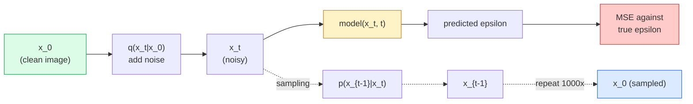

# Image Generation — Diffusion Models · 图像生成 — 扩散模型

> 扩散模型（diffusion model）学的是去噪。训练它从一张带噪图像里去掉一点点噪声，把这个过程反向重复一千次，你就得到了一个图像生成器。

> A diffusion model learns to denoise. Train it to remove a tiny bit of noise from a noisy image, repeat that backwards a thousand times, and you have an image generator.

**Type:** Build
**Languages:** Python
**Prerequisites:** Phase 4 Lesson 07 (U-Net), Phase 1 Lesson 06 (Probability), Phase 3 Lesson 06 (Optimizers)
**Time:** ~75 minutes

## Learning Objectives · 学习目标

- 推导前向加噪过程 `x_0 -> x_1 -> ... -> x_T`，并解释为什么闭式解 `q(x_t | x_0)` 对任意 t 都成立
- 实现 DDPM 风格的训练目标——回归每一步加入的噪声——以及一个从纯噪声一路走回图像的采样器（sampler）
- 搭建一个时间条件（time-conditioned）U-Net（小到能在 CPU 上训练），为任意时间步预测噪声
- 解释 DDPM 与 DDIM 采样的区别，以及各自适用的场景（第 23 课将深入讲解 flow matching 与 rectified flow）

> Derive the forward noising process `x_0 -> x_1 -> ... -> x_T` and explain why the closed-form `q(x_t | x_0)` holds for any t
> Implement a DDPM-style training objective that regresses the noise added at each step, and a sampler that walks back from pure noise to an image
> Build a time-conditioned U-Net (small enough to train on CPU) that predicts the noise for any timestep
> Explain the difference between DDPM and DDIM sampling, and when each is appropriate (Lesson 23 covers flow matching and rectified flow in depth)

## The Problem · 问题在哪

GAN 是一次性生成：噪声进、图像出，一次前向传播。它快，但难训练。扩散模型是迭代生成：从纯噪声出发，一小步一小步地去噪，图像逐渐浮现。它慢，但好训练。过去五年，后一个性质占了上风：任何小团队都能训练一个扩散模型并拿到像样的样本；而 GAN 训练是一门手艺，要靠多年失败的 run 才能学会。

除了训练稳定，扩散的迭代结构才是它解锁现代图像生成一切能力的关键：文本条件（text conditioning）、图像修复（inpainting）、图像编辑、超分辨率、可控风格。采样循环的每一步都是一个可以注入新约束的地方。正是这个抓手让 Stable Diffusion、Imagen、DALL-E 3、Midjourney，以及你将会用到的每一个可控图像模型，全都基于扩散。

本课搭建最小的 DDPM：前向加噪、反向去噪、训练循环。下一课（Stable Diffusion）会把它接上 VAE、文本编码器（text encoder）和 classifier-free guidance，组成一套生产级系统。

> GANs generate one-shot: noise in, image out, one forward pass. They are fast and hard to train. Diffusion models generate iteratively: start from pure noise, denoise in small steps, image emerges. They are slow and easy to train. ... Each step of the sampling loop is a place to inject a new constraint. That hook is why Stable Diffusion, Imagen, DALL-E 3, Midjourney, and every controllable image model you will use are all diffusion-based.
> This lesson builds the minimal DDPM: forward noising, backward denoising, training loop. The next lesson (Stable Diffusion) wires it into a production system with a VAE, a text encoder, and classifier-free guidance.

## The Concept · 概念

### The forward process · 前向加噪过程

拿一张图像 `x_0`。加一点点高斯噪声得到 `x_1`。再加一点点得到 `x_2`。如此持续 T 步，直到 `x_T` 与纯高斯噪声几乎无法区分。

```
q(x_t | x_{t-1}) = N(x_t; sqrt(1 - beta_t) * x_{t-1},  beta_t * I)
```

`beta_t` 是一个小的方差调度（variance schedule），典型做法是在 T=1000 步内从 0.0001 线性升到 0.02。每一步既略微压缩信号，又注入新鲜噪声。

> Take an image `x_0`. Add a tiny amount of Gaussian noise to get `x_1`. Add a tiny amount more to get `x_2`. Keep going for T steps until `x_T` is nearly indistinguishable from pure Gaussian noise.
> `beta_t` is a small variance schedule, typically linear from 0.0001 to 0.02 over T=1000 steps. Each step slightly shrinks the signal and injects fresh noise.

### The closed-form jump · 一步直达的闭式解

一步一噪地加是一个马尔可夫链（Markov chain），但数学上可以折叠：你可以从 `x_0` 出发一步直接采样出 `x_t`。

```
Define alpha_t = 1 - beta_t
Define alpha_bar_t = prod_{s=1..t} alpha_s

Then:
  q(x_t | x_0) = N(x_t; sqrt(alpha_bar_t) * x_0,  (1 - alpha_bar_t) * I)

Equivalently:
  x_t = sqrt(alpha_bar_t) * x_0 + sqrt(1 - alpha_bar_t) * epsilon
  where epsilon ~ N(0, I)
```

这一条等式是扩散模型变得实用的全部理由。训练时你随机挑一个 `t`，从 `x_0` 直接采样出 `x_t`，一步完成训练——完全不需要模拟整条马尔可夫链。

> Adding noise one step at a time is a Markov chain, but the math folds: you can sample `x_t` directly from `x_0` in one step.
> This single equation is the whole reason diffusion is practical. During training you pick a random `t`, sample `x_t` directly from `x_0`, and train in one step — no simulation of the full Markov chain needed.

### The reverse process · 反向过程

前向过程是固定的。反向过程 `p(x_{t-1} | x_t)` 才是神经网络要学的东西。扩散模型并不直接预测 `x_{t-1}`；它预测第 t 步加入的噪声 `epsilon`，再由数学把 `x_{t-1}` 从中推出来。



> The forward process is fixed. The reverse process `p(x_{t-1} | x_t)` is what the neural network learns. Diffusion models do not predict `x_{t-1}` directly; they predict the noise `epsilon` added at step t, and the math derives `x_{t-1}` from it.

### The training loss · 训练损失

每个训练步：

1. 采样一张真实图像 `x_0`。
2. 从 [1, T] 均匀采样一个时间步 `t`。
3. 采样噪声 `epsilon ~ N(0, I)`。
4. 计算 `x_t = sqrt(alpha_bar_t) * x_0 + sqrt(1 - alpha_bar_t) * epsilon`。
5. 用网络预测 `epsilon_theta(x_t, t)`。
6. 最小化 `|| epsilon - epsilon_theta(x_t, t) ||^2`。

就这么简单。神经网络学会在任意时间步预测噪声。损失是 MSE。没有对抗博弈，没有崩溃，没有震荡。

> That is it. The neural network learns to predict the noise at any timestep. The loss is MSE. There is no adversarial game, no collapse, no oscillation.

### The sampler (DDPM) · 采样器（DDPM）

要生成：从 `x_T ~ N(0, I)` 出发，一步一步往回走。

```
for t = T, T-1, ..., 1:
    eps = model(x_t, t)
    x_{t-1} = (1 / sqrt(alpha_t)) * (x_t - (beta_t / sqrt(1 - alpha_bar_t)) * eps) + sqrt(beta_t) * z
    where z ~ N(0, I) if t > 1, else 0
return x_0
```

关键在于：虽然反向条件分布一般没有闭式解，但对这个特定的高斯前向过程它有。那些看起来很丑的系数，就是贝叶斯法则（Bayes' rule）给你的东西。

> To generate: start from `x_T ~ N(0, I)` and walk backwards one step at a time.
> The key is that even though the reverse conditional is not known in closed form in general, for this specific Gaussian forward process it is. The ugly-looking coefficients are what Bayes' rule gives you.

### Why 1000 steps · 为什么是 1000 步

前向噪声调度的选取原则是：每一步加入的噪声刚好让反向步骤接近高斯。步数太少，反向步骤离高斯太远，网络建模不好。步数太多，采样变贵而收益递减。T=1000 配线性调度就是 DDPM 的默认值。

> The forward noise schedule is chosen so each step adds just enough noise that the reverse step is nearly Gaussian. Too few steps and the reverse step is far from Gaussian, the network cannot model it well. Too many steps and sampling becomes expensive with diminishing gain. T=1000 with a linear schedule is the DDPM default.

### DDIM: 20x faster sampling · DDIM：快 20 倍的采样

训练不变，采样变了。DDIM（Song et al., 2020）定义了一个确定性的反向过程，可以跳过时间步而无需重新训练。DDIM 用 50 步采样就能拿到接近 DDPM 1000 步的质量。每个生产系统都在用 DDIM 或更快的变体（DPM-Solver、Euler ancestral）。

> Training is the same. Sampling changes. DDIM (Song et al., 2020) defines a deterministic reverse process that skips timesteps without retraining. Sampling in 50 steps with DDIM gives near-1000-step DDPM quality. Every production system uses DDIM or an even faster variant (DPM-Solver, Euler ancestral).

### Time conditioning · 时间条件

网络 `epsilon_theta(x_t, t)` 需要知道自己正在为哪个时间步去噪。现代扩散模型通过正弦时间嵌入（sinusoidal time embedding，与 Transformer 中的位置编码同一思路）注入 `t`，并在 U-Net 的每个层级把它加到特征图上。

```
t_embedding = sinusoidal(t)
feature_map += MLP(t_embedding)
```

没有时间条件，网络只能从图像本身去猜噪声水平——也能工作，但样本效率低得多。

```figure
cv-diffusion-image
```

> The network `epsilon_theta(x_t, t)` needs to know which timestep it is denoising. Modern diffusion models inject `t` via sinusoidal time embeddings (same idea as positional encoding in transformers) that get added to feature maps at every U-Net level.
> Without time conditioning the network has to guess the noise level from the image itself, which works but is much less sample-efficient.

## Build It · 动手造

### Step 1: Noise schedule · 第 1 步：噪声调度

```python
import torch

def linear_beta_schedule(T=1000, beta_start=1e-4, beta_end=2e-2):
    return torch.linspace(beta_start, beta_end, T)


def precompute_schedule(betas):
    alphas = 1.0 - betas
    alphas_cumprod = torch.cumprod(alphas, dim=0)
    return {
        "betas": betas,
        "alphas": alphas,
        "alphas_cumprod": alphas_cumprod,
        "sqrt_alphas_cumprod": torch.sqrt(alphas_cumprod),
        "sqrt_one_minus_alphas_cumprod": torch.sqrt(1.0 - alphas_cumprod),
        "sqrt_recip_alphas": torch.sqrt(1.0 / alphas),
    }

schedule = precompute_schedule(linear_beta_schedule(T=1000))
```

预计算一次，训练和采样时按索引取用。

> Precompute once, gather by index during training and sampling.

### Step 2: Forward diffusion (q_sample) · 第 2 步：前向扩散（q_sample）

```python
def q_sample(x0, t, noise, schedule):
    sqrt_a = schedule["sqrt_alphas_cumprod"][t].view(-1, 1, 1, 1)
    sqrt_one_minus_a = schedule["sqrt_one_minus_alphas_cumprod"][t].view(-1, 1, 1, 1)
    return sqrt_a * x0 + sqrt_one_minus_a * noise
```

一行的闭式解。`t` 是一批时间步，批内每张图像各对应一个。

> One-line closed form. `t` is a batch of timesteps, one per image in the batch.

### Step 3: A tiny time-conditioned U-Net · 第 3 步：带时间条件的小型 U-Net

```python
import torch.nn as nn
import torch.nn.functional as F
import math

def timestep_embedding(t, dim=64):
    half = dim // 2
    freqs = torch.exp(-math.log(10000) * torch.arange(half, device=t.device) / half)
    args = t[:, None].float() * freqs[None]
    emb = torch.cat([args.sin(), args.cos()], dim=-1)
    return emb


class TinyUNet(nn.Module):
    def __init__(self, img_channels=3, base=32, t_dim=64):
        super().__init__()
        self.t_mlp = nn.Sequential(
            nn.Linear(t_dim, base * 4),
            nn.SiLU(),
            nn.Linear(base * 4, base * 4),
        )
        self.t_dim = t_dim
        self.enc1 = nn.Conv2d(img_channels, base, 3, padding=1)
        self.enc2 = nn.Conv2d(base, base * 2, 4, stride=2, padding=1)
        self.mid = nn.Conv2d(base * 2, base * 2, 3, padding=1)
        self.dec1 = nn.ConvTranspose2d(base * 2, base, 4, stride=2, padding=1)
        self.dec2 = nn.Conv2d(base * 2, img_channels, 3, padding=1)
        self.time_proj = nn.Linear(base * 4, base * 2)

    def forward(self, x, t):
        t_emb = timestep_embedding(t, self.t_dim)
        t_emb = self.t_mlp(t_emb)
        t_proj = self.time_proj(t_emb)[:, :, None, None]

        h1 = F.silu(self.enc1(x))
        h2 = F.silu(self.enc2(h1)) + t_proj
        h3 = F.silu(self.mid(h2))
        d1 = F.silu(self.dec1(h3))
        d2 = torch.cat([d1, h1], dim=1)
        return self.dec2(d2)
```

两层 U-Net，时间条件在瓶颈处注入。处理真实图像时再放大深度和宽度。

> Two-level U-Net with time conditioning injected at the bottleneck. Scale up the depth and width for real images.

### Step 4: Training loop · 第 4 步：训练循环

```python
def train_step(model, x0, schedule, optimizer, device, T=1000):
    model.train()
    x0 = x0.to(device)
    bs = x0.size(0)
    t = torch.randint(0, T, (bs,), device=device)
    noise = torch.randn_like(x0)
    x_t = q_sample(x0, t, noise, schedule)
    pred = model(x_t, t)
    loss = F.mse_loss(pred, noise)
    optimizer.zero_grad()
    loss.backward()
    optimizer.step()
    return loss.item()
```

这就是完整的训练循环。没有 GAN 博弈，没有特殊损失，一次 MSE 调用。

> That is the entire training loop. No GAN game, no specialised loss, one MSE call.

### Step 5: Sampler (DDPM) · 第 5 步：采样器（DDPM）

```python
@torch.no_grad()
def sample(model, schedule, shape, T=1000, device="cpu"):
    model.eval()
    x = torch.randn(shape, device=device)
    betas = schedule["betas"].to(device)
    sqrt_one_minus_a = schedule["sqrt_one_minus_alphas_cumprod"].to(device)
    sqrt_recip_alphas = schedule["sqrt_recip_alphas"].to(device)

    for t in reversed(range(T)):
        t_batch = torch.full((shape[0],), t, dtype=torch.long, device=device)
        eps = model(x, t_batch)
        coef = betas[t] / sqrt_one_minus_a[t]
        mean = sqrt_recip_alphas[t] * (x - coef * eps)
        if t > 0:
            x = mean + torch.sqrt(betas[t]) * torch.randn_like(x)
        else:
            x = mean
    return x
```

生成一批样本需要 1000 次前向传播。真实代码里你会把它换成 DDIM 50 步采样器。

> 1000 forward passes to produce one batch of samples. In real code you would swap this for a DDIM 50-step sampler.

### Step 6: DDIM sampler (deterministic, ~20x faster) · 第 6 步：DDIM 采样器（确定性，约快 20 倍）

```python
@torch.no_grad()
def sample_ddim(model, schedule, shape, steps=50, T=1000, device="cpu", eta=0.0):
    model.eval()
    x = torch.randn(shape, device=device)
    alphas_cumprod = schedule["alphas_cumprod"].to(device)

    ts = torch.linspace(T - 1, 0, steps + 1).long()
    for i in range(steps):
        t = ts[i]
        t_prev = ts[i + 1]
        t_batch = torch.full((shape[0],), t, dtype=torch.long, device=device)
        eps = model(x, t_batch)
        a_t = alphas_cumprod[t]
        a_prev = alphas_cumprod[t_prev] if t_prev >= 0 else torch.tensor(1.0, device=device)
        x0_pred = (x - torch.sqrt(1 - a_t) * eps) / torch.sqrt(a_t)
        sigma = eta * torch.sqrt((1 - a_prev) / (1 - a_t) * (1 - a_t / a_prev))
        dir_xt = torch.sqrt(1 - a_prev - sigma ** 2) * eps
        noise = sigma * torch.randn_like(x) if eta > 0 else 0
        x = torch.sqrt(a_prev) * x0_pred + dir_xt + noise
    return x
```

`eta=0` 时完全确定（同样的噪声输入永远得到同样的输出）。`eta=1` 则退回 DDPM。

> `eta=0` is fully deterministic (same noise input always produces the same output). `eta=1` recovers DDPM.

## Use It · 实战用法

生产环境用 `diffusers`：

```python
from diffusers import DDPMScheduler, UNet2DModel

unet = UNet2DModel(sample_size=32, in_channels=3, out_channels=3, layers_per_block=2)
scheduler = DDPMScheduler(num_train_timesteps=1000)
```

这个库自带现成的调度器（DDPM、DDIM、DPM-Solver、Euler、Heun）、可配置的 U-Net、文生图和图生图的 pipeline，以及 LoRA 微调辅助工具。

搞研究的话，`k-diffusion`（Katherine Crowson）有最忠实的参考实现和最好的采样变体。

> For production work, use `diffusers`:
> The library ships ready-made schedulers (DDPM, DDIM, DPM-Solver, Euler, Heun), configurable U-Nets, pipelines for text-to-image and image-to-image, and LoRA fine-tuning helpers.
> For research, `k-diffusion` (Katherine Crowson) has the most faithful reference implementations and the best sampling variants.

## Ship It · 交付

本课产出：

- `outputs/prompt-diffusion-sampler-picker.md` — 一个提示词：根据质量目标、延迟预算和条件类型，在 DDPM / DDIM / DPM-Solver / Euler 之间做出选择。
- `outputs/skill-noise-schedule-designer.md` — 一个技能：给定 T 和目标破坏程度，产出线性、余弦或 sigmoid 的 beta 调度，并附上信噪比随时间变化的诊断图。

> This lesson produces:
> - `outputs/prompt-diffusion-sampler-picker.md` — a prompt that picks DDPM / DDIM / DPM-Solver / Euler based on quality target, latency budget, and conditioning type.
> - `outputs/skill-noise-schedule-designer.md` — a skill that produces a linear, cosine, or sigmoid beta schedule given T and target corruption level, plus diagnostic plots of signal-to-noise ratio over time.

## Exercises · 练习

1. **（简单）** 可视化前向过程：取一张图像，画出 `t in [0, 100, 250, 500, 750, 1000]` 时的 `x_t`。验证 `x_1000` 看起来就是纯高斯噪声。
2. **（中等）** 在合成圆圈数据集上训练 TinyUNet 20 个 epoch，采样 16 个圆圈。对比 DDPM（1000 步）与 DDIM（50 步）采样——同样的噪声种子下，两者生成的图像相似吗？
3. **（困难）** 实现一个余弦噪声调度（Nichol & Dhariwal, 2021）：`alpha_bar_t = cos^2((t/T + s) / (1 + s) * pi / 2)`。用线性和余弦两种调度训练同一个模型，证明余弦调度在低步数下样本质量更好。

## Key Terms · 术语表

| 术语 | 人们怎么说 | 实际含义 |
|------|----------------|----------------------|
| Forward process | 「随时间加噪」 | 固定的马尔可夫链，用 T 步把一张图像逐步破坏成高斯噪声 |
| Reverse process | 「一步步去噪」 | 学出来的分布，从噪声一步步走回图像 |
| Epsilon prediction | 「预测噪声」 | 训练目标：`epsilon_theta(x_t, t)` 预测第 t 步加入的噪声 |
| Beta schedule | 「噪声量」 | T 个小方差组成的序列，定义每一步进入多少噪声 |
| alpha_bar_t | 「累计保留系数」 | 到时刻 t 为止 (1 - beta_s) 的连乘；t 越大，剩下的信号越少 |
| DDPM sampler | 「祖先采样，随机」 | 从每个 x_{t-1} 的条件高斯中采样；1000 步 |
| DDIM sampler | 「确定性，快」 | 把采样改写成确定性 ODE；20-100 步达到相近质量 |
| Time conditioning | 「告诉模型当前是哪个 t」 | 把 t 的正弦嵌入注入 U-Net，让它知道噪声水平 |

## Further Reading · 延伸阅读

- [Denoising Diffusion Probabilistic Models (Ho et al., 2020)](https://arxiv.org/abs/2006.11239) — 让扩散变得实用、在 FID 上击败 GAN 的那篇论文
- [Improved DDPM (Nichol & Dhariwal, 2021)](https://arxiv.org/abs/2102.09672) — 余弦调度与 v-parameterisation
- [DDIM (Song, Meng, Ermon, 2020)](https://arxiv.org/abs/2010.02502) — 让实时推理成为可能的确定性采样器
- [Elucidating the Design Space of Diffusion (Karras et al., 2022)](https://arxiv.org/abs/2206.00364) — 对每一个扩散设计选择的统一视角；当前最好的参考
