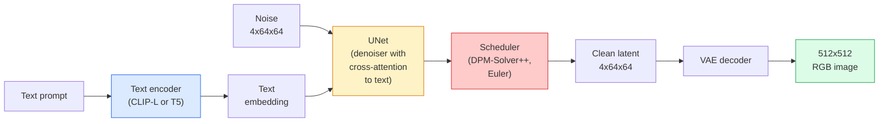

# Stable Diffusion — Architecture & Fine-Tuning · Stable Diffusion — 架构与微调

> Stable Diffusion 是一个运行在预训练 VAE 潜空间（latent space）里的 DDPM：通过交叉注意力（cross-attention）以文本为条件，用快速的确定性 ODE 求解器采样，并由 classifier-free guidance 引导。

> Stable Diffusion is a DDPM that runs in the latent space of a pretrained VAE, conditioned on text via cross-attention, sampled with a fast deterministic ODE solver, and steered by classifier-free guidance.

**Type:** Learn + Use
**Languages:** Python
**Prerequisites:** Phase 4 Lesson 10 (Diffusion), Phase 7 Lesson 02 (Self-Attention)
**Time:** ~75 minutes

## Learning Objectives · 学习目标

- 追踪 Stable Diffusion 流水线的五个部件：VAE、文本编码器（text encoder）、U-Net、调度器（scheduler）、安全检查器（safety checker）——以及它们各自真正做的事
- 解释潜在扩散（latent diffusion），以及为什么在 4x64x64 潜空间（而不是 3x512x512 图像）中训练能在不损失质量的前提下把计算量降低 48 倍
- 用 `diffusers` 生成图像，运行 image-to-image、inpainting 和 ControlNet 引导的生成
- 在小型自定义数据集上用 LoRA 微调 Stable Diffusion，并在推理时加载 LoRA 适配器（adapter）

> Trace the five pieces of a Stable Diffusion pipeline: VAE, text encoder, U-Net, scheduler, safety checker — and what each of them actually does
> Explain latent diffusion and why training in a 4x64x64 latent space (instead of a 3x512x512 image) reduces compute by 48x without quality loss
> Use `diffusers` to generate images, run image-to-image, inpainting, and ControlNet-guided generation
> Fine-tune Stable Diffusion with LoRA on a small custom dataset and load the LoRA adapter at inference

## The Problem · 问题在哪

直接在 512x512 RGB 图像上训练 DDPM 代价高昂。每个训练步都要对一个面对 3x512x512 = 786,432 个输入值的 U-Net 做反向传播，而采样要对同一个 U-Net 做 50 多次前向传播。以 Stable Diffusion 1.5（2022 年发布）的质量水准，像素空间扩散大约需要 256 个 GPU·月的训练，而且在消费级 GPU 上每张图要 10-30 秒。

让开源权重文生图变得实用的那个技巧是**潜在扩散**（latent diffusion，Rombach et al., CVPR 2022）。训练一个 VAE，把 3x512x512 的图像映射到 4x64x64 的潜张量再映射回来，然后在这个潜空间里做扩散。计算量下降 `(3*512*512)/(4*64*64) = 48` 倍。同一块 GPU 上，采样从几十秒降到两秒以内。

几乎每一个现代图像生成模型——SDXL、SD3、FLUX、HunyuanDiT、Wan-Video——都是潜在扩散模型，只是在自编码器（autoencoder）、去噪器（U-Net 或 DiT）和文本条件上各有变化。学会了 Stable Diffusion，你就学会了这个模板。

> Training a DDPM directly on 512x512 RGB images is expensive. Every training step backprops through a U-Net that sees 3x512x512 = 786,432 input values, and sampling takes 50+ forward passes through that same U-Net. At the quality level of Stable Diffusion 1.5 (released 2022), pixel-space diffusion would need roughly 256 GPU-months of training and 10-30 seconds per image on a consumer GPU.
> The trick that made open-weight text-to-image practical was **latent diffusion** (Rombach et al., CVPR 2022). ... Compute drops by `(3*512*512)/(4*64*64) = 48x`. Sampling drops from tens of seconds to under two seconds on the same GPU.
> Almost every modern image-generation model — SDXL, SD3, FLUX, HunyuanDiT, Wan-Video — is a latent diffusion model with variations on the autoencoder, the denoiser (U-Net or DiT), and the text conditioning. Learn Stable Diffusion and you have learnt the template.

## The Concept · 概念

### The pipeline · 整条流水线



- **VAE** — 冻结的自编码器。编码器把图像变成潜变量（用于 img2img 和训练）。解码器把潜变量变回图像。
- **文本编码器（text encoder）** — CLIP 文本编码器（SD 1.x/2.x）、CLIP-L + CLIP-G（SDXL）或 T5-XXL（SD3/FLUX）。产出一个 token 嵌入序列。
- **U-Net** — 去噪器。带有交叉注意力层，在每个分辨率层级上从潜变量注意（attend）到文本嵌入。
- **调度器（scheduler）** — 采样算法（DDIM、Euler、DPM-Solver++）。挑选 sigma，把预测出的噪声混合回潜变量。
- **安全检查器（safety checker）** — 输出图像上可选的 NSFW / 违法内容过滤器。

> - **VAE** — frozen autoencoder. Encoder turns image into latents (used for img2img and training). Decoder turns latents back into an image.
> - **Text encoder** — CLIP text encoder (SD 1.x/2.x), CLIP-L + CLIP-G (SDXL), or T5-XXL (SD3/FLUX). Produces a sequence of token embeddings.
> - **U-Net** — the denoiser. Has cross-attention layers that attend from latents to the text embedding at every resolution level.
> - **Scheduler** — the sampling algorithm (DDIM, Euler, DPM-Solver++). Picks sigmas, blends predicted noise back into the latent.
> - **Safety checker** — optional NSFW / illegal-content filter on the output image.

### Classifier-free guidance (CFG) · 无分类器引导（CFG）

普通的文本条件训练的是 `epsilon_theta(x_t, t, c)`，对每个提示词 `c` 都要覆盖。CFG 以 10% 的概率把 `c` 丢弃（替换成一个空嵌入）来训练同一个网络，得到一个同时能预测条件噪声和无条件噪声的单一模型。推理时：

```
eps = eps_uncond + w * (eps_cond - eps_uncond)
```

`w` 是引导强度（guidance scale）。`w=0` 是无条件，`w=1` 是普通条件，`w>1` 把输出推向「更强地跟着提示词走」，代价是牺牲多样性。SD 默认 `w=7.5`。

CFG 是文生图能达到生产级质量的原因。没有它，提示词对输出的影响很弱；有了它，提示词说了算。

> Plain text conditioning learns `epsilon_theta(x_t, t, c)` for every prompt `c`. CFG trains the same network with `c` dropped 10% of the time (replaced by an empty embedding), giving a single model that predicts both the conditional and the unconditional noise.
> `w` is the guidance scale. `w=0` is unconditional, `w=1` is plain conditional, `w>1` pushes the output toward being "more conditioned on the prompt" at the cost of diversity. SD default is `w=7.5`.
> CFG is the reason text-to-image works at production quality. Without it, prompts bias the output weakly; with it, prompts dominate.

### Latent space geometry · 潜空间几何

VAE 的 4 通道潜变量不只是压缩图像。它是一个流形（manifold），上面的算术运算大致对应语义编辑（提示词工程和插值都活在这里），而且扩散 U-Net 的全部建模预算都花在了这个流形上。解码一个随机的 4x64x64 潜变量不会得到一张「看起来随机」的图像——而是得到垃圾，因为只有潜空间中一个特定的子流形（submanifold）才能解码成有效图像。

两个推论：

1. **Img2img** = 把图像编码成潜变量，加部分噪声，跑去噪器，再解码。图像结构得以保留，因为编码近乎可逆；内容则由提示词改变。
2. **Inpainting（修复）** = 与 img2img 相同，但去噪器只更新被掩码（mask）的区域；未掩码的区域保持在编码后的潜变量上。

> The VAE's 4-channel latent is not just a compressed image. It is a manifold where arithmetic roughly corresponds to semantic edits (prompt engineering + interpolation both live here), and where the diffusion U-Net has been trained to spend its entire modelling budget. Decoding a random 4x64x64 latent does not produce a random-looking image — it produces garbage, because only a specific submanifold of latents decodes to valid images.
> 1. **Img2img** = encode image to latent, add partial noise, run the denoiser, decode. Image structure survives because encoding is near-invertible; content changes based on the prompt.
> 2. **Inpainting** = same as img2img but the denoiser only updates masked regions; unmasked regions are kept at the encoded latent.

### The U-Net architecture · U-Net 架构

SD 的 U-Net 是第 10 课 TinyUNet 的大号版本，外加三样东西：

- 每个空间分辨率上都有 **Transformer 块**，包含自注意力 + 对文本嵌入的交叉注意力。
- 通过正弦编码上的 MLP 注入**时间嵌入**（time embedding）。
- 编码器与解码器在对应分辨率之间的**跳跃连接**（skip connection）。

SD 1.5 总参数量：约 860M。SDXL：约 2.6B。FLUX：约 12B。参数量的跃升主要在注意力层。

> The SD U-Net is a big version of the TinyUNet from Lesson 10 with three additions:
> - **Transformer blocks** at every spatial resolution, containing self-attention + cross-attention to the text embedding.
> - **Time embedding** via MLP on sinusoidal encoding.
> - **Skip connections** between encoder and decoder at matching resolutions.
> Total parameters in SD 1.5: ~860M. SDXL: ~2.6B. FLUX: ~12B. The jump in params is mostly in attention layers.

### LoRA fine-tuning · LoRA 微调

全量微调 Stable Diffusion 需要 20+ GB 显存，并且要更新 860M 参数。LoRA（Low-Rank Adaptation）保持基座模型冻结，向注意力层注入小型的低秩分解（rank-decomposition）矩阵。SD 的一个 LoRA 适配器通常只有 10-50 MB，在单张消费级 GPU 上 10-60 分钟就能训完，推理时作为即插即用的修改加载。

```
Original: W_q : (d_in, d_out)   frozen
LoRA:     W_q + alpha * (A @ B)   where A : (d_in, r), B : (r, d_out)

r is typically 4-32.
```

几乎每个社区微调模型都是用 LoRA 分发的。CivitAI 和 Hugging Face 上托管着数以百万计的 LoRA。

> Full fine-tuning of Stable Diffusion needs 20+ GB of VRAM and updates 860M parameters. LoRA (Low-Rank Adaptation) keeps the base model frozen and injects small rank-decomposition matrices into the attention layers. A LoRA adapter for SD is typically 10-50 MB, trains in 10-60 minutes on a single consumer GPU, and loads at inference time as a drop-in modification.
> LoRA is how almost every community fine-tune is distributed. CivitAI and Hugging Face host millions of them.

### Schedulers you will see · 你会遇到的调度器

- **DDIM** — 确定性，约 50 步，简单。
- **Euler ancestral** — 随机性，30-50 步，样本略微更有「创意」。
- **DPM-Solver++ 2M Karras** — 确定性，20-30 步，生产默认。
- **LCM / TCD / Turbo** — 一致性模型（consistency model）与蒸馏变体；1-4 步，牺牲一些质量。

在 `diffusers` 里换调度器是一行代码的事，而且有时不用任何重训练就能修复采样问题。

> - **DDIM** — deterministic, ~50 steps, simple.
> - **Euler ancestral** — stochastic, 30-50 steps, slightly more creative samples.
> - **DPM-Solver++ 2M Karras** — deterministic, 20-30 steps, production default.
> - **LCM / TCD / Turbo** — consistency models and distilled variants; 1-4 steps at the cost of some quality.
> Swapping schedulers is a one-line change in `diffusers` and sometimes fixes sample issues without any retraining.

```figure
cv3-latent-compression
```

## Build It · 动手造

本课端到端使用 `diffusers`，而不是从零重造 Stable Diffusion。你要重造的那些部件（VAE、文本编码器、U-Net、调度器）各自都是一整课的主题；这里的目标是熟练掌握生产 API。

> This lesson uses `diffusers` end-to-end rather than rebuilding Stable Diffusion from scratch. The pieces you would need to rebuild (VAE, text encoder, U-Net, scheduler) are topics of their own lessons; here the goal is fluency with the production API.

### Step 1: Text-to-image · 第 1 步：文生图

```python
import torch
from diffusers import StableDiffusionPipeline

pipe = StableDiffusionPipeline.from_pretrained(
    "runwayml/stable-diffusion-v1-5",
    torch_dtype=torch.float16,
).to("cuda")

image = pipe(
    prompt="a dog riding a skateboard in tokyo, studio ghibli style",
    guidance_scale=7.5,
    num_inference_steps=25,
    generator=torch.Generator("cuda").manual_seed(42),
).images[0]
image.save("dog.png")
```

`float16` 把显存占用减半，且没有可见的质量损失。默认的 DPM-Solver++ 下 `num_inference_steps=25`，效果与 DDIM 下 `num_inference_steps=50` 相当。

> `float16` halves VRAM with no visible quality loss. `num_inference_steps=25` with the default DPM-Solver++ matches `num_inference_steps=50` with DDIM.

### Step 2: Swap the scheduler · 第 2 步：换调度器

```python
from diffusers import DPMSolverMultistepScheduler, EulerAncestralDiscreteScheduler

pipe.scheduler = DPMSolverMultistepScheduler.from_config(pipe.scheduler.config)
pipe.scheduler = EulerAncestralDiscreteScheduler.from_config(pipe.scheduler.config)
```

调度器的状态与 U-Net 权重是解耦的。你可以用 DDPM 训练，再用任意调度器采样。

> Scheduler state is decoupled from U-Net weights. You can train on DDPM and sample with any scheduler.

### Step 3: Image-to-image · 第 3 步：图生图

```python
from diffusers import StableDiffusionImg2ImgPipeline
from PIL import Image

img2img = StableDiffusionImg2ImgPipeline.from_pretrained(
    "runwayml/stable-diffusion-v1-5",
    torch_dtype=torch.float16,
).to("cuda")

init_image = Image.open("dog.png").convert("RGB").resize((512, 512))
out = img2img(
    prompt="a dog riding a skateboard, oil painting",
    image=init_image,
    strength=0.6,
    guidance_scale=7.5,
).images[0]
```

`strength` 控制去噪前加多少噪声（0.0 = 不变，1.0 = 完全重新生成）。0.5-0.7 是风格迁移的标准区间。

> `strength` is how much noise to add before denoising (0.0 = unchanged, 1.0 = full regeneration). 0.5-0.7 is the standard range for style transfer.

### Step 4: Inpainting · 第 4 步：局部重绘（inpainting）

```python
from diffusers import StableDiffusionInpaintPipeline

inpaint = StableDiffusionInpaintPipeline.from_pretrained(
    "runwayml/stable-diffusion-inpainting",
    torch_dtype=torch.float16,
).to("cuda")

image = Image.open("dog.png").convert("RGB").resize((512, 512))
mask = Image.open("dog_mask.png").convert("L").resize((512, 512))

out = inpaint(
    prompt="a cat",
    image=image,
    mask_image=mask,
    guidance_scale=7.5,
).images[0]
```

掩码里的白色像素是要重新生成的区域。黑色像素被保留。

> White pixels in the mask are the area to regenerate. Black pixels are preserved.

### Step 5: LoRA loading · 第 5 步：加载 LoRA

```python
pipe.load_lora_weights(
    "artificialguybr/studioghibli-redmond-1-5v-studio-ghibli-lora-for-liberteredmond-sd-1-5",
    weight_name="StudioGhibliRedmond-15V-LiberteRedmond-StdGBRedmAF-StudioGhibli.safetensors",
)
pipe.fuse_lora(lora_scale=0.8)

image = pipe(prompt="a village square, StdGBRedmAF, Studio Ghibli").images[0]
```

模型卡里的触发短语（`StdGBRedmAF, Studio Ghibli`）会把风格打开。`lora_scale` 控制强度；0.0 = 无效果，1.0 = 全效果。`fuse_lora` 为了速度把适配器就地烘焙进权重，但之后就无法再更换了。加载另一个适配器之前，要先调用 `pipe.unfuse_lora()`。

> The trigger phrase from the model card (`StdGBRedmAF, Studio Ghibli`) switches the style on. `lora_scale` controls strength; 0.0 = no effect, 1.0 = full effect. `fuse_lora` bakes the adapter into the weights in place for speed, but prevents swapping. Call `pipe.unfuse_lora()` before loading a different adapter.

### Step 6: LoRA training (sketch) · 第 6 步：LoRA 训练（概要）

真正的 LoRA 训练在 `peft` 或 `diffusers.training` 里。流程概要：

```python
# Pseudocode
for step, batch in enumerate(dataloader):
    images, prompts = batch
    latents = vae.encode(images).latent_dist.sample() * 0.18215

    t = torch.randint(0, num_train_timesteps, (batch_size,))
    noise = torch.randn_like(latents)
    noisy_latents = scheduler.add_noise(latents, noise, t)

    text_emb = text_encoder(tokenizer(prompts))

    pred_noise = unet(noisy_latents, t, text_emb)  # LoRA weights injected here

    loss = F.mse_loss(pred_noise, noise)
    loss.backward()
    optimizer.step()
```

只有 LoRA 矩阵接收梯度；基座 U-Net、VAE 和文本编码器全部冻结。批大小为 1 并开启梯度检查点（gradient checkpointing）时，8 GB 显存就装得下。

> Only the LoRA matrices receive gradient; the base U-Net, VAE, and text encoder are frozen. With a batch size of 1 and gradient checkpointing this fits in 8 GB of VRAM.

## Use It · 实战用法

生产中你真正要做的决策：

- **模型家族**：SD 1.5 用于开源社区微调模型，SDXL 用于更高保真度，SD3 / FLUX 用于最强效果和严格的授权要求。
- **调度器**：20-30 步用 DPM-Solver++ 2M Karras；延迟要求低于 1 秒时用 LCM-LoRA。
- **精度**：4080/4090 上用 `float16`，A100 及更新的卡上用 `bfloat16`，显存吃紧时用 `int8`（借助 `bitsandbytes` 或 `compel`）。
- **条件控制**：纯文本即可；要更强的控制力，在基础流水线之上加 ControlNet（canny、深度、姿态）。

批量生成用 `AUTO1111` / `ComfyUI` 这些社区工具；生产级 API 用 `diffusers` + `accelerate`，或配合 TensorRT 编译的 `optimum-nvidia`。

> In production, the decisions you actually make:
> - **Model family**: SD 1.5 for open-source community fine-tunes, SDXL for higher fidelity, SD3 / FLUX for state of the art and strict licensing requirements.
> - **Scheduler**: DPM-Solver++ 2M Karras for 20-30 steps, LCM-LoRA when latency is under 1s.
> - **Precision**: `float16` on 4080/4090, `bfloat16` on A100 and newer, `int8` (via `bitsandbytes` or `compel`) when VRAM is tight.
> - **Conditioning**: plain text works; for stronger control, add ControlNet (canny, depth, pose) on top of the base pipeline.
> For batch generation, `AUTO1111` / `ComfyUI` are the community tools; for production APIs, `diffusers` + `accelerate` or `optimum-nvidia` with TensorRT compilation.

## Ship It · 交付

本课产出：

- `outputs/prompt-sd-pipeline-planner.md` — 一个提示词：在给定延迟预算、保真度目标和授权约束时，选择 SD 1.5 / SDXL / SD3 / FLUX 以及配套的调度器和精度。
- `outputs/skill-lora-training-setup.md` — 一个技能：为自定义数据集写出完整的 LoRA 训练配置，包括标注（captions）、秩（rank）、批大小和学习率。

> This lesson produces:
> - `outputs/prompt-sd-pipeline-planner.md` — a prompt that picks SD 1.5 / SDXL / SD3 / FLUX plus scheduler and precision given a latency budget, fidelity target, and licensing constraint.
> - `outputs/skill-lora-training-setup.md` — a skill that writes a full LoRA training config for a custom dataset including captions, rank, batch size, and learning rate.

## Exercises · 练习

1. **（简单）** 用 `guidance_scale` 取 `[1, 3, 5, 7.5, 10, 15]` 生成同一个提示词。描述图像如何变化。引导值多大时会出现伪影（artefact）？
2. **（中等）** 任取一张真实照片，用 `StableDiffusionImg2ImgPipeline` 在 `strength` 取 `[0.2, 0.4, 0.6, 0.8, 1.0]` 下各跑一次。哪个强度能在改变风格的同时保留构图？为什么 1.0 会完全无视输入？
3. **（困难）** 用同一个主体（一只宠物、一个 logo、一个角色）的 10-20 张图训练一个 LoRA，并生成包含该主体的新场景。报告能最好地保持主体身份（identity）且不对输入图像过拟合的 LoRA 秩与训练步数。

## Key Terms · 术语表

| 术语 | 人们怎么说 | 实际含义 |
|------|----------------|----------------------|
| Latent diffusion | 「在潜空间里扩散」 | 把整个 DDPM 放在 VAE 潜空间（4x64x64）里跑，而不是像素空间（3x512x512）；省 48 倍计算 |
| VAE scale factor | 「0.18215」 | 把 VAE 原始潜变量重新缩放到近似单位方差的常数；硬编码在每个 SD 流水线里 |
| Classifier-free guidance | 「CFG」 | 混合条件与无条件的噪声预测；影响力最大的单一推理旋钮 |
| Scheduler | 「采样器」 | 把噪声 + 模型预测变成一条去噪潜变量轨迹的算法 |
| LoRA | 「低秩适配器」 | 注入注意力层的小型低秩分解矩阵，不动基座权重就能微调 |
| Cross-attention | 「文本-图像注意力」 | 从潜变量 token 注意到文本 token；在 U-Net 的每一层注入提示词信息 |
| ControlNet | 「结构条件」 | 单独训练的适配器，用一份额外输入（canny、深度、姿态、分割）来引导 SD |
| DPM-Solver++ | 「默认调度器」 | 二阶确定性 ODE 求解器；2026 年在低步数（20-30）下质量最好 |

## Further Reading · 延伸阅读

- [High-Resolution Image Synthesis with Latent Diffusion (Rombach et al., 2022)](https://arxiv.org/abs/2112.10752) — Stable Diffusion 论文；包含支撑这套设计的全部消融实验
- [Classifier-Free Diffusion Guidance (Ho & Salimans, 2022)](https://arxiv.org/abs/2207.12598) — CFG 论文
- [LoRA: Low-Rank Adaptation of Large Language Models (Hu et al., 2021)](https://arxiv.org/abs/2106.09685) — LoRA 起源于 NLP；几乎不加改动就迁移到了 SD
- [diffusers documentation](https://huggingface.co/docs/diffusers) — 每一个 SD / SDXL / SD3 / FLUX 流水线的参考文档
