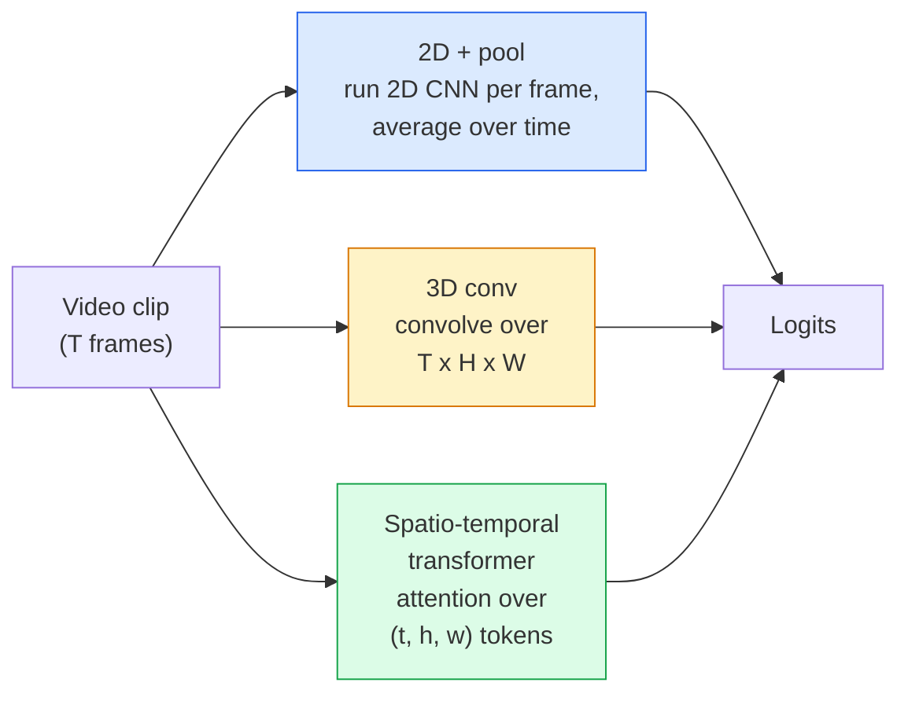

# Video Understanding — Temporal Modeling · 视频理解 — 时序建模

> 视频就是一串图像，再加上把它们连起来的物理。每个视频模型要么把时间当成一个额外的轴（3D 卷积），要么当成一个可以注意（attend）的序列（Transformer），要么当成一个提出来一次就池化掉的特征（2D+pool）。

> A video is a sequence of images plus the physics that connects them. Every video model either treats time as an extra axis (3D conv), a sequence to attend over (transformer), or a feature to extract once and pool (2D+pool).

**Type:** Learn + Build
**Languages:** Python
**Prerequisites:** Phase 4 Lesson 03 (CNNs), Phase 4 Lesson 04 (Image Classification)
**Time:** ~45 minutes

## Learning Objectives · 学习目标

- 区分三种主流视频建模路线（2D+pool、3D 卷积、时空 Transformer），并预判它们在成本与精度上的取舍
- 在 PyTorch 中实现帧采样（frame sampling）、时间池化（temporal pooling）和一个 2D+pool 基线分类器
- 解释为什么 I3D 的「膨胀」（inflated）3D 核能很好地从 ImageNet 权重迁移，以及因子分解（2+1）D 卷积有什么不同
- 读懂标准动作识别（action recognition）数据集与指标：Kinetics-400/600、UCF101、Something-Something V2；clip 级与视频级 top-1 准确率

> Distinguish the three main video-modelling approaches (2D+pool, 3D conv, spatio-temporal transformer) and predict their cost and accuracy trade-offs
> Implement frame sampling, temporal pooling, and a 2D+pool baseline classifier in PyTorch
> Explain why I3D's "inflated" 3D kernels transfer well from ImageNet weights and what a factorised (2+1)D conv does differently
> Read the standard action-recognition datasets and metrics: Kinetics-400/600, UCF101, Something-Something V2; top-1 accuracy at the clip and video level

## The Problem · 问题在哪

一段 30 秒、30 fps 的视频是 900 张图像。天真的做法是：视频分类 = 把图像分类跑 900 遍，再做某种聚合。当动作在几乎每一帧里都可见时（体育、烹饪、健身视频）这招管用；而当动作本身由运动定义时，它败得很惨：「把东西从左往右推」在每一单帧里看起来都是两个静止的物体。

每个视频架构的核心问题都是：时序结构在何处被建模、如何建模？答案决定其余一切——计算成本、预训练策略、能否复用 ImageNet 权重、模型在什么数据集上训练。

本课刻意比静态图像的那些课短。核心图像机制已经就位，视频理解主要讲的是时序这个故事：采样、建模、聚合。

> A 30-second video at 30 fps is 900 images. Naively, video classification is image classification run 900 times followed by some kind of aggregation. That works when the action is visible in almost every frame (sports, cooking, exercise videos) and fails badly when the action is defined by motion itself: "pushing something from left to right" looks like two still objects in every single frame.
> The core question for every video architecture is: when does temporal structure get modelled, and how? The answer drives everything else — compute cost, pretraining strategy, whether you can reuse ImageNet weights, what datasets the model trains on.
> This lesson is deliberately shorter than the static-image lessons. The core image machinery is already in place, and video understanding is mostly about the temporal story: sampling, modelling, and aggregating.

## The Concept · 概念

### The three architectural families · 三大架构家族



### 2D + pool · 2D 加池化

拿一个 2D CNN（ResNet、EfficientNet、ViT），在每个采样帧上独立运行。对每帧嵌入取平均（或最大池化，或注意力池化）。把池化后的向量喂给分类器。

优点：
- ImageNet 预训练直接可用。
- 实现最简单。
- 便宜：T 帧 × 单图推理成本。

缺点：
- 无法建模运动。动作 = 外观的聚合。
- 时间池化与顺序无关；「开门」和「关门」看起来一样。

何时使用：外观主导的任务、小视频数据集上的迁移学习、初始基线。

> Take a 2D CNN (ResNet, EfficientNet, ViT). Run it independently on every sampled frame. Average (or max-pool, or attention-pool) the per-frame embeddings. Feed the pooled vector to a classifier.
> Pros: ImageNet pretraining transfers directly. Simplest to implement. Cheap: T frames * single-image inference cost.
> Cons: Cannot model motion. Action = aggregate of appearances. Temporal pooling is order-invariant; "open door" and "close door" look the same.
> When to use: appearance-heavy tasks, transfer learning on small video datasets, initial baselines.

### 3D convolutions · 3D 卷积

把 2D (H, W) 核换成 3D (T, H, W) 核。网络同时在空间和时间上做卷积。早期家族：C3D、I3D、SlowFast。

I3D 技巧：拿一个预训练的 2D ImageNet 模型，把每个 2D 核沿一条新的时间轴复制「膨胀」（inflate）。3x3 的 2D 卷积变成 3x3x3 的 3D 卷积。这让 3D 模型直接拥有强大的预训练权重，而不用从零训练。

优点：
- 直接建模运动。
- I3D 膨胀带来免费的迁移学习。

缺点：
- 比 2D 对应物多 T/8 的 FLOPs（时间核为 3、堆叠 3 次的情形）。
- 时间核很小；长程运动需要金字塔或双流（dual-stream）方案。

何时使用：运动本身就是信号的动作识别（Something-Something V2、动作类目偏运动的 Kinetics）。

> Replace 2D (H, W) kernels with 3D (T, H, W) kernels. The network convolves over both space and time. Early family: C3D, I3D, SlowFast.
> I3D trick: take a pretrained 2D ImageNet model, "inflate" each 2D kernel by copying it along a new time axis. A 3x3 2D conv becomes a 3x3x3 3D conv. This gives the 3D model strong pretrained weights instead of training from scratch.
> Pros: Directly models motion. I3D inflation gives free transfer learning.
> Cons: T/8 more FLOPs than the 2D counterpart (for temporal kernel of 3 stacked 3 times). Temporal kernels are small; long-range motion needs a pyramid or dual-stream approach.
> When to use: action recognition where motion is the signal (Something-Something V2, Kinetics with motion-heavy classes).

### Spatio-temporal transformers · 时空 Transformer

把视频切成时空 patch 网格（token 化），在所有 patch 之间做注意力。TimeSformer、ViViT、Video Swin、VideoMAE。

重要的注意力模式：
- **Joint（联合）** — 对 (t, h, w) 做一次大注意力。关于 `T*H*W` 是平方级；昂贵。
- **Divided（分离）** — 每个块两次注意力：一次在时间上，一次在空间上。接近线性扩展。
- **Factorised（因子分解）** — 时间注意力与空间注意力在块间交替。

优点：
- 所有主要基准上的 SOTA 精度。
- 通过 patch 膨胀从图像 Transformer（ViT）迁移。
- 通过稀疏注意力支持长上下文视频。

缺点：
- 吃算力。
- 注意力模式选择不当，运行时间会失控。

何时使用：大数据集、高保真视频理解、多模态视频+文本任务。

> Tokenise the video into a grid of space-time patches and attend across all of them. TimeSformer, ViViT, Video Swin, VideoMAE.
> Attention patterns that matter: **Joint** — one big attention over (t, h, w). Quadratic in `T*H*W`; expensive. **Divided** — two attentions per block: one over time, one over space. Linear-ish scaling. **Factorised** — time attention alternates with space attention across blocks.
> Pros: SOTA accuracy on every major benchmark. Transfers from image transformers (ViT) via patch inflation. Supports long-context video via sparse attention.
> Cons: Compute-hungry. Requires careful attention pattern choice or runtime balloons.
> When to use: large datasets, high-fidelity video understanding, multi-modal video+text tasks.

### Frame sampling · 帧采样

10 秒、30 fps 的片段是 300 帧；把 300 帧全部喂给任何模型都是浪费。标准策略：

- **均匀采样（uniform sampling）** — 在片段内均匀取 T 帧。2D+pool 的默认选择。
- **稠密采样（dense sampling）** — 随机取连续的 T 帧窗口。3D 卷积常用，因为运动需要相邻帧。
- **多片段（multi-clip）** — 从同一视频采多个 T 帧窗口，各自分类，测试时平均预测。

T 通常是 8、16、32 或 64。T 越大 = 时序信号越多，算力也越多。

> A 10-second clip at 30 fps is 300 frames; feeding all 300 to any model is wasteful. Standard strategies:
> - **Uniform sampling** — pick T frames evenly across the clip. Default for 2D+pool.
> - **Dense sampling** — random contiguous T-frame window. Common for 3D convs because motion requires neighbouring frames.
> - **Multi-clip** — sample multiple T-frame windows from the same video, classify each, average predictions at test time.
> T is usually 8, 16, 32, or 64. Higher T = more temporal signal at more compute.

### Evaluation · 评估

两个层级：
- **Clip 级准确率** — 模型只看一个 T 帧片段，报告 top-k。
- **视频级准确率** — 每个视频取多个片段，对 clip 级预测取平均；更高也更稳定。

两个都要报告。一个模型 clip 78% / 视频 82%，说明它严重依赖测试时平均；一个 80% / 81% 的模型则每个片段本身更稳健。

> Two levels:
> - **Clip-level accuracy** — model sees one T-frame clip, reports top-k.
> - **Video-level accuracy** — average clip-level predictions across multiple clips per video; higher and more stable.
> Always report both. A model that scores 78% clip / 82% video is relying heavily on test-time averaging; one that scores 80% / 81% is more robust per-clip.

### Datasets you will meet · 你会遇到的数据集

- **Kinetics-400 / 600 / 700** — 通用动作数据集。40 万个片段；YouTube 链接（很多已经失效）。
- **Something-Something V2** — 由运动定义的动作（「把 X 从左往右移动」）。2D+pool 无法解决。
- **UCF-101**、**HMDB-51** — 更老、更小，但仍有人报告。
- **AVA** — 时空中的动作*定位*；比分类更难。

> - **Kinetics-400 / 600 / 700** — the general-purpose action dataset. 400k clips; YouTube URLs (many now dead).
> - **Something-Something V2** — motion-defined actions ("moving X from left to right"). Cannot be solved by 2D+pool.
> - **UCF-101**, **HMDB-51** — older, smaller, still reported.
> - **AVA** — action *localisation* in space and time; harder than classification.

```figure
v4-video-temporal
```

## Build It · 动手造

### Step 1: Frame sampler · 第 1 步：帧采样器

均匀与稠密两种采样器，作用于帧列表（或视频张量）。

```python
import numpy as np

def sample_uniform(num_frames_total, T):
    if num_frames_total <= T:
        return list(range(num_frames_total)) + [num_frames_total - 1] * (T - num_frames_total)
    step = num_frames_total / T
    return [int(i * step) for i in range(T)]


def sample_dense(num_frames_total, T, rng=None):
    rng = rng or np.random.default_rng()
    if num_frames_total <= T:
        return list(range(num_frames_total)) + [num_frames_total - 1] * (T - num_frames_total)
    start = int(rng.integers(0, num_frames_total - T + 1))
    return list(range(start, start + T))
```

两个函数都返回 T 个索引，你用它们去切视频张量。

> Both return `T` indices that you use to slice the video tensor.

### Step 2: A 2D+pool baseline · 第 2 步：2D+pool 基线

对每一帧跑一个 2D ResNet-18，对特征做平均池化，再分类。

```python
import torch
import torch.nn as nn
from torchvision.models import resnet18, ResNet18_Weights

class FramePool(nn.Module):
    def __init__(self, num_classes=400, pretrained=True):
        super().__init__()
        weights = ResNet18_Weights.IMAGENET1K_V1 if pretrained else None
        backbone = resnet18(weights=weights)
        self.features = nn.Sequential(*(list(backbone.children())[:-1]))  # global avg pool kept
        self.head = nn.Linear(512, num_classes)

    def forward(self, x):
        # x: (N, T, 3, H, W)
        N, T = x.shape[:2]
        x = x.view(N * T, *x.shape[2:])
        feats = self.features(x).view(N, T, -1)
        pooled = feats.mean(dim=1)
        return self.head(pooled)

model = FramePool(num_classes=10)
x = torch.randn(2, 8, 3, 224, 224)
print(f"output: {model(x).shape}")
print(f"params: {sum(p.numel() for p in model.parameters()):,}")
```

一千一百万参数，ImageNet 预训练，逐帧运行、平均、分类。这个基线在外观主导的任务上常常与正经的 3D 模型相差 5-10 个点以内——有时甚至更好，因为它复用了更强的 ImageNet 骨干。

> Eleven million parameters, ImageNet pretrained, runs per-frame, averages, classifies. This baseline is often within 5-10 points of proper 3D models on appearance-heavy tasks — sometimes better, because it reuses a stronger ImageNet backbone.

### Step 3: An I3D-style inflated 3D conv · 第 3 步：I3D 风格的膨胀 3D 卷积

把一个 2D 卷积沿新的时间轴重复其权重，变成 3D 卷积。

```python
def inflate_2d_to_3d(conv2d, time_kernel=3):
    out_c, in_c, kh, kw = conv2d.weight.shape
    weight_3d = conv2d.weight.data.unsqueeze(2)  # (out, in, 1, kh, kw)
    weight_3d = weight_3d.repeat(1, 1, time_kernel, 1, 1) / time_kernel
    conv3d = nn.Conv3d(in_c, out_c, kernel_size=(time_kernel, kh, kw),
                        padding=(time_kernel // 2, conv2d.padding[0], conv2d.padding[1]),
                        stride=(1, conv2d.stride[0], conv2d.stride[1]),
                        bias=False)
    conv3d.weight.data = weight_3d
    return conv3d

conv2d = nn.Conv2d(3, 64, kernel_size=3, padding=1, bias=False)
conv3d = inflate_2d_to_3d(conv2d, time_kernel=3)
print(f"2D weight shape:  {tuple(conv2d.weight.shape)}")
print(f"3D weight shape:  {tuple(conv3d.weight.shape)}")
x = torch.randn(1, 3, 8, 56, 56)
print(f"3D output shape:  {tuple(conv3d(x).shape)}")
```

除以 `time_kernel` 让激活量级大致保持不变——这一点很重要，否则第一遍前向就会破坏 batch-norm 统计量。

> The division by `time_kernel` keeps the activation magnitudes roughly constant — important for not breaking batch-norm statistics on the first pass.

### Step 4: Factorised (2+1)D conv · 第 4 步：因子分解 (2+1)D 卷积

把一个 3D 卷积拆成一个 2D（空间）卷积和一个 1D（时间）卷积。相同的感受野，更少的参数，在某些基准上精度更好。

```python
class Conv2Plus1D(nn.Module):
    def __init__(self, in_c, out_c, kernel_size=3):
        super().__init__()
        mid_c = (in_c * out_c * kernel_size * kernel_size * kernel_size) \
                // (in_c * kernel_size * kernel_size + out_c * kernel_size)
        self.spatial = nn.Conv3d(in_c, mid_c, kernel_size=(1, kernel_size, kernel_size),
                                 padding=(0, kernel_size // 2, kernel_size // 2), bias=False)
        self.bn = nn.BatchNorm3d(mid_c)
        self.act = nn.ReLU(inplace=True)
        self.temporal = nn.Conv3d(mid_c, out_c, kernel_size=(kernel_size, 1, 1),
                                  padding=(kernel_size // 2, 0, 0), bias=False)

    def forward(self, x):
        return self.temporal(self.act(self.bn(self.spatial(x))))

c = Conv2Plus1D(3, 64)
x = torch.randn(1, 3, 8, 56, 56)
print(f"(2+1)D output: {tuple(c(x).shape)}")
```

完整的 R(2+1)D 网络，就是把 ResNet-18 里每个 3x3 卷积都换成 `Conv2Plus1D`。

> A full R(2+1)D network is the same as a ResNet-18 with every 3x3 conv replaced by `Conv2Plus1D`.

## Use It · 实战用法

两个库覆盖生产级视频工作：

- `torchvision.models.video` — R(2+1)D、MViT、Swin3D，带 Kinetics 预训练权重。API 与图像模型相同。
- `pytorchvideo`（Meta）— 模型库、Kinetics / SSv2 / AVA 的数据加载器、标准变换。

做视觉-语言视频模型（视频字幕、视频问答）用 `transformers`（`VideoMAE`、`VideoLLaMA`、`InternVideo`）。

> Two libraries cover production video work:
> - `torchvision.models.video` — R(2+1)D, MViT, Swin3D with pretrained Kinetics weights. Same API as image models.
> - `pytorchvideo` (Meta) — model zoo, data loaders for Kinetics / SSv2 / AVA, standard transforms.
> For Vision-Language video models (video captioning, video QA), use `transformers` (`VideoMAE`, `VideoLLaMA`, `InternVideo`).

## Ship It · 交付

本课产出：

- `outputs/prompt-video-architecture-picker.md` — 一个提示词：根据「外观还是运动」、数据集规模和算力预算，在 2D+pool / I3D / (2+1)D / Transformer 之间做出选择。
- `outputs/skill-frame-sampler-auditor.md` — 一个技能：检查视频流水线的采样器并标记常见 bug：差一（off-by-one）索引、`num_frames < T` 时的不均匀采样、缺少保持长宽比的裁剪等。

> This lesson produces:
> - `outputs/prompt-video-architecture-picker.md` — a prompt that picks 2D+pool / I3D / (2+1)D / transformer based on appearance-vs-motion, dataset size, and compute budget.
> - `outputs/skill-frame-sampler-auditor.md` — a skill that inspects a video pipeline's sampler and flags common bugs: off-by-one index, uneven sampling when `num_frames < T`, lack of aspect-preserving crop, etc.

## Exercises · 练习

1. **（简单）** 估算 FramePool 在 T=8 时的 FLOPs（近似），并对比 T=8 的 I3D 风格 3D ResNet。论证为什么 2D+pool 便宜 3-5 倍。
2. **（中等）** 生成一个合成视频数据集：随机的小球朝随机方向运动，按运动方向打标签（「从左到右」「从右到左」「斜向上」）。在上面训练 FramePool。展示它只能拿到接近随机的准确率，从而证明单凭外观不足以解决运动任务。
3. **（困难）** 把 ResNet-18 里的每个 Conv2d 都换成 `Conv2Plus1D`，搭出一个 R(2+1)D-18。从 ImageNet 预训练的 ResNet-18 膨胀第一个卷积的权重。在练习 2 的运动数据集上训练并击败 FramePool。

## Key Terms · 术语表

| 术语 | 人们怎么说 | 实际含义 |
|------|----------------|----------------------|
| 2D + pool | 「逐帧分类器」 | 在每个采样帧上跑 2D CNN，跨时间对特征做平均池化，再分类 |
| 3D convolution | 「时空核」 | 在 (T, H, W) 上卷积的核；天生能建模运动 |
| Inflation | 「把 2D 权重升到 3D」 | 沿新的时间轴重复 2D 卷积权重来初始化 3D 卷积，再除以 kernel_T 以保持激活量级 |
| (2+1)D | 「因子分解卷积」 | 把 3D 拆成 2D 空间 + 1D 时间；参数更少，中间多一层非线性 |
| Divided attention | 「先时间后空间」 | 每层两次注意力的 Transformer 块：一次注意同一帧内的 token，一次注意同一空间位置的 token |
| Clip | 「T 帧窗口」 | 采样出的 T 帧子序列；视频模型消费的基本单元 |
| Clip vs video accuracy | 「两种评估口径」 | Clip = 每个视频采一个样本；video = 对多个采样片段取平均 |
| Kinetics | 「视频界的 ImageNet」 | 400-700 个动作类别、30 万+ YouTube 片段，标准的视频预训练语料 |

## Further Reading · 延伸阅读

- [I3D: Quo Vadis, Action Recognition (Carreira & Zisserman, 2017)](https://arxiv.org/abs/1705.07750) — 提出 inflation 和 Kinetics 数据集
- [R(2+1)D: A Closer Look at Spatiotemporal Convolutions (Tran et al., 2018)](https://arxiv.org/abs/1711.11248) — 因子分解卷积，至今仍是强基线
- [TimeSformer: Is Space-Time Attention All You Need? (Bertasius et al., 2021)](https://arxiv.org/abs/2102.05095) — 第一个强大的视频 Transformer
- [VideoMAE (Tong et al., 2022)](https://arxiv.org/abs/2203.12602) — 视频掩码自编码器预训练；当前主流的预训练配方
