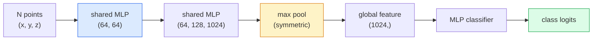

# 3D Vision — Point Clouds & NeRFs · 3D 视觉 — 点云与 NeRF

> 3D 视觉有两种风味。点云（point cloud）是传感器的原始输出。NeRF 是学出来的体积场（volumetric field）。两者回答的都是「空间中什么在哪里」。

> 3D vision comes in two flavours. Point clouds are the sensor's raw output. NeRFs are the learned volumetric field. Both answer "what is where in space."

**Type:** Learn + Build
**Languages:** Python
**Prerequisites:** Phase 4 Lesson 03 (CNNs), Phase 1 Lesson 12 (Tensor Operations)
**Time:** ~45 minutes

## Learning Objectives · 学习目标

- 区分显式（点云、网格 mesh、体素 voxel）与隐式（符号距离场 SDF、NeRF）3D 表示，以及各自的使用场景
- 理解 PointNet 的对称函数（symmetric function）技巧——它让神经网络对无序点集具有置换不变性（permutation invariance）
- 追踪一次 NeRF 前向传播：光线投射（ray casting）、体积渲染（volumetric rendering）、位置编码（positional encoding）、MLP 密度+颜色头
- 用 `nerfstudio` 或 `instant-ngp` 从少量带位姿的图像做现成的 3D 重建

> Distinguish explicit (point cloud, mesh, voxel) and implicit (signed distance field, NeRF) 3D representations and when each is used
> Understand PointNet's symmetric-function trick that makes a neural network permutation-invariant over an unordered set of points
> Trace a NeRF forward pass: ray casting, volumetric rendering, positional encoding, MLP density+colour head
> Use `nerfstudio` or `instant-ngp` for pretrained 3D reconstruction from a small set of posed images

## The Problem · 问题在哪

相机产出的是 2D 图像。LIDAR 产出的是一组没有顺序的 3D 点。structure-from-motion 流水线产出的是稀疏的 3D 关键点云。NeRF 从少量带位姿的图像重建出整个 3D 场景。这些都是「视觉」，但没有一个长得像 CNN 想要的稠密张量。

3D 视觉之所以重要，是因为几乎所有高价值的机器人任务都发生在 3D 里：抓取、避障、导航、AR 遮挡、3D 内容采集。只懂 2D 图像的视觉工程师，进不了这个领域增长最快的板块（AR/VR 内容、机器人、自动驾驶技术栈、房产或建筑行业的 NeRF 3D 重建）。

这两种表示各因不同的原因占据主导。点云是传感器白送的。NeRF 和它的后继者（3D Gaussian splatting、神经 SDF）则是你让神经网络去「学一个场景」时得到的东西。

> A camera produces a 2D image. A LIDAR produces a set of 3D points with no ordering. A structure-from-motion pipeline produces a sparse cloud of 3D keypoints. A NeRF reconstructs an entire 3D scene from a handful of posed images. All of these are "vision" but none of them look like the dense tensor a CNN wants.
> 3D vision matters because almost every high-value robot task runs in 3D: grasping, obstacle avoidance, navigation, AR occlusion, 3D content capture. A vision engineer who only understands 2D images is locked out of the fastest-growing slice of the field (AR/VR content, robotics, autonomous driving stacks, NeRF-based 3D reconstruction for real-estate or construction).
> The two representations dominate for different reasons. Point clouds are what sensors give you for free. NeRFs and their successors (3D Gaussian splatting, neural SDFs) are what you get when you ask a neural network to learn a scene.

## The Concept · 概念

### Point clouds · 点云

点云是 R^3 中 N 个点的无序集合，每个点可选地带特征（颜色、强度、法线）。

```
cloud = [
  (x1, y1, z1, r1, g1, b1),
  (x2, y2, z2, r2, g2, b2),
  ...
  (xN, yN, zN, rN, gN, bN),
]
```

没有网格，没有连接关系。两个性质让它对神经网络很难：

- **置换不变性（permutation invariance）** — 输出不能依赖点的顺序。
- **可变的 N** — 同一个模型必须处理不同规模的点云。

PointNet（Qi et al., 2017）用一个想法同时解决了这两点：对每个点施加共享 MLP（shared MLP），再用一个对称函数（最大池化）聚合。结果是一个不依赖顺序的定长向量。

```
f(P) = max_{p in P} MLP(p)
```

这就是 PointNet 的全部核心。更深的变体（PointNet++、Point Transformer）加了层次化采样和局部聚合，但对称函数技巧没有变。

> A point cloud is an unordered set of N points in R^3, optionally each with features (colour, intensity, normal).
> No grid, no connectivity. Two properties make this hard for neural networks:
> - **Permutation invariance** — the output must not depend on point order.
> - **Variable N** — a single model must handle clouds of different sizes.
> PointNet (Qi et al., 2017) solved both with one idea: apply a shared MLP to every point, then aggregate with a symmetric function (max pool). The result is a fixed-size vector that does not depend on order.
> This is the entire core of PointNet. Deeper variants (PointNet++, Point Transformer) add hierarchical sampling and local aggregation but the symmetric-function trick is unchanged.

### The PointNet architecture · PointNet 架构



「共享 MLP」指同一个 MLP 独立地跑在每个点上。为了效率，实现上是沿点维度做 1x1 卷积。

> "Shared MLP" means the same MLP runs on every point independently. Implemented as a 1x1 conv over the point dimension for efficiency.

### Neural Radiance Fields (NeRFs) · 神经辐射场（NeRF）

NeRF（Mildenhall et al., 2020）面对「能否从 N 张照片重建一个 3D 场景？」这个问题，给出的答案是一个本身即是场景的神经网络。这个网络把 `(x, y, z, viewing_direction)` 映射到 `(density, colour)`。渲染一个新视角，就是对这张网络做一次光线投射循环。

```
NeRF MLP:  (x, y, z, theta, phi) -> (sigma, r, g, b)

To render a pixel (u, v) of a new view:
  1. Cast a ray from the camera through pixel (u, v)
  2. Sample points along the ray at distances t_1, t_2, ..., t_N
  3. Query the MLP at each point
  4. Composite the colours weighted by (1 - exp(-sigma * dt))
  5. The sum is the rendered pixel colour
```

一个损失函数把渲染像素与训练照片中的真值像素作比较。反向传播穿过渲染步骤去更新 MLP。不需要 3D 真值，不需要显式几何——场景就存在 MLP 权重里。

> NeRFs (Mildenhall et al., 2020) took the question "can we reconstruct a 3D scene from N photos?" and answered with a neural network that is the scene. The network maps `(x, y, z, viewing_direction)` to `(density, colour)`. Rendering a new view is a ray-casting loop over this network.
> A loss compares the rendered pixel to the ground-truth pixel in the training photos. Backprop through the rendering step updates the MLP. No 3D ground truth, no explicit geometry — the scene is stored in the MLP weights.

### Positional encoding in NeRF · NeRF 中的位置编码

对 `(x, y, z)` 直接上一个普通 MLP，无法表达高频细节，因为 MLP 在频谱上偏向低频。NeRF 的修法是：在进 MLP 之前，把每个坐标编码成一个傅里叶特征（Fourier feature）向量：

```
gamma(p) = (sin(2^0 pi p), cos(2^0 pi p), sin(2^1 pi p), cos(2^1 pi p), ...)
```

最多到 L=10 个频率层级。这与 Transformer 用于位置的技巧相同，而且会在扩散的时间条件（第 10 课）里再次出现。没有它，NeRF 渲染出来一片模糊。

> A vanilla MLP on `(x, y, z)` cannot represent high-frequency details because MLPs are spectrally biased toward low frequencies. NeRF fixes this by encoding each coordinate into a Fourier feature vector before the MLP:
> Up to L=10 frequency levels. This is the same trick transformers use for positions, and it appears again in diffusion time conditioning (Lesson 10). Without it, NeRFs look blurry.

### Volumetric rendering · 体积渲染

```
C(r) = sum_i T_i * (1 - exp(-sigma_i * delta_i)) * c_i

T_i  = exp(- sum_{j<i} sigma_j * delta_j)
delta_i = t_{i+1} - t_i
```

`T_i` 是透射率（transmittance）——有多少光存活到了第 i 个点。`(1 - exp(-sigma_i * delta_i))` 是第 i 个点的不透明度（opacity）。`c_i` 是颜色。最终像素是沿光线的加权和。

> `T_i` is transmittance — how much light survives to point i. `(1 - exp(-sigma_i * delta_i))` is the opacity at point i. `c_i` is the colour. The final pixel is a weighted sum along the ray.

### What replaced NeRFs · 取代 NeRF 的技术

纯 NeRF 训练慢（小时级）、渲染慢（每图秒级）。此后的脉络：

- **Instant-NGP**（2022）— 哈希网格编码（hash-grid encoding）取代 MLP 的位置输入；秒级训练。
- **Mip-NeRF 360** — 处理无界场景和抗锯齿。
- **3D Gaussian Splatting**（2023）— 用数百万个 3D 高斯取代体积场；分钟级训练，实时渲染。当前的生产默认。

2026 年几乎所有真实的 NeRF 产品，实际上都是 3D Gaussian splatting。但心智模型仍然是 NeRF。

> Pure NeRFs are slow to train (hours) and slow to render (seconds per image). The lineage since:
> - **Instant-NGP** (2022) — hash-grid encoding replaces the MLP's position input; trains in seconds.
> - **Mip-NeRF 360** — handles unbounded scenes and anti-aliasing.
> - **3D Gaussian Splatting** (2023) — replaces the volumetric field with millions of 3D Gaussians; trains in minutes, renders in real time. The current production default.
> Almost every real NeRF product in 2026 is actually 3D Gaussian splatting. The mental model is still NeRF.

### Datasets and benchmarks · 数据集与基准

- **ShapeNet** — 3D CAD 模型的点云分类与分割。
- **ScanNet** — 用于分割的真实室内扫描。
- **KITTI** — 自动驾驶的室外 LIDAR 点云。
- **NeRF Synthetic** / **Blended MVS** — 用于视角合成的带位姿图像数据集。
- **Mip-NeRF 360** 数据集 — 无界的真实场景。

> - **ShapeNet** — classification and segmentation of 3D CAD models as point clouds.
> - **ScanNet** — real indoor scans for segmentation.
> - **KITTI** — outdoor LIDAR point clouds for autonomous driving.
> - **NeRF Synthetic** / **Blended MVS** — posed-image datasets for view synthesis.
> - **Mip-NeRF 360** dataset — unbounded real scenes.

```figure
nerf-rays
```

## Build It · 动手造

### Step 1: PointNet classifier · 第 1 步：PointNet 分类器

```python
import torch
import torch.nn as nn

class PointNet(nn.Module):
    def __init__(self, num_classes=10):
        super().__init__()
        self.mlp1 = nn.Sequential(
            nn.Conv1d(3, 64, 1),    nn.BatchNorm1d(64),   nn.ReLU(inplace=True),
            nn.Conv1d(64, 64, 1),   nn.BatchNorm1d(64),   nn.ReLU(inplace=True),
        )
        self.mlp2 = nn.Sequential(
            nn.Conv1d(64, 128, 1),  nn.BatchNorm1d(128),  nn.ReLU(inplace=True),
            nn.Conv1d(128, 1024, 1), nn.BatchNorm1d(1024), nn.ReLU(inplace=True),
        )
        self.head = nn.Sequential(
            nn.Linear(1024, 512),   nn.BatchNorm1d(512),  nn.ReLU(inplace=True),
            nn.Dropout(0.3),
            nn.Linear(512, 256),    nn.BatchNorm1d(256),  nn.ReLU(inplace=True),
            nn.Dropout(0.3),
            nn.Linear(256, num_classes),
        )

    def forward(self, x):
        # x: (N, 3, num_points) — transposed for Conv1d
        x = self.mlp1(x)
        x = self.mlp2(x)
        x = torch.max(x, dim=-1)[0]       # (N, 1024)
        return self.head(x)

pts = torch.randn(4, 3, 1024)
net = PointNet(num_classes=10)
print(f"output: {net(pts).shape}")
print(f"params: {sum(p.numel() for p in net.parameters()):,}")
```

大约 160 万参数。每个点云跑 1,024 个点。

> About 1.6M parameters. Runs on 1,024 points per cloud.

### Step 2: Positional encoding · 第 2 步：位置编码

```python
def positional_encoding(x, L=10):
    """
    x: (..., D) -> (..., D * 2 * L)
    """
    freqs = 2.0 ** torch.arange(L, dtype=x.dtype, device=x.device)
    args = x.unsqueeze(-1) * freqs * 3.141592653589793
    sinc = torch.cat([args.sin(), args.cos()], dim=-1)
    return sinc.reshape(*x.shape[:-1], -1)

x = torch.randn(5, 3)
y = positional_encoding(x, L=10)
print(f"input:  {x.shape}")
print(f"encoded: {y.shape}     # (5, 60)")
```

乘以 `2^l * pi` 得到逐级升高的频率。

> Multiplying by `2^l * pi` gives progressively higher frequencies.

### Step 3: Tiny NeRF MLP · 第 3 步：小型 NeRF MLP

```python
class TinyNeRF(nn.Module):
    def __init__(self, L_pos=10, L_dir=4, hidden=128):
        super().__init__()
        self.L_pos = L_pos
        self.L_dir = L_dir
        pos_dim = 3 * 2 * L_pos
        dir_dim = 3 * 2 * L_dir
        self.trunk = nn.Sequential(
            nn.Linear(pos_dim, hidden), nn.ReLU(inplace=True),
            nn.Linear(hidden, hidden),  nn.ReLU(inplace=True),
            nn.Linear(hidden, hidden),  nn.ReLU(inplace=True),
            nn.Linear(hidden, hidden),  nn.ReLU(inplace=True),
        )
        self.sigma = nn.Linear(hidden, 1)
        self.color = nn.Sequential(
            nn.Linear(hidden + dir_dim, hidden // 2), nn.ReLU(inplace=True),
            nn.Linear(hidden // 2, 3), nn.Sigmoid(),
        )

    def forward(self, x, d):
        x_enc = positional_encoding(x, self.L_pos)
        d_enc = positional_encoding(d, self.L_dir)
        h = self.trunk(x_enc)
        sigma = torch.relu(self.sigma(h)).squeeze(-1)
        rgb = self.color(torch.cat([h, d_enc], dim=-1))
        return sigma, rgb

nerf = TinyNeRF()
x = torch.randn(128, 3)
d = torch.randn(128, 3)
s, c = nerf(x, d)
print(f"sigma: {s.shape}   rgb: {c.shape}")
```

相比原版 NeRF（两个深度为 8 的 MLP 干线）很小。足以演示这个架构。

> Tiny compared to the original NeRF (which has 2 MLP trunks of depth 8). Enough to demonstrate the architecture.

### Step 4: Volumetric rendering along a ray · 第 4 步：沿一条光线做体积渲染

```python
def volumetric_render(sigma, rgb, t_vals):
    """
    sigma: (..., N_samples)
    rgb:   (..., N_samples, 3)
    t_vals: (N_samples,) distances along the ray
    """
    delta = torch.cat([t_vals[1:] - t_vals[:-1], torch.full_like(t_vals[:1], 1e10)])
    alpha = 1.0 - torch.exp(-sigma * delta)
    trans = torch.cumprod(torch.cat([torch.ones_like(alpha[..., :1]), 1.0 - alpha + 1e-10], dim=-1), dim=-1)[..., :-1]
    weights = alpha * trans
    rendered = (weights.unsqueeze(-1) * rgb).sum(dim=-2)
    depth = (weights * t_vals).sum(dim=-1)
    return rendered, depth, weights


N = 64
t_vals = torch.linspace(2.0, 6.0, N)
sigma = torch.rand(N) * 0.5
rgb = torch.rand(N, 3)
rendered, depth, weights = volumetric_render(sigma, rgb, t_vals)
print(f"rendered colour: {rendered.tolist()}")
print(f"depth:           {depth.item():.2f}")
```

一条光线，64 个采样点，合成出一个 RGB 像素和一个深度。

> One ray, 64 samples, composite to a single RGB pixel and a depth.

## Use It · 实战用法

做真东西时：

- `nerfstudio`（Tancik et al.）— 当前 NeRF / Instant-NGP / Gaussian Splatting 的参考库。命令行加网页查看器。
- `pytorch3d`（Meta）— 可微渲染、点云工具、网格（mesh）操作。
- `open3d` — 点云处理、配准（registration）、可视化。

部署时，3D Gaussian splatting 已大体取代纯 NeRF，因为渲染快 100 倍。重建质量相当。

> For real work:
> - `nerfstudio` (Tancik et al.) — the current reference library for NeRF / Instant-NGP / Gaussian Splatting. Command-line plus a web viewer.
> - `pytorch3d` (Meta) — differentiable rendering, point-cloud utilities, mesh ops.
> - `open3d` — point cloud processing, registration, visualisation.
> For deployment, 3D Gaussian splatting has largely replaced pure NeRFs because it renders 100x faster. The reconstruction quality is comparable.

## Ship It · 交付

本课产出：

- `outputs/prompt-3d-task-router.md` — 一个提示词：根据任务和输入数据，路由到正确的 3D 表示（点云、mesh、voxel、NeRF、Gaussian splat）。
- `outputs/skill-point-cloud-loader.md` — 一个技能：为 .ply / .pcd / .xyz 文件写出 PyTorch `Dataset`，带正确的归一化、居中和点采样。

> This lesson produces:
> - `outputs/prompt-3d-task-router.md` — a prompt that routes to the right 3D representation (point cloud, mesh, voxel, NeRF, Gaussian splat) based on task and input data.
> - `outputs/skill-point-cloud-loader.md` — a skill that writes a PyTorch `Dataset` for .ply / .pcd / .xyz files with correct normalisation, centring, and point sampling.

## Exercises · 练习

1. **（简单）** 证明 PointNet 是置换不变的：把同一个点云跑两遍，其中一遍打乱点的顺序。验证输出在浮点误差内完全一致。
2. **（中等）** 实现一个最小的光线生成函数：给定相机内参和位姿，为 H x W 图像的每个像素产出生成光线的起点和方向。
3. **（困难）** 在一个彩色立方体渲染视图的合成数据集上（用可微渲染或简单的光线追踪生成）训练 TinyNeRF。报告第 1、10、100 个 epoch 的渲染损失。到第几个 epoch 模型能产出可辨认的视图？

## Key Terms · 术语表

| 术语 | 人们怎么说 | 实际含义 |
|------|----------------|----------------------|
| Point cloud | 「来自 LIDAR 的 3D 点」 | 无序的 (x, y, z) 集合，每点可选地带特征 |
| PointNet | 「第一个点云神经网络」 | 每点共享 MLP + 对称（最大）池化；构造上即置换不变 |
| NeRF | 「本身就是场景的 MLP」 | 把 (x, y, z, dir) 映射到（密度，颜色）的网络；通过光线投射渲染 |
| Positional encoding | 「傅里叶特征」 | 把每个坐标编码成多频率的 sin/cos，克服 MLP 的低频偏好 |
| Volumetric rendering | 「沿光线积分」 | 用透射率和 alpha 把沿光线的采样合成为单个像素 |
| Instant-NGP | 「哈希网格 NeRF」 | 用多分辨率哈希网格取代 NeRF 的坐标 MLP；快 100-1000 倍 |
| 3D Gaussian splatting | 「数百万个高斯」 | 场景 = 一堆 3D 高斯；实时渲染，分钟级训练 |
| SDF | 「符号距离场」 | 返回到最近表面带符号距离的函数；另一种隐式表示 |

## Further Reading · 延伸阅读

- [PointNet (Qi et al., 2017)](https://arxiv.org/abs/1612.00593) — 置换不变的分类器
- [NeRF (Mildenhall et al., 2020)](https://arxiv.org/abs/2003.08934) — 让「从照片做 3D 重建」变成神经网络问题的论文
- [Instant-NGP (Müller et al., 2022)](https://arxiv.org/abs/2201.05989) — 哈希网格，1000 倍加速
- [3D Gaussian Splatting (Kerbl et al., 2023)](https://arxiv.org/abs/2308.04079) — 在生产中取代 NeRF 的架构
