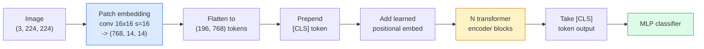

# Vision Transformers (ViT) · 视觉 Transformer（ViT）

> 把图像切成 patch，把每个 patch 当作一个词，跑一个标准的 Transformer。然后就不要回头了。

> Cut the image into patches, treat each patch as a word, run a standard transformer. Don't look back.

**Type:** Build
**Languages:** Python
**Prerequisites:** Phase 7 Lesson 02 (Self-Attention), Phase 4 Lesson 04 (Image Classification)
**Time:** ~45 minutes

## Learning Objectives · 学习目标

- 从零实现 patch 嵌入（patch embedding）、可学习位置嵌入、class token 和 Transformer 编码器块，搭出一个最小 ViT
- 解释为什么人们曾以为 ViT 需要海量预训练数据，直到 DeiT 和 MAE 证明并非如此
- 从架构先验（inductive prior）的角度比较 ViT、Swin 和 ConvNeXt（无先验、局部窗口注意力、卷积骨干）
- 用 `timm` 和标准的 linear-probe / 微调配方，在小数据集上微调一个预训练 ViT

> Implement patch embedding, learned positional embedding, class token, and transformer encoder blocks from scratch to build a minimal ViT
> Explain why ViT was thought to need massive pretraining data until DeiT and MAE proved otherwise
> Compare ViT, Swin, and ConvNeXt on their architectural priors (none, local window attention, conv backbone)
> Fine-tune a pretrained ViT on a small dataset using `timm` and the standard linear-probe / fine-tune recipe

## The Problem · 问题在哪

十年来，卷积就是计算机视觉的同义词。CNN 有很强的归纳偏置（inductive bias）——局部性、平移等变性——没有人觉得它们能被取代。然后 Dosovitskiy et al.（2020）证明：把一个纯 Transformer 直接用在展平的图像 patch 上，完全不带卷积机制，在大规模数据下能追平甚至击败最好的 CNN。

但条件是「大规模」。ViT 在 ImageNet-1k 上输给 ResNet；在 ImageNet-21k 或 JFT-300M 上预训练、再到 ImageNet-1k 上微调的 ViT 赢了它。当时的结论是：Transformer 缺少有用的先验，但能从足够多的数据里学出来。后续工作（DeiT、MAE、DINO）表明，配合正确的训练配方——强数据增强、自监督预训练、蒸馏——ViT 在小数据上也能训好。

到 2026 年，纯 CNN 在边缘设备上仍有竞争力（ConvNeXt 最强），但 Transformer 统治其余一切：分割（Mask2Former、SegFormer）、检测（DETR、RT-DETR）、多模态（CLIP、SigLIP）、视频（VideoMAE、VJEPA）。ViT 块结构是必须掌握的那一个。

> For a decade, convolution was synonymous with computer vision. CNNs had strong inductive biases — locality, translation equivariance — that nobody thought you could replace. Then Dosovitskiy et al. (2020) showed that a plain transformer applied to flattened image patches, with no convolutional machinery at all, could match or beat the best CNNs at scale.
> The catch was "at scale." ViT on ImageNet-1k lost to ResNet. ViT pretrained on ImageNet-21k or JFT-300M then fine-tuned on ImageNet-1k beat it. The conclusion was that transformers lacked useful priors but could learn them from enough data. Subsequent work (DeiT, MAE, DINO) showed that with the right training recipes — strong augmentation, self-supervised pretraining, distillation — ViTs train fine on small data too.
> By 2026, pure CNNs are still competitive on edge devices (ConvNeXt is the strongest), but transformers dominate everything else: segmentation (Mask2Former, SegFormer), detection (DETR, RT-DETR), multimodal (CLIP, SigLIP), video (VideoMAE, VJEPA). The ViT block structure is the one to know.

## The Concept · 概念

### The pipeline · 整条流水线



七步。patch → token → 注意力 → 分类器。每个变体（DeiT、Swin、ConvNeXt、MAE 预训练）只改动七步中的一两步，其余原封不动。

> Seven steps. Patches -> tokens -> attention -> classifier. Every variant (DeiT, Swin, ConvNeXt, MAE pretraining) changes one or two of the seven and leaves the rest alone.

### Patch embedding · Patch 嵌入

第一个卷积就是秘密所在。核大小 16、步长 16，于是 224x224 的图像变成 14x14 的 16x16 patch 网格，每个 patch 被投影成 768 维嵌入。这一个卷积同时完成了切 patch 和线性投影。

```
Input:  (3, 224, 224)
Conv (3 -> 768, k=16, s=16, no padding):
Output: (768, 14, 14)
Flatten spatial: (196, 768)
```

196 个 patch = 196 个 token。每个 token 的特征维度是 768（ViT-B）、1024（ViT-L）或 1280（ViT-H）。

> The first conv is the secret. Kernel size 16, stride 16, so a 224x224 image becomes a 14x14 grid of 16x16 patches, each projected to a 768-dim embedding. That single conv both patchifies and linearly projects.
> 196 patches = 196 tokens. Each token's feature dimension is 768 (ViT-B), 1024 (ViT-L), or 1280 (ViT-H).

### Class token · 类别 token（class token）

一个可学习的向量，加在序列最前面：

```
tokens = [CLS; patch_1; patch_2; ...; patch_196]   shape (197, 768)
```

经过 N 个 Transformer 块之后，`[CLS]` 的输出就是全局图像表示。分类头只读这一个向量。

> A single learned vector prepended to the sequence:
> After N transformer blocks, the `[CLS]` output is the global image representation. Classification head reads only this one vector.

### Positional embedding · 位置嵌入

Transformer 没有内建的空间位置概念。给每个 token 加一个可学习向量：

```
tokens = tokens + learned_pos_embedding   (also shape (197, 768))
```

这个嵌入是模型的一个参数；基于梯度的训练会让它适应 2D 图像结构。正弦 2D 替代方案存在，但实践中很少用。

> Transformers have no built-in notion of spatial position. Add a learned vector to every token:
> The embedding is a parameter of the model; gradient-based training adapts it to 2D image structure. Sinusoidal 2D alternatives exist but are rarely used in practice.

### Transformer encoder block · Transformer 编码器块

标准的。多头自注意力、MLP、残差连接、pre-LayerNorm。

```
x = x + MSA(LN(x))
x = x + MLP(LN(x))

MLP is two-layer with GELU: Linear(d -> 4d) -> GELU -> Linear(4d -> d)
```

ViT-B/16 堆叠 12 个这样的块，每块 12 个注意力头，总计 86M 参数。

> Standard. Multi-head self-attention, MLP, residual connections, pre-LayerNorm.
> ViT-B/16 stacks 12 of these blocks, each with 12 attention heads, totalling 86M parameters.

### Why pre-LN · 为什么用 pre-LN

早期 Transformer 用 post-LN（`x = LN(x + sublayer(x))`），没有 warmup 很难训过 6-8 层。Pre-LN（`x = x + sublayer(LN(x))`）不需要 warmup 就能稳定地训练更深的网络。每个 ViT 和每个现代 LLM 都用 pre-LN。

> Early transformers used post-LN (`x = LN(x + sublayer(x))`) and struggled to train past 6-8 layers without warmup. Pre-LN (`x = x + sublayer(LN(x))`) trains deeper networks stably without warmup. Every ViT and every modern LLM uses pre-LN.

### Patch size trade-off · Patch 大小的取舍

- 16x16 patch → 196 个 token，标准选择。
- 32x32 patch → 49 个 token，更快但分辨率更低。
- 8x8 patch → 784 个 token，更精细，但 O(n^2) 的注意力成本恶化得厉害。

patch 越大 = token 越少 = 更快但空间细节更少。SwinV2 在层级窗口里使用 4x4 patch。

> - 16x16 patches -> 196 tokens, standard.
> - 32x32 patches -> 49 tokens, faster but lower resolution.
> - 8x8 patches -> 784 tokens, finer but O(n^2) attention cost scales badly.
> Bigger patches = fewer tokens = faster but less spatial detail. SwinV2 uses 4x4 patches in hierarchical windows.

### DeiT's recipe for training ViT on ImageNet-1k · DeiT 在 ImageNet-1k 上训练 ViT 的配方

原版 ViT 需要 JFT-300M 才能击败 CNN。DeiT（Touvron et al., 2020）只用 ImageNet-1k 就把 ViT-B 训到 81.8% top-1，靠四处改动：

1. 重度增强：RandAugment、Mixup、CutMix、Random Erasing。
2. 随机深度（stochastic depth，训练时随机丢弃整块）。
3. 重复增强（同一张图每个 batch 采样 3 次）。
4. 从 CNN 教师蒸馏（可选，进一步提升精度）。

每个现代 ViT 训练配方都源自 DeiT。

> The original ViT needed JFT-300M to beat CNNs. DeiT (Touvron et al., 2020) trained ViT-B to 81.8% top-1 on ImageNet-1k alone with four changes:
> 1. Heavy augmentation: RandAugment, Mixup, CutMix, Random Erasing.
> 2. Stochastic depth (drop entire blocks at random during training).
> 3. Repeated augmentation (same image sampled 3 times per batch).
> 4. Distillation from a CNN teacher (optional, lifts accuracy further).
> Every modern ViT training recipe descends from DeiT.

### Swin vs ConvNeXt · Swin 对比 ConvNeXt

- **Swin**（Liu et al., 2021）— 基于窗口的注意力。每个块在局部窗口内注意；交替的块移动窗口，以混合跨窗口的信息。在保留注意力算子的同时，找回了类 CNN 的局部性先验。
- **ConvNeXt**（Liu et al., 2022）— 重新设计的 CNN，采纳了 Swin 的架构选择（深度卷积、LayerNorm、GELU、倒置瓶颈）。它证明了差距不在「注意力对卷积」，而在「现代训练配方 + 架构」。

2026 年，ConvNeXt-V2 和 Swin-V2 都是生产级的；选哪个取决于你的推理栈（ConvNeXt 在边缘端编译得更友好）和预训练语料。

> - **Swin** (Liu et al., 2021) — window-based attention. Each block attends within a local window; alternating blocks shift the window to mix information across windows. Brings back a CNN-like locality prior while keeping the attention operator.
> - **ConvNeXt** (Liu et al., 2022) — redesigned CNN that matches Swin's architecture choices (depthwise convs, LayerNorm, GELU, inverted bottleneck). Showed that the gap is not "attention vs convolution" but "modern training recipe + architecture."
> In 2026, ConvNeXt-V2 and Swin-V2 are both production-grade; the right choice depends on your inference stack (ConvNeXt compiles better for edge) and pretraining corpus.

### MAE pretraining · MAE 预训练

掩码自编码器（Masked Autoencoder，He et al., 2022）：随机遮住 75% 的 patch，训练编码器只处理可见的 25%，再训练一个小解码器从编码器的输出重建被遮的 patch。预训练完成后，丢弃解码器，微调编码器。

MAE 让 ViT 只用 ImageNet-1k 就能训练，达到 SOTA，是当前默认的自监督配方。

> Masked Autoencoder (He et al., 2022): mask 75% of patches at random, train the encoder to process only the visible 25%, train a small decoder to reconstruct the masked patches from the encoder's output. After pretraining, discard the decoder and fine-tune the encoder.
> MAE makes ViT trainable on ImageNet-1k alone, hits SOTA, and is the current default self-supervised recipe.

```figure
batchnorm-inference
```

## Build It · 动手造

### Step 1: Patch embedding · 第 1 步：Patch 嵌入

```python
import torch
import torch.nn as nn

class PatchEmbedding(nn.Module):
    def __init__(self, in_channels=3, patch_size=16, dim=192, image_size=64):
        super().__init__()
        assert image_size % patch_size == 0
        self.proj = nn.Conv2d(in_channels, dim, kernel_size=patch_size, stride=patch_size)
        num_patches = (image_size // patch_size) ** 2
        self.num_patches = num_patches

    def forward(self, x):
        x = self.proj(x)
        return x.flatten(2).transpose(1, 2)
```

一个卷积、一次展平、一次转置。这就是从图像到 token 的全部步骤。

> One conv, one flatten, one transpose. That is the entire image-to-tokens step.

### Step 2: Transformer block · 第 2 步：Transformer 块

Pre-LN、多头自注意力、带 GELU 的 MLP、残差连接。

```python
class Block(nn.Module):
    def __init__(self, dim, num_heads, mlp_ratio=4, dropout=0.0):
        super().__init__()
        self.ln1 = nn.LayerNorm(dim)
        self.attn = nn.MultiheadAttention(dim, num_heads, dropout=dropout, batch_first=True)
        self.ln2 = nn.LayerNorm(dim)
        self.mlp = nn.Sequential(
            nn.Linear(dim, dim * mlp_ratio),
            nn.GELU(),
            nn.Dropout(dropout),
            nn.Linear(dim * mlp_ratio, dim),
            nn.Dropout(dropout),
        )

    def forward(self, x):
        a, _ = self.attn(self.ln1(x), self.ln1(x), self.ln1(x), need_weights=False)
        x = x + a
        x = x + self.mlp(self.ln2(x))
        return x
```

`nn.MultiheadAttention` 处理了拆头、缩放点积和输出投影。`batch_first=True` 让形状是 `(N, seq, dim)`。

> `nn.MultiheadAttention` handles the splitting into heads, the scaled dot-product, and the output projection. `batch_first=True` so shapes are `(N, seq, dim)`.

### Step 3: The ViT · 第 3 步：完整 ViT

```python
class ViT(nn.Module):
    def __init__(self, image_size=64, patch_size=16, in_channels=3,
                 num_classes=10, dim=192, depth=6, num_heads=3, mlp_ratio=4):
        super().__init__()
        self.patch = PatchEmbedding(in_channels, patch_size, dim, image_size)
        num_patches = self.patch.num_patches
        self.cls_token = nn.Parameter(torch.zeros(1, 1, dim))
        self.pos_embed = nn.Parameter(torch.zeros(1, num_patches + 1, dim))
        self.blocks = nn.ModuleList([
            Block(dim, num_heads, mlp_ratio) for _ in range(depth)
        ])
        self.ln = nn.LayerNorm(dim)
        self.head = nn.Linear(dim, num_classes)
        nn.init.trunc_normal_(self.pos_embed, std=0.02)
        nn.init.trunc_normal_(self.cls_token, std=0.02)

    def forward(self, x):
        x = self.patch(x)
        cls = self.cls_token.expand(x.size(0), -1, -1)
        x = torch.cat([cls, x], dim=1)
        x = x + self.pos_embed
        for blk in self.blocks:
            x = blk(x)
        x = self.ln(x[:, 0])
        return self.head(x)

vit = ViT(image_size=64, patch_size=16, num_classes=10, dim=192, depth=6, num_heads=3)
x = torch.randn(2, 3, 64, 64)
print(f"output: {vit(x).shape}")
print(f"params: {sum(p.numel() for p in vit.parameters()):,}")
```

大约 280 万参数——一个 CPU 上可训练的小 ViT。真正的 ViT-B 是 86M；同样的类定义，改成 `dim=768, depth=12, num_heads=12`。

> About 2.8M parameters — a tiny ViT tractable on CPU. Real ViT-B is 86M; same class definition with `dim=768, depth=12, num_heads=12`.

### Step 4: Sanity check — single image inference · 第 4 步：健全性检查——单张图像推理

```python
logits = vit(torch.randn(1, 3, 64, 64))
print(f"logits: {logits}")
print(f"probs:  {logits.softmax(-1)}")
```

应该无错运行。概率之和为 1。

> Should run without error. Probabilities sum to 1.

## Use It · 实战用法

`timm` 自带每一种 ViT 变体的 ImageNet 预训练权重。一行代码：

```python
import timm

model = timm.create_model("vit_base_patch16_224", pretrained=True, num_classes=10)
```

`timm` 是 2026 年视觉 Transformer 的生产默认。同一套 API 下支持 ViT、DeiT、Swin、Swin-V2、ConvNeXt、ConvNeXt-V2、MaxViT、MViT、EfficientFormer 等几十种模型。

做多模态（图像 + 文本）用 `transformers`，它带 CLIP、SigLIP、BLIP-2、LLaVA。这些东西里的图像编码器都是 ViT 变体。

> `timm` ships every ViT variant with ImageNet pretrained weights. One line:
> `timm` is the production default for vision transformers in 2026. Supports ViT, DeiT, Swin, Swin-V2, ConvNeXt, ConvNeXt-V2, MaxViT, MViT, EfficientFormer, and dozens of others under the same API.
> For multi-modal work (image + text), `transformers` ships CLIP, SigLIP, BLIP-2, LLaVA. The image encoder in all of those is a ViT variant.

## Ship It · 交付

本课产出：

- `outputs/prompt-vit-vs-cnn-picker.md` — 一个提示词：根据数据集规模、算力和推理栈，在 ViT、ConvNeXt 或 Swin 之间做出选择。
- `outputs/skill-vit-patch-and-pos-embed-inspector.md` — 一个技能：校验 ViT 的 patch 嵌入和位置嵌入形状是否与模型期望的序列长度一致，抓住最常见的移植 bug。

> This lesson produces:
> - `outputs/prompt-vit-vs-cnn-picker.md` — a prompt that picks between a ViT, a ConvNeXt, or a Swin based on dataset size, compute, and inference stack.
> - `outputs/skill-vit-patch-and-pos-embed-inspector.md` — a skill that verifies a ViT's patch embedding and positional embedding shapes match the model's expected sequence length, catching the most common porting bugs.

## Exercises · 练习

1. **（简单）** 打印上面这个小 ViT 一次前向传播中每个中间张量的形状。确认：输入 `(N, 3, 64, 64)` → patch `(N, 16, 192)` → 加 CLS 后 `(N, 17, 192)` → 分类器输入 `(N, 192)` → 输出 `(N, num_classes)`。
2. **（中等）** 在第 4 课的合成 CIFAR 数据集上微调一个预训练的 `timm` ViT-S/16。与在同样数据上微调 ResNet-18 做对比。报告训练时间和最终精度。
3. **（困难）** 为这个小 ViT 实现 MAE 预训练：遮住 75% 的 patch，训练编码器 + 一个小解码器来重建被遮的 patch。在预训练前后分别评估合成数据上的 linear-probe 精度。

## Key Terms · 术语表

| 术语 | 人们怎么说 | 实际含义 |
|------|----------------|----------------------|
| Patch embedding | 「第一个卷积」 | kernel size = stride = patch size 的卷积；把图像变成 token 嵌入网格 |
| Class token | 「[CLS]」 | 加在 token 序列最前面的可学习向量；它的最终输出就是全局图像表示 |
| Positional embedding | 「可学习位置」 | 加到每个 token 上的可学习向量，让 Transformer 知道每个 patch 来自哪里 |
| Pre-LN | 「子层之前做 LayerNorm」 | 稳定的 Transformer 变体：`x + sublayer(LN(x))` 而不是 `LN(x + sublayer(x))` |
| Multi-head attention | 「并行注意力」 | 标准注意力拆成 num_heads 个独立子空间，之后再拼接 |
| ViT-B/16 | 「Base，patch 16」 | 标准尺寸：dim=768、depth=12、heads=12、patch_size=16、image=224；约 86M 参数 |
| DeiT | 「数据高效 ViT」 | 只用 ImageNet-1k 配强增强训练的 ViT；证明并非严格需要大型预训练数据集 |
| MAE | 「掩码自编码器」 | 自监督预训练：遮住 75% 的 patch 再重建；当前主流的 ViT 预训练配方 |

## Further Reading · 延伸阅读

- [An Image is Worth 16x16 Words (Dosovitskiy et al., 2020)](https://arxiv.org/abs/2010.11929) — ViT 论文
- [DeiT: Data-efficient Image Transformers (Touvron et al., 2020)](https://arxiv.org/abs/2012.12877) — 如何只用 ImageNet-1k 训练 ViT
- [Masked Autoencoders are Scalable Vision Learners (He et al., 2022)](https://arxiv.org/abs/2111.06377) — MAE 预训练
- [timm documentation](https://huggingface.co/docs/timm) — 生产中会用到的每一个视觉 Transformer 的参考文档
