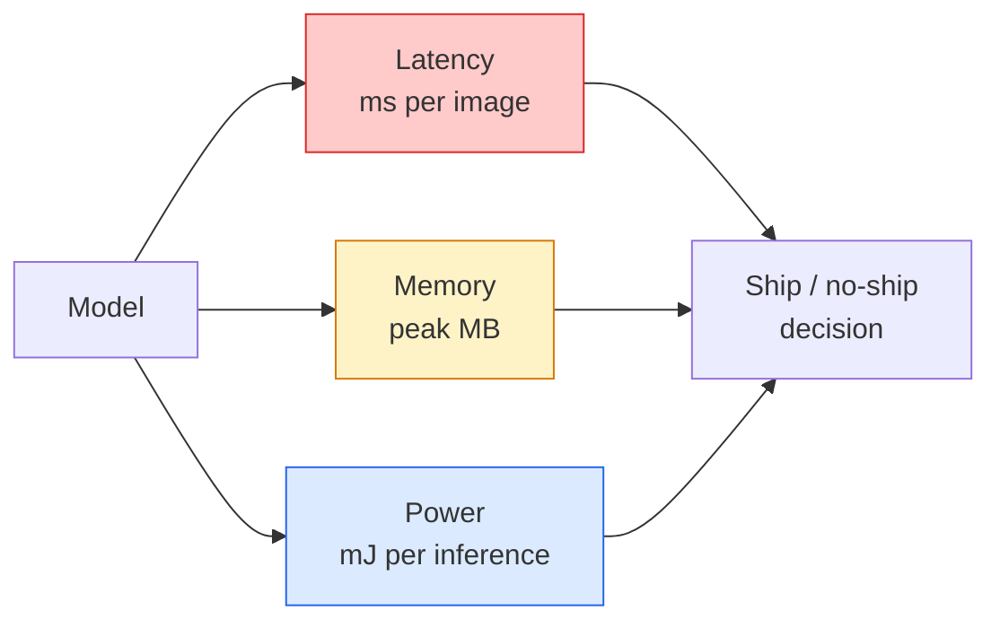

# Real-Time Vision — Edge Deployment · 实时视觉——边缘部署

> Edge inference is the discipline of getting a 90-accuracy model to run at 30 fps on a device with 2 GB of RAM. Every percentage point of accuracy is traded against milliseconds of latency.

**Type:** Learn + Build
**Languages:** Python
**Prerequisites:** Phase 4 Lesson 04 (Image Classification), Phase 10 Lesson 11 (Quantization)
**Time:** ~75 minutes

## Learning Objectives · 学习目标

- 学会测量任意 PyTorch 模型的推理延迟、峰值内存和吞吐量，并读懂 FLOPs / 参数量 / 延迟之间的权衡
- 用 PyTorch 的训练后量化（post-training quantisation）把视觉模型量化到 INT8，并验证精度损失小于 1%
- 导出为 ONNX，再用 ONNX Runtime 或 TensorRT 编译；说出三种最常见的导出失败及其修复办法
- 解释面对边缘约束时，何时该选 MobileNetV3、EfficientNet-Lite、ConvNeXt-Tiny 或 MobileViT

> Measure inference latency, peak memory, and throughput for any PyTorch model, and read the FLOPs / params / latency trade-off
> Quantise a vision model to INT8 using PyTorch's post-training quantisation and verify accuracy loss < 1%
> Export to ONNX and compile with ONNX Runtime or TensorRT; name the three most common export failures and their fixes
> Explain when to pick MobileNetV3, EfficientNet-Lite, ConvNeXt-Tiny, or MobileViT for an edge constraint

## The Problem · 问题在哪

训练时的视觉模型是一头浮点数巨兽：1 亿参数、一次前向 10 GFLOPs、2 GB 显存。这些东西没有一样能塞进手机、车机、工业相机或无人机。要把视觉系统交付出去，就意味着把同样的预测塞进一个缩小 100 倍的预算里。

三个旋钮承担了大部分工作：模型选择（同样的配方换更小的架构）、量化（用 INT8 替代 FP32）、推理运行时（ONNX Runtime、TensorRT、Core ML、TFLite）。旋钮调得好不好，就是「能在工作站上跑的 demo」和「能装进 30 美元相机模组的产品」之间的差别。

本课先建立测量纪律（测不了的东西就优化不了），再逐个讲这三个旋钮。目标不是学会每一个边缘运行时，而是知道有哪些杠杆存在，以及如何验证每个杠杆真的起到了你以为的作用。

> A training-time vision model is a floating-point monster. ... Shipping a vision system means fitting the same predictions into a budget that is 100x smaller.
> Three knobs do most of the work: model choice (a smaller architecture with the same recipe), quantisation (INT8 instead of FP32), and the inference runtime (ONNX Runtime, TensorRT, Core ML, TFLite). Getting them right is the difference between a demo that runs on a workstation and a product that ships on a $30 camera module.
> The goal is not to learn every edge runtime but to know what levers exist and how to verify each one does what you think.

## The Concept · 概念

### The three budgets · 三种预算



- **延迟（Latency）**：p50、p95、p99。只报 p50 的平均值会掩盖对实时系统至关重要的尾部行为。
- **峰值内存（Peak memory）**：设备曾经达到过的最大值，不是稳态平均值。它很关键，因为在嵌入式目标上 OOM（内存耗尽）是致命的。
- **功耗 / 能耗（Power / energy）**：电池供电设备上每次推理消耗的毫焦耳。常用 CPU/GPU 利用率 * 时间来近似。

边缘部署决策就是靠一张（模型、延迟、内存、精度）表格做出来的。每个格子都必须在目标设备上实测，而不是在工作站上。

> - **Latency**: p50, p95, p99. Averaging only p50 hides tail behaviour that matters for real-time systems.
> - **Peak memory**: the maximum the device ever sees, not the steady-state average. Matters because OOMs are fatal on embedded targets.
> - **Power / energy**: millijoules per inference on a battery-powered device. Often proxied by CPU/GPU utilisation * time.
> A table of (model, latency, memory, accuracy) is what an edge decision is made from. Every cell is measured on the target device, not the workstation.

### Measurement discipline · 测量纪律

每一次边缘性能画像都应该遵守三条规则：

1. 测量前先用 5-10 次假前向**预热（warm up）**模型。冷缓存和 JIT 编译会让第一次测出的数字失去代表性。
2. 在计时块前后用 `torch.cuda.synchronize()` **同步** GPU 负载。不加这一步，你测到的是 kernel 派发，不是 kernel 执行。
3. 把输入尺寸**固定**为生产分辨率。224x224 上的延迟不是 512x512 上的延迟。

> 1. **Warm up** the model with 5-10 dummy forward passes before measuring. Cold caches and JIT compilation produce unrepresentative first numbers.
> 2. **Synchronise** GPU workloads with `torch.cuda.synchronize()` before and after the timed block. Without this you measure kernel dispatch, not kernel execution.
> 3. **Fix input sizes** to the production resolution. Latency on 224x224 is not latency on 512x512.

### FLOPs as a proxy · FLOPs：延迟的廉价代理

FLOPs（每次推理的浮点运算数）是一个廉价、与设备无关的延迟代理指标。用它比较架构很有用，当成绝对墙钟时间则会误导。一个 FLOPs 多 10% 的模型实际可能快 2 倍，因为它用的是对硬件友好的算子（depthwise 卷积编译效果好，大 7x7 卷积则不行）。

规则：架构搜索看 FLOPs，部署决策看设备实测延迟。

> FLOPs (floating-point operations per inference) is a cheap, device-independent proxy for latency. Useful for architecture comparison, misleading as absolute wall-clock. A model with 10% more FLOPs can be 2x faster in practice because it uses hardware-friendly ops (depthwise convs compile well, large 7x7 convs do not).
> Rule: use FLOPs for architecture search, use on-device latency for deployment decisions.

### Quantisation in one paragraph · 一段话讲完量化

把 FP32 的权重和激活换成 INT8。模型体积缩小 4 倍，内存带宽需求降为 1/4，在带 INT8 kernel 的硬件上（每一代现代移动 SoC、每一块带 Tensor Core 的 NVIDIA GPU）计算提速 2-4 倍。视觉任务上，训练后静态量化的精度损失通常只有 0.1-1 个百分点。

类型：

- **动态（Dynamic）** — 权重量化到 INT8，激活仍用浮点计算。简单，加速有限。
- **静态（训练后 / post-training）** — 量化权重 + 用一个小校准集校准激活范围。比动态快得多。
- **量化感知训练（QAT）** — 训练期间模拟量化，让模型学会绕开量化带来的误差。精度最好，但需要标注数据。

对视觉任务，训练后静态量化用 5% 的力气拿到 95% 的收益。只有当 PTQ 的精度损失不可接受时才上 QAT。

> Replace FP32 weights and activations with INT8. Model size drops 4x, memory bandwidth drops 4x, compute drops 2-4x on hardware that has INT8 kernels (every modern mobile SoC, every NVIDIA GPU with Tensor Cores). Accuracy loss on vision tasks is typically 0.1-1 percentage points with post-training static quantisation.
> For vision, post-training static quantisation gives 95% of the benefit with 5% of the effort. Use QAT only when accuracy loss from PTQ is unacceptable.

### Pruning and distillation · 剪枝与蒸馏

- **剪枝（Pruning）** — 删除不重要的权重（按幅值）或通道（结构化）。在过参数化模型上效果好；对本来就很紧凑的架构用处不大。
- **蒸馏（Distillation）** — 训练一个小 student 模型去模仿大 teacher 的 logits。通常能挽回模型压缩时丢掉的大部分精度。是生产级边缘模型的标准做法。

> - **Pruning** — remove unimportant weights (magnitude-based) or channels (structured). Works well on overparameterised models; less useful on already-compact architectures.
> - **Distillation** — train a small student to mimic a large teacher's logits. Often recovers most of the accuracy lost by shrinking the model. Standard for production edge models.

### The inference runtimes · 推理运行时

- **PyTorch eager** — 慢，不适合部署。只用于开发。
- **TorchScript** — 上一代方案。已被 `torch.compile` 和 ONNX 导出取代。
- **ONNX Runtime** — 中立的运行时。CPU、CUDA、CoreML、TensorRT、OpenVINO 都提供 ONNX provider。从这里起步。
- **TensorRT** — NVIDIA 的编译器。在 NVIDIA GPU（工作站和 Jetson）上延迟最佳。可与 ONNX Runtime 集成，也可独立使用。
- **Core ML** — Apple 面向 iOS/macOS 的运行时。需要 `.mlmodel` 或 `.mlpackage`。
- **TFLite** — Google 面向 Android/ARM 的运行时。需要 `.tflite`。
- **OpenVINO** — Intel 面向 CPU/VPU 的运行时。需要 `.xml` + `.bin`。

实际路线：PyTorch 导出 -> ONNX -> 按目标设备挑运行时。ONNX 就是通用语。

> - **ONNX Runtime** — the neutral runtime. CPU, CUDA, CoreML, TensorRT, OpenVINO all have ONNX providers. Start here.
> - **TensorRT** — NVIDIA's compiler. Best latency on NVIDIA GPUs (workstation and Jetson). Integrates with ONNX Runtime or standalone.
> In practice: export PyTorch -> ONNX -> pick the runtime for the target. ONNX is the lingua franca.

### Edge architecture picker · 边缘架构怎么选

| 预算 | 模型 | 理由 |
|------|------|------|
| < 3M 参数 | MobileNetV3-Small | 到处都能编译，好基线 |
| 3-10M | EfficientNet-Lite-B0 | TFLite 上单位参数精度最高 |
| 10-20M | ConvNeXt-Tiny | 单位参数精度最高，对 CPU 友好 |
| 20-30M | MobileViT-S 或 EfficientViT | 拥有 ImageNet 精度的 Transformer |
| 30-80M | Swin-V2-Tiny | 前提是技术栈支持 window attention |

除非有明确的理由不这么做，否则上面这些模型全部量化到 INT8。

> Quantise all of these to INT8 unless you have a specific reason not to.

```figure
cnn-param-count
```

## Build It · 动手造

### Step 1: Measure latency correctly · 正确测量延迟

```python
import time
import torch

def measure_latency(model, input_shape, device="cpu", warmup=10, iters=50):
    model = model.to(device).eval()
    x = torch.randn(input_shape, device=device)
    with torch.no_grad():
        for _ in range(warmup):
            model(x)
        if device == "cuda":
            torch.cuda.synchronize()
        times = []
        for _ in range(iters):
            if device == "cuda":
                torch.cuda.synchronize()
            t0 = time.perf_counter()
            model(x)
            if device == "cuda":
                torch.cuda.synchronize()
            times.append((time.perf_counter() - t0) * 1000)
    times.sort()
    return {
        "p50_ms": times[len(times) // 2],
        "p95_ms": times[int(len(times) * 0.95)],
        "p99_ms": times[int(len(times) * 0.99)],
        "mean_ms": sum(times) / len(times),
    }
```

预热、同步、用 `time.perf_counter()`。报告分位数，别只报均值。

> Warm up, synchronise, use `time.perf_counter()`. Report percentiles, not just mean.

### Step 2: Parameter and FLOP counts · 参数量与 FLOP 统计

```python
def parameter_count(model):
    return sum(p.numel() for p in model.parameters())

def flops_estimate(model, input_shape):
    """
    Rough FLOP count for a conv/linear-only model. For production use `fvcore` or `ptflops`.
    """
    total = 0
    def conv_hook(m, inp, out):
        nonlocal total
        c_out, c_in, kh, kw = m.weight.shape
        h, w = out.shape[-2:]
        total += 2 * c_in * c_out * kh * kw * h * w
    def linear_hook(m, inp, out):
        nonlocal total
        total += 2 * m.in_features * m.out_features
    hooks = []
    for m in model.modules():
        if isinstance(m, torch.nn.Conv2d):
            hooks.append(m.register_forward_hook(conv_hook))
        elif isinstance(m, torch.nn.Linear):
            hooks.append(m.register_forward_hook(linear_hook))
    model.eval()
    with torch.no_grad():
        model(torch.randn(input_shape))
    for h in hooks:
        h.remove()
    return total
```

真实项目请用 `fvcore.nn.FlopCountAnalysis` 或 `ptflops`；它们能正确处理每一种模块类型。

> For real projects use `fvcore.nn.FlopCountAnalysis` or `ptflops`; they handle every module type correctly.

### Step 3: Post-training static quantisation · 训练后静态量化

```python
def quantise_ptq(model, calibration_loader, backend="x86"):
    import torch.ao.quantization as tq
    model = model.eval().cpu()
    model.qconfig = tq.get_default_qconfig(backend)
    tq.prepare(model, inplace=True)
    with torch.no_grad():
        for x, _ in calibration_loader:
            model(x)
    tq.convert(model, inplace=True)
    return model
```

三个步骤：配置、prepare（插入 observer）、用真实数据校准、convert（融合 + 量化）。前提是模型已做算子融合（`Conv -> BN -> ReLU` -> `ConvBnReLU`），这件事由 `torch.ao.quantization.fuse_modules` 处理。

> Three steps: configure, prepare (insert observers), calibrate with real data, convert (fuse + quantise). Requires the model to be fused (`Conv -> BN -> ReLU` -> `ConvBnReLU`), which `torch.ao.quantization.fuse_modules` handles.

### Step 4: Export to ONNX · 导出 ONNX

```python
def export_onnx(model, sample_input, path="model.onnx"):
    model = model.eval()
    torch.onnx.export(
        model,
        sample_input,
        path,
        input_names=["input"],
        output_names=["output"],
        dynamic_axes={"input": {0: "batch"}, "output": {0: "batch"}},
        opset_version=17,
    )
    return path
```

`opset_version=17` 是 2026 年的安全默认值。`dynamic_axes` 让你可以用任意 batch size 运行这个 ONNX 模型。

> `opset_version=17` is the safe default in 2026. `dynamic_axes` lets you run the ONNX model with arbitrary batch size.

### Step 5: Benchmark and compare regimes · 基准测试并对比各种组合

```python
import torch.nn as nn
from torchvision.models import mobilenet_v3_small

def compare_regimes():
    model = mobilenet_v3_small(weights=None, num_classes=10)
    params = parameter_count(model)
    flops = flops_estimate(model, (1, 3, 224, 224))
    lat_fp32 = measure_latency(model, (1, 3, 224, 224), device="cpu")
    print(f"FP32 MobileNetV3-Small: {params:,} params  {flops/1e9:.2f} GFLOPs  "
          f"p50={lat_fp32['p50_ms']:.2f}ms  p95={lat_fp32['p95_ms']:.2f}ms")
```

对 `resnet50`、`efficientnet_v2_s` 和 `convnext_tiny` 跑同一个函数，你就得到了部署决策所需的对比表。

> Run the same function for `resnet50`, `efficientnet_v2_s`, and `convnext_tiny` and you have the comparison table you need for a deployment decision.

## Use It · 实战用法

生产级技术栈收敛为三条路线：

- **Web / serverless**：PyTorch -> ONNX -> ONNX Runtime（CPU 或 CUDA provider）。最省事，对大多数场景够用。
- **NVIDIA 边缘（Jetson、GPU 服务器）**：PyTorch -> ONNX -> TensorRT。延迟最优，工程量最大。
- **移动端**：PyTorch -> ONNX -> Core ML（iOS）或 TFLite（Android）。导出前先量化。

测量方面，`torch-tb-profiler`、`nvprof` / `nsys` 和 macOS 上的 Instruments 能给出逐层耗时分解。`benchmark_app`（OpenVINO）和 `trtexec`（TensorRT）给出独立的命令行数字。

> - **Web / serverless**: PyTorch -> ONNX -> ONNX Runtime (CPU or CUDA provider). Easiest, good enough for most.
> - **NVIDIA edge (Jetson, GPU server)**: PyTorch -> ONNX -> TensorRT. Best latency, biggest engineering effort.
> - **Mobile**: PyTorch -> ONNX -> Core ML (iOS) or TFLite (Android). Quantise before export.
> For measurement, `torch-tb-profiler`, `nvprof` / `nsys`, and Instruments on macOS give layer-by-layer breakdowns. `benchmark_app` (OpenVINO) and `trtexec` (TensorRT) give standalone CLI numbers.

## Ship It · 交付

本课产出：

- `outputs/prompt-edge-deployment-planner.md` — 一个提示词：给定目标设备和延迟 SLA，选出骨干网络、量化策略和运行时。
- `outputs/skill-latency-profiler.md` — 一个技能：写出完整的延迟基准测试脚本，内含预热、同步、分位数与内存追踪。

> `outputs/prompt-edge-deployment-planner.md` — a prompt that picks backbone, quantisation strategy, and runtime given target device and latency SLA.
> `outputs/skill-latency-profiler.md` — a skill that writes a complete latency-benchmarking script with warmup, synchronisation, percentiles, and memory tracking.

## Exercises · 练习

1. **（简单）**在 CPU 上以 224x224 输入测量 `resnet18`、`mobilenet_v3_small`、`efficientnet_v2_s` 和 `convnext_tiny` 的 p50 延迟。给出表格，并指出哪个架构的单位毫秒精度（accuracy-per-ms）最好。
2. **（中等）**对 `mobilenet_v3_small` 做训练后静态量化。在 CIFAR-10 或类似数据集的留出子集上，报告 FP32 对比 INT8 的延迟与精度损失。
3. **（困难）**把 `convnext_tiny` 导出为 ONNX，用 `onnxruntime` 的 `CPUExecutionProvider` 运行，并与 PyTorch eager 基线比较延迟。找出 ONNX Runtime 第一个更快的层，并解释原因。

## Key Terms · 术语表

| 术语 | 大家怎么说 | 实际含义 |
|------|------------|----------|
| Latency | 「多快」 | 从输入到输出的耗时；看 p50/p95/p99 分位数，不是均值 |
| FLOPs | 「模型大小」 | 每次前向传播的浮点运算数；计算成本的粗略代理 |
| INT8 quantisation | 「8 位」 | 用 8 位整数替换 FP32 权重/激活；约小 4 倍，快 2-4 倍 |
| PTQ | 「训练后量化」 | 不重训，直接量化训练好的模型；简单，通常够用 |
| QAT | 「量化感知训练」 | 训练时模拟量化；精度最好，需要标注数据 |
| ONNX | 「中立格式」 | 所有主流推理运行时都支持的模型交换格式 |
| TensorRT | 「NVIDIA 编译器」 | 把 ONNX 编译成面向 NVIDIA GPU 的优化引擎 |
| Distillation | 「teacher -> student」 | 训练小模型模仿大模型的 logits；挽回大部分损失的精度 |

## Further Reading · 延伸阅读

- [EfficientNet (Tan & Le, 2019)](https://arxiv.org/abs/1905.11946) — 高效架构的复合缩放（compound scaling）
- [MobileNetV3 (Howard et al., 2019)](https://arxiv.org/abs/1905.02244) — 移动优先的架构，带 h-swish 和 squeeze-excite
- [Accelerating Inference Up to 6x Faster in PyTorch with Torch-TensorRT (NVIDIA)](https://developer.nvidia.com/blog/accelerating-inference-up-to-6x-faster-in-pytorch-with-torch-tensorrt/) — 论文里那些吞吐数字实际怎么拿到
- [ONNX Runtime docs](https://onnxruntime.ai/docs/) — 量化、图优化、provider 选择
