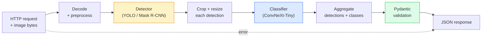

# Build a Complete Vision Pipeline — Capstone · 构建完整的视觉流水线——毕业项目

> A production vision system is a chain of models and rules stitched with data contracts. The pieces are already in this phase; the capstone wires them together end-to-end.

**Type:** Build
**Languages:** Python
**Prerequisites:** Phase 4 Lessons 01-15
**Time:** ~120 minutes

## Learning Objectives · 学习目标

- 设计一条生产级视觉流水线：检测物体、分类、输出结构化 JSON——并且处理好每一条失败路径
- 把检测器（Mask R-CNN 或 YOLO）、分类器（ConvNeXt-Tiny）和数据契约（Pydantic）接进同一个服务
- 对端到端流水线做基准测试，找出第一个瓶颈（通常是预处理，其次是检测器）
- 交付一个最小的 FastAPI 服务：接收图片上传、运行流水线、返回带分类结果的检测

> Design a production vision pipeline that detects objects, classifies them, and emits structured JSON — with every failure path handled
> Plug a detector (Mask R-CNN or YOLO), a classifier (ConvNeXt-Tiny), and a data contract (Pydantic) into one service
> Benchmark the end-to-end pipeline and identify the first bottleneck (usually preprocessing, then the detector)
> Ship a minimal FastAPI service that accepts an image upload, runs the pipeline, and returns detections with classifications

## The Problem · 问题在哪

单个视觉模型有用，视觉产品却是模型的链条。零售货架盘点 = 一个检测器 + 一个商品分类器 + 一条价格 OCR 流水线。自动驾驶 = 2D 检测器 + 3D 检测器 + 分割器 + 跟踪器 + 规划器。医疗预筛 = 分割器 + 区域分类器 + 医生操作界面。

把这些链条接起来，才是区分 ML 原型和产品的地方。模型之间的每个接口都是新的出 bug 之处。每一次坐标变换、每一次归一化、每一次 mask 缩放，都是静默失败（silent failure）的候选。流水线的强度取决于它最弱的那个接口。

本毕业项目搭的是最小可行流水线：检测 + 分类 + 结构化输出 + 一个服务层。Phase 4 的其他所有内容都能嵌进这个骨架：把 Mask R-CNN 换成 YOLOv8、加一个 OCR 头、加一个分割分支、加一个跟踪器。架构是稳定的，组件是可插拔的。

> Individual vision models are useful; vision products are chains of them. ... Wiring those chains is the part that separates a ML prototype from a product. Every interface between models is a new place for bugs. ... A pipeline is as strong as its weakest interface.
> This capstone sets up the minimum viable pipeline: detection + classification + structured output + a serving layer. ... The architecture is stable; the pieces are pluggable.

## The Concept · 概念

### The pipeline · 流水线



七个阶段。两个模型阶段开销大；其余五个阶段才是 bug 的藏身之处。

> Seven stages. The two model stages are expensive; the five other stages are where the bugs live.

### Data contracts with Pydantic · 用 Pydantic 做数据契约

每个模型边界都变成一个带类型的对象。这会把静默失败变成大声报错。

```
Detection(
    box: tuple[float, float, float, float],   # (x1, y1, x2, y2), absolute pixels
    score: float,                              # [0, 1]
    class_id: int,                             # from detector's label map
    mask: Optional[list[list[int]]],           # RLE-encoded if present
)

PipelineResult(
    image_id: str,
    detections: list[Detection],
    classifications: list[Classification],
    inference_ms: float,
)
```

当检测器返回的框是 `(cx, cy, w, h)` 而不是 `(x1, y1, x2, y2)` 时，Pydantic 的校验会在边界处立刻失败，你马上就能发现，而不是去调试一个静默返回空区域的下游裁剪。

> Every model boundary becomes a typed object. This turns silent failures into loud ones.
> When a detector returns boxes in `(cx, cy, w, h)` instead of `(x1, y1, x2, y2)`, Pydantic's validation fails at the boundary and you find out immediately instead of debugging a downstream crop that silently returns empty regions.

### Where latency goes · 延迟都花在哪了

几乎每条视觉流水线都成立的三条事实：

1. **预处理往往是最大的单一耗时块。**解码 JPEG、转换色彩空间、缩放——这些都是 CPU 密集的，也最容易被遗忘。
2. **检测器主导 GPU 时间。**GPU 时间的 70-90% 花在检测前向上。
3. **后处理（NMS、RLE 编解码）在 GPU 上便宜，在 CPU 上贵。**一定要用真实目标设备做性能画像。

知道了耗时分量的分布，优化才能变成一张按优先级排好的清单。

> 1. **Preprocessing is often the biggest single block.** Decoding JPEGs, converting colour spaces, resizing — these are CPU-bound and easy to forget.
> 2. **The detector dominates GPU time.** 70-90% of GPU time is in the detection forward pass.
> 3. **Postprocessing (NMS, RLE encode/decode) is cheap on GPU, expensive on CPU.** Always profile with the actual target.
> Knowing the distribution is what turns optimisation into a prioritised list.

### Failure modes · 失败模式

- **空检测结果** — 返回空列表，不要崩溃。记录日志。
- **越界框** — 裁剪前先钳制到图像尺寸内。
- **过小的裁剪** — 比分类器最小输入还小的框，跳过分类。
- **损坏的上传** — 返回带具体错误码的 400 响应，而不是 500。
- **模型加载失败** — 在服务启动时就失败，而不是在第一个请求时。

生产级流水线要逐一处理这些情况，而不是写一个把失败吞掉的万能 `try/except`。每种失败都有一个具名错误码和一个对应的响应。

> - **Empty detections** — return empty list, do not crash. Log.
> - **Out-of-bounds boxes** — clamp to image size before cropping.
> - **Corrupt upload** — 400 response with a specific error code, not 500.
> - **Model load failure** — fail at service startup, not at first request.
> A production pipeline handles each of these without writing generic `try/except` that hides the failure. Every failure gets a named code and a response.

### Batching · 批处理

生产服务要同时服务多个客户端。把多个请求的检测和分类攒成批次，能让吞吐量成倍增长。代价是：等批次攒满会带来额外延迟。典型做法：最多收集 20ms 的请求，一起打包、处理、再分发响应。`torchserve` 和 `triton` 原生支持这件事；负载可预期的小服务可以自己写一个微批处理器（micro-batcher）。

```figure
v4-vision-pipeline
```

> A production service serves multiple clients. Batching detections and classifications across requests multiplies throughput. The trade-off: extra latency from waiting for a batch to fill. Typical setup: collect requests for up to 20ms, batch together, process, distribute responses. `torchserve` and `triton` do this natively; small services with predictable load roll their own micro-batcher.

## Build It · 动手造

### Step 1: Data contracts · 数据契约

```python
from pydantic import BaseModel, Field
from typing import List, Optional, Tuple

class Detection(BaseModel):
    box: Tuple[float, float, float, float]
    score: float = Field(ge=0, le=1)
    class_id: int = Field(ge=0)
    mask_rle: Optional[str] = None


class Classification(BaseModel):
    detection_index: int
    class_id: int
    class_name: str
    score: float = Field(ge=0, le=1)


class PipelineResult(BaseModel):
    image_id: str
    detections: List[Detection]
    classifications: List[Classification]
    inference_ms: float
```

五秒钟的代码，能在任何正经流水线上省下一小时的调试。

> Five seconds of code saves an hour of debugging on any serious pipeline.

### Step 2: A minimal Pipeline class · 一个最小的 Pipeline 类

```python
import time
import numpy as np
import torch
from PIL import Image

class VisionPipeline:
    def __init__(self, detector, classifier, class_names,
                 device="cpu", min_crop=32):
        self.detector = detector.to(device).eval()
        self.classifier = classifier.to(device).eval()
        self.class_names = class_names
        self.device = device
        self.min_crop = min_crop

    def preprocess(self, image):
        """
        image: PIL.Image or np.ndarray (H, W, 3) uint8
        returns: CHW float tensor on device
        """
        if isinstance(image, Image.Image):
            image = np.asarray(image.convert("RGB"))
        tensor = torch.from_numpy(image).permute(2, 0, 1).float() / 255.0
        return tensor.to(self.device)

    @torch.no_grad()
    def detect(self, image_tensor):
        return self.detector([image_tensor])[0]

    @torch.no_grad()
    def classify(self, crops):
        if len(crops) == 0:
            return []
        batch = torch.stack(crops).to(self.device)
        logits = self.classifier(batch)
        probs = logits.softmax(-1)
        scores, cls = probs.max(-1)
        return list(zip(cls.tolist(), scores.tolist()))

    def run(self, image, image_id="anonymous"):
        t0 = time.perf_counter()
        tensor = self.preprocess(image)
        det = self.detect(tensor)

        crops = []
        detections = []
        valid_indices = []
        for i, (box, score, cls) in enumerate(zip(det["boxes"], det["scores"], det["labels"])):
            x1, y1, x2, y2 = [max(0, int(b)) for b in box.tolist()]
            x2 = min(x2, tensor.shape[-1])
            y2 = min(y2, tensor.shape[-2])
            detections.append(Detection(
                box=(x1, y1, x2, y2),
                score=float(score),
                class_id=int(cls),
            ))
            if (x2 - x1) < self.min_crop or (y2 - y1) < self.min_crop:
                continue
            crop = tensor[:, y1:y2, x1:x2]
            crop = torch.nn.functional.interpolate(
                crop.unsqueeze(0),
                size=(224, 224),
                mode="bilinear",
                align_corners=False,
            )[0]
            crops.append(crop)
            valid_indices.append(i)

        class_preds = self.classify(crops)

        classifications = []
        for valid_idx, (cls_id, cls_score) in zip(valid_indices, class_preds):
            classifications.append(Classification(
                detection_index=valid_idx,
                class_id=int(cls_id),
                class_name=self.class_names[cls_id],
                score=float(cls_score),
            ))

        return PipelineResult(
            image_id=image_id,
            detections=detections,
            classifications=classifications,
            inference_ms=(time.perf_counter() - t0) * 1000,
        )
```

每个接口都有类型。每条失败路径都有明确的处理决策。

> Every interface is typed. Every failure path has a specific handling decision.

### Step 3: Wire a detector and a classifier · 接上检测器和分类器

```python
from torchvision.models.detection import maskrcnn_resnet50_fpn_v2
from torchvision.models import convnext_tiny

# Use ImageNet-pretrained weights for a realistic pipeline without training
detector = maskrcnn_resnet50_fpn_v2(weights="DEFAULT")
classifier = convnext_tiny(weights="DEFAULT")
class_names = [f"imagenet_class_{i}" for i in range(1000)]

pipe = VisionPipeline(detector, classifier, class_names)

# Smoke test with a synthetic image
test_image = (np.random.rand(400, 600, 3) * 255).astype(np.uint8)
result = pipe.run(test_image, image_id="demo")
print(result.model_dump_json(indent=2)[:500])
```

### Step 4: FastAPI service · FastAPI 服务

```python
from fastapi import FastAPI, UploadFile, HTTPException
from io import BytesIO

app = FastAPI()
pipe = None  # initialised on startup

@app.on_event("startup")
def load():
    global pipe
    detector = maskrcnn_resnet50_fpn_v2(weights="DEFAULT").eval()
    classifier = convnext_tiny(weights="DEFAULT").eval()
    pipe = VisionPipeline(detector, classifier, class_names=[f"c{i}" for i in range(1000)])

@app.post("/detect")
async def detect_endpoint(file: UploadFile):
    if file.content_type not in {"image/jpeg", "image/png", "image/webp"}:
        raise HTTPException(status_code=400, detail="unsupported image type")
    data = await file.read()
    try:
        img = Image.open(BytesIO(data)).convert("RGB")
    except Exception:
        raise HTTPException(status_code=400, detail="cannot decode image")
    result = pipe.run(img, image_id=file.filename or "upload")
    return result.model_dump()
```

用 `uvicorn main:app --host 0.0.0.0 --port 8000` 启动。用 `curl -F 'file=@dog.jpg' http://localhost:8000/detect` 测试。

> Run with `uvicorn main:app --host 0.0.0.0 --port 8000`. Test with `curl -F 'file=@dog.jpg' http://localhost:8000/detect`.

### Step 5: Benchmark the pipeline · 给流水线做基准测试

```python
import time

def benchmark(pipe, num_runs=20, image_size=(400, 600)):
    img = (np.random.rand(*image_size, 3) * 255).astype(np.uint8)
    pipe.run(img)  # warm up

    stages = {"preprocess": [], "detect": [], "classify": [], "total": []}
    for _ in range(num_runs):
        t0 = time.perf_counter()
        tensor = pipe.preprocess(img)
        t1 = time.perf_counter()
        det = pipe.detect(tensor)
        t2 = time.perf_counter()
        crops = []
        for box in det["boxes"]:
            x1, y1, x2, y2 = [max(0, int(b)) for b in box.tolist()]
            x2 = min(x2, tensor.shape[-1])
            y2 = min(y2, tensor.shape[-2])
            if (x2 - x1) >= pipe.min_crop and (y2 - y1) >= pipe.min_crop:
                crop = tensor[:, y1:y2, x1:x2]
                crop = torch.nn.functional.interpolate(
                    crop.unsqueeze(0), size=(224, 224), mode="bilinear", align_corners=False
                )[0]
                crops.append(crop)
        pipe.classify(crops)
        t3 = time.perf_counter()
        stages["preprocess"].append((t1 - t0) * 1000)
        stages["detect"].append((t2 - t1) * 1000)
        stages["classify"].append((t3 - t2) * 1000)
        stages["total"].append((t3 - t0) * 1000)

    for stage, times in stages.items():
        times.sort()
        print(f"{stage:12s}  p50={times[len(times)//2]:7.1f} ms  p95={times[int(len(times)*0.95)]:7.1f} ms")
```

CPU 上的典型输出：预处理约 3 ms，检测 300-500 ms，分类 20-40 ms，总计 350-550 ms。在 GPU 上，检测只要 20-40 ms，预处理 + 分类在相对占比上开始变得更要紧。

> Typical output on CPU: preprocess ~3 ms, detect 300-500 ms, classify 20-40 ms, total 350-550 ms. On GPU, detect is 20-40 ms and the preprocess + classify start to matter more in relative terms.

## Use It · 实战用法

生产级模板都收敛到同一套结构，再额外加上：

- **模型版本管理** — 始终在响应里记录模型名和权重哈希。
- **每请求 trace ID** — 给每个请求记录每个阶段的耗时，方便把慢响应和具体阶段关联起来。
- **降级路径** — 分类器超时就只返回检测结果不带分类，而不是让整个请求失败。
- **安全过滤** — NSFW / PII 过滤器在分类之后、响应离开服务之前运行。
- **批量端点** — 一个接受图片 URL 列表做批量处理的 `/detect_batch`。

生产级部署可以用 `torchserve`、`Triton Inference Server` 或 `BentoML`，它们开箱自带批处理、版本管理、指标和健康检查。原型和小规模产品直接跑 `FastAPI` 没问题。

> - **Model versioning** — always log the model name and weights hash in the response.
> - **Per-request trace IDs** — log every stage timing for every request so you can correlate slow responses with stages.
> - **Fallback path** — if the classifier times out, return detections without classifications rather than failing the whole request.
> For production serving, `torchserve`, `Triton Inference Server`, and `BentoML` handle batching, versioning, metrics, and health checks out of the box. Running `FastAPI` directly is fine for prototypes and small-scale products.

## Ship It · 交付

本课产出：

- `outputs/prompt-vision-service-shape-reviewer.md` — 一个提示词：审查视觉服务代码里的契约/响应结构违规，并点名第一个会出事的 bug。
- `outputs/skill-pipeline-budget-planner.md` — 一个技能：给定目标延迟和吞吐，为每个流水线阶段分配时间预算，并标出哪个阶段会最先超标。

> `outputs/prompt-vision-service-shape-reviewer.md` — a prompt that reviews a vision service's code for contract/response shape violations and names the first breaking bug.
> `outputs/skill-pipeline-budget-planner.md` — a skill that, given target latency and throughput, assigns a time budget to every pipeline stage and flags which stage will miss its budget first.

## Exercises · 练习

1. **（简单）**用任意开放数据集中的 10 张图跑一遍流水线。报告每个阶段的平均耗时，以及每张图检测框数量的分布。
2. **（中等）**给 `Detection` 加一个 mask 输出字段，并用 RLE 编码。验证即使一张图有 10 个物体，JSON 也保持在 1MB 以内。
3. **（困难）**在分类器前面加一个微批处理器：最多收集 10 ms 的裁剪图，一次 GPU 调用全部分类，再按请求返回结果。测量每秒 5 个并发请求时的吞吐增益和新增延迟。

## Key Terms · 术语表

| 术语 | 大家怎么说 | 实际含义 |
|------|------------|----------|
| Pipeline | 「这套系统」 | 预处理、推理、后处理组成的有序链条，任意相邻两级之间都有带类型的接口 |
| Data contract | 「schema」 | Pydantic / dataclass 定义，每个阶段的输入输出都要符合；在边界处抓住集成 bug |
| Preprocessing | 「模型之前」 | 解码、色彩转换、缩放、归一化；通常是最大的 CPU 时间黑洞 |
| Postprocessing | 「模型之后」 | NMS、mask 缩放、阈值、RLE 编码；GPU 上便宜，CPU 上贵 |
| Microbatcher | 「先攒再算」 | 在固定时间窗内等待多个请求、然后跑一次批量前向的聚合器 |
| Trace ID | 「请求 id」 | 每个请求在各阶段都记录的标识符，让慢请求可以端到端追踪 |
| Failure code | 「具名错误」 | 每类失败对应一个具体错误码，而非笼统的 500；让客户端可以做重试逻辑 |
| Health check | 「就绪探针」 | 报告服务能否应答的廉价端点；负载均衡器依赖它 |

## Further Reading · 延伸阅读

- [Full Stack Deep Learning — Deploying Models](https://fullstackdeeplearning.com/course/2022/lecture-5-deployment/) — 生产级 ML 部署的经典综述
- [BentoML docs](https://docs.bentoml.com) — 自带批处理、版本管理和指标的服务框架
- [torchserve docs](https://pytorch.org/serve/) — PyTorch 官方服务库
- [NVIDIA Triton Inference Server](https://developer.nvidia.com/triton-inference-server) — 支持批处理和多模型的高吞吐推理服务
