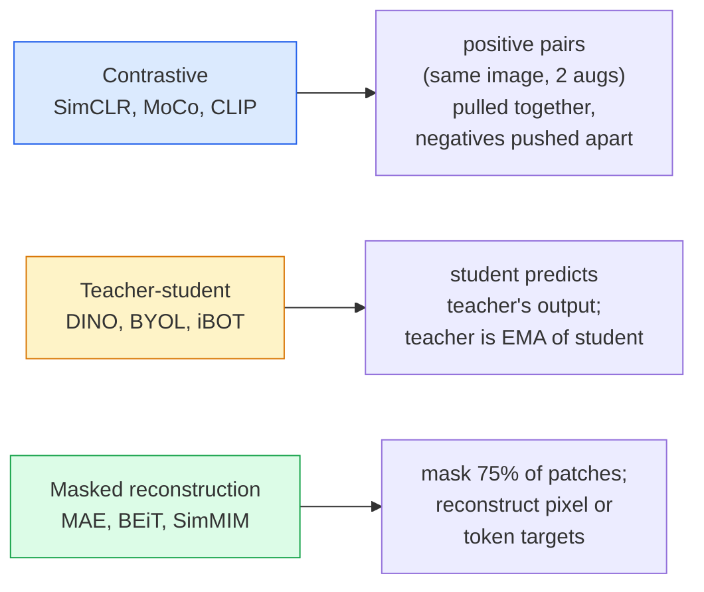

# Self-Supervised Vision — SimCLR, DINO, MAE · 自监督视觉——SimCLR、DINO、MAE

> Labels are the bottleneck of supervised vision. Self-supervised pretraining removes them: learn visual features from 100M unlabelled images, fine-tune on 10k labelled ones.

**Type:** Learn + Build
**Languages:** Python
**Prerequisites:** Phase 4 Lesson 04 (Image Classification), Phase 4 Lesson 14 (ViT)
**Time:** ~75 minutes

## Learning Objectives · 学习目标

- 梳理自监督的三大流派——对比学习（SimCLR）、师生模式（DINO）、掩码重建（MAE）——并说出各自在优化什么
- 从零实现 InfoNCE 损失，并解释为什么 batch 512 能训起来而 batch 32 会失败
- 解释 MAE 的 75% 掩码比例为什么不是拍脑袋定的，以及它与 BERT 在文本上用 15% 的区别
- 用 DINOv2 或 MAE 的 ImageNet 检查点做线性探测（linear probing）和零样本检索

> Trace the three major self-supervised families — contrastive (SimCLR), teacher-student (DINO), masked reconstruction (MAE) — and state what each one optimises
> Implement an InfoNCE loss from scratch and explain why a batch of 512 works but a batch of 32 fails
> Explain why MAE's 75% masking ratio is not arbitrary and how it differs from BERT's 15% for text
> Use DINOv2 or MAE ImageNet checkpoints for linear probing and zero-shot retrieval

## The Problem · 问题在哪

有监督的 ImageNet 有 130 万张标注图片，标注成本估计高达 1000 万美元。医疗和工业数据集更小，标注反而更贵。每个视觉团队都会问同一个问题：能不能先在便宜的无标注数据上预训练——YouTube 视频帧、网络爬取、网络摄像头录像、卫星扫图——再在一小撮有标注的数据上微调？

自监督学习（self-supervised learning）就是答案。在 LAION 或 JFT 上训练的现代自监督 ViT，微调后的精度能追平甚至超过有监督的 ImageNet。它迁移到下游任务（检测、分割、深度估计）的效果也比有监督预训练更好。DINOv2（Meta，2023）和 MAE（Meta，2022）是当前可迁移视觉特征的生产默认选择。

概念上的转变在于：代理任务（pretext task）——模型被训练去做的那件事——不必就是下游任务。关键是它逼迫模型学到有用的特征。给灰度图上色、旋转图片让模型分类旋转角、掩掉 patch 再重建——这些都成功过。真正能规模化的是三种方法：对比学习、师生蒸馏、掩码重建。

> Supervised ImageNet has 1.3M labelled images, which cost an estimated $10M to annotate. ... Every vision team asks: can we pretrain on cheap unlabelled data — YouTube frames, web crawls, webcam footage, satellite sweeps — and then fine-tune on a small labelled set?
> Self-supervised learning is the answer. A modern self-supervised ViT trained on LAION or JFT reaches or beats supervised ImageNet accuracy when fine-tuned. ... DINOv2 (Meta, 2023) and MAE (Meta, 2022) are the current production defaults for transferable vision features.
> The conceptual shift is that the pretext task — the thing the model is trained to do — does not have to be the downstream task.

## The Concept · 概念

### Three families · 三大流派



### Contrastive learning (SimCLR) · 对比学习（SimCLR）

取一张图，施加两次随机增广，得到两个视图。把两个视图都喂给同一个编码器加投影头（projection head）。最小化这样一个损失：「这两个嵌入应该靠近」，同时「这个嵌入应该离批内其他所有图片的嵌入都很远」。

```
Loss for positive pair (z_i, z_j) among 2N views per batch:

   L_ij = -log( exp(sim(z_i, z_j) / tau) / sum_k in batch \ {i} exp(sim(z_i, z_k) / tau) )

sim = cosine similarity
tau = temperature (0.1 standard)
```

这就是 InfoNCE 损失。每个正样本需要很多负样本，所以 batch size 很关键——SimCLR 需要 512-8192。MoCo 引入了历史批次的动量队列，把负样本数量和 batch size 解耦。

> Take one image, apply two random augmentations, get two views. Feed both through the same encoder plus a projection head. Minimise a loss that says "these two embeddings should be close" and "this embedding should be far from every other image's embeddings in the batch."
> This is the InfoNCE loss. It requires many negatives per positive, so batch size matters — SimCLR needs 512-8192. MoCo introduced a momentum queue of past batches to decouple negative count from batch size.

### Teacher-student (DINO) · 师生模式（DINO）

两个同构网络：student 和 teacher。teacher 是 student 权重的指数滑动平均（EMA）。两者看的是同一张图的增广视图。训练目标是让 student 的输出匹配 teacher 的输出——没有显式负样本。

```
loss = CE( student_output(view_1),  teacher_output(view_2) )
     + CE( student_output(view_2),  teacher_output(view_1) )

teacher_weights = m * teacher_weights + (1 - m) * student_weights   (m ≈ 0.996)
```

它为什么不塌缩成「永远预测同一个常数」：teacher 的输出会被中心化（centering，减去每个维度的均值）并锐化（sharpening，除以一个小的温度）。中心化防止某个维度独大；锐化防止输出塌缩成均匀分布。

DINOv2 放大的就是 DINO，用 1.42 亿张精选图片。得到的特征是当前零样本视觉检索和密集预测的 SOTA。

> Two networks with the same architecture: student and teacher. The teacher is an exponential moving average (EMA) of the student's weights. Both see augmented views of the image. The student's output is trained to match the teacher's — no explicit negatives.
> Why it does not collapse to "predict a constant": the teacher's output is centred (subtract per-dimension mean) and sharpened (divide by small temperature). Centering prevents one dimension from dominating; sharpening prevents output collapse to uniform.
> DINO is what DINOv2 scales up, on 142M curated images. The resulting features are the current SOTA for zero-shot visual retrieval and dense prediction.

### Masked reconstruction (MAE) · 掩码重建（MAE）

把 ViT 输入的 patch 掩掉 75%。只把可见的 25% 送进编码器。一个小解码器接收编码器的输出，加上掩码位置上的 mask token，训练目标是重建被掩 patch 的像素。

```
Encoder:  visible 25% of patches -> features
Decoder:  features + mask tokens at masked positions -> reconstructed pixels
Loss:     MSE between reconstructed and original pixels on masked patches only
```

让 MAE 成立的几个关键设计选择：

- **75% 掩码比例** — 很高。逼编码器去学语义特征；只掩 25% 的重建几乎是送分题（相邻像素相关性太强，CNN 都能做对）。
- **非对称编解码器** — 大 ViT 编码器只看可见 patch；重建交给一个小解码器（8 层、512 维）。预训练比朴素的 BEiT 快 3 倍。
- **像素空间重建目标** — 比 BEiT 的 token 化目标更简单，在 ViT 上效果也更好。

预训练完成后，丢弃解码器。编码器就是特征提取器。

> Mask 75% of patches of a ViT input. Pass only the visible 25% through the encoder. A small decoder receives the encoder's output plus mask tokens at masked positions, and is trained to reconstruct the pixels of the masked patches.
> - **75% mask ratio** — high. Forces the encoder to learn semantic features; reconstructing 25% would be near-trivial (neighbouring pixels are so correlated that a CNN could nail it).
> - **Asymmetric encoder/decoder** — the big ViT encoder only sees visible patches; a small decoder (8-layer, 512-dim) handles reconstruction. 3x faster pretraining than naive BEiT.
> After pretraining, discard the decoder. The encoder is the feature extractor.

### Why 75% and not 15% · 为什么是 75% 而不是 15%

BERT 掩 15% 的 token，MAE 掩 75%。差别在于信息密度。

- 自然语言每个 token 的熵很高。预测 15% 的 token 依然难，因为每个被掩位置都有很多种合理的补全。
- 图像 patch 的熵低——未被掩的邻域常常几乎能精确决定被掩 patch 的像素。要让预测必须依赖语义理解，就得下狠手掩。

75% 足够高，简单的空间外推解不了这个任务；编码器必须真正表示图像内容。

> BERT masks 15% of tokens. MAE masks 75%. The difference is information density.
> - Natural language has high entropy per token. Predicting 15% of tokens is still hard because each masked position has many plausible completions.
> - Image patches have low entropy — an unmasked neighbourhood often determines the masked patch's pixels almost exactly. To make prediction require semantic understanding, you have to mask aggressively.
> 75% is high enough that simple spatial extrapolation cannot solve the task; the encoder must represent the image content.

### Linear-probe evaluation · 线性探测评估

自监督预训练之后，标准评估是**线性探测（linear probe）**：冻结编码器，只在顶上用 ImageNet 标签训一个线性分类器。报告 top-1 精度。

- SimCLR ResNet-50：约 71%（2020）
- DINO ViT-S/16：约 77%（2021）
- MAE ViT-L/16：约 76%（2022）
- DINOv2 ViT-g/14：约 86%（2023）

线性探测是对特征质量的纯度量；微调通常能再加 2-5 个点，但也混入了重训分类头的影响。

> After self-supervised pretraining, the standard evaluation is a **linear probe**: freeze the encoder, train a single linear classifier on top on ImageNet labels. Reports top-1 accuracy.
> Linear probe is a pure measure of feature quality; fine-tuning typically adds 2-5 points but also mixes in the effect of head retraining.

```figure
data-augmentation
```

## Build It · 动手造

### Step 1: Two-view augmentation pipeline · 双视图增广流水线

```python
import torch
import torchvision.transforms as T

two_view_train = lambda: T.Compose([
    T.RandomResizedCrop(96, scale=(0.2, 1.0)),
    T.RandomHorizontalFlip(),
    T.ColorJitter(0.4, 0.4, 0.4, 0.1),
    T.RandomGrayscale(p=0.2),
    T.ToTensor(),
])


class TwoViewDataset(torch.utils.data.Dataset):
    def __init__(self, base):
        self.base = base
        self.aug = two_view_train()

    def __len__(self):
        return len(self.base)

    def __getitem__(self, i):
        img, _ = self.base[i]
        v1 = self.aug(img)
        v2 = self.aug(img)
        return v1, v2
```

每个 `__getitem__` 返回同一张图的两个增广视图；不需要标签。

> Each __getitem__ returns two augmented views of the same image; labels are not needed.

### Step 2: InfoNCE loss · InfoNCE 损失

```python
import torch.nn.functional as F

def info_nce(z1, z2, tau=0.1):
    """
    z1, z2: (N, D) L2-normalised embeddings of paired views
    """
    N, D = z1.shape
    z = torch.cat([z1, z2], dim=0)  # (2N, D)
    sim = z @ z.T / tau              # (2N, 2N)

    mask = torch.eye(2 * N, dtype=torch.bool, device=z.device)
    sim = sim.masked_fill(mask, float("-inf"))

    targets = torch.cat([torch.arange(N, 2 * N), torch.arange(0, N)]).to(z.device)
    return F.cross_entropy(sim, targets)
```

调用前先对嵌入做 L2 归一化。`tau=0.1` 是 SimCLR 默认值；调低会让损失更尖锐，也需要更多负样本。

> L2-normalise embeddings before calling. `tau=0.1` is the SimCLR default; lower makes the loss sharper and requires more negatives.

### Step 3: Sanity check InfoNCE · InfoNCE 合理性检查

```python
z1 = F.normalize(torch.randn(16, 32), dim=-1)
z2 = z1.clone()
loss_same = info_nce(z1, z2, tau=0.1).item()
z2_random = F.normalize(torch.randn(16, 32), dim=-1)
loss_random = info_nce(z1, z2_random, tau=0.1).item()
print(f"InfoNCE with identical pairs:  {loss_same:.3f}")
print(f"InfoNCE with random pairs:     {loss_random:.3f}")
```

相同配对应给出低损失（大批量 + 低温度时接近 0）。随机配对在 16 对的 batch 下应给出 log(2N-1) = ~log(31) = ~3.4。

> Identical pairs should give a low loss (close to 0 for a large batch and cold temperature). Random pairs should give log(2N-1) = ~log(31) = ~3.4 with a 16-pair batch.

### Step 4: MAE-style masking · MAE 式掩码

```python
def random_mask_indices(num_patches, mask_ratio=0.75, seed=0):
    g = torch.Generator().manual_seed(seed)
    n_keep = int(num_patches * (1 - mask_ratio))
    perm = torch.randperm(num_patches, generator=g)
    visible = perm[:n_keep]
    masked = perm[n_keep:]
    return visible.sort().values, masked.sort().values


num_patches = 196
visible, masked = random_mask_indices(num_patches, mask_ratio=0.75)
print(f"visible: {len(visible)} / {num_patches}")
print(f"masked:  {len(masked)} / {num_patches}")
```

简单、快，而且对给定种子是确定性的。真实的 MAE 实现会把它批量化，并保留每个样本自己的掩码。

> Simple, fast, and deterministic for a given seed. Real MAE implementations batch this and keep per-sample masks.

## Use It · 实战用法

DINOv2 是 2026 年的生产标准：

```python
import torch
from transformers import AutoImageProcessor, AutoModel

processor = AutoImageProcessor.from_pretrained("facebook/dinov2-base")
model = AutoModel.from_pretrained("facebook/dinov2-base")
model.eval()

# Per-image embeddings for zero-shot retrieval
with torch.no_grad():
    inputs = processor(images=[pil_image], return_tensors="pt")
    outputs = model(**inputs)
    embedding = outputs.last_hidden_state[:, 0]  # CLS token
```

得到的 768 维嵌入是现代图像检索、密集对应（dense correspondence）和零样本迁移流水线的骨干。下游任务微调很少需要超过一个线性头。

图文嵌入的对等物是 SigLIP 或 OpenCLIP；MAE 风格的微调，`timm` 仓库收录了所有 MAE 检查点。

> The resulting 768-dim embedding is the backbone of modern image retrieval, dense correspondence, and zero-shot transfer pipelines. Fine-tuning on a downstream task rarely needs more than a linear head.
> For image-text embeddings, SigLIP or OpenCLIP is the equivalent; for MAE-style fine-tuning, the `timm` repo ships every MAE checkpoint.

## Ship It · 交付

本课产出：

- `outputs/prompt-ssl-pretraining-picker.md` — 一个提示词：按数据规模、算力和下游任务在 SimCLR / MAE / DINOv2 之间做选择。
- `outputs/skill-linear-probe-runner.md` — 一个技能：为任意「冻结编码器 + 标注数据集」写出线性探测评估。

> `outputs/prompt-ssl-pretraining-picker.md` — a prompt that picks SimCLR / MAE / DINOv2 given dataset size, compute, and downstream task.
> `outputs/skill-linear-probe-runner.md` — a skill that writes the linear-probe evaluation for any frozen encoder + labelled dataset.

## Exercises · 练习

1. **（简单）**验证：对已经对齐好的嵌入，降低温度会让 InfoNCE 损失下降；对随机嵌入，降低温度会让损失上升。画出 `tau in [0.05, 0.1, 0.2, 0.5]` 对损失的图。
2. **（中等）**实现一个 DINO 式的中心化缓冲（centre buffer）。展示：没有中心化时，student 会在几个 epoch 内塌缩成一个常数向量。
3. **（困难）**用第 10 课的 TinyUNet 做骨干，在 CIFAR-100 上训练 MAE。报告 10、50、200 epoch 时的线性探测精度。展示：在同样的 1000 张图子集上，MAE 预训练后的线性探测胜过从零有监督训练的线性探测。

## Key Terms · 术语表

| 术语 | 大家怎么说 | 实际含义 |
|------|------------|----------|
| Self-supervised | 「无标签」 | 用一个代理任务从无标注数据里产出有用的表示 |
| Pretext task | 「假任务」 | SSL 阶段使用的目标（重建 patch、匹配视图）；预训练完就丢弃 |
| Linear probe | 「冻结编码器 + 线性头」 | 标准 SSL 评估：只在冻结特征之上训一个线性分类器 |
| InfoNCE | 「对比损失」 | 对余弦相似度做 softmax；正样本对是目标类，其余全是负样本 |
| EMA teacher | 「滑动平均 teacher」 | 权重是 student 权重指数滑动平均的 teacher；BYOL、MoCo、DINO 都在用 |
| Mask ratio | 「被掩 patch 的百分比」 | MAE 中被掩 patch 的比例；视觉 75%，文本 15% |
| Representation collapse | 「常数输出」 | SSL 的失败模式：编码器对所有输入都输出同一个向量；靠中心化、锐化或负样本防止 |
| DINOv2 | 「生产级 SSL 骨干」 | Meta 2023 年的自监督 ViT；2026 年最强的通用图像特征 |

## Further Reading · 延伸阅读

- [SimCLR (Chen et al., 2020)](https://arxiv.org/abs/2002.05709) — 对比学习的参考论文
- [DINO (Caron et al., 2021)](https://arxiv.org/abs/2104.14294) — 带动量、中心化、锐化的师生模式
- [MAE (He et al., 2022)](https://arxiv.org/abs/2111.06377) — 面向 ViT 的掩码自编码器预训练
- [DINOv2 (Oquab et al., 2023)](https://arxiv.org/abs/2304.07193) — 把自监督 ViT 规模化成生产级特征
