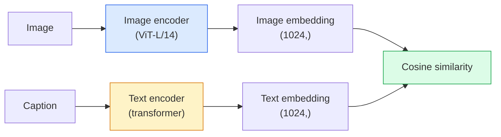

# Open-Vocabulary Vision — CLIP · 开放词表视觉——CLIP

> Train an image encoder and a text encoder together so that matching (image, caption) pairs land at the same point in a shared space. That is the whole trick.

**Type:** Build + Use
**Languages:** Python
**Prerequisites:** Phase 4 Lesson 14 (ViT), Phase 4 Lesson 17 (Self-Supervised)
**Time:** ~45 minutes

## Learning Objectives · 学习目标

- 解释 CLIP 的双塔（two-tower）架构和对比训练目标
- 用预训练 CLIP（或 SigLIP）做零样本分类，不需要任何任务专用训练
- 从零实现零样本分类：编码类别提示、计算余弦相似度、取 argmax
- 分清 CLIP、SigLIP、OpenCLIP 和 LLaVA/LLaMA-vision 模型——2026 年各自用在哪

> Explain CLIP's two-tower architecture and contrastive training objective
> Use a pretrained CLIP (or SigLIP) for zero-shot classification without any task-specific training
> Implement zero-shot classification from scratch: encode class prompts, compute cosine similarity, take argmax
> Distinguish CLIP, SigLIP, OpenCLIP, and LLaVA/LLaMA-vision models — what each is for in 2026

## The Problem · 问题在哪

传统分类器是封闭词表（closed-vocabulary）的：一个 1000 类的 ImageNet 模型只能预测 1000 个标签。每加一个新类别，都需要标注数据并重训分类头。

CLIP（Radford 等，OpenAI 2021）证明了：用从网上抓取的 4 亿对（图片，说明文字）训练，得到的模型在推理时能分类到任意一组类别——类别完全用自然语言描述。给它一个新类别，写一句话就行。

这种能力——零样本迁移（zero-shot transfer）——就是每个现代视觉系统都从 CLIP 系检查点起步的原因。检测（Grounding DINO、OWL-ViT）、分割（CLIPSeg、SAM）、检索、内容审核、VLM、文生图，全都构建在 CLIP 式联合嵌入之上。

> Traditional classifiers are closed-vocabulary: a 1000-class ImageNet model can only predict 1000 labels. Every new category requires labelled data and a retrained head.
> CLIP (Radford et al., OpenAI 2021) showed that training on 400M (image, caption) pairs scraped from the web produces a model that can classify into any set of categories at inference, described purely in natural language. You give it a new class by writing a sentence.
> That capability — zero-shot transfer — is why every modern vision system starts with a CLIP-family checkpoint. ... all build on CLIP-style joint embeddings.

## The Concept · 概念

### Two towers · 双塔



两个编码器最后都接一个线性投影，映射到同一个嵌入维度（CLIP-B/32 是 512，CLIP-L/14 是 1024）。做 L2 归一化，再计算余弦相似度。

> Both encoders end with a linear projection to the same embedding dimension (512 for CLIP-B/32, 1024 for CLIP-L/14). L2-normalise and compute cosine similarity.

### The objective · 训练目标

给定一个含 N 对（图片，说明文字）的 batch，构建一个 NxN 相似度矩阵。训练两个编码器，让对角线（匹配对）相似度高、非对角线（不匹配）相似度低。

```
sim_matrix = image_embeddings @ text_embeddings.T / tau

loss_i2t = cross_entropy(sim_matrix,       targets=arange(N))
loss_t2i = cross_entropy(sim_matrix.T,     targets=arange(N))
loss = (loss_i2t + loss_t2i) / 2
```

之所以对称，是因为图到文和文到图两条检索方向都应该可用。`tau`（温度）通常作为一个标量参数来学习，初始化为 0.07。

> Given a batch of N (image, caption) pairs, build an NxN similarity matrix. Train both encoders so the diagonal (matching pairs) has high similarity and off-diagonals (non-matching) have low similarity.
> Symmetric because both image-to-text and text-to-image retrieval should work. `tau` (temperature) is typically learned as a scalar parameter, initialised to 0.07.

### SigLIP: a better loss · SigLIP：更好的损失

SigLIP（Zhai 等，2023）把 softmax 换成了逐对（per-pair）sigmoid：

```
loss = mean over pairs of log(1 + exp(-y_ij * sim_ij))
y_ij = +1 if matching, -1 otherwise
```

逐对损失去掉了 CLIP 依赖的批级别归一化。SigLIP 在小 batch size 下训练得更好，同等数据量下持平甚至超过 CLIP。

> SigLIP (Zhai et al., 2023) replaced the softmax with per-pair sigmoid:
> Per-pair loss removes the batch-level normalisation that CLIP requires. SigLIP trains better at small batch sizes and matches or exceeds CLIP at equal data.

### Zero-shot classification · 零样本分类

拿到一个训练好的 CLIP：

1. 为每个类别组一个提示词："a photo of a {class}"。
2. 用文本编码器编码所有类别提示 -> `T` 形状 (C, d)。
3. 编码测试图片 -> `I` 形状 (1, d)。
4. 相似度 = `I @ T.T` 形状 (1, C)。
5. 取 argmax -> 预测类别。

提示词工程很重要。OpenAI 为 ImageNet 公布过 80 个提示模板（"a photo of a {}"、"a blurry photo of a {}"、"a sketch of a {}"……）。把每个类所有模板的嵌入取平均，能额外涨 1-3% 的 top-1 精度。

> Given a trained CLIP:
> 1. For each class, compose a prompt: "a photo of a {class}".
> 2. Encode all class prompts with the text encoder -> `T` shape (C, d).
> 3. Encode the test image -> `I` shape (1, d).
> 4. Similarity = `I @ T.T` shape (1, C).
> 5. Argmax -> predicted class.
> Prompt engineering matters. OpenAI published 80 prompt templates for ImageNet ("a photo of a {}", "a blurry photo of a {}", "a sketch of a {}", ...). Average the embeddings of all templates per class for an extra 1-3% top-1 accuracy.

### Where CLIP-style models are used in 2026 · 2026 年 CLIP 系模型用在哪

- **零样本分类** — 直接使用。
- **图像检索** — 所有图片编码一次，推理时嵌入查询。
- **文本条件检测** — Grounding DINO、OWL-ViT 在检测器外面套一个 CLIP 文本塔。
- **文本条件分割** — CLIPSeg；SAM 通过 CLIP 接受文本提示输入。
- **VLM** — LLaVA、Qwen-VL、InternVL 把 CLIP 系视觉编码器接进 LLM。
- **文生图** — Stable Diffusion、DALL-E 3 以 CLIP 文本嵌入为条件。

一旦有了共享嵌入空间，每个视觉+语言任务都变成一次距离计算。

> - **Zero-shot classification** — direct use.
> - **Image retrieval** — encode all images once, embed query at inference.
> - **Text-conditioned detection** — Grounding DINO, OWL-ViT wrap a CLIP text tower around a detector.
> Once you have a shared embedding space, every vision+language task becomes a distance computation.

```figure
clip-contrastive
```

## Build It · 动手造

### Step 1: A tiny two-tower model · 一个迷你双塔模型

真正的 CLIP 是 ViT + transformer。本课的双塔是架在预提取特征上的小 MLP，这样在 CPU 上就能看到训练信号。

```python
import torch
import torch.nn as nn
import torch.nn.functional as F


class TwoTower(nn.Module):
    def __init__(self, img_in=128, txt_in=64, emb=64):
        super().__init__()
        self.image_proj = nn.Sequential(nn.Linear(img_in, 128), nn.ReLU(), nn.Linear(128, emb))
        self.text_proj = nn.Sequential(nn.Linear(txt_in, 128), nn.ReLU(), nn.Linear(128, emb))
        self.logit_scale = nn.Parameter(torch.ones([]) * 2.6592)  # ln(1/0.07)

    def forward(self, img_feats, txt_feats):
        i = F.normalize(self.image_proj(img_feats), dim=-1)
        t = F.normalize(self.text_proj(txt_feats), dim=-1)
        return i, t, self.logit_scale.exp()
```

两个投影、同维输出、可学习的温度。和真正的 CLIP API 是同一个形状。

> Real CLIP is ViT + transformer. For this lesson the towers are small MLPs over pre-extracted features so the training signal is visible on CPU.
> Two projections, shared-dim output, learned temperature. Same shape as the real CLIP API.

### Step 2: Contrastive loss · 对比损失

```python
def clip_loss(image_emb, text_emb, logit_scale):
    N = image_emb.size(0)
    sim = logit_scale * image_emb @ text_emb.T
    targets = torch.arange(N, device=sim.device)
    l_i = F.cross_entropy(sim, targets)
    l_t = F.cross_entropy(sim.T, targets)
    return (l_i + l_t) / 2
```

对称结构。logit_scale 越高 = softmax 越尖锐 = 越自信，但有不稳定的风险。

> Symmetric. Higher logit_scale = sharper softmax = more confident but risk of instability.

### Step 3: Zero-shot classifier · 零样本分类器

```python
@torch.no_grad()
def zero_shot_classify(model, image_feats, class_text_feats, class_names):
    """
    image_feats:      (N, img_in)
    class_text_feats: (C, txt_in)   one averaged embedding per class
    """
    i = F.normalize(model.image_proj(image_feats), dim=-1)
    t = F.normalize(model.text_proj(class_text_feats), dim=-1)
    sim = i @ t.T
    pred = sim.argmax(dim=-1)
    return [class_names[p] for p in pred.tolist()]
```

每步一行代码。这就是用生产级 CLIP 检查点时的那套零样本流程，一字不差。

> One line per step. This is the exact zero-shot procedure used with a production CLIP checkpoint.

### Step 4: Sanity check · 合理性检查

```python
torch.manual_seed(0)
model = TwoTower()

img = torch.randn(8, 128)
txt = torch.randn(8, 64)
i, t, scale = model(img, txt)
loss = clip_loss(i, t, scale)
print(f"batch size: {i.size(0)}   loss: {loss.item():.3f}")
```

随机初始化的模型，损失应接近 `log(N) = log(8) = 2.08`——还没学到任何结构时，对称交叉熵的理论目标值。

> Loss should be close to `log(N) = log(8) = 2.08` for a randomly initialised model — the symmetric cross-entropy target when no structure is learned yet.

## Use It · 实战用法

OpenCLIP 是 2026 年的社区默认选择：

```python
import open_clip
import torch
from PIL import Image

model, _, preprocess = open_clip.create_model_and_transforms("ViT-B-32", pretrained="laion2b_s34b_b79k")
tokenizer = open_clip.get_tokenizer("ViT-B-32")

image = preprocess(Image.open("dog.jpg")).unsqueeze(0)
text = tokenizer(["a photo of a dog", "a photo of a cat", "a photo of a car"])

with torch.no_grad():
    image_features = model.encode_image(image)
    text_features = model.encode_text(text)
    image_features = image_features / image_features.norm(dim=-1, keepdim=True)
    text_features = text_features / text_features.norm(dim=-1, keepdim=True)
    probs = (100.0 * image_features @ text_features.T).softmax(dim=-1)

print(probs)
```

SigLIP 更新，在小规模下训练效果更好，新项目优先用它：`google/siglip-base-patch16-224`。Hugging Face 上两类都有。

> SigLIP is newer, trains better at small scales, and is preferred for new work: `google/siglip-base-patch16-224`. Hugging Face ships both.

## Ship It · 交付

本课产出：

- `outputs/prompt-zero-shot-class-picker.md` — 一个提示词：给定类别列表和领域，为零样本 CLIP 设计类别模板。
- `outputs/skill-image-text-retriever.md` — 一个技能：用任意 CLIP 检查点构建图像嵌入索引，支持以文搜图和以图搜图。

> `outputs/prompt-zero-shot-class-picker.md` — a prompt that designs class templates for zero-shot CLIP given a list of classes and a domain.
> `outputs/skill-image-text-retriever.md` — a skill that builds an image embedding index with any CLIP checkpoint, supports query-by-text and query-by-image.

## Exercises · 练习

1. **（简单）**用预训练 OpenCLIP ViT-B/32 在 CIFAR-10 上做零样本分类，使用 80 模板提示词集合。报告 top-1 精度；应该在 85-90% 左右。
2. **（中等）**在同样的 CIFAR-10 任务上，比较单模板（"a photo of a {}"）与 80 模板平均嵌入。量化差距并解释模板为什么有效。
3. **（困难）**搭一个零样本图像检索索引：用 CLIP 嵌入 1000 张图，建 FAISS 索引，用自然语言描述查询。对你手写的 20 条留出查询，报告检索 recall@5。

## Key Terms · 术语表

| 术语 | 大家怎么说 | 实际含义 |
|------|------------|----------|
| Two-tower | 「双编码器」 | 图像、文本各自独立的编码器，末端接一个同维投影头 |
| Zero-shot | 「不做任务专用训练」 | 推理时直接分类到只用文本描述的类别；不碰任何标签 |
| Temperature / logit_scale | 「tau」 | 一个可学习的标量，在 softmax 之前缩放相似度矩阵 |
| Prompt template | 「A photo of a {}」 | 包在类名外面的自然语言外衣；平均多个模板能提升零样本精度 |
| CLIP | 「图文模型」 | OpenAI 2021 年的模型；2026 年已是这个领域的通用语言 |
| SigLIP | 「Sigmoid CLIP」 | 把 softmax 换成逐对 sigmoid；小 batch 下训练更好 |
| OpenCLIP | 「开源复现」 | 社区在 LAION 上训练的 CLIP 变体；开源流水线的生产默认 |
| VLM | 「视觉语言模型」 | CLIP 系编码器加 LLM，训练来回答关于图片的问题 |

## Further Reading · 延伸阅读

- [CLIP: Learning Transferable Visual Models from Natural Language Supervision (Radford et al., 2021)](https://arxiv.org/abs/2103.00020)
- [SigLIP: Sigmoid Loss for Language-Image Pre-Training (Zhai et al., 2023)](https://arxiv.org/abs/2303.15343)
- [OpenCLIP](https://github.com/mlfoundations/open_clip) — 社区代码库
- [Oquab et al. (2023). DINOv2: Learning Robust Visual Features without Supervision](https://arxiv.org/abs/2304.07193) — 原论文，含与 CLIP 系、MAE 系模型的特征基准对比
