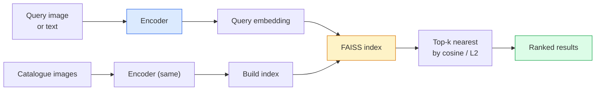

# Image Retrieval & Metric Learning · 图像检索与度量学习

> A retrieval system ranks candidates by a distance in embedding space. Metric learning is the discipline of shaping that space so the distances mean what you want.

**Type:** Build
**Languages:** Python
**Prerequisites:** Phase 4 Lesson 14 (ViT), Phase 4 Lesson 18 (CLIP)
**Time:** ~45 minutes

## Learning Objectives · 学习目标

- 解释三元组（triplet）、对比和基于代理（proxy-based）的度量学习损失，并针对给定数据集选对的那一个
- 正确实现 L2 归一化与余弦相似度，并厘清「同一物品」检索和「同类目」检索的区别
- 建 FAISS 索引，用文本和图片查询，并在留出查询集上报告 recall@K
- 把 DINOv2、CLIP、SigLIP 当现成的嵌入骨干用，并知道各自何时占优

> Explain triplet, contrastive, and proxy-based metric learning losses and pick the right one for a given dataset
> Implement L2-normalisation and cosine similarity correctly and audit the difference between "same item" and "same class" retrieval
> Build a FAISS index, query it by text and by image, and report recall@K for a held-out query set
> Use DINOv2, CLIP, and SigLIP as off-the-shelf embedding backbones and know when each wins

## The Problem · 问题在哪

检索在生产级视觉里无处不在：查重、反向图片搜索、视觉搜索（「找相似商品」）、人脸重识别、安防里的人员重识别（re-ID）、电商的实例级匹配。产品问题永远相同：「给定这张查询图，给我的目录排序。」

两个设计决策决定整个系统的形态。嵌入——用什么模型产生向量。索引——如何大规模找最近邻。2026 年这两样都已是 commodity（嵌入用 DINOv2，索引用 FAISS），这反而抬高了门槛：难的部分是为你的应用定义*什么算相似*，然后把嵌入空间塑造成距离与之一致的样子。

这种塑造就是度量学习（metric learning）。它是个小领域，但杠杆极高。

> Retrieval is everywhere in production vision: duplicate detection, reverse image search, visual search ("find similar products"), face re-identification, person re-ID for surveillance, instance-level matching for e-commerce. The product question is always the same: "given this query image, rank my catalogue."
> Two design decisions shape the whole system. The embedding — what model produces the vectors. The index — how to find nearest neighbours at scale. ... the hard part is defining *what counts as similar* for your application, then shaping the embedding space so the distances match.
> That shaping is metric learning. It is a small but high-leverage discipline.

## The Concept · 概念

### Retrieval at a glance · 检索一图流



### The four loss families · 四大损失家族

| 损失 | 需要 | 优点 | 缺点 |
|------|------|------|------|
| **Contrastive（对比）** | (anchor, positive) + 负样本 | 简单，任何成对标签都能用 | 没有足够负样本时收敛慢 |
| **Triplet（三元组）** | (anchor, positive, negative) | 直观；直接控制间隔（margin） | 困难三元组挖掘开销大 |
| **NT-Xent / InfoNCE** | 样本对 + 批内挖掘的负样本 | 可扩展到大 batch | 需要大 batch 或动量队列 |
| **Proxy-based（ProxyNCA）** | 只要类别标签 | 快、稳定、无需挖掘 | 小数据集上可能过拟合到 proxy |

大多数生产场景：先从预训练骨干开始，只有当现成嵌入在你的测试集上表现不佳时，才加一轮度量学习微调。

> For most production use cases, start with a pretrained backbone and only add a metric-learning fine-tune if the off-the-shelf embeddings underperform on your test set.

### Triplet loss formally · 三元组损失（正式定义）

```
L = max(0, ||f(a) - f(p)||^2 - ||f(a) - f(n)||^2 + margin)
```

把 anchor `a` 拉近正样本 `p`，推离负样本 `n`，并用一个 `margin` 保证间隔。这个三图结构可以推广到任何相似度排序。

挖掘（mining）很关键：简单三元组（`n` 本来就离 `a` 远）损失贡献为零；只有困难三元组能教到网络。半困难挖掘（semi-hard，`n` 比 `p` 远但在 margin 之内）是 2016 年 FaceNet 的配方，至今仍是主流。

> Pull anchor `a` close to positive `p`, push it away from negative `n`, with a `margin` that ensures a gap. The three-image structure generalises to any similarity ordering.
> Mining matters: easy triplets (`n` already far from `a`) contribute zero loss; only hard triplets teach the network. Semi-hard mining (`n` further than `p` but within margin) is the 2016 FaceNet recipe and still dominates.

### Cosine similarity vs L2 · 余弦相似度 vs L2

两种度量，两种惯例：

- **余弦（Cosine）**：向量之间的夹角。要求 L2 归一化的嵌入。
- **L2**：欧氏距离。原始或归一化嵌入都能用，但通常和「L2 归一化 + 平方 L2」搭配。

对大多数现代网络，两者等价：当 `||a|| = ||b|| = 1` 时 `||a - b||^2 = 2 - 2 cos(a, b)`。选一个与你嵌入训练方式一致的惯例；混用两者会悄悄改变「最近」的含义。

> - **Cosine**: angle between vectors. Requires L2-normalised embeddings.
> - **L2**: Euclidean distance. Works on raw or normalised embeddings, but is usually paired with L2-normalised + squared L2.
> For most modern nets the two are equivalent: `||a - b||^2 = 2 - 2 cos(a, b)` when `||a|| = ||b|| = 1`. Pick the convention that matches your embedding training; mixing them silently changes what "nearest" means.

### Recall@K · Recall@K

标准的检索指标：

```
recall@K = fraction of queries where at least one correct match is in the top K results
```

recall@1、@5、@10 并排报告。recall@10 高于 0.95 而 recall@1 低于 0.5，说明嵌入空间结构是对的、但排序噪声大——试试更久的微调或加一步重排（re-ranking）。

查重场景下 precision@K 更重要，因为每个假阳性都是用户看得见的错误。视觉搜索场景下，recall@K 才是产品信号。

> Report recall@1, @5, @10 side by side. A recall@10 above 0.95 with recall@1 below 0.5 means the embedding space has the right structure but the ranking is noisy — try longer fine-tunes or a re-ranking step.
> For duplicate detection, precision@K matters more because every false positive is a user-visible mistake. For visual search, recall@K is the product signal.

### FAISS in one paragraph · 一段话讲完 FAISS

Facebook AI Similarity Search。最近邻搜索的事实标准库。三种索引选择：

- `IndexFlatIP` / `IndexFlatL2` — 暴力、精确、免训练。约 100 万向量以内适用。
- `IndexIVFFlat` — 划成 K 个 cell，只搜最近的几个 cell。近似、快、需要训练数据。
- `IndexHNSW` — 基于图，查询多时最快，索引体积大。

10 万向量，用余弦相似度的 `IndexFlatIP` 大概率就够了。1000 万用 `IndexIVFFlat`。1 亿以上再配合乘积量化（`IndexIVFPQ`）。

> `IndexFlatIP` / `IndexFlatL2` — brute force, exact, no training. Use up to ~1M vectors.
> `IndexIVFFlat` — partition into K cells, search only the closest few cells. Approximate, fast, needs training data.
> `IndexHNSW` — graph-based, fastest for many queries, large index size.
> For 100k vectors you probably want `IndexFlatIP` on cosine similarity. For 10M you want `IndexIVFFlat`. For 100M+ combined with product quantisation (`IndexIVFPQ`).

### Instance-level vs category-level retrieval · 实例级 vs 类目级检索

同一个名字下的两个截然不同的问题：

- **类目级（Category-level）** — 「在我的目录里找猫。」类条件相似度；现成的 CLIP / DINOv2 嵌入就很好用。
- **实例级（Instance-level）** — 「在我的目录里找*这一个确定的商品*。」需要在同类目中视觉相似的对象之间做细粒度区分；现成嵌入表现不佳；用度量学习微调才管用。

选模型之前，先问清楚自己在解决哪一个。

> - **Category-level** — "find cats in my catalogue." Class-conditional similarity; off-the-shelf CLIP / DINOv2 embeddings work well.
> - **Instance-level** — "find *this exact product* in my catalogue." Needs fine-grained discrimination between visually similar objects of the same class; off-the-shelf embeddings under-perform; fine-tuning with metric learning matters.
> Always ask which one you are solving before picking a model.

```figure
metric-embedding
```

## Build It · 动手造

### Step 1: Triplet loss · 三元组损失

```python
import torch
import torch.nn.functional as F

def triplet_loss(anchor, positive, negative, margin=0.2):
    d_ap = F.pairwise_distance(anchor, positive, p=2)
    d_an = F.pairwise_distance(anchor, negative, p=2)
    return F.relu(d_ap - d_an + margin).mean()
```

就一行。L2 归一化或原始嵌入都能用。

> One line. Works on L2-normalised or raw embeddings.

### Step 2: Semi-hard mining · 半困难挖掘

给定一批嵌入和标签，为每个 anchor 找到最难的半困难负样本。

```python
def semi_hard_negatives(emb, labels, margin=0.2):
    dist = torch.cdist(emb, emb)
    same_class = labels[:, None] == labels[None, :]
    diff_class = ~same_class
    N = emb.size(0)

    positives = dist.clone()
    positives[~same_class] = float("-inf")
    positives.fill_diagonal_(float("-inf"))
    pos_idx = positives.argmax(dim=1)

    semi_hard = dist.clone()
    semi_hard[same_class] = float("inf")
    d_ap = dist[torch.arange(N), pos_idx].unsqueeze(1)
    semi_hard[dist <= d_ap] = float("inf")
    neg_idx = semi_hard.argmin(dim=1)

    fallback_mask = semi_hard[torch.arange(N), neg_idx] == float("inf")
    if fallback_mask.any():
        hardest = dist.clone()
        hardest[same_class] = float("inf")
        neg_idx = torch.where(fallback_mask, hardest.argmin(dim=1), neg_idx)
    return pos_idx, neg_idx
```

每个 anchor 拿到类内最难的正样本，以及一个比正样本远、但在 margin 之内的半困难负样本。

> Each anchor gets the hardest positive in-class and a semi-hard negative that is further than the positive but within margin.

### Step 3: Recall@K · Recall@K

```python
def recall_at_k(query_emb, gallery_emb, query_labels, gallery_labels, k=1):
    sim = query_emb @ gallery_emb.T
    _, top_k = sim.topk(k, dim=-1)
    matches = (gallery_labels[top_k] == query_labels[:, None]).any(dim=-1)
    return matches.float().mean().item()
```

在 L2 归一化嵌入上按内积取 top-k 等价于按余弦取 top-k。报告「至少有一个正确邻居」的查询的平均比例。

> Top-k by inner product on L2-normalised embeddings equals top-k by cosine. Report the mean proportion of queries with at least one correct neighbour.

### Step 4: Putting it together · 拼起来

```python
import torch
import torch.nn as nn
from torch.optim import Adam

class Encoder(nn.Module):
    def __init__(self, in_dim=128, emb_dim=64):
        super().__init__()
        self.net = nn.Sequential(
            nn.Linear(in_dim, 128), nn.ReLU(),
            nn.Linear(128, emb_dim),
        )

    def forward(self, x):
        return F.normalize(self.net(x), dim=-1)

torch.manual_seed(0)
num_classes = 6
protos = F.normalize(torch.randn(num_classes, 128), dim=-1)

def sample_batch(bs=32):
    labels = torch.randint(0, num_classes, (bs,))
    x = protos[labels] + 0.15 * torch.randn(bs, 128)
    return x, labels

enc = Encoder()
opt = Adam(enc.parameters(), lr=3e-3)

for step in range(200):
    x, y = sample_batch(32)
    emb = enc(x)
    pos_idx, neg_idx = semi_hard_negatives(emb, y)
    loss = triplet_loss(emb, emb[pos_idx], emb[neg_idx])
    opt.zero_grad(); loss.backward(); opt.step()
```

几百步之后，嵌入会聚成每类一簇。

> After a few hundred steps the embedding clusters form one cluster per class.

## Use It · 实战用法

2026 年的生产组合：

- **DINOv2 + FAISS** — 通用视觉检索。开箱即用。
- **CLIP + FAISS** — 查询是文本时。
- **微调过的 DINOv2 + FAISS** — 实例级检索、人脸重识别、时尚、电商。
- **Milvus / Weaviate / Qdrant** — 包着 FAISS 或 HNSW 的托管向量数据库。

要做 SOTA 的实例检索，配方是：DINOv2 骨干、加一个嵌入头、用 triplet 或 InfoNCE 损失在实例标注对上微调、建进 FAISS。

> - **DINOv2 + FAISS** — general-purpose visual retrieval. Works off-the-shelf.
> - **CLIP + FAISS** — when queries are text.
> - **Fine-tuned DINOv2 + FAISS** — instance-level retrieval, face re-ID, fashion, e-commerce.
> For SOTA instance retrieval, the recipe is: DINOv2 backbone, add an embedding head, fine-tune with a triplet or InfoNCE loss on instance-labelled pairs, index in FAISS.

## Ship It · 交付

本课产出：

- `outputs/prompt-retrieval-loss-picker.md` — 一个提示词：为给定的检索问题挑 triplet / InfoNCE / ProxyNCA。
- `outputs/skill-recall-at-k-runner.md` — 一个技能：写出干净的 recall@K 评估框架，含 train/val/gallery 切分和规范的数据契约。

> `outputs/prompt-retrieval-loss-picker.md` — a prompt that picks triplet / InfoNCE / ProxyNCA for a given retrieval problem.
> `outputs/skill-recall-at-k-runner.md` — a skill that writes a clean evaluation harness for recall@K with train/val/gallery splits and proper data contract.

## Exercises · 练习

1. **（简单）**跑上面的玩具示例。用 PCA 画出训练前后的嵌入，看六个簇的形成过程。
2. **（中等）**加一个 ProxyNCA 损失实现：每个类一个可学习的「proxy」，在余弦相似度上做标准交叉熵。在玩具数据上比较它与三元组损失的收敛速度。
3. **（困难）**取 1000 张 ImageNet 验证图，用 HuggingFace 的 DINOv2 嵌入，建 FAISS flat 索引，报告 recall@{1, 5, 10}：以同一批图作查询时应为 1.0；以 ImageNet 标签为真值、在留出切分上再测一次。

## Key Terms · 术语表

| 术语 | 大家怎么说 | 实际含义 |
|------|------------|----------|
| Metric learning | 「塑造空间」 | 训练一个编码器，让其输出空间中的距离反映目标相似度 |
| Triplet loss | 「一拉一推」 | L = max(0, d(a, p) - d(a, n) + margin)；度量学习的经典损失 |
| Semi-hard mining | 「有用的负样本」 | 比正样本离 anchor 远、但在 margin 之内的负样本；经验上信息量最大 |
| Proxy-based loss | 「类原型」 | 每类一个可学习的 proxy；对「与 proxy 的相似度」做交叉熵；无需配对挖掘 |
| Recall@K | 「Top-K 命中率」 | top K 结果中至少含一个正确答案的查询比例 |
| Instance retrieval | 「找这一个确定的东西」 | 细粒度匹配；现成特征通常表现不佳 |
| FAISS | 「最近邻库」 | Facebook 的最近邻库；支持精确和近似索引 |
| HNSW | 「图索引」 | 分层可导航小世界图；内存开销小的快速近似最近邻 |

## Further Reading · 延伸阅读

- [FaceNet: A Unified Embedding for Face Recognition (Schroff et al., 2015)](https://arxiv.org/abs/1503.03832) — 三元组损失 / 半困难挖掘的出处
- [In Defense of the Triplet Loss for Person Re-Identification (Hermans et al., 2017)](https://arxiv.org/abs/1703.07737) — 三元组微调的实战指南
- [FAISS documentation](https://github.com/facebookresearch/faiss/wiki) — 每种索引、每种权衡
- [SMoT: Metric Learning Taxonomy (Kim et al., 2021)](https://arxiv.org/abs/2010.06927) — 现代损失及其相互关系的综述
