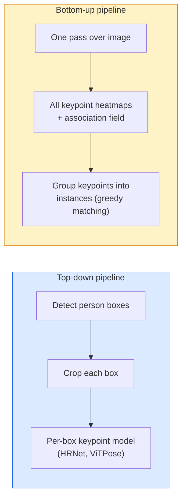

# Keypoint Detection & Pose Estimation · 关键点检测与姿态估计

> 姿态（pose）就是一组有序的关键点（keypoint）。关键点检测器就是一个热图回归器。其余全是簿记工作。

> A pose is a set of ordered keypoints. A keypoint detector is a heatmap regressor. Everything else is bookkeeping.

**Type:** Build
**Languages:** Python
**Prerequisites:** Phase 4 Lesson 06 (Detection), Phase 4 Lesson 07 (U-Net)
**Time:** ~45 minutes

## Learning Objectives · 学习目标

- 区分自顶向下（top-down）与自底向上（bottom-up）两种姿态估计路线，并说明各自的使用时机
- 以「每个关键点一张高斯目标热图」的方式为 K 个关键点回归热图（heatmap），并在推理时提取关键点坐标
- 解释部件亲和场（Part Affinity Fields, PAFs），以及自底向上管线如何把关键点关联成实例
- 使用 MediaPipe Pose 或 MMPose 做生产级关键点估计，并理解它们的输出格式

> Distinguish top-down and bottom-up pose estimation and state when each is used
> Regress heatmaps for K keypoints with a Gaussian-per-keypoint target and extract keypoint coordinates at inference
> Explain Part Affinity Fields (PAFs) and how bottom-up pipelines associate keypoints into instances
> Use MediaPipe Pose or MMPose for production keypoint estimation and understand their output format

## The Problem · 问题在哪

关键点任务藏在很多名字底下：人体姿态（17 个身体关节）、人脸关键点（68 或 478 个点）、手部（21 个点）、动物姿态、机器人的物体位姿、医学解剖标志点。每一个任务的结构都相同：在物体上检测 K 个离散的点，并输出它们的 (x, y) 坐标。

姿态估计是动作捕捉、健身应用、体育分析、手势控制、动画、AR 试穿和机器人抓取的地基。2D 情形已经成熟；3D 姿态（从单个相机估计世界坐标系下的关节位置）是当前的研究前沿。

工程上真正的问题是规模。单张图、单人的姿态是一个 20ms 量级的问题。人群里 30 fps 的多人姿态则是另一个问题，需要另一套架构。

> Keypoint tasks hide under many names: human pose (17 body joints), face landmarks (68 or 478 points), hand (21 points), animal pose, robotic object pose, medical anatomy landmarks. Every one of them shares the same structure: detect K discrete points on an object and output their (x, y) coordinates.
> Pose estimation is the foundation of motion capture, fitness apps, sports analytics, gesture control, animation, AR try-on, and robotic grasping. The 2D case is mature; 3D pose (estimating joint positions in world coordinates from a single camera) is the current research frontier.
> The engineering question is scale. A single-image, single-person pose is a 20ms problem. Multi-person pose in a crowd at 30 fps is a different problem with different architectures.

## The Concept · 概念

### Top-down vs bottom-up · 自顶向下 vs 自底向上



- **Top-down（自顶向下）** — 先检测人，再对每个裁剪框跑一个逐人关键点模型。精度最高；耗时随人数线性增长。
- **Bottom-up（自底向上）** — 一次前向传播预测出所有关键点外加一个关联场（association field）；再把它们分组。无论人群多大，耗时恒定。

Top-down（HRNet、ViTPose）是精度王者；bottom-up（OpenPose、HigherHRNet）在拥挤场景下是吞吐王者。

> - **Top-down** — detect people first, then run a per-person keypoint model on each crop. Highest accuracy; scales linearly with number of people.
> - **Bottom-up** — one forward pass predicts all keypoints plus an association field; group them. Constant time regardless of crowd size.
> Top-down (HRNet, ViTPose) is the accuracy leader; bottom-up (OpenPose, HigherHRNet) is the throughput leader for crowded scenes.

### Heatmap regression · 热图回归

与其直接回归 `(x, y)`，不如为每个关键点预测一张 `H x W` 的热图（heatmap），在真实位置放一个高斯亮斑。

```
target[k, y, x] = exp(-((x - cx_k)^2 + (y - cy_k)^2) / (2 sigma^2))
```

推理时，每张热图的 argmax 就是预测出的关键点位置。

为什么热图比直接回归效果更好：网络的空间结构（卷积特征图）与空间输出天然对齐。高斯目标还自带正则化——定位误差小，loss 就小，而不是直接归零。

> Instead of regressing `(x, y)` directly, predict an `H x W` heatmap per keypoint with a Gaussian blob centred at the true location.
> At inference, the argmax of each heatmap is the predicted keypoint location.
> Why heatmaps work better than direct regression: the network's spatial structure (conv feature map) aligns naturally with spatial output. Gaussian targets also regularise — a small localisation error produces a small loss, not zero.

### Sub-pixel localisation · 亚像素定位

argmax 给出的是整数坐标。要拿到亚像素（sub-pixel）精度，可以用 argmax 及其邻近点拟合一条抛物线来精修，或者使用那个著名的偏移方向 `(dx, dy) = 0.25 * (heatmap[y, x+1] - heatmap[y, x-1], ...)`。

> Argmax gives integer coordinates. For sub-pixel precision, refine by fitting a parabola to the argmax and its neighbours, or use the well-known offset `(dx, dy) = 0.25 * (heatmap[y, x+1] - heatmap[y, x-1], ...)` direction.

### Part Affinity Fields (PAFs) · 部件亲和场（PAFs）

OpenPose 用于自底向上关联的技巧。对每一对相连的关键点（例如左肩到左肘），预测一个 2 通道的场，编码从一个点指向另一个点的单位向量。要把肩和它的肘配对，就沿连接候选对的直线对 PAF 做线积分；积分最高的那一对胜出。

```
For each connection (limb):
  PAF channels: 2 (unit vector x, y)
  Line integral: sum over sample points of (PAF . line_direction)
  Higher integral = stronger match
```

方法优雅，而且不需要逐人裁剪就能扩展到任意规模的人群。

> OpenPose's trick for bottom-up association. For each pair of connected keypoints (e.g. left shoulder to left elbow), predict a 2-channel field that encodes the unit vector pointing from one to the other. To associate a shoulder with its elbow, integrate the PAF along the line connecting candidate pairs; the pair with the highest integral is matched.
> Elegant and scales to arbitrary crowd sizes without per-person crops.

### COCO keypoints · COCO 关键点

标准的人体姿态数据集：每人 17 个关键点，指标用 PCK（Percentage of Correct Keypoints，正确关键点比例）和 OKS（Object Keypoint Similarity，目标关键点相似度）。OKS 就是关键点版的 IoU，COCO mAP@OKS 报告的就是它。

> The standard body-pose dataset: 17 keypoints per person, PCK (Percentage of Correct Keypoints) and OKS (Object Keypoint Similarity) as metrics. OKS is the keypoint analogue of IoU and is what COCO mAP@OKS reports.

### 2D vs 3D · 2D 与 3D

- **2D pose（2D 姿态）** — 图像坐标；生产级质量已经解决（MediaPipe、HRNet、ViTPose）。
- **3D pose（3D 姿态）** — 世界/相机坐标；仍是活跃的研究方向。常见做法：
  - 用一个小 MLP 把 2D 预测抬升到 3D（VideoPose3D）。
  - 从图像直接回归 3D（PyMAF、MHFormer）。
  - 多视角系统（CMU Panoptic）用于采集真值。

```figure
cv3-pose-heatmap
```

> - **2D pose** — image coordinates; solved at production quality (MediaPipe, HRNet, ViTPose).
> - **3D pose** — world / camera coordinates; still active research. Common approaches:
>   - Lift 2D predictions to 3D with a small MLP (VideoPose3D).
>   - Direct 3D regression from image (PyMAF, MHFormer).
>   - Multi-view setups (CMU Panoptic) for ground truth.

## Build It · 动手造

### Step 1: Gaussian heatmap target · 第 1 步：高斯热图目标

```python
import numpy as np
import torch

def gaussian_heatmap(size, cx, cy, sigma=2.0):
    yy, xx = np.meshgrid(np.arange(size), np.arange(size), indexing="ij")
    return np.exp(-((xx - cx) ** 2 + (yy - cy) ** 2) / (2 * sigma ** 2)).astype(np.float32)

hm = gaussian_heatmap(64, 32, 32, sigma=2.0)
print(f"peak: {hm.max():.3f} at ({hm.argmax() % 64}, {hm.argmax() // 64})")
```

每个关键点的热图沿通道轴堆叠，就得到完整的目标张量。

> Per-keypoint heatmaps stacked along a channel axis give the full target tensor.

### Step 2: Tiny keypoint head · 第 2 步：微型关键点头

一个输出 K 个热图通道的 U-Net 风格模型。

```python
import torch.nn as nn
import torch.nn.functional as F

class TinyKeypointNet(nn.Module):
    def __init__(self, num_keypoints=4, base=16):
        super().__init__()
        self.down1 = nn.Sequential(nn.Conv2d(3, base, 3, 2, 1), nn.ReLU(inplace=True))
        self.down2 = nn.Sequential(nn.Conv2d(base, base * 2, 3, 2, 1), nn.ReLU(inplace=True))
        self.mid = nn.Sequential(nn.Conv2d(base * 2, base * 2, 3, 1, 1), nn.ReLU(inplace=True))
        self.up1 = nn.ConvTranspose2d(base * 2, base, 2, 2)
        self.up2 = nn.ConvTranspose2d(base, num_keypoints, 2, 2)

    def forward(self, x):
        h1 = self.down1(x)
        h2 = self.down2(h1)
        h3 = self.mid(h2)
        u1 = self.up1(h3)
        return self.up2(u1)
```

输入 `(N, 3, H, W)`，输出 `(N, K, H, W)`。损失是对高斯目标的逐像素 MSE。

> A U-Net-style model that outputs K heatmap channels.
> Input `(N, 3, H, W)`, output `(N, K, H, W)`. Loss is per-pixel MSE against Gaussian targets.

### Step 3: Inference — extract keypoint coordinates · 第 3 步：推理——提取关键点坐标

```python
def heatmap_to_coords(heatmaps):
    """
    heatmaps: (N, K, H, W)
    returns:  (N, K, 2) float coordinates in image pixels
    """
    N, K, H, W = heatmaps.shape
    hm = heatmaps.reshape(N, K, -1)
    idx = hm.argmax(dim=-1)
    ys = (idx // W).float()
    xs = (idx % W).float()
    return torch.stack([xs, ys], dim=-1)

coords = heatmap_to_coords(torch.randn(2, 4, 32, 32))
print(f"coords: {coords.shape}")  # (2, 4, 2)
```

推理就一行代码。要亚像素精修，就在 argmax 周围做插值。

> One line at inference. For sub-pixel refinement, interpolate around the argmax.

### Step 4: Synthetic keypoint dataset · 第 4 步：合成关键点数据集

很简单：在白色画布上画四个点，然后学着预测它们。

```python
def make_synthetic_sample(size=64):
    img = np.ones((3, size, size), dtype=np.float32)
    rng = np.random.default_rng()
    kps = rng.integers(8, size - 8, size=(4, 2))
    for cx, cy in kps:
        img[:, cy - 2:cy + 2, cx - 2:cx + 2] = 0.0
    hms = np.stack([gaussian_heatmap(size, cx, cy) for cx, cy in kps])
    return img, hms, kps
```

简单到一个小模型一分钟就能学会。

> Simple: draw four points on a white canvas and learn to predict them.
> Easy enough for a tiny model to learn in a minute.

### Step 5: Training · 第 5 步：训练

```python
model = TinyKeypointNet(num_keypoints=4)
opt = torch.optim.Adam(model.parameters(), lr=3e-3)

for step in range(200):
    batch = [make_synthetic_sample() for _ in range(16)]
    imgs = torch.from_numpy(np.stack([b[0] for b in batch]))
    hms = torch.from_numpy(np.stack([b[1] for b in batch]))
    pred = model(imgs)
    # Upsample pred to full resolution
    pred = F.interpolate(pred, size=hms.shape[-2:], mode="bilinear", align_corners=False)
    loss = F.mse_loss(pred, hms)
    opt.zero_grad(); loss.backward(); opt.step()
```

## Use It · 实战用法

- **MediaPipe Pose** — Google 的生产级姿态估计器；自带 WebGL + 移动端运行时，延迟低于 10ms。
- **MMPose**（OpenMMLab）— 研究向的全能代码库；每一种 SOTA 架构都带预训练权重。
- **YOLOv8-pose** — 最快的实时多人姿态方案，单次前向传播搞定。
- **transformers HumanDPT / PoseAnything** — 面向开放词表姿态（任意物体、任意关键点集合）的更新一代视觉-语言方法。

> - **MediaPipe Pose** — Google's production pose estimator; ships WebGL + mobile runtimes with sub-10ms latency.
> - **MMPose** (OpenMMLab) — comprehensive research codebase; every SOTA architecture with pretrained weights.
> - **YOLOv8-pose** — fastest real-time multi-person pose with a single forward pass.
> - **transformers HumanDPT / PoseAnything** — newer vision-language approaches for open-vocabulary pose (any object, any keypoint set).

## Ship It · 交付

本课产出：

- `outputs/prompt-pose-stack-picker.md` — 一个提示词：给定延迟、人群规模、2D 还是 3D 需求，在 MediaPipe / YOLOv8-pose / HRNet / ViTPose 之间选型。
- `outputs/skill-heatmap-to-coords.md` — 一个技能：写出每个生产级姿态模型都要用的「热图到坐标」亚像素例程。

> This lesson produces:
> - `outputs/prompt-pose-stack-picker.md` — a prompt that picks MediaPipe / YOLOv8-pose / HRNet / ViTPose given latency, crowd size, and 2D vs 3D need.
> - `outputs/skill-heatmap-to-coords.md` — a skill that writes the sub-pixel heatmap-to-coordinate routine used by every production pose model.

## Exercises · 练习

1. **（简单）** 在合成的 4 点数据集上训练这个微型关键点模型。报告 200 步后预测关键点与真实关键点之间的平均 L2 误差。
2. **（中等）** 加上亚像素精修：给定 argmax 位置，沿 x 和 y 方向用邻近像素各拟合一条一维抛物线。报告相对整数 argmax 的精度提升。
3. **（困难）** 构建一个双人合成数据集，每张图包含两个 4 关键点图案的实例。训练一个带 PAF 的自底向上管线，预测哪个关键点属于哪个实例，并用 OKS 评估。

> 1. **(Easy)** Train the tiny keypoint model on the synthetic 4-point dataset. Report mean L2 error between predicted and true keypoints after 200 steps.
> 2. **(Medium)** Add sub-pixel refinement: given the argmax position, fit a 1D parabola along x and y from the neighbouring pixels. Report the accuracy gain vs integer argmax.
> 3. **(Hard)** Build a 2-person synthetic dataset where each image shows two instances of the 4-keypoint pattern. Train a bottom-up pipeline with PAFs that predict which keypoint belongs to which instance, and evaluate OKS.

## Key Terms · 术语表

| 术语 | 人们常说 | 实际含义 |
|------|----------------|----------------------|
| Keypoint | 「一个地标点」 | 物体上一个特定的有序点（关节、角点、特征点） |
| Pose | 「那副骨架」 | 属于同一实例的一组有序关键点 |
| Top-down | 「先检测，再做姿态」 | 两阶段管线：行人检测器 + 逐裁剪关键点模型；精度最高 |
| Bottom-up | 「先出姿态，再分组」 | 单次前向预测所有关键点 + 分组；耗时与人群规模无关 |
| Heatmap | 「高斯目标」 | 每个关键点一张 H x W 张量，峰值在真实位置；首选的回归目标 |
| PAF | 「部件亲和场」 | 2 通道单位向量场，编码肢体方向；用于把关键点分组为实例 |
| OKS | 「关键点版 IoU」 | Object Keypoint Similarity；COCO 的姿态指标 |
| HRNet | 「高分辨率网络」 | 占主导的自顶向下关键点架构；全程保留高分辨率特征 |

## Further Reading · 延伸阅读

- [OpenPose (Cao et al., 2017)](https://arxiv.org/abs/1812.08008) —— 自底向上 + PAF 的开山之作；迄今对该方法最好的阐述
- [HRNet (Sun et al., 2019)](https://arxiv.org/abs/1902.09212) —— 自顶向下的参考架构
- [ViTPose (Xu et al., 2022)](https://arxiv.org/abs/2204.12484) —— 用朴素 ViT 做姿态骨干；多个基准上的当前 SOTA
- [MediaPipe Pose](https://developers.google.com/mediapipe/solutions/vision/pose_landmarker) —— 生产级实时姿态；2026 年部署最快的方案
