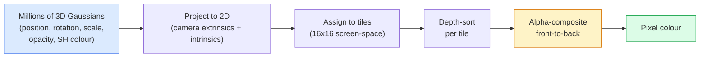

# 3D Gaussian Splatting from Scratch · 从零实现 3D 高斯泼溅（3D Gaussian Splatting）

> 一个场景就是一团数百万个 3D 高斯。每个高斯有位置、朝向、尺度、不透明度，以及一个随观察方向变化的颜色。把它们光栅化，再穿过光栅化做反向传播，完事。

> A scene is a cloud of millions of 3D Gaussians. Each one has a position, orientation, scale, opacity, and a colour that depends on viewing direction. Rasterise them, backprop through the rasterisation, done.

**Type:** Build
**Languages:** Python
**Prerequisites:** Phase 4 Lesson 13 (3D Vision & NeRF), Phase 1 Lesson 12 (Tensor Operations), Phase 4 Lesson 10 (Diffusion basics optional)
**Time:** ~90 minutes

## Learning Objectives · 学习目标

- 解释为什么 2026 年 3D 高斯泼溅（3D Gaussian Splatting, 3DGS）取代 NeRF 成为照片级 3D 重建的生产默认选择
- 说出每个高斯的六个参数（位置、旋转四元数、尺度、不透明度、球谐颜色、可选特征）以及各贡献多少个浮点数
- 用 alpha 合成（alpha compositing）从零实现一个 2D 高斯泼溅光栅化器，然后展示 3D 情形如何投影到同一个循环里
- 使用 `nerfstudio`、`gsplat` 或 `SuperSplat` 从 20-50 张照片重建一个场景，并导出为 `KHR_gaussian_splatting` glTF 扩展或 OpenUSD 26.03 的 `UsdVolParticleField3DGaussianSplat` schema

> Explain why 3D Gaussian Splatting replaced NeRF as the production default for photorealistic 3D reconstruction in 2026
> State the six per-Gaussian parameters (position, rotation quaternion, scale, opacity, spherical harmonics colour, optional feature) and how many floats each contributes
> Implement a 2D Gaussian splatting rasterizer from scratch using `alpha` compositing, then show how the 3D case projects to the same loop
> Use `nerfstudio`, `gsplat`, or `SuperSplat` to reconstruct a scene from 20-50 photos and export to the `KHR_gaussian_splatting` glTF extension or the OpenUSD 26.03 `UsdVolParticleField3DGaussianSplat` schema

## The Problem · 问题在哪

NeRF 把场景存成一个 MLP 的权重。渲染每一个像素都要沿一条光线做几百次 MLP 查询。训练要几小时，渲染要几秒，而且权重没法编辑——想把场景里的一把椅子挪个位置，你只能重新训练。

3D Gaussian Splatting（Kerbl, Kopanas, Leimkühler, Drettakis, SIGGRAPH 2023）把这一切都换掉了。场景是一组显式的 3D 高斯。渲染是 100+ fps 的 GPU 光栅化。训练只要几分钟。编辑是直接的：平移一部分高斯，椅子就挪走了。到 2026 年，Khronos Group 已为高斯泼溅批准了 glTF 扩展，OpenUSD 26.03 内置高斯泼溅 schema，Zillow 和 Apartments.com 用它渲染房产，大多数新的 3D 重建论文都是核心 3DGS 思想的变体。

心智模型很简单，但数学的零件足够多，以至于大多数入门材料都从光栅化讲起，跳过了投影和球谐函数。本课把整件事都造出来——先造 2D 版本，再扩展到 3D。

> A NeRF stores a scene as the weights of an MLP. Every rendered pixel is hundreds of MLP queries along a ray. Training takes hours, rendering takes seconds, and the weights cannot be edited — if you want to move a chair inside a scene, you have to retrain.
> 3D Gaussian Splatting (Kerbl, Kopanas, Leimkühler, Drettakis, SIGGRAPH 2023) replaced all of that. A scene is an explicit set of 3D Gaussians. Rendering is GPU rasterisation at 100+ fps. Training takes minutes. Editing is direct: translate a subset of Gaussians and you have moved the chair. ... By 2026 the Khronos Group has ratified a glTF extension for Gaussian splats, OpenUSD 26.03 ships a Gaussian splat schema, Zillow and Apartments.com render real estate with them, and most new research papers on 3D reconstruction are variants on the core 3DGS idea.
> The mental model is simple, the math has enough moving parts that most introductions start at rasterisation and skip past the projections and spherical harmonics. This lesson builds the whole thing — a 2D version first, then the 3D extension.

## The Concept · 概念

### What a Gaussian carries · 一个高斯携带什么

一个 3D 高斯是空间中一个参数化的「斑」，带有这些属性：

```
position         mu         (3,)    centre in world coordinates
rotation         q          (4,)    unit quaternion encoding orientation
scale            s          (3,)    log-scales per axis (exponentiated at render time)
opacity          alpha      (1,)    post-sigmoid opacity [0, 1]
SH coefficients  c_lm       (3 * (L+1)^2,)   view-dependent colour
```

旋转 + 尺度构成一个 3x3 协方差：`Sigma = R S S^T R^T`。这就是高斯在 3D 里的形状。球谐函数（spherical harmonics）让颜色随观察方向变化——镜面高光、细微光泽、随视角变化的光晕——而不需要存储逐视角的纹理。SH 取 3 阶时每个颜色通道有 16 个系数，仅颜色一项每个高斯就要 48 个浮点数。

一个场景通常有 100-500 万个高斯。每个大约存 60 个浮点数（3 + 4 + 3 + 1 + 48 + 杂项）。500 万高斯的场景就是 240 MB——远小于带逐点纹理的等价点云，也比按高分辨率重渲染的 NeRF MLP 权重小一个数量级。

> Rotation + scale build a 3x3 covariance: `Sigma = R S S^T R^T`. That is the shape of the Gaussian in 3D. Spherical harmonics let the colour change with viewing direction — specular highlights, subtle sheen, view-dependent glow — without storing per-view textures. With SH degree 3 you get 16 coefficients per colour channel, 48 floats per Gaussian for colour alone.
> A scene typically has 1-5 million Gaussians. Each stores roughly 60 floats (3 + 4 + 3 + 1 + 48 + misc). That is 240 MB for a five-million-Gaussian scene — far smaller than the equivalent point cloud with per-point texture, and an order of magnitude smaller than a NeRF's MLP weights re-rendered at high resolution.

### Rasterisation, not ray marching · 光栅化，而不是光线步进



五个步骤，全部对 GPU 友好。没有逐像素的 MLP 查询。一张 RTX 3080 Ti 能以 147 fps 渲染 600 万个 splat。

> Five steps, all GPU-friendly. No MLP query per pixel. A single RTX 3080 Ti renders 6 million splats at 147 fps.

### The projection step · 投影这一步

世界位置为 `mu`、3D 协方差为 `Sigma` 的 3D 高斯，投影为屏幕位置 `mu'`、2D 协方差 `Sigma'` 的 2D 高斯：

```
mu' = project(mu)
Sigma' = J W Sigma W^T J^T          (2 x 2)

W = viewing transform (rotation + translation of camera)
J = Jacobian of the perspective projection at mu'
```

2D 高斯的足迹（footprint）是一个椭圆，其主轴是 `Sigma'` 的特征向量。椭圆内的每个像素都收到该高斯的贡献，权重为 `exp(-0.5 * (p - mu')^T Sigma'^-1 (p - mu'))`。

> The 3D Gaussian at world position `mu` with 3D covariance `Sigma` projects to a 2D Gaussian at screen position `mu'` with 2D covariance `Sigma'`:
> The 2D Gaussian's footprint is an ellipse whose axes are the eigenvectors of `Sigma'`. Every pixel inside that ellipse receives the Gaussian's contribution, weighted by `exp(-0.5 * (p - mu')^T Sigma'^-1 (p - mu'))`.

### The alpha-compositing rule · alpha 合成规则

对单个像素，覆盖它的各个高斯按由后到前排序（或等价地由前到后、公式取逆）。颜色合成用的是自 1980 年代以来每一个半透明光栅化器都相同的方程：

```
C_pixel = sum_i alpha_i * T_i * c_i

T_i = prod_{j < i} (1 - alpha_j)       transmittance up to i
alpha_i = opacity_i * exp(-0.5 * d^T Sigma'^-1 d)   local contribution
c_i = eval_SH(SH_i, view_direction)    view-dependent colour
```

这**和 NeRF 的体积渲染是同一个方程**，只是积分对象从「沿光线的密集采样」换成了「显式的稀疏高斯集合」。正是这个同一性保证了渲染质量能对齐 NeRF——两者积分的是同一个 radiance field 方程。

> For one pixel, the Gaussians that cover it are sorted back-to-front (or equivalently front-to-back with inverted formula). Colour is composited with the same equation as every semi-transparent rasteriser since the 1980s:
> This is **the same equation as NeRF's volumetric render**, just over an explicit sparse set of Gaussians instead of dense samples along a ray. That identity is why rendered quality matches NeRF — both are integrating the same radiance-field equation.

### Why this is differentiable · 为什么这一切可微

每一步——投影、tile 分配、alpha 合成、SH 求值——都对这些高斯参数可微。给定一张真值图像，算出渲染像素 loss，穿过光栅化器反向传播，用梯度下降更新所有 `(mu, q, s, alpha, c_lm)`。大约 30,000 次迭代之后，高斯们就找到了合适的位置、尺度和颜色。

> Every step — projection, tile assignment, alpha compositing, SH evaluation — is differentiable with respect to the Gaussian parameters. Given a ground-truth image, compute rendered pixel loss, backprop through the rasteriser, update all `(mu, q, s, alpha, c_lm)` by gradient descent. Over ~30,000 iterations the Gaussians find their right positions, scales, and colours.

### Densification and pruning · 致密化与剪枝

固定的一组高斯盖不住复杂场景。训练包含两个自适应机制：

- 当某个高斯梯度幅值很大但尺度很小时，在它当前位置**克隆（clone）**一个——这里的重建需要更多细节。
- 当一个大尺度高斯的梯度很高时，把它**分裂（split）**成两个更小的——一个大高斯太平滑，拟合不了这个区域。
- 把不透明度跌破阈值的高斯**剪枝（prune）**掉——它们没有贡献。

致密化每 N 次迭代运行一次。场景通常从约 10 万个初始高斯（由 SfM 点播种）增长到训练结束时的 100-500 万。

> A fixed set of Gaussians cannot cover a complex scene. Training includes two adaptive mechanisms:
> - **Clone** a Gaussian at its current position when its gradient magnitude is high but its scale is small — the reconstruction needs more detail here.
> - **Split** a large-scale Gaussian into two smaller ones when its gradient is high — one big Gaussian is too smooth to fit the region.
> - **Prune** Gaussians whose opacity drops below a threshold — they are not contributing.
> Densification runs every N iterations. A scene typically grows from ~100k initial Gaussians (seeded from SfM points) to 1-5M at the end of training.

### Spherical harmonics in one paragraph · 一段话讲完球谐函数

视角相关颜色是单位球面上的一个函数 `c(direction)`。球谐函数就是球面上的傅里叶基。截断到 `L` 阶，每个通道得到 `(L+1)^2` 个基函数。给一个新视角求颜色，就是在「该观察方向处求值的基函数」和学到的 SH 系数之间做点积。0 阶 = 1 个系数 = 恒定颜色。3 阶 = 16 个系数 = 足以捕捉 Lambert 着色、镜面反射和轻微反射。SD Gaussian Splatting 论文默认用 3 阶。

> View-dependent colour is a function `c(direction)` on the unit sphere. Spherical harmonics are the sphere's Fourier basis. Truncate at degree `L` and you get `(L+1)^2` basis functions per channel. ... Degree 3 = 16 coefficients = enough to capture Lambertian shading, specular, and mild reflection. SD Gaussian Splatting papers use degree 3 by default.

### The 2026 production stack · 2026 年的生产工具链

```
1. Capture         smartphone / DJI drone / handheld scanner
2. SfM / MVS       COLMAP or GLOMAP derives camera poses + sparse points
3. Train 3DGS      nerfstudio / gsplat / inria official / PostShot (~10-30 min on RTX 4090)
4. Edit            SuperSplat / SplatForge (clean floaters, segment)
5. Export          .ply -> glTF KHR_gaussian_splatting or .usd (OpenUSD 26.03)
6. View            Cesium / Unreal / Babylon.js / Three.js / Vision Pro
```

### 4D and generative variants · 4D 与生成式变体

- **4D Gaussian Splatting** — 高斯成为时间的函数；用于体积视频（Superman 2026、A$AP Rocky 的 "Helicopter"）。
- **生成式 splat（generative splats）** — 文本生成 splat 的模型（World Labs 的 Marble），能「脑补」出整个场景。
- **3D Gaussian Unscented Transform** — NVIDIA NuRec 面向自动驾驶仿真的变体。

```figure
cv3-gaussian-splat
```

> - **4D Gaussian Splatting** — Gaussians are functions of time; used for volumetric video (Superman 2026, A$AP Rocky's "Helicopter").
> - **Generative splats** — text-to-splat models (Marble by World Labs) that hallucinate entire scenes.
> - **3D Gaussian Unscented Transform** — NVIDIA NuRec's variant for autonomous driving simulation.

## Build It · 动手造

### Step 1: A 2D Gaussian · 第 1 步：一个 2D 高斯

我们先造一个 2D 光栅化器。3D 情形在投影之后会归结为它。

```python
import torch
import torch.nn as nn
import torch.nn.functional as F


def eval_2d_gaussian(means, covs, points):
    """
    means:  (G, 2)      centres
    covs:   (G, 2, 2)   covariance matrices
    points: (H, W, 2)   pixel coordinates
    returns: (G, H, W)  density at every pixel for every Gaussian
    """
    G = means.size(0)
    H, W, _ = points.shape
    flat = points.view(-1, 2)
    inv = torch.linalg.inv(covs)
    diff = flat[None, :, :] - means[:, None, :]
    d = torch.einsum("gpi,gij,gpj->gp", diff, inv, diff)
    density = torch.exp(-0.5 * d)
    return density.view(G, H, W)
```

`einsum` 为每一对（高斯，像素）算出二次型 `diff^T Sigma^-1 diff`。

> We first build a 2D rasteriser. The 3D case reduces to it after projection.
> `einsum` does the quadratic form `diff^T Sigma^-1 diff` for every (Gaussian, pixel) pair.

### Step 2: 2D splatting rasteriser · 第 2 步：2D 泼溅光栅化器

由前到后做 alpha 合成。2D 里的深度没有意义，所以我们用每高斯一个可学习标量来定顺序。

```python
def rasterise_2d(means, covs, colours, opacities, depths, image_size):
    """
    means:     (G, 2)
    covs:      (G, 2, 2)
    colours:   (G, 3)
    opacities: (G,)     in [0, 1]
    depths:    (G,)     per-Gaussian scalar used for ordering
    image_size: (H, W)
    returns:   (H, W, 3) rendered image
    """
    H, W = image_size
    yy, xx = torch.meshgrid(
        torch.arange(H, dtype=torch.float32, device=means.device),
        torch.arange(W, dtype=torch.float32, device=means.device),
        indexing="ij",
    )
    points = torch.stack([xx, yy], dim=-1)

    densities = eval_2d_gaussian(means, covs, points)
    alphas = opacities[:, None, None] * densities
    alphas = alphas.clamp(0.0, 0.99)

    order = torch.argsort(depths)
    alphas = alphas[order]
    colours_sorted = colours[order]

    T = torch.ones(H, W, device=means.device)
    out = torch.zeros(H, W, 3, device=means.device)
    for i in range(means.size(0)):
        a = alphas[i]
        out += (T * a)[..., None] * colours_sorted[i][None, None, :]
        T = T * (1.0 - a)
    return out
```

不快——真正的实现用基于 tile 的 CUDA kernel——但数学完全正确，而且完全可微。

> Alpha-compositing front-to-back. Depth in 2D is meaningless, so we use a learned per-Gaussian scalar for order.
> Not fast — a real implementation uses tile-based CUDA kernels — but exactly the right math and fully differentiable.

### Step 3: A trainable 2D splat scene · 第 3 步：可训练的 2D splat 场景

```python
class Splats2D(nn.Module):
    def __init__(self, num_splats=128, image_size=64, seed=0):
        super().__init__()
        g = torch.Generator().manual_seed(seed)
        H, W = image_size, image_size
        self.means = nn.Parameter(torch.rand(num_splats, 2, generator=g) * torch.tensor([W, H]))
        self.log_scale = nn.Parameter(torch.ones(num_splats, 2) * math.log(2.0))
        self.rot = nn.Parameter(torch.zeros(num_splats))  # single angle in 2D
        self.colour_logits = nn.Parameter(torch.randn(num_splats, 3, generator=g) * 0.5)
        self.opacity_logit = nn.Parameter(torch.zeros(num_splats))
        self.depth = nn.Parameter(torch.rand(num_splats, generator=g))

    def covs(self):
        s = torch.exp(self.log_scale)
        c, si = torch.cos(self.rot), torch.sin(self.rot)
        R = torch.stack([
            torch.stack([c, -si], dim=-1),
            torch.stack([si, c], dim=-1),
        ], dim=-2)
        S = torch.diag_embed(s ** 2)
        return R @ S @ R.transpose(-1, -2)

    def forward(self, image_size):
        covs = self.covs()
        colours = torch.sigmoid(self.colour_logits)
        opacities = torch.sigmoid(self.opacity_logit)
        return rasterise_2d(self.means, covs, colours, opacities, self.depth, image_size)
```

`log_scale`、`opacity_logit`、`colour_logits` 都是无约束参数，在渲染时经过合适的激活函数映射。这是所有 3DGS 实现的标准套路。

> `log_scale`, `opacity_logit`, and `colour_logits` are all unconstrained parameters mapped through the right activation at render time. This is the standard pattern for every 3DGS implementation.

### Step 4: Fit 2D Gaussians to a target image · 第 4 步：把 2D 高斯拟合到目标图像

```python
import math
import numpy as np

def make_target(size=64):
    yy, xx = np.meshgrid(np.arange(size), np.arange(size), indexing="ij")
    img = np.zeros((size, size, 3), dtype=np.float32)
    # Red circle
    mask = (xx - 20) ** 2 + (yy - 20) ** 2 < 10 ** 2
    img[mask] = [1.0, 0.2, 0.2]
    # Blue square
    mask = (np.abs(xx - 45) < 8) & (np.abs(yy - 40) < 8)
    img[mask] = [0.2, 0.3, 1.0]
    return torch.from_numpy(img)


target = make_target(64)
model = Splats2D(num_splats=64, image_size=64)
opt = torch.optim.Adam(model.parameters(), lr=0.05)

for step in range(200):
    pred = model((64, 64))
    loss = F.mse_loss(pred, target)
    opt.zero_grad(); loss.backward(); opt.step()
    if step % 40 == 0:
        print(f"step {step:3d}  mse {loss.item():.4f}")
```

200 步之后，64 个高斯就各自贴到两个形状上。这就是全部思想——对显式几何图元做梯度下降。

> Over 200 steps the 64 Gaussians settle into the two shapes. That is the entire idea — gradient-descent on explicit geometric primitives.

### Step 5: From 2D to 3D · 第 5 步：从 2D 到 3D

3D 扩展沿用同一个循环。新增的部分：

1. 每高斯旋转从单个角度变成四元数（quaternion）。
2. 协方差是 `R S S^T R^T`，其中 `R` 由四元数构造、`S = diag(exp(log_scale))`。
3. 投影 `(mu, Sigma) -> (mu', Sigma')` 使用相机外参和 `mu` 处透视投影的雅可比（Jacobian）。
4. 颜色变成球谐展开；在观察方向处求值。
5. 深度排序改用真实的相机空间 z，而不是可学习标量。

每个生产级实现（`gsplat`、`inria/gaussian-splatting`、`nerfstudio`）在 GPU 上用基于 tile 的 CUDA kernel 做的正是这些事。

> The 3D extension keeps the same loop. The additions:
> 1. Per-Gaussian rotation is a quaternion instead of a single angle.
> 2. Covariance is `R S S^T R^T` with `R` built from the quaternion and `S = diag(exp(log_scale))`.
> 3. Projection `(mu, Sigma) -> (mu', Sigma')` uses the camera extrinsics and the Jacobian of the perspective projection at `mu`.
> 4. Colour becomes a spherical-harmonics expansion; evaluate it at the viewing direction.
> 5. Depth-sort is from actual camera-space z instead of a learned scalar.
> Every production implementation (`gsplat`, `inria/gaussian-splatting`, `nerfstudio`) does exactly this on the GPU with tile-based CUDA kernels.

### Step 6: Spherical harmonics evaluation · 第 6 步：球谐求值

3 阶以内的 SH 基每通道有 16 项。求值方式：

```python
def eval_sh_degree_3(sh_coeffs, dirs):
    """
    sh_coeffs: (..., 16, 3)   last dim is RGB channels
    dirs:      (..., 3)       unit vectors
    returns:   (..., 3)
    """
    C0 = 0.282094791773878
    C1 = 0.488602511902920
    C2 = [1.092548430592079, 1.092548430592079,
          0.315391565252520, 1.092548430592079,
          0.546274215296039]
    x, y, z = dirs[..., 0], dirs[..., 1], dirs[..., 2]
    x2, y2, z2 = x * x, y * y, z * z
    xy, yz, xz = x * y, y * z, x * z

    result = C0 * sh_coeffs[..., 0, :]
    result = result - C1 * y[..., None] * sh_coeffs[..., 1, :]
    result = result + C1 * z[..., None] * sh_coeffs[..., 2, :]
    result = result - C1 * x[..., None] * sh_coeffs[..., 3, :]

    result = result + C2[0] * xy[..., None] * sh_coeffs[..., 4, :]
    result = result + C2[1] * yz[..., None] * sh_coeffs[..., 5, :]
    result = result + C2[2] * (2.0 * z2 - x2 - y2)[..., None] * sh_coeffs[..., 6, :]
    result = result + C2[3] * xz[..., None] * sh_coeffs[..., 7, :]
    result = result + C2[4] * (x2 - y2)[..., None] * sh_coeffs[..., 8, :]

    # degree 3 terms omitted here for brevity; full 16-coefficient version in the code file
    return result
```

学到的 `sh_coeffs` 为该高斯存储「每个方向上的颜色」。渲染时对当前观察方向求值，得到一个 3 维 RGB 向量。

> The SH basis up to degree 3 has 16 terms per channel. Evaluation:
> Learned `sh_coeffs` store the "colour in every direction" for that Gaussian. At render time you evaluate against the current view direction and get a 3-vector RGB.

## Use It · 实战用法

做真正的 3DGS 工作，用 `gsplat`（Meta）或 `nerfstudio`：

```bash
pip install nerfstudio gsplat
ns-download-data example
ns-train splatfacto --data path/to/data
```

`splatfacto` 是 nerfstudio 的 3DGS 训练器。典型场景在 RTX 4090 上要跑 10-30 分钟。

2026 年值得关心的导出格式：

- `.ply` — 原始高斯云（可移植，文件最大）。
- `.splat` — PlayCanvas / SuperSplat 的量化格式。
- glTF `KHR_gaussian_splatting` — Khronos 标准，跨查看器可移植（2026 年 2 月 RC）。
- OpenUSD `UsdVolParticleField3DGaussianSplat` — USD 原生，面向 NVIDIA Omniverse 和 Vision Pro 管线。

4D / 动态场景方面，`4DGS` 和 `Deformable-3DGS` 用随时间变化的均值和不透明度扩展了同一套机制。

> For real 3DGS work, use `gsplat` (Meta) or `nerfstudio`:
> `splatfacto` is nerfstudio's 3DGS trainer. The run takes 10-30 minutes on an RTX 4090 for a typical scene.
> Export options that matter in 2026:
> - `.ply` — raw Gaussian cloud (portable, largest file).
> - `.splat` — PlayCanvas / SuperSplat quantised format.
> - glTF `KHR_gaussian_splatting` — Khronos standard, portable across viewers (Feb 2026 RC).
> - OpenUSD `UsdVolParticleField3DGaussianSplat` — USD-native, for NVIDIA Omniverse and Vision Pro pipelines.
> For 4D / dynamic scenes, `4DGS` and `Deformable-3DGS` extend the same machinery with time-varying means and opacities.

## Ship It · 交付

本课产出：

- `outputs/prompt-3dgs-capture-planner.md` — 一个提示词：针对给定场景类型规划一次采集（照片数量、相机路径、光照）。
- `outputs/skill-3dgs-export-router.md` — 一个技能：根据下游查看器或引擎选择正确的导出格式（`.ply` / `.splat` / glTF / USD）。

> This lesson produces:
> - `outputs/prompt-3dgs-capture-planner.md` — a prompt that plans a capture session (number of photos, camera path, lighting) for a given scene type.
> - `outputs/skill-3dgs-export-router.md` — a skill that picks the right export format (`.ply` / `.splat` / glTF / USD) given the downstream viewer or engine.

## Exercises · 练习

1. **（简单）** 在另一张合成图像上运行上面的 2D splat 训练器。把 `num_splats` 在 `[16, 64, 256]` 中取值，画出各自的 MSE 随步数变化的曲线。找出收益递减的拐点。
2. **（中等）** 扩展 2D 光栅化器，让每高斯 RGB 颜色通过一个 2 阶谐函数依赖一个标量「视角」。在一对目标图像上训练，验证模型能把两张都重建出来。
3. **（困难）** 克隆 `nerfstudio`，在你手头的任意场景（桌面、绿植、人脸、房间）的 20 张照片上训练 `splatfacto`。导出为 glTF `KHR_gaussian_splatting`，并在查看器中打开（Three.js `GaussianSplats3D`、SuperSplat、Babylon.js V9）。报告训练时长、高斯数量和渲染 fps。

> 1. **(Easy)** Run the 2D splat trainer above on a different synthetic image. Vary `num_splats` in `[16, 64, 256]` and plot MSE vs step for each. Identify the point of diminishing returns.
> 2. **(Medium)** Extend the 2D rasteriser to support per-Gaussian RGB colours that depend on a scalar "view angle" through a degree-2 harmonic. Train on a pair of target images and verify the model reconstructs both.
> 3. **(Hard)** Clone `nerfstudio` and train `splatfacto` on a 20-photo capture of any scene you have (desk, plant, face, room). Export to glTF `KHR_gaussian_splatting` and open it in a viewer (Three.js `GaussianSplats3D`, SuperSplat, Babylon.js V9). Report training time, number of Gaussians, and rendered fps.

## Key Terms · 术语表

| 术语 | 人们常说 | 实际含义 |
|------|----------------|----------------------|
| 3DGS | 「高斯 splat」 | 把场景显式表示成数百万个 3D 高斯，每个高斯带位置、旋转、尺度、不透明度、SH 颜色 |
| Covariance | 「高斯的形状」 | `Sigma = R S S^T R^T`；单个高斯的朝向与各向异性尺度 |
| Alpha compositing | 「由后到前混合」 | 与 NeRF 体积渲染相同的方程，只是作用在显式稀疏集合上 |
| Densification | 「克隆与分裂」 | 在重建欠拟合的地方自适应地添加新高斯 |
| Pruning | 「删掉低不透明度」 | 移除训练中不透明度塌缩到近零的高斯 |
| Spherical harmonics | 「视角相关颜色」 | 球面上的傅里叶基；把颜色存成观察方向的函数 |
| Splatfacto | 「nerfstudio 的 3DGS」 | 2026 年训练 3DGS 最省事的路径 |
| `KHR_gaussian_splatting` | 「glTF 标准」 | Khronos 2026 年的扩展，让 3DGS 跨查看器、跨引擎可移植 |

## Further Reading · 延伸阅读

- [3D Gaussian Splatting for Real-Time Radiance Field Rendering (Kerbl et al., SIGGRAPH 2023)](https://repo-sam.inria.fr/fungraph/3d-gaussian-splatting/) —— 原始论文
- [gsplat (Meta/nerfstudio)](https://github.com/nerfstudio-project/gsplat) —— 生产级质量的 CUDA 光栅化器
- [nerfstudio Splatfacto](https://docs.nerf.studio/nerfology/methods/splat.html) —— 参考训练配方
- [Khronos KHR_gaussian_splatting extension](https://github.com/KhronosGroup/glTF/blob/main/extensions/2.0/Khronos/KHR_gaussian_splatting/README.md) —— 2026 年的可移植格式
- [OpenUSD 26.03 release notes](https://openusd.org/release/) —— `UsdVolParticleField3DGaussianSplat` schema
- [THE FUTURE 3D State of Gaussian Splatting 2026](https://www.thefuture3d.com/blog-0/2026/4/4/state-of-gaussian-splatting-2026) —— 行业综述
