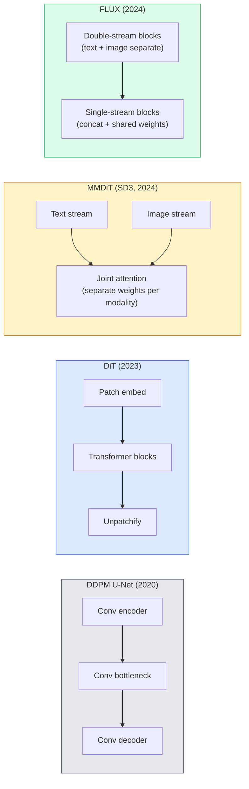

# Diffusion Transformers & Rectified Flow · Diffusion Transformer 与整流流（Rectified Flow）

> 扩散的秘密不在 U-Net。把它换成 transformer，把噪声调度换成一条直线流，你就突然有了 SD3、FLUX 和所有 2026 年的文生图模型。

> The U-Net is not the secret of diffusion. Replace it with a transformer, swap the noise schedule for a straight-line flow, and suddenly you have SD3, FLUX, and every 2026 text-to-image model.

**Type:** Learn + Build
**Languages:** Python
**Prerequisites:** Phase 4 Lesson 10 (Diffusion DDPM), Phase 4 Lesson 14 (ViT), Phase 7 Lesson 02 (Self-Attention)
**Time:** ~75 minutes

## Learning Objectives · 学习目标

- 梳理从 U-Net DDPM（第 10 课）到 Diffusion Transformer（DiT）、MMDiT（SD3）、再到单流+双流 DiT（FLUX）的演进脉络
- 解释整流流（rectified flow）：为什么噪声和数据之间的直线路径让模型 20 步就能采样，而不是 1000 步
- 实现一个微型 DiT block 和一个整流流训练循环，都在 100 行以内
- 按架构、参数量和许可证区分各模型变体（SD3、FLUX.1-dev、FLUX.1-schnell、Z-Image、Qwen-Image）

> Trace the evolution from U-Net DDPM (Lesson 10) to Diffusion Transformer (DiT), MMDiT (SD3), and single+double-stream DiT (FLUX)
> Explain rectified flow: why a straight-line trajectory between noise and data lets models sample in 20 steps instead of 1000
> Implement a tiny DiT block and a rectified-flow training loop, both under 100 lines
> Distinguish model variants (SD3, FLUX.1-dev, FLUX.1-schnell, Z-Image, Qwen-Image) by architecture, parameter count, and licensing

## The Problem · 问题在哪

第 10 课用 U-Net 去噪器搭了一个 DDPM。那套配方统治了 2020-2023：U-Net + beta 调度 + 噪声预测损失。它产出了 Stable Diffusion 1.5、2.1 和 DALL-E 2。

所有 2026 年最先进的文生图模型都已经越过它。Stable Diffusion 3、FLUX、SD4、Z-Image、Qwen-Image、Hunyuan-Image——没有一个用 U-Net。它们用 Diffusion Transformer（DiT）。SD3 和 FLUX 还把 DDPM 的噪声调度换成了整流流（rectified flow），把噪声到数据的路径拉直，配合 consistency 或蒸馏变体可以实现 1-4 步推理。

这个转变之所以重要，是因为它正是扩散图像生成变得可控、提示词准确（SD3/SD4 解决了文字渲染）、生产级快速的原因。理解 DiT + 整流流，就是理解 2026 年的生成图像技术栈。

> Lesson 10 built a DDPM with a U-Net denoiser. That recipe dominated 2020-2023: U-Net + beta schedule + noise-prediction loss. It produced Stable Diffusion 1.5 and 2.1 and DALL-E 2.
> Every 2026 state-of-the-art text-to-image model has moved past it. Stable Diffusion 3, FLUX, SD4, Z-Image, Qwen-Image, Hunyuan-Image — none use a U-Net. They use Diffusion Transformers (DiT). SD3 and FLUX also swap the DDPM noise schedule for rectified flow, which straightens the path from noise to data and enables 1-4 step inference with consistency or distilled variants.
> The shift matters because it is the reason diffusion-based image generation became controllable, prompt-accurate (SD3/SD4 solved text rendering), and production-fast. Understanding DiT + rectified flow is understanding the 2026 generative-image stack.

## The Concept · 概念

### From U-Net to transformer · 从 U-Net 到 transformer



- **DiT**（Peebles & Xie, 2023）— 用一个类 ViT 的 transformer 在 latent patch 上取代 U-Net。条件注入靠自适应层归一化（adaptive layer norm, AdaLN）。
- **MMDiT**（SD3, Esser et al., 2024）— 两条流：文本和图像 token 各有独立权重，共享一个联合注意力（joint attention）。
- **FLUX**（Black Forest Labs, 2024）— 前 N 个 block 像 SD3 一样双流，后面的 block 拼接并共享权重（单流），在更深处换取效率。
- **Z-Image**（2025）— 6B 参数的高效单流 DiT，向「不计代价堆规模」发起挑战。

> - **DiT** (Peebles & Xie, 2023) — replace the U-Net with a ViT-like transformer on latent patches. Conditioning via adaptive layer norm (AdaLN).
> - **MMDiT** (SD3, Esser et al., 2024) — two streams with separate weights for text and image tokens that share a joint attention.
> - **FLUX** (Black Forest Labs, 2024) — first N blocks double-stream like SD3, later blocks concatenate and share weights (single-stream) for efficiency at higher depth.
> - **Z-Image** (2025) — an efficient single-stream DiT at 6B parameters that challenges "scale at all costs".

### Rectified flow in one paragraph · 一段话讲完整流流

DDPM 把前向过程定义成一个逐步加噪的 SDE，`x_t` 被越来越严重地破坏。学到的反向过程是第二个 SDE，要用 1000 个小步求解。

整流流定义的是干净数据与纯噪声之间的**直线**插值：

```
x_t = (1 - t) * x_0 + t * epsilon,     t in [0, 1]
```

训练一个网络去预测速度 `v_theta(x_t, t) = epsilon - x_0`——沿「从干净数据到噪声」的直线路径的前向方向（`dx_t/dt`）。采样时，把这个速度反向积分，就能从噪声一步步走向数据。得到的 ODE 离直线近得多，所以采样需要的积分步数少得多。

SD3 把它叫做 **Rectified Flow Matching**。FLUX、Z-Image 和大多数 2026 年的模型都用同一个训练目标。典型推理：20-30 个 Euler 步（确定性），对比旧 DDPM 时代的 50+ 步 DDIM。蒸馏 / turbo / schnell / LCM 变体还能降到 1-4 步。

> DDPM defines the forward process as a noisy SDE where `x_t` is increasingly corrupted. The learned reverse is a second SDE, solved by 1000 small steps.
> Rectified flow defines a **straight-line** interpolation between clean data and pure noise:
> Train a network to predict the velocity `v_theta(x_t, t) = epsilon - x_0` — the forward direction along the straight-line path from clean data to noise (`dx_t/dt`). During sampling, you integrate this velocity backward to step from noise toward data. The resulting ODE is much closer to a straight line, so far fewer integration steps are needed to sample.
> SD3 calls this **Rectified Flow Matching**. FLUX, Z-Image, and most 2026 models use the same objective. Typical inference: 20-30 Euler steps (deterministic) vs 50+ DDIM steps in the old DDPM regime. Distilled / turbo / schnell / LCM variants take it down to 1-4 steps.

### AdaLN conditioning · AdaLN 条件注入

DiT 通过**自适应层归一化（adaptive layer norm）**注入时间步和类别/文本条件：从条件向量预测 `scale` 和 `shift`，在 LayerNorm 之后应用。比 U-Net 里的 FiLM 式调制干净得多，是所有现代 DiT 的默认做法。

```
cond -> MLP -> (scale, shift, gate)
norm(x) * (1 + scale) + shift, then residual add * gate
```

> DiTs condition on timestep and class/text via **adaptive layer norm**: predict `scale` and `shift` from the conditioning vector and apply them after LayerNorm. Much cleaner than FiLM-style modulation in U-Nets and the default in every modern DiT.

### Text encoders in SD3 and FLUX · SD3 和 FLUX 里的文本编码器

- **SD3** 用三个文本编码器：两个 CLIP 模型 + T5-XXL。嵌入拼接后作为文本条件喂给图像流。
- **FLUX** 用一个 CLIP-L + T5-XXL。
- **Qwen-Image / Z-Image** 变体用自己的、与其基座 LLM 对齐的内部文本编码器。

SD3/FLUX 在提示词理解上远好于 SD1.5，文本编码器占了很大一部分功劳。光 T5-XXL 就有 4.7B 参数。

> - **SD3** uses three text encoders: two CLIP models + T5-XXL. Embeddings concatenated and fed to the image stream as text conditioning.
> - **FLUX** uses one CLIP-L + T5-XXL.
> - **Qwen-Image / Z-Image** variants use their own in-house text encoders aligned with their base LLMs.
> The text encoder is a big part of why SD3/FLUX reason about prompts so much better than SD1.5. T5-XXL alone is 4.7B params.

### Classifier-free guidance still holds · 无分类器引导依然成立

整流流改变的是采样器，不是条件注入。无分类器引导（classifier-free guidance：训练时以 10% 概率丢弃文本，推理时混合条件与无条件预测）在整流流下原样可用。大多数 2026 年的模型用 3.5-5 的 guidance scale——低于 SD1.5 的 7.5，因为整流流模型默认就更贴提示词。

> Rectified flow changes the sampler, not the conditioning. Classifier-free guidance (drop text with 10% probability during training, mix conditional and unconditional predictions at inference) works identically with rectified flow. Most 2026 models use guidance scale 3.5-5 — lower than SD1.5's 7.5 because rectified-flow models follow prompts more tightly by default.

### Consistency, Turbo, Schnell, LCM · Consistency、Turbo、Schnell、LCM

同一个想法的四个名字：把慢的多步模型蒸馏成快的少步模型。

- **LCM（Latent Consistency Model）** — 训练一个学生模型，从任意中间 `x_t` 一步预测出最终 `x_0`。
- **SDXL Turbo / FLUX schnell** — 用对抗扩散蒸馏训练的 1-4 步模型。
- **SD Turbo** — OpenAI 式 Consistency Models 改造到 latent diffusion 上。

任何新模型的生产级服务都会同时提供「全质量」checkpoint 和「turbo / schnell」变体。Schnell（德语的「快」，Black Forest Labs 的命名习惯）1-4 步出图，塞得进实时管线。

> Four names for the same idea: distil a slow many-step model into a fast few-step model.
> - **LCM (Latent Consistency Model)** — train a student that predicts the final `x_0` from any intermediate `x_t` in one step.
> - **SDXL Turbo / FLUX schnell** — 1-4 step models trained with adversarial diffusion distillation.
> - **SD Turbo** — OpenAI-style Consistency Models adapted to latent diffusion.
> Production serving of any new model ships both a "full quality" checkpoint and a "turbo / schnell" variant. Schnell ("fast" in German, Black Forest Labs' convention) runs in 1-4 steps and fits real-time pipelines.

### Model landscape in 2026 · 2026 年模型全景

| 模型 | 规模 | 架构 | 许可证 |
|-------|------|--------------|---------|
| Stable Diffusion 3 Medium | 2B | MMDiT | SAI Community |
| Stable Diffusion 3.5 Large | 8B | MMDiT | SAI Community |
| FLUX.1-dev | 12B | 双流 + 单流 DiT | 非商业 |
| FLUX.1-schnell | 12B | 同上，蒸馏版 | Apache 2.0 |
| FLUX.2 | — | FLUX.1 迭代版 | 混合 |
| Z-Image | 6B | S3-DiT（可扩展单流） | 宽松 |
| Qwen-Image | ~20B | DiT + Qwen 文本塔 | Apache 2.0 |
| Hunyuan-Image-3.0 | ~80B | DiT | 仅研究 |
| SD4 Turbo | 3B | DiT + 蒸馏 | SAI 商业 |

FLUX.1-schnell 是 2026 年的开源默认。Z-Image 是效率王者。FLUX.2 和 SD4 是当前的质量天花板。

> FLUX.1-schnell is the 2026 open-source default. Z-Image is the efficiency leader. FLUX.2 and SD4 are the current quality tips.

### Why this phase shift matters · 为什么这次范式转移重要

DDPM + U-Net 能用。DiT + 整流流**更好、更快、扩展起来更干净**。这次转变可以和 NLP 里 RNN 到 transformer 的转变类比：两种架构解决同一个问题，但 transformer 扩展得动，于是现在独占鳌头。2026 年每一篇图像、视频或 3D 生成论文都用 DiT 形状的去噪器，通常还配整流流目标。U-Net DDPM 现在主要是教学价值（第 10 课）。

```figure
cv3-rectified-flow
```

> DDPM + U-Net worked. DiT + rectified flow works **better, faster, and scales more cleanly**. The transition parallels the one from RNNs to transformers in NLP: both architectures solved the same problem, but transformers scaled and now dominate. Every 2026 paper on image, video, or 3D generation uses a DiT-shaped denoiser and usually a rectified flow objective. U-Net DDPM is now primarily pedagogical (Lesson 10).

## Build It · 动手造

### Step 1: A DiT block with AdaLN · 第 1 步：带 AdaLN 的 DiT block

```python
import torch
import torch.nn as nn


class AdaLNZero(nn.Module):
    """
    Adaptive LayerNorm with a gate. Predicts (scale, shift, gate) from the conditioning.
    Init such that the whole block starts as identity ("zero init").
    """

    def __init__(self, dim, cond_dim):
        super().__init__()
        self.norm = nn.LayerNorm(dim, elementwise_affine=False)
        self.mlp = nn.Linear(cond_dim, dim * 3)
        nn.init.zeros_(self.mlp.weight)
        nn.init.zeros_(self.mlp.bias)

    def forward(self, x, cond):
        scale, shift, gate = self.mlp(cond).chunk(3, dim=-1)
        h = self.norm(x) * (1 + scale.unsqueeze(1)) + shift.unsqueeze(1)
        return h, gate.unsqueeze(1)


class DiTBlock(nn.Module):
    def __init__(self, dim=192, heads=3, mlp_ratio=4, cond_dim=192):
        super().__init__()
        self.adaln1 = AdaLNZero(dim, cond_dim)
        self.attn = nn.MultiheadAttention(dim, heads, batch_first=True)
        self.adaln2 = AdaLNZero(dim, cond_dim)
        self.mlp = nn.Sequential(
            nn.Linear(dim, dim * mlp_ratio),
            nn.GELU(),
            nn.Linear(dim * mlp_ratio, dim),
        )

    def forward(self, x, cond):
        h, gate1 = self.adaln1(x, cond)
        a, _ = self.attn(h, h, h, need_weights=False)
        x = x + gate1 * a
        h, gate2 = self.adaln2(x, cond)
        x = x + gate2 * self.mlp(h)
        return x
```

`AdaLNZero` 起步时是恒等映射，因为它的 MLP 权重初始化为全零。训练把 block 从恒等态一点点推开；这一招极大稳定了深层的 transformer 扩散模型。

> `AdaLNZero` starts as an identity mapping because its MLP weights are initialised to zero. Training nudges the block away from identity; this stabilises deep transformer diffusion models dramatically.

### Step 2: A tiny DiT · 第 2 步：一个微型 DiT

```python
def timestep_embedding(t, dim):
    import math
    half = dim // 2
    freqs = torch.exp(-math.log(10000) * torch.arange(half, device=t.device) / half)
    args = t[:, None].float() * freqs[None]
    return torch.cat([args.sin(), args.cos()], dim=-1)


class TinyDiT(nn.Module):
    def __init__(self, image_size=16, patch_size=2, in_channels=3, dim=96, depth=4, heads=3):
        super().__init__()
        self.patch_size = patch_size
        self.num_patches = (image_size // patch_size) ** 2
        self.patch = nn.Conv2d(in_channels, dim, kernel_size=patch_size, stride=patch_size)
        self.pos = nn.Parameter(torch.zeros(1, self.num_patches, dim))
        self.time_mlp = nn.Sequential(
            nn.Linear(dim, dim * 2),
            nn.SiLU(),
            nn.Linear(dim * 2, dim),
        )
        self.blocks = nn.ModuleList([DiTBlock(dim, heads, cond_dim=dim) for _ in range(depth)])
        self.norm_out = nn.LayerNorm(dim, elementwise_affine=False)
        self.head = nn.Linear(dim, patch_size * patch_size * in_channels)

    def forward(self, x, t):
        n = x.size(0)
        x = self.patch(x)
        x = x.flatten(2).transpose(1, 2) + self.pos
        t_emb = self.time_mlp(timestep_embedding(t, self.pos.size(-1)))
        for blk in self.blocks:
            x = blk(x, t_emb)
        x = self.norm_out(x)
        x = self.head(x)
        return self._unpatchify(x, n)

    def _unpatchify(self, x, n):
        p = self.patch_size
        h = w = int(self.num_patches ** 0.5)
        x = x.view(n, h, w, p, p, -1).permute(0, 5, 1, 3, 2, 4).reshape(n, -1, h * p, w * p)
        return x
```

### Step 3: Rectified flow training · 第 3 步：整流流训练

```python
import torch.nn.functional as F

def rectified_flow_train_step(model, x0, optimizer, device):
    model.train()
    x0 = x0.to(device)
    n = x0.size(0)
    t = torch.rand(n, device=device)
    epsilon = torch.randn_like(x0)
    x_t = (1 - t[:, None, None, None]) * x0 + t[:, None, None, None] * epsilon

    target_velocity = epsilon - x0
    pred_velocity = model(x_t, t)

    loss = F.mse_loss(pred_velocity, target_velocity)
    optimizer.zero_grad()
    loss.backward()
    optimizer.step()
    return loss.item()
```

和 DDPM 的噪声预测损失（第 10 课）对比：结构相同，目标不同。我们不再预测噪声 `epsilon`，而是预测**速度** `epsilon - x_0`，它沿直线插值方向从数据指向噪声。

> Compare with DDPM's noise-prediction loss (Lesson 10): same structure, different target. Instead of predicting the noise `epsilon`, we predict the **velocity** `epsilon - x_0`, which points from data to noise along the straight-line interpolation.

### Step 4: Euler sampler · 第 4 步：Euler 采样器

整流流是一个 ODE。Euler 法最简单，而且对训练良好的整流流模型来说，在 20+ 步时几乎和更高阶求解器一样准。

```python
@torch.no_grad()
def rectified_flow_sample(model, shape, steps=20, device="cpu"):
    model.eval()
    x = torch.randn(shape, device=device)
    dt = 1.0 / steps
    t = torch.ones(shape[0], device=device)
    for _ in range(steps):
        v = model(x, t)
        x = x - dt * v
        t = t - dt
    return x
```

20 步。在训练好的模型上，采样质量可与 1000 步的 DDPM 相当。

> Rectified flow is an ODE. Euler's method is the simplest and, for a well-trained rectified-flow model, nearly as accurate as higher-order solvers at 20+ steps.
> 20 steps. On a trained model this produces samples comparable to 1000-step DDPM.

### Step 5: End-to-end smoke test · 第 5 步：端到端冒烟测试

```python
import numpy as np

def synthetic_blobs(num=200, size=16, seed=0):
    rng = np.random.default_rng(seed)
    out = np.zeros((num, 3, size, size), dtype=np.float32)
    yy, xx = np.meshgrid(np.arange(size), np.arange(size), indexing="ij")
    for i in range(num):
        cx, cy = rng.uniform(4, size - 4, size=2)
        r = rng.uniform(2, 4)
        mask = (xx - cx) ** 2 + (yy - cy) ** 2 < r ** 2
        colour = rng.uniform(-1, 1, size=3)
        for c in range(3):
            out[i, c][mask] = colour[c]
    return torch.from_numpy(out)
```

用整流流在上面训练一个 `TinyDiT`。500 步之后，采样输出应该看起来像一团团淡淡的色斑。

> Train a `TinyDiT` on this with rectified flow. After 500 steps, sampled outputs should look like faint blobs of colour.

## Use It · 实战用法

用 FLUX / SD3 / Z-Image 做真正的图像生成，`diffusers` 用统一 API 提供了其中每一个：

```python
from diffusers import FluxPipeline, StableDiffusion3Pipeline
import torch

pipe = FluxPipeline.from_pretrained(
    "black-forest-labs/FLUX.1-schnell",
    torch_dtype=torch.bfloat16,
).to("cuda")

out = pipe(
    prompt="a golden retriever surfing a tsunami, hyperrealistic, studio lighting",
    guidance_scale=0.0,           # schnell was trained without CFG
    num_inference_steps=4,
    max_sequence_length=256,
).images[0]
out.save("surf.png")
```

三行代码。`FLUX.1-schnell` 四步出图。把 model id 换成 `black-forest-labs/FLUX.1-dev`，用 CFG 跑 20-30 步换更高质量。

SD3 的话：

```python
pipe = StableDiffusion3Pipeline.from_pretrained(
    "stabilityai/stable-diffusion-3.5-large",
    torch_dtype=torch.bfloat16,
).to("cuda")
out = pipe(prompt, guidance_scale=3.5, num_inference_steps=28).images[0]
```

> For real image generation with FLUX / SD3 / Z-Image, `diffusers` ships every one with a unified API:
> Three lines. `FLUX.1-schnell` in four steps. Swap the model id for `black-forest-labs/FLUX.1-dev` for higher quality at 20-30 steps with CFG.
> For SD3:

## Ship It · 交付

本课产出：

- `outputs/prompt-dit-model-picker.md` — 在 SD3、FLUX.1-dev、FLUX.1-schnell、Z-Image、SD4 Turbo 之间按质量、延迟和许可证约束选型。
- `outputs/skill-rectified-flow-trainer.md` — 写出完整的整流流训练循环：AdaLN DiT + Euler 采样。

> This lesson produces:
> - `outputs/prompt-dit-model-picker.md` — picks between SD3, FLUX.1-dev, FLUX.1-schnell, Z-Image, SD4 Turbo given quality, latency, and license constraints.
> - `outputs/skill-rectified-flow-trainer.md` — writes a complete training loop for rectified flow with AdaLN DiT and Euler sampling.

## Exercises · 练习

1. **（简单）** 用上面的 TinyDiT 在合成色斑数据集上训练 500 步。对比分别用 10、20、50 个 Euler 步产生的样本。
2. **（中等）** 加上文本条件：把一个可学习的类别嵌入拼接到时间嵌入上（按颜色分 10 个色斑「类别」）。分别用类别 0、5、9 采样，验证颜色对得上。
3. **（困难）** 在同等规模、同数据、同步数的条件下，计算整流流版本与 DDPM 版本生成样本之间的 Fréchet 距离（FID 代理指标）。报告哪个收敛更快。

> 1. **(Easy)** Train the TinyDiT above on the synthetic blob dataset for 500 steps. Compare samples produced with 10, 20, and 50 Euler steps.
> 2. **(Medium)** Add text conditioning by concatenating a learned class embedding to the time embedding (10 blob "classes" by colour). Sample with class 0, 5, and 9 and verify colours match.
> 3. **(Hard)** Compute the Fréchet distance (FID proxy) between generated samples from rectified-flow and DDPM versions of the same-size network trained on the same data for the same number of steps. Report which converges faster.

## Key Terms · 术语表

| 术语 | 人们常说 | 实际含义 |
|------|----------------|----------------------|
| DiT | 「Diffusion transformer」 | 取代 U-Net 充当扩散去噪器的 transformer；作用于 patch 化的 latent |
| AdaLN | 「自适应层归一化」 | 通过可学习的 scale、shift、gate 在 LayerNorm 之后注入时间步/文本条件；所有现代 DiT 的标准配置 |
| MMDiT | 「多模态 DiT（SD3）」 | 文本与图像 token 各自独立的权重流，共享一个联合自注意力 |
| Single-stream / double-stream | 「FLUX 的招数」 | 前 N 个 block 双流（每模态独立权重），后面的 block 单流（拼接 + 共享权重）换取效率 |
| Rectified flow | 「噪声到数据的直线」 | 数据与噪声之间的线性插值；网络预测速度；推理所需的 ODE 步数更少 |
| Velocity target | 「epsilon - x_0」 | 整流流的回归目标；从干净数据指向噪声 |
| CFG guidance | 「无分类器引导」 | 混合条件与无条件预测；在整流流模型中仍在使用 |
| Schnell / turbo / LCM | 「1-4 步蒸馏」 | 从全质量模型蒸馏出的小步数变体；生产级实时 |

## Further Reading · 延伸阅读

- [Scalable Diffusion Models with Transformers (Peebles & Xie, 2023)](https://arxiv.org/abs/2212.09748) —— DiT 论文
- [Scaling Rectified Flow Transformers (Esser et al., SD3 paper)](https://arxiv.org/abs/2403.03206) —— 规模化的 MMDiT 与整流流
- [FLUX.1 model card and technical report (Black Forest Labs)](https://huggingface.co/black-forest-labs/FLUX.1-dev) —— 双流 + 单流细节
- [Z-Image: Efficient Image Generation Foundation Model (2025)](https://arxiv.org/html/2511.22699v1) —— 6B 的单流 DiT
- [Elucidating the Design Space of Diffusion (Karras et al., 2022)](https://arxiv.org/abs/2206.00364) —— 所有扩散设计取舍的参考
- [Latent Consistency Models (Luo et al., 2023)](https://arxiv.org/abs/2310.04378) —— LCM-LoRA 如何给你 4 步推理
