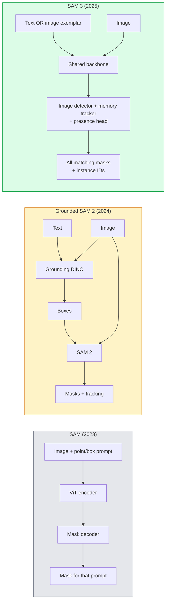

# SAM 3 & Open-Vocabulary Segmentation · SAM 3 与开放词表分割

> 给模型一个文本提示和一张图像，拿到所有匹配物体的掩码。SAM 3 把这件事变成了一次前向传播。

> Give a model a text prompt and an image and get masks for every matching object. SAM 3 made that a single forward pass.

**Type:** Use + Build
**Languages:** Python
**Prerequisites:** Phase 4 Lesson 07 (U-Net), Phase 4 Lesson 08 (Mask R-CNN), Phase 4 Lesson 18 (CLIP)
**Time:** ~60 minutes

## Learning Objectives · 学习目标

- 区分 SAM（只认视觉提示）、Grounded SAM / SAM 2（检测器 + SAM）与 SAM 3（通过可提示概念分割原生支持文本提示）
- 解释 SAM 3 架构：共享骨干 + 图像检测器 + 基于记忆的视频跟踪器 + 存在头 + 检测器-跟踪器解耦设计
- 使用 Hugging Face `transformers` 的 SAM 3 集成做文本提示的检测、分割和视频跟踪
- 按延迟、概念复杂度和部署目标，在 SAM 3、Grounded SAM 2、YOLO-World、SAM-MI 之间选型

> Distinguish SAM (visual prompts only), Grounded SAM / SAM 2 (detector + SAM), and SAM 3 (native text prompts via Promptable Concept Segmentation)
> Explain the SAM 3 architecture: shared backbone + image detector + memory-based video tracker + presence head + decoupled detector-tracker design
> Use Hugging Face `transformers` SAM 3 integration for text-prompted detection, segmentation, and video tracking
> Pick between SAM 3, Grounded SAM 2, YOLO-World, and SAM-MI based on latency, concept complexity, and deployment target

## The Problem · 问题在哪

2023 年的 SAM 是一个只认视觉提示的模型：你点一个点或画一个框，它返回一个掩码。要做「给我这张照片里所有的橙子」，你需要一个检测器（Grounding DINO）先出框，再让 SAM 去逐个分割。Grounded SAM 把它串成了一条管线，但那是两个冻结模型的级联，误差不可避免地层层累积。

SAM 3（Meta，2025 年 11 月，ICLR 2026）把级联折叠掉了。它接受一个简短的名词短语或一张图像范例（image exemplar）作为提示，在一次前向传播里返回所有匹配的掩码和实例 ID。这就是**可提示概念分割（Promptable Concept Segmentation, PCS）**。配合 2026 年 3 月的 Object Multiplex 更新（SAM 3.1），它能高效地在视频里跟踪同一概念的多个实例。

本课关注的是这一结构性转变。2D 分割、检测、图文 grounding 已经合并进一个模型。生产问题不再是「我把哪几条管线串起来」，而是「哪个可提示模型能端到端搞定我的用例」。

> The 2023 SAM was a visual-prompt-only model: you click a point or draw a box and it returns a mask. For "give me all the oranges in this photo" you needed a detector (Grounding DINO) to produce boxes, then SAM to segment each. Grounded SAM turned this into a pipeline, but it was a cascade of two frozen models with inevitable error accumulation.
> SAM 3 (Meta, Nov 2025, ICLR 2026) collapsed the cascade. It accepts a short noun phrase or an image exemplar as prompt and returns all matching masks and instance IDs in a single forward pass. That is **Promptable Concept Segmentation (PCS)**. Combined with the March 2026 Object Multiplex update (SAM 3.1), it tracks multiple instances of the same concept through video efficiently.
> This lesson is about the structural shift this represents. 2D seg, detection, and text-image grounding have merged into one model. The production question is no longer "which pipeline do I chain together" but "which promptable model handles my use case end-to-end."

## The Concept · 概念

### The three generations · 三代模型



### Promptable Concept Segmentation · 可提示概念分割（PCS）

「概念提示（concept prompt）」是一个简短的名词短语（`"yellow school bus"`、`"striped red umbrella"`、`"hand holding a mug"`）或一张图像范例。模型为图像中每个匹配该概念的实例返回分割掩码，外加每个匹配一个唯一的实例 ID。

它与经典视觉提示 SAM 有三点不同：

1. 不需要逐实例提示——一个文本提示返回全部匹配。
2. 开放词表（open-vocabulary）——概念可以是任何能用自然语言描述的东西。
3. 一次返回多个实例，而不是一个提示换一个掩码。

> A "concept prompt" is a short noun phrase (`"yellow school bus"`, `"striped red umbrella"`, `"hand holding a mug"`) or an image exemplar. The model returns segmentation masks for every instance in the image that matches the concept, plus a unique instance ID per match.
> This differs from classic visual-prompt SAM in three ways:
> 1. No per-instance prompting required — one text prompt returns all matches.
> 2. Open-vocabulary — the concept can be anything describable in natural language.
> 3. Returns multiple instances at once rather than one mask per prompt.

### Key architectural pieces · 关键架构组件

- **共享骨干（shared backbone）** — 单个 ViT 处理图像。检测头和基于记忆的跟踪器都从它读取。
- **存在头（presence head）** — 预测概念到底是否出现在图像里。把「这里有没有」和「它在哪里」解耦。减少概念缺席时的误报。
- **解耦的检测器-跟踪器（decoupled detector-tracker）** — 图像级检测与视频级跟踪各有独立的头，互不干扰。
- **记忆库（memory bank）** — 跨帧存储每实例特征，用于视频跟踪（与 SAM 2 用的是同一机制）。

> - **Shared backbone** — a single ViT processes the image. Both the detector head and the memory-based tracker read from it.
> - **Presence head** — predicts whether the concept is present in the image at all. Decouples "is this here?" from "where is it?". Reduces false positives on absent concepts.
> - **Decoupled detector-tracker** — image-level detection and video-level tracking have separate heads so they do not interfere.
> - **Memory bank** — stores per-instance features across frames for video tracking (same mechanism SAM 2 used).

### Training at scale · 大规模训练

SAM 3 在 **400 万个独特概念**上训练，这些概念由一个数据引擎迭代地标注、并用 AI + 人工审核校正生成。新的 **SA-CO 基准**包含 27 万个独特概念，比以往基准大 50 倍。SAM 3 在 SA-CO 上达到人类性能的 75-80%，并在图像 + 视频 PCS 上把现有系统翻倍。

> SAM 3 was trained on **4 million unique concepts** generated by a data engine that iteratively annotates and corrects using AI + human review. The new **SA-CO benchmark** contains 270K unique concepts, 50x larger than prior benchmarks. SAM 3 reaches 75-80% of human performance on SA-CO and doubles existing systems on image + video PCS.

### SAM 3.1 Object Multiplex · SAM 3.1 Object Multiplex

2026 年 3 月的更新：**Object Multiplex** 引入共享记忆机制，可同时联合跟踪同一概念的多个实例。此前，跟踪 N 个实例意味着 N 个独立记忆库。Multiplex 把它折叠成一个带每实例查询的共享记忆。结果：多目标跟踪大幅提速，精度不受损。

> March 2026 update: **Object Multiplex** introduces a shared-memory mechanism for joint tracking of many instances of the same concept at once. Previously, tracking N instances meant N separate memory banks. Multiplex collapses that into one shared memory with per-instance queries. Result: substantially faster multi-object tracking without sacrificing accuracy.

### Where Grounded SAM still matters in 2026 · 2026 年 Grounded SAM 仍然重要的地方

- 需要换入特定的开放词表检测器时（DINO-X、Florence-2）。
- SAM 3 的许可证（HF 上 gated）构成阻碍时。
- 需要比 SAM 3 所暴露的更多检测器阈值控制时。
- 对检测器组件做研究 / 消融实验时。

模块化管线仍有立足之地。但对大多数生产工作，SAM 3 是更简单的答案。

> - When you need a specific open-vocabulary detector swapped in (DINO-X, Florence-2).
> - When the SAM 3 license (gated on HF) is a blocker.
> - When you need more control over the detector threshold than SAM 3 exposes.
> - For research / ablation work on the detector component.
> Modular pipelines still have a place. For most production work, SAM 3 is the simpler answer.

### YOLO-World vs SAM 3 · YOLO-World 对 SAM 3

- **YOLO-World** — 仅开放词表检测（无掩码）。实时。需要高 fps 出框时最佳。
- **SAM 3** — 完整分割 + 跟踪。更慢但输出更丰富。

生产分工：只要检测、要快的管线（机器人导航、快速仪表盘）用 YOLO-World；需要掩码或跟踪的一律 SAM 3。

> - **YOLO-World** — open-vocabulary detector only (no masks). Real-time. Best when you need boxes at high fps.
> - **SAM 3** — full segmentation + tracking. Slower but richer output.
> Production split: YOLO-World for fast detection-only pipelines (robotics navigation, fast dashboards), SAM 3 for anything that needs masks or tracking.

### SAM-MI efficiency · SAM-MI 的效率

SAM-MI（2025-2026）解决 SAM 的解码器瓶颈。核心想法：

- **稀疏点提示（sparse point prompting）** — 用少量精选的点代替稠密提示；解码器调用减少 96%。
- **浅层掩码聚合（shallow mask aggregation）** — 把粗糙的掩码预测合并成一张更锐利的掩码。
- **解耦掩码注入（decoupled mask injection）** — 解码器接收预先算好的掩码特征，而不是重跑。

结果：在开放词表基准上比 Grounded-SAM 提速约 1.6 倍。

> SAM-MI (2025-2026) addresses SAM's decoder bottleneck. Key ideas:
> - **Sparse point prompting** — uses a few well-chosen points instead of dense prompts; reduces decoder calls by 96%.
> - **Shallow mask aggregation** — merges rough mask predictions into one sharper mask.
> - **Decoupled mask injection** — decoder receives pre-computed mask features instead of re-running.
> Result: ~1.6× speedup over Grounded-SAM on open-vocabulary benchmarks.

### Output format for the three models · 三个模型的输出格式

它们都返回大致相同的结构（boxes + labels + scores + masks + IDs），这一点很有用——下游管线不用因为跑的是哪个模型而分叉。

```figure
cv3-open-vocab
```

> All return the same general structure (boxes + labels + scores + masks + IDs), which is helpful — your pipeline downstream does not have to branch on which model ran.

## Build It · 动手造

### Step 1: Prompt construction · 第 1 步：提示词构造

构建一个辅助函数，把用户句子切成 SAM 3 概念提示列表。这里是「用户输入了什么」与「模型消费什么」的交界。

```python
def split_concepts(sentence):
    """
    Heuristic splitter for multi-concept prompts.
    Returns list of short noun phrases.
    """
    for sep in [",", ";", "and", "or", "&"]:
        if sep in sentence:
            parts = [p.strip() for p in sentence.replace("and ", ",").split(",")]
            return [p for p in parts if p]
    return [sentence.strip()]

print(split_concepts("cats, dogs and balloons"))
```

SAM 3 每次前向传播接受一个概念；多概念查询就循环或批处理。

> Build a helper that turns a user sentence into a list of SAM 3 concept prompts. This is the boundary where "what the user typed" meets "what the model consumes".
> SAM 3 accepts one concept per forward pass; for multi-concept queries, loop or batch them.

### Step 2: Post-processing helpers · 第 2 步：后处理辅助函数

把 SAM 3 的原始输出变成干净的结果列表，对齐我们 Phase 4 第 16 课的管线契约。

```python
from dataclasses import dataclass
from typing import List

@dataclass
class ConceptDetection:
    concept: str
    instance_id: int
    box: tuple          # (x1, y1, x2, y2)
    score: float
    mask_rle: str       # run-length encoded


def rle_encode(binary_mask):
    flat = binary_mask.flatten().astype("uint8")
    runs = []
    prev, count = flat[0], 0
    for v in flat:
        if v == prev:
            count += 1
        else:
            runs.append((int(prev), count))
            prev, count = v, 1
    runs.append((int(prev), count))
    return ";".join(f"{v}x{c}" for v, c in runs)
```

RLE 让响应负载保持很小，即使掩码又多分辨率又高。同一格式在 SAM 2、SAM 3、Grounded SAM 2 之间通用。

> Turn SAM 3's raw outputs into a clean list of detections that match our Phase 4 Lesson 16 pipeline contract.
> RLE keeps response payloads small even for many high-resolution masks. The same format works across SAM 2, SAM 3, Grounded SAM 2.

### Step 3: A unified open-vocab segmentation interface · 第 3 步：统一的开放词表分割接口

把你手头任何后端（SAM 3、Grounded SAM 2、YOLO-World + SAM 2）都包进一个方法后面。后端换了，下游代码不用动。

```python
from abc import ABC, abstractmethod
import numpy as np

class OpenVocabSeg(ABC):
    @abstractmethod
    def detect(self, image: np.ndarray, concept: str) -> List[ConceptDetection]:
        ...


class StubOpenVocabSeg(OpenVocabSeg):
    """
    Deterministic stub used for pipeline testing when real models are not loaded.
    """
    def detect(self, image, concept):
        h, w = image.shape[:2]
        return [
            ConceptDetection(
                concept=concept,
                instance_id=0,
                box=(w * 0.2, h * 0.3, w * 0.5, h * 0.8),
                score=0.89,
                mask_rle="0x100;1x50;0x200",
            ),
            ConceptDetection(
                concept=concept,
                instance_id=1,
                box=(w * 0.55, h * 0.25, w * 0.85, h * 0.75),
                score=0.74,
                mask_rle="0x80;1x40;0x220",
            ),
        ]
```

真正的 `SAM3OpenVocabSeg` 子类会去包装 `transformers.Sam3Model` 和 `Sam3Processor`。

> Wrap whatever backend you have (SAM 3, Grounded SAM 2, YOLO-World + SAM 2) behind a single method. Your downstream code does not change when the backend does.
> The real `SAM3OpenVocabSeg` subclass would wrap `transformers.Sam3Model` and `Sam3Processor`.

### Step 4: Hugging Face SAM 3 usage (reference) · 第 4 步：Hugging Face SAM 3 用法（参考）

真模型就用 `transformers` 集成：

```python
from transformers import Sam3Processor, Sam3Model
import torch

processor = Sam3Processor.from_pretrained("facebook/sam3")
model = Sam3Model.from_pretrained("facebook/sam3").eval()

inputs = processor(images=pil_image, return_tensors="pt")
inputs = processor.set_text_prompt(inputs, "yellow school bus")

with torch.no_grad():
    outputs = model(**inputs)

masks = processor.post_process_masks(
    outputs.masks, inputs.original_sizes, inputs.reshaped_input_sizes
)
boxes = outputs.boxes
scores = outputs.scores
```

一个提示，一次调用返回全部匹配。

> For the actual model, the `transformers` integration:
> One prompt, all matches returned in a single call.

### Step 5: Measure what Grounded SAM 2 gave you for free · 第 5 步：量一量 Grounded SAM 2 曾白白给你什么

一个诚实的基准：在真实管线里把 Grounded SAM 2 换成 SAM 3 会发生什么？

- 延迟：SAM 3 省掉一次前向传播（没有独立检测器），但模型本身更重；通常净持平或略快。
- 精度：在稀有或组合式概念（"striped red umbrella"）上 SAM 3 明显更好。常见单词概念上相近。
- 灵活性：Grounded SAM 2 允许你换检测器（DINO-X、Florence-2、Grounding DINO 1.5）；SAM 3 是一体化的。

结论：SAM 3 是 2026 年开放词表分割的默认。需要检测器灵活性或不同许可条款时，Grounded SAM 2 仍是正确答案。

> An honest benchmark: what happens when you replace Grounded SAM 2 with SAM 3 in a real pipeline?
> - Latency: SAM 3 saves one forward pass (no separate detector) but the model itself is heavier; usually net-neutral or a slight speedup.
> - Accuracy: SAM 3 substantially better on rare or compositional concepts ("striped red umbrella"). Similar on common single-word concepts.
> - Flexibility: Grounded SAM 2 lets you swap detectors (DINO-X, Florence-2, Grounding DINO 1.5); SAM 3 is monolithic.
> Conclusion: SAM 3 is the default for 2026 open-vocab seg. Grounded SAM 2 is still the right answer when you need detector flexibility or different license terms.

## Use It · 实战用法

生产部署模式：

- **实时标注** — SAM 3 + CVAT 的「标签即文本提示」功能。标注员选中一个标签名；SAM 3 预标注所有匹配实例。人工复核修正。
- **视频分析** — SAM 3.1 Object Multiplex 做多目标跟踪；把帧喂给基于记忆的跟踪器。
- **机器人** — SAM 3 做开放词表操作（"pick up the red cup"）；作为规划原语运行。
- **医学影像** — 在医学概念上微调的 SAM 3；需要在 HF 上申请访问权限。

Ultralytics 把 SAM 3 包进了它的 Python 包：

```python
from ultralytics import SAM

model = SAM("sam3.pt")
results = model(image_path, prompts="yellow school bus")
```

和 YOLO、SAM 2 同一套接口。

> Production deployment patterns:
> - **Real-time annotation** — SAM 3 + CVAT's label-as-text-prompt feature. Annotators select a label name; SAM 3 pre-labels every matching instance. Review and correct.
> - **Video analytics** — SAM 3.1 Object Multiplex for multi-object tracking; feed frames to the memory-based tracker.
> - **Robotics** — SAM 3 for open-vocab manipulation ("pick up the red cup"); runs as a planning primitive.
> - **Medical imaging** — SAM 3 fine-tuned on medical concepts; requires access request on HF.
> Ultralytics wraps SAM 3 in its Python package:
> Same interface as YOLO and SAM 2.

## Ship It · 交付

本课产出：

- `outputs/prompt-open-vocab-stack-picker.md` — 一个提示词：按延迟、概念复杂度和许可证在 SAM 3 / Grounded SAM 2 / YOLO-World / SAM-MI 之间选型。
- `outputs/skill-concept-prompt-designer.md` — 一个技能：把用户话语转成格式良好的 SAM 3 概念提示（切分、消歧、兜底）。

> This lesson produces:
> - `outputs/prompt-open-vocab-stack-picker.md` — a prompt that picks SAM 3 / Grounded SAM 2 / YOLO-World / SAM-MI based on latency, concept complexity, and licensing.
> - `outputs/skill-concept-prompt-designer.md` — a skill that turns user utterances into well-formed SAM 3 concept prompts (splitting, disambiguation, fallbacks).

## Exercises · 练习

1. **（简单）** 用你自选的概念提示在 10 张图上运行 SAM 3。在同一批图上与 SAM 2 + Grounding DINO 1.5 对比。报告各自漏掉了哪些概念。
2. **（中等）** 在 SAM 3 之上搭一个「点击纳入 / 点击排除」界面：文本提示返回候选实例；用户点选哪些算正样本。把最终概念集合输出为 JSON。
3. **（困难）** 在一个自定义概念集（如 5 类电子元件）上微调 SAM 3，每类 20 张标注图像。与零样本 SAM 3 在同一测试集上对比；度量掩码 IoU 的提升。

> 1. **(Easy)** Run SAM 3 on 10 images with concept prompts you choose. Compare against SAM 2 + Grounding DINO 1.5 on the same images. Report which concepts each model missed.
> 2. **(Medium)** Build a "click-to-include / click-to-exclude" UI on top of SAM 3: a text prompt returns candidate instances; user clicks keep which ones count as positive. Output the final concept set as JSON.
> 3. **(Hard)** Fine-tune SAM 3 on a custom concept set (e.g. 5 types of electronic components) with 20 labelled images each. Compare to zero-shot SAM 3 on the same test set; measure mask IoU improvement.

## Key Terms · 术语表

| 术语 | 人们常说 | 实际含义 |
|------|----------------|----------------------|
| Open-vocabulary segmentation | 「按文本分割」 | 为自然语言描述的物体生成掩码，而不是固定标签集 |
| PCS | 「Promptable Concept Segmentation」 | SAM 3 的核心任务——给定名词短语或图像范例，分割出所有匹配实例 |
| Concept prompt | 「那段文本输入」 | 简短的名词短语或图像范例；不是完整句子 |
| Presence head | 「它在这吗？」 | SAM 3 模块：在定位之前先判断概念是否存在于图像中 |
| SA-CO | 「SAM 3 基准」 | 27 万概念的开放词表分割基准；比以往开放词表基准大 50 倍 |
| Object Multiplex | 「SAM 3.1 更新」 | 共享记忆的多目标跟踪；快速联合跟踪多个实例 |
| Grounded SAM 2 | 「模块化管线」 | 检测器 + SAM 2 级联；在需要换检测器时仍然相关 |
| SAM-MI | 「高效 SAM 变体」 | Mask Injection，比 Grounded-SAM 提速 1.6 倍 |

## Further Reading · 延伸阅读

- [SAM 3: Segment Anything with Concepts (arXiv 2511.16719)](https://arxiv.org/abs/2511.16719)
- [SAM 3.1 Object Multiplex (Meta AI, March 2026)](https://ai.meta.com/blog/segment-anything-model-3/)
- [SAM 3 model page on Hugging Face](https://huggingface.co/facebook/sam3)
- [Grounded SAM 2 tutorial (PyImageSearch)](https://pyimagesearch.com/2026/01/19/grounded-sam-2-from-open-set-detection-to-segmentation-and-tracking/)
- [Ultralytics SAM 3 docs](https://docs.ultralytics.com/models/sam-3/)
- [SAM3-I: Instruction-aware SAM (arXiv 2512.04585)](https://arxiv.org/abs/2512.04585)
