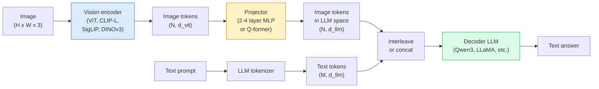

# Vision-Language Models — The ViT-MLP-LLM Pattern · 视觉语言模型——ViT-MLP-LLM 模式

> 视觉编码器把图像变成 token。MLP 投影器把这些 token 映进 LLM 的嵌入空间。剩下的交给语言模型。这个模式——ViT-MLP-LLM——就是 2026 年所有生产级 VLM。

> A vision encoder converts an image into tokens. An MLP projector maps those tokens into the LLM's embedding space. A language model does the rest. That pattern — ViT-MLP-LLM — is every production VLM in 2026.

**Type:** Learn + Use
**Languages:** Python
**Prerequisites:** Phase 4 Lesson 14 (ViT), Phase 4 Lesson 18 (CLIP), Phase 7 Lesson 02 (Self-Attention)
**Time:** ~75 minutes

## Learning Objectives · 学习目标

- 说出 ViT-MLP-LLM 架构，并解释三个组件各自贡献什么
- 对比 Qwen3-VL、InternVL3.5、LLaVA-Next、GLM-4.6V 的参数量、上下文长度和基准表现
- 解释 DeepStack：为什么多层 ViT 特征比只用最后一层特征更能收紧视觉-语言对齐
- 用跨模态错误率（Cross-Modal Error Rate, CMER）在生产环境度量 VLM 幻觉（hallucination），并对信号采取行动

> State the ViT-MLP-LLM architecture and explain what each of the three components contributes
> Compare Qwen3-VL, InternVL3.5, LLaVA-Next, and GLM-4.6V on parameter count, context length, and benchmark performance
> Explain DeepStack: why multi-level ViT features tighten vision-language alignment better than a single last-layer feature
> Measure VLM hallucination in production with Cross-Modal Error Rate (CMER) and act on the signal

## The Problem · 问题在哪

CLIP（Phase 4 第 18 课）给了你一个图文共享嵌入空间，做零样本分类和检索够用。但它答不了「这张图里有几辆红车？」，因为 CLIP 不生成文本——它只会打相似度分。

视觉语言模型（Vision-Language Model, VLM）——Qwen3-VL、InternVL3.5、LLaVA-Next、GLM-4.6V——把一个 CLIP 系图像编码器接到一个完整的语言模型上。模型看到图像加问题，生成答案。2026 年，开源 VLM 在多模态基准（MMMU、MMBench、DocVQA、ChartQA、MathVista、OSWorld）上已能与 GPT-5 和 Gemini-2.5-Pro 打平甚至胜出。

三件套（ViT、投影器、LLM）就是标准。模型之间的差别在于用哪个 ViT、哪个投影器、哪个 LLM，以及训练数据和对齐配方。理解了这个模式，替换任何组件都是机械操作。

> CLIP (Phase 4 Lesson 18) gives you a shared embedding space for images and text, which is enough for zero-shot classification and retrieval. It cannot answer "how many red cars are in this image?" because CLIP does not generate text — it only scores similarities.
> Vision-Language Models (VLMs) — Qwen3-VL, InternVL3.5, LLaVA-Next, GLM-4.6V — bolt a CLIP-family image encoder to a full language model. The model sees an image plus a question and generates an answer. In 2026 open-source VLMs rival or beat GPT-5 and Gemini-2.5-Pro on multimodal benchmarks (MMMU, MMBench, DocVQA, ChartQA, MathVista, OSWorld).
> The trio of pieces (ViT, projector, LLM) is the standard. The differences between models are in which ViT, which projector, which LLM, the training data, and the alignment recipe. Once you understand the pattern, swapping any component is mechanical.

## The Concept · 概念

### The ViT-MLP-LLM architecture · ViT-MLP-LLM 架构



1. **视觉编码器（vision encoder）** — 一个预训练 ViT（CLIP-L/14、SigLIP、DINOv3 或微调变体）。产出 patch token。
2. **投影器（projector）** — 一个小模块（2-4 层 MLP，或 Q-former），把视觉 token 映到 LLM 的嵌入维度。大部分微调发生在这里。
3. **LLM** — 一个 decoder-only 语言模型（Qwen3、Llama、Mistral、GLM、InternLM）。按顺序读入视觉 + 文本 token，生成文本。

三件套原则上都可训练。实践中视觉编码器和 LLM 大体冻结、只训练投影器——花小钱拿到几十亿参数规模的信号。

> 1. **Vision encoder** — a pretrained ViT (CLIP-L/14, SigLIP, DINOv3, or a fine-tuned variant). Produces patch tokens.
> 2. **Projector** — a small module (2-4 layer MLP, or a Q-former) that maps vision tokens into the LLM's embedding dimension. This is where most of the fine-tuning happens.
> 3. **LLM** — a decoder-only language model (Qwen3, Llama, Mistral, GLM, InternLM). Reads the vision + text tokens in sequence, generates text.
> All three pieces are trainable in principle. In practice, the vision encoder and LLM stay mostly frozen while the projector trains — a few billion parameters of signal for cheap.

### DeepStack · DeepStack

朴素投影只用 ViT 的最后一层。DeepStack（Qwen3-VL）从 ViT 的多个深度采样特征并堆叠。深层承载高层语义；浅层承载细粒度的空间与纹理信息。把两者都喂给 LLM，就弥合了「图像里有什么」（语义）与「具体在哪」（空间定位）之间的差距。

> Vanilla projection uses only the last ViT layer. DeepStack (Qwen3-VL) samples features from multiple ViT depths and stacks them. Deeper layers carry high-level semantics; shallower layers carry fine-grained spatial and textural information. Feeding both into the LLM closes the gap between "what does the image contain" (semantics) and "where exactly" (spatial grounding).

### Three training stages · 三个训练阶段

现代 VLM 分阶段训练：

1. **对齐（alignment）** — 冻结 ViT 和 LLM。只用图文对训练投影器。教会投影器把视觉空间映射进语言空间。
2. **预训练（pre-training）** — 全部解冻。在大规模交错图文数据（5 亿+ 对）上训练。建立模型的视觉知识。
3. **指令微调（instruction tuning）** — 在精选的（图像，问题，答案）三元组上微调。教会对话行为和任务格式。这一步把「看得懂图的 LM」变成可用的助手。

大多数 LoRA 微调瞄准第 3 阶段，用一个小型标注数据集。

> Modern VLMs train in stages:
> 1. **Alignment** — freeze ViT and LLM. Train only the projector on image-caption pairs. Teaches the projector to map vision space into language space.
> 2. **Pre-training** — unfreeze everything. Train on large-scale interleaved image-text data (500M+ pairs). Builds the model's visual knowledge.
> 3. **Instruction tuning** — fine-tune on curated (image, question, answer) triples. Teaches conversational behaviour and task formats. This is what turns a "vision-aware LM" into a usable assistant.
> Most LoRA fine-tunes target stage 3 with a small labelled dataset.

### Model family comparison (early 2026) · 模型家族对比（2026 年初）

| 模型 | 参数量 | 视觉编码器 | LLM | 上下文 | 优势 |
|-------|--------|----------------|-----|---------|-----------|
| Qwen3-VL-235B-A22B (MoE) | 235B（22B 激活） | 定制 ViT + DeepStack | Qwen3 | 256K | 综合 SOTA、GUI 智能体 |
| Qwen3-VL-30B-A3B (MoE) | 30B（3B 激活） | 定制 ViT + DeepStack | Qwen3 | 256K | 更小的 MoE 替代 |
| Qwen3-VL-8B（稠密） | 8B | 定制 ViT | Qwen3 | 128K | 生产级稠密默认 |
| InternVL3.5-38B | 38B | InternViT-6B | Qwen3 + GPT-OSS | 128K | MMBench / MMVet 强 |
| InternVL3.5-241B-A28B | 241B（28B 激活） | InternViT-6B | Qwen3 | 128K | 与 GPT-4o 有来有回 |
| LLaVA-Next 72B | 72B | SigLIP | Llama-3 | 32K | 开放、易微调 |
| GLM-4.6V | ~70B | 定制 | GLM | 64K | 开源、OCR 强 |
| MiniCPM-V-2.6 | 8B | SigLIP | MiniCPM | 32K | 边缘友好 |

### Visual agents · 视觉智能体

Qwen3-VL-235B 在 OSWorld 上达到全球顶尖水平——OSWorld 是**视觉智能体（visual agent）**操作 GUI（桌面、移动、网页）的基准。模型看截图、理解 UI、发出动作（点击、输入、滚动）。配合工具，它把常见桌面任务的闭环走通了。2026 年大多数「AI PC」演示的底层就是这个。

> Qwen3-VL-235B reaches top global performance on OSWorld — a benchmark for **visual agents** that operate GUIs (desktop, mobile, web). The model sees a screenshot, understands the UI, and emits actions (click, type, scroll). Combined with tools, it closes the loop on common desktop tasks. This is what most 2026 "AI PC" demos run under the hood.

### Agentic capabilities + RoPE variants · 智能体能力与 RoPE 变体

VLM 需要知道一帧**何时**出现在视频里。Qwen3-VL 从 T-RoPE（temporal rotary position embeddings，时间旋转位置编码）进化到**基于文本的时间对齐**——把显式的时间戳文本 token 与视频帧交错。模型看到 "`<timestamp 00:32>` frame, prompt" 这样的输入，就能推理时间关系。

> VLMs need to know **when** a frame is in a video. Qwen3-VL evolved from T-RoPE (temporal rotary position embeddings) to **text-based time alignment** — explicit timestamp text tokens interleaved with video frames. The model sees "`<timestamp 00:32>` frame, prompt" and can reason about temporal relationships.

### The alignment problem · 对齐问题

爬取的数据集里 12% 的图文对包含没有完全落到图像上的描述。在这种数据上训练的 VLM 会悄悄学会幻觉——捏造物体、读错数字、编造关系。在生产环境这是最主要的失败模式。

Skywork.ai 提出了**跨模态错误率（Cross-Modal Error Rate, CMER）**来追踪它：

```
CMER = fraction of outputs where the text confidence is high but the image-text similarity (via a CLIP-family checker) is low
```

CMER 高意味着模型在自信地说图像里没有的东西。监控 CMER 并把它当作生产 KPI，在他们的部署里把幻觉率砍掉了约 35%。诀窍不是「修模型」，而是「把高 CMER 的输出路由给人工复核」。

> 12% of image-text pairs in a crawled dataset contain descriptions not fully grounded in the image. A VLM trained on this silently learns to hallucinate — fabricate objects, misread numbers, invent relationships. In production this is the dominant failure mode.
> Skywork.ai introduced the **Cross-Modal Error Rate (CMER)** to track it:
> High CMER means the model is confidently saying things not grounded in the image. Monitoring CMER and treating it as a production KPI cut hallucination rate by ~35% in their deployment. The trick is not "fix the model" but "route high-CMER outputs to human review."

### Fine-tuning with LoRA / QLoRA · 用 LoRA / QLoRA 微调

全参数微调一个 70B VLM 对大多数团队不现实。在注意力 + 投影层上做 LoRA（rank 16-64），或者用 4-bit 底座权重的 QLoRA，一张 A100 / H100 就装得下。成本：5,000-50,000 条样本，100-5,000 美元算力，2-10 小时训练。

> Full fine-tuning of a 70B VLM is out of reach for most teams. LoRA (rank 16-64) on attention + projector layers, or QLoRA with 4-bit base weights, fits on a single A100 / H100. Cost: 5,000-50,000 examples, $100-$5,000 in compute, 2-10 hours of training.

### Spatial reasoning is still weak · 空间推理仍然弱

当前 VLM 在空间推理基准（上下、左右、计数、距离）上得分 50-60%。如果你的用例依赖「哪个物体在哪个之上」，要重度验证——通用 VLM 的表现低于人类。纯空间任务上比 VLM 更好的替代品：专门的关键点 / 姿态估计器、深度模型，或者检测模型加框几何后处理。

```figure
v4-vlm-projector
```

> Current VLMs score 50-60% on spatial reasoning benchmarks (above-below, left-right, counting, distance). If your use case depends on "which object is on top of which," validate heavily — generic VLM performance is below human. Better-than-VLM alternatives for pure spatial tasks: a specialised keypoint / pose estimator, a depth model, or a detection model with box geometry post-processed.

## Build It · 动手造

### Step 1: The projector · 第 1 步：投影器

你最常训练的部分。2-4 层 MLP 带 GELU。

```python
import torch
import torch.nn as nn


class Projector(nn.Module):
    def __init__(self, vit_dim=768, llm_dim=4096, hidden=4096):
        super().__init__()
        self.net = nn.Sequential(
            nn.Linear(vit_dim, hidden),
            nn.GELU(),
            nn.Linear(hidden, llm_dim),
        )

    def forward(self, x):
        return self.net(x)
```

输入是 `(N_patches, d_vit)` 的 token 张量。输出是 `(N_patches, d_llm)`。LLM 把输出的每一行就当成另一个 token。

> The part you will train most often. 2-4 layer MLP with GELU.
> Input is a `(N_patches, d_vit)` token tensor. Output is `(N_patches, d_llm)`. The LLM treats every output row as just another token.

### Step 2: Assemble ViT-MLP-LLM end-to-end · 第 2 步：端到端拼装 ViT-MLP-LLM

一个最小 VLM 前向传播的骨架。真实代码用 `transformers`；这里展示的是概念布局。

```python
class MinimalVLM(nn.Module):
    def __init__(self, vit, projector, llm, image_token_id):
        super().__init__()
        self.vit = vit
        self.projector = projector
        self.llm = llm
        self.image_token_id = image_token_id  # placeholder token in text prompt

    def forward(self, image, input_ids, attention_mask):
        # 1. vision features
        vision_tokens = self.vit(image)                     # (B, N_patches, d_vit)
        vision_embeds = self.projector(vision_tokens)       # (B, N_patches, d_llm)

        # 2. text embeddings
        text_embeds = self.llm.get_input_embeddings()(input_ids)  # (B, M, d_llm)

        # 3. replace image placeholder tokens with vision embeds
        merged = self._merge(text_embeds, vision_embeds, input_ids)

        # 4. run LLM
        return self.llm(inputs_embeds=merged, attention_mask=attention_mask)

    def _merge(self, text_embeds, vision_embeds, input_ids):
        out = text_embeds.clone()
        expected = vision_embeds.size(1)
        for b in range(input_ids.size(0)):
            positions = (input_ids[b] == self.image_token_id).nonzero(as_tuple=True)[0]
            if len(positions) != expected:
                raise ValueError(
                    f"batch item {b} has {len(positions)} image tokens but vision_embeds has {expected} patches."
                    " Every sample in the batch must be pre-padded to the same number of image placeholder tokens.")
            out[b, positions] = vision_embeds[b]
        return out
```

文本里的 `<image>` 占位 token 被替换成真实的图像嵌入——LLaVA、Qwen-VL、InternVL 用的都是这个模式。

> Skeleton of the forward pass for a minimal VLM. Real code uses `transformers`; this is the conceptual layout.
> The `<image>` placeholder token in the text gets replaced with real image embeddings — same pattern LLaVA, Qwen-VL, and InternVL use.

### Step 3: CMER computation · 第 3 步：CMER 计算

一个轻量的运行时检查。

```python
import torch.nn.functional as F


def cross_modal_error_rate(image_emb, text_emb, text_confidence, sim_threshold=0.25, conf_threshold=0.8):
    """
    image_emb, text_emb: embeddings of image and generated text (normalised internally)
    text_confidence:     mean per-token probability in [0, 1]
    Returns:             fraction of high-confidence outputs with low image-text alignment
    """
    image_emb = F.normalize(image_emb, dim=-1)
    text_emb = F.normalize(text_emb, dim=-1)
    sim = (image_emb * text_emb).sum(dim=-1)        # cosine similarity
    high_conf_low_sim = (text_confidence > conf_threshold) & (sim < sim_threshold)
    return high_conf_low_sim.float().mean().item()
```

把 CMER 当作生产 KPI。按端点、按提示类型、按客户监控。CMER 上升说明模型开始在某个输入分布上产生幻觉。

> A lightweight runtime check.
> Treat CMER as a production KPI. Monitor it per endpoint, per prompt type, per customer. Rising CMER indicates the model is starting to hallucinate on some input distribution.

### Step 4: Toy VLM classifier (runnable) · 第 4 步：玩具 VLM 分类器（可运行）

演示投影器确实能被训练。假的「ViT 特征」进去；一个 LLM 风格的小 token 头预测类别。

```python
class ToyVLM(nn.Module):
    def __init__(self, vit_dim=32, llm_dim=64, num_classes=5):
        super().__init__()
        self.projector = Projector(vit_dim, llm_dim, hidden=64)
        self.head = nn.Linear(llm_dim, num_classes)

    def forward(self, vision_tokens):
        projected = self.projector(vision_tokens)
        pooled = projected.mean(dim=1)
        return self.head(pooled)
```

在合成的（特征，类别）对上不到 200 步就能拟合——足以证明投影器模式有效。

> Demonstrate the projector trains. Fake "ViT features" go in; a tiny LLM-style token predicts a class.
> One can fit this on synthetic (feature, class) pairs in under 200 steps — enough to show the projector pattern works.

## Use It · 实战用法

2026 年生产团队使用 VLM 的三种方式：

- **托管 API** — OpenAI Vision、Anthropic Claude Vision、Google Gemini Vision。零基础设施，承担供应商风险。
- **开源自托管** — Qwen3-VL 或 InternVL3.5，用 `transformers` 和 `vllm`。完全掌控，前期投入更高。
- **领域微调** — 加载 Qwen2.5-VL-7B 或 LLaVA-1.6-7B，在 5k-50k 条自有样本上做 LoRA，用 `vllm` 或 `TGI` 服务。

```python
from transformers import AutoProcessor, AutoModelForVision2Seq
import torch
from PIL import Image

model_id = "Qwen/Qwen3-VL-8B-Instruct"
processor = AutoProcessor.from_pretrained(model_id)
model = AutoModelForVision2Seq.from_pretrained(model_id, torch_dtype=torch.bfloat16, device_map="auto")

messages = [{
    "role": "user",
    "content": [
        {"type": "image", "image": Image.open("plot.png")},
        {"type": "text", "text": "What does this chart show?"},
    ],
}]
inputs = processor.apply_chat_template(messages, add_generation_prompt=True, tokenize=True, return_dict=True, return_tensors="pt").to("cuda")
generated = model.generate(**inputs, max_new_tokens=256)
answer = processor.decode(generated[0][inputs["input_ids"].shape[1]:], skip_special_tokens=True)
```

`apply_chat_template` 藏起了 `<image>` 占位 token 的分词细节；合并由模型在内部完成。

> Three ways production teams use VLMs in 2026:
> - **Hosted API** — OpenAI Vision, Anthropic Claude Vision, Google Gemini Vision. Zero infra, vendor risk.
> - **Open-source self-host** — Qwen3-VL or InternVL3.5 via `transformers` and `vllm`. Full control, higher up-front effort.
> - **Fine-tune on domain** — load Qwen2.5-VL-7B or LLaVA-1.6-7B, LoRA on 5k-50k custom examples, serve with `vllm` or `TGI`.
> `apply_chat_template` hides the `<image>` placeholder tokenisation; the model handles the merge internally.

## Ship It · 交付

本课产出：

- `outputs/prompt-vlm-selector.md` — 按精度、延迟、上下文长度和预算在 Qwen3-VL / InternVL3.5 / LLaVA-Next / API 之间选型。
- `outputs/skill-cmer-monitor.md` — 生成给生产 VLM 端点插上跨模态错误率监控的代码，含每端点仪表盘和告警阈值。

> This lesson produces:
> - `outputs/prompt-vlm-selector.md` — picks Qwen3-VL / InternVL3.5 / LLaVA-Next / API given accuracy, latency, context length, and budget.
> - `outputs/skill-cmer-monitor.md` — emits the code to instrument a production VLM endpoint with cross-modal error rate, per-endpoint dashboards, and alerting thresholds.

## Exercises · 练习

1. **（简单）** 把三个提示（"what is this?"、"count the objects"、"describe the scene"）跑过任意开源 VLM，用五张图。手工把每个答案评为正确 / 部分正确 / 幻觉。算出一个初版 CMER 风格的比率。
2. **（中等）** 在 500 张带说明的目标领域图像上，用 LoRA（rank 16）微调 Qwen2.5-VL-3B 或 LLaVA-1.6-7B。对比零样本与微调后的 MMBench 风格准确率。
3. **（困难）** 把 VLM 的图像编码器从默认的 SigLIP/CLIP 换成 DINOv3。只重训投影器（冻结 LLM + 冻结 DINOv3）。度量稠密预测任务（计数、空间推理）是否改善。

> 1. **(Easy)** Run three prompts ("what is this?", "count the objects", "describe the scene") through any open VLM on five images. Score each answer as correct / partially correct / hallucinated by hand. Compute a first-pass CMER-like rate.
> 2. **(Medium)** Fine-tune Qwen2.5-VL-3B or LLaVA-1.6-7B with LoRA (rank 16) on 500 images of a target domain with captions. Compare zero-shot vs fine-tuned MMBench-style accuracy.
> 3. **(Hard)** Replace the VLM's image encoder with DINOv3 instead of its default SigLIP/CLIP. Re-train only the projector (frozen LLM + frozen DINOv3). Measure whether dense-prediction tasks (counting, spatial reasoning) improve.

## Key Terms · 术语表

| 术语 | 人们常说 | 实际含义 |
|------|----------------|----------------------|
| ViT-MLP-LLM | 「VLM 模式」 | 视觉编码器 + 投影器 + 语言模型；2026 年的每一个 VLM |
| Projector | 「那座桥」 | 把视觉 token 映进 LLM 嵌入空间的 2-4 层 MLP（或 Q-former） |
| DeepStack | 「Qwen3-VL 的特征招数」 | 堆叠多层 ViT 特征，而不是只用最后一层 |
| Image token | 「`<image>` 占位符」 | 文本流中的特殊 token，被替换成投影后的视觉嵌入 |
| CMER | 「幻觉 KPI」 | 跨模态错误率；文本置信度高而图文相似度低时升高 |
| Visual agent | 「会点击的 VLM」 | 操作 GUI（OSWorld、移动、网页）并调用工具的 VLM |
| Q-former | 「固定数量 token 的桥」 | BLIP-2 风格的投影器，产出固定数量的视觉查询 token |
| Alignment / pre-training / instruction tuning | 「三个阶段」 | 标准 VLM 训练管线 |

## Further Reading · 延伸阅读

- [Qwen3-VL Technical Report (arXiv 2511.21631)](https://arxiv.org/abs/2511.21631)
- [InternVL3.5 Advancing Open-Source Multimodal Models (arXiv 2508.18265)](https://arxiv.org/html/2508.18265v1)
- [LLaVA-Next series](https://llava-vl.github.io/blog/2024-05-10-llava-next-stronger-llms/)
- [BentoML: Best Open-Source VLMs 2026](https://www.bentoml.com/blog/multimodal-ai-a-guide-to-open-source-vision-language-models)
- [MMMU: Multi-discipline Multimodal Understanding benchmark](https://mmmu-benchmark.github.io/)
- [VLMs in manufacturing (Robotics Tomorrow, March 2026)](https://www.roboticstomorrow.com/story/2026/03/when-machines-learn-to-see-like-experts-the-rise-of-vision-language-models-in-manufacturing/26335/)
