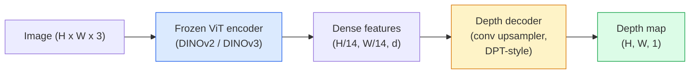

# Monocular Depth & Geometry Estimation · 单目深度与几何估计

> A depth map is a single-channel image where each pixel is a distance from the camera. Predicting it from one RGB frame used to be impossible without stereo or LiDAR. In 2026 a frozen ViT encoder plus a lightweight head gets within a few percent of ground truth.

**Type:** Build + Use
**Languages:** Python
**Prerequisites:** Phase 4 Lesson 14 (ViT), Phase 4 Lesson 17 (Self-Supervised Vision), Phase 4 Lesson 07 (U-Net)
**Time:** ~60 minutes

## Learning Objectives · 学习目标

- 区分相对深度（relative depth）与度量深度（metric depth），并说出每个生产级模型（MiDaS、Marigold、Depth Anything V3、ZoeDepth）各自解决的是哪一种
- 用 Depth Anything V3（DINOv2 backbone）为任意单张图像预测深度，无需任何标定
- 解释单目深度估计（monocular depth estimation）为什么仅凭一张图像就能工作（透视线索、纹理梯度、学到的先验），以及它无法恢复什么（绝对尺度、被遮挡的几何）
- 用深度图和针孔相机内参（pinhole camera intrinsics）把 2D 检测提升为 3D 点

> Distinguish relative and metric depth and state which one each production model (MiDaS, Marigold, Depth Anything V3, ZoeDepth) solves
> Use Depth Anything V3 (DINOv2 backbone) to predict depth for arbitrary single images with no calibration
> Explain why monocular depth works at all from a single image (perspective cues, texture gradients, learned priors) and what it cannot recover (absolute scale, occluded geometry)
> Lift 2D detections to 3D points using a depth map and pinhole camera intrinsics

## The Problem · 问题在哪

深度是 2D 计算机视觉缺失的那根轴。给定 RGB，你知道物体出现在图像平面的哪个位置；却不知道它们有多远。深度传感器（双目相机、LiDAR、飞行时间）能直接解决这个问题，但昂贵、易坏、量程有限。

单目深度估计——从单帧 RGB 预测深度——过去只能产出模糊、不可靠的结果。到 2026 年，大规模预训练 encoder 改变了这一切：Depth Anything V3 使用一个冻结的 DINOv2 backbone，产出的深度图能泛化到室内、室外、医学和卫星等领域。Marigold 把深度重新表述成一个条件扩散问题。ZoeDepth 直接回归真实的度量距离。

深度还是 2D 检测与 3D 理解之间的桥：把检测框的像素乘上深度，你就把这个 2D 物体提升成了 3D 点云。这是每一个 AR 遮挡系统、每一条避障流水线、每一台「拿起杯子」的机器人的核心。

> Depth is the missing axis in 2D computer vision. Given RGB, you know where things appear in the image plane; you do not know how far they are. ... Monocular depth estimation — predicting depth from a single RGB frame — used to produce blurry, unreliable output. By 2026 large pretrained encoders changed that: Depth Anything V3 uses a frozen DINOv2 backbone and produces depth maps that generalise across indoor, outdoor, medical, and satellite domains.
> Depth is also the bridge between 2D detection and 3D understanding: multiply a detected box's pixels by depth and you lift the 2D object into a 3D point cloud. That is the core of every AR occlusion system, every obstacle-avoidance pipeline, and every "pick up the cup" robot.

## The Concept · 概念

### Relative vs metric depth · 相对深度 vs 度量深度

- **相对深度（relative depth）**——只有排序的 `z` 值，没有真实世界单位。「像素 A 比像素 B 近，但距离的比值没有锚定到米。」
- **度量深度（metric depth）**——距相机的绝对距离，以米计。要求模型学过图像线索与真实距离之间的统计关系。

MiDaS 和 Depth Anything V3 产出相对深度。Marigold 产出相对深度。ZoeDepth、UniDepth、Metric3D 产出度量深度。度量模型对相机内参（intrinsics）敏感；相对模型不敏感。

> **Relative depth** — ordered `z` values without a real-world unit. "Pixel A is closer than pixel B, but the ratio of distances is not anchored to metres."
> **Metric depth** — absolute distance in metres from the camera. Requires the model to have learnt the statistical relationship between image cues and real distance.
> MiDaS and Depth Anything V3 produce relative depth. Marigold produces relative depth. ZoeDepth, UniDepth, and Metric3D produce metric depth. Metric models are sensitive to camera intrinsics; relative models are not.

### The encoder-decoder pattern · encoder-decoder 模式



Depth Anything V3 冻结 encoder，只训练 DPT 风格的 decoder。encoder 提供丰富的特征；decoder 把它们插值回图像分辨率并回归出深度。

> Depth Anything V3 freezes the encoder and trains only the DPT-style decoder. The encoder provides rich features; the decoder interpolates them back to image resolution and regresses depth.

### Why a single image produces depth at all · 为什么单张图像也能产生深度

一张 2D 图像包含许多与深度相关的单目线索（monocular cues）：

- **透视（perspective）**——3D 中的平行线在 2D 中汇聚。
- **纹理梯度（texture gradient）**——越远的表面纹理越小、越密。
- **遮挡顺序（occlusion order）**——近处的物体遮挡远处的物体。
- **大小恒常性（size constancy）**——已知物体（汽车、人）给出近似尺度。
- **大气透视（atmospheric perspective）**——室外场景中，远处的物体显得更朦胧、更偏蓝。

在数十亿张图像上训练过的 ViT 会把这些线索内化。只要有足够的数据和足够强的 backbone，单目深度无需任何显式 3D 监督就能达到合理的精度。

> A 2D image contains many monocular cues that correlate with depth:
> **Perspective** — parallel lines in 3D converge in 2D. ... **Texture gradient** — surfaces far away have smaller, denser texture. ... **Occlusion order** — nearer objects occlude farther ones. ... **Size constancy** — known objects (cars, humans) give approximate scale. ... **Atmospheric perspective** — distant objects appear hazier and bluer in outdoor scenes.
> A ViT trained on billions of images internalises these cues. With enough data and a strong backbone, monocular depth hits reasonable accuracy without any explicit 3D supervision.

### What monocular depth cannot do · 单目深度做不到的事

- **绝对度量尺度**——没有内参或场景中的已知物体就得不到。网络能预测「杯子是勺子距离的两倍」，却不知道杯子到底是 1 米还是 10 米远。
- **被遮挡的几何**——椅子的背面看不见，无法可靠推断。
- **真正无纹理/反光的表面**——镜子、玻璃、均匀的墙面。网络会报告看似合理但错误的深度。

> **Absolute metric scale** without intrinsics or a known object in the scene. The network can predict "the cup is twice as far as the spoon" without knowing whether the cup is 1 m or 10 m away.
> **Occluded geometry** — the back of a chair is unseen and cannot be inferred reliably.
> **Truly untextured / reflective surfaces** — mirrors, glass, uniform walls. The network reports plausible but wrong depth.

### Depth Anything V3 in 2026 · 2026 年的 Depth Anything V3

- 原味 DINOv2 ViT-L/14 作为 encoder（冻结）。
- DPT decoder。
- 在来自多样来源的带位姿图像对上训练（除光度一致性外，不需要显式深度监督）。
- 从**任意数量的视觉输入、有无已知相机位姿均可**预测空间一致的几何。
- 在单目深度、任意视角几何、视觉渲染、相机位姿估计上全面 SOTA。

这就是 2026 年你需要深度时随叫随到的那个模型。

> Vanilla DINOv2 ViT-L/14 as encoder (frozen). ... Trained on posed image pairs from diverse sources (no explicit depth supervision needed beyond photometric consistency). ... Predicts spatially consistent geometry from **an arbitrary number of visual inputs, with or without known camera poses**. ... SOTA across monocular depth, any-view geometry, visual rendering, camera pose estimation.
> This is the drop-in model to call when you need depth in 2026.

### Marigold — diffusion for depth · Marigold——用扩散做深度

Marigold（Ke et al., CVPR 2024）把深度估计重新表述为条件图像到图像扩散（conditional image-to-image diffusion）。条件：RGB。目标：深度图。backbone 用的是预训练的 Stable Diffusion 2 U-Net。输出的深度图在物体边界处异常锐利。代价：推理比前馈模型慢（10-50 步去噪）。

> Marigold (Ke et al., CVPR 2024) reframes depth estimation as conditional image-to-image diffusion. Conditioning: RGB. Target: depth map. Uses a pretrained Stable Diffusion 2 U-Net as backbone. Output depth maps are exceptionally sharp at object boundaries. Trade-off: slower inference than feed-forward models (10-50 denoising steps).

### Intrinsics and the pinhole camera · 内参与针孔相机

要把带深度 `d` 的像素 `(u, v)` 提升为相机坐标系下的 3D 点 `(X, Y, Z)`：

```
fx, fy, cx, cy = camera intrinsics
X = (u - cx) * d / fx
Y = (v - cy) * d / fy
Z = d
```

内参来自 EXIF 元数据、标定板，或单目内参估计器（Perspective Fields、UniDepth）。没有内参时，你仍然可以假设 60-70° FOV 和中等分辨率的主点来渲染点云——可以用于可视化，不能用于测量。

> To lift a pixel `(u, v)` with depth `d` to a 3D point `(X, Y, Z)` in camera coordinates:
> Intrinsics come from EXIF metadata, a calibration pattern, or a monocular intrinsics estimator (Perspective Fields, UniDepth). Without intrinsics, you can still render a point cloud by assuming a 60-70° FOV and moderate-resolution principals — usable for visualisation, not for measurement.

### Evaluation · 评估

两个标准指标：

- **AbsRel**（绝对相对误差）：`mean(|d_pred - d_gt| / d_gt)`。越低越好。生产级模型在 0.05-0.1。
- **delta < 1.25**（阈值准确率）：`max(d_pred/d_gt, d_gt/d_pred) < 1.25` 的像素占比。越高越好。SOTA 在 0.9 以上。

对相对深度（Depth Anything V3、MiDaS），评估用的是这两个指标的尺度-平移不变（scale-and-shift invariant）版本。

```figure
depth-sweep
```

> **AbsRel** (absolute relative error): `mean(|d_pred - d_gt| / d_gt)`. Lower is better. 0.05-0.1 for production models.
> **delta < 1.25** (threshold accuracy): fraction of pixels where `max(d_pred/d_gt, d_gt/d_pred) < 1.25`. Higher is better. 0.9+ for SOTA.
> For relative depth (Depth Anything V3, MiDaS), evaluation uses scale-and-shift invariant versions of both metrics.

## Build It · 动手造

### Step 1: Depth metrics · 第 1 步：深度指标

```python
import torch

def abs_rel_error(pred, target, mask=None):
    if mask is not None:
        pred = pred[mask]
        target = target[mask]
    return (torch.abs(pred - target) / target.clamp(min=1e-6)).mean().item()


def delta_accuracy(pred, target, threshold=1.25, mask=None):
    if mask is not None:
        pred = pred[mask]
        target = target[mask]
    ratio = torch.maximum(pred / target.clamp(min=1e-6), target / pred.clamp(min=1e-6))
    return (ratio < threshold).float().mean().item()
```

评估前，一定要把无效深度像素（0、NaN、饱和值）掩掉。

> Always mask invalid depth pixels (zero, NaN, saturated) before evaluation.

### Step 2: Scale-and-shift alignment · 第 2 步：尺度-平移对齐

对相对深度模型，要先对齐预测和真值，再计算指标。对 `a * pred + b = target` 做最小二乘拟合：

```python
def align_scale_shift(pred, target, mask=None):
    if mask is not None:
        p = pred[mask]
        t = target[mask]
    else:
        p = pred.flatten()
        t = target.flatten()
    A = torch.stack([p, torch.ones_like(p)], dim=1)
    coeffs, *_ = torch.linalg.lstsq(A, t.unsqueeze(-1))
    a, b = coeffs[:2, 0]
    return a * pred + b
```

评估 MiDaS / Depth Anything 时，先跑 `align_scale_shift`，再跑 `abs_rel_error`。

> For relative-depth models, align prediction to ground truth before computing metrics. Least-squares fit of `a * pred + b = target`:
> Run `align_scale_shift` before `abs_rel_error` when evaluating MiDaS / Depth Anything.

### Step 3: Lift depth to a point cloud · 第 3 步：把深度提升为点云

```python
import numpy as np

def depth_to_point_cloud(depth, intrinsics):
    H, W = depth.shape
    fx, fy, cx, cy = intrinsics
    v, u = np.meshgrid(np.arange(H), np.arange(W), indexing="ij")
    z = depth
    x = (u - cx) * z / fx
    y = (v - cy) * z / fy
    return np.stack([x, y, z], axis=-1)


depth = np.random.uniform(0.5, 4.0, (240, 320))
intr = (320.0, 320.0, 160.0, 120.0)
pc = depth_to_point_cloud(depth, intr)
print(f"point cloud shape: {pc.shape}  (H, W, 3)")
```

一个函数，通吃所有需要 3D 提升的应用。把点云导出为 `.ply`，用 MeshLab 或 CloudCompare 打开看看。

> One function, every 3D-lifted application. Export the point cloud to `.ply` and open in MeshLab or CloudCompare.

### Step 4: Smoke test with a synthetic depth scene · 第 4 步：用合成深度场景做冒烟测试

```python
def synthetic_depth(size=96):
    yy, xx = np.meshgrid(np.arange(size), np.arange(size), indexing="ij")
    # Floor: linear gradient from near (top) to far (bottom)
    depth = 1.0 + (yy / size) * 4.0
    # Box in the middle: closer
    mask = (np.abs(xx - size / 2) < size / 6) & (np.abs(yy - size * 0.6) < size / 6)
    depth[mask] = 2.0
    return depth.astype(np.float32)


gt = torch.from_numpy(synthetic_depth(96))
pred = gt + 0.3 * torch.randn_like(gt)  # simulated prediction
aligned = align_scale_shift(pred, gt)
print(f"before align  absRel = {abs_rel_error(pred, gt):.3f}")
print(f"after align   absRel = {abs_rel_error(aligned, gt):.3f}")
```

### Step 5: Depth Anything V2 usage (reference) · 第 5 步：Depth Anything V2 用法（参考）

```python
import numpy as np
from transformers import pipeline
from PIL import Image

pipe = pipeline(task="depth-estimation", model="depth-anything/Depth-Anything-V2-Large-hf")

image = Image.open("street.jpg").convert("RGB")
out = pipe(image)
depth_np = np.array(out["depth"])
```

三行代码。`out["depth"]` 是一张 PIL 灰度图；转成 numpy 再做数学。Depth Anything 3（2025 年 11 月）无法通过这条 pipeline 加载。它自带 `depth_anything_3` 包：`DepthAnything3.from_pretrained("depth-anything/DA3MONO-LARGE")` 加载相对单目模型，`model.inference(images).depth` 返回一个 `[N, H, W]` 的深度数组。

> Three lines. `out["depth"]` is a PIL grayscale; convert to numpy for math. Depth Anything 3 (November 2025) does not load through this pipeline. It ships its own `depth_anything_3` package: `DepthAnything3.from_pretrained("depth-anything/DA3MONO-LARGE")` loads the relative monocular model, and `model.inference(images).depth` returns an `[N, H, W]` depth array.

## Use It · 实战用法

- **Depth Anything V3**（Meta AI / ByteDance，2024-2026）——相对深度的默认选择。生产环境中最快的 ViT-large backbone 模型。
- **Marigold**（ETH，2024）——视觉质量最高，推理慢。
- **UniDepth**（ETH，2024）——带相机内参估计的度量深度。
- **ZoeDepth**（Intel，2023）——度量深度；更老，但依然可靠。
- **MiDaS v3.1**——遗留但稳定；很好的对比基线。

典型集成流程：

1. RGB 帧到达。
2. 深度模型产出深度图。
3. 检测器产出检测框。
4. 把框中心点通过深度提升到 3D；如果有点云就与之合并。
5. 下游：AR 遮挡、路径规划、物体尺寸估计、双目替代。

实时场景下，Depth Anything V2 Small（INT8 量化）在消费级 GPU 上、518x518 分辨率可达约 30 fps。

> **Depth Anything V3** (Meta AI / ByteDance, 2024-2026) — the default for relative depth. Fastest ViT-large-backbone model in production.
> Typical integration pattern: 1. RGB frame arrives. ... 5. Downstream: AR occlusion, path planning, object-size estimation, stereo replacement.
> For real-time use, Depth Anything V2 Small (INT8 quantised) hits ~30 fps on a consumer GPU at 518x518.

## Ship It · 交付

本课产出：

- `outputs/prompt-depth-model-picker.md`——根据延迟、度量-vs-相对需求、场景类型，在 Depth Anything V3、Marigold、UniDepth、MiDaS 之间做选择。
- `outputs/skill-depth-to-pointcloud.md`——一个技能：从深度图构建点云，正确处理内参并导出为 `.ply`。

> This lesson produces:
> `outputs/prompt-depth-model-picker.md` — picks between Depth Anything V3, Marigold, UniDepth, MiDaS given latency, metric-vs-relative need, and scene type.
> `outputs/skill-depth-to-pointcloud.md` — a skill that builds point clouds from depth maps with correct intrinsics handling and export to `.ply`.

## Exercises · 练习

1. **（简单）** 在你的桌面上任取 10 张图，跑 Depth Anything V2。把深度保存为灰度 PNG 并查看。找出一个预测深度看起来不对的物体，解释为什么单目线索失效了。
2. **（中等）** 给定来自 Depth Anything V2 的 RGB + 深度，提升成点云并用 `open3d` 渲染。对比两个场景（室内 / 室外），指出哪个看起来更可信。
3. **（困难）** 取五对图像，每一对只差一个已知物体的位置（例如瓶子移近了 30 cm）。用 UniDepth 对两张图都预测度量深度。报告预测距离差与真实 30 cm 的对比。

> (Easy) Run Depth Anything V2 on any 10 images of your desk. Save depth as grayscale PNGs and inspect. Identify one object whose predicted depth looks wrong and explain why the monocular cues failed.
> (Medium) Given RGB + depth from Depth Anything V2, lift to a point cloud and render with `open3d`. Compare two scenes (indoor / outdoor) and note which looks more believable.
> (Hard) Take five pairs of images that differ only by a known object's position (e.g. bottle moved 30 cm closer). Use UniDepth to predict metric depth on both. Report the predicted distance delta vs the true 30 cm.

## Key Terms · 术语表

| 术语 | 人们怎么说 | 实际含义 |
|------|----------------|----------------------|
| Monocular depth | "单图深度" | 从单帧 RGB 估计深度，不需要双目或 LiDAR |
| Relative depth | "有顺序的深度" | 只有排序的 z 值，没有真实世界单位 |
| Metric depth | "绝对距离" | 以米计的深度；需要标定或用度量监督训练的模型 |
| AbsRel | "绝对相对误差" | |d_pred - d_gt| / d_gt 的均值；标准深度指标 |
| Delta accuracy | "delta < 1.25" | 预测在真值 25% 以内的像素占比 |
| Pinhole camera | "fx, fy, cx, cy" | 把 (u, v, d) 提升为 (X, Y, Z) 所用的相机模型 |
| DPT | "Dense Prediction Transformer" | 冻结 ViT encoder 之上用于深度的卷积 decoder |
| DINOv2 backbone | "它好使的原因" | 无需深度标签就能跨领域泛化的自监督特征 |

## Further Reading · 延伸阅读

- [Depth Anything V3 paper page](https://depth-anything.github.io/) —— 用 DINOv2 encoder 做的 SOTA 单目深度
- [Marigold (Ke et al., CVPR 2024)](https://marigoldmonodepth.github.io/) —— 基于扩散的深度估计
- [UniDepth (Piccinelli et al., 2024)](https://arxiv.org/abs/2403.18913) —— 带内参的度量深度
- [MiDaS v3.1 (Intel ISL)](https://github.com/isl-org/MiDaS) —— 公认的相对深度基线
- [DINOv3 blog post (Meta)](https://ai.meta.com/blog/dinov3-self-supervised-vision-model/) —— 把深度精度抬起来的那个 encoder 家族
