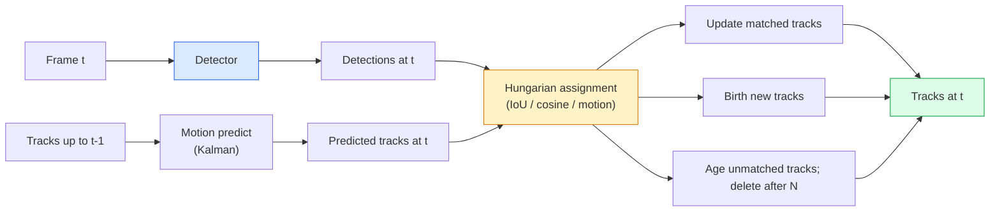

# Multi-Object Tracking & Video Memory · 多目标跟踪与视频记忆

> Tracking is detection plus association. Detect every frame. Match this frame's detections to last frame's tracks by ID.

**Type:** Build
**Languages:** Python
**Prerequisites:** Phase 4 Lesson 06 (YOLO Detection), Phase 4 Lesson 08 (Mask R-CNN), Phase 4 Lesson 24 (SAM 3)
**Time:** ~60 minutes

## Learning Objectives · 学习目标

- 区分 tracking-by-detection（先检测再关联）与 query-based tracking（基于查询的跟踪），并说出各算法家族（SORT、DeepSORT、ByteTrack、BoT-SORT、SAM 2 memory tracker、SAM 3.1 Object Multiplex）
- 从零实现 IoU + 匈牙利分配（Hungarian assignment），完成经典的 tracking-by-detection
- 解释 SAM 2 的记忆库（memory bank），以及为什么它比基于 IoU 的关联更擅长处理遮挡
- 读懂三个跟踪指标（MOTA、IDF1、HOTA），并针对给定用例挑出该看的那一个

> Distinguish tracking-by-detection from query-based tracking and name the algorithm families (SORT, DeepSORT, ByteTrack, BoT-SORT, SAM 2 memory tracker, SAM 3.1 Object Multiplex)
> Implement IoU + Hungarian assignment from scratch for classic tracking-by-detection
> Explain SAM 2's memory bank and why it handles occlusion better than IoU-based association
> Read the three tracking metrics (MOTA, IDF1, HOTA) and pick which one matters for a given use case

## The Problem · 问题在哪

检测器告诉你单帧里物体在哪里。跟踪器告诉你帧 `t` 里的哪个检测和帧 `t-1` 里的某个检测是同一个物体。没有它，你就没法统计越过一条线的物体数、没法跟住一颗穿过遮挡的球、也没法知道「4 号车已经在这条道上待了 8 秒」。

跟踪对每一个面向视频的产品都是必需的：体育分析、安防监控、自动驾驶、医学视频分析、野生动物监测、品牌标识计数。核心构件是共享的：一个逐帧检测器、一个运动模型（卡尔曼滤波或更丰富的东西）、一个关联步骤（在 IoU / 余弦 / 学习到的特征上跑匈牙利算法），以及一个轨迹生命周期（诞生、更新、消亡）。

2026 年带来了两种新模式：**SAM 2 基于记忆的跟踪**（用特征记忆取代运动模型关联）和 **SAM 3.1 Object Multiplex**（让同一概念的许多实例共享一份记忆）。本课先走一遍经典技术栈，再看基于记忆的方法。

> A detector tells you where the objects are in a single frame. A tracker tells you which detection in frame `t` is the same object as a detection in frame `t-1`. Without that, you cannot count objects crossing a line, follow a ball through an occlusion, or know "car #4 has been in the lane for 8 seconds."
> 2026 brought two new patterns: **SAM 2 memory-based tracking** (feature-memory instead of motion-model association) and **SAM 3.1 Object Multiplex** (shared memory for many instances of the same concept). This lesson walks the classical stack first, then the memory-based approach.

## The Concept · 概念

### Tracking-by-detection · 先检测再关联



你在 2026 年会遇到的每一个跟踪器都是这个循环的变体。区别在于：

- **SORT**（2016）：卡尔曼滤波 + IoU 匈牙利匹配。简单、快、没有外观模型。
- **DeepSORT**（2017）：SORT + 每条轨迹一个基于 CNN 的外观特征（ReID embedding）。更擅长处理交叉。
- **ByteTrack**（2021）：把低置信度检测作为第二阶段来关联；不需要外观特征，却是 MOT17 上的顶尖选手。
- **BoT-SORT**（2022）：Byte + 相机运动补偿 + ReID。
- **StrongSORT / OC-SORT**——ByteTrack 的后代，运动和外观都更好。

> Every tracker you will encounter in 2026 is a variation on this loop. The differences:
> **SORT** (2016): Kalman filter + IoU Hungarian. Simple, fast, no appearance model. ... **DeepSORT** (2017): SORT + a CNN-based appearance feature per track (ReID embedding). Handles crossings better. ... **ByteTrack** (2021): associates low-confidence detections as a second stage; no appearance features needed but top performer on MOT17. ... **BoT-SORT** (2022): Byte + camera motion compensation + ReID.

### Kalman filter in one paragraph · 一段话讲完卡尔曼滤波

卡尔曼滤波为每条轨迹维护一个带协方差的状态 `(x, y, w, h, dx, dy, dw, dh)`。每一帧先**预测**（用匀速模型），再用匹配上的检测**更新**。当预测的不确定性高时，更新会更信任检测。这带来平滑的轨迹，以及让轨迹穿过短暂遮挡（1-5 帧）的能力。

每个经典跟踪器的运动预测步骤里都有一个卡尔曼滤波。

> A Kalman filter maintains a per-track state `(x, y, w, h, dx, dy, dw, dh)` with a covariance. At each frame, **predict** the state using a constant-velocity model, then **update** with the matched detection. The update trusts the detection more when the predict uncertainty is high. This gives smooth trajectories and the ability to continue a track through a short occlusion (1-5 frames).
> Every classical tracker uses a Kalman filter in the motion-prediction step.

### The Hungarian algorithm · 匈牙利算法

给定一个 `M x N` 代价矩阵（轨迹 x 检测），找出总代价最小的一对一分配。代价通常是 `1 - IoU(track_bbox, detection_bbox)` 或外观特征的负余弦相似度。运行时间为 O((M+N)^3)；当 M、N 在 ~1000 以内时，用 `scipy.optimize.linear_sum_assignment` 在 Python 里就足够快。

> Given a `M x N` cost matrix (tracks x detections), find the one-to-one assignment that minimises total cost. Cost is usually `1 - IoU(track_bbox, detection_bbox)` or negative cosine similarity of appearance features. Runtime is O((M+N)^3); for M, N up to ~1000 it is fast enough in Python via `scipy.optimize.linear_sum_assignment`.

### ByteTrack's key idea · ByteTrack 的关键想法

标准跟踪器会丢掉低置信度检测（< 0.5）。ByteTrack 把它们留在手边当**第二阶段候选**：先把轨迹和高置信度检测匹配，然后没匹配上的轨迹用一个稍宽松的 IoU 阈值去匹配低置信度检测。能挽回短遮挡和人群附近的 ID 切换。

> Standard trackers drop low-confidence detections (< 0.5). ByteTrack keeps them around as **second-stage candidates**: after matching tracks to high-confidence detections, unmatched tracks try to match low-confidence detections with a slightly looser IoU threshold. Recovers short occlusions, ID switches near crowds.

### SAM 2 memory-based tracking · SAM 2 基于记忆的跟踪

SAM 2 处理视频的方式是为每个实例维护一个时空特征**记忆库**（memory bank）。在某帧上给定一个提示（点击、框、文本），它把这个实例编码进记忆。在后续帧上，记忆对新帧的特征做交叉注意力（cross-attend），decoder 为同一个实例在新帧上产出掩码。

没有卡尔曼滤波，没有匈牙利分配。关联隐含在记忆注意力操作里。

优点：

- 对大遮挡鲁棒（记忆让实例身份跨越许多帧延续）。
- 与 SAM 3 的文本提示组合时支持开放词表。
- 不需要单独的运动模型。

缺点：

- 跟很多物体时比 ByteTrack 慢。
- 记忆库会增长；限制了上下文窗口。

> SAM 2 handles video by keeping a **memory bank** of per-instance spatio-temporal features. Given a prompt (click, box, text) on one frame, it encodes the instance into memory. On subsequent frames, the memory is cross-attended against the new frame's features, and the decoder produces a mask for the same instance in the new frame.
> No Kalman filter, no Hungarian assignment. The association is implicit in the memory-attention operation.
> Pros: Robust to large occlusions (memory carries instance identity across many frames). ... Cons: Slower than ByteTrack for many-object tracking. Memory bank grows; limits the context window.

### SAM 3.1 Object Multiplex · SAM 3.1 Object Multiplex

之前的 SAM 2 / SAM 3 跟踪给每个实例维护一个单独的记忆库。50 个物体就是 50 个记忆库。Object Multiplex（2026 年 3 月）把它们折叠成一个共享记忆，配**每实例查询 token**（query tokens）。开销随实例数亚线性增长。

Multiplex 是 2026 年人群跟踪的新默认：演唱会人群、仓库工人、交通路口。

> Prior SAM 2 / SAM 3 tracking keeps a separate memory bank per instance. For 50 objects, 50 memory banks. Object Multiplex (March 2026) collapses them into one shared memory with **per-instance query tokens**. Cost scales sub-linearly in number of instances.
> Multiplex is the new default for crowd tracking in 2026: concert crowds, warehouse workers, traffic intersections.

### Three metrics to know · 三个必须认识的指标

- **MOTA（Multi-Object Tracking Accuracy）**——1 - (FN + FP + ID 切换) / GT。按错误类型加权；一个把检测失败和关联失败混在一起的单项指标。
- **IDF1（ID F1）**——ID 精确率和召回率的调和平均。专门衡量每条真值轨迹随时间保持自己 ID 的能力。对 ID 切换敏感的任务比 MOTA 更合适。
- **HOTA（Higher Order Tracking Accuracy）**——分解为检测精度（DetA）和关联精度（AssA）。2020 年以来的社区标准；最全面。

安防（谁是谁）：报告 IDF1。体育分析（数传球）：HOTA。一般学术对比：HOTA。

```figure
cv3-track-assoc
```

> **MOTA (Multi-Object Tracking Accuracy)** — 1 - (FN + FP + ID switches) / GT. Weighted by error type; a single metric that conflates detection and association failures.
> **IDF1 (ID F1)** — harmonic mean of ID precision and recall. Focuses specifically on how well each ground-truth track keeps its ID over time. Better than MOTA for ID-switch-sensitive tasks.
> **HOTA (Higher Order Tracking Accuracy)** — decomposes into detection accuracy (DetA) and association accuracy (AssA). The community standard since 2020; most comprehensive.
> For surveillance (who is who): IDF1 is what you report. For sports analytics (counting passes): HOTA. For general academic comparison: HOTA.

## Build It · 动手造

### Step 1: IoU-based cost matrix · 第 1 步：基于 IoU 的代价矩阵

```python
import numpy as np


def bbox_iou(a, b):
    """
    a, b: (N, 4) arrays of [x1, y1, x2, y2].
    Returns (N_a, N_b) IoU matrix.
    """
    ax1, ay1, ax2, ay2 = a[:, 0], a[:, 1], a[:, 2], a[:, 3]
    bx1, by1, bx2, by2 = b[:, 0], b[:, 1], b[:, 2], b[:, 3]
    inter_x1 = np.maximum(ax1[:, None], bx1[None, :])
    inter_y1 = np.maximum(ay1[:, None], by1[None, :])
    inter_x2 = np.minimum(ax2[:, None], bx2[None, :])
    inter_y2 = np.minimum(ay2[:, None], by2[None, :])
    inter = np.clip(inter_x2 - inter_x1, 0, None) * np.clip(inter_y2 - inter_y1, 0, None)
    area_a = (ax2 - ax1) * (ay2 - ay1)
    area_b = (bx2 - bx1) * (by2 - by1)
    union = area_a[:, None] + area_b[None, :] - inter
    return inter / np.clip(union, 1e-8, None)
```

### Step 2: Minimal SORT-style tracker · 第 2 步：极简 SORT 风格跟踪器

为省篇幅，固定匀速的卡尔曼滤波被省略了——这里只用简单的 IoU 关联；在生产中卡尔曼预测必不可少。`sort` Python 包提供完整版本。

```python
from scipy.optimize import linear_sum_assignment


class Track:
    def __init__(self, tid, bbox, frame):
        self.id = tid
        self.bbox = bbox
        self.last_frame = frame
        self.hits = 1

    def update(self, bbox, frame):
        self.bbox = bbox
        self.last_frame = frame
        self.hits += 1


class SimpleTracker:
    def __init__(self, iou_threshold=0.3, max_age=5):
        self.tracks = []
        self.next_id = 1
        self.iou_threshold = iou_threshold
        self.max_age = max_age

    def step(self, detections, frame):
        if not self.tracks:
            for d in detections:
                self.tracks.append(Track(self.next_id, d, frame))
                self.next_id += 1
            return [(t.id, t.bbox) for t in self.tracks]

        track_boxes = np.array([t.bbox for t in self.tracks])
        det_boxes = np.array(detections) if len(detections) else np.empty((0, 4))

        iou = bbox_iou(track_boxes, det_boxes) if len(det_boxes) else np.zeros((len(track_boxes), 0))
        cost = 1 - iou
        cost[iou < self.iou_threshold] = 1e6

        matched_track = set()
        matched_det = set()
        if cost.size > 0:
            row, col = linear_sum_assignment(cost)
            for r, c in zip(row, col):
                if cost[r, c] < 1.0:
                    self.tracks[r].update(det_boxes[c], frame)
                    matched_track.add(r); matched_det.add(c)

        for i, d in enumerate(det_boxes):
            if i not in matched_det:
                self.tracks.append(Track(self.next_id, d, frame))
                self.next_id += 1

        self.tracks = [t for t in self.tracks if frame - t.last_frame <= self.max_age]
        return [(t.id, t.bbox) for t in self.tracks]
```

60 行。输入逐帧检测，返回逐帧轨迹 ID。真实系统会加上卡尔曼预测、ByteTrack 的第二阶段重匹配和外观特征。

> Fixed constant-velocity Kalman omitted for brevity — we use a simple IoU association here; in production the Kalman predict is essential. The `sort` Python package provides the full version.
> 60 lines. Takes per-frame detections, returns per-frame track IDs. Real systems add the Kalman predict, ByteTrack's second-stage re-match, and appearance features.

### Step 3: Synthetic trajectory test · 第 3 步：合成轨迹测试

```python
def synthetic_frames(num_frames=20, num_objects=3, H=240, W=320, seed=0):
    rng = np.random.default_rng(seed)
    starts = rng.uniform(20, 200, size=(num_objects, 2))
    velocities = rng.uniform(-5, 5, size=(num_objects, 2))
    frames = []
    for f in range(num_frames):
        dets = []
        for i in range(num_objects):
            cx, cy = starts[i] + f * velocities[i]
            dets.append([cx - 10, cy - 10, cx + 10, cy + 10])
        frames.append(dets)
    return frames


tracker = SimpleTracker()
for f, dets in enumerate(synthetic_frames()):
    tracks = tracker.step(dets, f)
```

三个沿直线运动的物体应当在全部 20 帧里保住自己的 ID。

> Three objects moving in straight lines should keep their IDs across all 20 frames.

### Step 4: ID-switch metric · 第 4 步：ID 切换指标

```python
def count_id_switches(tracks_per_frame, gt_per_frame):
    """
    tracks_per_frame:  list of list of (track_id, bbox)
    gt_per_frame:      list of list of (gt_id, bbox)
    Returns number of ID switches.
    """
    prev_assignment = {}
    switches = 0
    for tracks, gts in zip(tracks_per_frame, gt_per_frame):
        if not tracks or not gts:
            continue
        t_boxes = np.array([b for _, b in tracks])
        g_boxes = np.array([b for _, b in gts])
        iou = bbox_iou(g_boxes, t_boxes)
        for g_idx, (gt_id, _) in enumerate(gts):
            j = iou[g_idx].argmax()
            if iou[g_idx, j] > 0.5:
                t_id = tracks[j][0]
                if gt_id in prev_assignment and prev_assignment[gt_id] != t_id:
                    switches += 1
                prev_assignment[gt_id] = t_id
    return switches
```

这是一个简化的、接近 IDF1 的指标：统计真值物体更换被指派的预测轨迹 ID 的次数。真正的 MOTA / IDF1 / HOTA 工具在 `py-motmetrics` 和 `TrackEval` 里。

> This is a simplified IDF1-adjacent metric: count how many times a ground-truth object changes its assigned predicted track ID. Real MOTA / IDF1 / HOTA tooling lives in `py-motmetrics` and `TrackEval`.

## Use It · 实战用法

2026 年的生产级跟踪器：

- `ultralytics`——YOLOv8 + 内置 ByteTrack / BoT-SORT。`results = model.track(source, tracker="bytetrack.yaml")`。默认之选。
- `supervision`（Roboflow）——ByteTrack 封装加标注工具。
- SAM 2 / SAM 3.1——通过 `processor.track()` 做基于记忆的跟踪。
- 自组栈：检测器（YOLOv8 / RT-DETR）+ `sort-tracker` / `OC-SORT` / `StrongSORT`。

怎么选：

- 30+ fps 的行人 / 汽车 / 箱子：**用 ultralytics 的 ByteTrack**。
- 一类物体的大量实例挤在人群里：**SAM 3.1 Object Multiplex**。
- 重遮挡但外观可辨认：**DeepSORT / StrongSORT**（ReID 特征）。
- 体育 / 复杂交互：**BoT-SORT** 或学习型跟踪器（MOTRv3）。

> Production trackers in 2026: `ultralytics` — YOLOv8 + ByteTrack / BoT-SORT built-in. `results = model.track(source, tracker="bytetrack.yaml")`. The default. ...
> Picking: Pedestrians / cars / boxes at 30+ fps: **ByteTrack with ultralytics**. ... Heavy occlusions with identifiable appearance: **DeepSORT / StrongSORT** (ReID features). ... Sports / complex interactions: **BoT-SORT** or learned trackers (MOTRv3).

## Ship It · 交付

本课产出：

- `outputs/prompt-tracker-picker.md`——根据场景类型、遮挡模式、延迟预算，在 SORT / ByteTrack / BoT-SORT / SAM 2 / SAM 3.1 之间做选择。
- `outputs/skill-mot-evaluator.md`——针对真值轨迹写出完整的 MOTA / IDF1 / HOTA 评估工具。

> This lesson produces:
> `outputs/prompt-tracker-picker.md` — picks SORT / ByteTrack / BoT-SORT / SAM 2 / SAM 3.1 given scene type, occlusion patterns, and latency budget.
> `outputs/skill-mot-evaluator.md` — writes a complete evaluation harness for MOTA / IDF1 / HOTA against ground-truth tracks.

## Exercises · 练习

1. **（简单）** 用 3、10、30 个物体分别跑上面的合成跟踪器。报告每种情况的 ID 切换次数。指出只靠 IoU 的关联从哪里开始失效。
2. **（中等）** 在关联之前加一个匀速卡尔曼预测步骤。证明 2-3 帧的短遮挡不再引起 ID 切换。
3. **（困难）** 把 SAM 2 的基于记忆的跟踪器（经 `transformers`）接入成另一个跟踪后端。在一段 30 秒的人群视频上同时跑 SimpleTracker 和 SAM 2，手工给 5 个显著的人标注真值 ID，比较两者的 ID 切换次数。

> (Easy) Run the synthetic tracker above with 3, 10, and 30 objects. Report ID-switch count in each case. Identify where the simple IoU-only association starts to fail.
> (Medium) Add a constant-velocity Kalman predict step before association. Show that short (2-3 frame) occlusions no longer cause ID switches.
> (Hard) Integrate SAM 2's memory-based tracker (via `transformers`) as an alternative tracker backend. Run both SimpleTracker and SAM 2 on a 30-second clip of a crowd and compare ID-switch counts, manually labelling ground-truth IDs for 5 salient people.

## Key Terms · 术语表

| 术语 | 人们怎么说 | 实际含义 |
|------|----------------|----------------------|
| Tracking-by-detection | "先检测再关联" | 逐帧检测器 + 在 IoU / 外观上做匈牙利分配 |
| Kalman filter | "运动预测" | 线性动力学 + 协方差，用于平滑轨迹预测和遮挡处理 |
| Hungarian algorithm | "最优分配" | 求解最小代价二分图匹配问题；`scipy.optimize.linear_sum_assignment` |
| ByteTrack | "低置信度第二轮" | 把未匹配的轨迹重新匹配到低置信度检测，挽回短遮挡 |
| DeepSORT | "SORT + 外观" | 加一个用于跨帧匹配的 ReID 特征；更利于 ID 保持 |
| Memory bank | "SAM 2 的招" | 跨帧存储的每实例时空特征；用交叉注意力取代显式关联 |
| Object Multiplex | "SAM 3.1 共享记忆" | 单一共享记忆 + 每实例查询，实现快速的多物体跟踪 |
| HOTA | "现代跟踪指标" | 分解为检测精度和关联精度；社区标准 |

## Further Reading · 延伸阅读

- [SORT (Bewley et al., 2016)](https://arxiv.org/abs/1602.00763) —— 最极简的 tracking-by-detection 论文
- [DeepSORT (Wojke et al., 2017)](https://arxiv.org/abs/1703.07402) —— 加入外观特征
- [ByteTrack (Zhang et al., 2022)](https://arxiv.org/abs/2110.06864) —— 低置信度第二轮
- [BoT-SORT (Aharon et al., 2022)](https://arxiv.org/abs/2206.14651) —— 相机运动补偿
- [HOTA (Luiten et al., 2020)](https://arxiv.org/abs/2009.07736) —— 分解式跟踪指标
- [SAM 2 video segmentation (Meta, 2024)](https://ai.meta.com/sam2/) —— 基于记忆的跟踪器
- [SAM 3.1 Object Multiplex (Meta, March 2026)](https://ai.meta.com/blog/segment-anything-model-3/)
