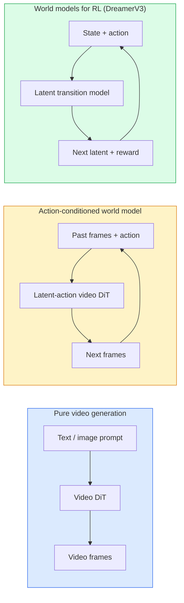

# World Models & Video Diffusion · 世界模型与视频扩散

> A video model that predicts the next seconds of a scene is a world simulator. Condition that prediction on actions and you have a learned game engine.

**Type:** Learn + Build
**Languages:** Python
**Prerequisites:** Phase 4 Lesson 10 (Diffusion), Phase 4 Lesson 12 (Video Understanding), Phase 4 Lesson 23 (DiT + Rectified Flow)
**Time:** ~75 minutes

## Learning Objectives · 学习目标

- 解释纯视频生成模型（Sora 2）与动作条件世界模型（action-conditioned world model，如 Genie 3、DreamerV3）的区别
- 描述视频 DiT：时空 patch（spatio-temporal patches）、3D 位置编码、跨 (T, H, W) token 的联合注意力
- 追踪世界模型如何接入机器人：VLM 规划 → 视频模型模拟 → 逆动力学输出动作
- 针对给定用例（创意视频、交互式模拟、自动驾驶合成）在 Sora 2、Genie 3、Runway GWM-1 Worlds、Wan-Video、HunyuanVideo 之间做选择

> Explain the difference between a pure video generation model (Sora 2) and an action-conditioned world model (Genie 3, DreamerV3)
> Describe a video DiT: spatio-temporal patches, 3D position encoding, joint attention across (T, H, W) tokens
> Trace how a world model plugs into robotics: VLM plans → video model simulates → inverse dynamics emits actions
> Pick between Sora 2, Genie 3, Runway GWM-1 Worlds, Wan-Video, and HunyuanVideo for a given use case (creative video, interactive sim, autonomous-driving synthesis)

## The Problem · 问题在哪

视频生成与世界建模（world modelling）在 2026 年合流。一个能生成一分钟连贯视频的模型，在某种意义上已经学会了世界如何运动：物体恒存性（object permanence）、重力、因果、风格。如果你把这个预测条件化在动作上（向左走、开门），视频模型就变成一个可学习的模拟器，可以取代游戏引擎、驾驶模拟器或机器人环境。

利害关系很具体。Genie 3 从一张图像生成可玩的环境。Runway GWM-1 Worlds 合成无限可探索的场景。Sora 2 产出带同步音频和建模物理的分钟级视频。NVIDIA Cosmos-Drive、Wayve Gaia-2 和 Tesla DrivingWorld 为自动驾驶训练数据生成逼真的驾驶视频。世界模型范式正在悄然接管机器人领域的 sim-to-real。

本课是 Phase 4 的「大图景」一课。它把图像生成、视频理解和智能体推理连接成主流研究正在走向的那个架构模式。

> Video generation and world modelling converged in 2026. A model that can generate a coherent minute of video has, in some sense, learned how the world moves: object permanence, gravity, causality, style. If you condition that prediction on actions (walk left, open the door), the video model becomes a learnable simulator that can replace a game engine, a driving simulator, or a robotics environment.
> The stakes are concrete. Genie 3 generates playable environments from a single image. ... The world-model paradigm is quietly taking over sim-to-real for robotics.
> This lesson is the "big picture" lesson for Phase 4. It connects image generation, video understanding, and agentic reasoning into the architecture pattern dominant research is moving toward.

## The Concept · 概念

### Three families of world-modelling · 世界建模的三个家族



- **Sora 2**是纯视频生成，以提示为条件。没有动作接口。你无法在 rollout 中途「转向」它。
- **Genie 3**、**GWM-1 Worlds**、**Mirage / Magica**是动作条件世界模型。从观测到的视频推断潜在动作（latent action），再把未来帧预测条件化在动作上。可交互——你按键或移动相机，场景就响应。
- **DreamerV3**和经典 RL 世界模型家族在潜空间中预测、带显式动作条件、用奖励信号训练。视觉上弱一些；对样本高效的 RL 更有用。

> **Sora 2** is pure video generation conditioned on prompts. No action interface. You cannot "steer" it mid-rollout.
> **Genie 3**, **GWM-1 Worlds**, **Mirage / Magica** are action-conditioned world models. Infer latent actions from observed video, then condition future frame predictions on actions. Interactive — you press keys or move a camera and the scene responds.
> **DreamerV3** and the classic RL world-model family predict in a latent space with explicit action conditioning, trained on a reward signal. Less visual; more useful for sample-efficient RL.

### Video DiT architecture · 视频 DiT 架构

```
Video latent:          (C, T, H, W)
Patchify (spatial):    grid of P_h x P_w patches per frame
Patchify (temporal):   group P_t frames into a temporal patch
Resulting tokens:      (T / P_t) * (H / P_h) * (W / P_w) tokens
```

位置编码是 3D 的：每个 (t, h, w) 坐标一个旋转（rotary）或可学习 embedding。注意力可以是：

- **完全联合（full joint）**——所有 token 互相关注。N 个 token 是 O(N^2)。长视频上不可承受。
- **分割式（divided）**——交替做时间注意力（同一空间位置、跨时间：`(H*W) * T^2`）和空间注意力（同一时间步、跨空间：`T * (H*W)^2`）。TimeSformer 和大多数视频 DiT 用这个。
- **窗口式（window）**——(t, h, w) 中的局部窗口。Video Swin 用这个。

2026 年的每一个视频扩散模型都用这三种模式之一，外加 AdaLN 条件化（Lesson 23）和 rectified flow。

> Positional encoding is 3D: a rotary or learned embedding per (t, h, w) coordinate. Attention can be:
> **Full joint** — all tokens attend to all tokens. O(N^2) with N tokens. Prohibitive for long videos. ... **Divided** — alternate temporal attention (same spatial position, across time: `(H*W) * T^2`) and spatial attention (same timestep, across space: `T * (H*W)^2`). Used by TimeSformer and most video DiTs. ... **Window** — local windows in (t, h, w). Used by Video Swin.
> Every 2026 video diffusion model uses one of these three patterns plus AdaLN conditioning (Lesson 23) and rectified flow.

### Conditioning on actions: latent action models · 用动作做条件：潜在动作模型

Genie 通过判别式地预测一对连续帧之间的动作，为每帧学出一个**潜在动作**（latent action）。模型的 decoder 随后条件化在推断出的潜在动作上——而不是显式键盘按键。推理时，用户可以指定一个潜在动作（或从一个全新先验中采样一个），模型生成与该动作一致的下一帧。

Sora 完全跳过动作接口。它的 decoder 从过去的时空 token 预测下一批时空 token。提示条件化起点；生成中途没有任何东西能转向它。

> Genie learns a **latent action** per frame by discriminatively predicting the action between a pair of consecutive frames. The model's decoder then conditions on the inferred latent action — not on explicit keyboard keys. At inference, a user can specify a latent action (or sample one from a fresh prior) and the model generates the next frame consistent with that action.
> Sora skips the action interface entirely. Its decoder predicts next spacetime tokens from past spacetime tokens. Prompt conditions the start; nothing steers it mid-generation.

### Physical plausibility · 物理合理性

Sora 2 的 2026 版本明确宣传了**物理合理性**（physical plausibility）：重量、平衡、物体恒存性、因果。团队用人工评定的合理性分数来衡量；与 Sora 1 相比，模型在掉落物体、角色碰撞和故意失败（一跳跃空）上肉眼可见地改进。

合理性仍是最主要的失败模式。2024-2025 年那些人吃意大利面或用玻璃杯喝水的视频，暴露了模型缺乏持久的物体表示。2026 年的模型（Sora 2、Runway Gen-5、HunyuanVideo）减少了这些问题，但没有消除。

> Sora 2's 2026 release explicitly advertised **physical plausibility**: weight, balance, object permanence, cause-and-effect. Measured by the team via hand-rated plausibility scores; the model visibly improves on dropped objects, characters colliding, and failures-on-purpose (a missed jump) versus Sora 1.
> Plausibility remains the dominant failure mode. 2024-2025 videos of people eating spaghetti or drinking from glasses revealed the model's lack of persistent object representation. 2026 models (Sora 2, Runway Gen-5, HunyuanVideo) reduce but do not eliminate these.

### Autonomous driving world models · 自动驾驶世界模型

驾驶世界模型以轨迹、边界框或导航图为条件生成逼真的道路场景。用例：

- **Cosmos-Drive-Dreams**（NVIDIA）——为 RL 训练生成数分钟的驾驶视频。
- **Gaia-2**（Wayve）——轨迹条件场景合成，用于策略评估。
- **DrivingWorld**（Tesla）——模拟多样的天气、时段、交通状况。
- **Vista**（ByteDance）——反应式驾驶场景合成。

它们取代了针对 corner case 的昂贵真实数据采集——夜间行人乱穿马路、结冰路口、罕见车型——否则这些场景需要数百万英里的真实驾驶才能采到。

> Driving world models generate realistic road scenes conditioned on trajectories, bounding boxes, or navigation maps. Usage:
> They replace expensive real-world data collection for corner cases — pedestrian jaywalks at night, icy intersections, unusual vehicle types — that would otherwise require millions of miles of driving.

### Robotics stack: VLM + video model + inverse dynamics · 机器人栈：VLM + 视频模型 + 逆动力学

新兴的三组件机器人循环：

1. **VLM**解析目标（「拿起红色杯子」），规划高层动作序列。
2. **视频生成模型**模拟执行每个动作会是什么样子——预测 N 帧之后的观测。
3. **逆动力学模型**（inverse dynamics model）提取能产生那些观测的具体电机指令。

这取代了奖励塑形和样本密集的 RL。世界模型负责想象；逆动力学把执行环节闭上环。Genie Envisioner 是一个实例；许多研究团队正在向这个结构收敛。

> The emerging three-component robotics loop:
> **VLM** parses the goal ("pick up the red cup"), plans a high-level action sequence. ... **Video generation model** simulates what executing each action would look like — predicts observations N frames ahead. ... **Inverse dynamics model** extracts the concrete motor commands that would produce those observations.
> This replaces reward shaping and sample-heavy RL. The world model does the imagination; the inverse dynamics closes the loop on actuation. Genie Envisioner is one instantiation; many research groups are converging on this structure.

### Evaluation · 评估

- **视觉质量**——FVD（Fréchet Video Distance）、用户研究。
- **提示对齐**——逐帧 CLIPScore、VQA 式评估。
- **物理合理性**——在基准套件上人工评定（Sora 2 的内部基准、VBench）。
- **可控性**（针对交互式世界模型）——动作 → 观测一致性；你能回到先前的状态吗？

> **Visual quality** — FVD (Fréchet Video Distance), user studies. ... **Physical plausibility** — hand-rated on a benchmark suite (Sora 2's internal benchmark, VBench). ... **Controllability** (for interactive world models) — action → observation consistency; can you go back to a prior state?

### Model landscape in 2026 · 2026 年的模型版图

| 模型 | 用途 | 参数量 | 输出 | 许可证 |
|-------|-----|------------|--------|---------|
| Sora 2 | 文生视频、音频 | — | 1 分钟 1080p + 音频 | 仅 API |
| Runway Gen-5 | 文/图生视频 | — | 10 秒片段 | API |
| Runway GWM-1 Worlds | 交互式世界 | — | 无限 3D rollout | API |
| Genie 3 | 从图像生成交互世界 | 11B+ | 可玩帧 | 研究预览 |
| Wan-Video 2.1 | 开源文生视频 | 14B | 高质量片段 | 非商用 |
| HunyuanVideo | 开源文生视频 | 13B | 10 秒片段 | 宽松许可 |
| Cosmos / Cosmos-Drive | 自动驾驶模拟 | 7-14B | 驾驶场景 | NVIDIA 开放 |
| Magica / Mirage 2 | AI 原生游戏引擎 | — | 可修改的世界 | 产品 |

```figure
v4-world-rollout
```

## Build It · 动手造

### Step 1: 3D patchify for video · 第 1 步：视频的 3D patchify

```python
import torch
import torch.nn as nn


class VideoPatch3D(nn.Module):
    def __init__(self, in_channels=4, dim=64, patch_t=2, patch_h=2, patch_w=2):
        super().__init__()
        self.proj = nn.Conv3d(
            in_channels, dim,
            kernel_size=(patch_t, patch_h, patch_w),
            stride=(patch_t, patch_h, patch_w),
        )
        self.patch_t = patch_t
        self.patch_h = patch_h
        self.patch_w = patch_w

    def forward(self, x):
        # x: (N, C, T, H, W)
        x = self.proj(x)
        n, c, t, h, w = x.shape
        tokens = x.reshape(n, c, t * h * w).transpose(1, 2)
        return tokens, (t, h, w)
```

stride 等于 kernel 的 3D 卷积就是时空 patchifier。`(T, H, W) -> (T/2, H/2, W/2)` 的 token 网格。

> A 3D conv with stride equal to kernel acts as the spatio-temporal patchifier. `(T, H, W) -> (T/2, H/2, W/2)` grid of tokens.

### Step 2: 3D rotary position encoding · 第 2 步：3D 旋转位置编码

旋转位置编码（RoPE, Rotary Position Embeddings）分别沿 `t`、`h`、`w` 轴施加：

```python
def rope_3d(tokens, t_dim, h_dim, w_dim, grid):
    """
    tokens: (N, T*H*W, D)
    grid: (T, H, W) sizes
    t_dim + h_dim + w_dim == D
    """
    T, H, W = grid
    n, seq, d = tokens.shape
    if t_dim + h_dim + w_dim != d:
        raise ValueError(f"t_dim+h_dim+w_dim ({t_dim}+{h_dim}+{w_dim}) must equal D={d}")
    assert seq == T * H * W
    t_idx = torch.arange(T, device=tokens.device).repeat_interleave(H * W)
    h_idx = torch.arange(H, device=tokens.device).repeat_interleave(W).repeat(T)
    w_idx = torch.arange(W, device=tokens.device).repeat(T * H)
    # Simplified: just scale channels by frequencies. Real RoPE rotates pairs.
    freqs_t = torch.exp(-torch.log(torch.tensor(10000.0)) * torch.arange(t_dim // 2, device=tokens.device) / (t_dim // 2))
    freqs_h = torch.exp(-torch.log(torch.tensor(10000.0)) * torch.arange(h_dim // 2, device=tokens.device) / (h_dim // 2))
    freqs_w = torch.exp(-torch.log(torch.tensor(10000.0)) * torch.arange(w_dim // 2, device=tokens.device) / (w_dim // 2))
    emb_t = torch.cat([torch.sin(t_idx[:, None] * freqs_t), torch.cos(t_idx[:, None] * freqs_t)], dim=-1)
    emb_h = torch.cat([torch.sin(h_idx[:, None] * freqs_h), torch.cos(h_idx[:, None] * freqs_h)], dim=-1)
    emb_w = torch.cat([torch.sin(w_idx[:, None] * freqs_w), torch.cos(w_idx[:, None] * freqs_w)], dim=-1)
    return tokens + torch.cat([emb_t, emb_h, emb_w], dim=-1)
```

简化加法形式。真正的 RoPE 让成对通道按频率旋转；位置信息是一样的。

> Rotary Position Embeddings (RoPE) separately applied along `t`, `h`, `w` axes:
> Simplified additive form. Real RoPE rotates paired channels at frequencies; the positional information is the same.

### Step 3: Divided attention block · 第 3 步：分割式注意力块

```python
class DividedAttentionBlock(nn.Module):
    def __init__(self, dim=64, heads=2):
        super().__init__()
        self.time_attn = nn.MultiheadAttention(dim, heads, batch_first=True)
        self.space_attn = nn.MultiheadAttention(dim, heads, batch_first=True)
        self.ln1 = nn.LayerNorm(dim)
        self.ln2 = nn.LayerNorm(dim)
        self.ln3 = nn.LayerNorm(dim)
        self.mlp = nn.Sequential(nn.Linear(dim, 4 * dim), nn.GELU(), nn.Linear(4 * dim, dim))

    def forward(self, x, grid):
        T, H, W = grid
        n, seq, d = x.shape
        # time attention: same (h, w), across t
        xt = x.view(n, T, H * W, d).permute(0, 2, 1, 3).reshape(n * H * W, T, d)
        a, _ = self.time_attn(self.ln1(xt), self.ln1(xt), self.ln1(xt), need_weights=False)
        xt = (xt + a).reshape(n, H * W, T, d).permute(0, 2, 1, 3).reshape(n, seq, d)
        # space attention: same t, across (h, w)
        xs = xt.view(n, T, H * W, d).reshape(n * T, H * W, d)
        a, _ = self.space_attn(self.ln2(xs), self.ln2(xs), self.ln2(xs), need_weights=False)
        xs = (xs + a).reshape(n, T, H * W, d).reshape(n, seq, d)
        xs = xs + self.mlp(self.ln3(xs))
        return xs
```

时间注意力在每个空间位置内跨时间关注；空间注意力在每一帧内跨位置关注。两次 O(T^2 + (HW)^2) 操作取代一次 O((THW)^2)。这是 TimeSformer 和每个现代视频 DiT 的核心。

> The time attention attends within each spatial position across time; the space attention attends within each frame across positions. Two O(T^2 + (HW)^2) operations instead of one O((THW)^2). This is the core of TimeSformer and every modern video DiT.

### Step 4: Compose a tiny video DiT · 第 4 步：组装一个微型视频 DiT

```python
class TinyVideoDiT(nn.Module):
    def __init__(self, in_channels=4, dim=64, depth=2, heads=2):
        super().__init__()
        self.patch = VideoPatch3D(in_channels=in_channels, dim=dim, patch_t=2, patch_h=2, patch_w=2)
        self.blocks = nn.ModuleList([DividedAttentionBlock(dim, heads) for _ in range(depth)])
        self.out = nn.Linear(dim, in_channels * 2 * 2 * 2)

    def forward(self, x):
        tokens, grid = self.patch(x)
        for blk in self.blocks:
            tokens = blk(tokens, grid)
        return self.out(tokens), grid
```

不是一个能用的视频生成器；是一个结构演示，验证每个部件的形状都正确。

> Not a working video generator; a structural demo that every piece shapes correctly.

### Step 5: Check shapes · 第 5 步：检查形状

```python
vid = torch.randn(1, 4, 8, 16, 16)  # (N, C, T, H, W)
model = TinyVideoDiT()
out, grid = model(vid)
print(f"input  {tuple(vid.shape)}")
print(f"tokens grid {grid}")
print(f"output {tuple(out.shape)}")
```

patch 之后预期 `grid = (4, 8, 8)`、`out = (1, 256, 32)`；head 再投影到每 token 的时空 patch，准备 un-patchify 回视频。

> Expect `grid = (4, 8, 8)` and `out = (1, 256, 32)` after patching; the head then projects to per-token spatio-temporal patches, ready to be un-patchified back into a video.

## Use It · 实战用法

2026 年的生产接入方式：

- **Sora 2 API**（OpenAI）——文生视频、同步音频。溢价定价。
- **Runway Gen-5 / GWM-1**（Runway）——图生视频、交互式世界。
- **Wan-Video 2.1 / HunyuanVideo**——开源自托管。
- **Cosmos / Cosmos-Drive**（NVIDIA）——驾驶模拟开放权重。
- **Genie 3**——研究预览，需申请访问。

要做交互式世界模型 demo：先用 Wan-Video 保质量，再叠一个潜在动作适配器实现交互。要做自动驾驶模拟：Cosmos-Drive 是 2026 年的开放参考实现。

机器人方向，实战中的栈：

1. 语言目标 -> VLM（Qwen3-VL）-> 高层计划。
2. 计划 -> 潜在动作视频模型 -> 想象出的 rollout。
3. Rollout -> 逆动力学模型 -> 低层动作。
4. 动作被执行 -> 观测反馈回第 1 步。

> Production access patterns for 2026: **Sora 2 API** (OpenAI) — text-to-video, synchronized audio. Premium pricing. ...
> For building an interactive world-model demo: start with Wan-Video for quality, layer on a latent-action adapter for interactivity. For autonomous driving simulation: Cosmos-Drive is the 2026 open reference.
> For robotics, the stack in the wild: 1. Language goal -> VLM (Qwen3-VL) -> high-level plan. ... 4. Actions executed -> observation fed back into step 1.

## Ship It · 交付

本课产出：

- `outputs/prompt-video-model-picker.md`——根据任务、许可证、延迟，在 Sora 2 / Runway / Wan / HunyuanVideo / Cosmos 之间做选择。
- `outputs/skill-physical-plausibility-checks.md`——一个技能：定义自动化检查（物体恒存、重力、连续性），在发布前对任何生成视频运行。

> This lesson produces:
> `outputs/prompt-video-model-picker.md` — picks between Sora 2 / Runway / Wan / HunyuanVideo / Cosmos given task, license, and latency.
> `outputs/skill-physical-plausibility-checks.md` — a skill that defines automated checks (object permanence, gravity, continuity) to run on any generated video before shipping.

## Exercises · 练习

1. **（简单）** 计算一段 5 秒 360p 视频、patch-t=2、patch-h=8、patch-w=8 时的 token 数。推算这个规模下注意力的内存需求。
2. **（中等）** 把上面的分割式注意力块换成完全联合注意力块，测量形状和参数量。解释为什么真实视频模型必须用分割式注意力。
3. **（困难）** 构建一个最小的潜在动作视频模型：取一个 (frame_t, action_t, frame_{t+1}) 三元组数据集（任何简单 2D 游戏都行），训练一个以动作 embedding 为条件的微型视频 DiT，并展示不同动作产生不同的下一帧。

> (Easy) Compute the token count for a 5-second 360p video at patch-t=2, patch-h=8, patch-w=8. Reason about memory for attention at this size.
> (Medium) Swap the divided attention block above for a full joint attention block and measure the shape and parameter count. Explain why divided attention is necessary for real video models.
> (Hard) Build a minimal latent-action video model: take a dataset of (frame_t, action_t, frame_{t+1}) triples (any simple 2D game), train a tiny video DiT conditioned on action embeddings, and show that different actions produce different next frames.

## Key Terms · 术语表

| 术语 | 人们怎么说 | 实际含义 |
|------|----------------|----------------------|
| World model | "学出来的模拟器" | 给定状态和动作预测未来观测的模型 |
| Video DiT | "时空 transformer" | 带 3D patch 化和分割式注意力的扩散 transformer |
| Latent action | "推断出的控制" | 从帧对推断的离散或连续动作潜变量；用于条件化下一帧生成 |
| Divided attention | "先时间后空间" | 每块两次注意力——先跨时间再跨空间——让 O(N^2) 保持在可承受范围 |
| Object permanence | "东西一直是真的" | 视频模型必须学会的场景属性；在食物、玻璃器皿上的经典失败模式 |
| FVD | "Fréchet Video Distance" | FID 的视频版；主要的视觉质量指标 |
| Inverse dynamics model | "从观测到动作" | 给定 (state, next state)，输出连接它们的动作；闭合机器人回路 |
| Cosmos-Drive | "NVIDIA 驾驶模拟" | 用于 RL 和评估的开放权重自动驾驶世界模型 |

## Further Reading · 延伸阅读

- [Sora technical report (OpenAI)](https://openai.com/index/video-generation-models-as-world-simulators/)
- [Genie: Generative Interactive Environments (Bruce et al., 2024)](https://arxiv.org/abs/2402.15391) —— 潜在动作世界模型
- [TimeSformer (Bertasius et al., 2021)](https://arxiv.org/abs/2102.05095) —— 视频 transformer 的分割式注意力
- [DreamerV3 (Hafner et al., 2023)](https://arxiv.org/abs/2301.04104) —— 面向 RL 的世界模型
- [Cosmos-Drive-Dreams (NVIDIA, 2025)](https://research.nvidia.com/labs/toronto-ai/cosmos-drive-dreams/) —— 驾驶世界模型
- [Top 10 Video Generation Models 2026 (DataCamp)](https://www.datacamp.com/blog/top-video-generation-models)
- [From Video Generation to World Model — survey repo](https://github.com/ziqihuangg/Awesome-From-Video-Generation-to-World-Model/)
