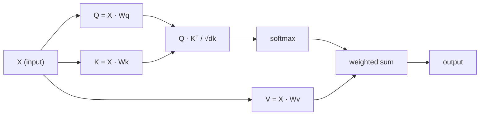

# Self-Attention from Scratch · 从零实现自注意力

> Attention is a lookup table where every word asks "who matters to me?" - and learns the answer.

**Type:** Build
**Languages:** Python
**Prerequisites:** Phase 3 (Deep Learning Core), Phase 5 Lesson 10 (Sequence-to-Sequence)
**Time:** ~90 minutes

## Learning Objectives · 学习目标

- 只用 NumPy 从零实现缩放点积自注意力（scaled dot-product self-attention），包括 query/key/value 投影和 softmax 加权求和
- 搭一个多头注意力层：切分头、并行计算注意力、拼接结果
- 追踪注意力矩阵如何捕捉 token 之间的关系，并解释为什么除以 sqrt(d_k) 能防止 softmax 饱和
- 应用因果掩码（causal masking），把双向注意力变成自回归（解码器式）注意力

> Implement scaled dot-product self-attention from scratch using only NumPy, including query/key/value projections and the softmax-weighted sum
> Build a multi-head attention layer that splits heads, computes parallel attention, and concatenates results
> Trace how the attention matrix captures token relationships and explain why scaling by sqrt(d_k) prevents softmax saturation
> Apply causal masking to convert bidirectional attention into autoregressive (decoder-style) attention

## The Problem · 问题在哪

RNN 一次只处理一个 token。等你走到第 50 个 token，第 1 个 token 的信息已经被挤过 50 道压缩工序。长程依赖被碾进固定大小的隐藏状态里——这个瓶颈，再多 LSTM 门控也解决不干净。

2014 年的 Bahdanau 注意力论文给出了修法：让解码器回看编码器的每一个位置，自己决定当前这一步谁重要。但它仍然挂在 RNN 上。2017 年的《Attention Is All You Need》问了一个更锋利的问题：如果注意力是*唯一*的机制呢？不要循环。不要卷积。只要注意力。

自注意力让序列中的每个位置在单次并行计算里注意其他所有位置。这就是 transformer 快、可扩展、并最终称霸的原因。

> RNNs process sequences one token at a time. By the time you reach token 50, the information from token 1 has been squeezed through 50 compression steps. Long-range dependencies get crushed into a fixed-size hidden state - a bottleneck that no amount of LSTM gating fully solves. ... The 2014 Bahdanau attention paper showed the fix: let the decoder look back at every encoder position and decide which ones matter for the current step. ... The 2017 "Attention Is All You Need" paper asked a sharper question: what if attention is the *only* mechanism? No recurrence. No convolution. Just attention. ... Self-attention lets every position in a sequence attend to every other position in a single parallel step. That is what makes transformers fast, scalable, and dominant.

## The Concept · 概念

### The Database Lookup Analogy · 数据库查询的类比

把注意力想成一次「软」数据库查询：

```
Traditional database:
  Query: "capital of France"  -->  exact match  -->  "Paris"

Attention:
  Query: "capital of France"  -->  similarity to ALL keys  -->  weighted blend of ALL values
```

每个 token 生成三个向量：

- **Query（Q）**：「我在找什么？」
- **Key（K）**：「我装着什么？」
- **Value（V）**：「如果被选中，我能提供什么信息？」

query 与所有 key 的点积产生注意力分数（attention score）。分数高意味着「这个 key 跟我的 query 匹配」。这些分数去加权 value。输出就是 value 的加权和。

> Think of attention as a soft database lookup:
> Every token generates three vectors:
> - **Query (Q)**: "What am I looking for?"
> - **Key (K)**: "What do I contain?"
> - **Value (V)**: "What information do I provide if selected?"
> The dot product between a query and all keys produces attention scores. High score means "this key matches my query." Those scores weight the values. The output is a weighted sum of values.

### Q, K, V Computation · Q、K、V 的计算

每个 token 嵌入经过三个可学习的权重矩阵做投影：

```
Input embeddings (sequence of n tokens, each d-dimensional):

  X = [x1, x2, x3, ..., xn]       shape: (n, d)

Three weight matrices:

  Wq  shape: (d, dk)
  Wk  shape: (d, dk)
  Wv  shape: (d, dv)

Projections:

  Q = X @ Wq    shape: (n, dk)      each token's query
  K = X @ Wk    shape: (n, dk)      each token's key
  V = X @ Wv    shape: (n, dv)      each token's value
```

单个 token 的可视化：

```
             Wq
  x_i ------[*]------> q_i    "What am I looking for?"
       |
       |     Wk
       +----[*]------> k_i    "What do I contain?"
       |
       |     Wv
       +----[*]------> v_i    "What do I offer?"
```

> Each token embedding gets projected through three learned weight matrices:
> Visually, for one token:

### The Attention Matrix · 注意力矩阵

有了所有 token 的 Q、K、V 之后，注意力分数构成一个矩阵：

```
Scores = Q @ K^T    shape: (n, n)

              k1    k2    k3    k4    k5
        +-----+-----+-----+-----+-----+
   q1   | 2.1 | 0.3 | 0.1 | 0.8 | 0.2 |   <- how much q1 attends to each key
        +-----+-----+-----+-----+-----+
   q2   | 0.4 | 1.9 | 0.7 | 0.1 | 0.3 |
        +-----+-----+-----+-----+-----+
   q3   | 0.2 | 0.6 | 2.3 | 0.5 | 0.1 |
        +-----+-----+-----+-----+-----+
   q4   | 0.9 | 0.1 | 0.4 | 1.7 | 0.6 |
        +-----+-----+-----+-----+-----+
   q5   | 0.1 | 0.3 | 0.2 | 0.5 | 2.0 |
        +-----+-----+-----+-----+-----+

Each row: one token's attention over the entire sequence
```

一次盯住一个 query 扫过所有 key：每一行给每个 token 打分，softmax 把分数变成权重，上下文向量就是 value 的加权混合。

```figure
attention-matrix
```

> Once you have Q, K, V for all tokens, attention scores form a matrix:
> Watch one query at a time sweep the keys: each row scores every token, softmax turns the scores into weights, and the context vector is the weighted blend of values.

### Why Scale? · 为什么要缩放？

点积随维度 dk 增长。如果 dk = 64，点积会到几十的量级，把 softmax 推进梯度消失的区域。修法：除以 sqrt(dk)。

```
Scaled scores = (Q @ K^T) / sqrt(dk)
```

这能把数值保持在 softmax 还能产生有效梯度的范围内。

> The dot products grow with dimension dk. If dk = 64, dot products can be in the range of tens, pushing softmax into regions where gradients vanish. The fix: divide by sqrt(dk).
> This keeps values in a range where softmax produces useful gradients.

### Softmax Turns Scores into Weights · softmax 把分数变成权重

softmax 把原始分数变成每一行上的一个概率分布：

```
Raw scores for q1:   [2.1, 0.3, 0.1, 0.8, 0.2]
                            |
                         softmax
                            |
Attention weights:   [0.52, 0.09, 0.07, 0.14, 0.08]   (sums to ~1.0)
```

现在每个 token 都有一组权重，说明它该以多大程度注意其他每个 token。

> Softmax converts raw scores into a probability distribution across each row:
> Now each token has a set of weights saying how much to attend to every other token.

### Weighted Sum of Values · 对 value 向量做加权和

每个 token 的最终输出是所有 value 向量的加权和：

```
output_i = sum( attention_weight[i][j] * v_j  for all j )

For token 1:
  output_1 = 0.52 * v1 + 0.09 * v2 + 0.07 * v3 + 0.14 * v4 + 0.08 * v5
```

> The final output for each token is a weighted sum of all value vectors:

### Full Pipeline · 完整流水线



一行写完的公式：

```
Attention(Q, K, V) = softmax( Q @ K^T / sqrt(dk) ) @ V
```

```figure
softmax-attention-scaling
```

> Formula in one line:

## Build It · 动手造

### Step 1: Softmax from scratch · 从零实现 softmax

softmax 把原始 logits 变成概率。减去最大值以保证数值稳定。

```python
import numpy as np

def softmax(x):
    shifted = x - np.max(x, axis=-1, keepdims=True)
    exp_x = np.exp(shifted)
    return exp_x / np.sum(exp_x, axis=-1, keepdims=True)

logits = np.array([2.0, 1.0, 0.1])
print(f"logits:  {logits}")
print(f"softmax: {softmax(logits)}")
print(f"sum:     {softmax(logits).sum():.4f}")
```

> Softmax converts raw logits into probabilities. Subtract the max for numerical stability.

### Step 2: Scaled dot-product attention · 缩放点积注意力

核心函数。输入 Q、K、V 矩阵，返回注意力输出和权重矩阵。

```python
def scaled_dot_product_attention(Q, K, V):
    dk = Q.shape[-1]
    scores = Q @ K.T / np.sqrt(dk)
    weights = softmax(scores)
    output = weights @ V
    return output, weights
```

> The core function. Takes Q, K, V matrices and returns the attention output plus the weight matrix.

### Step 3: Self-attention class with learned projections · 带可学习投影的自注意力类

一个完整的自注意力模块，带 Wq、Wk、Wv 权重矩阵，用类 Xavier（Xavier-like）的缩放初始化。

```python
class SelfAttention:
    def __init__(self, d_model, dk, dv, seed=42):
        rng = np.random.default_rng(seed)
        scale = np.sqrt(2.0 / (d_model + dk))
        self.Wq = rng.normal(0, scale, (d_model, dk))
        self.Wk = rng.normal(0, scale, (d_model, dk))
        scale_v = np.sqrt(2.0 / (d_model + dv))
        self.Wv = rng.normal(0, scale_v, (d_model, dv))
        self.dk = dk

    def forward(self, X):
        Q = X @ self.Wq
        K = X @ self.Wk
        V = X @ self.Wv
        output, weights = scaled_dot_product_attention(Q, K, V)
        return output, weights
```

> A full self-attention module with Wq, Wk, Wv weight matrices initialized with Xavier-like scaling.

### Step 4: Run it on a sentence · 在一个句子上跑起来

给一个句子造假嵌入，观察注意力权重。

```python
sentence = ["The", "cat", "sat", "on", "the", "mat"]
n_tokens = len(sentence)
d_model = 8
dk = 4
dv = 4

rng = np.random.default_rng(42)
X = rng.normal(0, 1, (n_tokens, d_model))

attn = SelfAttention(d_model, dk, dv, seed=42)
output, weights = attn.forward(X)

print("Attention weights (each row: where that token looks):\n")
print(f"{'':>6}", end="")
for token in sentence:
    print(f"{token:>6}", end="")
print()

for i, token in enumerate(sentence):
    print(f"{token:>6}", end="")
    for j in range(n_tokens):
        w = weights[i][j]
        print(f"{w:6.3f}", end="")
    print()
```

> Create fake embeddings for a sentence and watch the attention weights.

### Step 5: Visualize attention with ASCII heatmap · 用 ASCII 热力图可视化注意力

把注意力权重映射成字符，快速得到一张可视化。

```python
def ascii_heatmap(weights, tokens, chars=" ░▒▓█"):
    n = len(tokens)
    print(f"\n{'':>6}", end="")
    for t in tokens:
        print(f"{t:>6}", end="")
    print()

    for i in range(n):
        print(f"{tokens[i]:>6}", end="")
        for j in range(n):
            level = int(weights[i][j] * (len(chars) - 1) / weights.max())
            level = min(level, len(chars) - 1)
            print(f"{'  ' + chars[level] + '   '}", end="")
        print()

ascii_heatmap(weights, sentence)
```

> Map attention weights to characters for a quick visual.

## Use It · 实战用法

PyTorch 的 `nn.MultiheadAttention` 做的正是我们造的东西，外加多头切分和输出投影：

```python
import torch
import torch.nn as nn

d_model = 8
n_heads = 2
seq_len = 6

mha = nn.MultiheadAttention(embed_dim=d_model, num_heads=n_heads, batch_first=True)

X_torch = torch.randn(1, seq_len, d_model)

output, attn_weights = mha(X_torch, X_torch, X_torch)

print(f"Input shape:            {X_torch.shape}")
print(f"Output shape:           {output.shape}")
print(f"Attention weight shape: {attn_weights.shape}")
print(f"\nAttn weights (averaged over heads):")
print(attn_weights[0].detach().numpy().round(3))
```

关键区别：多头注意力并行运行多个注意力函数，每个都有自己的 Q、K、V 投影（大小为 dk = d_model / n_heads），然后拼接结果。这让模型能同时注意不同类型的关系。

> PyTorch's `nn.MultiheadAttention` does exactly what we built, plus multi-head splitting and output projection:
> The key difference: multi-head attention runs multiple attention functions in parallel, each with its own Q, K, V projections of size dk = d_model / n_heads, then concatenates results. This lets the model attend to different relationship types simultaneously.

## Ship It · 交付

本课产出：

- `outputs/prompt-attention-explainer.md` —— 一个用数据库查询类比讲解注意力的提示词

> This lesson produces:
> - `outputs/prompt-attention-explainer.md` - a prompt for explaining attention through the database lookup analogy

## Exercises · 练习

1. 修改 `scaled_dot_product_attention`，让它接受一个可选的掩码矩阵，在 softmax 之前把某些位置设成负无穷（因果/解码器掩码就是这么工作的）
2. 从零实现多头注意力：把 Q、K、V 切成 `n_heads` 份，各自跑注意力，拼接起来，最后过一个权重矩阵 Wo 做投影
3. 取两个长度相同的不同句子，喂给同一个 SelfAttention 实例，比较它们的注意力模式。什么变了？什么没变？

## Key Terms · 术语表

| 术语 | 人们怎么说 | 它实际是什么意思 |
|------|----------------|----------------------|
| Query（Q） | 「问题向量」 | 输入的一个可学习投影，表示这个 token 正在找什么信息 |
| Key（K） | 「标签向量」 | 一个可学习投影，表示这个 token 装着什么信息，用来与 query 匹配 |
| Value（V） | 「内容向量」 | 携带真正信息的可学习投影，按注意力分数被聚合 |
| 缩放点积注意力（Scaled dot-product attention） | 「注意力公式」 | softmax(QK^T / sqrt(dk)) @ V——缩放防止 softmax 在高维饱和 |
| 自注意力（Self-attention） | 「token 看自己也看别人」 | Q、K、V 全部来自同一序列的注意力，让每个位置注意所有其他位置 |
| 注意力权重（Attention weights） | 「关注多少」 | 位置上的一个概率分布，由缩放点积过 softmax 得到 |
| 多头注意力（Multi-head attention） | 「并行注意力」 | 用不同投影并行运行多个注意力函数，再拼接结果，获得更丰富的表示 |

## Further Reading · 延伸阅读

- [Attention Is All You Need (Vaswani et al., 2017)](https://arxiv.org/abs/1706.03762) —— transformer 原始论文
- [The Illustrated Transformer (Jay Alammar)](https://jalammar.github.io/illustrated-transformer/) —— 全架构最好的图解讲解
- [The Annotated Transformer (Harvard NLP)](https://nlp.seas.harvard.edu/annotated-transformer/) —— 逐行 PyTorch 实现，带讲解
