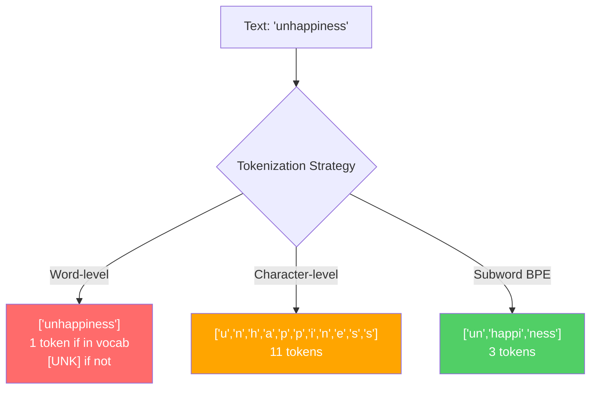
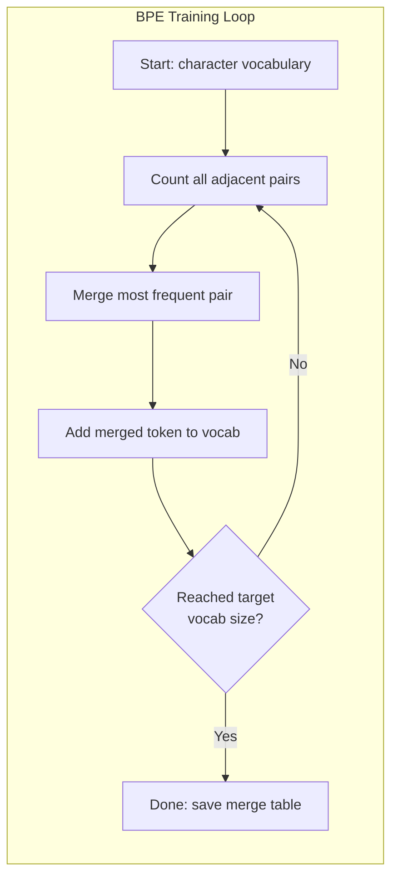
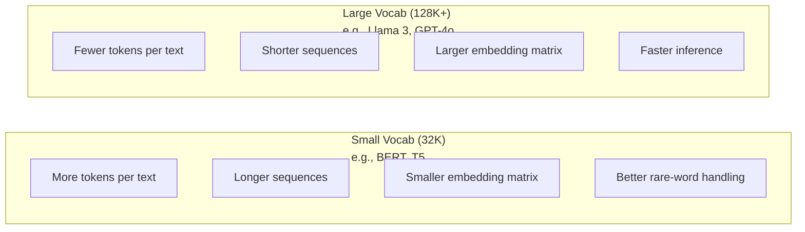

# Tokenizers: BPE, WordPiece, SentencePiece · 分词器：BPE、WordPiece、SentencePiece

> 你的 LLM 读的不是英语。它读的是整数。这些整数是承载意义还是浪费意义，由分词器（tokenizer）决定。

> Your LLM does not read English. It reads integers. The tokenizer decides whether those integers carry meaning or waste it.

**Type:** Build
**Languages:** Python
**Prerequisites:** Phase 05 (NLP Foundations)
**Time:** ~90 minutes

## Learning Objectives · 学习目标

- 从零实现 BPE、WordPiece、Unigram 三种分词算法，并比较它们的合并（merge）策略
- 解释词表大小（vocabulary size）如何影响模型效率：太小会产生过长的序列，太大则浪费嵌入（embedding）参数
- 分析分词在不同语言和代码上留下的痕迹（artifacts），定位特定分词器在何处失效
- 使用 tiktoken 和 sentencepiece 库对文本分词，并检查得到的 token ID

> Implement BPE, WordPiece, and Unigram tokenization algorithms from scratch and compare their merge strategies
> Explain how vocabulary size affects model efficiency: too small creates long sequences, too large wastes embedding parameters
> Analyze tokenization artifacts across languages and code, identifying where specific tokenizers break down
> Use the tiktoken and sentencepiece libraries to tokenize text and inspect the resulting token IDs

## The Problem · 问题在哪

你的 LLM 读的不是英语。它什么语言都不读。它读的是数字。

从 "Hello, world!" 到 [15496, 11, 995, 0] 之间的那道鸿沟，就是分词器。每个单词、每个空格、每个标点都必须先转换成整数，模型才能处理。这种转换并不中立：它把一些假设永久地烘焙进了模型，事后无法撤销。

搞错了，模型就会浪费容量、用多个 token 去编码常见词。"unfortunately" 会变成 4 个 token 而不是 1 个。对多音节词密集的文本来说，你的 128K 上下文窗口实际上缩水了 75%。搞对了，同样的上下文窗口能装下两倍的意义。「这个模型代码写得好」和「这个模型一碰 Python 就崩」的差别，往往就取决于分词器是怎么训练的。

你对 GPT-4 或 Claude 的每一次 API 调用都按 token 计费。模型生成的每一个 token 都消耗算力。表示一个输出所需的 token 越少，端到端推理就越快。分词不是预处理，它就是架构本身。

> Your LLM does not read English. It does not read any language. It reads numbers.
> The gap between "Hello, world!" and [15496, 11, 995, 0] is the tokenizer. ... This conversion is not neutral. It bakes assumptions into the model that cannot be undone later.
> Get this wrong and your model wastes capacity encoding common words with multiple tokens. ... The difference between "this model handles code well" and "this model chokes on Python" often comes down to how the tokenizer was trained.
> Every API call you make to GPT-4 or Claude is priced per token. ... Tokenization is not preprocessing. It is architecture.

## The Concept · 概念

### Three Approaches That Failed (and One That Won) · 三种失败的方法（和一个赢家）

把文本变成数字有三种显而易见的方法。其中两种在规模上去不住。

**词级分词（word-level tokenization）**按空格和标点切分。"The cat sat" 变成 ["The", "cat", "sat"]。简单。可是 "tokenization" 怎么办？"GPT-4o" 呢？或者德语复合词 "Geschwindigkeitsbegrenzung" 呢？词级分词需要巨大的词表才能覆盖每种语言里的每个词。漏掉一个词，你就会得到可怕的 `[UNK]` token——那是模型在说「我完全不知道这是什么」。仅英语就有超过一百万种词形。再加上代码、URL、科学计数法和另外 100 种语言，你需要一个无限大的词表。

**字符级分词（character-level tokenization）**走向另一个极端。"hello" 变成 ["h", "e", "l", "l", "o"]。词表极小（几百个字符），而且永远不会出现未知 token。但序列会变得极长。一句原本是 10 个词级 token 的话，会变成 50 个字符级 token。模型必须学会 "t"、"h"、"e" 连在一起表示 "the"——把注意力容量烧在三岁小孩都会的事情上。

**子词分词（subword tokenization）**找到了甜蜜点。常见词保持完整："the" 就是一个 token。罕见词分解成有意义的片段："unhappiness" 变成 ["un", "happi", "ness"]。词表保持可控（30K 到 128K 个 token），序列保持较短。未知 token 基本消失了，因为任何词都能由子词片段拼出来。

每一个现代 LLM 都在用子词分词。GPT-2、GPT-4、BERT、Llama 3、Claude——全部都是。问题只在于用哪种算法。



> There are three obvious ways to convert text to numbers. Two of them do not work at scale.
> Word-level tokenization splits on spaces and punctuation. ... Miss a word and you get the dreaded [UNK] token -- the model's way of saying "I have no idea what this is."
> Subword tokenization finds the sweet spot. ... Unknown tokens essentially disappear because any word can be built from subword pieces.
> Every modern LLM uses subword tokenization. GPT-2, GPT-4, BERT, Llama 3, Claude -- all of them.

### BPE: Byte Pair Encoding · BPE：字节对编码

BPE 是一个被改造用于分词的贪心压缩算法。它的想法简单到能写在一张索引卡片上。

从单个字符开始。统计训练语料里每一对相邻字符。把最高频的一对合并成一个新的 token。重复，直到达到目标词表大小。

```figure
tokenizer-bpe
```

下面是 BPE 在一个迷你语料（单词 "lower"、"lowest"、"newest"）上的运行过程：

```
Corpus (with word frequencies):
  "lower"  x5
  "lowest" x2
  "newest" x6

Step 0 -- Start with characters:
  l o w e r       (x5)
  l o w e s t     (x2)
  n e w e s t     (x6)

Step 1 -- Count adjacent pairs:
  (e,s): 8    (s,t): 8    (l,o): 7    (o,w): 7
  (w,e): 13   (e,r): 5    (n,e): 6    ...

Step 2 -- Merge most frequent pair (w,e) -> "we":
  l o we r        (x5)
  l o we s t      (x2)
  n e we s t      (x6)

Step 3 -- Recount and merge (e,s) -> "es":
  l o we r        (x5)
  l o we s t      (x2)    <- 'es' only forms from 'e'+'s', not 'we'+'s'
  n e we s t      (x6)    <- wait, the 'e' before 'we' and 's' after 'we'

Actually tracking this precisely:
  After "we" merge, remaining pairs:
  (l,o): 7   (o,we): 7   (we,r): 5   (we,s): 8
  (s,t): 8   (n,e): 6    (e,we): 6

Step 3 -- Merge (we,s) -> "wes" or (s,t) -> "st" (tied at 8, pick first):
  Merge (we,s) -> "wes":
  l o we r        (x5)
  l o wes t       (x2)
  n e wes t       (x6)

Step 4 -- Merge (wes,t) -> "west":
  l o we r        (x5)
  l o west        (x2)
  n e west        (x6)

...continue until target vocab size reached.
```

合并表（merge table）就是分词器。要编码新文本，就按合并被学到的顺序依次应用。训练语料决定了存在哪些合并，而这个选择会永久塑造模型所看到的世界。



> BPE is a greedy compression algorithm repurposed for tokenization. The idea is simple enough to fit on an index card.
> Start with individual characters. Count every adjacent pair in the training corpus. Merge the most frequent pair into a new token. Repeat until you reach your target vocabulary size.
> The merge table is the tokenizer. To encode new text, apply merges in the order they were learned. The training corpus determines which merges exist, and that choice permanently shapes what the model sees.

### Byte-Level BPE (GPT-2, GPT-3, GPT-4) · 字节级 BPE（GPT-2、GPT-3、GPT-4）

标准 BPE 在 Unicode 字符上操作。字节级 BPE 在原始字节（0-255）上操作。这带来一个恰好 256 的基础词表，能处理任何语言或任何编码，并且永远不会产生未知 token。

GPT-2 引入了这种方法。基础词表覆盖每一个可能的字节，BPE 合并在其上构建。OpenAI 的 tiktoken 库实现了字节级 BPE，词表大小如下：

- GPT-2: 50,257 tokens
- GPT-3.5/GPT-4: ~100,256 tokens (cl100k_base encoding)
- GPT-4o: 200,019 tokens (o200k_base encoding)

> Standard BPE operates on Unicode characters. Byte-level BPE operates on raw bytes (0-255). This gives you a base vocabulary of exactly 256, handles any language or encoding, and never produces an unknown token.
> GPT-2 introduced this approach. The base vocabulary covers every possible byte. BPE merges build on top of that.

### WordPiece (BERT) · WordPiece（BERT）

WordPiece 看起来和 BPE 很像，但挑选合并的方式不同。它不看重原始频率，而是最大化训练数据的似然（likelihood）：

```
BPE merge criterion:      count(A, B)
WordPiece merge criterion: count(AB) / (count(A) * count(B))
```

BPE 问的是：「哪一对出现得最多？」WordPiece 问的是：「哪一对共同出现的频率远超随机预期？」这个微妙的差别产生了不同的词表。WordPiece 偏好那些共现令人意外的合并，而不只是高频的合并。

WordPiece 还用 "##" 前缀标记接续子词：

```
"unhappiness" -> ["un", "##happi", "##ness"]
"embedding"   -> ["em", "##bed", "##ding"]
```

"##" 前缀告诉你这个片段接在前面某个 token 之后。BERT 使用词表为 30,522 个 token 的 WordPiece。每个 BERT 变体——DistilBERT……RoBERTa 的分词器其实是 BPE，但 BERT 本身是 WordPiece。

> WordPiece looks similar to BPE but picks merges differently. Instead of raw frequency, it maximizes the likelihood of the training data
> BPE asks: "Which pair appears most often?" WordPiece asks: "Which pair appears together more often than you would expect by chance?" This subtle difference produces different vocabularies.
> The "##" prefix tells you this piece continues a previous token. BERT uses WordPiece with a vocabulary of 30,522 tokens.

### SentencePiece (Llama, T5) · SentencePiece（Llama、T5）

SentencePiece 把输入当作原始的 Unicode 字符流来处理，包括空白。没有预分词（pre-tokenization）步骤，没有关于词边界的语言特定规则。这让它真正做到语言无关——对中文、日语、泰语以及其他不用空格分隔单词的语言都能工作。

SentencePiece 支持两种算法：
- **BPE 模式**：与标准 BPE 相同的合并逻辑，应用于原始字符序列
- **Unigram 模式**：从一个大词表出发，迭代删除对整体似然影响最小的 token。与 BPE 相反——做减法而不是合并。

Llama 2 使用词表为 32,000 个 token 的 SentencePiece BPE。T5 使用词表为 32,000 个 token 的 SentencePiece Unigram。注意：Llama 3 已换成基于 tiktoken 的字节级 BPE 分词器，词表 128,256。

> SentencePiece treats the input as a raw stream of Unicode characters, including whitespace. No pre-tokenization step. No language-specific rules about word boundaries. This makes it genuinely language-agnostic
> Llama 2 uses SentencePiece BPE with a vocabulary of 32,000 tokens. T5 uses SentencePiece Unigram with 32,000 tokens. Note: Llama 3 switched to a tiktoken-based byte-level BPE tokenizer with 128,256 tokens.

### Vocabulary Size Tradeoffs · 词表大小的权衡

这是一个真实的工程决策，后果可以量化。



具体数字。对 128K 词表加 4,096 维嵌入来说，光嵌入矩阵就有 128,000 x 4,096 = 5.24 亿参数。32K 词表则是 1.31 亿参数。仅仅是分词器的选择，就造成了 4 亿参数的差距。

但更大的词表压缩文本更狠。同一段英文，32K 词表要 100 个 token，128K 词表可能只要 70 个。这意味着生成时前向传播减少 30%。对一个服务数百万请求的模型来说，这是算力成本的直接削减。

趋势很明确：词表在变大。GPT-2 用 50,257。GPT-4 用约 100K。Llama 3 用 128K。GPT-4o 用 200K。

| 模型 | 词表大小 | 分词器类型 | 每个英文单词平均 token 数 |
|-------|-----------|----------------|---------------------------|
| BERT | 30,522 | WordPiece | ~1.4 |
| GPT-2 | 50,257 | Byte-level BPE | ~1.3 |
| Llama 2 | 32,000 | SentencePiece BPE | ~1.4 |
| GPT-4 | ~100,256 | Byte-level BPE | ~1.2 |
| Llama 3 | 128,256 | Byte-level BPE (tiktoken) | ~1.1 |
| GPT-4o | 200,019 | Byte-level BPE | ~1.0 |

> Concrete numbers. For a 128K vocabulary with 4,096-dimensional embeddings, the embedding matrix alone is 128,000 x 4,096 = 524 million parameters. For a 32K vocabulary, it is 131 million parameters. That is a 400M parameter difference from the tokenizer choice alone.
> But larger vocabularies compress text more aggressively. ... For a model serving millions of requests, that is a direct reduction in compute cost.
> The trend is clear: vocabulary sizes are growing. GPT-2 used 50,257. GPT-4 uses ~100K. Llama 3 uses 128K. GPT-4o uses 200K.

### The Multilingual Tax · 多语言税

主要在英语上训练的分词器对其他语言非常残酷。在 GPT-2 的分词器里，韩语文本平均每个词要 2-3 个 token。中文可能更糟。这意味着一个韩语用户的有效上下文窗口只有英语用户的一半——花同样的钱，买到的信息密度却更低。

这就是 Llama 3 把词表从 32K 扩大到 128K（翻了两番）的原因。更多 token 用于非英语文字，意味着各语言之间的压缩更公平。

```figure
tokenizer-tradeoff
```

> Tokenizers trained primarily on English are brutal to other languages. Korean text in GPT-2's tokenizer averages 2-3 tokens per word. Chinese can be worse.
> This is why Llama 3 quadrupled its vocabulary from 32K to 128K. More tokens dedicated to non-English scripts means fairer compression across languages.

## Build It · 动手造

### Step 1: Character-Level Tokenizer · 步骤 1：字符级分词器

从地基开始。字符级分词器把每个字符映射到它的 Unicode 码点（code point）。无需训练，没有未知 token，就是一个直接映射。

```python
class CharTokenizer:
    def encode(self, text):
        return [ord(c) for c in text]

    def decode(self, tokens):
        return "".join(chr(t) for t in tokens)
```

"hello" 变成 [104, 101, 108, 108, 111]。每个字符就是一个 token。这是我们要在此基础上改进的基线。

> Start at the foundation. A character-level tokenizer maps each character to its Unicode code point. No training needed. No unknown tokens. Just a direct mapping.
> "hello" becomes [104, 101, 108, 108, 111]. Every character is its own token. This is the baseline we improve on.

### Step 2: BPE Tokenizer from Scratch · 步骤 2：从零实现 BPE 分词器

真正的实现。我们在原始字节上训练（像 GPT-2 那样），统计字节对，合并最高频的一对，并按顺序记录每一次合并。合并表就是分词器。

```python
from collections import Counter

class BPETokenizer:
    def __init__(self):
        self.merges = {}
        self.vocab = {}

    def _get_pairs(self, tokens):
        pairs = Counter()
        for i in range(len(tokens) - 1):
            pairs[(tokens[i], tokens[i + 1])] += 1
        return pairs

    def _merge_pair(self, tokens, pair, new_token):
        merged = []
        i = 0
        while i < len(tokens):
            if i < len(tokens) - 1 and tokens[i] == pair[0] and tokens[i + 1] == pair[1]:
                merged.append(new_token)
                i += 2
            else:
                merged.append(tokens[i])
                i += 1
        return merged

    def train(self, text, num_merges):
        tokens = list(text.encode("utf-8"))
        self.vocab = {i: bytes([i]) for i in range(256)}

        for i in range(num_merges):
            pairs = self._get_pairs(tokens)
            if not pairs:
                break
            best_pair = max(pairs, key=pairs.get)
            new_token = 256 + i
            tokens = self._merge_pair(tokens, best_pair, new_token)
            self.merges[best_pair] = new_token
            self.vocab[new_token] = self.vocab[best_pair[0]] + self.vocab[best_pair[1]]

        return self

    def encode(self, text):
        tokens = list(text.encode("utf-8"))
        for pair, new_token in self.merges.items():
            tokens = self._merge_pair(tokens, pair, new_token)
        return tokens

    def decode(self, tokens):
        byte_sequence = b"".join(self.vocab[t] for t in tokens)
        return byte_sequence.decode("utf-8", errors="replace")
```

训练循环是 BPE 的核心：统计字节对、合并赢家、重复。每次合并都会减少总 token 数。经过 `num_merges` 轮之后，词表从 256（基础字节）增长到 256 + num_merges。

编码时严格按合并被学到的顺序依次应用。这一点很关键：如果合并 1 造出了 "th"，合并 5 造出了 "the"，那么编码必须先应用合并 1，这样合并 5 才能由 "th" + "e" 拼出 "the"。

解码是逆过程：在词表里查出每个 token ID 对应的字节，把字节拼接起来，再按 UTF-8 解码。

> The training loop is the core of BPE: count pairs, merge the winner, repeat. Each merge reduces the total token count. After `num_merges` rounds, the vocabulary grows from 256 (base bytes) to 256 + num_merges.
> Encoding applies merges in the exact order they were learned. This matters. If merge 1 created "th" and merge 5 created "the", encoding must apply merge 1 first so that "the" can form from "th" + "e" in merge 5.
> Decoding is the inverse: look up each token ID in the vocabulary, concatenate the bytes, decode to UTF-8.

### Step 3: Encode and Decode Roundtrip · 步骤 3：编码-解码往返测试

```python
corpus = (
    "The cat sat on the mat. The cat ate the rat. "
    "The dog sat on the log. The dog ate the frog. "
    "Natural language processing is the study of how computers "
    "understand and generate human language. "
    "Tokenization is the first step in any NLP pipeline."
)

tokenizer = BPETokenizer()
tokenizer.train(corpus, num_merges=40)

test_sentences = [
    "The cat sat on the mat.",
    "Natural language processing",
    "tokenization pipeline",
    "unhappiness",
]

for sentence in test_sentences:
    encoded = tokenizer.encode(sentence)
    decoded = tokenizer.decode(encoded)
    raw_bytes = len(sentence.encode("utf-8"))
    ratio = len(encoded) / raw_bytes
    print(f"'{sentence}'")
    print(f"  Tokens: {len(encoded)} (from {raw_bytes} bytes) -- ratio: {ratio:.2f}")
    print(f"  Roundtrip: {'PASS' if decoded == sentence else 'FAIL'}")
```

压缩率告诉你这个分词器有多有效。0.50 的压缩率表示分词器把文本压成了原始字节数一半的 token。越低越好。在训练语料上，压缩率会不错。在分布外文本上（比如语料里没出现过的 "unhappiness"），压缩率会变差——对没见过的模式，分词器会退回到字符级编码。

> The compression ratio tells you how effective the tokenizer is. A ratio of 0.50 means the tokenizer compressed the text to half as many tokens as raw bytes. Lower is better. On the training corpus, the ratio will be good. On out-of-distribution text like "unhappiness" (which does not appear in the corpus), the ratio will be worse -- the tokenizer falls back to character-level encoding for unseen patterns.

### Step 4: Compare with tiktoken · 步骤 4：与 tiktoken 对比

```python
import tiktoken

enc = tiktoken.get_encoding("cl100k_base")

texts = [
    "The cat sat on the mat.",
    "unhappiness",
    "Hello, world!",
    "def fibonacci(n): return n if n < 2 else fibonacci(n-1) + fibonacci(n-2)",
    "Geschwindigkeitsbegrenzung",
]

for text in texts:
    our_tokens = tokenizer.encode(text)
    tiktoken_tokens = enc.encode(text)
    tiktoken_pieces = [enc.decode([t]) for t in tiktoken_tokens]
    print(f"'{text}'")
    print(f"  Our BPE:   {len(our_tokens)} tokens")
    print(f"  tiktoken:  {len(tiktoken_tokens)} tokens -> {tiktoken_pieces}")
```

tiktoken 用的是完全相同的算法，只是它在几百 GB 的文本上训练、做了 100,000 次合并。算法一模一样，差别在训练数据和合并次数。你在一段文字上训练、只做 40 次合并的分词器，没法在超大语料上与 tiktoken 的 10 万次合并竞争。但机制是同一个。

> tiktoken uses the exact same algorithm but trained on hundreds of gigabytes of text with 100,000 merges. The algorithm is identical. The difference is the training data and the number of merges. Your tokenizer trained on a paragraph with 40 merges cannot compete with tiktoken's 100K merges on a massive corpus. But the mechanism is the same.

### Step 5: Vocabulary Analysis · 步骤 5：词表分析

```python
def analyze_vocabulary(tokenizer, test_texts):
    total_tokens = 0
    total_chars = 0
    token_usage = Counter()

    for text in test_texts:
        encoded = tokenizer.encode(text)
        total_tokens += len(encoded)
        total_chars += len(text)
        for t in encoded:
            token_usage[t] += 1

    print(f"Vocabulary size: {len(tokenizer.vocab)}")
    print(f"Total tokens across all texts: {total_tokens}")
    print(f"Total characters: {total_chars}")
    print(f"Avg tokens per character: {total_tokens / total_chars:.2f}")

    print(f"\nMost used tokens:")
    for token_id, count in token_usage.most_common(10):
        token_bytes = tokenizer.vocab[token_id]
        display = token_bytes.decode("utf-8", errors="replace")
        print(f"  Token {token_id:4d}: '{display}' (used {count} times)")

    unused = [t for t in tokenizer.vocab if t not in token_usage]
    print(f"\nUnused tokens: {len(unused)} out of {len(tokenizer.vocab)}")
```

这会揭示你词表中的 Zipf（齐夫）分布：少数 token 占据大头（空格、"the"、"e"），大多数 token 很少被用到。生产级分词器就是针对这种分布优化的——常见模式拿到短的 token ID，罕见模式拿到更长的表示。

> This reveals the Zipf distribution in your vocabulary. A few tokens dominate (spaces, "the", "e"). Most tokens are rarely used. Production tokenizers optimize for this distribution -- common patterns get short token IDs, rare patterns get longer representations.

## Use It · 实战用法

你手写的 BPE 已经能跑了。现在看看生产级工具长什么样。

> Your scratch BPE works. Now see what production tools look like.

### tiktoken (OpenAI) · OpenAI 的 tiktoken

```python
import tiktoken

enc = tiktoken.get_encoding("cl100k_base")

text = "Tokenizers convert text to integers"
tokens = enc.encode(text)
print(f"Tokens: {tokens}")
print(f"Pieces: {[enc.decode([t]) for t in tokens]}")
print(f"Roundtrip: {enc.decode(tokens)}")
```

tiktoken 用 Rust 编写，带 Python 绑定。它每秒能编码数百万个 token。同样的 BPE 算法，工业强度的实现。

> tiktoken is written in Rust with Python bindings. It encodes millions of tokens per second. Same BPE algorithm, industrial-strength implementation.

### Hugging Face tokenizers · Hugging Face tokenizers 库

```python
from tokenizers import Tokenizer
from tokenizers.models import BPE
from tokenizers.trainers import BpeTrainer
from tokenizers.pre_tokenizers import ByteLevel

tokenizer = Tokenizer(BPE())
tokenizer.pre_tokenizer = ByteLevel()

trainer = BpeTrainer(vocab_size=1000, special_tokens=["<pad>", "<eos>", "<unk>"])
tokenizer.train(["corpus.txt"], trainer)

output = tokenizer.encode("The cat sat on the mat.")
print(f"Tokens: {output.tokens}")
print(f"IDs: {output.ids}")
```

Hugging Face 的 tokenizers 库底层同样是 Rust。它能在几秒内对 GB 级语料完成 BPE 训练。训练你自己的模型时，用的就是它。

> The Hugging Face tokenizers library is also Rust under the hood. It trains BPE on gigabyte-scale corpora in seconds. This is what you use when training your own model.

### Loading Llama's Tokenizer · 加载 Llama 的分词器

```python
from transformers import AutoTokenizer

tokenizer = AutoTokenizer.from_pretrained("meta-llama/Llama-3.1-8B")

text = "Tokenizers are the unsung heroes of LLMs"
tokens = tokenizer.encode(text)
print(f"Token IDs: {tokens}")
print(f"Tokens: {tokenizer.convert_ids_to_tokens(tokens)}")
print(f"Vocab size: {tokenizer.vocab_size}")

multilingual = ["Hello world", "Hola mundo", "Bonjour le monde"]
for text in multilingual:
    ids = tokenizer.encode(text)
    print(f"'{text}' -> {len(ids)} tokens")
```

Llama 3 的 128K 词表对非英语文本的压缩明显好于 GPT-2 的 50K 词表。你可以自己验证——用多种语言编码同一句话，数一数 token。

> Llama 3's 128K vocabulary compresses non-English text significantly better than GPT-2's 50K vocabulary. You can verify this yourself -- encode the same sentence in multiple languages and count the tokens.

## Ship It · 交付

本课产出 `outputs/prompt-tokenizer-analyzer.md`——一个可复用的提示词（prompt），用于分析任意「文本 + 模型」组合的分词效率。喂给它一段文本样本，它会告诉你哪个模型的分词器处理得最好。

> This lesson produces `outputs/prompt-tokenizer-analyzer.md` -- a reusable prompt that analyzes tokenization efficiency for any text and model combination. Feed it a text sample and it tells you which model's tokenizer handles it best.

## Exercises · 练习

1. 修改 BPE 分词器，让它在每次合并后打印词表。观察 "t" + "h" 如何变成 "th"，然后 "th" + "e" 如何变成 "the"。追踪常见英文单词是如何被一片一片拼装出来的。

2. 给 BPE 分词器加上特殊 token（`<pad>`、`<eos>`、`<unk>`）。把它们分配为 ID 0、1、2，并相应平移其他所有 token。实现一个预分词步骤，在运行 BPE 之前先按空白切分。

3. 实现 WordPiece 的合并准则（用似然比代替频率）。在同一个语料上、用相同的合并次数分别训练 BPE 和 WordPiece，比较得到的词表——哪一个产生的子词在语言学上更有意义？

4. 构建一个多语言分词器效率基准。取英语、西班牙语、中文、韩语、阿拉伯语各 10 个句子，用 tiktoken（cl100k_base）分别分词，测量平均每字符 token 数。量化每种语言的「多语言税」。

5. 在更大的语料上训练你的 BPE 分词器（下载一篇 Wikipedia 文章）。调整合并次数，使压缩率与 tiktoken 在同一文本上的差距控制在 10% 以内。这会逼你理解语料规模、合并次数与压缩质量之间的关系。

## Key Terms · 关键术语

| 术语 | 大家怎么说 | 实际含义 |
|------|----------------|----------------------|
| Token | "一个词" | 模型词表中的一个单位——可以是字符、子词、单词或多词片段 |
| BPE | "某种压缩玩意儿" | Byte Pair Encoding（字节对编码）——迭代合并最高频的相邻 token 对，直到达到目标词表大小 |
| WordPiece | "BERT 的分词器" | 类似 BPE，但合并时最大化似然比 count(AB)/(count(A)*count(B))，而不是原始频率 |
| SentencePiece | "一个分词器库" | 语言无关的分词器，直接在原始 Unicode 上操作、无需预分词，支持 BPE 和 Unigram 两种算法 |
| Vocabulary size | "它认识多少个词" | 唯一 token 的总数：GPT-2 是 50,257，BERT 是 30,522，Llama 3 是 128,256 |
| Fertility | "不是分词领域的术语" | 每个单词平均产生的 token 数——衡量分词器跨语言效率的指标（1.0 是完美，3.0 意味着模型要多干三倍的活） |
| Byte-level BPE | "GPT 的分词器" | 在原始字节（0-255）而非 Unicode 字符上运行的 BPE——保证任何输入都不会产生未知 token |
| Merge table | "分词器文件" | 训练时学到的字节对合并的有序列表——它就是分词器本身，而且顺序很重要 |
| Pre-tokenization | "按空格切分" | 子词分词之前应用的规则：空白切分、数字拆分、标点处理 |
| Compression ratio | "分词器的效率" | 产出的 token 数除以输入字节数——越低说明压缩越好、推理越快 |

## Further Reading · 延伸阅读

- [Sennrich et al., 2016 -- "Neural Machine Translation of Rare Words with Subword Units"](https://arxiv.org/abs/1508.07909) —— 把 BPE 引入 NLP 的论文，让一个 1994 年的压缩算法成为现代分词的基石
- [Kudo & Richardson, 2018 -- "SentencePiece: A simple and language independent subword tokenizer"](https://arxiv.org/abs/1808.06226) —— 语言无关的分词方案，让多语言模型变得实用
- [OpenAI tiktoken repository](https://github.com/openai/tiktoken) —— Rust 实现的生产级 BPE，带 Python 绑定，GPT-3.5/4/4o 在用
- [Hugging Face Tokenizers documentation](https://huggingface.co/docs/tokenizers) —— 依托 Rust 性能的生产级分词器训练
