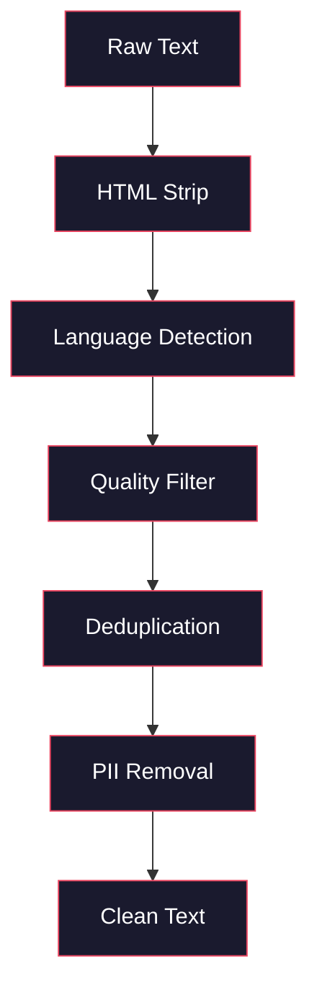
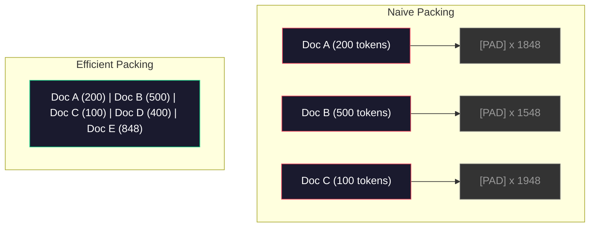

# Data Pipelines for Pre-Training · 预训练的数据管道

> 模型是一面镜子。它反映你喂给它的数据。喂垃圾，它就以完美的流畅度反映垃圾。

> The model is a mirror. It reflects whatever data you feed it. Feed it garbage, it reflects garbage with perfect fluency.

**Type:** Build
**Languages:** Python
**Prerequisites:** Phase 10, Lessons 01-02 (Tokenizers, Building a Tokenizer)
**Time:** ~90 minutes

## Learning Objectives · 学习目标

- 构建流式数据管道，对 TB 级文本进行分词、切块、打乱和分批，而无需全部载入内存
- 实现真实预训练管道使用的数据质量过滤器（去重、语言检测、内容过滤）
- 创建定长训练序列，并正确处理注意力掩码（attention mask）与文档边界
- 对管道吞吐量做性能分析，确保 dataloader 跟得上 GPU 训练速度

> Build a streaming data pipeline that tokenizes, chunks, shuffles, and batches terabytes of text without loading it all into memory
> Implement data quality filters (deduplication, language detection, content filtering) used in real pre-training pipelines
> Create fixed-length training sequences with proper attention masks and document boundary handling
> Profile pipeline throughput to ensure the dataloader keeps up with GPU training speed

## The Problem · 问题在哪

你有了分词器。现在你需要数据。

不是数据集，不是 CSV 文件。是 TB 级的文本——清洗过、去重过、按质量过滤过、分词成定长序列，再以随机化的批次喂出来，而且要快到你的 8 卡 GPU 集群永远不用等下一个批次。

大多数人以为训练 LLM 的关键在模型架构。并不是。Llama 3 用了 15.6 万亿 token。GPT-3 用了 3000 亿。DeepSeek-V2 用了 8.1 万亿。三者的架构大体相同：堆叠的 transformer 块加注意力和前馈层。输出质量的差距压倒性地来自数据。

DeepMind 的 Chinchilla 论文把这一点讲精确了。在给定算力预算下，模型参数量与训练 token 量之间存在一个最优比例。Chinchilla 表明，2022 年的大多数模型都严重训练不足——相对于它们看到的数据量，参数太多了。一个在 1.4 万亿 token 上训练的 70B 参数模型（Chinchilla 最优），胜过了在 3000 亿 token 上训练的 280B 模型（Gopher）。

你的数据管道决定你的模型学到的是语言，还是噪声。

> You have a tokenizer. Now you need data.
> Not a dataset. Not a CSV file. Terabytes of text -- cleaned, deduplicated, filtered for quality, tokenized into fixed-length sequences, and served in randomized batches fast enough that your 8-GPU cluster never waits for the next batch.
> Most people think training an LLM is about the model architecture. It is not. ... The difference in output quality comes overwhelmingly from the data.
> The Chinchilla paper from DeepMind made this precise. ... A 70B parameter model trained on 1.4 trillion tokens (Chinchilla-optimal) outperformed a 280B model trained on 300 billion tokens (Gopher).
> Your data pipeline determines whether your model learns language or learns noise.

## The Concept · 概念

### Where the Data Comes From · 数据从哪来

每个大语言模型都训练在多种来源的混合上。确切配方对大多数实验室是严格保守的秘密，但我们知道的已足够理解这些类别。

| 来源 | 规模 | 质量 | 使用者 |
|--------|------|---------|---------|
| Common Crawl | ~250 TB 原始数据 | 低（需要重度过滤） | GPT-3、Llama 和大多数开源模型 |
| Wikipedia | ~20 GB | 高 | 每个主流 LLM |
| GitHub 代码 | ~1 TB+ | 中（大量重复、死代码） | StarCoder, CodeLlama, DeepSeek-Coder |
| 书籍（BookCorpus、Pile） | ~100 GB | 高 | GPT-2、GPT-3 和早期模型 |
| 学术论文（arXiv、S2ORC） | ~100 GB | 高（对 STEM 而言） | Llama, Galactica |
| StackOverflow、Reddit | ~100 GB | 中 | Llama, Falcon |
| 精选网页（C4、RefinedWeb） | ~5 TB | 中高（已预过滤） | T5, Falcon |

Llama 3 公开了它的数据配方：约 50% 网页数据、25% 代码、13% 书籍和学术论文、8% 数学数据、4% 多语言网页数据。总计 15.6 万亿 token，来源的原始文本超过 5 TB。

比例和总量同样重要。网页数据太多，模型就变成一只 Reddit 鹦鹉。代码太少，它不会编程。数学太少，它推理不行。把这个配比调对是训练 LLM 最难的部分之一，而且没有公式——只能靠实验和评估。

> Every large language model is trained on a mix of sources. The exact composition is a closely guarded secret for most labs, but we know enough to understand the categories.
> Llama 3 disclosed its data mix: roughly 50% web data, 25% code, 13% books and academic papers, 8% math data, and 4% multilingual web data. The total was 15.6 trillion tokens from sources exceeding 5 TB of raw text.
> The ratio matters as much as the total size. Too much web data and the model becomes a Reddit parrot. Too little code and it cannot program. Too little math and it fails at reasoning. Getting this mix right is one of the hardest parts of training an LLM, and there is no formula -- it requires experimentation and evaluation.

### Data Cleaning · 数据清洗

原始网页数据是脏的。一份典型的 Common Crawl 转储包含：

- HTML 标签和 JavaScript
- 样板式的页眉、页脚、导航菜单
- 重复页面（完全重复和近似重复）
- 机器生成的垃圾内容（spam）
- 个人可识别信息（PII）
- 低质文本（关键词堆砌、SEO 垃圾）
- 被编码成文本的非文本内容

清洗不是可选项。它决定了你的模型是能生成连贯段落，还是输出混着商品列表的 HTML 标签。



每一步消除一类噪声：

**HTML 剥离：** 去掉所有标记，只保留可见文本内容。`trafilatura` 或 `readability` 这类库能提取正文内容，同时丢掉导航、广告和样板文字。

**语言检测：** 用 fastText 的语言识别模型（lid.176.bin）给每个文档分类，只保留目标语言。被判为英语但置信度低于 0.8 的文档，多半不是干净的英语。

**质量过滤：** 有意思的从这里开始。RefinedWeb（Falcon 背后的数据集）用基于困惑度（perplexity）的过滤器：先在 Wikipedia 上训练一个小语言模型，再给每个文档打分。高困惑度意味着这个文档不像 Wikipedia——很可能是垃圾、关键词堆砌或机器生成内容。困惑度超过阈值的文档被移除。

**去重：** 影响最大的单一清洗步骤。Common Crawl 里有海量的重复页面——法律免责声明、cookie 提示、服务条款。在重复数据上训练浪费算力，还会让模型逐字记住并复述特定段落。

**PII 移除：** 姓名、邮箱地址、电话号码、社会安全号。结构化 PII 用基于正则的检测，上下文中的姓名用 NER 模型。

> Raw web data is filthy. A typical Common Crawl dump contains
> Cleaning this is not optional. It is the difference between a model that generates coherent paragraphs and one that outputs HTML tags mixed with product listings.
> Quality filtering: This is where it gets interesting. RefinedWeb (the dataset behind Falcon) uses a perplexity-based filter: train a small language model on Wikipedia, then score each document. High perplexity means the document is unlike Wikipedia -- likely spam, keyword lists, or machine-generated content.
> Deduplication: The single most impactful cleaning step. ... Training on duplicates wastes compute and can cause the model to memorize and regurgitate specific passages verbatim.

### Deduplication with MinHash · 用 MinHash 去重

精确去重很简单：给每个文档算哈希，删掉重复的。但近似重复才是真正的问题。同一篇新闻报道的两个副本、周围广告略有不同，就是近似重复。内容 95% 相同，但逐字节比较却不一样。

MinHash + 局部敏感哈希（LSH）能高效解决这个问题。


思路如下：

1. **Shingling（切 shingle）：** 把每个文档转成一个 n-gram 集合（比如按 5 个词或 5 个字符一组）。"the quick brown fox" 按 3 词 shingle 切分得到 {"the quick brown", "quick brown fox"}。

2. **MinHash：** 对每个文档的 shingle 集合计算 k 个哈希值。每个哈希值是在一个不同哈希函数下、所有 shingle 中的最小哈希。这样就得到一个固定大小的「签名」，用来近似任意两个文档之间的 Jaccard 相似度。

3. **LSH：** 按 MinHash 签名的分段（band）把文档分进桶里。同一个桶里的文档就是近似重复的候选。这避免了所有文档两两相比——你只比较候选对。

4. **验证：** 对每个候选对计算精确的 Jaccard 相似度。相似度超过阈值（通常 0.8）就删掉其中一份。

Llama 团队报告，他们通过去重移除了约 38% 的网页数据。这不是小数字。Common Crawl 超过三分之一是重复或近似重复内容。

> Exact deduplication is easy: hash each document, remove duplicates. But near-duplicates are the real problem. ... The content is 95% identical, but byte-for-byte they differ.
> MinHash + Locality-Sensitive Hashing (LSH) solves this efficiently.
> The Llama team reported removing approximately 38% of their web data through deduplication. That is not a small number. More than a third of Common Crawl is duplicate or near-duplicate content.

### Sequence Packing · 序列打包

模型要求定长输入序列，而文档长短不一。有的 50 个 token，有的 50,000 个。

朴素做法：把每个文档都填充（pad）到最大序列长度。这会在对学习毫无贡献的填充 token 上浪费大量算力。

更好的做法：把多个文档打包进一条序列，用序列结束 token 分隔。一条 2048 token 的序列可能装着三个短文档，中间用 [EOS] 隔开。



注意力掩码必须设对。同一条打包序列里，文档 A 的 token 不应该关注文档 B 的 token。这需要一个块对角（block-diagonal）注意力掩码。

长文档会被截断或在序列边界处切成块。切分点有讲究：在句子中间切开，会强迫模型看到不完整的想法。一些管道会尽量把切分点对齐到段落或句子边界。

> Your model expects fixed-length input sequences. Your documents are variable length. Some are 50 tokens. Some are 50,000 tokens.
> Naive approach: pad every document to the maximum sequence length. This wastes enormous compute on padding tokens that contribute nothing to learning.
> Better approach: pack multiple documents into a single sequence, separated by end-of-sequence tokens. ... A 2048-token sequence might contain three short documents concatenated with [EOS] tokens between them.
> The attention mask must be set correctly. Tokens from Document A should not attend to tokens from Document B within the same packed sequence. This requires a block-diagonal attention mask.

### The Chinchilla Scaling Law · Chinchilla 缩放定律

对固定的算力预算 C（以 FLOPs 计），最优模型规模 N 和数据集规模 D 满足：

```
N_opt ~ C^0.5
D_opt ~ C^0.5
```

实践中，这意味着模型规模和数据集规模应当大致等比扩展。参数多 10 倍的模型，需要大约多 10 倍的训练 token 才能达到同样的 loss。

| 模型 | 参数量 | 训练 token | 是否 Chinchilla 最优？ |
|-------|-----------|----------------|-------------------|
| GPT-3 | 175B | 300B | 否（训练不足 3-4 倍） |
| Chinchilla | 70B | 1.4T | 是（设计如此） |
| Llama 2 | 70B | 2T | 过度训练（有意为之） |
| Llama 3 | 70B | 15T | 大幅过度训练 |

Llama 3 有意违反了 Chinchilla 定律。Meta 发现，用远超算力最优比例的数据做过度训练，能产出推理时表现更好的模型。额外的训练成本只付一次，而更小的模型从今往后一直更便宜地服务。这有时被称为「推理最优（inference-optimal）」缩放策略，自 2024 年起已成为行业标准。

```figure
l5-data-pipeline
```

> For a fixed compute budget C (measured in FLOPs), the optimal model size N and dataset size D follow
> In practice, this means you should scale model size and dataset size roughly equally. A model with 10x more parameters needs roughly 10x more training tokens to reach the same loss.
> Llama 3 deliberately violates the Chinchilla law. Meta found that overtraining on more data -- far beyond the compute-optimal ratio -- produces better models for inference. The extra training cost is paid once, but the smaller model is cheaper to serve forever. This is sometimes called the "inference-optimal" scaling approach, and it has become the industry standard since 2024.

## Build It · 动手造

### Step 1: Text Cleaning · 步骤 1：文本清洗

剥离 HTML、规范空白、移除非文本内容。我们用一段公有领域文本（Project Gutenberg）作为小语料。

```python
import re

def clean_text(text):
    text = re.sub(r"<[^>]+>", "", text)
    text = re.sub(r"http\S+", "", text)
    text = re.sub(r"[^\x20-\x7E\n]", "", text)
    text = re.sub(r"\n{3,}", "\n\n", text)
    text = re.sub(r" {2,}", " ", text)
    return text.strip()

def quality_filter(text, min_words=50, max_ratio_caps=0.3, max_ratio_special=0.1):
    words = text.split()
    if len(words) < min_words:
        return False
    caps_ratio = sum(1 for w in words if w.isupper()) / len(words)
    if caps_ratio > max_ratio_caps:
        return False
    special_chars = sum(1 for c in text if not c.isalnum() and not c.isspace())
    if special_chars / max(len(text), 1) > max_ratio_special:
        return False
    return True
```

质量过滤器能抓住 SEO 垃圾（全大写）、机器生成噪声（特殊字符比例过高）和占位页（太短）。仅这三条检查，就能从网页爬取结果里去掉数量惊人的垃圾。

> Strip HTML, normalize whitespace, remove non-text content. We will use a public domain text (Project Gutenberg) as our small corpus.
> The quality filter catches SEO spam (ALL CAPS), machine-generated noise (high special character ratio), and stub pages (too short). These three checks alone remove a surprising amount of garbage from web crawls.

### Step 2: MinHash Deduplication · 步骤 2：MinHash 去重

从零实现 MinHash。不需要任何外部库——只要 `hashlib`。

```python
import hashlib
from collections import defaultdict

def get_shingles(text, k=5):
    words = text.lower().split()
    if len(words) < k:
        return set()
    return {" ".join(words[i:i+k]) for i in range(len(words) - k + 1)}

def minhash_signature(shingles, num_hashes=128):
    signature = []
    for i in range(num_hashes):
        min_hash = float("inf")
        for shingle in shingles:
            h = int(hashlib.sha256(f"{i}:{shingle}".encode()).hexdigest(), 16)
            min_hash = min(min_hash, h)
        signature.append(min_hash)
    return signature

def lsh_buckets(signature, bands=16):
    rows_per_band = len(signature) // bands
    buckets = []
    for b in range(bands):
        start = b * rows_per_band
        band_data = tuple(signature[start:start + rows_per_band])
        bucket_hash = hashlib.md5(str(band_data).encode()).hexdigest()
        buckets.append((b, bucket_hash))
    return buckets

def deduplicate(documents, threshold=0.8, num_hashes=128, bands=16):
    signatures = []
    shingle_sets = []
    for doc in documents:
        shingles = get_shingles(doc)
        shingle_sets.append(shingles)
        signatures.append(minhash_signature(shingles, num_hashes))

    bucket_map = defaultdict(list)
    for doc_idx, sig in enumerate(signatures):
        for band_id, bucket_hash in lsh_buckets(sig, bands):
            bucket_map[(band_id, bucket_hash)].append(doc_idx)

    duplicate_pairs = set()
    for bucket_docs in bucket_map.values():
        if len(bucket_docs) < 2:
            continue
        for i in range(len(bucket_docs)):
            for j in range(i + 1, len(bucket_docs)):
                duplicate_pairs.add((bucket_docs[i], bucket_docs[j]))

    removed = set()
    for i, j in duplicate_pairs:
        if i in removed or j in removed:
            continue
        s1, s2 = shingle_sets[i], shingle_sets[j]
        if not s1 or not s2:
            continue
        jaccard = len(s1 & s2) / len(s1 | s2)
        if jaccard >= threshold:
            removed.add(j)

    return [doc for idx, doc in enumerate(documents) if idx not in removed], len(removed)
```

`num_hashes=128` 和 `bands=16` 这两个参数控制精确率-召回率的权衡。哈希越多，相似度估计越准。分段（band）越多，召回率越高（抓住更多重复），代价是更多误报。这些取值对典型网页文本效果不错。

> Implement MinHash from scratch. No external libraries required -- just `hashlib`.
> The `num_hashes=128` and `bands=16` parameters control the precision-recall tradeoff. More hashes give more accurate similarity estimates. More bands increase recall (catch more duplicates) at the cost of more false positives. These values work well for typical web text.

### Step 3: Tokenize and Pack Sequences · 步骤 3：分词并打包序列

拿到干净、去重后的文本，分词，再打包成训练用的定长序列。

```python
def tokenize_corpus(documents, tokenizer):
    all_tokens = []
    for doc in documents:
        tokens = tokenizer.encode(doc)
        all_tokens.extend(tokens)
        all_tokens.append(tokenizer.eos_id)
    return all_tokens

def pack_sequences(token_ids, seq_length, pad_id=0):
    sequences = []
    attention_masks = []
    for i in range(0, len(token_ids), seq_length):
        seq = token_ids[i:i + seq_length]
        mask = [1] * len(seq)
        if len(seq) < seq_length:
            pad_count = seq_length - len(seq)
            seq = seq + [pad_id] * pad_count
            mask = mask + [0] * pad_count
        sequences.append(seq)
        attention_masks.append(mask)
    return sequences, attention_masks
```

> Take the clean, deduplicated text, tokenize it, and pack into fixed-length sequences for training.

### Step 4: DataLoader for Training · 步骤 4：训练用 DataLoader

产出打乱后的打包序列批次。这就是训练循环消费的东西。

```python
import random

class PreTrainingDataLoader:
    def __init__(self, sequences, attention_masks, batch_size, shuffle=True):
        self.sequences = sequences
        self.attention_masks = attention_masks
        self.batch_size = batch_size
        self.shuffle = shuffle

    def __len__(self):
        return (len(self.sequences) + self.batch_size - 1) // self.batch_size

    def __iter__(self):
        indices = list(range(len(self.sequences)))
        if self.shuffle:
            random.shuffle(indices)
        for start in range(0, len(indices), self.batch_size):
            batch_idx = indices[start:start + self.batch_size]
            batch_seqs = [self.sequences[i] for i in batch_idx]
            batch_masks = [self.attention_masks[i] for i in batch_idx]
            yield batch_seqs, batch_masks
```

> Yield randomized batches of packed sequences. This is what the training loop consumes.

### Step 5: Dataset Statistics · 步骤 5：数据集统计

算出要紧的数字：总 token 数、唯一 token 数、压缩率、文档长度分布。

```python
from collections import Counter

def compute_statistics(documents, token_ids, sequences, tokenizer_vocab_size):
    total_chars = sum(len(d) for d in documents)
    total_tokens = len(token_ids)
    unique_tokens = len(set(token_ids))
    compression_ratio = total_chars / total_tokens

    doc_lengths = [len(d.split()) for d in documents]
    avg_doc_length = sum(doc_lengths) / max(len(doc_lengths), 1)
    max_doc_length = max(doc_lengths) if doc_lengths else 0
    min_doc_length = min(doc_lengths) if doc_lengths else 0

    token_counts = Counter(token_ids)
    top_tokens = token_counts.most_common(10)

    non_pad_tokens = sum(sum(1 for t in seq if t != 0) for seq in sequences)
    total_positions = sum(len(seq) for seq in sequences)
    utilization = non_pad_tokens / max(total_positions, 1)

    stats = {
        "total_documents": len(documents),
        "total_characters": total_chars,
        "total_tokens": total_tokens,
        "unique_tokens": unique_tokens,
        "vocab_utilization": unique_tokens / tokenizer_vocab_size,
        "compression_ratio": compression_ratio,
        "avg_doc_length_words": avg_doc_length,
        "max_doc_length_words": max_doc_length,
        "min_doc_length_words": min_doc_length,
        "num_sequences": len(sequences),
        "sequence_utilization": utilization,
        "top_10_tokens": top_tokens,
    }
    return stats
```

压缩率告诉你分词器在这个语料上的效率。英语文本通常压缩到每 token 约 3-4 个字符。如果每 token 只有 1.5 个字符，说明你的分词器切得太狠。如果是 8 以上，说明它学到了非常领域特定的合并。

序列利用率告诉你打包序列里有多少是真实数据、多少是填充。低于 90% 说明打包效率低——你在填充 token 上浪费算力。

> Compute the numbers that matter: total tokens, unique tokens, compression ratio, document length distribution.
> Compression ratio tells you how efficient the tokenizer is on this corpus. English text typically compresses to about 3-4 characters per token. If you see 1.5 characters per token, your tokenizer is splitting too aggressively. If you see 8+, it has learned very domain-specific merges.
> Sequence utilization tells you how much of your packed sequences is real data versus padding. Below 90% means your packing is inefficient -- you are wasting compute on padding tokens.

## Use It · 实战用法

### Compare With HuggingFace Datasets · 与 HuggingFace Datasets 对比

用 HuggingFace 的 datasets 库加载同一语料，比较管道速度。

```python
from datasets import load_dataset
from transformers import AutoTokenizer

ds = load_dataset("wikitext", "wikitext-2-raw-v1", split="train")
tokenizer = AutoTokenizer.from_pretrained("meta-llama/Meta-Llama-3-8B")

import time

start = time.time()
tokenized = ds.map(
    lambda x: tokenizer(x["text"], truncation=True, max_length=2048),
    batched=True,
    num_proc=4,
)
hf_time = time.time() - start
total_tokens = sum(len(t) for t in tokenized["input_ids"])
print(f"HuggingFace: {total_tokens:,} tokens in {hf_time:.2f}s ({total_tokens/hf_time:,.0f} tokens/sec)")
```

HuggingFace 管道底层用 Rust 分词器，并在 4 个核上并行处理。你的纯 Python 管道会慢 10-50 倍。这个差距就是生产团队使用编译实现分词器的原因。算法是同一个，差的是实现语言。

> Load the same corpus through HuggingFace's datasets library and compare the pipeline speed.
> The HuggingFace pipeline uses Rust tokenizers under the hood and parallel processing across 4 cores. Your pure Python pipeline will be 10-50x slower. That gap is why production teams use compiled tokenizers. The algorithm is the same. The implementation language is the difference.

## Ship It · 交付

本课产出一个用于校验和调试 LLM 训练管道数据质量的提示词。见 `outputs/prompt-data-quality-checker.md`。

> This lesson produces a prompt for validating and debugging data quality in LLM training pipelines. See `outputs/prompt-data-quality-checker.md`.

## Exercises · 练习

1. **简单：** 用一个简单启发式（字符集分析）给清洗管道加语言检测。只保留英语文档，并测量有多少文档被移除。
2. **中等：** 在 MinHash 近似去重之外，再用 SHA-256 哈希实现精确去重。在一个网页爬取语料上比较两种方法各自抓到了多少重复。
3. **困难：** 构建一个基于困惑度的质量过滤器。在 Wikipedia 文本上训练一个小 bigram 语言模型，按困惑度给每个文档打分，移除最差的 20%。比较在过滤与未过滤数据上训练出的模型的输出质量。

## Key Terms · 关键术语

| 术语 | 大家怎么说 | 实际含义 |
|------|----------------|----------------------|
| Common Crawl | "互联网" | 一个每月爬取网页的非营利项目——约 250TB 原始数据，是大多数 LLM 训练数据的起点 |
| MinHash | "某种哈希技巧" | 用固定大小签名估计集合间 Jaccard 相似度的技术——让大规模近似重复检测成为可能 |
| LSH | "Locality-Sensitive Hashing（局部敏感哈希）" | 把相似项分进同一个桶的方法——把两两比较从 O(n^2) 降到接近线性 |
| Sequence packing | "拼接文档" | 把多个文档装进定长序列并配好注意力掩码——消除填充浪费 |
| Chinchilla scaling | "用更多数据训练" | 在固定算力预算下，最优性能要求模型规模和训练 token 大致等比扩展 |
| Fertility | "每个词几个 token" | 每个单词平均产生的 token 数——GPT-4 上英语为 1.3，非拉丁文字更高 |
| Data mixing | "挑选训练数据" | 代码、文本、数学、多语言数据之间的比例——没有公式，只能靠实验 |
| Perplexity filter | "质量打分" | 用小语言模型给文档打分——困惑度高说明文本不像干净的参考数据 |
| Deduplication | "删掉副本" | 消除完全重复和近似重复的文档——通常能移除原始网页数据的 30-40% |
| Attention mask | "看哪些 token" | 一个二值掩码，阻止打包序列中跨文档边界的注意力 |

## Further Reading · 延伸阅读

- [Hoffmann et al., 2022 -- Training Compute-Optimal Large Language Models (Chinchilla)](https://arxiv.org/abs/2203.15556) —— 改变了我们对数据规模认知的那篇论文
- [Penedo et al., 2023 -- The RefinedWeb Dataset for Falcon LLM](https://arxiv.org/abs/2306.01116) —— 如何把 Common Crawl 过滤成高质量数据
- [Touvron et al., 2023 -- Llama 2: Open Foundation and Fine-Tuned Chat Models](https://arxiv.org/abs/2307.09288) —— Llama 2 的数据管道细节
- [Lee et al., 2022 -- Deduplicating Training Data Makes Language Models Better](https://arxiv.org/abs/2107.06499) —— 去重为什么比你以为的更重要
- [Broder, 1997 -- On the Resemblance and Containment of Documents](https://ieeexplore.ieee.org/document/666900) —— MinHash 的原始论文
- [Meta, 2024 -- Llama 3 Technical Report](https://arxiv.org/abs/2407.21783) —— 15.6T token、数据配比、过滤管道
