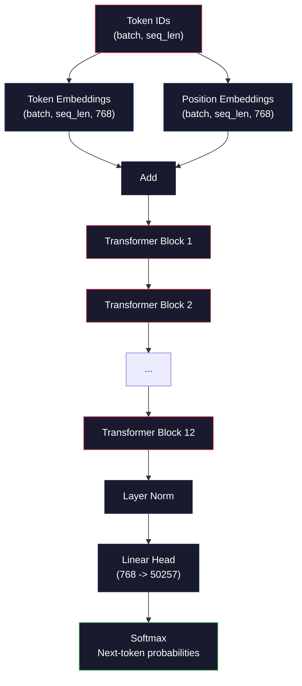
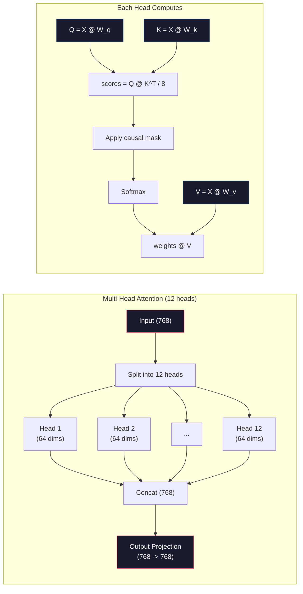
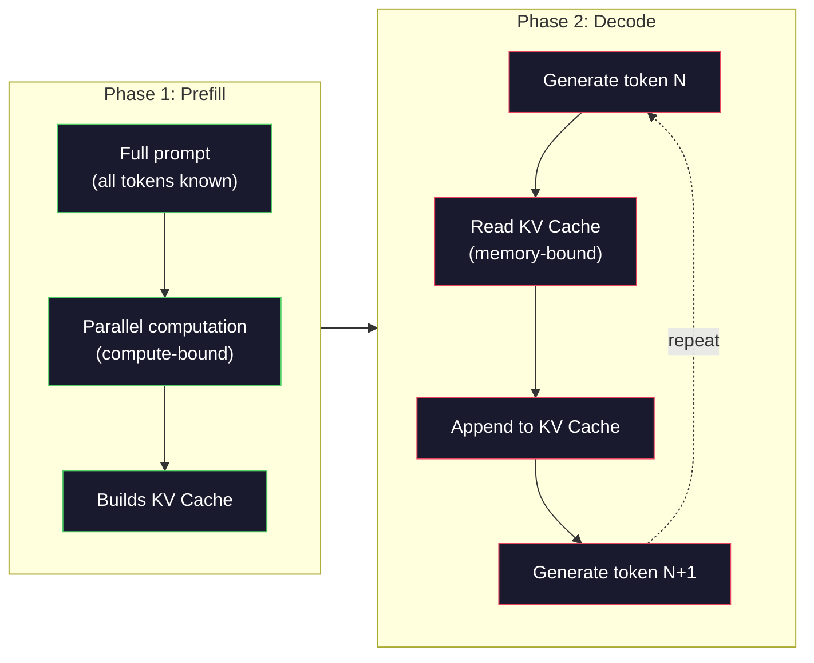

# Pre-Training a Mini GPT (124M Parameters) · 从零预训练迷你 GPT（124M 参数）

> GPT-2 Small 有 1.24 亿参数：12 层 transformer、12 个注意力头、768 维嵌入。你可以在单张 GPU 上花几个小时从零把它训练出来。大多数人从来没做过这件事——他们直接用预训练好的 checkpoint。但如果你不亲手训练一次，你就没有真正理解你正在上面构建产品的那个模型内部到底发生了什么。

> GPT-2 Small has 124 million parameters. That's 12 transformer layers, 12 attention heads, and 768-dimensional embeddings. You can train it from scratch on a single GPU in a few hours. Most people never do this. They use pre-trained checkpoints. But if you don't train one yourself, you don't actually understand what's happening inside the model you're building products on.

**类型：** Build（构建）
**语言：** Python（使用 numpy）
**先修：** Phase 10, Lessons 01-03（Tokenizers、构建 Tokenizer、数据管道）
**时间：** ~120 分钟

## Learning Objectives · 学习目标

- 从零实现完整的 GPT-2 架构（124M 参数）：词元嵌入（token embedding）、位置嵌入（positional embedding）、transformer 块和语言模型输出头
- 在文本语料上用下一词元预测（next-token prediction）和交叉熵损失（cross-entropy loss）训练一个 GPT 模型
- 实现带温度采样（temperature sampling）和 top-k/top-p 过滤的自回归（autoregressive）文本生成
- 监控训练损失曲线，验证模型确实学到了连贯的语言模式

> Implement the full GPT-2 architecture (124M parameters) from scratch: token embeddings, positional embeddings, transformer blocks, and the language model head
> Train a GPT model on a text corpus using next-token prediction with cross-entropy loss
> Implement autoregressive text generation with temperature sampling and top-k/top-p filtering
> Monitor training loss curves and validate that the model learns coherent language patterns

## The Problem · 问题在哪

你知道 transformer 是什么。你看过那些架构图。你能背出「attention is all you need」，也能在白板上画出标着「Multi-Head Attention」的方框。

但这些都不代表你理解模型生成文本时到底发生了什么。

GPT-2 Small（启用 weight tying）有 124,438,272 个参数。每一个参数都是被一个训练循环设置出来的：前向传播、计算损失、反向传播、更新权重。12 个 transformer 块，每块 12 个注意力头，768 维嵌入空间，50,257 个词元的词表。模型每生成一个词元，全部 1.24 亿个参数都会参与一条矩阵乘法链——它吃进一串 token ID，吐出下一个词元的概率分布。

如果你从没亲手造过它，你面对的就是一个黑盒。你会用 API，会微调（fine-tune）。但当出了问题——模型开始幻觉（hallucinate）、开始复读、拒绝听从指令——你没有任何心智模型去解释*为什么*。

本课从零构建 GPT-2 Small。不用 PyTorch，用 numpy。每一次矩阵乘法都看得见，每一个梯度都由你的代码算出。你会亲眼看到 1.24 亿个数字是如何合谋预测下一个词的。

> You know what a transformer is. You have read the diagrams. You can recite "attention is all you need" and draw boxes labeled "Multi-Head Attention" on a whiteboard.
> There are 124,438,272 parameters in GPT-2 Small (with weight tying). Every single one of them was set by running a training loop: forward pass, compute loss, backward pass, update weights. ... Every time the model generates a token, all 124 million parameters participate in a single matrix multiplication chain that takes a sequence of token IDs and produces a probability distribution over the next token.
> If you have never built this yourself, you are working with a black box. ... But when something goes wrong -- when the model hallucinates, when it repeats itself, when it refuses to follow instructions -- you have no mental model for *why*.
> This lesson builds GPT-2 Small from scratch. Not in PyTorch. In numpy. Every matrix multiplication is visible. Every gradient is computed by your code. You will see exactly how 124 million numbers conspire to predict the next word.

## The Concept · 概念

### The GPT Architecture · GPT 架构

GPT 是一个自回归（autoregressive）语言模型。「自回归」指它一次生成一个词元，每次生成都以之前全部词元为条件。整个架构就是一摞 transformer 解码器块（decoder block）。

下面是从 token ID 到下一词元概率的完整计算图：

1. 输入 token ID。形状：(batch_size, seq_len)。
2. 词元嵌入查表（embedding lookup）。每个 ID 映射为一个 768 维向量。形状：(batch_size, seq_len, 768)。
3. 位置嵌入查表。每个位置（0, 1, 2, ...）映射为一个 768 维向量。形状相同。
4. 词元嵌入 + 位置嵌入相加。
5. 依次通过 12 个 transformer 块。
6. 最后一次层归一化（layer normalization）。
7. 线性投影到词表大小。形状：(batch_size, seq_len, vocab_size)。
8. softmax 得到概率。

这就是整个模型。没有卷积，没有循环。只有嵌入、注意力、前馈网络（feedforward network）和层归一化，堆叠 12 次。



> GPT is an autoregressive language model. "Autoregressive" means it generates one token at a time, each conditioned on all previous tokens. The architecture is a stack of transformer decoder blocks.
> That is the entire model. No convolutions. No recurrence. Just embeddings, attention, feedforward networks, and layer norms stacked 12 times.

### The Transformer Block · Transformer 块

12 个块全部遵循同一模式。Pre-norm 架构（GPT-2 用的是 pre-norm，不像原始 transformer 那样用 post-norm）：

1. LayerNorm
2. 多头自注意力（Multi-Head Self-Attention）
3. 残差连接（residual connection，把输入加回来）
4. LayerNorm
5. 前馈网络（Feed-Forward Network / MLP）
6. 残差连接（把输入加回来）

残差连接至关重要。没有它们，反向传播的梯度传到第 1 块时就消失了。有了它们，梯度可以经由「跳连」路径从损失直达任何一层。这就是为什么你可以堆 12 层、32 层甚至 96 层（传闻 GPT-4 用了 120 层）。

> The residual connections are critical. Without them, gradients vanish by the time they reach block 1 during backpropagation. With them, gradients can flow directly from the loss to any layer through the "skip" path. This is why you can stack 12, 32, or even 96 blocks (GPT-4 is rumored to use 120).

### Attention: The Core Mechanism · 注意力：核心机制

自注意力（self-attention）让每个词元都能看到它之前的所有词元，并决定对每一个分配多少注意力。数学如下。

对每个词元位置，从输入算出三个向量：
- **Query（Q）**：「我在找什么？」
- **Key（K）**：「我装着什么？」
- **Value（V）**：「我携带什么信息？」

```
Q = input @ W_q    (768 -> 768)
K = input @ W_k    (768 -> 768)
V = input @ W_v    (768 -> 768)

attention_scores = Q @ K^T / sqrt(d_k)
attention_scores = mask(attention_scores)   # causal mask: -inf for future positions
attention_weights = softmax(attention_scores)
output = attention_weights @ V
```

因果掩码（causal mask）就是让 GPT 自回归的东西。位置 5 只能关注位置 0-5，不能看 6、7、8 等后面的位置。这防止模型在训练时靠「偷看」未来词元作弊。

**多头注意力（multi-head attention）**把 768 维空间拆成 12 个头，每头 64 维。每个头学一种不同的注意力模式：可能有一个头追踪句法关系（主谓一致），另一个追踪语义相似度（同义词），再一个追踪位置邻近性（相邻的词）。12 个头的输出拼接后再投影回 768 维。



除以 sqrt(d_k)——即 sqrt(64) = 8——是缩放（scaling）。不这么做的话，高维向量的点积会变得很大，把 softmax 推进梯度几乎为零的区域。这是原始论文《Attention Is All You Need》的关键洞见之一。

> Self-attention lets every token look at every previous token and decide how much to attend to each one.
> The causal mask is what makes GPT autoregressive. Position 5 can attend to positions 0-5 but not 6, 7, 8, and so on. This prevents the model from "cheating" by looking at future tokens during training.
> Multi-head attention splits the 768-dimensional space into 12 heads of 64 dimensions each. Each head learns a different attention pattern. ... The outputs from all 12 heads are concatenated and projected back to 768 dimensions.
> The division by sqrt(d_k) -- sqrt(64) = 8 -- is scaling. Without it, the dot products grow large for high-dimensional vectors, pushing softmax into regions where gradients are nearly zero.

### KV Cache: Why Inference Is Fast · KV Cache：推理为什么快

训练时，整个序列一次性处理。推理时，一次只生成一个词元。不做优化的话，生成第 N 个词元需要为之前 N-1 个词元重算一遍注意力。这是每生成一个词元 O(N^2)，长度 N 的序列总共 O(N^3)。

KV Cache 解决了这个问题。算完每个词元的 K 和 V 后存起来。生成第 N+1 个词元时，只需为新词元算 Q，再查之前所有词元缓存的 K 和 V。这把 K、V 计算的单词元开销从 O(N) 降到 O(1)。注意力分数计算仍是 O(N)（因为要关注所有历史位置），但省掉了对输入的重复矩阵乘法。

对 12 层、12 头的 GPT-2，KV cache 每个词元存 2（K + V）x 12 层 x 12 头 x 64 维 = 18,432 个值。1024 个词元的序列在 FP32 下约 75MB。对 128 层的 Llama 3 405B，单条序列的 KV cache 能超过 10GB。这就是长上下文推理是访存受限（memory-bound）的原因。

> During training, you process the entire sequence at once. During inference, you generate one token at a time. Without optimization, generating token N requires recomputing attention for all N-1 previous tokens. That is O(N^2) per generated token, or O(N^3) total for a sequence of length N.
> KV Cache solves this. ... This reduces per-token cost from O(N) to O(1) for the K and V computation.
> For GPT-2 with 12 layers and 12 heads, the KV cache stores 2 (K + V) x 12 layers x 12 heads x 64 dims = 18,432 values per token. ... This is why long-context inference is memory-bound.

### Prefill vs Decode: Two Phases of Inference · Prefill 与 Decode：推理的两个阶段

你给 LLM 发一个提示词（prompt）时，推理分成两个截然不同的阶段。

**Prefill（预填充）**并行处理你的整个 prompt。所有词元都已知，模型可以同时计算所有位置的注意力。这个阶段是算力受限（compute-bound）的——GPU 在全吞吐地做矩阵乘法。A100 上一个 1000 词元的 prompt，prefill 大约 20-50ms。

**Decode（解码）**一次生成一个词元。每个新词元依赖之前所有词元。这个阶段是访存受限（memory-bound）的——瓶颈是把模型权重和 KV cache 从显存读出来，而不是矩阵运算本身。GPU 的计算核心大部分时间在闲着等显存读取。对 GPT-2 来说，不管矩阵乘需要多少 FLOPs，每步 decode 耗时都差不多，因为限制在内存带宽上。

这个区分对生产系统很重要。Prefill 吞吐随 GPU 算力扩展（FLOPS 越高 prefill 越快）。Decode 吞吐随内存带宽扩展（带宽越高 decode 越快）。这就是为什么 NVIDIA 的 H100 相对 A100 重点提升了内存带宽——它直接加快词元生成。



> Prefill processes your entire prompt in parallel. ... This phase is compute-bound -- the GPU is doing matrix multiplications at full throughput.
> Decode generates tokens one at a time. Each new token depends on all previous tokens. This phase is memory-bound -- the bottleneck is reading the model weights and KV cache from GPU memory, not the matrix math itself.
> Prefill throughput scales with GPU compute (more FLOPS = faster prefill). Decode throughput scales with memory bandwidth (faster memory = faster decode).

### The Training Loop · 训练循环

训练 LLM 就是下一词元预测。给定词元 [0, 1, 2, ..., N-1]，预测词元 [1, 2, 3, ..., N]。损失函数是模型预测的概率分布与真实下一词元之间的交叉熵（cross-entropy）。

一个训练步骤：

1. **前向传播**：把 batch 跑过全部 12 个块，得到每个位置的 logits（softmax 之前的分数）。
2. **计算损失**：logits 与目标词元（输入右移一位）之间的交叉熵。
3. **反向传播**：用反向传播（backpropagation）算出全部 1.24 亿参数的梯度。
4. **优化器步进**：更新权重。GPT-2 用 Adam，配合学习率预热（warmup）和余弦衰减（cosine decay）。

学习率调度（learning rate schedule）比你以为的更重要。GPT-2 在前 2000 步把学习率从 0 预热到峰值，然后按余弦曲线衰减。一开始就用大学习率会让模型发散；一直保持大学习率会让训练后期来回震荡。先预热后衰减的模式被每一个主流 LLM 采用。

> Training an LLM is next-token prediction. Given tokens [0, 1, 2, ..., N-1], predict tokens [1, 2, 3, ..., N]. The loss function is cross-entropy between the model's predicted probability distribution and the actual next token.
> The learning rate schedule matters more than you might expect. GPT-2 warms up from 0 to the peak learning rate over the first 2,000 steps, then decays following a cosine curve. ... The warmup-then-decay pattern is used by every major LLM.

### GPT-2 Small: The Numbers · GPT-2 Small：数字盘点

| 组件 | 形状 | 参数量 |
|-----------|-------|------------|
| 词元嵌入 | (50257, 768) | 38,597,376 |
| 位置嵌入 | (1024, 768) | 786,432 |
| 每块注意力（W_q, W_k, W_v, W_out） | 4 x (768, 768) | 2,359,296 |
| 每块 FFN（升维 + 降维） | (768, 3072) + (3072, 768) | 4,718,592 |
| 每块 LayerNorm（2 个） | 2 x 768 x 2 | 3,072 |
| 最终 LayerNorm | 768 x 2 | 1,536 |
| **每块合计** | | **7,080,960** |
| **总计（12 块）** | | **85,054,464 + 39,383,808 = 124,438,272** |

输出投影（logits 头）与词元嵌入矩阵共享权重。这叫权重绑定（weight tying）——它省掉 3800 万参数，还能提升效果，因为它迫使模型在输入端和输出端使用同一个表示空间。

> The output projection (logits head) shares weights with the token embedding matrix. This is called weight tying -- it reduces the parameter count by 38M and improves performance because it forces the model to use the same representation space for input and output.

## Build It · 动手造

### Step 1: Embedding Layer · 第 1 步：嵌入层

词元嵌入把 50,257 个可能的词元各自映射成一个 768 维向量。位置嵌入补充每个词元在序列中所处位置的信息。两者相加。

```python
import numpy as np

class Embedding:
    def __init__(self, vocab_size, embed_dim, max_seq_len):
        self.token_embed = np.random.randn(vocab_size, embed_dim) * 0.02
        self.pos_embed = np.random.randn(max_seq_len, embed_dim) * 0.02

    def forward(self, token_ids):
        seq_len = token_ids.shape[-1]
        tok_emb = self.token_embed[token_ids]
        pos_emb = self.pos_embed[:seq_len]
        return tok_emb + pos_emb
```

0.02 的初始化标准差来自 GPT-2 论文。太大：最初的几次前向传播会产生极端值，让训练不稳定。太小：所有输入的初始输出几乎一样，早期梯度信号形同虚设。

> Token embeddings map each of the 50,257 possible tokens to a 768-dimensional vector. Position embeddings add information about where each token sits in the sequence. The two are summed.
> The 0.02 standard deviation for initialization comes from the GPT-2 paper. Too large and the initial forward passes produce extreme values that destabilize training. Too small and the initial outputs are nearly identical for all inputs, making early gradient signals useless.

### Step 2: Self-Attention with Causal Mask · 第 2 步：带因果掩码的自注意力

先看单头注意力。因果掩码在 softmax 之前把未来位置设为负无穷，保证每个位置只能关注自己和更早的位置。

```python
def attention(Q, K, V, mask=None):
    d_k = Q.shape[-1]
    scores = Q @ K.transpose(0, -1, -2 if Q.ndim == 4 else 1) / np.sqrt(d_k)
    if mask is not None:
        scores = scores + mask
    weights = np.exp(scores - scores.max(axis=-1, keepdims=True))
    weights = weights / weights.sum(axis=-1, keepdims=True)
    return weights @ V
```

这个 softmax 实现在取指数前先减去最大值。不这么做，exp(large_number) 会溢出成无穷大。这是个数值稳定性技巧，不改变输出，因为对任意常数 c 有 softmax(x - c) = softmax(x)。

> Single-head attention first. The causal mask sets future positions to negative infinity before softmax, ensuring each position can only attend to itself and earlier positions.
> The softmax implementation subtracts the maximum before exponentiating. Without this, exp(large_number) overflows to infinity. This is a numerical stability trick that does not change the output because softmax(x - c) = softmax(x) for any constant c.

### Step 3: Multi-Head Attention · 第 3 步：多头注意力

把 768 维输入拆成 12 个头、每头 64 维。每个头独立计算注意力。把结果拼接，再投影回 768 维。

```python
class MultiHeadAttention:
    def __init__(self, embed_dim, num_heads):
        self.num_heads = num_heads
        self.head_dim = embed_dim // num_heads
        self.W_q = np.random.randn(embed_dim, embed_dim) * 0.02
        self.W_k = np.random.randn(embed_dim, embed_dim) * 0.02
        self.W_v = np.random.randn(embed_dim, embed_dim) * 0.02
        self.W_out = np.random.randn(embed_dim, embed_dim) * 0.02

    def forward(self, x, mask=None):
        batch, seq_len, d = x.shape
        Q = (x @ self.W_q).reshape(batch, seq_len, self.num_heads, self.head_dim).transpose(0, 2, 1, 3)
        K = (x @ self.W_k).reshape(batch, seq_len, self.num_heads, self.head_dim).transpose(0, 2, 1, 3)
        V = (x @ self.W_v).reshape(batch, seq_len, self.num_heads, self.head_dim).transpose(0, 2, 1, 3)

        scores = Q @ K.transpose(0, 1, 3, 2) / np.sqrt(self.head_dim)
        if mask is not None:
            scores = scores + mask
        weights = np.exp(scores - scores.max(axis=-1, keepdims=True))
        weights = weights / weights.sum(axis=-1, keepdims=True)
        attn_out = weights @ V

        attn_out = attn_out.transpose(0, 2, 1, 3).reshape(batch, seq_len, d)
        return attn_out @ self.W_out
```

reshape-transpose-reshape 这套组合拳是多头注意力里最容易犯晕的部分。实际发生的事情：(batch, seq_len, 768) 张量先变成 (batch, seq_len, 12, 64)，再变成 (batch, 12, seq_len, 64)。现在 12 个头各自有一份 (seq_len, 64) 矩阵可以跑注意力。注意力算完再把过程倒回去：(batch, 12, seq_len, 64) 变回 (batch, seq_len, 12, 64)，最后变回 (batch, seq_len, 768)。

> The reshape-transpose-reshape dance is the most confusing part of multi-head attention. Here is what happens: the (batch, seq_len, 768) tensor becomes (batch, seq_len, 12, 64), then (batch, 12, seq_len, 64). Now each of the 12 heads has its own (seq_len, 64) matrix to run attention on. After attention, we reverse the process: (batch, 12, seq_len, 64) becomes (batch, seq_len, 12, 64) becomes (batch, seq_len, 768).

### Step 4: Transformer Block · 第 4 步：Transformer 块

一个完整的 transformer 块：LayerNorm、带残差的多头注意力、LayerNorm、带残差的前馈网络。

```python
class LayerNorm:
    def __init__(self, dim, eps=1e-5):
        self.gamma = np.ones(dim)
        self.beta = np.zeros(dim)
        self.eps = eps

    def forward(self, x):
        mean = x.mean(axis=-1, keepdims=True)
        var = x.var(axis=-1, keepdims=True)
        return self.gamma * (x - mean) / np.sqrt(var + self.eps) + self.beta


class FeedForward:
    def __init__(self, embed_dim, ff_dim):
        self.W1 = np.random.randn(embed_dim, ff_dim) * 0.02
        self.b1 = np.zeros(ff_dim)
        self.W2 = np.random.randn(ff_dim, embed_dim) * 0.02
        self.b2 = np.zeros(embed_dim)

    def forward(self, x):
        h = x @ self.W1 + self.b1
        h = np.maximum(0, h)  # GELU approximation: ReLU for simplicity
        return h @ self.W2 + self.b2


class TransformerBlock:
    def __init__(self, embed_dim, num_heads, ff_dim):
        self.ln1 = LayerNorm(embed_dim)
        self.attn = MultiHeadAttention(embed_dim, num_heads)
        self.ln2 = LayerNorm(embed_dim)
        self.ffn = FeedForward(embed_dim, ff_dim)

    def forward(self, x, mask=None):
        x = x + self.attn.forward(self.ln1.forward(x), mask)
        x = x + self.ffn.forward(self.ln2.forward(x))
        return x
```

前馈网络把 768 维输入先扩到 3,072 维（4 倍），过一个非线性，再投影回 768。这种「扩张-收缩」模式给模型在每个位置一个更「宽」的内部表示。GPT-2 用 GELU 激活，这里为了简单用 ReLU——对理解架构而言差别很小。

> The feedforward network expands the 768-dimensional input to 3,072 dimensions (4x), applies a nonlinearity, then projects back to 768. This expansion-contraction pattern gives the model a "wider" internal representation to work with at each position. GPT-2 uses GELU activation, but we use ReLU here for simplicity -- the difference is minor for understanding the architecture.

### Step 5: Full GPT Model · 第 5 步：完整 GPT 模型

把 12 个 transformer 块堆起来，前面接嵌入层，后面接输出投影。

```python
class MiniGPT:
    def __init__(self, vocab_size=50257, embed_dim=768, num_heads=12,
                 num_layers=12, max_seq_len=1024, ff_dim=3072):
        self.embedding = Embedding(vocab_size, embed_dim, max_seq_len)
        self.blocks = [
            TransformerBlock(embed_dim, num_heads, ff_dim)
            for _ in range(num_layers)
        ]
        self.ln_f = LayerNorm(embed_dim)
        self.vocab_size = vocab_size
        self.embed_dim = embed_dim

    def forward(self, token_ids):
        seq_len = token_ids.shape[-1]
        mask = np.triu(np.full((seq_len, seq_len), -1e9), k=1)

        x = self.embedding.forward(token_ids)
        for block in self.blocks:
            x = block.forward(x, mask)
        x = self.ln_f.forward(x)

        logits = x @ self.embedding.token_embed.T
        return logits

    def count_parameters(self):
        total = 0
        total += self.embedding.token_embed.size
        total += self.embedding.pos_embed.size
        for block in self.blocks:
            total += block.attn.W_q.size + block.attn.W_k.size
            total += block.attn.W_v.size + block.attn.W_out.size
            total += block.ffn.W1.size + block.ffn.b1.size
            total += block.ffn.W2.size + block.ffn.b2.size
            total += block.ln1.gamma.size + block.ln1.beta.size
            total += block.ln2.gamma.size + block.ln2.beta.size
        total += self.ln_f.gamma.size + self.ln_f.beta.size
        return total
```

注意权重绑定：`logits = x @ self.embedding.token_embed.T`。输出投影复用了词元嵌入矩阵（转置）。这不只是省参数的技巧——它意味着模型在「理解词元」（嵌入）和「预测词元」（输出）时用的是同一个向量空间。

> Notice the weight tying: `logits = x @ self.embedding.token_embed.T`. The output projection reuses the token embedding matrix (transposed). This is not just a parameter-saving trick. It means the model uses the same vector space for understanding tokens (embeddings) and predicting them (output).

### Step 6: Training Loop · 第 6 步：训练循环

真要完整训练 1.24 亿参数，你需要 GPU 和 PyTorch。这个训练循环用一个纯 numpy 就能跑的小模型演示机制。我们用一个迷你模型（4 层、4 头、128 维）让规模可控。

```python
def cross_entropy_loss(logits, targets):
    batch, seq_len, vocab_size = logits.shape
    logits_flat = logits.reshape(-1, vocab_size)
    targets_flat = targets.reshape(-1)

    max_logits = logits_flat.max(axis=-1, keepdims=True)
    log_softmax = logits_flat - max_logits - np.log(
        np.exp(logits_flat - max_logits).sum(axis=-1, keepdims=True)
    )

    loss = -log_softmax[np.arange(len(targets_flat)), targets_flat].mean()
    return loss


def train_mini_gpt(text, vocab_size=256, embed_dim=128, num_heads=4,
                   num_layers=4, seq_len=64, num_steps=200, lr=3e-4):
    tokens = np.array(list(text.encode("utf-8")[:2048]))
    model = MiniGPT(
        vocab_size=vocab_size, embed_dim=embed_dim, num_heads=num_heads,
        num_layers=num_layers, max_seq_len=seq_len, ff_dim=embed_dim * 4
    )

    print(f"Model parameters: {model.count_parameters():,}")
    print(f"Training tokens: {len(tokens):,}")
    print(f"Config: {num_layers} layers, {num_heads} heads, {embed_dim} dims")
    print()

    for step in range(num_steps):
        start_idx = np.random.randint(0, max(1, len(tokens) - seq_len - 1))
        batch_tokens = tokens[start_idx:start_idx + seq_len + 1]

        input_ids = batch_tokens[:-1].reshape(1, -1)
        target_ids = batch_tokens[1:].reshape(1, -1)

        logits = model.forward(input_ids)
        loss = cross_entropy_loss(logits, target_ids)

        if step % 20 == 0:
            print(f"Step {step:4d} | Loss: {loss:.4f}")

    return model
```

损失一开始接近 ln(vocab_size)——对 256 词元的字节级词表就是 ln(256) = 5.55。随机模型给每个词元分配相等概率。随着训练推进，损失下降，因为模型学会了预测常见模式：「th」跟在「t」后面、空格跟在句号后面，等等。

生产环境里你会用 Adam 优化器，配合梯度累积（gradient accumulation）、学习率预热和梯度裁剪（gradient clipping）。前向-损失-反向-更新的循环一模一样，只是优化器更精密。

> The loss starts near ln(vocab_size) -- for a 256-token byte-level vocabulary, that is ln(256) = 5.55. A random model assigns equal probability to every token. As training progresses, the loss drops because the model learns to predict common patterns: "th" after "t", space after a period, and so on.
> In production, you would use Adam optimizer with gradient accumulation, learning rate warmup, and gradient clipping. The forward-pass-loss-backward-update loop is identical. The optimizer is more sophisticated.

### Step 7: Text Generation · 第 7 步：文本生成

生成就是用训练好的模型一次预测一个词元。每次预测从输出分布中采样（或者贪心地取 argmax）。

```python
def generate(model, prompt_tokens, max_new_tokens=100, temperature=0.8):
    tokens = list(prompt_tokens)
    seq_len = model.embedding.pos_embed.shape[0]

    for _ in range(max_new_tokens):
        context = np.array(tokens[-seq_len:]).reshape(1, -1)
        logits = model.forward(context)
        next_logits = logits[0, -1, :]

        next_logits = next_logits / temperature
        probs = np.exp(next_logits - next_logits.max())
        probs = probs / probs.sum()

        next_token = np.random.choice(len(probs), p=probs)
        tokens.append(next_token)

    return tokens
```

温度（temperature）控制随机性。温度 1.0 用原始分布。温度 0.5 把分布变尖（更确定——模型更常选它最偏好的词元）。温度 1.5 把分布摊平（更随机——低概率词元有更大机会）。温度 0.0 是贪心解码（永远选概率最高的词元）。

`tokens[-seq_len:]` 这个窗口是必需的，因为模型的上下文长度有上限（GPT-2 是 1024）。一旦超过，就必须丢掉最老的词元。这就是人人都在说的「上下文窗口（context window）」。

```figure
sampling-decoder
```

> Temperature controls randomness. Temperature 1.0 uses the raw distribution. Temperature 0.5 sharpens it (more deterministic -- the model picks its top choices more often). Temperature 1.5 flattens it (more random -- low-probability tokens get a bigger chance). Temperature 0.0 is greedy decoding (always pick the highest probability token).
> The `tokens[-seq_len:]` window is necessary because the model has a maximum context length (1024 for GPT-2). Once you exceed it, you must drop the oldest tokens. This is the "context window" that everyone talks about.

## Use It · 实战用法

### Full Training and Generation Demo · 完整训练与生成演示

```python
corpus = """The transformer architecture has revolutionized natural language processing.
Attention mechanisms allow the model to focus on relevant parts of the input.
Self-attention computes relationships between all pairs of positions in a sequence.
Multi-head attention splits the representation into multiple subspaces.
Each attention head can learn different types of relationships.
The feedforward network provides nonlinear transformations at each position.
Residual connections enable gradient flow through deep networks.
Layer normalization stabilizes training by normalizing activations.
Position embeddings give the model information about token ordering.
The causal mask ensures autoregressive generation during training.
Pre-training on large text corpora teaches the model general language understanding.
Fine-tuning adapts the pre-trained model to specific downstream tasks."""

model = train_mini_gpt(corpus, num_steps=200)

prompt = list("The transformer".encode("utf-8"))
output_tokens = generate(model, prompt, max_new_tokens=100, temperature=0.8)
generated_text = bytes(output_tokens).decode("utf-8", errors="replace")
print(f"\nGenerated: {generated_text}")
```

小语料 + 小模型，生成的文本最多算半通顺。它能从训练文本学到一些字节级模式，但无法像 GPT-2 那样泛化——后者有 40GB 训练数据和完整的 1.24 亿参数架构。重点不在输出质量。重点是你能追踪每一步：嵌入查表、注意力计算、前馈变换、logit 投影、softmax、采样。每个操作都看得见。

> On a small corpus with a small model, the generated text will be semi-coherent at best. It will learn some byte-level patterns from the training text but cannot generalize the way GPT-2 does with 40GB of training data and the full 124M parameter architecture. The point is not the output quality. The point is that you can trace every step: embedding lookup, attention computation, feedforward transformation, logit projection, softmax, and sampling. Every operation is visible.

## Ship It · 交付

本课产出 `outputs/prompt-gpt-architecture-analyzer.md`——一个分析任意 GPT 类模型架构选择的提示词。喂给它模型卡（model card）或技术报告，它会拆解参数分配、注意力设计和扩展决策。

> This lesson produces `outputs/prompt-gpt-architecture-analyzer.md` -- a prompt that analyzes the architecture choices in any GPT-style model. Feed it a model card or technical report and it breaks down the parameter allocation, attention design, and scaling decisions.

## Exercises · 练习

1. 把模型改成 24 层、16 头（原为 12/12）。数一数参数量。深度翻倍和宽度翻倍（嵌入维度）相比效果如何？

2. 实现 GELU 激活函数（GELU(x) = x * 0.5 * (1 + erf(x / sqrt(2)))），替换前馈网络里的 ReLU。两种激活各跑 500 步训练，比较最终损失。

3. 给生成函数加 KV cache。第一次前向传播后把每层的 K、V 张量存起来，后续词元复用。测加速比：开/不开 cache 各生成 200 个词元，比较墙钟时间。

4. 实现 top-k 采样（只考虑概率最高的 k 个词元）和 top-p 采样（nucleus sampling：考虑累计概率超过 p 的最小词元集合）。在温度 0.8 下比较 top-k=50 与 top-p=0.95 的输出质量。

5. 写一个训练损失曲线绘图器。训练 1000 步，画出 loss 随步数的变化。识别三个阶段：初期快速下降（学常见字节）、中段变慢（学字节模式）、平台期（在小语料上过拟合）。无论训的是 128 维小模型还是 GPT-4，这条曲线的形状都一样。

## Key Terms · 术语表

| 术语 | 大家怎么说 | 实际含义 |
|------|----------------|----------------------|
| Autoregressive | 「一次生成一个词」 | 每个输出词元都以之前全部词元为条件——模型预测 P(token_n \| token_0, ..., token_{n-1}) |
| Causal mask | 「看不到未来」 | 一个上三角的 -infinity 矩阵，训练时阻止对未来位置的注意力 |
| Multi-head attention | 「多套注意力模式」 | 把 Q、K、V 拆成并行的多个头（GPT-2 是 12 头 x 64 维），让每个头学习不同类型的关系 |
| KV Cache | 「为了提速做缓存」 | 把已算出的历史词元 Key 和 Value 张量存起来，避免自回归生成时的重复计算 |
| Prefill | 「处理提示词」 | 推理第一阶段，整个 prompt 的词元并行处理——受 GPU FLOPS（算力）限制 |
| Decode | 「生成词元」 | 推理第二阶段，一次生成一个词元——受 GPU 带宽（显存带宽）限制 |
| Weight tying | 「共享嵌入」 | 输入词元嵌入和输出投影头用同一个矩阵——GPT-2 里省下 3800 万参数 |
| Residual connection | 「跳连（skip connection）」 | 把子层的输入直接加到子层的输出上（x + sublayer(x)）——让梯度能流过深层网络 |
| Layer normalization | 「归一化激活值」 | 沿特征维度归一化到均值 0、方差 1，带可学习的缩放和平移参数 |
| Cross-entropy loss | 「预测有多错」 | -log(分配给正确下一词元的概率)，对所有位置取平均——标准的 LLM 训练目标 |

## Further Reading · 延伸阅读

- [Radford et al., 2019 -- "Language Models are Unsupervised Multitask Learners" (GPT-2)](https://cdn.openai.com/better-language-models/language_models_are_unsupervised_multitask_learners.pdf) —— 提出 124M 到 1.5B 参数家族的 GPT-2 论文
- [Vaswani et al., 2017 -- "Attention Is All You Need"](https://arxiv.org/abs/1706.03762) —— 提出 scaled dot-product attention 和多头注意力的原始 transformer 论文
- [Llama 3 Technical Report](https://arxiv.org/abs/2407.21783) —— Meta 如何用 16K GPU 把 GPT 架构扩展到 405B 参数
- [Pope et al., 2022 -- "Efficiently Scaling Transformer Inference"](https://arxiv.org/abs/2211.05102) —— 正式提出 prefill vs decode 区分及 KV cache 分析的论文
