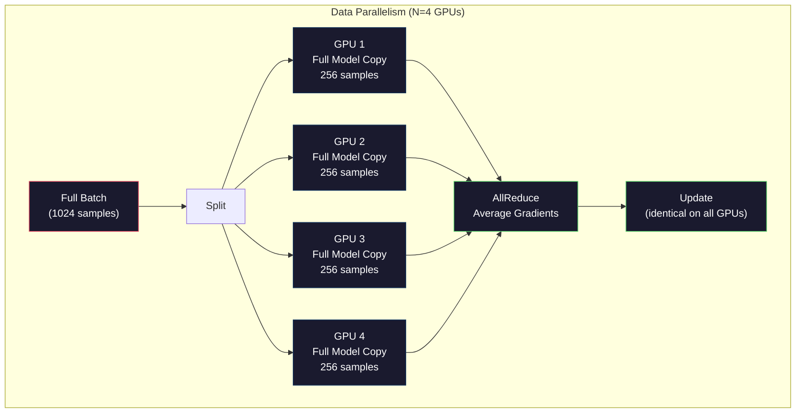
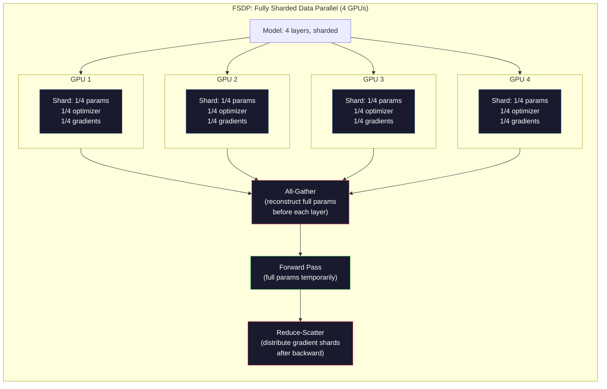
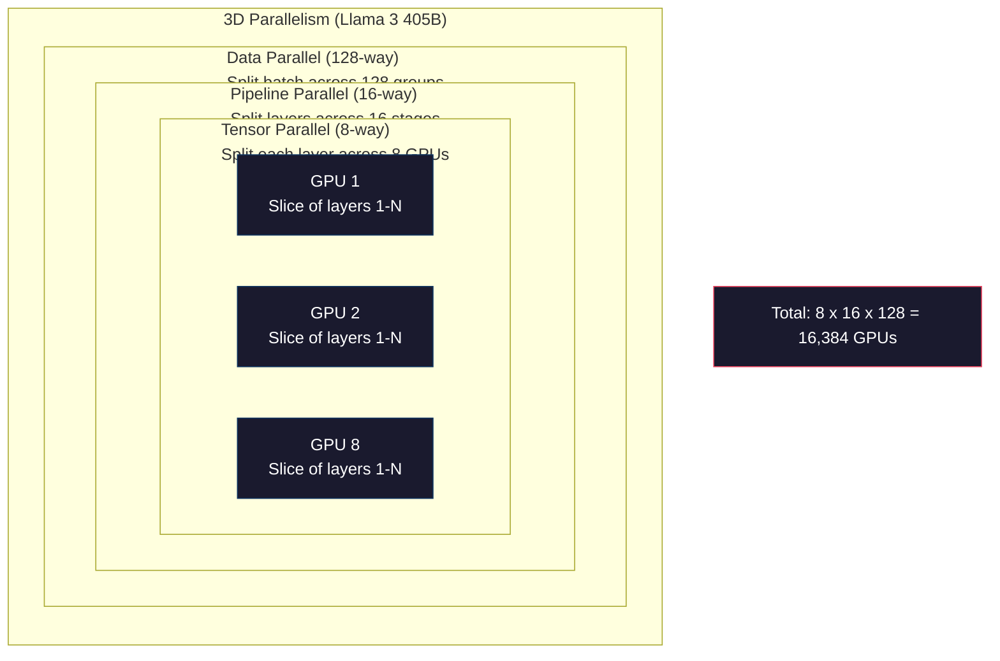

# Scaling: Distributed Training, FSDP, DeepSpeed · 扩展：分布式训练、FSDP、DeepSpeed

> 你的 1.24 亿模型在单张 GPU 上训完了。现在试试 70 亿参数。模型塞不进显存，数据在单机上要跑好几个星期。到了规模这一步，分布式训练不是可选项——它是唯一的路。

> Your 124M model trained on one GPU. Now try 7 billion parameters. The model doesn't fit in memory. The data takes weeks on a single machine. Distributed training isn't optional at scale. It's the only path forward.

**类型：** Build（构建）
**语言：** Python
**先修：** Phase 10, Lesson 04（从零预训练迷你 GPT）
**时间：** ~120 分钟

## Learning Objectives · 学习目标

- 解释三种并行（数据并行、张量并行、流水线并行）的原理，并能根据模型和集群规模判断何时需要哪一种
- 使用 PyTorch DDP 实现数据并行（data parallelism）训练，跨多 GPU 同步梯度
- 对给定模型规模计算显存预算（权重 + 优化器状态 + 梯度 + 激活值），推算最低硬件需求
- 配置 FSDP 或 DeepSpeed ZeRO 各阶段，把模型状态分片（shard）到多张 GPU，装下单卡显存放不下的模型

> Explain the three types of parallelism (data, tensor, pipeline) and when each is necessary based on model and cluster size
> Implement data-parallel training using PyTorch DDP with gradient synchronization across multiple GPUs
> Calculate the memory budget for a given model size (weights + optimizer states + gradients + activations) to determine the minimum hardware
> Configure FSDP or DeepSpeed ZeRO stages to shard model states across GPUs and fit models that exceed single-GPU memory

## The Problem · 问题在哪

一个 70 亿（7B）参数模型用 FP16 存，光权重就要 14GB。Adam 优化器还要为每个参数多存两份副本（一阶矩和二阶矩估计），又是 28GB。反向传播期间的梯度再加 14GB。还没存任何激活值（activation），你已经 56GB 了。

一块 NVIDIA A100 有 80GB 显存。

80GB 已用掉 56GB，只剩 24GB 给激活值——前向传播算出、必须为反向传播保留的中间值。2048 词元序列、4096 维模型，单层激活约 64MB。32 层的话每个样本要 2GB。batch size 8 需要 16GB，而你只有 24GB。batch size 12 直接爆掉。

再试 700 亿（70B）参数。光权重 FP16 就 140GB，单卡装不下。只是把权重放下去就至少要 2 块 A100（2 x 80GB = 160GB）。加上优化器状态和梯度，需要的远不止：最少 3 块 GPU，现实里 8-16 块，取决于分片（sharding）策略。

Llama 3 405B 用 16,384 块 NVIDIA H100 训练，算力成本估计 1 亿美元。DeepSeek V3 靠架构上的巧思（混合专家 Mixture of Experts：每个词元只激活一小部分参数）和训练效率，用大约 560 万美元训出了可比的模型。

本课讲让大规模训练成为可能的四种策略：数据并行（data parallelism）、张量并行（tensor parallelism）、流水线并行（pipeline parallelism）和全分片数据并行（fully sharded data parallelism）。在碰任何分布式训练框架之前，你会先用纯 Python 把每一种都模拟一遍，理解其机制。

> A 7B parameter model in FP16 needs 14GB just for the weights. Adam optimizer stores two additional copies of every parameter (first and second moment estimates). That is another 28GB. Gradients during backpropagation add 14GB more. You are at 56GB before a single activation is stored.
> 56GB out of 80GB consumed. That leaves 24GB for activations -- the intermediate values computed during the forward pass that must be kept alive for backpropagation. ... A batch size of 12 blows up.
> Llama 3 405B was trained on 16,384 NVIDIA H100 GPUs. The training run cost an estimated $100 million in compute.
> This lesson covers the four strategies that make large-scale training possible: data parallelism, tensor parallelism, pipeline parallelism, and fully sharded data parallelism.

## The Concept · 概念

### Why Distribution is Required · 为什么必须分布式

下面是真实模型的显存账。每个数字都是算出来的，不是估的。

| 模型 | 参数量 | 权重（FP16） | Adam 状态 | 梯度（FP16） | 合计（不含激活） |
|-------|--------|----------------|-------------|------------------|----------------------|
| GPT-2 Small | 124M | 248 MB | 992 MB | 248 MB | 1.5 GB |
| Llama 3 8B | 8B | 16 GB | 64 GB | 16 GB | 96 GB |
| Llama 3 70B | 70B | 140 GB | 560 GB | 140 GB | 840 GB |
| Llama 3 405B | 405B | 810 GB | 3,240 GB | 810 GB | 4,860 GB |

「Adam 状态」这一列是杀手。Adam 为每个参数存一个滑动均值（m）和一个滑动方差（v），都是 FP32。对 70B 模型就是 70B x 4 bytes x 2 = 560GB。光优化器就要七块 A100。

一块 H100 只有 80GB。Llama 3 405B 至少要 61 块 H100 才装得下权重、优化器和梯度。加上激活值，数字还要涨。Meta 用 16,384 块 GPU 不是因为想用——是因为不得不用。

> Here is the memory math for real models. Every number is calculated, not estimated.
> The "Adam States" column is the killer. Adam stores a running mean (m) and a running variance (v) for every parameter, both in FP32. For a 70B model, that is 70B x 4 bytes x 2 = 560GB. The optimizer alone needs seven A100s.
> Meta used 16,384 GPUs not because they wanted to -- because they had to.

### Data Parallelism · 数据并行

最简单的分布式策略。把整个模型复制到 N 块 GPU，把每个训练 batch 均分成 N 份。每块 GPU 对自己那份数据跑一遍前向和反向。反向结束后，跨所有 GPU 平均梯度。每块 GPU 用同一份平均梯度更新自己那份权重，保证所有副本同步。

**好处：** 吞吐线性扩展。N 块 GPU 每步处理 N 倍数据。通信只有梯度平均，而且能与计算重叠。

**坏处：** 每块 GPU 都存一份完整的模型、优化器状态和梯度副本。70B 模型每块 GPU 要 840GB。数据并行完全不降低单卡显存，只缩短训练时间。

**算一下：** 有效 batch size = per_gpu_batch_size x N。N=64 块 GPU、每卡 batch 16，有效 batch 是 1,024。Llama 3 每步的有效 batch size 是 1600 万词元。



> The simplest distributed strategy. Copy the entire model to N GPUs. Split each training batch into N equal parts. ... Every GPU updates its copy of the weights with the same averaged gradients, keeping all copies in sync.
> The good: Linear throughput scaling. N GPUs process N times more data per step.
> The bad: Every GPU holds a complete copy of the model, optimizer states, and gradients. ... Data parallelism does nothing to reduce per-GPU memory. It only reduces training time.
> The math: Effective batch size = per_gpu_batch_size x N. ... Llama 3 used an effective batch size of 16 million tokens per step.

### Tensor Parallelism · 张量并行

把单个层拆到多块 GPU 上。一次矩阵乘法被分给多块 GPU，每块算结果的一部分。

看前馈层里一个形状为 (8192, 8192) 的权重矩阵。4 路张量并行下，每块 GPU 持有一个 (8192, 2048) 分片。每块 GPU 把输入乘自己的分片，得到部分结果。部分结果再合并（通过 all-reduce 或 all-gather）得到完整输出。

**好处：** 降低每卡的权重显存。70B 模型拆到 8 块 GPU，每卡只需装约 87.5 亿参数的权重。

**坏处：** 每层之后都需要高速的 GPU 间通信。每次矩阵乘后的 all-reduce 带来延迟。在 NVLink（同节点 GPU 间 900 GB/s）下很好用，跨节点走 InfiniBand（400 Gb/s，约合 50 GB/s）就很糟。所以张量并行几乎总是限于单节点内（8 块 GPU）。

**实际使用：** Megatron-LM 开创了张量并行。Llama 3 405B 在每个节点内用 8 路张量并行。

> Split individual layers across GPUs. A single matrix multiplication is divided among GPUs, each computing part of the result.
> The bad: Requires fast inter-GPU communication after every layer. ... Tensor parallelism is almost always limited to within a single node (8 GPUs).
> Real usage: Megatron-LM pioneered tensor parallelism. Llama 3 405B uses 8-way tensor parallelism within each node.

### Pipeline Parallelism · 流水线并行

按层拆模型。GPU 1 跑第 1-8 层，GPU 2 跑第 9-16 层，GPU 3 跑第 17-24 层，GPU 4 跑第 25-32 层。数据流过流水线：GPU 1 算完自己的层把激活值发给 GPU 2，GPU 2 算完发给 GPU 3，以此类推。

**好处：** GPU 间通信极少——只有层边界的激活值，比梯度或权重小得多。带宽需求低，所以能跨节点用。

**坏处：** 流水线气泡（bubble）。GPU 4 在算 micro-batch 1 的前向时，GPU 1、2、3 都闲着（它们的份额已经传完了）。反向传播时模式反过来。朴素流水线下，N 个流水线阶段的 GPU 利用率只有 1/N。

**GPipe 和 PipeDream** 通过把 batch 切成 micro-batch 解决气泡问题。GPU 1 一传完 micro-batch 1 就立刻开始 micro-batch 2。这样各流水线阶段的计算就重叠起来。M 个 micro-batch、N 个阶段时，气泡占比降到 (N-1)/M。用 M=16 个 micro-batch、N=4 个阶段，气泡是 3/16 = 18.75% 的空闲时间。

> Split the model by layers. ... Data flows through the pipeline: GPU 1 computes its layers and sends activations to GPU 2, which computes its layers and sends to GPU 3, and so on.
> The bad: Pipeline bubbles. ... With naive pipelining, GPU utilization is only 1/N for N pipeline stages.
> GPipe and PipeDream solve the bubble problem by splitting the batch into micro-batches. ... With M micro-batches and N stages, the bubble fraction drops to (N-1)/M. Use M=16 micro-batches with N=4 stages and the bubble is 3/16 = 18.75% idle time.

### FSDP: Fully Sharded Data Parallel · FSDP：全分片数据并行

FSDP 把数据并行的可扩展性和分片的省显存结合起来。每块 GPU 不再持有完整的模型副本，只持有 1/N 的参数、梯度和优化器状态。

在某层做前向之前，FSDP 先跑一次 **all-gather**，把完整参数从所有 GPU 收集到每块 GPU 的显存里。前向结束后，每块 GPU 丢弃非本地的参数。反向时再跑一次 all-gather，重建参数以计算梯度。反向结束后，**reduce-scatter** 把梯度分片发下去，每块 GPU 只存 1/N 的梯度。

**70B 模型用 8 块 GPU 的账：**

| 组件 | 不用 FSDP | 用 FSDP |
|-----------|-------------|-----------|
| 权重（FP16） | 每卡 140 GB | 每卡 17.5 GB |
| Adam 状态（FP32） | 每卡 560 GB | 每卡 70 GB |
| 梯度（FP16） | 每卡 140 GB | 每卡 17.5 GB |
| **合计** | **每卡 840 GB** | **每卡 105 GB** |

不用 FSDP，70B 模型装不进单张 80GB GPU。用 FSDP 8 卡，每卡 105GB——等等，还是装不下。你得至少 16 块 GPU 才能压到每卡 80GB 以下，或者把 FSDP 和激活检查点（activation checkpointing，反向时重算激活而不是存储）结合。

通信开销比朴素数据并行高，因为每层前都要 all-gather。但省下的显存让原本不可能的训练变得可能。



> FSDP combines the scalability of data parallelism with the memory efficiency of sharding. Instead of each GPU holding a complete copy of the model, each GPU holds only 1/N of the parameters, gradients, and optimizer states.
> Before a layer's forward pass, FSDP runs an all-gather to collect the full parameters from all GPUs into each GPU's memory. ... After the backward pass, a reduce-scatter distributes gradient shards so each GPU only stores 1/N of the gradients.
> The communication cost is higher than vanilla data parallelism because of the all-gather before each layer. But the memory savings make previously impossible training runs possible.

### DeepSpeed ZeRO · DeepSpeed ZeRO

DeepSpeed 的 ZeRO（Zero Redundancy Optimizer）在概念上与 FSDP 完全一致，但由 Microsoft 独立开发。它定义了三个阶段，一个比一个分得激进：

| 阶段 | 分片对象 | 省显存 | 通信 |
|-------|--------|---------------|---------------|
| ZeRO-1 | 仅优化器状态 | 约 4 倍降幅 | 与数据并行相同 |
| ZeRO-2 | + 梯度 | 约 8 倍降幅 | 略多 |
| ZeRO-3 | + 参数 | 约 N 倍降幅（N 块 GPU） | 每层 all-gather |

ZeRO-3 等价于 FSDP。名字不同，机制相同。DeepSpeed 验证了这个概念之后，PyTorch 把 FSDP 加成了原生实现。

DeepSpeed 还推出了 ZeRO-Offload（把优化器状态卸载到更便宜也更大的 CPU 内存）和 ZeRO-Infinity（卸载到 NVMe SSD）。这些是拿计算速度换显存容量——被卸载的操作更慢，但腾出了 GPU 显存。

> DeepSpeed's ZeRO (Zero Redundancy Optimizer) is conceptually identical to FSDP but was developed independently by Microsoft. It defines three stages, each sharding more aggressively.
> ZeRO-3 is equivalent to FSDP. The naming is different, the mechanism is the same.
> DeepSpeed also introduced ZeRO-Offload (offload optimizer states to CPU RAM, which is cheaper and larger) and ZeRO-Infinity (offload to NVMe SSDs). These trade compute speed for memory capacity -- the offloaded operations are slower but free up GPU memory.

### Mixed Precision Training · 混合精度训练

现代训练同时使用多种浮点格式：

- **前向传播**：FP16 或 BF16（16 位）。显存是 FP32 的一半，矩阵乘在 tensor core 上快 2 倍。
- **主权重（master weights）**：FP32（32 位）。由优化器维护，保证权重更新时的数值精度。
- **损失缩放（loss scaling）**：反向传播前把损失乘一个大常数，防止 FP16 梯度下溢成 0；优化器步进前再除回同一常数。

BF16（Brain Float 16）的指数范围与 FP32 相同（8 位指数），但精度更低（7 位尾数 vs FP32 的 23 位）。它能表示同样的数值范围，所以基本不需要损失缩放。FP16 是 5 位指数、10 位尾数——能表示精细数值，但在极端量级处会上溢/下溢。

Google 的 TPU 原生用 BF16。NVIDIA 的 A100 和 H100 两者都支持。业界已大体转向 BF16，因为它免掉了损失缩放的麻烦。

**7B 模型的显存对比：**

| 精度 | 权重 | 优化器 | 梯度 | 合计 |
|-----------|---------|-----------|-----------|-------|
| 全 FP32 | 28 GB | 56 GB | 28 GB | 112 GB |
| 混合（BF16 + FP32 主权重） | 14 GB | 56 GB | 14 GB | 84 GB |

这个模型上混合精度省 28GB。优化器状态无论如何都留在 FP32——大部分显存都花在这里。

> Modern training uses multiple floating-point formats simultaneously.
> BF16 (Brain Float 16) has the same exponent range as FP32 (8 exponent bits) but reduced precision (7 mantissa bits vs FP32's 23). It rarely needs loss scaling because it can represent the same range of values.
> Mixed precision saves 28GB on this model. The optimizer states stay in FP32 regardless -- this is where most of the memory goes.

### Megatron-LM and 3D Parallelism · Megatron-LM 与 3D 并行

真实的大规模训练把三种并行全用上：

- **数据并行**跨节点组（扩大 batch size）
- **张量并行**在节点内（把层拆到 8 块 GPU）
- **流水线并行**跨节点（把层组拆到多台机器）

Llama 3 405B 在 16,384 块 H100 上：

- 节点内 8 路张量并行（每节点 8 块 GPU）
- 跨节点 16 路流水线并行（16 个流水线阶段）
- 剩余维度上 128 路数据并行（16,384 / 8 / 16 = 128）

这个 3D 分解（8 x 16 x 128 = 16,384）就是扩展到数千块 GPU 的方法。每块 GPU 看到不同的数据分片（数据并行），持有每层的一个切片（张量并行），计算不同的层集合（流水线并行）。

DeepSeek V3 走了另一条路。它的混合专家（Mixture of Experts）架构每个词元只激活 671B 参数中的 37B。这意味着每块 GPU 只需计算激活参数（并只为激活参数存储激活值）。他们用 2,048 块 H800 训练——不到 Meta GPU 数量的 1/8——花了 560 万美元，对比 Meta 估计的 1 亿美元。



```figure
paged-kv-cache
```

> This 3D decomposition (8 x 16 x 128 = 16,384) is how you scale to thousands of GPUs. Each GPU sees a different data shard (data parallel), holds one slice of each layer (tensor parallel), and computes a different set of layers (pipeline parallel).
> DeepSeek V3 took a different approach. Their Mixture of Experts architecture activates only 37B out of 671B parameters per token. ... They trained on 2,048 H800 GPUs -- less than 1/8 of Meta's GPU count -- for $5.6M vs Meta's estimated $100M.

## Build It · 动手造

### Step 1: Simulate Data Parallelism · 第 1 步：模拟数据并行

把一个 batch 拆到模拟的 GPU 上。每块 GPU 对自己那份做前向。对「梯度」取平均（我们用 loss 值来模拟梯度）。

```python
import numpy as np

def simulate_data_parallelism(data, num_gpus, model_fn):
    batch_size = len(data)
    shard_size = batch_size // num_gpus
    remainder = batch_size % num_gpus

    gpu_losses = []
    gpu_gradients = []

    offset = 0
    for gpu_id in range(num_gpus):
        extra = 1 if gpu_id < remainder else 0
        shard = data[offset:offset + shard_size + extra]
        offset += shard_size + extra

        loss, grad = model_fn(shard)
        gpu_losses.append(loss)
        gpu_gradients.append(grad)

    avg_loss = np.mean(gpu_losses)
    avg_gradient = np.mean(gpu_gradients, axis=0)

    return avg_loss, avg_gradient
```

all-reduce 操作（平均梯度）是数据并行里唯一的通信。实践中它用 NVIDIA GPU 上的 NCCL 库实现，即 ring all-reduce：每块 GPU 把自己梯度的 1/N 发给一个邻居，从另一个邻居收 1/N，N-1 步之后每块 GPU 都有完整平均。总通信量：2 x gradient_size x (N-1)/N，N 大时逼近梯度大小的 2 倍。

> The all-reduce operation (averaging gradients) is the only communication in data parallelism. In practice, this uses the NCCL library on NVIDIA GPUs, which implements ring all-reduce: ... Total communication volume: 2 x gradient_size x (N-1)/N, approaching 2x the gradient size for large N.

### Step 2: Simulate Tensor Parallelism · 第 2 步：模拟张量并行

把权重矩阵拆到多块 GPU。每块 GPU 计算一部分矩阵乘。合并结果。

```python
def simulate_tensor_parallelism(input_data, weight_matrix, num_gpus):
    d_in, d_out = weight_matrix.shape
    assert d_out % num_gpus == 0, f"d_out {d_out} not divisible by num_gpus {num_gpus}"
    shard_size = d_out // num_gpus

    partial_results = []
    for gpu_id in range(num_gpus):
        start = gpu_id * shard_size
        end = start + shard_size
        weight_shard = weight_matrix[:, start:end]

        partial = input_data @ weight_shard
        partial_results.append(partial)

    full_output = np.concatenate(partial_results, axis=-1)

    direct_output = input_data @ weight_matrix
    error = np.abs(full_output - direct_output).max()

    return full_output, error
```

误差应该恰好为零（或机器精度级）。张量并行在数学上是精确的——结果与单卡算完整矩阵乘完全一致。切分沿输出维度，每块 GPU 产出不同的列块，拼接起来就还原出完整结果。

列并行线性层（切输出维度）用拼接。行并行（切输入维度）用求和。transformer 的 FFN 里，第一个线性层（升维）用列并行，第二个线性层（降维）用行并行。这避免了两个层之间做 all-reduce。

> The error should be exactly zero (or machine epsilon). Tensor parallelism is mathematically exact -- it produces the same result as computing the full matmul on one GPU.
> For column-parallel linear layers (splitting the output dimension), you concatenate. For row-parallel (splitting the input dimension), you sum. In a transformer FFN, the first linear (expand) uses column-parallel and the second linear (contract) uses row-parallel. This avoids an all-reduce between the two layers.

### Step 3: Simulate Pipeline Parallelism · 第 3 步：模拟流水线并行

把模型的层拆到虚拟 GPU 上。展示气泡问题：靠后的阶段在计算时，靠前的阶段闲着。

```python
def simulate_pipeline_parallelism(num_layers, num_stages, num_microbatches):
    layers_per_stage = num_layers // num_stages

    timeline = {}
    clock = 0

    for mb in range(num_microbatches):
        for stage in range(num_stages):
            start_time = max(
                timeline.get((stage, mb - 1, "fwd"), (0, 0))[1] if mb > 0 else 0,
                timeline.get((stage - 1, mb, "fwd"), (0, 0))[1] if stage > 0 else 0,
            )
            end_time = start_time + layers_per_stage
            timeline[(stage, mb, "fwd")] = (start_time, end_time)

    last_fwd_end = max(v[1] for v in timeline.values())

    for mb in range(num_microbatches - 1, -1, -1):
        for stage in range(num_stages - 1, -1, -1):
            deps = [last_fwd_end]
            if mb < num_microbatches - 1 and (stage, mb + 1, "bwd") in timeline:
                deps.append(timeline[(stage, mb + 1, "bwd")][1])
            if stage < num_stages - 1 and (stage + 1, mb, "bwd") in timeline:
                deps.append(timeline[(stage + 1, mb, "bwd")][1])
            start_time = max(deps)
            end_time = start_time + layers_per_stage
            timeline[(stage, mb, "bwd")] = (start_time, end_time)

    total_time = max(v[1] for v in timeline.values())
    compute_time = num_microbatches * num_stages * layers_per_stage * 2
    bubble_fraction = 1.0 - compute_time / (total_time * num_stages)

    return timeline, total_time, bubble_fraction
```

4 个阶段、1 个 micro-batch 时气泡占比 75%——任意时刻四块 GPU 有三块闲着。16 个 micro-batch 时降到约 19%。消除气泡的代价是显存：所有在途 micro-batch 的激活值必须同时保存。

> With 4 stages and 1 micro-batch, the bubble fraction is 75% -- three out of four GPUs idle at any time. With 16 micro-batches, it drops to about 19%. The cost of eliminating bubbles is memory: you must store activations for all in-flight micro-batches simultaneously.

### Step 4: Memory Calculator · 第 4 步：显存计算器

精确计算训练任意规模模型所需的显存。

```python
def memory_calculator(
    params_billions,
    precision_bytes=2,
    optimizer="adam",
    num_gpus=1,
    sharding="none",
    sequence_length=2048,
    batch_size_per_gpu=1,
    hidden_dim=None,
    num_layers=None,
):
    params = params_billions * 1e9

    weight_memory = params * precision_bytes

    if optimizer == "adam":
        optimizer_memory = params * 4 * 2
    elif optimizer == "sgd":
        optimizer_memory = params * 4
    else:
        optimizer_memory = 0

    gradient_memory = params * precision_bytes

    total_no_activation = weight_memory + optimizer_memory + gradient_memory

    if hidden_dim and num_layers:
        activation_per_layer = (
            sequence_length * batch_size_per_gpu * hidden_dim * precision_bytes * 4
        )
        activation_memory = activation_per_layer * num_layers
    else:
        activation_memory = params * precision_bytes * 0.5

    if sharding == "fsdp" or sharding == "zero3":
        weight_memory /= num_gpus
        optimizer_memory /= num_gpus
        gradient_memory /= num_gpus
    elif sharding == "zero2":
        optimizer_memory /= num_gpus
        gradient_memory /= num_gpus
    elif sharding == "zero1":
        optimizer_memory /= num_gpus

    per_gpu_total = weight_memory + optimizer_memory + gradient_memory + activation_memory

    return {
        "params_billions": params_billions,
        "weights_gb": weight_memory / 1e9,
        "optimizer_gb": optimizer_memory / 1e9,
        "gradients_gb": gradient_memory / 1e9,
        "activations_gb": activation_memory / 1e9,
        "per_gpu_total_gb": per_gpu_total / 1e9,
        "total_across_gpus_gb": per_gpu_total * num_gpus / 1e9,
        "fits_on_80gb": per_gpu_total / 1e9 <= 80,
        "num_gpus": num_gpus,
        "sharding": sharding,
    }
```

这个计算器回答每个 ML 工程师都问过的问题：「我需要多少块 GPU？」输入模型大小，看装不装得下。调整分片策略，直到每卡总量降到 80GB 以下。

> This calculator answers the question every ML engineer asks: "How many GPUs do I need?" Feed it the model size and see whether it fits. Adjust sharding strategy until the per-GPU total drops below 80GB.

### Step 5: Mixed Precision Simulation · 第 5 步：混合精度模拟

对比 FP32、FP16 与混合精度训练的显存占用。

```python
def mixed_precision_comparison(params_billions):
    params = params_billions * 1e9

    fp32_weights = params * 4
    fp32_optimizer = params * 4 * 2
    fp32_gradients = params * 4
    fp32_total = fp32_weights + fp32_optimizer + fp32_gradients

    fp16_weights = params * 2
    fp16_master = params * 4
    fp16_optimizer = params * 4 * 2
    fp16_gradients = params * 2
    fp16_total = fp16_weights + fp16_master + fp16_optimizer + fp16_gradients

    mixed_weights = params * 2
    mixed_optimizer = params * 4 * 2
    mixed_gradients = params * 2
    mixed_total = mixed_weights + mixed_optimizer + mixed_gradients

    return {
        "fp32_total_gb": fp32_total / 1e9,
        "fp16_with_master_gb": fp16_total / 1e9,
        "mixed_bf16_gb": mixed_total / 1e9,
        "savings_vs_fp32": 1 - mixed_total / fp32_total,
    }
```

对大多数人来说最意外的一点：混合精度并不能把显存减半。优化器状态（Adam 的 m 和 v）无论什么精度都留在 FP32。7B 模型，FP32 训练用 112GB，混合精度用 84GB。省 25%，不是 50%。优化器才是大头。

> The biggest surprise for most people: mixed precision does not halve the memory. The optimizer states (Adam's m and v) stay in FP32 regardless of precision. For a 7B model, FP32 training uses 112GB. Mixed precision uses 84GB. That is a 25% reduction, not 50%. The optimizer dominates.

## Use It · 实战用法

### Run All Simulations · 跑全部模拟

```python
def run_all_demos():
    print("=" * 70)
    print("DATA PARALLELISM SIMULATION")
    print("=" * 70)

    np.random.seed(42)
    data = np.random.randn(64, 32)
    weight = np.random.randn(32, 16)

    def model_fn(batch):
        output = batch @ weight
        loss = np.mean(output ** 2)
        grad = 2 * batch.T @ (batch @ weight) / len(batch)
        return loss, grad

    for n_gpus in [1, 2, 4, 8]:
        loss, grad = simulate_data_parallelism(data, n_gpus, model_fn)
        print(f"  {n_gpus} GPUs: loss={loss:.4f}, grad_norm={np.linalg.norm(grad):.4f}")

    print()
    print("=" * 70)
    print("TENSOR PARALLELISM SIMULATION")
    print("=" * 70)

    x = np.random.randn(4, 8192)
    W = np.random.randn(8192, 8192)

    for n_gpus in [1, 2, 4, 8]:
        output, error = simulate_tensor_parallelism(x, W, n_gpus)
        print(f"  {n_gpus} GPUs: output_shape={output.shape}, max_error={error:.2e}")

    print()
    print("=" * 70)
    print("PIPELINE PARALLELISM SIMULATION")
    print("=" * 70)

    for n_mb in [1, 4, 8, 16, 32]:
        _, total_t, bubble = simulate_pipeline_parallelism(32, 4, n_mb)
        print(f"  {n_mb:2d} micro-batches: total_time={total_t:4d}, bubble={bubble:.1%}")

    print()
    print("=" * 70)
    print("MEMORY CALCULATOR")
    print("=" * 70)

    configs = [
        (7, "none", 1),
        (7, "fsdp", 8),
        (70, "none", 1),
        (70, "fsdp", 8),
        (70, "fsdp", 16),
        (405, "fsdp", 64),
        (405, "fsdp", 128),
    ]

    print(f"  {'Model':>8} {'Sharding':>8} {'GPUs':>5} {'Per-GPU':>10} {'Fits 80GB':>10}")
    print("  " + "-" * 50)
    for params, shard, gpus in configs:
        result = memory_calculator(params, num_gpus=gpus, sharding=shard)
        fits = "Yes" if result["fits_on_80gb"] else "No"
        print(f"  {params:>6}B {shard:>8} {gpus:>5} {result['per_gpu_total_gb']:>8.1f}GB {fits:>10}")

    print()
    print("=" * 70)
    print("MIXED PRECISION COMPARISON")
    print("=" * 70)

    for params_b in [7, 13, 70, 405]:
        result = mixed_precision_comparison(params_b)
        print(f"  {params_b}B: FP32={result['fp32_total_gb']:.0f}GB, "
              f"Mixed BF16={result['mixed_bf16_gb']:.0f}GB, "
              f"Savings={result['savings_vs_fp32']:.0%}")
```

## Ship It · 交付

本课产出 `outputs/prompt-distributed-training-planner.md`——一个提示词：输入模型规模和可用硬件，产出一份完整的分布式训练计划：并行策略、显存预算、通信开销和预期吞吐。

> This lesson produces `outputs/prompt-distributed-training-planner.md` -- a prompt that takes a model size and available hardware, then produces a complete distributed training plan: parallelism strategy, memory budget, communication overhead, and expected throughput.

## Exercises · 练习

1. 给显存计算器加上激活检查点（activation checkpointing）。开启后只在每第 K 层存激活（典型 K=1，即全部重算）。展示显存-计算权衡：检查点能省多少显存，训练慢多少（完全检查点约多 33% 计算量）？

2. 扩展流水线并行模拟，实现 PipeDream 使用的 1F1B（一次前向一次反向）调度。4 个阶段、8 个 micro-batch 下，与朴素调度对比气泡占比。1F1B 调度的峰值显存应该更小，因为它更早开始反向传播。

3. 实现一个梯度累积模拟器。不是每个 micro-batch 后都 all-reduce，而是本地累积 K 步再 all-reduce。展示这如何把通信量降为 1/K，同时最终梯度完全一致（因此训练也完全一致）。

4. 做一个成本估算器。给定模型规模、目标词元数、GPU 类型（A100 每小时 2 美元、H100 每小时 3.50 美元）和并行策略，估算以美元计的总训练成本。用已知成本验证：Llama 3 405B 据报道约 1 亿美元，DeepSeek V3 约 560 万美元。

5. 给显存计算器加 ZeRO-Offload。假设每节点 CPU 内存 512GB、NVMe 2TB。展示把优化器状态卸载到 CPU 后，70B 模型可以用 4 块 GPU 而不是 16 块来训练，代价是优化器步进慢 30-50%。

## Key Terms · 术语表

| 术语 | 大家怎么说 | 实际含义 |
|------|----------------|----------------------|
| Data parallelism | 「把模型复制到每块 GPU」 | 每块 GPU 处理不同的数据分片；每步结束后通过 all-reduce 平均梯度 |
| Tensor parallelism | 「把一个层拆到多块 GPU」 | 切分权重矩阵，每块 GPU 算矩阵乘的一部分；需要高速 NVLink 互联 |
| Pipeline parallelism | 「把各层拆到多块 GPU」 | 每块 GPU 跑不同的层组；数据以 micro-batch 流过流水线以减少气泡 |
| FSDP | 「什么都分片」 | Fully Sharded Data Parallel——每块 GPU 只持 1/N 的权重、梯度和优化器状态；计算前 all-gather |
| ZeRO | 「DeepSpeed 版的 FSDP」 | Zero Redundancy Optimizer，三个阶段：分片优化器（Stage 1）、+ 梯度（Stage 2）、+ 参数（Stage 3） |
| All-reduce | 「跨 GPU 求平均」 | 集合通信操作，每块 GPU 最终拿到所有 GPU 输入的和（或平均）——通常实现为 ring all-reduce |
| All-gather | 「从所有 GPU 收集」 | 集合通信操作，每块 GPU 最终拿到所有 GPU 数据的拼接——FSDP 用它重建完整参数 |
| Reduce-scatter | 「求和再分发」 | 集合通信操作，先归约（求和）再把不同块发给不同 GPU——FSDP 用它做梯度分片 |
| Mixed precision | 「半精度训练」 | 前向/反向用 FP16/BF16，优化器状态用 FP32——省约 25% 显存而不是 50%，因为优化器占大头 |
| Pipeline bubble | 「流水线空闲时间」 | GPU 等上一阶段数据的空闲时间占比——用更多 micro-batch 可以降低 |

## Further Reading · 延伸阅读

- [Rajbhandari et al., 2020 -- "ZeRO: Memory Optimizations Toward Training Trillion Parameter Models"](https://arxiv.org/abs/1910.02054) —— 定义了三个分片阶段的 DeepSpeed ZeRO 论文
- [Shoeybi et al., 2020 -- "Megatron-LM: Training Multi-Billion Parameter Language Models Using Model Parallelism"](https://arxiv.org/abs/1909.08053) —— NVIDIA 的 transformer 张量并行
- [Narayanan et al., 2021 -- "Efficient Large-Scale Language Model Training on GPU Clusters Using Megatron-LM"](https://arxiv.org/abs/2104.04473) —— 数据、张量、流水线三合一的 3D 并行
- [Zhao et al., 2023 -- "PyTorch FSDP: Experiences on Scaling Fully Sharded Data Parallel"](https://arxiv.org/abs/2304.11277) —— PyTorch 原生 FSDP 实现
- [Llama 3 Technical Report](https://arxiv.org/abs/2407.21783) —— 16,384 块 GPU 上 3D 并行训练的细节
- [DeepSeek-V3 Technical Report](https://arxiv.org/abs/2412.19437) —— MoE 架构如何把训练成本降低一个数量级
