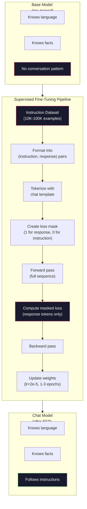

# Instruction Tuning (SFT) · 指令微调（SFT）

> A base model predicts the next token. That's it. It doesn't follow instructions, answer questions, or refuse harmful requests. SFT is the bridge between a token predictor and a useful assistant. Every model you've ever talked to -- Claude, GPT, Llama Chat -- went through this step.

**Type:** Build
**Languages:** Python (with numpy)
**Prerequisites:** Phase 10, Lesson 04 (Pre-Training a Mini GPT)
**Time:** ~90 minutes

## Learning Objectives · 学习目标

- 实现监督微调（supervised fine-tuning, SFT），把一个基座语言模型变成指令跟随（instruction-following）助手
- 用带 system、user、assistant 角色的聊天模板（chat template）格式化训练数据，并对非 assistant token 做损失掩码（loss masking）
- 解释 SFT 为什么必要：基座模型只会续写文本，而不是回答问题
- 通过对比基座模型与微调后模型在留出（held-out）指令集上的回答，评估 SFT 质量

> Implement supervised fine-tuning (SFT) that converts a base language model into an instruction-following assistant
> Format training data using chat templates with system, user, and assistant roles, and mask loss on non-assistant tokens
> Explain why SFT is necessary: base models continue text rather than answer questions
> Evaluate SFT quality by comparing base model vs fine-tuned model responses on a held-out instruction set

## The Problem · 问题在哪

你在第 04 课训练了一个模型。它能根据一个序列预测下一个 token。喂给它 "The transformer architecture"，它可能会续写出 "has revolutionized natural language processing"。对一个下一 token 预测器来说，这已经令人印象深刻。

现在试试这样：喂给它 "What is the capital of France?"。基座模型不会回答 "Paris"，而是延续这个模式。它可能生成 "What is the capital of Germany? What is the capital of Spain?"，因为它从包含问题列表的文档里学到过这种模式；也可能生成 "is a question that many people ask"，因为这是一个说得通的下一 token 续写。模型没有「回答」的概念，它只懂「续写」。

这正是 GPT-3（基座模型，2020 年 6 月发布）与 ChatGPT（指令微调版，2022 年 11 月发布）之间的差距。相同的架构，相同的预训练，差别在于 2 万到 10 万条精心构造的（指令，回复）对——是它们教会了模型跟随对话模式。

Stanford Alpaca 证明你不需要上百万条样本。2023 年 3 月，他们只用 52,000 条由 GPT-3.5 生成的指令-回复对微调了 Llama 7B，总成本 600 美元。产物是一个能跟随指令、回答问题、进行对话的聊天机器人。虽然比不上 ChatGPT，但对 600 美元加几个小时训练来说，已经接近得令人吃惊。

Meta 的 Llama 2 Chat 在初始 SFT 阶段只用了约 27,000 条高质量样本。关键洞见：质量比数量更重要。27,000 条由熟练标注员写出的样本，胜过从互联网上扒来的 100 万条噪声样本。

> You trained a model in Lesson 04. It can predict the next token given a sequence... The model has no concept of *answering*. It only knows *continuing*.
> This is the gap between GPT-3 (base model, released June 2020) and ChatGPT (instruction-tuned, released November 2022). Same architecture. Same pre-training. The difference is 20,000 to 100,000 carefully crafted (instruction, response) pairs that taught the model to follow the conversation pattern.
> Stanford Alpaca proved you don't need millions of examples. In March 2023, they fine-tuned Llama 7B on just 52,000 instruction-response pairs generated by GPT-3.5. Total cost: $600.
> Meta's Llama 2 Chat used only ~27,000 high-quality examples for its initial SFT stage. The key insight: quality matters more than quantity. 27,000 examples written by skilled annotators beat 1 million noisy examples scraped from the internet.

## The Concept · 概念

### What SFT Actually Does · SFT 到底在做什么

监督微调（Supervised Fine-Tuning）延续预训练中同一个训练循环——前向传播、计算损失、反向传播、更新权重——只是换了一种数据。训练对象不再是原始文本，而是结构化的对话：

```json
{
  "system": "You are a helpful assistant.",
  "user": "What is the capital of France?",
  "assistant": "The capital of France is Paris."
}
```

模型早就知道巴黎是法国首都——这是它在预训练时从维基百科、教科书和网页里学到的。SFT 不是教模型新的事实，而是教模型一种新*行为*：看到问题，就产出答案；看到指令，就产出补全；看到有害请求，就产出拒绝。

可以这样理解：预训练给模型知识，SFT 给模型规矩。

> Supervised Fine-Tuning continues the same training loop from pre-training -- forward pass, compute loss, backward pass, update weights -- but on a different kind of data. Instead of raw text, you train on structured conversations:
> The model already knows that Paris is the capital of France. It learned this during pre-training on Wikipedia, textbooks, and web pages. SFT doesn't teach the model new facts. It teaches the model a new *behavior*: when you see a question, produce an answer. When you see an instruction, produce a completion. When you see a harmful request, produce a refusal.
> Think of it this way. Pre-training gives the model knowledge. SFT gives the model manners.

### Data Formats · 数据格式

三种格式主导业界。它们用不同的分隔符编码同样的信息——谁说了什么。

**Alpaca 格式**（Stanford，2023 年 3 月）：

```json
{
  "instruction": "Summarize the following article in 3 sentences.",
  "input": "The European Central Bank raised interest rates...",
  "output": "The ECB increased rates by 25 basis points..."
}
```

简单，且使用广泛。`input` 字段是可选的——很多指令不需要额外的上下文。Stanford 以这种格式发布了 52,000 条由 GPT-3.5 花 600 美元生成的样本，由此点燃了开源指令微调运动。

**ShareGPT 格式**（社区，2023）：

```json
{
  "conversations": [
    {"from": "system", "value": "You are a helpful assistant."},
    {"from": "human", "value": "What causes tides?"},
    {"from": "gpt", "value": "Tides are caused by the gravitational pull of the Moon..."},
    {"from": "human", "value": "How often do they occur?"},
    {"from": "gpt", "value": "Most coastal areas experience two high tides and two low tides per day..."}
  ]
}
```

支持多轮对话。按惯例，`from` 字段用 "human" 和 "gpt"，与实际是哪个模型无关。Vicuna 用从用户分享的 ChatGPT 聊天记录中扒出的 70,000 段 ShareGPT 对话训练而成。

**ChatML 格式**（OpenAI，众多开源模型采用）：

```
<|im_start|>system
You are a helpful assistant.<|im_end|>
<|im_start|>user
What is the capital of France?<|im_end|>
<|im_start|>assistant
The capital of France is Paris.<|im_end|>
```

用特殊 token（`<|im_start|>`、`<|im_end|>`）来界定角色。这些 token 会在微调时加入分词器的词表。Qwen、Yi 以及许多其他模型都在用 ChatML。

三种格式完成的是同一件事：告诉模型「这是指令，这是回复，学会这个模式」。

> Three formats dominate the industry. Each encodes the same information -- who said what -- with different delimiters.
> Simple and widely used. The `input` field is optional -- many instructions don't need additional context. Stanford released 52,000 examples in this format, generated by GPT-3.5 for $600. This kicked off the open-source instruction tuning movement.
> Supports multi-turn conversations. The "from" field uses "human" and "gpt" by convention, regardless of the actual model. Vicuna was trained on 70,000 ShareGPT conversations scraped from user-shared ChatGPT transcripts.
> Uses special tokens (`<|im_start|>`, `<|im_end|>`) to delimit roles. These tokens are added to the tokenizer's vocabulary during fine-tuning. Qwen, Yi, and many other models use ChatML.
> All three formats accomplish the same thing: they tell the model "this is the instruction, this is the response, learn this pattern."

### Why It Works · 为什么有效

模型在预训练时就已经掌握了语言。它见过数十亿个「问题后跟答案」「指令后跟补全」「人对人对话」的例子。这些模式早已编码在权重里。

SFT 把这种潜在能力聚焦激发出来。模型不必再从上下文里猜测自己该回答问题还是续写文档——SFT 直接在对话模式上做显式训练。几千条样本之后，模型就学到了：看到 assistant 角色标记，就产出有帮助的回复。

这就是为什么 27,000 条样本就够了。你不是在教模型英语，也不是在教它世界知识，你只是在教它一个简单的行为：响应指令。知识本来就在那里。

> The model already knows language from pre-training. It has seen billions of examples of questions followed by answers, instructions followed by completions, and conversations between people. The patterns are already encoded in the weights.
> SFT concentrates this latent ability. Instead of the model needing to figure out from context whether it should answer a question or continue a document, SFT explicitly trains on the conversation pattern. After a few thousand examples, the model learns: when you see the assistant role marker, produce a helpful response.
> This is why 27,000 examples is enough. You're not teaching the model English. You're not teaching it facts about the world. You're teaching it one simple behavior: respond to instructions. The knowledge was already there.

### The Masked Loss · 掩码损失

这是 SFT 里最重要的技术细节，而大多数教程都跳过了它。

预训练时，你对每个 token 都计算损失，模型学习预测序列中的每一个下一 token。SFT 时，你只在*回复* token 上计算损失。指令 token 在那里是提供上下文的，模型不会因为「没预测对」这些 token 而被惩罚。

为什么？因为你不想让模型学会*生成*指令，你想让它学会*响应*指令。如果在指令 token 上也计算损失，你就是在训练模型去预测 "What is the capital of France?"，仿佛提问的是它自己。这浪费梯度信号，还会让模型对自身角色产生混乱。

实践中，你构造一个损失掩码（loss mask）：回复 token 为 1，指令 token 为 0，取平均之前先把逐 token 损失乘上这个掩码。

```
Tokens:    [SYS] You are helpful [USER] What is the capital? [ASST] Paris is the capital [EOS]
Loss mask:   0    0    0     0      0     0   0  0     0       1     1    1   1     1      1
```

只有 `[ASST]` 之后的 token 参与损失。前向传播时模型看到完整对话（它需要指令才能生成正确的回复），但权重只根据它把回复预测得有多好来更新。

> This is the most important technical detail in SFT, and most tutorials skip it.
> During pre-training, you compute loss on every token. The model learns to predict every next token in the sequence. During SFT, you only compute loss on the *response* tokens. The instruction tokens are there for context, but the model is not penalized for "predicting" them incorrectly.
> Why? Because you don't want the model to learn to *generate* instructions. You want it to learn to *respond to* instructions.
> In practice, you create a loss mask: 1 for response tokens, 0 for instruction tokens. Multiply the per-token loss by this mask before averaging.
> Only the tokens after `[ASST]` contribute to the loss. The model sees the full conversation during the forward pass (it needs the instruction to produce the right response) but only updates its weights based on how well it predicted the response.

### Training Hyperparameters · 训练超参数

SFT 使用的超参数与预训练差别巨大。你不是从零开始训练，而是在调整一个已经能用的模型。

| 参数 | 预训练（Llama 2 7B） | SFT（Llama 2 Chat） |
|------|---------------------|---------------------|
| 学习率（Learning rate） | 3e-4（峰值） | 2e-5 |
| 轮数（Epochs） | 1（数据过一遍） | 2 |
| 批大小（Batch size） | 4M tokens | 64 条样本 |
| Warmup 步数 | 2,000 | 0-100 |
| 权重衰减（Weight decay） | 0.1 | 0.0-0.1 |
| 数据规模 | 2T tokens | 27,000 条样本 |

SFT 的学习率低了 15 倍。这一点至关重要。微调时学习率过高会摧毁预训练学到的知识——模型会「忘记」学过的内容，并对小小的微调数据集过拟合。这就是灾难性遗忘（catastrophic forgetting）。

两个 epoch 意味着每条训练样本模型看两遍。在小数据集上超过 3 个 epoch 会导致记忆化——模型开始逐字复述训练样本，而不是泛化。

> SFT uses dramatically different hyperparameters than pre-training. You're not training from scratch. You're adjusting a model that already works.
> The learning rate is 15x lower for SFT. This is critical. A high learning rate during fine-tuning destroys the pre-trained knowledge. The model "forgets" what it learned and overfits to the small fine-tuning dataset. This is catastrophic forgetting.
> Two epochs means the model sees each training example twice. More than 3 epochs on a small dataset leads to memorization -- the model starts reproducing training examples verbatim instead of generalizing.

### Catastrophic Forgetting · 灾难性遗忘

微调可能摧毁通用能力。在指令跟随数据上训练太久，模型会失去写代码、做数学、产出创意文本的能力。它会变得非常擅长训练数据的那种特定格式，而对其他一切都很糟糕。

三种缓解手段：

1. **低学习率。** 1e-5 到 5e-5。更小的更新意味着对预训练特征的破坏更小。

2. **短训练。** 1-3 个 epoch。在模型过拟合之前停下。

3. **混入预训练数据。** Llama 2 Chat 把一小部分（2-5%）原始预训练数据混入了 SFT 数据集。这能在学习新的指令跟随行为的同时，「提醒」模型别丢掉自己的通用能力。

> Fine-tuning can destroy general capabilities. Train too long on instruction-following data and the model loses its ability to write code, do math, or produce creative text. It becomes very good at the specific format of its training data and terrible at everything else.
> Three mitigations:
> 1. **Low learning rate.** 1e-5 to 5e-5. Smaller updates mean less destruction of pre-trained features.
> 2. **Short training.** 1-3 epochs. Stop before the model overfits.
> 3. **Mix in pre-training data.** Llama 2 Chat mixed a small percentage (2-5%) of raw pre-training data into the SFT dataset. This "reminds" the model of its general capabilities while learning the new instruction-following behavior.

### Real Numbers · 真实数字

在单张 NVIDIA A100 80GB GPU 上，用 10,000 条高质量指令对微调一个 7B 模型大约需要 1 小时。算一下这笔账：

- 10,000 条样本 x 平均 512 tokens = 5.12M tokens
- 2 个 epoch = 共 10.24M tokens
- 7B 模型微调时 A100 吞吐：~3,000 tokens/秒
- 10.24M / 3,000 = ~3,400 秒 = ~57 分钟

对我们的迷你 GPT（4 层、128 维）来说，训练几乎瞬间完成。重点是理解机制，而不是规模。



```figure
loss-masking
```

> Fine-tuning a 7B model on 10,000 high-quality instruction pairs takes approximately 1 hour on a single NVIDIA A100 80GB GPU. Here's the math:
> - 10,000 examples x 512 tokens average = 5.12M tokens
> - 2 epochs = 10.24M tokens total
> - A100 throughput for 7B model fine-tuning: ~3,000 tokens/second
> - 10.24M / 3,000 = ~3,400 seconds = ~57 minutes
> For our mini GPT (4 layers, 128 dims), training is nearly instant. The point is understanding the mechanics, not the scale.

## Build It · 动手造

### Step 1: Instruction Dataset · 指令数据集

构造一个合成的指令数据集。在生产环境中，Scale AI 和 Anthropic 这类公司会雇人类标注员来编写这些数据。我们用程序生成，以演示这种格式。

```python
import numpy as np

INSTRUCTION_DATA = [
    {
        "instruction": "What is the capital of France?",
        "response": "The capital of France is Paris."
    },
    {
        "instruction": "Explain gravity in one sentence.",
        "response": "Gravity is the force that attracts objects with mass toward each other."
    },
    {
        "instruction": "Write a haiku about the ocean.",
        "response": "Waves crash on the shore, salt and foam beneath the sun, endless blue expanse."
    },
    {
        "instruction": "What is 15 multiplied by 7?",
        "response": "15 multiplied by 7 is 105."
    },
    {
        "instruction": "Name three programming languages.",
        "response": "Three programming languages are Python, Rust, and TypeScript."
    },
    {
        "instruction": "Summarize photosynthesis.",
        "response": "Photosynthesis converts sunlight, water, and carbon dioxide into glucose and oxygen."
    },
    {
        "instruction": "What year did World War II end?",
        "response": "World War II ended in 1945."
    },
    {
        "instruction": "Define machine learning.",
        "response": "Machine learning is a field where algorithms learn patterns from data to make predictions."
    },
]
```

8 条样本非常少。Stanford Alpaca 用了 52,000 条。但不管你有 8 条还是 52,000 条，机制完全一样：分词、掩码、只在回复上计算损失。

> Create a synthetic instruction dataset. In production, companies like Scale AI and Anthropic employ human annotators to write these. We'll create them programmatically to demonstrate the format.
> Eight examples is tiny. Stanford Alpaca used 52,000. But the mechanics are identical whether you have 8 or 52,000: tokenize, mask, compute loss on responses only.

### Step 2: Tokenize with Chat Template · 用聊天模板分词

把指令-回复对转换成带特殊角色标记的 token 序列。这些标记告诉模型指令在哪里结束、回复从哪里开始。

```python
SPECIAL_TOKENS = {
    "INST_START": 253,
    "INST_END": 254,
    "RESP_START": 255,
}


def tokenize_instruction_pair(instruction, response, vocab_size=256):
    inst_tokens = list(instruction.encode("utf-8"))
    resp_tokens = list(response.encode("utf-8"))

    inst_tokens = [min(t, vocab_size - 4) for t in inst_tokens]
    resp_tokens = [min(t, vocab_size - 4) for t in resp_tokens]

    tokens = (
        [SPECIAL_TOKENS["INST_START"]]
        + inst_tokens
        + [SPECIAL_TOKENS["INST_END"]]
        + [SPECIAL_TOKENS["RESP_START"]]
        + resp_tokens
    )

    return tokens


def create_loss_mask(tokens):
    mask = np.zeros(len(tokens), dtype=np.float32)
    in_response = False

    for i, token in enumerate(tokens):
        if token == SPECIAL_TOKENS["RESP_START"]:
            in_response = True
            continue
        if in_response:
            mask[i] = 1.0

    return mask
```

损失掩码在指令 token 上全为 0，在回复 token 上全为 1。`RESP_START` 这个 token 本身的掩码是 0，因为它是分隔符，不属于回复内容。

> Convert instruction-response pairs into token sequences with special role markers. The markers tell the model where the instruction ends and where the response begins.
> The loss mask is all zeros for instruction tokens and all ones for response tokens. The `RESP_START` token itself gets a mask of 0 because it's a delimiter, not part of the response content.

### Step 3: Masked Cross-Entropy Loss · 掩码交叉熵损失

标准交叉熵，只是乘上损失掩码。只有回复 token 对梯度有贡献。

```python
def masked_cross_entropy_loss(logits, targets, loss_mask):
    batch, seq_len, vocab_size = logits.shape
    logits_flat = logits.reshape(-1, vocab_size)
    targets_flat = targets.reshape(-1)
    mask_flat = loss_mask.reshape(-1)

    max_logits = logits_flat.max(axis=-1, keepdims=True)
    log_softmax = logits_flat - max_logits - np.log(
        np.exp(logits_flat - max_logits).sum(axis=-1, keepdims=True)
    )

    per_token_loss = -log_softmax[np.arange(len(targets_flat)), targets_flat]

    masked_loss = per_token_loss * mask_flat
    num_response_tokens = mask_flat.sum()
    if num_response_tokens == 0:
        return 0.0
    loss = masked_loss.sum() / num_response_tokens

    return loss
```

分母是 `num_response_tokens`，不是 `seq_len`。如果除以序列总长，长指令会稀释梯度信号。除以回复 token 数能保证每个回复 token 权重相等，与指令长短无关。

> Standard cross-entropy, but multiplied by the loss mask. Only response tokens contribute to the gradient.
> The denominator is `num_response_tokens`, not `seq_len`. If you divide by the total sequence length, longer instructions dilute the gradient signal. Dividing by response token count ensures equal weight per response token regardless of instruction length.

### Step 4: SFT Training Loop · SFT 训练循环

复用第 04 课的 MiniGPT。训练循环看起来和预训练几乎一样，只是加了指令格式化和掩码损失。

```python
import sys
import os
sys.path.insert(0, os.path.join(os.path.dirname(__file__), "..", "..", "04-pre-training-mini-gpt", "code"))
from main import MiniGPT, LayerNorm, FeedForward, MultiHeadAttention, TransformerBlock, Embedding


def sft_train(model, dataset, num_epochs=2, lr=2e-5, seq_len=64):
    formatted_data = []
    for example in dataset:
        tokens = tokenize_instruction_pair(example["instruction"], example["response"])
        mask = create_loss_mask(tokens)
        formatted_data.append((tokens, mask))

    print(f"SFT Training: {len(formatted_data)} examples, {num_epochs} epochs, lr={lr}")
    print(f"Total tokens: {sum(len(t) for t, _ in formatted_data):,}")
    print()

    losses = []

    for epoch in range(num_epochs):
        epoch_loss = 0.0
        num_batches = 0

        indices = np.random.permutation(len(formatted_data))

        for idx in indices:
            tokens, mask = formatted_data[idx]

            if len(tokens) < 3:
                continue
            if len(tokens) > seq_len:
                tokens = tokens[:seq_len]
                mask = mask[:seq_len]

            input_ids = np.array(tokens[:-1]).reshape(1, -1)
            target_ids = np.array(tokens[1:]).reshape(1, -1)
            loss_mask = np.array(mask[1:]).reshape(1, -1)

            logits = model.forward(input_ids)
            loss = masked_cross_entropy_loss(logits, target_ids, loss_mask)

            batch_size, s_len, v_size = logits.shape
            probs = np.exp(logits - logits.max(axis=-1, keepdims=True))
            probs = probs / probs.sum(axis=-1, keepdims=True)
            dlogits = probs.copy()
            dlogits[np.arange(batch_size)[:, None], np.arange(s_len), target_ids] -= 1.0

            mask_expanded = loss_mask[:, :, np.newaxis]
            num_resp = loss_mask.sum()
            if num_resp > 0:
                dlogits = dlogits * mask_expanded / num_resp

            for block in model.blocks:
                block.ffn.W1 -= lr * np.random.randn(*block.ffn.W1.shape) * 0.01
                block.ffn.W2 -= lr * np.random.randn(*block.ffn.W2.shape) * 0.01
                block.ffn.b1 -= lr * np.random.randn(*block.ffn.b1.shape) * 0.01
                block.ffn.b2 -= lr * np.random.randn(*block.ffn.b2.shape) * 0.01

            epoch_loss += loss
            num_batches += 1
            losses.append(loss)

        avg_loss = epoch_loss / max(num_batches, 1)
        print(f"Epoch {epoch + 1}/{num_epochs} | Avg Loss: {avg_loss:.4f}")

    return model, losses
```

学习率是 2e-5，与 Llama 2 Chat 一致。对比预训练用的 3e-4——小了 15 倍。梯度是掩码过的：指令 token 产生的梯度为零，只有回复 token 在推动权重。

> Reuse the MiniGPT from Lesson 04. The training loop looks almost identical to pre-training, but with instruction formatting and masked loss.
> The learning rate is 2e-5, matching Llama 2 Chat. Compare this to the 3e-4 used in pre-training -- 15x smaller. The gradient is masked: instruction tokens produce zero gradient. Only response tokens push the weights.

### Step 5: Compare Base vs SFT Model · 对比基座模型与 SFT 模型

SFT 的全部意义就在于行为改变。我们通过观察模型对「指令格式输入」与「原始文本续写」的不同响应来度量它。

```python
def generate_response(model, prompt_tokens, max_new_tokens=50, temperature=0.8):
    tokens = list(prompt_tokens)
    seq_len = model.embedding.pos_embed.shape[0]

    for _ in range(max_new_tokens):
        context = np.array(tokens[-seq_len:]).reshape(1, -1)
        logits = model.forward(context)
        next_logits = logits[0, -1, :]

        next_logits = next_logits / max(temperature, 1e-8)
        probs = np.exp(next_logits - next_logits.max())
        probs = probs / probs.sum()
        probs = np.clip(probs, 1e-10, 1.0)
        probs = probs / probs.sum()

        next_token = np.random.choice(len(probs), p=probs)
        tokens.append(int(next_token))

    return tokens


def evaluate_instruction_following(model, instructions):
    print("Evaluating instruction following:")
    print("-" * 50)

    for instruction in instructions:
        tokens = (
            [SPECIAL_TOKENS["INST_START"]]
            + [min(t, 252) for t in list(instruction.encode("utf-8"))]
            + [SPECIAL_TOKENS["INST_END"]]
            + [SPECIAL_TOKENS["RESP_START"]]
        )

        output = generate_response(model, tokens, max_new_tokens=30, temperature=0.6)
        response_start = len(tokens)
        response_tokens = output[response_start:]
        response_bytes = bytes([t for t in response_tokens if t < 128])
        response_text = response_bytes.decode("utf-8", errors="replace")

        print(f"  Q: {instruction}")
        print(f"  A: {response_text[:80]}")
        print()
```

在只有 8 条样本的小模型上，回复不会有意义。这是预期之中的。重要的是*结构*：模型学会在回复标记之后生成输出，而不是继续生成更多指令。

> The whole point of SFT is behavioral change. Let's measure it by checking how the model responds to instruction-formatted inputs versus raw text continuations.
> On a tiny model with 8 examples, the responses won't be meaningful. That's expected. The important thing is the *structure*: the model learns to produce output after the response marker instead of continuing to generate more instructions.

### Step 6: Measure Catastrophic Forgetting · 测量灾难性遗忘

对比 SFT 前后模型的下一 token 预测能力。如果 SFT 损伤了通用能力，原始文本上的损失就会上升。

```python
def measure_forgetting(model, test_text, seq_len=64):
    tokens = np.array(list(test_text.encode("utf-8")[:512]))

    total_loss = 0.0
    num_windows = 0

    for start in range(0, len(tokens) - seq_len - 1, seq_len):
        input_ids = tokens[start:start + seq_len].reshape(1, -1)
        target_ids = tokens[start + 1:start + seq_len + 1].reshape(1, -1)

        logits = model.forward(input_ids)

        batch, s_len, vocab_size = logits.shape
        logits_flat = logits.reshape(-1, vocab_size)
        targets_flat = target_ids.reshape(-1)

        max_logits = logits_flat.max(axis=-1, keepdims=True)
        log_softmax = logits_flat - max_logits - np.log(
            np.exp(logits_flat - max_logits).sum(axis=-1, keepdims=True)
        )

        loss = -log_softmax[np.arange(len(targets_flat)), targets_flat].mean()
        total_loss += loss
        num_windows += 1

    return total_loss / max(num_windows, 1)
```

真实微调中，你会在整个训练过程中跟踪这个指标。如果原始文本损失上升超过 10-15%，说明你的 SFT 太激进了。降低学习率或减少 epoch 数。

> Compare the model's next-token prediction ability before and after SFT. If SFT damages general capabilities, the loss on raw text will increase.
> In real fine-tuning, you would track this metric throughout training. If the raw text loss increases by more than 10-15%, your SFT is too aggressive. Lower the learning rate or reduce the number of epochs.

## Use It · 实战用法

### Full SFT Pipeline Demo · 完整 SFT 流水线演示

```python
if __name__ == "__main__":
    np.random.seed(42)

    test_text = """The transformer architecture processes sequences through self-attention.
Each layer applies multi-head attention followed by a feedforward network.
Residual connections and layer normalization stabilize deep networks.
The model learns to predict the next token given all previous tokens."""

    print("=" * 70)
    print("INSTRUCTION TUNING (SFT) DEMO")
    print("=" * 70)
    print()

    model = MiniGPT(
        vocab_size=256, embed_dim=128, num_heads=4,
        num_layers=4, max_seq_len=128, ff_dim=512
    )
    print(f"Model: {model.count_parameters():,} parameters")
    print(f"Config: 4 layers, 4 heads, 128 dims (mini GPT from Lesson 04)")
    print()

    print("PRE-SFT: Measuring base model loss on raw text")
    base_loss = measure_forgetting(model, test_text)
    print(f"  Base model loss: {base_loss:.4f}")
    print()

    print("=" * 70)
    print("SFT TRAINING")
    print("=" * 70)

    model, losses = sft_train(
        model, INSTRUCTION_DATA, num_epochs=3, lr=2e-5, seq_len=128
    )

    print()
    print("POST-SFT: Measuring fine-tuned model loss on raw text")
    sft_loss = measure_forgetting(model, test_text)
    print(f"  SFT model loss: {sft_loss:.4f}")
    print(f"  Change: {((sft_loss - base_loss) / base_loss * 100):+.1f}%")
    if abs(sft_loss - base_loss) / base_loss < 0.15:
        print("  Minimal forgetting (< 15% change)")
    else:
        print("  Significant forgetting detected")
    print()

    print("=" * 70)
    print("INSTRUCTION FOLLOWING EVALUATION")
    print("=" * 70)
    print()

    test_instructions = [
        "What is the capital of France?",
        "Name a programming language.",
        "Define gravity.",
    ]
    evaluate_instruction_following(model, test_instructions)

    print("=" * 70)
    print("DATA FORMAT EXAMPLES")
    print("=" * 70)
    print()

    for i, example in enumerate(INSTRUCTION_DATA[:3]):
        tokens = tokenize_instruction_pair(example["instruction"], example["response"])
        mask = create_loss_mask(tokens)
        resp_count = int(mask.sum())
        total_count = len(tokens)
        print(f"  Example {i + 1}: {total_count} tokens, {resp_count} response tokens ({resp_count/total_count:.0%} of sequence)")
        print(f"    Instruction: {example['instruction']}")
        print(f"    Response: {example['response']}")
        print()

    print("=" * 70)
    print("TRAINING LOSS CURVE")
    print("=" * 70)
    print()

    if losses:
        window = max(1, len(losses) // 5)
        for i in range(0, len(losses), window):
            chunk = losses[i:i + window]
            avg = sum(chunk) / len(chunk)
            print(f"  Steps {i:3d}-{i + len(chunk) - 1:3d}: avg loss = {avg:.4f}")
```

## Ship It · 交付

本课产出 `outputs/prompt-sft-data-curator.md`——一个帮你设计并策划 SFT 指令数据集的提示词。给定一个目标能力（代码生成、数学、对话），它会产出一份数据收集计划，包含格式规范、质量标准和多样性要求。

> This lesson produces `outputs/prompt-sft-data-curator.md` -- a prompt that helps you design and curate instruction datasets for SFT. Given a target capability (code generation, math, conversation), it produces a data collection plan with format specifications, quality criteria, and diversity requirements.

## Exercises · 练习

1. 添加 system prompt 支持。修改 `tokenize_instruction_pair`，让它接受一条 system 消息并把它插到指令之前。创建 5 条使用不同 system prompt（"You are a poet"、"You are a math tutor"）的样本，并验证模型在训练时能看到不同的 system prompt。

2. 实现数据混合。写一个函数，输入一个 SFT 数据集和一个原始文本语料，产出的训练 batch 中 5% 的样本是原始文本（不掩码）、95% 是指令对（掩码）。跑 3 个 epoch，把遗忘指标与纯 SFT 训练对比。

3. 构建一个数据质量评分器。对每条指令-回复对，计算：(a) 回复的 token 长度，(b) 指令与回复的长度比，(c) 词汇多样性（去重 token 数 / 总 token 数）。过滤掉回复长度 < 10 个 token 或多样性 < 0.3 的样本，展示过滤对最终损失的影响。

4. 实现多轮对话训练。扩展分词逻辑以处理 3 轮对话（user-assistant-user-assistant-user-assistant）。损失掩码应覆盖全部三个 assistant 轮次。打印一条样本的 token-掩码对齐情况，验证掩码正确。

5. 对比学习率。用 lr=1e-4、lr=2e-5、lr=1e-6 各训练同一个模型一次，画出损失曲线。1e-4 那次应该初期下降很快但最终损失更高（过拟合）；1e-6 那次几乎不动；2e-5 那次应该是最佳点。

## Key Terms · 术语表

| 术语 | 大家怎么说 | 实际含义 |
|------|----------------|----------------------|
| SFT | "在对话上做微调" | Supervised Fine-Tuning：在（指令，回复）对上继续训练，损失只在回复 token 上计算 |
| Instruction tuning | "教模型跟随指令" | 在显式的指令-回复对上训练，让基座模型学会的是对话模式，而不是新知识 |
| Loss masking | "把提示词忽略掉" | 把指令 token 的损失置为 0，使梯度只来自回复 token 的预测 |
| ChatML | "Chat Markup Language" | 一种 token 格式，用 `<\|im_start\|>` 和 `<\|im_end\|>` 分隔符标记对话数据中的说话者角色 |
| Alpaca format | "Stanford 的格式" | 含 instruction/input/output 字段的 JSON 格式，用于 52K 条成本 600 美元的 GPT-3.5 生成样本 |
| Catastrophic forgetting | "模型变笨了" | 微调摧毁预训练能力，因为梯度更新用任务特定模式覆盖了通用知识 |
| Weight tying | "共享嵌入" | 输入 token 嵌入与输出预测头共用同一个矩阵，节省参数并提升连贯性 |
| Chat template | "提示词怎么格式化" | 为模型构造对话所用的具体 token 序列（角色标记、分隔符） |

## Further Reading · 延伸阅读

- [Ouyang et al., 2022 -- "Training language models to follow instructions with human feedback" (InstructGPT)](https://arxiv.org/abs/2203.02155) —— 在 OpenAI 引入指令微调 + RLHF 的论文
- [Taori et al., 2023 -- "Stanford Alpaca: An Instruction-following LLaMA Model"](https://github.com/tatsu-lab/stanford_alpaca) —— 600 美元搞定 52K 条指令样本，证明 SFT 在小数据集上同样有效
- [Touvron et al., 2023 -- "Llama 2: Open Foundation and Fine-Tuned Chat Models"](https://arxiv.org/abs/2307.09288) —— Meta 用 27K 高质量样本搭建的 SFT + RLHF 流水线
- [Chiang et al., 2023 -- "Vicuna: An Open-Source Chatbot Impressing GPT-4"](https://lmsys.org/blog/2023-03-30-vicuna/) —— 用 70K 段 ShareGPT 对话训练
- [Zhou et al., 2023 -- "LIMA: Less Is More for Alignment"](https://arxiv.org/abs/2305.11206) —— 证明 1,000 条精心筛选的样本能媲美大得多的 SFT 数据集
