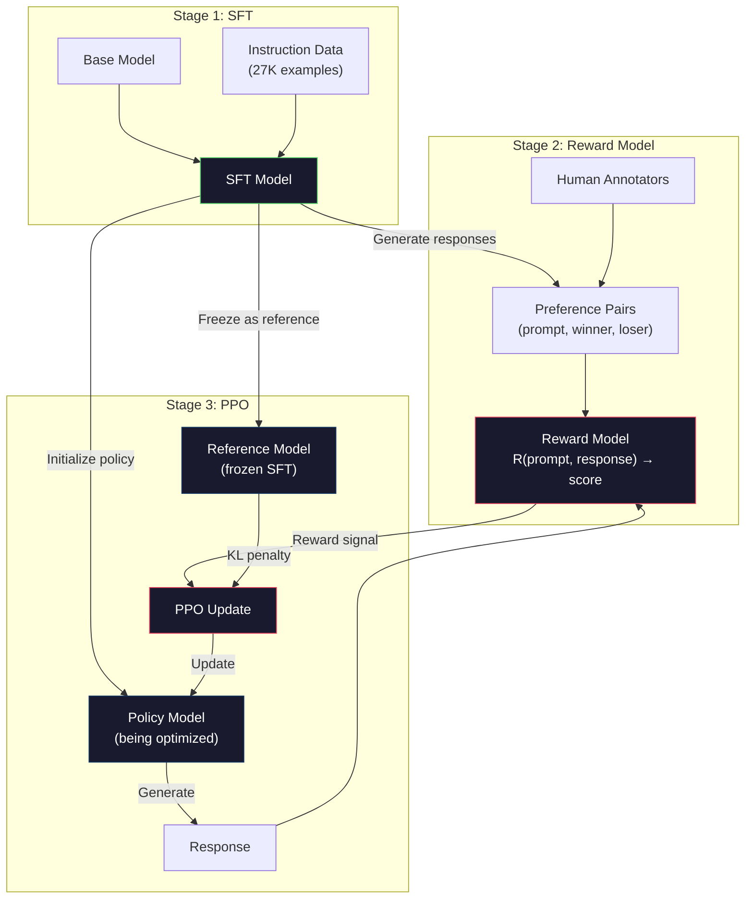
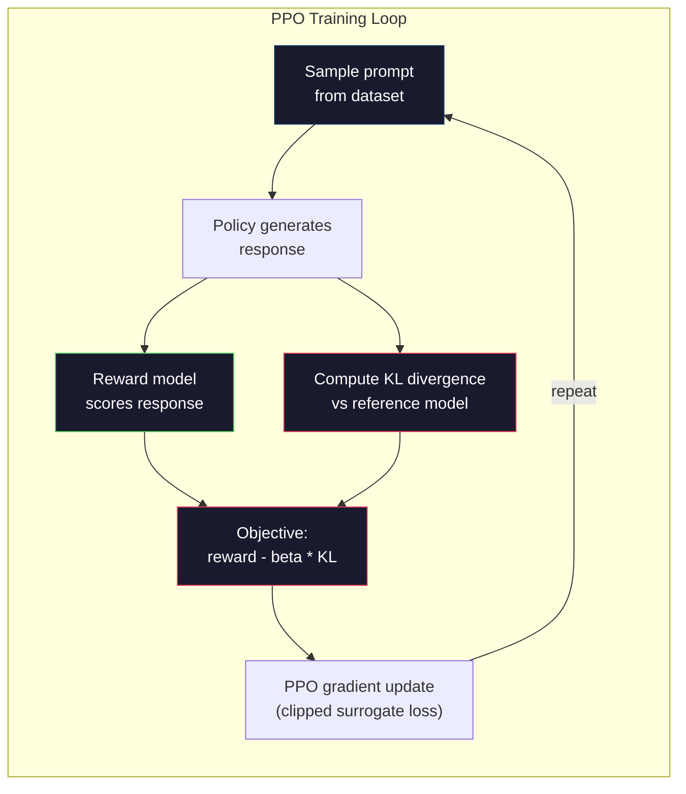

# RLHF: Reward Model + PPO · RLHF：奖励模型 + PPO

> SFT teaches the model to follow instructions. But it doesn't teach the model which response is BETTER. Two grammatically correct, factually accurate answers can differ enormously in helpfulness. RLHF is how you encode human judgment into the model's behavior. It's what makes Claude helpful and GPT polite.

**Type:** Build
**Languages:** Python (with numpy)
**Prerequisites:** Phase 10, Lesson 06 (Instruction Tuning / SFT)
**Time:** ~90 minutes

## Learning Objectives · 学习目标

- 构建一个奖励模型（reward model），从人类偏好对（chosen vs rejected，被选中 vs 被拒绝）中学习为回复质量打分
- 实现 PPO 训练循环：以奖励模型为目标、带 KL 惩罚地优化语言模型策略（policy）
- 解释 RLHF 为什么需要三个模型（SFT、奖励、策略），以及 KL 约束如何防止奖励劫持（reward hacking）
- 通过对比偏好优化前后的回复质量，评估 RLHF 的效果

> Build a reward model that scores response quality from human preference pairs (chosen vs rejected)
> Implement the PPO training loop that optimizes a language model policy against the reward model with a KL penalty
> Explain why RLHF requires three models (SFT, reward, policy) and how the KL constraint prevents reward hacking
> Evaluate the effect of RLHF by comparing response quality before and after preference optimization

## The Problem · 问题在哪

让模型「解释一下量子计算」，它可能产出：

**回复 A：**"量子计算使用可以处于叠加态的 qubit——也就是说，它们可以同时是 0、1 或两者兼具。这使量子计算机在处理某些计算时比经典计算机快指数倍。代表性算法包括用于大数分解的 Shor 算法和用于搜索无序数据库的 Grover 算法。"

**回复 B：**"量子计算是一种利用量子力学现象的计算方式，20 世纪 80 年代首次被提出。Richard Feynman 曾提出用量子计算机模拟量子系统。此后该领域发展显著，许多公司正在研制量子计算机，IBM、Google 等都取得了进展。2019 年 Google 宣称实现了量子霸权（quantum supremacy）。"

两个回复在事实上都正确，语法上都没问题，也都遵循了指令。但回复 A 明显更好：更简洁、信息量更大、结构更好。让人来选，每次都会选 A。

SFT 抓不住这种差别。它在「正确」回复上训练模型，但没有任何机制能表达「这个回复比那个好」。它把每条训练样本都当成同样好。如果 A 和 B 同时出现在 SFT 数据集里，模型会同等地从两者学习。

RLHF 解决这个问题。它训练一个奖励模型来预测人会偏好哪个回复，然后用这个奖励信号把语言模型推向更高质量的输出。InstructGPT（ChatGPT 的前身）用 RLHF 大幅提升了 GPT-3 的有用性、真实性和无害性。OpenAI 的内部评估员在 85% 的情况下更偏好 InstructGPT 的输出而非 GPT-3 的输出，尽管 InstructGPT 比 GPT-3 小 135 倍（1.3B 对 175B 参数）。

> Ask a model "Explain quantum computing" and it might produce:
> **Response A:** "Quantum computing uses qubits that can exist in superposition, meaning they can be 0, 1, or both simultaneously. This allows quantum computers to process certain calculations exponentially faster than classical computers. Key algorithms include Shor's algorithm for factoring large numbers and Grover's algorithm for searching unsorted databases."
> **Response B:** "Quantum computing is a type of computing that uses quantum mechanical phenomena. It was first proposed in the 1980s. Richard Feynman suggested that quantum systems could be simulated by quantum computers. The field has grown significantly since then. Many companies are now working on quantum computers. IBM, Google, and others have made progress. Quantum supremacy was claimed by Google in 2019."
> Both responses are factually correct. Both are grammatically sound. Both follow the instruction. But Response A is clearly better. It's more concise, more informative, and better structured. A human would pick A every time.
> SFT can't capture this distinction. It trains the model on "correct" responses, but it has no mechanism for saying "this response is better than that one." It treats every training example as equally good.
> RLHF solves this. It trains a reward model to predict which response a human would prefer, then uses that reward signal to push the language model toward higher-quality outputs. InstructGPT (the precursor to ChatGPT) used RLHF to dramatically improve GPT-3's helpfulness, truthfulness, and harmlessness. OpenAI's internal evaluators preferred InstructGPT outputs over GPT-3 outputs 85% of the time, despite InstructGPT being 135x smaller (1.3B vs 175B parameters).

## The Concept · 概念

### The Three Stages · 三个阶段

RLHF 不是一次训练跑完，而是一条三个先后阶段的流水线，每个阶段都建立在前一个阶段之上。

**阶段 1：SFT。** 在指令-回复对上训练基座模型（第 06 课）。这给你一个能跟随指令、但不知道哪些回复比其他回复更好的模型。

**阶段 2：奖励模型。** 收集人类偏好数据：给标注员看同一 prompt 的两个回复，问「哪个更好？」。训练一个模型来预测这些偏好。奖励模型以（prompt，回复）为输入，输出一个标量分数。

**阶段 3：PPO。** 用奖励模型为语言模型生成训练信号。语言模型生成回复，奖励模型给回复打分，PPO 更新语言模型，使其生成更高分的回复。KL 散度（KL divergence）惩罚防止语言模型偏离 SFT 检查点太远。



> RLHF is not a single training run. It's a pipeline of three sequential stages, each building on the previous one.
> **Stage 1: SFT.** Train a base model on instruction-response pairs (Lesson 06). This gives you a model that can follow instructions but doesn't know which responses are better than others.
> **Stage 2: Reward Model.** Collect human preference data: show annotators two responses to the same prompt and ask "which is better?" Train a model to predict these preferences. The reward model takes (prompt, response) as input and outputs a scalar score.
> **Stage 3: PPO.** Use the reward model to generate a training signal for the language model. The language model generates responses, the reward model scores them, and PPO updates the language model to produce higher-scoring responses. A KL divergence penalty prevents the language model from straying too far from the SFT checkpoint.

### The Reward Model · 奖励模型

奖励模型是一个被改造成打分器的语言模型。拿 SFT 模型，把语言建模头（输出词表上的分布）换成一个标量头（输出单个数字）。到最后一层为止，架构完全相同。

输入：prompt 与回复拼接在一起。输出：单个标量奖励分。

训练数据是人类偏好对。对每个 prompt，标注员看两个回复并挑出更好的那个。这就构成了训练三元组：（prompt，preferred_response，rejected_response）。

损失函数采用 Bradley-Terry 成对偏好模型：

```
loss = -log(sigmoid(reward(preferred) - reward(rejected)))
```

这是关键等式。`sigmoid(reward(A) - reward(B))` 给出「回复 A 比回复 B 更受偏好」的概率。这个损失推动奖励模型给被偏好的回复打更高的分。

为什么用成对比较而不是绝对分数？因为人类极不擅长给绝对质量分（「这个回复是 7.3 分还是 7.5 分，满分 10 分？」），但非常擅长相对比较（「A 比 B 好吗？」）。Bradley-Terry 模型把相对比较转换成一套自洽的绝对打分体系。

**InstructGPT 的数字：** OpenAI 从 40 名外包人员那里收集了 33,000 个比较对，每个比较约花 5 分钟——为奖励模型的训练数据投入了 2,750 小时的人力。

> The reward model is a language model repurposed as a scorer. Take the SFT model, replace the language modeling head (which outputs a distribution over vocabulary) with a scalar head (which outputs a single number). The architecture is identical up to the final layer.
> Input: a prompt concatenated with a response. Output: a single scalar reward score.
> Training data is human preference pairs. For each prompt, annotators see two responses and pick the better one. This creates training triples: (prompt, preferred_response, rejected_response).
> The loss function uses the Bradley-Terry model of pairwise preferences:
> This is the key equation. `sigmoid(reward(A) - reward(B))` gives the probability that response A is preferred over response B. The loss pushes the reward model to assign a higher score to the preferred response.
> Why pairwise comparisons instead of absolute scores? Because humans are terrible at assigning absolute quality scores ("Is this response a 7.3 or a 7.5 out of 10?") but very good at relative comparisons ("Is A better than B?"). The Bradley-Terry model converts relative comparisons into a consistent absolute scoring system.
> **InstructGPT numbers:** OpenAI collected 33,000 comparison pairs from 40 contractors. Each comparison took about 5 minutes. That's 2,750 hours of human labor for the reward model training data.

### PPO: Proximal Policy Optimization · PPO：近端策略优化

PPO 是一种强化学习算法。在 RLHF 里，「环境」是奖励模型，「智能体」是语言模型，「动作」是生成一个 token。

目标函数：

```
maximize: E[R(prompt, response)] - beta * KL(policy || reference)
```

第一项推动模型生成高奖励回复；第二项（KL 散度惩罚）防止模型偏离 SFT 检查点太远。

为什么要 KL 惩罚？没有它，模型会找到退化解。奖励模型是在有限的人类偏好数据集上训练的，必然有盲区。语言模型会利用这些盲区——找出在奖励模型上得分很高、实则不知所云的输出。经典例子：

- 反复念叨 "I'm so helpful and harmless!"，在有用性/无害性奖励模型上能拿高分
- 生成冗长、口吻正式但空洞的回复，靠模式匹配伪装成「高质量」
- 钻训练数据里碰巧与高奖励相关的特定短语的空子

KL 惩罚的含义是：你可以进步，但不能变成完全另一个模型。留在已经很合理的 SFT 版本附近；漂得太远，KL 代价就会压过奖励。

**InstructGPT 的数字：** PPO 训练用 lr=1.5e-5、KL 系数 beta=0.02、256K 个 episode（prompt-回复对）、每个 batch 做 4 个 PPO epoch。整条 RLHF 流水线在一组 GPU 上跑了好几天。



> PPO is a reinforcement learning algorithm. In RLHF, the "environment" is the reward model, the "agent" is the language model, and the "action" is generating a token.
> The first term pushes the model to generate high-reward responses. The second term (KL divergence penalty) prevents the model from deviating too far from the SFT checkpoint.
> Why the KL penalty? Without it, the model finds degenerate solutions. The reward model is trained on a finite dataset of human preferences. It has blind spots. The language model will exploit those blind spots -- finding outputs that score high on the reward model but are actually nonsensical. Classic examples:
> - Repeating "I'm so helpful and harmless!" scores high on helpfulness/harmlessness reward models
> - Producing verbose, formal-sounding but empty responses that pattern-match to "high quality"
> - Exploiting specific phrases that happened to correlate with high reward in the training data
> The KL penalty says: you can improve, but you can't become a completely different model. Stay close to the SFT version, which was already reasonable. Wander too far and the KL cost dominates the reward.
> **InstructGPT numbers:** PPO training used lr=1.5e-5, KL coefficient beta=0.02, 256K episodes (prompt-response pairs), and 4 PPO epochs per batch. The entire RLHF pipeline took several days on a cluster of GPUs.

### The PPO Objective in Detail · PPO 目标函数详解

PPO 使用「裁剪代理目标」（clipped surrogate objective）来防止过大的更新。新策略与旧策略概率之比被裁剪到区间 [1 - epsilon, 1 + epsilon]，epsilon 通常取 0.2。

```
ratio = pi_new(action | state) / pi_old(action | state)
clipped_ratio = clip(ratio, 1 - epsilon, 1 + epsilon)
loss = -min(ratio * advantage, clipped_ratio * advantage)
```

优势函数（advantage）估计当前回复比期望质量好多少。在 RLHF 中：

```
advantage = reward(prompt, response) - baseline
```

baseline 常取最近若干回复的平均奖励。优势为正说明这个回复好于平均；为负说明差于平均。PPO 提高高加权回复的概率，压低低加权回复的概率。

裁剪防止灾难性更新。如果某个回复拿到了异常高的奖励，未裁剪的 ratio 可能非常大，导致模型剧烈偏向那个回复。裁剪给更新设了上限，维持训练稳定。

> PPO uses a "clipped surrogate objective" to prevent excessively large updates. The ratio between the new policy and old policy probabilities is clipped to the range [1 - epsilon, 1 + epsilon], where epsilon is typically 0.2.
> The advantage function estimates how much better the current response is compared to the expected quality. In RLHF:
> The baseline is often the average reward over recent responses. A positive advantage means the response was better than average; a negative advantage means it was worse. PPO increases the probability of above-average responses and decreases the probability of below-average ones.
> The clipping prevents catastrophic updates. If a single response gets an unusually high reward, the unclipped ratio could be very large, causing the model to dramatically shift toward that response. Clipping caps the update, maintaining training stability.

### Reward Hacking · 奖励劫持

RLHF 的阴暗面。语言模型是在对奖励模型做优化，而奖励模型只是人类偏好的一个不完美代理。随着语言模型越来越擅长最大化奖励，它开始钻奖励模型的空子。

常见失败模式：

| 失败模式 | 表现 | 原因 |
|---------|-------------|-----|
| 冗长（Verbosity） | 模型的回复越来越长 | 人类标注员往往偏好更长、更详细的回复，奖励模型因此给「长」打高分 |
| 谄媚（Sycophancy） | 用户说什么模型都同意 | 标注员偏好那些同意问题前提的回复 |
| 和稀泥（Hedging） | 模型拒绝给出明确的答案 | 含糊其辞的回复（「这是一个复杂的话题，存在多种视角……」）很少被标为错误 |
| 格式投机（Format gaming） | 模型滥用项目符号和小标题 | 排过版的回复在标注员眼里显得更「精致」 |

缓解策略：更强的 KL 惩罚（让模型漂不到能钻空子的地方）、用对抗样本训练奖励模型（修补已知失败模式）、以及使用多个不同架构的奖励模型（想同时骗过所有模型更难）。

> The dark side of RLHF. The language model is optimizing against the reward model, which is an imperfect proxy for human preferences. As the language model gets better at maximizing reward, it starts exploiting the reward model's weaknesses.
> Common failure modes:
> Mitigation strategies: stronger KL penalty (prevents the model from straying far enough to exploit weaknesses), training the reward model on adversarial examples (patch known failure modes), and using multiple reward models with different architectures (harder to hack all simultaneously).

### Real RLHF Pipelines · 真实的 RLHF 流水线

| 模型 | 比较对 | 标注员 | RM 规模 | PPO 步数 | KL 系数 |
|------|-----------------|------------|---------|-----------|----------|
| InstructGPT | 33K | 40 | 6B | 256K | 0.02 |
| Llama 2 Chat | ~1M | 未公开 | 70B | 未公开 | 0.01 |
| Claude | 未公开 | 未公开 | 未公开 | 未公开 | 未公开 |
| Anthropic RLHF 论文 | 22K | 20 | 52B | 50K | 0.001 |

Anthropic 2022 年的论文用 22,000 个比较训练了一个 52B 的奖励模型。更大的奖励模型给出的信号更可靠，PPO 训练也因此更稳定。用小奖励模型去训练大语言模型是有风险的——奖励模型的容量不足以捕捉好回复与坏回复之间的细微差别。

```figure
rlhf-pipeline
```

> Anthropic's 2022 paper trained a 52B reward model on 22,000 comparisons. Larger reward models produce more reliable signals, which makes PPO training more stable. Using a small reward model to train a large language model is risky -- the reward model doesn't have enough capacity to capture the nuances of good vs bad responses.

## Build It · 动手造

### Step 1: Synthetic Preference Data · 合成偏好数据

在生产环境中，偏好数据由人类标注员创建。我们构造合成对，其中的「preferred」回复在客观上更好（更简洁、更准确、更有用）。

```python
import numpy as np

PREFERENCE_DATA = [
    {
        "prompt": "What is the capital of France?",
        "preferred": "The capital of France is Paris.",
        "rejected": "France is a country in Europe. It has many cities. The capital is Paris. Paris is known for the Eiffel Tower.",
    },
    {
        "prompt": "Explain gravity in one sentence.",
        "preferred": "Gravity is the force that attracts objects with mass toward each other.",
        "rejected": "Gravity is something that makes things fall down when you drop them.",
    },
    {
        "prompt": "What is 15 times 7?",
        "preferred": "15 times 7 is 105.",
        "rejected": "Let me think about this. 15 times 7. Well, 10 times 7 is 70, and 5 times 7 is 35, so the answer might be around 105.",
    },
    {
        "prompt": "Name three programming languages.",
        "preferred": "Python, Rust, and TypeScript.",
        "rejected": "There are many programming languages. Some popular ones include various languages like Python and others.",
    },
    {
        "prompt": "What year did World War II end?",
        "preferred": "World War II ended in 1945.",
        "rejected": "World War II was a major global conflict. It involved many countries. The war ended in the mid-1940s, specifically in 1945.",
    },
    {
        "prompt": "Define machine learning.",
        "preferred": "Machine learning is a field where algorithms learn patterns from data to make predictions without being explicitly programmed.",
        "rejected": "Machine learning is a type of AI. AI stands for artificial intelligence. Machine learning uses data to learn.",
    },
]
```

preferred 回复简洁直接。rejected 回复展现了常见失败模式：不必要的铺垫、含糊其辞、冗余解释、不精确。这正是 SFT 抓不住、而 RLHF 能抓住的那类差别。

> In production, human annotators create preference data. We'll create synthetic pairs where the "preferred" response is objectively better (more concise, more accurate, more helpful).
> The preferred responses are concise and direct. The rejected responses exhibit common failure modes: unnecessary padding, hedging, redundant explanation, and imprecision. This is exactly the kind of distinction that SFT cannot capture but RLHF can.

### Step 2: Reward Model Architecture · 奖励模型架构

奖励模型复用迷你 GPT 的 transformer 架构，只是把词表大小的输出头换成一个标量投影。

```python
import sys
import os
sys.path.insert(0, os.path.join(os.path.dirname(__file__), "..", "..", "04-pre-training-mini-gpt", "code"))
from main import MiniGPT, LayerNorm, Embedding, TransformerBlock


class RewardModel:
    def __init__(self, vocab_size=256, embed_dim=128, num_heads=4,
                 num_layers=4, max_seq_len=128, ff_dim=512):
        self.embedding = Embedding(vocab_size, embed_dim, max_seq_len)
        self.blocks = [
            TransformerBlock(embed_dim, num_heads, ff_dim)
            for _ in range(num_layers)
        ]
        self.ln_f = LayerNorm(embed_dim)
        self.reward_head = np.random.randn(embed_dim) * 0.02

    def forward(self, token_ids):
        seq_len = token_ids.shape[-1]
        mask = np.triu(np.full((seq_len, seq_len), -1e9), k=1)

        x = self.embedding.forward(token_ids)
        for block in self.blocks:
            x = block.forward(x, mask)
        x = self.ln_f.forward(x)

        last_hidden = x[:, -1, :]
        reward = last_hidden @ self.reward_head

        return reward
```

奖励模型取*最后*一个 token 位置的隐藏状态，并把它投影成一个标量。为什么取最后一个 token？因为因果注意力掩码意味着最后一个位置已经注意到了之前所有 token，它对整个（prompt，回复）序列的表示最完整。

> The reward model reuses the transformer architecture from the mini GPT, but replaces the vocabulary-sized output head with a single scalar projection.
> The reward model takes the hidden state at the *last* token position and projects it to a scalar. Why the last token? Because the causal attention mask means the last position has attended to every previous token. It has the most complete representation of the entire (prompt, response) sequence.

### Step 3: Bradley-Terry Loss · Bradley-Terry 损失

用 Bradley-Terry 成对损失在偏好对上训练奖励模型。

```python
def tokenize_for_reward(prompt, response, vocab_size=256):
    prompt_tokens = [min(t, vocab_size - 1) for t in list(prompt.encode("utf-8"))]
    response_tokens = [min(t, vocab_size - 1) for t in list(response.encode("utf-8"))]
    return prompt_tokens + [0] + response_tokens


def sigmoid(x):
    return np.where(
        x >= 0,
        1.0 / (1.0 + np.exp(-x)),
        np.exp(x) / (1.0 + np.exp(x))
    )


def bradley_terry_loss(reward_preferred, reward_rejected):
    diff = reward_preferred - reward_rejected
    loss = -np.log(sigmoid(diff) + 1e-8)
    return loss


def train_reward_model(rm, preference_data, num_epochs=10, lr=1e-4, max_seq_len=128):
    print(f"Training Reward Model: {len(preference_data)} preference pairs, {num_epochs} epochs")
    print()

    losses = []
    accuracies = []

    for epoch in range(num_epochs):
        epoch_loss = 0.0
        epoch_correct = 0
        num_pairs = 0

        indices = np.random.permutation(len(preference_data))

        for idx in indices:
            pair = preference_data[idx]

            preferred_tokens = tokenize_for_reward(pair["prompt"], pair["preferred"])
            rejected_tokens = tokenize_for_reward(pair["prompt"], pair["rejected"])

            preferred_tokens = preferred_tokens[:max_seq_len]
            rejected_tokens = rejected_tokens[:max_seq_len]

            preferred_ids = np.array(preferred_tokens).reshape(1, -1)
            rejected_ids = np.array(rejected_tokens).reshape(1, -1)

            r_preferred = rm.forward(preferred_ids)[0]
            r_rejected = rm.forward(rejected_ids)[0]

            loss = bradley_terry_loss(r_preferred, r_rejected)

            if r_preferred > r_rejected:
                epoch_correct += 1

            diff = r_preferred - r_rejected
            grad = sigmoid(diff) - 1.0

            rm.reward_head -= lr * grad * rm.ln_f.forward(
                rm.embedding.forward(preferred_ids)
            )[:, -1, :].flatten()

            epoch_loss += loss
            num_pairs += 1

        avg_loss = epoch_loss / max(num_pairs, 1)
        accuracy = epoch_correct / max(num_pairs, 1)
        losses.append(avg_loss)
        accuracies.append(accuracy)

        if epoch % 2 == 0:
            print(f"  Epoch {epoch + 1:3d} | Loss: {avg_loss:.4f} | Accuracy: {accuracy:.1%}")

    return rm, losses, accuracies
```

准确率指标很直接：奖励模型把多大比例的偏好对排对了？随机模型是 50%。在干净数据上训练良好的奖励模型应超过 70%。InstructGPT 的奖励模型在留出比较上达到约 72% 的准确率，听起来不高，其实已经很好——很多偏好对连人类都觉得模糊（标注员之间的一致率约 73%）。

> Train the reward model on preference pairs using the Bradley-Terry pairwise loss.
> The accuracy metric is straightforward: what fraction of preference pairs does the reward model rank correctly? A random model scores 50%. A well-trained reward model on clean data should exceed 70%. InstructGPT's reward model achieved about 72% accuracy on held-out comparisons, which sounds low but is actually good -- many preference pairs are ambiguous even to humans (inter-annotator agreement was about 73%).

### Step 4: Simplified PPO Loop · 简化版 PPO 循环

完整 PPO 很复杂。这个实现抓住核心机制：生成回复、打分、计算优势、带 KL 惩罚地更新策略。

```python
def compute_kl_divergence(policy_logits, reference_logits):
    policy_probs = np.exp(policy_logits - policy_logits.max(axis=-1, keepdims=True))
    policy_probs = policy_probs / policy_probs.sum(axis=-1, keepdims=True)
    policy_probs = np.clip(policy_probs, 1e-10, 1.0)

    ref_probs = np.exp(reference_logits - reference_logits.max(axis=-1, keepdims=True))
    ref_probs = ref_probs / ref_probs.sum(axis=-1, keepdims=True)
    ref_probs = np.clip(ref_probs, 1e-10, 1.0)

    kl = np.sum(policy_probs * np.log(policy_probs / ref_probs), axis=-1)
    return kl.mean()


def generate_response(model, prompt_tokens, max_new_tokens=30, temperature=0.8, max_seq_len=128):
    tokens = list(prompt_tokens)

    for _ in range(max_new_tokens):
        context = np.array(tokens[-max_seq_len:]).reshape(1, -1)
        logits = model.forward(context)
        next_logits = logits[0, -1, :]

        next_logits = next_logits / max(temperature, 1e-8)
        probs = np.exp(next_logits - next_logits.max())
        probs = probs / probs.sum()
        probs = np.clip(probs, 1e-10, 1.0)
        probs = probs / probs.sum()

        next_token = np.random.choice(len(probs), p=probs)
        tokens.append(int(next_token))

    return tokens


def copy_model_weights(source, target):
    target.embedding.token_embed = source.embedding.token_embed.copy()
    target.embedding.pos_embed = source.embedding.pos_embed.copy()
    target.ln_f.gamma = source.ln_f.gamma.copy()
    target.ln_f.beta = source.ln_f.beta.copy()
    for s_block, t_block in zip(source.blocks, target.blocks):
        t_block.attn.W_q = s_block.attn.W_q.copy()
        t_block.attn.W_k = s_block.attn.W_k.copy()
        t_block.attn.W_v = s_block.attn.W_v.copy()
        t_block.attn.W_out = s_block.attn.W_out.copy()
        t_block.ffn.W1 = s_block.ffn.W1.copy()
        t_block.ffn.W2 = s_block.ffn.W2.copy()
        t_block.ffn.b1 = s_block.ffn.b1.copy()
        t_block.ffn.b2 = s_block.ffn.b2.copy()
        t_block.ln1.gamma = s_block.ln1.gamma.copy()
        t_block.ln1.beta = s_block.ln1.beta.copy()
        t_block.ln2.gamma = s_block.ln2.gamma.copy()
        t_block.ln2.beta = s_block.ln2.beta.copy()


def ppo_training(policy_model, reference_model, reward_model, prompts,
                 num_episodes=20, lr=1.5e-5, kl_coeff=0.02, max_seq_len=128):
    print(f"PPO Training: {num_episodes} episodes, lr={lr}, KL coeff={kl_coeff}")
    print()

    rewards_history = []
    kl_history = []

    for episode in range(num_episodes):
        prompt_text = prompts[episode % len(prompts)]
        prompt_tokens = [min(t, 252) for t in list(prompt_text.encode("utf-8"))]

        response_tokens = generate_response(
            policy_model, prompt_tokens,
            max_new_tokens=20, temperature=0.8, max_seq_len=max_seq_len
        )

        response_ids = np.array(response_tokens[:max_seq_len]).reshape(1, -1)
        reward = reward_model.forward(response_ids)[0]

        policy_logits = policy_model.forward(response_ids)
        ref_logits = reference_model.forward(response_ids)
        kl = compute_kl_divergence(policy_logits, ref_logits)

        total_reward = reward - kl_coeff * kl

        rewards_history.append(float(reward))
        kl_history.append(float(kl))

        for block in policy_model.blocks:
            update_scale = lr * total_reward
            block.ffn.W1 += update_scale * np.random.randn(*block.ffn.W1.shape) * 0.01
            block.ffn.W2 += update_scale * np.random.randn(*block.ffn.W2.shape) * 0.01

        if episode % 5 == 0:
            avg_reward = np.mean(rewards_history[-5:]) if rewards_history else 0
            avg_kl = np.mean(kl_history[-5:]) if kl_history else 0
            print(f"  Episode {episode:3d} | Reward: {reward:.4f} | KL: {kl:.4f} | "
                  f"Avg Reward: {avg_reward:.4f}")

    return policy_model, rewards_history, kl_history
```

核心循环：(1) 采样一个 prompt，(2) 生成回复，(3) 用奖励模型打分，(4) 对冻结的参考模型计算 KL 散度，(5) 计算调整后的奖励（奖励减去 KL 惩罚），(6) 更新策略。策略偏离参考越远，KL 惩罚越大，自动防止奖励劫持。

> Full PPO is complex. This implementation captures the core mechanism: generate responses, score them, compute the advantage, and update the policy with a KL penalty.
> The core loop: (1) sample a prompt, (2) generate a response, (3) score it with the reward model, (4) compute KL divergence against the frozen reference, (5) compute the adjusted reward (reward minus KL penalty), (6) update the policy. The KL penalty grows as the policy diverges from the reference, automatically preventing reward hacking.

### Step 5: Reward Score Comparison · 奖励分数对比

RLHF 之后，策略模型的回复在奖励模型上的得分应高于原 SFT 模型的回复。

```python
def compare_models(sft_model, rlhf_model, reward_model, prompts, max_seq_len=128):
    print("Model Comparison (reward scores)")
    print("-" * 60)
    print(f"  {'Prompt':<35} {'SFT':>10} {'RLHF':>10}")
    print("  " + "-" * 55)

    sft_total = 0.0
    rlhf_total = 0.0

    for prompt in prompts:
        prompt_tokens = [min(t, 252) for t in list(prompt.encode("utf-8"))]

        sft_response = generate_response(
            sft_model, prompt_tokens,
            max_new_tokens=20, temperature=0.6, max_seq_len=max_seq_len
        )
        rlhf_response = generate_response(
            rlhf_model, prompt_tokens,
            max_new_tokens=20, temperature=0.6, max_seq_len=max_seq_len
        )

        sft_ids = np.array(sft_response[:max_seq_len]).reshape(1, -1)
        rlhf_ids = np.array(rlhf_response[:max_seq_len]).reshape(1, -1)

        sft_reward = reward_model.forward(sft_ids)[0]
        rlhf_reward = reward_model.forward(rlhf_ids)[0]

        sft_total += sft_reward
        rlhf_total += rlhf_reward

        truncated_prompt = prompt[:33] + ".." if len(prompt) > 35 else prompt
        print(f"  {truncated_prompt:<35} {sft_reward:>10.4f} {rlhf_reward:>10.4f}")

    n = len(prompts)
    print("  " + "-" * 55)
    print(f"  {'Average':<35} {sft_total/n:>10.4f} {rlhf_total/n:>10.4f}")

    return sft_total / n, rlhf_total / n
```

> After RLHF, the policy model's responses should score higher on the reward model than the original SFT model's responses.

## Use It · 实战用法

### Full RLHF Pipeline Demo · 完整 RLHF 流水线演示

```python
if __name__ == "__main__":
    np.random.seed(42)

    print("=" * 70)
    print("RLHF PIPELINE: REWARD MODEL + PPO")
    print("=" * 70)
    print()

    print("STAGE 1: SFT Model (from Lesson 06)")
    print("-" * 40)
    sft_model = MiniGPT(
        vocab_size=256, embed_dim=128, num_heads=4,
        num_layers=4, max_seq_len=128, ff_dim=512
    )
    print(f"  Parameters: {sft_model.count_parameters():,}")
    print()

    print("STAGE 2: Train Reward Model")
    print("-" * 40)
    rm = RewardModel(
        vocab_size=256, embed_dim=128, num_heads=4,
        num_layers=4, max_seq_len=128, ff_dim=512
    )

    rm, rm_losses, rm_accuracies = train_reward_model(rm, PREFERENCE_DATA, num_epochs=10, lr=1e-4)
    print()

    print("Reward Model Evaluation:")
    print("-" * 40)
    correct = 0
    for pair in PREFERENCE_DATA:
        pref_tokens = tokenize_for_reward(pair["prompt"], pair["preferred"])[:128]
        rej_tokens = tokenize_for_reward(pair["prompt"], pair["rejected"])[:128]

        r_pref = rm.forward(np.array(pref_tokens).reshape(1, -1))[0]
        r_rej = rm.forward(np.array(rej_tokens).reshape(1, -1))[0]

        if r_pref > r_rej:
            correct += 1
        print(f"  Preferred: {r_pref:+.4f} | Rejected: {r_rej:+.4f} | {'Correct' if r_pref > r_rej else 'Wrong'}")

    print(f"\n  Accuracy: {correct}/{len(PREFERENCE_DATA)} = {correct/len(PREFERENCE_DATA):.1%}")
    print()

    print("STAGE 3: PPO Training")
    print("-" * 40)

    policy_model = MiniGPT(
        vocab_size=256, embed_dim=128, num_heads=4,
        num_layers=4, max_seq_len=128, ff_dim=512
    )
    reference_model = MiniGPT(
        vocab_size=256, embed_dim=128, num_heads=4,
        num_layers=4, max_seq_len=128, ff_dim=512
    )

    copy_model_weights(sft_model, policy_model)
    copy_model_weights(sft_model, reference_model)

    train_prompts = [pair["prompt"] for pair in PREFERENCE_DATA]

    policy_model, rewards, kls = ppo_training(
        policy_model, reference_model, rm,
        train_prompts, num_episodes=20, lr=1.5e-5, kl_coeff=0.02
    )
    print()

    print("=" * 70)
    print("COMPARISON: SFT vs RLHF")
    print("=" * 70)
    print()

    eval_prompts = [
        "What is the capital of France?",
        "Explain gravity.",
        "Name three programming languages.",
    ]

    sft_avg, rlhf_avg = compare_models(sft_model, policy_model, rm, eval_prompts)
    print()

    print("=" * 70)
    print("KL DIVERGENCE ANALYSIS")
    print("=" * 70)
    print()

    if kls:
        print(f"  Initial KL: {kls[0]:.4f}")
        print(f"  Final KL:   {kls[-1]:.4f}")
        print(f"  Max KL:     {max(kls):.4f}")
        kl_threshold = 0.1
        print(f"  KL > {kl_threshold}: {'Yes (model drifted significantly)' if max(kls) > kl_threshold else 'No (model stayed close to reference)'}")
```

## Ship It · 交付

本课产出 `outputs/prompt-reward-model-designer.md`——一个用于设计奖励模型训练流水线的提示词。给定一个目标行为（有用性、编码能力、安全性），它会产出数据收集协议、标注员指南和奖励模型评估标准。

> This lesson produces `outputs/prompt-reward-model-designer.md` -- a prompt for designing reward model training pipelines. Given a target behavior (helpfulness, coding ability, safety), it produces a data collection protocol, annotator guidelines, and reward model evaluation criteria.

## Exercises · 练习

1. 修改奖励模型，改用所有隐藏状态的均值而不是只用最后一个位置，并对比准确率。均值池化（mean pooling）给每个 token 相同权重，而最后位置方案依赖因果注意力来汇聚信息。在 6 个偏好对上测试，报告哪种做法准确率更高。

2. 实现奖励模型校准。训练完成后，把所有偏好对跑一遍奖励模型，计算：(a) preferred 回复的平均奖励，(b) rejected 回复的平均奖励，(c) 间隔（preferred 减 rejected）。校准良好的模型应有清晰的间隔。然后新增 4 个偏好对，检查间隔在未见数据上是否保持。

3. 模拟奖励劫持。构造一个给长回复打高分的奖励模型（reward = len(response) / 100），用它跑 PPO，观察策略模型生成越来越长、越来越重复的输出。然后加上 0.1 的 KL 惩罚，展示它如何阻止这种退化行为。

4. 实现多目标奖励。训练两个奖励模型——一个管有用性、一个管简洁性——按 R = 0.7 * R_helpful + 0.3 * R_concise 组合。展示组合目标能同时产出有用且简洁的回复，避开单一有用性奖励导致的冗长陷阱。

5. 对比不同 KL 系数。分别用 beta=0.001（太低，会奖励劫持）、beta=0.02（标准）、beta=0.5（太高，学不到东西）跑 PPO，画出各自的奖励曲线和 KL 曲线。beta=0.02 那次应表现为奖励稳步提升且 KL 有界。

## Key Terms · 术语表

| 术语 | 大家怎么说 | 实际含义 |
|------|----------------|----------------------|
| RLHF | "用人类反馈训练" | Reinforcement Learning from Human Feedback：三阶段流水线（SFT、奖励模型、PPO），用人类偏好信号优化语言模型的输出 |
| Reward model | "给回复打分的模型" | 带标量输出头的 transformer，用 Bradley-Terry 损失在成对人类偏好上训练 |
| Bradley-Terry | "那个比较模型" | 概率模型 P(A > B) = sigmoid(score(A) - score(B))，把成对偏好转换成自洽的打分函数 |
| PPO | "那个 RL 算法" | Proximal Policy Optimization：更新策略以最大化奖励，同时裁剪更新幅度以防不稳定 |
| KL divergence | "两个分布有多不同" | 策略模型 token 分布与参考模型分布之间差异的度量——用作防止奖励劫持的惩罚项 |
| KL penalty | "拴住模型的绳子" | 从奖励信号中减去 beta * KL(policy \|\| reference)——防止策略偏离 SFT 检查点太远 |
| Reward hacking | "钻奖励的空子" | 策略利用奖励模型的弱点找到退化的高奖励输出，而不是真正提升质量 |
| Preference pair | "A 和 B 哪个更好？" | 由（prompt，preferred_response，rejected_response）组成的一条训练样本——RLHF 训练数据的基本单元 |
| Reference model | "冻结的 SFT 检查点" | SFT 模型的一份权重永不改变的副本——用作 KL 散度计算的锚点 |

## Further Reading · 延伸阅读

- [Ouyang et al., 2022 -- "Training language models to follow instructions with human feedback" (InstructGPT)](https://arxiv.org/abs/2203.02155) —— 让 RLHF 在大语言模型上变得实用的论文
- [Schulman et al., 2017 -- "Proximal Policy Optimization Algorithms"](https://arxiv.org/abs/1707.06347) —— OpenAI 的 PPO 原始论文
- [Bai et al., 2022 -- "Training a Helpful and Harmless Assistant with Reinforcement Learning from Human Feedback"](https://arxiv.org/abs/2204.05862) —— Anthropic 的 RLHF 论文，对奖励劫持与 KL 惩罚有详细分析
- [Stiennon et al., 2020 -- "Learning to summarize with human feedback"](https://arxiv.org/abs/2009.01325) —— 把 RLHF 用于摘要任务，说明奖励模型能捕捉细腻的质量判断
- [Christiano et al., 2017 -- "Deep reinforcement learning from human preferences"](https://arxiv.org/abs/1706.03741) —— 从人类比较中学习奖励函数的奠基性工作
