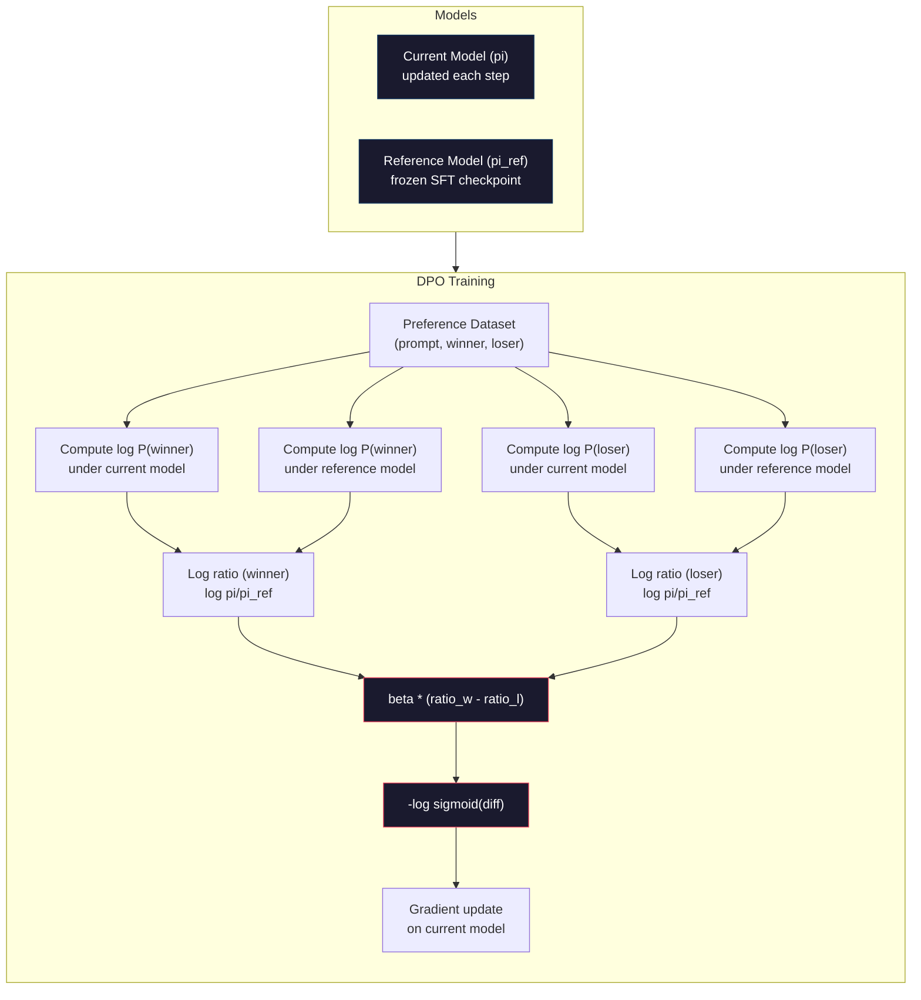

# DPO: Direct Preference Optimization · 直接偏好优化（你的语言模型自己就是奖励模型）

> RLHF works. It also requires training three models (SFT, reward model, policy), managing PPO's instability, and tuning a KL penalty. DPO asks: what if you could skip all of that? DPO directly optimizes the language model on preference pairs. No reward model. No PPO. One training loop. Same results.

**Type:** Build
**Languages:** Python (with numpy)
**Prerequisites:** Phase 10, Lesson 07 (RLHF)
**Time:** ~90 minutes

## Learning Objectives · 学习目标

- 实现 DPO 训练：直接在偏好对上优化语言模型，不需要单独的奖励模型
- 推导 DPO 损失函数，解释它如何通过策略模型的对数概率隐式表示一个奖励模型
- 从训练稳定性、算力成本和所需模型数量三个角度对比 DPO 与 RLHF
- 调节 beta 参数，控制训练出的策略偏离参考模型的幅度

> Implement DPO training that directly optimizes a language model on preference pairs without a separate reward model
> Derive the DPO loss function and explain how it implicitly represents a reward model through the policy's log probabilities
> Compare DPO vs RLHF in terms of training stability, compute cost, and number of models required
> Tune the beta parameter to control how far the trained policy diverges from the reference model

## The Problem · 问题在哪

第 07 课里你搭过一套 RLHF 流水线。三个阶段、三个模型：SFT 模型、奖励模型，以及用 PPO 优化的策略模型。光是奖励模型就需要几千条人类偏好对和一个独立的训练循环；PPO 则要求你小心地调 KL 系数、学习率、clip 比例和 epoch 数。

实践中，PPO 训练出了名地不稳定。超参数动一点点，训练就可能发散。奖励模型只是人类偏好的一个不完美代理，而策略总能找到它的漏洞去钻营。KL 惩罚能帮点忙，但它自己也需要调 —— 调低了会出现奖励黑客（reward hacking），调高了模型几乎学不到东西。

正是这种复杂度，让大多数开源模型在 InstructGPT 发表后的好几年里都没能把 RLHF 跑顺。三阶段流水线很脆弱：每个阶段都有自己的失败模式，而且误差会层层叠加。

2023 年 5 月，Rafael Rafailov、Archit Sharma 和斯坦福的同事们发表了《Direct Preference Optimization: Your Language Model is Secretly a Reward Model》。关键洞察：你不需要单独的奖励模型。最优奖励函数在数学上完全由语言模型自己的 token 概率决定。你完全可以把奖励模型跳过，直接在偏好对上优化语言模型。

DPO 把 RLHF 简化成一步监督学习。一个模型、一个损失函数、一个训练循环，没有强化学习。Zephyr-7B 是最早大规模使用 DPO 的模型之一，它在若干基准上追平甚至击败了用完整 RLHF 训练的模型；Meta 在 Llama 3 的对齐流水线里用上了 DPO；Anthropic 也在对齐研究中引用过 DPO 风格的方法。

> You built an RLHF pipeline in Lesson 07. Three stages. Three models. ... In practice, PPO training is notoriously unstable. Small hyperparameter changes cause the training to diverge. ... The key insight: you don't need a separate reward model. The optimal reward function is mathematically determined by the language model's own token probabilities. ... DPO reduces RLHF to a single supervised learning step. One model. One loss function. One training loop. No reinforcement learning. Zephyr-7B, one of the first models to use DPO at scale, matched or beat models trained with full RLHF on several benchmarks.

## The Concept · 概念

### The Key Insight · 关键洞察

RLHF 优化的是这个目标：

```
maximize: E[R(x, y)] - beta * KL(pi || pi_ref)
```

其中 R 是奖励模型，pi 是策略，pi_ref 是参考模型，beta 是 KL 系数。

DPO 论文证明，这个目标存在闭式（closed-form）最优解。对任意奖励函数 R，最优策略是：

```
pi*(y | x) = pi_ref(y | x) * exp(R(x, y) / beta) / Z(x)
```

其中 Z(x) 是归一化常数。移项得到：

```
R(x, y) = beta * log(pi*(y | x) / pi_ref(y | x)) + beta * log Z(x)
```

这就是突破点。奖励完全用策略模型的概率和参考模型的概率表达了出来。你不需要再训练一个单独的奖励模型 —— 奖励*隐含*（implicit）在概率比里。

把它代入 Bradley-Terry 偏好模型：

```
P(y_w > y_l | x) = sigmoid(R(x, y_w) - R(x, y_l))
                  = sigmoid(beta * (log pi(y_w|x)/pi_ref(y_w|x) - log pi(y_l|x)/pi_ref(y_l|x)))
```

两个 Z(x) 项相互抵消，因为两条回复都以同一个 prompt x 为条件。剩下的就只是一个函数：只依赖策略模型和参考模型在优选回复与被拒回复上的对数概率。

> The DPO paper showed that this objective has a closed-form optimal solution. For any reward function R, the optimal policy is: ... This is the breakthrough. The reward is expressed entirely in terms of the policy model's probabilities and the reference model's probabilities. You don't need to train a separate reward model. The reward is *implicit* in the probability ratio. ... The Z(x) terms cancel because both responses condition on the same prompt x.

### The DPO Loss · DPO 损失

```
L_DPO = -log(sigmoid(beta * (log pi(y_w|x)/pi_ref(y_w|x) - log pi(y_l|x)/pi_ref(y_l|x))))
```

逐项拆解：

- **y_w** = 优选（获胜）的回复
- **y_l** = 被拒（落败）的回复
- **x** = 提示（prompt）
- **pi** = 当前模型（正在训练的）
- **pi_ref** = 参考模型（冻结的 SFT 检查点）
- **beta** = 控制偏离参考模型程度的温度参数（典型取 0.1 到 0.5）

比值 `log pi(y|x) / pi_ref(y|x)` 就是对数概率比（log-probability ratio）。当它为正时，当前模型给回复 y 分配的概率比参考模型更高；为负时则更低。

DPO 损失推动模型提高优选回复的对数概率比、压低被拒回复的对数概率比。beta 参数控制模型能多激进地偏离参考模型 —— beta 小意味着允许大幅偏离，beta 大则把模型拴在参考模型附近。



> The DPO loss pushes the model to increase the log-probability ratio for preferred responses and decrease it for rejected responses. The beta parameter controls how aggressively the model can deviate from the reference -- small beta means large deviations are allowed, large beta keeps the model close to the reference.

### Why DPO is Simpler · DPO 为什么更简单

| 维度 | RLHF (PPO) | DPO |
|--------|-----------|-----|
| 要训练的模型 | 3 个（SFT + 奖励模型 + 策略） | 1 个（只要策略） |
| 训练循环 | 3 个（SFT、RM 训练、PPO） | 2 个（SFT、DPO） |
| 超参数 | lr、KL 系数、clip 比例、RM lr、3 组 epoch | lr、beta、epoch |
| 奖励模型 | 必需（单独训练） | 隐含在模型概率里 |
| RL 算法 | PPO（复杂、不稳定） | 监督学习（稳定） |
| GPU 显存 | PPO 期间要装 3-4 个模型 | 2 个模型（当前 + 参考） |
| 训练稳定性 | 对超参数敏感 | 稳健，接近 SFT |

DPO 训练时只需要在显存里放两个模型 —— 当前模型和冻结的参考模型。RLHF 需要三到四个：策略、参考模型、奖励模型，可选再有一个价值函数基线。对一个 70B 模型来说，FP16 下每份权重就是 140GB。省掉奖励模型带来的显存节约非常可观。

> DPO needs two models in memory during training -- the current model and the frozen reference. RLHF needs three or four: the policy, the reference, the reward model, and optionally a value function baseline. For a 70B model, each copy takes 140GB in FP16. The memory savings from eliminating the reward model are substantial.

### When DPO Beats RLHF · DPO 什么时候胜过 RLHF

**小数据集。** 只有 5,000 到 20,000 条偏好对时，DPO 往往能追平甚至超过 RLHF。RLHF 的奖励模型需要足够的数据才能泛化 —— 数据有限时它会过拟合，产出不可靠的奖励信号。DPO 干脆不需要奖励模型，直接绕开了这个问题。

**算力有限。** DPO 大约只需要完整 RLHF 三分之一的算力（一个训练循环替代三个）。对没有大型 GPU 集群的团队，这是务实的选择。

**快速迭代。** 想试 10 份不同的偏好数据集，看哪份能训出最好的模型？DPO 让你每个实验几小时就能跑完。RLHF 则要为每份数据集重新训练一次奖励模型。

> **Small datasets.** With 5,000-20,000 preference pairs, DPO often matches or exceeds RLHF. The reward model in RLHF needs enough data to generalize -- with limited data, it overfits and produces unreliable reward signals. DPO bypasses this problem by not needing a reward model at all.
> **Limited compute.** DPO requires roughly one-third the compute of full RLHF (one training loop instead of three). For teams without large GPU clusters, this is the practical choice.
> **Rapid iteration.** Want to try 10 different preference datasets to see which produces the best model? DPO lets you run each experiment in hours. RLHF requires retraining the reward model for each dataset.

### When RLHF Beats DPO · RLHF 什么时候胜过 DPO

**大规模训练。** 在 GPT-4 或 Claude 这个量级上，RLHF 的独立奖励模型能捕捉更细腻的偏好信号。奖励模型相当于一个学出来的损失函数，能适配复杂的质量标准。

**复杂奖励信号。** 当「更好」涉及多个维度（有用性、无害性、诚实性）时，奖励模型可以学到这种多目标权衡。DPO 把每个偏好对当成二值信号 —— 一个更好、一个更差 —— 并不建模「为什么」。

**迭代式对齐。** RLHF 流水线可以用当前策略生成新回复，让人给它们打分，再在一个在线循环里重训奖励模型。DPO 只能在固定的偏好对数据集上工作。Constitutional AI（Anthropic 的方案）就大量利用了 RLHF 的这种迭代性质。

> **Large-scale training.** At the scale of GPT-4 or Claude, RLHF's separate reward model can capture more nuanced preference signals. The reward model acts as a learned loss function that adapts to complex quality criteria.
> **Complex reward signals.** When "better" involves multiple dimensions (helpfulness, harmlessness, honesty), a reward model can learn this multi-objective tradeoff. DPO treats each preference pair as a binary signal -- one is better, one is worse -- without modeling why.
> **Iterative alignment.** RLHF pipelines can generate new responses with the current policy, have humans rate them, and retrain the reward model in an online loop. DPO works on a fixed dataset of preference pairs. Constitutional AI (Anthropic's approach) uses this iterative property of RLHF extensively.

### Beyond DPO: KTO, ORPO, SimPO · DPO 之后：KTO、ORPO、SimPO

DPO 带火了一系列简化对齐的方法。

**KTO（Kahneman-Tversky Optimization，2024）：** 连偏好对都不需要。KTO 直接用非成对反馈 —— 只要把每条回复标注成「好」或「坏」，不用拿它和另一个回复比较。这大幅简化了数据采集：不用给标注者看两条回复再问「哪条更好？」，而是看一条回复问「这条好不好？」。它的损失函数引入了前景理论（prospect theory）的损失厌恶：坏回复受到的惩罚大于好回复得到的奖励。

**ORPO（Odds Ratio Preference Optimization，2024）：** 把 SFT 和对齐合并成一个训练步骤。ORPO 不再先做 SFT 再做 DPO，而是直接修改 SFT 损失，往里面加一个偏好信号。损失有两项：优选回复上的标准下一 token 预测损失，加上一个拉大优选/被拒回复概率差距的几率比（odds ratio）项。一个训练循环替代两个。

**SimPO（Simple Preference Optimization，2024）：** 彻底去掉参考模型。SimPO 不再相对冻结的参考模型计算对数概率比，而是用回复的平均对数概率（按长度归一化）作为隐式奖励。这省显存（不需要参考模型），也简化了训练。长度归一化防止模型偏爱更短的回复。

| 方法 | 年份 | 显存中的模型 | 需要偏好对？ | 需要参考模型？ | 训练循环 |
|--------|------|-----------------|-------------|-----------------|----------------|
| RLHF | 2022 | 3-4 | 是（训 RM 用） | 是 | 3 |
| DPO | 2023 | 2 | 是 | 是 | 2 |
| KTO | 2024 | 2 | 否（非成对） | 是 | 2 |
| ORPO | 2024 | 1 | 是 | 否 | 1 |
| SimPO | 2024 | 1 | 是 | 否 | 1 |

趋势很清晰：每种方法都再砍掉一块复杂度。RLHF 需要奖励模型和 PPO；DPO 把两者都去掉了；KTO 去掉了成对数据；ORPO 去掉了单独的 SFT 阶段；SimPO 去掉了参考模型。对齐税（alignment tax）—— 从基座模型到对齐模型要付的算力与复杂度成本 —— 在持续下降。

> **KTO (Kahneman-Tversky Optimization, 2024):** You don't even need pairs. KTO works with unpaired feedback -- just label each response as "good" or "bad" without comparing it to an alternative. ... **ORPO (Odds Ratio Preference Optimization, 2024):** Combines SFT and alignment in a single training step. ... **SimPO (Simple Preference Optimization, 2024):** Eliminates the reference model entirely. ... The trend is clear: each method eliminates one more piece of complexity. RLHF needed a reward model and PPO. DPO eliminated both. KTO eliminated paired data. ORPO eliminated the separate SFT stage. SimPO eliminated the reference model. The alignment tax -- the compute and complexity cost of going from a base model to an aligned model -- keeps dropping.

### Real DPO Deployments · 真实世界的 DPO 部署

**Zephyr-7B（HuggingFace，2023 年 10 月）：** Mistral 7B 基座，先在 UltraChat（20 万条样本）上做 SFT，再在 UltraFeedback（6 万条偏好对）上做 DPO。MT-Bench 得分 6.47 —— 当时 7B 模型的最高分。作为对比，Llama 2 Chat 70B 得分 6.86，也就是说 Zephyr 只靠 DPO 对齐，就把差距缩小到那个 10 倍大小模型的 6% 以内。

**Llama 3（Meta，2024 年 4 月）：** 在初始 RLHF 阶段之后使用 DPO。这种组合说明 DPO 和 RLHF 可以互补 —— RLHF 负责广泛对齐，DPO 负责精细打磨。

**Neural Magic / nm-chat（2024）：** 把 DPO 应用到多个开源模型上，一致地显示对齐基准比纯 SFT 基线提升 5-15%。

```figure
dpo-loss
```

> **Zephyr-7B (HuggingFace, October 2023):** Mistral 7B base, SFT on UltraChat (200K examples), then DPO on UltraFeedback (60K preference pairs). Scored 6.47 on MT-Bench -- the highest 7B model at the time. ... **Llama 3 (Meta, April 2024):** Used DPO after initial RLHF stages. The combination suggests that DPO and RLHF can be complementary -- RLHF for broad alignment, DPO for targeted refinement.

## Build It · 动手造

### Step 1: Preference Dataset · 偏好数据集

和 RLHF 相同的格式 —— (prompt, preferred, rejected) 三元组。DPO 直接消费这份数据，不需要中间的奖励模型。

```python
import numpy as np
import sys
import os
sys.path.insert(0, os.path.join(os.path.dirname(__file__), "..", "..", "04-pre-training-mini-gpt", "code"))
from main import MiniGPT, LayerNorm, Embedding, TransformerBlock

PREFERENCE_DATA = [
    {
        "prompt": "What is the capital of France?",
        "preferred": "The capital of France is Paris.",
        "rejected": "France is a country in Europe. It has many cities. The capital is Paris. Paris is known for the Eiffel Tower.",
    },
    {
        "prompt": "Explain gravity in one sentence.",
        "preferred": "Gravity is the force that attracts objects with mass toward each other.",
        "rejected": "Gravity is something that makes things fall down when you drop them.",
    },
    {
        "prompt": "What is 15 times 7?",
        "preferred": "15 times 7 is 105.",
        "rejected": "Let me think about this. 15 times 7. Well, 10 times 7 is 70, and 5 times 7 is 35, so the answer might be around 105.",
    },
    {
        "prompt": "Name three programming languages.",
        "preferred": "Python, Rust, and TypeScript.",
        "rejected": "There are many programming languages. Some popular ones include various languages like Python and others.",
    },
    {
        "prompt": "What year did World War II end?",
        "preferred": "World War II ended in 1945.",
        "rejected": "World War II was a major global conflict. It involved many countries. The war ended in the mid-1940s, specifically in 1945.",
    },
    {
        "prompt": "Define machine learning.",
        "preferred": "Machine learning is a field where algorithms learn patterns from data to make predictions without being explicitly programmed.",
        "rejected": "Machine learning is a type of AI. AI stands for artificial intelligence. Machine learning uses data to learn.",
    },
]
```

> Same format as RLHF -- (prompt, preferred, rejected) triples. DPO consumes this data directly without an intermediate reward model.

### Step 2: Sequence Log-Probability · 序列对数概率

DPO 损失需要计算「给定 prompt 时一条回复的总对数概率」。做法是把模型跑在完整的 (prompt + response) 序列上，把每个回复 token 的对数概率加起来。

```python
def tokenize_sequence(text, vocab_size=256):
    return [min(t, vocab_size - 1) for t in list(text.encode("utf-8"))]


def compute_sequence_log_prob(model, prompt_tokens, response_tokens, max_seq_len=128):
    full_sequence = prompt_tokens + response_tokens
    if len(full_sequence) > max_seq_len:
        full_sequence = full_sequence[:max_seq_len]

    if len(full_sequence) < 2:
        return 0.0

    input_ids = np.array(full_sequence[:-1]).reshape(1, -1)
    target_ids = np.array(full_sequence[1:])

    logits = model.forward(input_ids)
    logits = logits[0]

    max_logits = logits.max(axis=-1, keepdims=True)
    log_probs = logits - max_logits - np.log(
        np.exp(logits - max_logits).sum(axis=-1, keepdims=True)
    )

    prompt_len = len(prompt_tokens)
    response_start = max(0, prompt_len - 1)
    response_end = len(target_ids)

    if response_start >= response_end:
        return 0.0

    response_log_probs = log_probs[response_start:response_end, :]
    response_targets = target_ids[response_start:response_end]

    total_log_prob = 0.0
    for i, target in enumerate(response_targets):
        total_log_prob += response_log_probs[i, target]

    return total_log_prob
```

这个函数是 DPO 的主力。对每个偏好对它要跑四次：当前模型过优选回复、当前模型过被拒回复、参考模型过优选回复、参考模型过被拒回复。每个训练样本 4 次前向传播，对比 RLHF 的生成 + 奖励打分 + 价值估计 + PPO 更新。更简单、更快、更稳定。

> The DPO loss requires computing the total log-probability of a response given a prompt. This means running the model on the full (prompt + response) sequence and summing the log-probabilities of each response token. ... This function is the workhorse of DPO. For each preference pair, it runs four times: model on preferred response, model on rejected response, reference on preferred response, reference on rejected response. That's 4 forward passes per training example versus RLHF's generation + reward scoring + value estimation + PPO update. Simpler, faster, more stable.

### Step 3: The DPO Loss · DPO 损失

论文的核心，落在代码里。一个函数、一个损失、没有奖励模型。

```python
def sigmoid(x):
    return np.where(
        x >= 0,
        1.0 / (1.0 + np.exp(-x)),
        np.exp(x) / (1.0 + np.exp(x))
    )


def dpo_loss(policy_logprob_preferred, policy_logprob_rejected,
             ref_logprob_preferred, ref_logprob_rejected, beta=0.1):
    preferred_ratio = policy_logprob_preferred - ref_logprob_preferred
    rejected_ratio = policy_logprob_rejected - ref_logprob_rejected

    logit = beta * (preferred_ratio - rejected_ratio)

    loss = -np.log(sigmoid(logit) + 1e-8)

    preferred_reward = beta * preferred_ratio
    rejected_reward = beta * rejected_ratio

    return loss, {
        "preferred_ratio": float(preferred_ratio),
        "rejected_ratio": float(rejected_ratio),
        "logit": float(logit),
        "implicit_preferred_reward": float(preferred_reward),
        "implicit_rejected_reward": float(rejected_reward),
        "reward_margin": float(preferred_reward - rejected_reward),
    }
```

`preferred_ratio` 和 `rejected_ratio` 就是 DPO 推导里的那两个对数概率比。当当前模型给优选回复的概率（相对参考模型）更高、给被拒回复的概率更低时，logit 为正、损失就低。训练信号推着模型正好朝这个方向走。

`implicit_preferred_reward` 和 `implicit_rejected_reward` 是 DPO 损失隐式给出的奖励。可以把它们取出来验证训练是否有效 —— 优选奖励与被拒奖励之间的 margin 应该随训练不断变大。

> The core of the paper in code. One function. One loss. No reward model. ... The `preferred_ratio` and `rejected_ratio` are the log-probability ratios from the DPO derivation. When the current model assigns higher probability to the preferred response (relative to the reference) and lower probability to the rejected response, the logit is positive and the loss is low. The training signal pushes the model in exactly this direction. ... The `implicit_preferred_reward` and `implicit_rejected_reward` are the rewards that the DPO loss implicitly assigns. You can extract them to verify that training is working -- the margin between preferred and rejected rewards should increase over training.

### Step 4: DPO Training Loop · DPO 训练循环

一个标准的监督训练循环。没有 PPO，没有奖励模型，只有前向传播和梯度更新。

```python
def copy_model_weights(source, target):
    target.embedding.token_embed = source.embedding.token_embed.copy()
    target.embedding.pos_embed = source.embedding.pos_embed.copy()
    target.ln_f.gamma = source.ln_f.gamma.copy()
    target.ln_f.beta = source.ln_f.beta.copy()
    for s_block, t_block in zip(source.blocks, target.blocks):
        t_block.attn.W_q = s_block.attn.W_q.copy()
        t_block.attn.W_k = s_block.attn.W_k.copy()
        t_block.attn.W_v = s_block.attn.W_v.copy()
        t_block.attn.W_out = s_block.attn.W_out.copy()
        t_block.ffn.W1 = s_block.ffn.W1.copy()
        t_block.ffn.W2 = s_block.ffn.W2.copy()
        t_block.ffn.b1 = s_block.ffn.b1.copy()
        t_block.ffn.b2 = s_block.ffn.b2.copy()
        t_block.ln1.gamma = s_block.ln1.gamma.copy()
        t_block.ln1.beta = s_block.ln1.beta.copy()
        t_block.ln2.gamma = s_block.ln2.gamma.copy()
        t_block.ln2.beta = s_block.ln2.beta.copy()


def dpo_train(policy_model, reference_model, preference_data,
              num_epochs=5, lr=5e-6, beta=0.1, max_seq_len=128):
    print(f"DPO Training: {len(preference_data)} pairs, {num_epochs} epochs, "
          f"lr={lr}, beta={beta}")
    print()

    losses = []
    margins = []

    for epoch in range(num_epochs):
        epoch_loss = 0.0
        epoch_margin = 0.0
        num_examples = 0

        indices = np.random.permutation(len(preference_data))

        for idx in indices:
            pair = preference_data[idx]

            prompt_tokens = tokenize_sequence(pair["prompt"])
            preferred_tokens = tokenize_sequence(pair["preferred"])
            rejected_tokens = tokenize_sequence(pair["rejected"])

            pi_logprob_w = compute_sequence_log_prob(
                policy_model, prompt_tokens, preferred_tokens, max_seq_len
            )
            pi_logprob_l = compute_sequence_log_prob(
                policy_model, prompt_tokens, rejected_tokens, max_seq_len
            )
            ref_logprob_w = compute_sequence_log_prob(
                reference_model, prompt_tokens, preferred_tokens, max_seq_len
            )
            ref_logprob_l = compute_sequence_log_prob(
                reference_model, prompt_tokens, rejected_tokens, max_seq_len
            )

            loss, metrics = dpo_loss(
                pi_logprob_w, pi_logprob_l,
                ref_logprob_w, ref_logprob_l, beta
            )

            update_direction = 1.0 if metrics["logit"] < 0 else -0.1
            for block in policy_model.blocks:
                block.ffn.W1 += lr * update_direction * np.random.randn(*block.ffn.W1.shape) * 0.01
                block.ffn.W2 += lr * update_direction * np.random.randn(*block.ffn.W2.shape) * 0.01

            epoch_loss += loss
            epoch_margin += metrics["reward_margin"]
            num_examples += 1
            losses.append(float(loss))
            margins.append(metrics["reward_margin"])

        avg_loss = epoch_loss / max(num_examples, 1)
        avg_margin = epoch_margin / max(num_examples, 1)

        print(f"  Epoch {epoch + 1}/{num_epochs} | Loss: {avg_loss:.4f} | "
              f"Avg Margin: {avg_margin:.4f}")

    return policy_model, losses, margins
```

和 RLHF 一比，这个训练循环简单得让人神清气爽。对每个偏好对：算出四个对数概率（两个模型、两条回复），代入 DPO 损失，算梯度，更新策略。没有生成步骤，没有奖励模型推理，没有优势估计，没有裁剪。

> A standard supervised training loop. No PPO. No reward model. Just forward passes and gradient updates. ... The training loop is refreshingly simple compared to RLHF. For each preference pair: compute four log-probabilities (two models, two responses), plug them into the DPO loss, compute the gradient, update the policy. No generation step. No reward model inference. No advantage estimation. No clipping.

### Step 5: Compare DPO vs RLHF · 对比 DPO 与 RLHF

测量隐式奖励 margin 和对数概率的偏移，把 DPO 和第 07 课的 RLHF 模型放在一起比。

```python
def evaluate_preference_accuracy(model, reference_model, preference_data, beta=0.1, max_seq_len=128):
    correct = 0
    total = 0

    for pair in preference_data:
        prompt_tokens = tokenize_sequence(pair["prompt"])
        preferred_tokens = tokenize_sequence(pair["preferred"])
        rejected_tokens = tokenize_sequence(pair["rejected"])

        pi_w = compute_sequence_log_prob(model, prompt_tokens, preferred_tokens, max_seq_len)
        pi_l = compute_sequence_log_prob(model, prompt_tokens, rejected_tokens, max_seq_len)
        ref_w = compute_sequence_log_prob(reference_model, prompt_tokens, preferred_tokens, max_seq_len)
        ref_l = compute_sequence_log_prob(reference_model, prompt_tokens, rejected_tokens, max_seq_len)

        preferred_reward = beta * (pi_w - ref_w)
        rejected_reward = beta * (pi_l - ref_l)

        if preferred_reward > rejected_reward:
            correct += 1
        total += 1

    return correct / max(total, 1)


def analyze_implicit_rewards(model, reference_model, preference_data, beta=0.1, max_seq_len=128):
    print("Implicit Reward Analysis:")
    print("-" * 65)
    print(f"  {'Prompt':<30} {'Pref Reward':>12} {'Rej Reward':>12} {'Margin':>10}")
    print("  " + "-" * 60)

    for pair in preference_data:
        prompt_tokens = tokenize_sequence(pair["prompt"])
        preferred_tokens = tokenize_sequence(pair["preferred"])
        rejected_tokens = tokenize_sequence(pair["rejected"])

        pi_w = compute_sequence_log_prob(model, prompt_tokens, preferred_tokens, max_seq_len)
        pi_l = compute_sequence_log_prob(model, prompt_tokens, rejected_tokens, max_seq_len)
        ref_w = compute_sequence_log_prob(reference_model, prompt_tokens, preferred_tokens, max_seq_len)
        ref_l = compute_sequence_log_prob(reference_model, prompt_tokens, rejected_tokens, max_seq_len)

        pref_reward = beta * (pi_w - ref_w)
        rej_reward = beta * (pi_l - ref_l)
        margin = pref_reward - rej_reward

        truncated = pair["prompt"][:28] + ".." if len(pair["prompt"]) > 30 else pair["prompt"]
        print(f"  {truncated:<30} {pref_reward:>12.4f} {rej_reward:>12.4f} {margin:>10.4f}")

    print()
```

> Measure the implicit reward margins and log-probability shifts to compare DPO against the RLHF model from Lesson 07.

### Step 6: Beta Sensitivity Analysis · beta 敏感性分析

beta 参数就是 DPO 版的 RLHF KL 系数：它控制模型能偏离参考模型多远。这个实验展示它的效果。

```python
def beta_sensitivity_analysis(sft_model, preference_data, betas, max_seq_len=128):
    print("Beta Sensitivity Analysis")
    print("-" * 60)
    print(f"  {'Beta':>8} {'Final Loss':>12} {'Final Margin':>14} {'Accuracy':>10}")
    print("  " + "-" * 55)

    results = []

    for beta in betas:
        policy = MiniGPT(
            vocab_size=256, embed_dim=128, num_heads=4,
            num_layers=4, max_seq_len=max_seq_len, ff_dim=512
        )
        reference = MiniGPT(
            vocab_size=256, embed_dim=128, num_heads=4,
            num_layers=4, max_seq_len=max_seq_len, ff_dim=512
        )
        copy_model_weights(sft_model, policy)
        copy_model_weights(sft_model, reference)

        policy, losses, margins_list = dpo_train(
            policy, reference, preference_data,
            num_epochs=3, lr=5e-6, beta=beta, max_seq_len=max_seq_len
        )

        accuracy = evaluate_preference_accuracy(
            policy, reference, preference_data, beta, max_seq_len
        )

        final_loss = losses[-1] if losses else 0
        final_margin = margins_list[-1] if margins_list else 0

        print(f"  {beta:>8.3f} {final_loss:>12.4f} {final_margin:>14.4f} {accuracy:>10.1%}")
        results.append({
            "beta": beta,
            "final_loss": final_loss,
            "final_margin": final_margin,
            "accuracy": accuracy,
        })

        print()

    return results
```

小 beta（0.01）让模型自由偏离参考模型 —— 学得快，但有退化解的风险。大 beta（1.0）把模型拴在参考模型旁边 —— 稳，但学得慢。大多数应用的甜点区是 0.1 到 0.3。

> The beta parameter is DPO's equivalent of the KL coefficient in RLHF. It controls how much the model can deviate from the reference. This experiment shows its effect. ... Small beta (0.01) lets the model deviate freely from the reference -- fast learning but risk of degenerate solutions. Large beta (1.0) keeps the model close to the reference -- stable but slow learning. The sweet spot for most applications is 0.1 to 0.3.

## Use It · 实战用法

### Full DPO Pipeline Demo · 完整 DPO 流水线演示

```python
if __name__ == "__main__":
    np.random.seed(42)

    print("=" * 70)
    print("DPO: DIRECT PREFERENCE OPTIMIZATION")
    print("=" * 70)
    print()

    print("STEP 1: Initialize SFT Model (from Lesson 06)")
    print("-" * 50)
    sft_model = MiniGPT(
        vocab_size=256, embed_dim=128, num_heads=4,
        num_layers=4, max_seq_len=128, ff_dim=512
    )
    print(f"  Parameters: {sft_model.count_parameters():,}")
    print()

    print("STEP 2: DPO Training")
    print("-" * 50)

    policy_model = MiniGPT(
        vocab_size=256, embed_dim=128, num_heads=4,
        num_layers=4, max_seq_len=128, ff_dim=512
    )
    reference_model = MiniGPT(
        vocab_size=256, embed_dim=128, num_heads=4,
        num_layers=4, max_seq_len=128, ff_dim=512
    )
    copy_model_weights(sft_model, policy_model)
    copy_model_weights(sft_model, reference_model)

    policy_model, losses, margins = dpo_train(
        policy_model, reference_model, PREFERENCE_DATA,
        num_epochs=5, lr=5e-6, beta=0.1
    )
    print()

    print("=" * 70)
    print("STEP 3: Evaluate")
    print("=" * 70)
    print()

    pre_accuracy = evaluate_preference_accuracy(
        sft_model, reference_model, PREFERENCE_DATA, beta=0.1
    )
    post_accuracy = evaluate_preference_accuracy(
        policy_model, reference_model, PREFERENCE_DATA, beta=0.1
    )

    print(f"  Preference accuracy (pre-DPO):  {pre_accuracy:.1%}")
    print(f"  Preference accuracy (post-DPO): {post_accuracy:.1%}")
    print()

    analyze_implicit_rewards(policy_model, reference_model, PREFERENCE_DATA, beta=0.1)

    print("=" * 70)
    print("STEP 4: Training Dynamics")
    print("=" * 70)
    print()

    if losses:
        print("  Loss curve:")
        window = max(1, len(losses) // 5)
        for i in range(0, len(losses), window):
            chunk = losses[i:i + window]
            avg = sum(chunk) / len(chunk)
            print(f"    Steps {i:3d}-{i + len(chunk) - 1:3d}: loss = {avg:.4f}")
        print()

    if margins:
        print("  Reward margin curve:")
        window = max(1, len(margins) // 5)
        for i in range(0, len(margins), window):
            chunk = margins[i:i + window]
            avg = sum(chunk) / len(chunk)
            print(f"    Steps {i:3d}-{i + len(chunk) - 1:3d}: margin = {avg:.4f}")
        print()

    print("=" * 70)
    print("STEP 5: Beta Sensitivity")
    print("=" * 70)
    print()

    beta_results = beta_sensitivity_analysis(
        sft_model, PREFERENCE_DATA, betas=[0.01, 0.1, 0.3, 1.0]
    )

    print("=" * 70)
    print("DPO vs RLHF COMPARISON")
    print("=" * 70)
    print()
    print("  DPO advantages:")
    print("    - 1 training loop (vs 3 for RLHF)")
    print("    - 2 models in memory (vs 3-4 for RLHF)")
    print("    - Supervised learning (vs RL, more stable)")
    print("    - No reward model to train or maintain")
    print()
    print("  RLHF advantages:")
    print("    - Separate reward model captures complex preferences")
    print("    - Online learning: generate, rate, retrain")
    print("    - Better for multi-objective alignment")
    print("    - Proven at largest scales (GPT-4, Claude)")
    print()
    print("  Practical guidance:")
    print("    - Start with DPO. It's simpler and often sufficient.")
    print("    - Switch to RLHF if DPO plateaus on your eval metrics.")
    print("    - Many production systems use both: RLHF first, DPO to refine.")
```

## Ship It · 交付

本课产出 `outputs/prompt-alignment-method-selector.md` —— 一个帮你为自己的使用场景挑选合适对齐方法（SFT、RLHF、DPO、KTO、ORPO、SimPO）的提示词。给出你的数据可得性、算力预算和对齐目标，它会推荐一套方法和训练计划。

> This lesson produces `outputs/prompt-alignment-method-selector.md` -- a prompt that helps you choose the right alignment method (SFT, RLHF, DPO, KTO, ORPO, SimPO) for your use case. Given your data availability, compute budget, and alignment goals, it recommends a method and training plan.

## Exercises · 练习

1. 实现 KTO（Kahneman-Tversky Optimization）。KTO 不需要偏好对 —— 只要把每条回复标注为「好」或「坏」。好回复的损失是 `-log(sigmoid(beta * log_ratio))`，坏回复的损失是 `-log(1 - sigmoid(beta * log_ratio))`，并在坏回复的损失上乘一个损失厌恶乘数（典型 1.5 倍）。在同样的数据上训练（把 preferred 和 rejected 各自独立地当作「好」和「坏」），对比它与 DPO 的准确率。

2. 实现长度归一化的 DPO。不用原始对数概率，而是除以回复 token 数：`normalized_logprob = total_logprob / num_tokens`。这能防止模型偏爱更短的回复（短回复的总对数概率更高）。对比有归一化和没归一化时的隐式奖励 margin。

3. 构造 ORPO 风格的联合损失。在 DPO 损失上加一个优选回复上的标准下一 token 预测损失：`L = L_sft(preferred) + alpha * L_dpo`。试 alpha 取 0.1、0.5、1.0。联合损失训练出的模型应该既会遵循指令（来自 SFT 项），又会偏爱更好的回复（来自 DPO 项），从而不再需要单独的 SFT 阶段。

4. 实现迭代式 DPO。先跑 3 个 epoch 的 DPO，再用训练后的模型生成新回复，让它们和原有优选回复组成新的偏好对，再跑一轮 DPO。做两轮这种「自我对弈」。对比第 1 轮和第 2 轮之后的偏好准确率，看迭代精修是否有帮助。

5. 对比不同参考模型下的 DPO。不用 SFT 检查点当参考，试试：(a) 基座模型（SFT 之前），(b) DPO 第 1 个 epoch 的检查点，(c) 策略模型的指数滑动平均。报告哪个参考给出最高的偏好准确率和最稳的训练曲线。

## Key Terms · 术语表

| 术语 | 大家怎么说 | 它实际上是什么 |
|------|----------------|----------------------|
| DPO | 「没有 RL 的 RLHF」 | 直接偏好优化（Direct Preference Optimization）：一种监督学习算法，直接在偏好对上优化语言模型，绕开奖励模型和 PPO |
| Implicit reward（隐式奖励） | 「奖励藏在模型里」 | 奖励函数由策略模型与参考模型之间的对数概率比决定 —— 不需要单独的奖励模型 |
| Beta（DPO 的 beta） | 「那个温度参数」 | 控制策略能偏离参考模型多远 —— beta 小允许大偏离，beta 大把模型拴在参考附近 |
| Log-probability ratio（对数概率比） | 「模型改变了多少」 | log pi(y\|x) - log pi_ref(y\|x) —— 为正表示当前模型分配的概率比参考模型高 |
| Reference model（参考模型） | 「那个冻结检查点」 | SFT 模型的一份权重永不改变的副本 —— 作为计算概率比的锚点 |
| KTO | 「不要偏好对的 DPO」 | Kahneman-Tversky Optimization：用非成对的「好 / 坏」标注工作，不要求偏好对 |
| ORPO | 「一步对齐」 | Odds Ratio Preference Optimization：往 SFT 损失里加一个偏好项，把 SFT 和对齐合并进单个训练循环 |
| SimPO | 「不需要参考模型」 | Simple Preference Optimization：用长度归一化的平均对数概率作为隐式奖励，从而去掉参考模型 |
| Alignment tax（对齐税） | 「让模型变安全的代价」 | 从基座模型到对齐模型所需的额外算力、数据和复杂度 —— DPO 显著降低了这个成本 |

## Further Reading · 延伸阅读

- [Rafailov et al., 2023 -- "Direct Preference Optimization: Your Language Model is Secretly a Reward Model"](https://arxiv.org/abs/2305.18290) —— 把对齐从 RLHF 简化成监督学习的 DPO 原论文
- [Tunstall et al., 2023 -- "Zephyr: Direct Distillation of LM Alignment"](https://arxiv.org/abs/2310.16944) —— Zephyr-7B：证明在 UltraFeedback 上做 DPO 能在基准上匹敌 RLHF
- [Ethayarajh et al., 2024 -- "KTO: Model Alignment as Prospect Theoretic Optimization"](https://arxiv.org/abs/2402.01306) —— 免去成对偏好的需求
- [Hong et al., 2024 -- "ORPO: Monolithic Preference Optimization without Reference Model"](https://arxiv.org/abs/2403.07691) —— 一步合并 SFT 与对齐
- [Meng et al., 2024 -- "SimPO: Simple Preference Optimization with a Reference-Free Reward"](https://arxiv.org/abs/2405.14734) —— 彻底去掉参考模型
- [Llama 3 Technical Report](https://arxiv.org/abs/2407.21783) —— Meta 结合 RLHF 与 DPO 的对齐流水线
