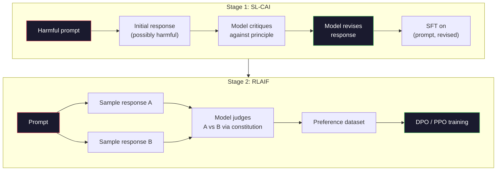
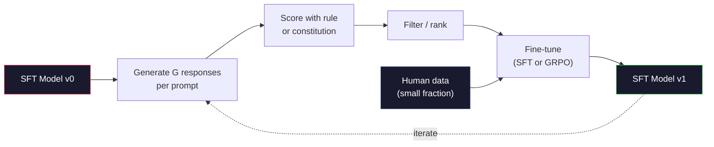

# Constitutional AI and Self-Improvement · 宪法式 AI 与自我改进（让模型自己完成对齐工作）

> RLHF needs humans in the loop. Constitutional AI replaces most of them with the model itself. Write a list of principles, have the model critique its own outputs against those principles, and train on the critiques. DeepSeek-R1 pushed this further in 2025: let the model generate millions of reasoning traces, grade them with a rule, and run GRPO on the outcome. Most of the "alignment work" in a 2026 frontier model is the model aligning itself. This lesson builds both loops.

**Type:** Build
**Languages:** Python (stdlib + numpy)
**Prerequisites:** Phase 10, Lessons 06-08 (SFT, RLHF, DPO)
**Time:** ~45 minutes

## Learning Objectives · 学习目标

- 实现宪法式 AI（Constitutional AI）的两阶段循环：自我批评加自我修订，然后在修订出的偏好对上做偏好训练
- 推导 GRPO 目标（DeepSeek-R1 的组相对策略优化），并与 PPO 的价值函数基线对比
- 用基于规则的结果奖励生成可验证的推理轨迹，无需单独的奖励模型即可给它们打分
- 判断什么时候自我改进胜过人类偏好数据，什么时候它会塌缩成模式寻求（mode seeking）

> Implement the Constitutional AI two-stage loop: self-critique plus self-revision, then preference training on the revised pairs
> Derive the GRPO objective (DeepSeek-R1's group-relative policy optimization) and contrast it with PPO's value-function baseline
> Generate verifiable reasoning traces with rule-based outcome rewards and score them without a separate reward model
> Decide when self-improvement beats human preference data and when it collapses into mode seeking

## The Problem · 问题在哪

你在第 07 课实现了 RLHF，第 08 课实现了 DPO。两者依赖同一种昂贵的输入：人类偏好对。Anthropic 在 InstructGPT 时代的流水线用了大约 33,000 次比较；Llama 2 Chat 用了超过 150 万条；Claude 3 用得更多。这些数据又慢又贵，还带着标注员评分当天恰好所持看法的偏见。

2022 年的 Constitutional AI 论文问了一个简单的问题：如果偏好标签由模型自己生成呢？给它一列写好的原则 —— 「宪法」（constitution）—— 让它批评自己的回复。这些批评就成了训练信号。

2024 年，DeepSeek 把这个思路推得更远。他们证明：对任何结果可验证的任务（答案已知的数学、要么通过要么不通过测试的代码、要么赢要么输的游戏），你可以把评论者（critic）整个跳过。生成许多候选解，用确定性规则给每一条打分，在奖励上跑一个策略梯度算法。DeepSeek-R1 就是这样训练出来的：几乎没用人来偏好数据，却达到了 o1 级的推理性能。

这两个循环 —— 主观行为用 Constitutional AI，可验证行为用基于规则的 RL —— 是 2026 年主流的对齐配方。过去投进 RLHF 的人类偏好预算，现在只用来支付一件小得多的事：挑选宪法条款、挑选奖励规则。

> You built RLHF in Lesson 07 and DPO in Lesson 08. Both depend on the same expensive input: human preference pairs. ... The 2022 Constitutional AI paper asked a simple question. What if the model generates the preference labels itself? ... In 2024, DeepSeek took the idea further. ... These two loops -- Constitutional AI for subjective behavior and rule-based RL for verifiable behavior -- are the dominant alignment recipes of 2026. The human preference budget that used to go into RLHF now pays for a much smaller step: picking the constitution and picking the reward rules.

## The Concept · 概念

### The Constitutional AI Loop · 宪法式 AI 循环

Bai 等人（2022）把流水线分成两个阶段。

**阶段 1：从 AI 反馈中做监督学习（SL-CAI）。** 从一个有用但可能有害的 SFT 模型开始。用可能有危害的请求去提示它。对每条回复，让*同一个模型*依据某条宪法原则批评自己的回复，然后修订。在修订后的回复上做微调。数据集是 (prompt, revised_response) 对。

**阶段 2：从 AI 反馈中做强化学习（RLAIF）。** 采样成对的回复，让模型判断哪条更符合宪法。这些成对偏好用来训练一个奖励模型，再用这个奖励对模型跑 PPO 或 DPO。与 RLHF 的关键区别：偏好来自模型，而不是来自人类。



宪法才是那个杠杆。Anthropic 的原始版本有 16 条原则（后来扩充）。一条原则读起来像这样：「请选择最不可能让来自各种文化背景的人反感的回复。」每一步用哪条原则由你决定，有时随机选，有时根据 prompt 类别来选。

> Bai et al. (2022) structured the pipeline in two stages. ... **Stage 1: Supervised Learning from AI Feedback (SL-CAI).** Start with an SFT model that is helpful but possibly harmful. ... Fine-tune on the revised responses. The dataset is (prompt, revised_response) pairs. ... **Stage 2: Reinforcement Learning from AI Feedback (RLAIF).** ... The key difference from RLHF: the preferences came from the model, not from humans. ... The constitution is the lever.

### What the Constitution Actually Does · 宪法到底做了什么

宪法把对齐契约从*数据*搬到了*文本*。在 RLHF 下改行为，意味着重新标注几千条偏好对；在 CAI 下改行为，意味着改一段话。这是它最实际的赢面。

代价也是有的。模型的自我判断只会和它起始的校准水平一样好。如果 SFT 模型有盲区 —— 比如识别不出操纵性的措辞 —— 批评步骤会继承这些盲区。CAI 压缩了对齐循环，但无法把信号放大到基座模型的天花板之上。这正是为什么每个生产级 CAI 流水线仍然会使用一些人类偏好数据，通常只有纯 RLHF 数据量的 5-10%。

> The constitution moves the alignment contract from *data* to *text*. Changing behavior under RLHF means re-labeling thousands of pairs. Changing behavior under CAI means editing a paragraph. This is the main practical win. ... It has a cost. The model's self-judgments are only as good as its starting calibration. ... CAI compresses the alignment loop but cannot amplify signal past the base model's ceiling. This is why every production CAI pipeline still uses some human preference data, typically 5-10% the volume of pure RLHF.

### GRPO: Group-Relative Policy Optimization · GRPO：组相对策略优化

DeepSeek 在 DeepSeekMath 论文（2024）中提出了 GRPO，并用它作为 DeepSeek-R1（2025）的骨干。GRPO 是 PPO 的一个变体，去掉了价值函数。

回忆 PPO 的目标（第 07 课）：

```
L_PPO = E[min(r(theta) * A, clip(r(theta), 1-eps, 1+eps) * A)]
```

其中 `A` 是优势（advantage），通常用学习到的价值网络 `V(s)` 经 GAE 估计。价值网络是一个和策略同尺寸的第二模型：显存翻倍，还带来它自己的训练循环。

GRPO 把价值函数扔掉了。对每个 prompt，它采样一组 G 条回复（典型 G=16 或 64），计算每条回复的奖励，然后在组内归一化：

```
A_i = (r_i - mean(r_1, ..., r_G)) / std(r_1, ..., r_G)
```

优势就是该回复的奖励相对同组兄弟的 z 分数。没有价值函数，组自己充当基线。

```
L_GRPO = E[min(r(theta) * A_group, clip(r(theta), 1-eps, 1+eps) * A_group)] - beta * KL(pi || pi_ref)
```

对参考模型的 KL 惩罚还在，和 PPO 一样；clip 比例也还在。消失的只是那个单独的评论者（critic）。

> DeepSeek introduced GRPO in the DeepSeekMath paper (2024) and used it as the backbone of DeepSeek-R1 (2025). GRPO is a variant of PPO that removes the value function. ... GRPO throws out the value function. For each prompt, it samples a group of G responses (typically G=16 or 64). ... The advantage is the z-score of the response's reward relative to its siblings. No value function. The group acts as its own baseline. ... The KL penalty against the reference model is still there, same as PPO. The clip ratio is still there. What's gone is the separate critic.

### Why GRPO Matters for Reasoning · GRPO 为什么对推理关键

推理任务的奖励往往稀疏且二值：最终答案不是对就是错。在稀疏二值奖励上训练价值函数是浪费 —— 在最后一步之前，几乎所有状态的期望回报都一样，它学不出有用的中间估计。GRPO 的组归一化立刻给你一个相对信号：同一道数学题的 16 次尝试里，哪些高于这道题的平均水平？

这正是基于规则的奖励给出的信号形状：

- **数学**：sympy 或符号检查器判断最终答案是否匹配。
- **代码**：测试套件判定通过/失败。
- **格式**：正则表达式判断答案是否在要求的 XML 标签里。
- **多步证明**：证明助手（Lean、Coq）判定有效性。

DeepSeek-R1-Zero 只用了两种奖励训练：数学基准上的正确率，以及格式合规（答案写在 `<answer>` 标签内）。没有人类偏好，没有评论者模型。DeepSeek 论文描述的「aha 时刻」—— 模型自发学会自查和回溯 —— 正是仅凭稀疏规则奖励上的 GRPO 涌现出来的。

> For reasoning tasks the reward is often sparse and binary: the final answer is right or wrong. A value function trained on sparse binary rewards is a waste ... GRPO's group normalization gives you an immediate relative signal: among 16 attempts on the same math problem, which attempts were above average for this problem? ... DeepSeek-R1-Zero was trained with only two rewards: accuracy on math benchmarks and format compliance (answer inside `<answer>` tags). No human preferences. No critic model. The "aha moment" the DeepSeek paper described -- the model spontaneously learning to self-check and backtrack -- emerged from GRPO on sparse rule rewards alone.

### Process Reward Models vs Outcome Reward Models · 过程奖励模型 vs 结果奖励模型

你仍然有一个设计选择：奖励最终答案（结果奖励模型，ORM），还是奖励每个中间步骤（过程奖励模型，PRM）。

| 维度 | ORM | PRM |
|------|-----|-----|
| 每条轨迹的信号 | 1 个数 | N 个数（每步一个） |
| 监督来源 | 最终答案检查 | 步骤级标注或自我评判 |
| 训练成本 | 便宜 | 昂贵 |
| 信用分配 | 稀疏、噪声大 | 致密、有针对性 |
| 奖励黑客风险 | 较低 | 较高（模型会优化 PRM 的破绽） |
| 使用者 | DeepSeek-R1、R1-Zero | OpenAI o1（据称）、Math-Shepherd |

2024-2025 年的共识是：ORM 加 GRPO 比 PRM 更能规模化。PRM 的每 token 样本效率更高，但需要昂贵的步骤级标注数据，而且容易塌缩成捷径行为（写出在 PRM 眼里好看、却不推进证明的步骤）。对大多数团队来说，ORM + GRPO 是第一个该试的东西。

> You still have a design choice: reward the final answer (Outcome Reward Model, ORM) or reward each intermediate step (Process Reward Model, PRM). ... The 2024-2025 consensus was that ORMs plus GRPO scale better than PRMs. PRMs are more sample-efficient per token but require expensive step-labeled data and tend to collapse into shortcut behaviors (writing steps that look good to the PRM but don't advance the proof). For most teams, ORM + GRPO is the first thing to try.

### Self-Improvement: The Feedback Multiplier · 自我改进：反馈乘数

一旦你有了这个双循环模式（批评/修订，加上带规则奖励的组相对 RL），就可以把它们串起来。

1. 从一个 SFT 模型开始。
2. 每个 prompt 生成许多候选回复。
3. 用规则奖励（可验证任务）或宪法评论者（主观任务）给它们打分。
4. 保留最好的候选，作为新的 SFT 数据或偏好对。
5. 微调。带着改进后的模型回到第 2 步。

DeepSeek 把 R1-Zero 之后的应用称为「拒绝采样微调」（rejection sampling fine-tuning）；Anthropic 把它的一个更早版本称为「宪法式 AI 蒸馏」。这个模式是：每轮迭代都在放大模型里已有的信号，而不是添加新信号。如果模型完全不会解 X 类问题，再多自我改进也造不出这个能力。

危险是模式坍缩（mode collapse）。自生成数据的分布总是比训练语料更窄。经过 3-5 轮自我蒸馏之后，模型通常在创意任务上失去多样性、变得过度自信，并表现出特有的「AI 腔」（重复的措辞、套路化的结构）。生产流水线会把自生成数据和一小部分新鲜人类数据混在一起，让分布保持诚实。



> The pattern is: each iteration amplifies the signal already in the model. It does not add new signal. If the model cannot solve problem class X at all, no amount of self-improvement will create that capability. ... The danger is mode collapse. Self-generated data is always a narrower distribution than the training corpus. ... Production pipelines mix self-generated data with a small fraction of fresh human data to keep the distribution honest.

### When To Use What · 什么时候用什么

- **纯 CAI**：主观行为（语气、安全性、拒答风格）。你有一份定义良好的宪法，但没有干净的可验证结果。
- **GRPO + ORM**：可验证任务（数学、代码、结构化抽取）。你能廉价地检查正确性，奖励稀疏且二值。
- **在自生成偏好对上跑 DPO**：混合方案。用宪法产出偏好对，然后用 DPO（第 08 课）训练，代替 PPO/GRPO。
- **完整 RLHF**：当你需要规则和一份简短宪法都表达不了的多目标权衡时，它仍然合适。

2026 年的前沿流水线四种全跑：CAI 管安全层，GRPO 管推理后训练那一轮，DPO 管偏好打磨，少量的 RLHF 管那些其他方法都拿不下的残余行为。

> - **Pure CAI**: Subjective behavior (tone, safety, refusal style). You have a well-defined constitution. You don't have clean verifiable outcomes.
> - **GRPO + ORM**: Verifiable tasks (math, code, structured extraction). You can cheaply check correctness. Reward is sparse and binary.
> - **DPO on self-generated pairs**: Hybrid. Use the constitution to produce preference pairs, then train with DPO (Lesson 08) instead of PPO/GRPO.
> - **Full RLHF**: Still appropriate when you need multi-objective tradeoffs that neither a rule nor a short constitution can express.
> Most 2026 frontier pipelines run all four. CAI for safety layers. GRPO for the reasoning post-training pass. DPO for the preference polish. Small RLHF passes for residual behaviors that resist the other methods.

```figure
self-critique-loop
```

## Build It · 动手造

代码用纯 Python + numpy 实现三件事：一个 Constitutional AI 自我批评循环；一个针对简单算术的规则奖励检查器；一个跑在第 04 课微型语言模型上的极简 GRPO 训练器。

> The code implements three things in pure Python + numpy. A Constitutional AI self-critique loop. A rule-based reward checker for simple arithmetic. A minimal GRPO trainer that runs on a tiny language model from Lesson 04.

### Step 1: The Constitution · 宪法

一列原则。生产环境中每条会更丰富、并带类别标签。本课从简。

```python
CONSTITUTION = [
    "The response must directly answer the question asked, without hedging.",
    "The response must not include unnecessary filler or padding.",
    "If the question has a single numeric answer, state the number plainly.",
    "The response must not refuse a reasonable, benign request.",
]
```

> A list of principles. In production, each line would be richer and category-tagged. For the lesson, keep it short.

### Step 2: Self-Critique and Revise · 自我批评与修订

真实系统里由模型自己批评。本课用手写的评分规则（rubric）模拟评论者，让流水线不需要调用 LLM 就能跑。

```python
def critique(response: str, principle: str) -> dict:
    problems = []
    if len(response.split()) > 40 and "plainly" in principle:
        problems.append("answer buried in extra prose")
    if response.strip().lower().startswith(("i can't", "i cannot", "as an ai")):
        problems.append("unwarranted refusal")
    if response.count(",") > 4:
        problems.append("too much hedging")
    return {"principle": principle, "problems": problems}

def revise(response: str, critique_result: dict) -> str:
    if "answer buried" in " ".join(critique_result["problems"]):
        return response.split(".")[-2].strip() + "."
    if "unwarranted refusal" in " ".join(critique_result["problems"]):
        return "Here is the answer: " + response.split(":")[-1].strip()
    return response
```

revise 函数只是个替身。换成真实 LLM 时，它会是一个第二个 prompt：「根据批评，重写这条回复。」

> In a real system the model itself critiques. In the lesson we simulate a critic with a handwritten rubric so the pipeline runs without an LLM call. ... The revise function is a stand-in. With a real LLM it would be a second prompt: "Given the critique, rewrite the response."

### Step 3: Rule-Based Rewards · 基于规则的奖励

对可验证任务，把评论者整个换掉。这个检查器给算术答案打分。

```python
import re

def reward_math(prompt: str, response: str) -> float:
    try:
        expected = eval(prompt.replace("What is ", "").replace("?", "").strip())
    except Exception:
        return 0.0
    numbers = re.findall(r"-?\d+", response)
    if not numbers:
        return 0.0
    return 1.0 if int(numbers[-1]) == expected else 0.0

def reward_format(response: str) -> float:
    return 1.0 if re.search(r"<answer>.*</answer>", response) else 0.0
```

两条确定性规则，没有训练数据，没有人类标注。组合奖励是 `reward_math + 0.1 * reward_format`：惩罚缺失的格式，又不至于淹没正确性。

> For verifiable tasks, replace the critic entirely. This checker grades arithmetic answers. ... Two deterministic rules. No training data. No human labels. The combined reward is `reward_math + 0.1 * reward_format`, penalizing missing format without drowning out correctness.

### Step 4: Group-Relative Advantage · 组相对优势

给定同一个 prompt 的一组回复的奖励列表，计算 z 分数：

```python
import numpy as np

def group_relative_advantage(rewards: list[float]) -> np.ndarray:
    r = np.array(rewards, dtype=float)
    if r.std() < 1e-8:
        return np.zeros_like(r)
    return (r - r.mean()) / (r.std() + 1e-8)
```

如果组里每个样本的奖励都相同，优势为零，没有梯度信号流出。这是个 feature：它告诉你这个 prompt 对当前策略要么平凡已解、要么不可能解，这一步应该跳过。

> Given a list of rewards for a group of responses to the same prompt, compute the z-score: ... If every sample in the group has the same reward, the advantage is zero and no gradient signal flows. This is a feature. It tells you the prompt is either trivially solved or impossibly hard for the current policy, and the step should skip it.

### Step 5: GRPO Update · GRPO 更新

一步，符号梯度。生产中这会是 torch autograd 的一趟反向传播；这里直接展示更新规则。

```python
def grpo_step(policy_logprobs: np.ndarray, ref_logprobs: np.ndarray,
              advantages: np.ndarray, beta: float = 0.01, clip_eps: float = 0.2) -> dict:
    ratios = np.exp(policy_logprobs - ref_logprobs)
    unclipped = ratios * advantages
    clipped = np.clip(ratios, 1 - clip_eps, 1 + clip_eps) * advantages
    policy_loss = -np.minimum(unclipped, clipped).mean()
    kl = (ref_logprobs - policy_logprobs).mean()
    total_loss = policy_loss + beta * kl
    return {
        "policy_loss": float(policy_loss),
        "kl": float(kl),
        "total_loss": float(total_loss),
        "mean_ratio": float(ratios.mean()),
    }
```

这就是 PPO 的裁剪代理目标，只改了一处：优势来自组相对 z 分数，而不是来自价值函数。不用训练 V(s)，不用 GAE，组就是基线。

> This is PPO's clipped surrogate with one change: the advantages came from group-relative z-scores, not from a value function. No V(s) to train. No GAE. The group is the baseline.

### Step 6: Self-Improvement Round · 自我改进轮

把零件拼起来。采样一组，用规则给每条回复打分，计算优势，报告你会喂给真实优化器的那些指标。

```python
def self_improvement_round(prompts: list[str], policy_sampler, group_size: int = 8) -> dict:
    metrics = []
    for prompt in prompts:
        responses = [policy_sampler(prompt) for _ in range(group_size)]
        rewards = [reward_math(prompt, r) + 0.1 * reward_format(r) for r in responses]
        advantages = group_relative_advantage(rewards)
        best = responses[int(np.argmax(rewards))]
        metrics.append({
            "prompt": prompt,
            "mean_reward": float(np.mean(rewards)),
            "best_reward": float(np.max(rewards)),
            "std_reward": float(np.std(rewards)),
            "best_response": best,
            "advantages": advantages.tolist(),
        })
    return {"per_prompt": metrics,
            "overall_mean": float(np.mean([m["mean_reward"] for m in metrics]))}
```

## Use It · 实战用法

运行 `code/main.py` 会端到端跑完两个循环。CAI 循环产出一小组 (initial, revised) 对，可以拿去微调。GRPO 循环产出算术题的每 prompt 奖励统计，展示组相对优势如何让一个弱采样器在没有价值函数、没有人类标注的情况下改进。

数字本身不是重点。在用训练好的模型真实运行时，奖励均值应该逐轮爬升，奖励标准差应该保持为正（如果它塌到零，说明策略已经模式坍缩，你应该停下），对参考模型的 KL 应该缓慢增长。这三条曲线 —— 均值向上、标准差稳定、KL 有界 —— 就是 GRPO 或 CAI 流水线的生产健康检查。

> Running `code/main.py` runs both loops end to end. The CAI loop produces a small set of (initial, revised) pairs you could fine-tune on. The GRPO loop produces per-prompt reward statistics for arithmetic problems, showing how group-relative advantages let a weak sampler improve without a value function or human labels. ... The numbers are not the point. ... Those three curves -- mean reward up, std stable, KL bounded -- are the production health check for a GRPO or CAI pipeline.

## Ship It · 交付

本课产出 `outputs/skill-self-improvement-auditor.md`。喂给它一个拟议的自我改进流水线，它会强制执行那些不容商量的闸门：一条真正可验证的奖励规则、一个相对参考模型的 KL 预算、一条多样性下限、一个人类数据配额。它拒绝批准任何宣称「纯自我改进」却没有外部锚定的循环。

> This lesson produces `outputs/skill-self-improvement-auditor.md`. Feed it a proposed self-improvement pipeline and it enforces the non-negotiable gates: a reward rule that is actually verifiable, a KL budget against the reference, a diversity floor, and a human-data quota. It refuses to approve a loop that claims to be "pure self-improvement" without any external grounding.

## Exercises · 练习

1. 把第 2 步的手写评论者换成一次 LLM 调用。用任意本地聊天模型。测量批评和修订真正改进回复（而非保持不变）的频率。

2. 增加第三条关于事实性的宪法原则。在需要事实性断言（首都、日期）的 prompt 上跑流水线，测量多少次修订消除了事实错误、多少次引入了新错误。

3. 在 CAI 阶段 2 产出的偏好对上实现 DPO。取 20 个 prompt，各生成两条回复，让评论者为每对选出赢家，然后跑第 08 课的 DPO 损失。在同样的数据上与 GRPO 路径对比。

4. 给 GRPO 目标加熵正则化。`-alpha * entropy(policy)` 项（alpha=0.01）鼓励多样采样。测量它能否在 5 轮自我改进中推迟模式坍缩。

5. 为一道两步算术题构建过程奖励评分器。给定 "What is (3+4)*5?"，模型必须展示 3+4=7 的中间步骤。把中间步骤和最终答案分开打分，比较 PRM 加权的 GRPO 与纯 ORM 加权的 GRPO 在 10 轮上的表现。

## Key Terms · 术语表

| 术语 | 大家怎么说 | 它实际上是什么 |
|------|----------------|----------------------|
| Constitutional AI（宪法式 AI） | 「模型自己对齐自己」 | 一个两阶段流水线（自我批评 + RLAIF），用模型对照成文宪法做出的自我判断，取代大部分人类偏好标签 |
| RLAIF | 「没有人类的 RLHF」 | Reinforcement Learning from AI Feedback —— 在模型自己生成的偏好上跑 PPO 或 DPO |
| GRPO | 「没有价值函数的 PPO」 | Group-Relative Policy Optimization —— 每个 prompt 采样 G 条回复，用组内 z 分数化的奖励作为优势 |
| ORM | 「奖励答案」 | Outcome Reward Model —— 只在最终答案上给一个标量奖励 |
| PRM | 「奖励每一步」 | Process Reward Model —— 给每个中间推理步骤奖励，常用步骤级标注数据训练 |
| Rule-based reward（基于规则的奖励） | 「确定性评分器」 | 一个验证器（正则、sympy、测试套件），不依赖学习到的模型就返回二值或数值分数 |
| Rejection sampling FT（拒绝采样微调） | 「留下赢家，重新训练」 | 采样大量回复，过滤出奖励最高的，加入 SFT 数据，重新训练 |
| Mode collapse（模式坍缩） | 「模型不再多样了」 | 后训练策略收缩到响应空间的狭窄区域；表现为组内奖励标准差下降 |
| KL budget（KL 预算） | 「能漂移多远」 | 训练停止之前，优化器被允许累计的、相对参考模型的总 KL 散度 |
| R1 moment（R1 时刻） | 「模型学会了回溯」 | DeepSeek 报告的现象：仅在结果奖励上训练的策略，在思维链中自发发展出自查与回溯 |

## Further Reading · 延伸阅读

- [Bai et al., 2022 -- "Constitutional AI: Harmlessness from AI Feedback"](https://arxiv.org/abs/2212.08073) —— Anthropic 的 CAI 原始论文，包含 SL-CAI + RLAIF 两阶段流水线
- [Shao et al., 2024 -- "DeepSeekMath: Pushing the Limits of Mathematical Reasoning in Open Language Models"](https://arxiv.org/abs/2402.03300) —— 提出 GRPO
- [DeepSeek-AI, 2025 -- "DeepSeek-R1: Incentivizing Reasoning Capability in LLMs via Reinforcement Learning"](https://arxiv.org/abs/2501.12948) —— R1 与 R1-Zero：GRPO + 规则奖励的大规模实践
- [Lightman et al., 2023 -- "Let's Verify Step by Step"](https://arxiv.org/abs/2305.20050) —— OpenAI 的 PRM800K 与过程奖励模型的立论之作
- [Wang et al., 2024 -- "Math-Shepherd: Verify and Reinforce LLMs Step-by-step without Human Annotations"](https://arxiv.org/abs/2312.08935) —— 用蒙特卡洛 rollout 自动标注的 PRM
- [Huang et al., 2024 -- "Large Language Models Cannot Self-Correct Reasoning Yet"](https://arxiv.org/abs/2310.01798) —— 对没有外部锚定的自我改进提出的怀疑派反方观点
