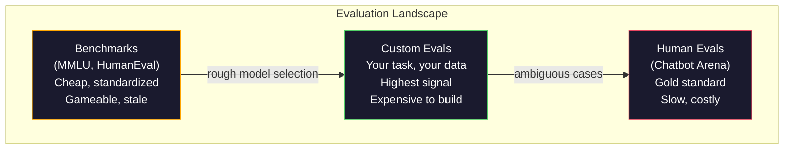
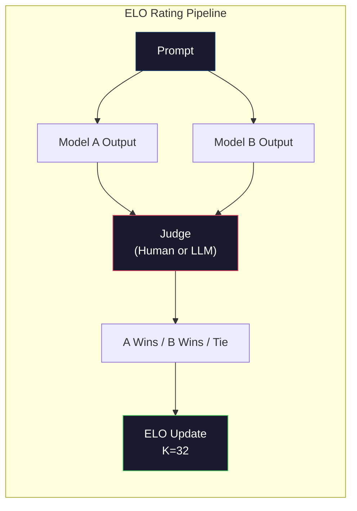

# Evaluation: Benchmarks, Evals, LM Harness · 评估：基准、自定义评测与评测框架（唯一要紧的评测是你自己的评测）

> Goodhart's Law: when a measure becomes a target, it ceases to be a good measure. Every frontier lab games benchmarks. MMLU scores go up while models still can't reliably count the number of R's in "strawberry." The only eval that matters is YOUR eval -- on YOUR task, with YOUR data.

**Type:** Build
**Languages:** Python
**Prerequisites:** Phase 10, Lessons 01-05 (LLMs from Scratch)
**Time:** ~90 minutes

## Learning Objectives · 学习目标

- 构建一个自定义评测框架，对语言模型运行多选题和开放式基准
- 解释标准基准（MMLU、HumanEval）为什么会饱和、为什么无法再区分前沿模型
- 用合适的指标实现任务特定的评测：精确匹配（exact match）、F1、BLEU 和 LLM-as-judge 打分
- 针对你的具体使用场景设计一套自定义评测，而不是只依赖公开排行榜

> Build a custom evaluation harness that runs multiple-choice and open-ended benchmarks against a language model
> Explain why standard benchmarks (MMLU, HumanEval) saturate and fail to differentiate frontier models
> Implement task-specific evals with proper metrics: exact match, F1, BLEU, and LLM-as-judge scoring
> Design a custom evaluation suite targeting your specific use case rather than relying solely on public leaderboards

## The Problem · 问题在哪

MMLU 于 2020 年发布，57 个学科共 15,908 道题。不到三年，前沿模型就把它刷爆了：GPT-4 得 86.4%，Claude 3 Opus 得 86.8%，Llama 3 405B 得 88.6%。排行榜被压缩进 3 个百分点的区间，那里的差异是统计噪声，不是真实的能力差距。

与此同时，这些模型却在一些十岁小孩不假思索就能完成的任务上翻车。Claude 3.5 Sonnet 的 MMLU 拿了 88.7%，但最初数不清 "strawberry" 里有几个字母 —— 这个任务不需要任何世界知识、不需要任何推理，只要逐个字符数一遍。HumanEval 用 164 道题测试代码生成，模型能拿 90% 以上，却仍然写出在边界情况上崩溃的代码 —— 那些坑任何初级开发者都会一眼看出来。

基准成绩和真实世界可靠性之间的鸿沟，就是 LLM 评估的核心问题。基准告诉你模型在基准上表现如何；至于模型在你的具体任务上、用你的具体数据、在你特有的失败模式下会表现如何，它几乎什么都没告诉你。如果你在做客服机器人，MMLU 毫不相关；如果你在做代码助手，HumanEval 只覆盖函数级生成 —— 它对调试、重构、跨文件解释代码只字未提。

你需要自定义评测（custom evals）。不是因为基准没用 —— 它们对粗选模型很有用 —— 而是因为最终的评估必须和你的部署条件完全一致。

> MMLU was published in 2020 with 15,908 questions across 57 subjects. Within three years, frontier models saturated it. ... The gap between benchmark performance and real-world reliability is the central problem of LLM evaluation. Benchmarks tell you how a model performs on the benchmark. They tell you almost nothing about how that model will perform on your specific task, with your specific data, under your specific failure modes. ... You need custom evals. Not because benchmarks are useless -- they are useful for rough model selection -- but because the final evaluation must match your deployment conditions exactly.

## The Concept · 概念

### The Eval Landscape · 评测全景

评估分三类，成本和信号质量各不相同。

**基准（Benchmarks）**是标准化测试套件：MMLU、HumanEval、SWE-bench、MATH、ARC、HellaSwag。把模型对着基准一跑，得到一个分数。优点：所有人用同一套题，可以横向比较模型。缺点：模型和训练数据对这些基准的污染越来越重，实验室的训练数据里就包含基准题。分数上去了，能力未必。

**自定义评测（Custom evals）**是你为自己的具体使用场景搭的测试套件。你定义输入、期望输出和打分函数。法律文书摘要器在法律文书上评测；SQL 生成器在你的数据库 schema 上评测。创建它们很贵，但这是唯一能预测生产表现的评估。

**人类评测（Human evals）**雇付费标注员按有用性、正确性、流畅度、安全性等标准评判模型输出。这是开放式任务在自动打分失效时的黄金标准。Chatbot Arena 已经收集了超过 200 万张人类偏好投票，覆盖 100 多个模型。缺点：成本（每条评判 $0.10-$2.00）和速度（几小时到几天）。



> There are three categories of evaluation, each with different cost and signal quality. ... **Custom evals** are test suites you build for your specific use case. You define the inputs, the expected outputs, and the scoring function. ... These are expensive to create but they are the only evaluation that predicts production performance. ... The downside: cost ($0.10-$2.00 per judgment) and speed (hours to days).

### Why Benchmarks Break · 基准为什么会失灵

三种机制让基准分数不再反映真实能力。

**数据污染（Data contamination）。** 训练语料爬取互联网，基准题就挂在互联网上，模型在训练时见过答案。这不是传统意义的作弊 —— 实验室并非故意收录基准数据 —— 但网络规模的爬取让排除它们几乎不可能。

**应试教学（Teaching to the test）。** 实验室针对基准表现优化训练配比。如果训练配比里 5% 是 MMLU 风格的多选题，模型就学会了这种格式和答案分布。MMLU 是四选一，模型学到答案分布在 A/B/C/D 上近似均匀 —— 这在它不知道答案时也能白捡分。

**饱和（Saturation）。** 当每个前沿模型都在某个基准上拿 85-90%，这个基准就失去了区分度。剩下那 10-15% 的题目可能含糊、标注错误，或需要冷门的领域知识。MMLU 从 87% 提到 89%，可能只意味着模型多背了两道偏题，不代表它变聪明了。

> Three mechanisms cause benchmark scores to stop reflecting real capability. ... **Data contamination.** Training corpora scrape the internet. Benchmark questions live on the internet. Models see the answers during training. ... **Saturation.** When every frontier model scores 85-90% on a benchmark, the benchmark stops discriminating. ... Improving from 87% to 89% on MMLU may mean the model memorized two more obscure questions, not that it got smarter.

### Perplexity: A Quick Health Check · 困惑度：快速体检

困惑度（perplexity）衡量模型对一个 token 序列有多「惊讶」。形式上，它是平均负对数似然的指数：

```
PPL = exp(-1/N * sum(log P(token_i | context)))
```

困惑度 10 意味着：平均而言，模型在每个 token 位置上的不确定程度，相当于在 10 个选项里均匀地猜一个。越低越好。GPT-2 在 WikiText-103 上困惑度约 30；GPT-3 约 20；Llama 3 8B 约 7。

困惑度适合在同一个测试集上比较模型，但它有盲区。一个模型可以靠擅长预测常见模式拿到低困惑度，却在罕见但重要的模式上一塌糊涂。它对指令遵循、推理、事实准确性也只字不提。把它当体检指标，别当最终判决。

> Perplexity measures how surprised a model is by a sequence of tokens. Formally, it is the exponentiated average negative log-likelihood: ... A perplexity of 10 means the model is, on average, as uncertain as choosing uniformly among 10 options at each token position. Lower is better. ... Use it as a sanity check, not a final verdict.

### LLM-as-Judge · LLM 当裁判

用一个强模型来评估弱模型的输出。思路很简单：让 GPT-4o 或 Claude Sonnet 按 1-5 分给一条回复的正确性、有用性、安全性打分。用 GPT-4o-mini 时每条评判约 $0.01，而且与人类判断的相关性出奇地好 —— 多数任务上约 80% 一致。

打分 prompt 比模型更重要。含糊的 prompt（「给这条回复打个分」）产出噪声分数；带评分细则（rubric）的结构化 prompt（「答案事实正确且引用了来源给 5 分，正确但无来源给 4 分，部分正确给 3 分……」）产出一致、可复现的分数。

失败模式：裁判模型有位置偏见（成对比较时偏爱第一条回复）、冗长偏见（偏爱更长的回复）和自我偏好（GPT-4 给 GPT-4 输出的打分高于同等水平的 Claude 输出）。缓解手段：随机化顺序、按长度归一化、用与被评模型不同的裁判。

> Use a strong model to evaluate a weaker model's output. ... This costs about $0.01 per judgment with GPT-4o-mini and correlates surprisingly well with human judgments -- around 80% agreement on most tasks. ... The scoring prompt matters more than the model. ... Failure modes: judge models exhibit position bias (prefer the first response in pairwise comparisons), verbosity bias (prefer longer responses), and self-preference (GPT-4 rates GPT-4 outputs higher than equivalent Claude outputs). Mitigations: randomize order, normalize for length, use a different judge than the model being evaluated.

### ELO Ratings from Pairwise Comparisons · 成对比较得出 ELO 等级分

Chatbot Arena 的做法。把来自不同模型的两个回复放在同一个 prompt 下，由人（或 LLM 裁判）选出更好的那个。从几千次这样的比较中，为每个模型算出一个 ELO 等级分 —— 国际象棋用的正是同一套系统。

ELO 的优点：相对排名比绝对打分更可靠，能优雅地处理平局，而且比对每条输出独立打分收敛得更快。截至 2026 年初，Chatbot Arena 排行上 GPT-4o、Claude 3.5 Sonnet 和 Gemini 1.5 Pro 在头部的差距在 20 ELO 分以内。



> Chatbot Arena's approach. Show two responses to the same prompt from different models. A human (or LLM judge) picks the better one. From thousands of these comparisons, compute an ELO rating for each model -- the same system used in chess. ... ELO advantages: relative ranking is more reliable than absolute scoring, handles ties gracefully, and converges with fewer comparisons than scoring every output independently.

### Eval Frameworks · 评测框架

**lm-evaluation-harness**（EleutherAI）：事实上的标准开源评测框架，支持 200 多个基准。一条命令就能把任何 Hugging Face 模型对着 MMLU、HellaSwag、ARC 等跑一遍。Open LLM Leaderboard 用的就是它。

**RAGAS**：专为 RAG 流水线设计的评测框架。度量忠实度（答案是否匹配检索到的上下文？）、相关性（检索到的上下文与问题相关吗？）和答案正确性。

**promptfoo**：面向 prompt 工程的配置驱动评测。在 YAML 里定义测试用例，对多个模型运行，产出通过/失败报告。适合 prompt 的回归测试 —— 确保一次 prompt 改动不会破坏既有测试用例。

> **lm-evaluation-harness** (EleutherAI): the standard open-source eval framework. Supports 200+ benchmarks. Run any Hugging Face model against MMLU, HellaSwag, ARC, etc. with one command. Used by the Open LLM Leaderboard. ... **RAGAS**: evaluation framework specifically for RAG pipelines. ... **promptfoo**: config-driven eval for prompt engineering. Define test cases in YAML, run against multiple models, get a pass/fail report.

### Building Custom Evals · 构建自定义评测

对生产唯一要紧的评测。流程：

1. **定义任务。** 模型到底该做什么？要精确。「回答问题」太含糊。「给定客户投诉邮件，抽取产品名、问题类别和情绪」才是可评测的任务。

2. **创建测试用例。** 原型评测最少 50 条，生产要 200 条以上。每条测试用例是一个 (input, expected_output) 对。要包含边界情况：空输入、对抗输入、含糊输入、其他语言的输入。

3. **定义打分。** 结构化输出用精确匹配；文本相似度用 BLEU/ROUGE；开放式质量用 LLM-as-judge；抽取任务用 F1。多个指标加权组合。

4. **自动化。** 每个评测一条命令跑完，没有手动步骤。结果用便于随时间对比的格式存储。

5. **随时间追踪。** 评测分数孤立看毫无意义，你要的是趋势线：上次改 prompt 之后分数涨了吗？换模型之后回退了吗？评测要和 prompt 一起做版本管理。

| 评测类型 | 每条评判成本 | 与人类的一致率 | 最适合 |
|-----------|------------------|----------------------|----------|
| 精确匹配 | ~$0 | 100%（适用时） | 结构化输出、分类 |
| BLEU/ROUGE | ~$0 | ~60% | 翻译、摘要 |
| LLM-as-judge | ~$0.01 | ~80% | 开放式生成 |
| 人类评测 | $0.10-$2.00 | N/A（它就是真值） | 含糊、高风险任务 |

> The only eval that matters for production. The process: ... **Create test cases.** Minimum 50 for a prototype eval, 200+ for production. ... **Automate.** Every eval runs with one command. No manual steps. ... **Track over time.** An eval score is meaningless in isolation. You need the trendline. ... Version your eval alongside your prompts.

```figure
perplexity-loss
```

## Build It · 动手造

### Step 1: A Minimal Eval Framework · 一个极简评测框架

定义核心抽象。评测用例（eval case）有输入、期望输出和一个可选的元数据字典。评分器（scorer）接受预测和参考，返回 0 到 1 之间的分数。

```python
import json
from collections import Counter

class EvalCase:
    def __init__(self, input_text, expected, metadata=None):
        self.input_text = input_text
        self.expected = expected
        self.metadata = metadata or {}

class EvalSuite:
    def __init__(self, name, cases, scorers):
        self.name = name
        self.cases = cases
        self.scorers = scorers

    def run(self, model_fn):
        results = []
        for case in self.cases:
            prediction = model_fn(case.input_text)
            scores = {}
            for scorer_name, scorer_fn in self.scorers.items():
                scores[scorer_name] = scorer_fn(prediction, case.expected)
            results.append({
                "input": case.input_text,
                "expected": case.expected,
                "prediction": prediction,
                "scores": scores,
            })
        return results
```

> Define the core abstractions. An eval case has an input, an expected output, and an optional metadata dict. A scorer takes a prediction and a reference and returns a score between 0 and 1.

### Step 2: Scoring Functions · 打分函数

实现精确匹配、token F1 和一个模拟的 LLM-as-judge 评分器。

```python
def exact_match(prediction, expected):
    return 1.0 if prediction.strip().lower() == expected.strip().lower() else 0.0

def token_f1(prediction, expected):
    pred_tokens = set(prediction.lower().split())
    exp_tokens = set(expected.lower().split())
    if not pred_tokens or not exp_tokens:
        return 0.0
    common = pred_tokens & exp_tokens
    precision = len(common) / len(pred_tokens)
    recall = len(common) / len(exp_tokens)
    if precision + recall == 0:
        return 0.0
    return 2 * (precision * recall) / (precision + recall)

def llm_judge_simulated(prediction, expected):
    pred_words = set(prediction.lower().split())
    exp_words = set(expected.lower().split())
    if not exp_words:
        return 0.0
    overlap = len(pred_words & exp_words) / len(exp_words)
    length_penalty = min(1.0, len(prediction) / max(len(expected), 1))
    return round(overlap * 0.7 + length_penalty * 0.3, 3)
```

> Build exact match, token F1, and a simulated LLM-as-judge scorer.

### Step 3: ELO Rating System · ELO 等级分系统

实现带 ELO 更新的成对比较。这正是 Chatbot Arena 给模型排名用的系统。

```python
class ELOTracker:
    def __init__(self, k=32, initial_rating=1500):
        self.ratings = {}
        self.k = k
        self.initial_rating = initial_rating
        self.history = []

    def _ensure_player(self, name):
        if name not in self.ratings:
            self.ratings[name] = self.initial_rating

    def expected_score(self, rating_a, rating_b):
        return 1 / (1 + 10 ** ((rating_b - rating_a) / 400))

    def record_match(self, player_a, player_b, outcome):
        self._ensure_player(player_a)
        self._ensure_player(player_b)

        ea = self.expected_score(self.ratings[player_a], self.ratings[player_b])
        eb = 1 - ea

        if outcome == "a":
            sa, sb = 1.0, 0.0
        elif outcome == "b":
            sa, sb = 0.0, 1.0
        else:
            sa, sb = 0.5, 0.5

        self.ratings[player_a] += self.k * (sa - ea)
        self.ratings[player_b] += self.k * (sb - eb)

        self.history.append({
            "a": player_a, "b": player_b,
            "outcome": outcome,
            "rating_a": round(self.ratings[player_a], 1),
            "rating_b": round(self.ratings[player_b], 1),
        })

    def leaderboard(self):
        return sorted(self.ratings.items(), key=lambda x: -x[1])
```

> Implement pairwise comparisons with ELO updates. This is exactly the system Chatbot Arena uses to rank models.

### Step 4: Perplexity Calculation · 困惑度计算

用 token 概率计算困惑度。实践中你会从模型 logits 拿到这些概率；这里用一个概率分布模拟。

```python
import numpy as np

def perplexity(log_probs):
    if not log_probs:
        return float("inf")
    avg_neg_log_prob = -np.mean(log_probs)
    return float(np.exp(avg_neg_log_prob))

def token_log_probs_simulated(text, model_quality=0.8):
    np.random.seed(hash(text) % 2**31)
    tokens = text.split()
    log_probs = []
    for i, token in enumerate(tokens):
        base_prob = model_quality
        if len(token) > 8:
            base_prob *= 0.6
        if i == 0:
            base_prob *= 0.7
        prob = np.clip(base_prob + np.random.normal(0, 0.1), 0.01, 0.99)
        log_probs.append(float(np.log(prob)))
    return log_probs
```

> Compute perplexity using token probabilities. In practice you would get these from the model's logits. Here we simulate with a probability distribution.

### Step 5: Aggregate Results · 汇总结果

跨一次评测运行计算汇总统计：均值、中位数、阈值通过率，以及每个指标的分解。

```python
def summarize_results(results, threshold=0.8):
    all_scores = {}
    for r in results:
        for metric, score in r["scores"].items():
            all_scores.setdefault(metric, []).append(score)

    summary = {}
    for metric, scores in all_scores.items():
        arr = np.array(scores)
        summary[metric] = {
            "mean": round(float(np.mean(arr)), 3),
            "median": round(float(np.median(arr)), 3),
            "std": round(float(np.std(arr)), 3),
            "min": round(float(np.min(arr)), 3),
            "max": round(float(np.max(arr)), 3),
            "pass_rate": round(float(np.mean(arr >= threshold)), 3),
            "n": len(scores),
        }
    return summary

def print_summary(summary, suite_name="Eval"):
    print(f"\n{'=' * 60}")
    print(f"  {suite_name} Summary")
    print(f"{'=' * 60}")
    for metric, stats in summary.items():
        print(f"\n  {metric}:")
        print(f"    Mean:      {stats['mean']:.3f}")
        print(f"    Median:    {stats['median']:.3f}")
        print(f"    Std:       {stats['std']:.3f}")
        print(f"    Range:     [{stats['min']:.3f}, {stats['max']:.3f}]")
        print(f"    Pass rate: {stats['pass_rate']:.1%} (threshold >= 0.8)")
        print(f"    N:         {stats['n']}")
```

> Compute summary statistics across an eval run: mean, median, pass rate at a threshold, and per-metric breakdowns.

### Step 6: Run the Full Pipeline · 跑通完整流水线

把所有东西接起来。定义任务，创建测试用例，模拟两个模型，运行评测，从成对比较算出 ELO，打印排行榜。

```python
def demo_model_good(prompt):
    responses = {
        "What is the capital of France?": "Paris",
        "What is 2 + 2?": "4",
        "Who wrote Hamlet?": "William Shakespeare",
        "What language is PyTorch written in?": "Python and C++",
        "What is the boiling point of water?": "100 degrees Celsius",
    }
    return responses.get(prompt, "I don't know")

def demo_model_bad(prompt):
    responses = {
        "What is the capital of France?": "Paris is the capital city of France",
        "What is 2 + 2?": "The answer is four",
        "Who wrote Hamlet?": "Shakespeare",
        "What language is PyTorch written in?": "Python",
        "What is the boiling point of water?": "212 Fahrenheit",
    }
    return responses.get(prompt, "Unknown")

cases = [
    EvalCase("What is the capital of France?", "Paris"),
    EvalCase("What is 2 + 2?", "4"),
    EvalCase("Who wrote Hamlet?", "William Shakespeare"),
    EvalCase("What language is PyTorch written in?", "Python and C++"),
    EvalCase("What is the boiling point of water?", "100 degrees Celsius"),
]

suite = EvalSuite(
    name="General Knowledge",
    cases=cases,
    scorers={
        "exact_match": exact_match,
        "token_f1": token_f1,
        "llm_judge": llm_judge_simulated,
    },
)

results_good = suite.run(demo_model_good)
results_bad = suite.run(demo_model_bad)

print_summary(summarize_results(results_good), "Model A (concise)")
print_summary(summarize_results(results_bad), "Model B (verbose)")
```

「好」模型给出精确答案，「差」模型给出啰嗦的转述。精确匹配狠狠惩罚啰嗦的模型；token F1 和 LLM-as-judge 更宽容。这说明了指标选择为什么重要：同一个模型，换个打分方式，观感可以从优秀变成糟糕。

> The "good" model gives exact answers. The "bad" model gives verbose paraphrases. Exact match punishes the verbose model severely. Token F1 and LLM-as-judge are more forgiving. This illustrates why metric choice matters: the same model looks great or terrible depending on how you score it.

### Step 7: ELO Tournament · ELO 锦标赛

跨多个轮次在模型之间做成对比较。

```python
elo = ELOTracker(k=32)

for case in cases:
    pred_a = demo_model_good(case.input_text)
    pred_b = demo_model_bad(case.input_text)

    score_a = token_f1(pred_a, case.expected)
    score_b = token_f1(pred_b, case.expected)

    if score_a > score_b:
        outcome = "a"
    elif score_b > score_a:
        outcome = "b"
    else:
        outcome = "tie"

    elo.record_match("model_a_concise", "model_b_verbose", outcome)

print("\nELO Leaderboard:")
for name, rating in elo.leaderboard():
    print(f"  {name}: {rating:.0f}")
```

> Run pairwise comparisons between models across multiple rounds.

### Step 8: Perplexity Comparison · 困惑度对比

在不同质量级别的「模型」之间比较困惑度。

```python
test_text = "The quick brown fox jumps over the lazy dog in the garden"

for quality, label in [(0.9, "Strong model"), (0.7, "Medium model"), (0.4, "Weak model")]:
    log_probs = token_log_probs_simulated(test_text, model_quality=quality)
    ppl = perplexity(log_probs)
    print(f"  {label} (quality={quality}): perplexity = {ppl:.2f}")
```

> Compare perplexity across "models" of different quality levels.

## Use It · 实战用法

### lm-evaluation-harness (EleutherAI) · lm-evaluation-harness（EleutherAI）

在任何模型上跑基准的标准工具。

```python
# pip install lm-eval
# Command line:
# lm_eval --model hf --model_args pretrained=meta-llama/Llama-3.1-8B --tasks mmlu --batch_size 8

# Python API:
# import lm_eval
# results = lm_eval.simple_evaluate(
#     model="hf",
#     model_args="pretrained=meta-llama/Llama-3.1-8B",
#     tasks=["mmlu", "hellaswag", "arc_easy"],
#     batch_size=8,
# )
# print(results["results"])
```

> The standard tool for running benchmarks on any model.

### promptfoo · promptfoo

面向 prompt 工程的配置驱动评测。在 YAML 里定义测试，对多个 provider 运行。

```yaml
# promptfoo.yaml
providers:
  - openai:gpt-4o-mini
  - anthropic:claude-3-haiku

prompts:
  - "Answer in one word: {{question}}"

tests:
  - vars:
      question: "What is the capital of France?"
    assert:
      - type: contains
        value: "Paris"
  - vars:
      question: "What is 2 + 2?"
    assert:
      - type: equals
        value: "4"
```

> Config-driven eval for prompt engineering. Define tests in YAML and run against multiple providers.

### RAGAS for RAG evaluation · 用 RAGAS 做 RAG 评测

```python
# pip install ragas
# from ragas import evaluate
# from ragas.metrics import faithfulness, answer_relevancy, context_precision
#
# result = evaluate(
#     dataset,
#     metrics=[faithfulness, answer_relevancy, context_precision],
# )
# print(result)
```

RAGAS 度量的是通用评测漏掉的东西：模型的答案是否扎根于检索到的上下文，而不只是答案在抽象意义上「正确」。

> RAGAS measures what generic evals miss: whether the model's answer is grounded in the retrieved context, not just whether the answer is "correct" in the abstract.

## Ship It · 交付

本课产出 `outputs/prompt-eval-designer.md` —— 一个为任意任务设计自定义评测套件的可复用提示词。给它一份任务描述，它会生成测试用例、打分函数和通过/失败阈值建议。

它还产出 `outputs/skill-llm-evaluation.md` —— 一个决策框架，按你的任务类型、预算和延迟要求选出合适的评估策略。

> This lesson produces `outputs/prompt-eval-designer.md` -- a reusable prompt that designs custom eval suites for any task. Give it a task description and it generates test cases, scoring functions, and a pass/fail threshold recommendation. ... It also produces `outputs/skill-llm-evaluation.md` -- a decision framework for choosing the right evaluation strategy based on your task type, budget, and latency requirements.

## Exercises · 练习

1. 加一个「一致性」评分器：把同一输入过模型 5 次，测量输出匹配的频率。确定性输入上的不一致答案，暴露的是脆弱的 prompt 或过高的 temperature 设置。

2. 扩展 ELO 追踪器，支持多个裁判函数（精确匹配、F1、LLM-as-judge）并为它们加权。对比重权精确匹配和重权 F1 时排行榜的变化。

3. 为一个具体任务构建评测套件：把邮件分进 5 个类别。创建 100 条测试用例，样本要多样并包含边界情况（可能属于多个类别的邮件、空邮件、其他语言的邮件）。测量不同「模型」（基于规则、关键词匹配、模拟 LLM）的表现。

4. 实现污染检测：给定一组评测题和一个训练语料，检查多大比例的评测题（或其近似改写）出现在训练数据里。研究者就是这样审计基准有效性的。

5. 构建一个「模型 diff」工具。给定两个模型版本的评测结果，高亮哪些测试用例变好了、哪些回退了、哪些保持不变。这就是评测版的代码 diff —— 判断一次改动是帮忙还是帮倒忙的关键。

## Key Terms · 术语表

| 术语 | 大家怎么说 | 它实际上是什么 |
|------|----------------|----------------------|
| MMLU | 「那个基准」 | Massive Multitask Language Understanding —— 57 个学科共 15,908 道多选题，到 2025 年已被刷到 88% 以上而饱和 |
| HumanEval | 「代码评测」 | OpenAI 的 164 道 Python 函数补全题，只测孤立的函数生成 |
| SWE-bench | 「真实编码评测」 | 来自 12 个 Python 仓库的 2,294 个 GitHub issue，测量端到端修 bug（含生成测试） |
| Perplexity（困惑度） | 「模型有多困惑」 | exp(-avg(log P(token_i given context))) —— 越低说明模型给真实 token 分配的概率越高 |
| ELO rating（ELO 等级分） | 「模型的棋类排名」 | 由成对胜负记录算出的相对水平分，Chatbot Arena 用它给 100 多个模型排名 |
| LLM-as-judge | 「用 AI 给 AI 判卷」 | 强模型按评分细则给弱模型的输出打分，与人类裁判约 80% 一致，每条约 $0.01 |
| Data contamination（数据污染） | 「模型见过考卷」 | 训练数据里包含基准题，推高分数却没有提升真实能力 |
| Eval suite（评测套件） | 「一堆测试」 | 一个带版本的 (input, expected_output, scorer) 三元组集合，测量某种特定能力 |
| Pass rate（通过率） | 「它做对了几成」 | 得分超过阈值的评测用例占比 —— 比平均分更可操作，因为它测量的是可靠性 |
| Chatbot Arena | 「模型排名网站」 | LMSYS 平台，拥有 200 多万张人类偏好投票，通过 ELO 等级分产出最可信的 LLM 排行榜 |

## Further Reading · 延伸阅读

- [Hendrycks et al., 2021 -- "Measuring Massive Multitask Language Understanding"](https://arxiv.org/abs/2009.03300) —— MMLU 论文；尽管已饱和，仍是引用最多的 LLM 基准
- [Chen et al., 2021 -- "Evaluating Large Language Models Trained on Code"](https://arxiv.org/abs/2107.03374) —— OpenAI 的 HumanEval 论文，确立了代码生成的评估方法学
- [Zheng et al., 2023 -- "Judging LLM-as-a-Judge"](https://arxiv.org/abs/2306.05685) —— 用 LLM 评估 LLM 的系统分析，包括位置偏见与冗长偏见的发现
- [Arena (formerly LMSYS Chatbot Arena)](https://arena.ai/leaderboard) —— 众包模型对比平台，200 多万张投票，最可信的真实世界 LLM 排名
