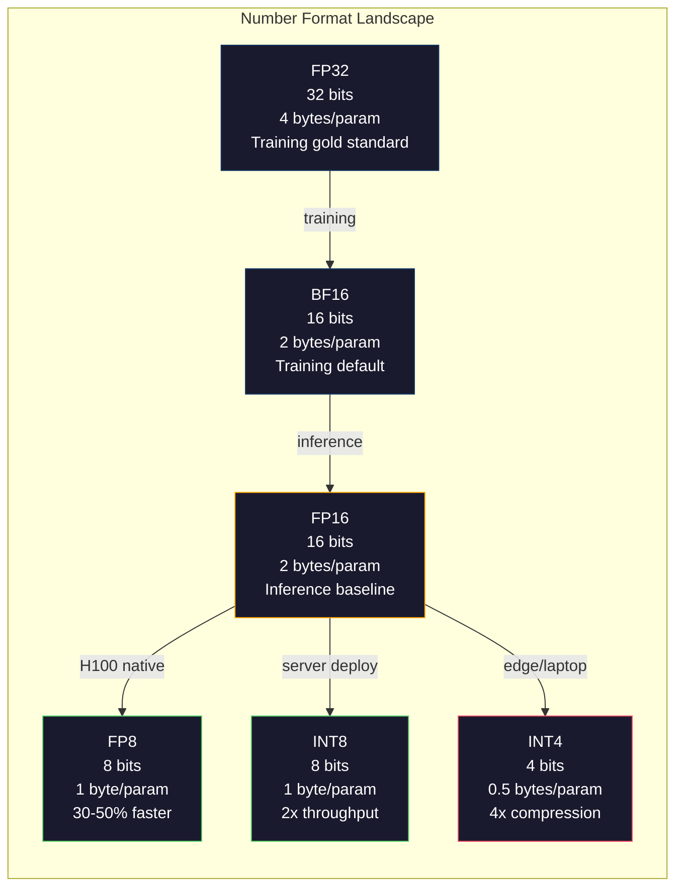
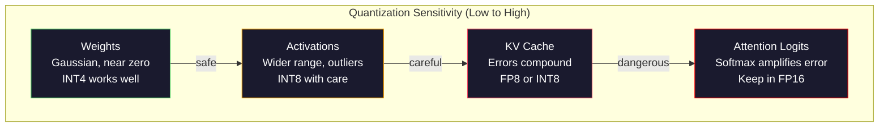
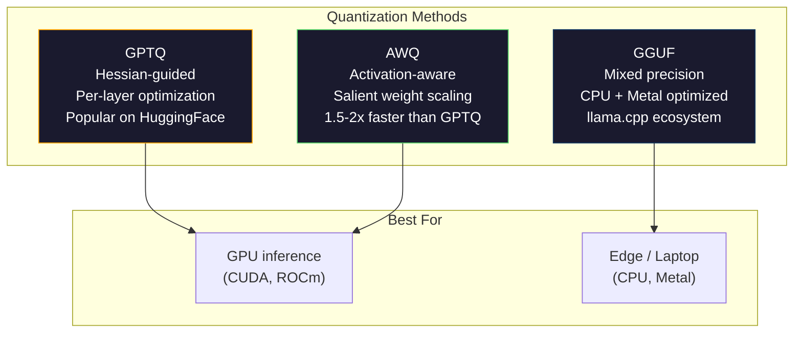

# Quantization: Making Models Fit · 量化（让模型装得下）

> 一个 70B 的模型用 FP16 存要 140GB——光权重就得用两块 A100。量化到 FP8：一块 80GB GPU 就够。INT4：一台 MacBook 就能跑。

> A 70B model in FP16 needs 140GB. Two A100s just for weights. Quantize to FP8: one 80GB GPU. INT4: a MacBook.

**Type:** Build
**Languages:** Python (with numpy)
**Prerequisites:** Phase 10, Lessons 01-10 (LLMs from Scratch)
**Time:** ~120 minutes

## Learning Objectives · 学习目标

- 从零实现从 FP16 到 INT8 和 INT4 的对称（symmetric）与非对称（asymmetric）量化（quantization），包括 per-tensor 与 per-channel 两种缩放粒度
- 计算量化带来的内存节省，判断哪种精度能装进给定 GPU 的显存（VRAM）
- 解释训练后量化（post-training quantization, PTQ）与量化感知训练（quantization-aware training, QAT）的区别
- 用 GPTQ 或 AWQ 量化一个真实模型，并在基准测试上度量精度与内存的权衡

> Implement symmetric and asymmetric quantization from FP16 to INT8 and INT4, including per-tensor and per-channel scaling
> Calculate the memory savings from quantization and determine which precision fits a given GPU's VRAM
> Explain the difference between post-training quantization (PTQ) and quantization-aware training (QAT)
> Apply GPTQ or AWQ to quantize a real model and measure the accuracy-memory tradeoff on a benchmark

## The Problem · 问题在哪

Llama 3 70B 有 700 亿个参数，每个参数是一个 16 位浮点数，加起来是 1400 亿字节：140GB。一块 A100 只有 80GB 显存。你连权重都装不进去，更别提在单卡上跑推理了。为了部署这一个模型，你得租两块 A100，每块每小时 2 美元。

但每个参数花 16 个 bit 太浪费了。神经网络里的大多数权重都聚集在零附近，FP16 的完整动态范围（从 0.000000059 到 65,504）几乎完全没被用上。只要实测一下 Llama 3 70B 权重的真实分布：95% 的权重都落在 -0.1 到 +0.1 之间。你在烧 16 个 bit，去表示本来 4 个 bit 就装得下的值。

量化（quantization）就是用低精度数字替换高精度数字。FP16 到 FP8，内存减半；FP16 到 INT4，内存只剩四分之一。那个 140GB 的模型变成 35GB，装进一张消费级 GPU。再推到 2-bit 量化（激进、有损，但对某些任务可用），同一个模型能跑在 16GB 的笔记本上。

代价是精度。每去掉一个 bit 都在破坏信息，问题是你损失多少精度、损失在哪里。一个量化得当的 INT4 模型在大多数基准上能保留原模型 95-99% 的质量；而一次朴素的（naive）INT4 量化可以把模型彻底毁掉。差别就在技术。

社区用 GPTQ 把 Llama 3 量化到 INT4，在 WikiText 上大约损失 1-2 个困惑度（perplexity）点。Mistral 发布了 Mixtral 8x22B 的 FP8 checkpoint，在 MMLU 上测不出任何质量损失。GGUF 格式支撑着 llama.cpp，让 70B 模型跑在 M 系列芯片的 MacBook 上。量化不是 hack，它是所有 7B 以上模型的标准部署路径。

> Llama 3 70B has 70 billion parameters. Each parameter is a 16-bit floating point number. That is 140 billion bytes. 140GB. A single A100 has 80GB of VRAM. You cannot even load the weights, let alone run inference, on a single GPU. You need two A100s at $2/hour each just to serve one model. ... If you measure the actual distribution of weights in Llama 3 70B, 95% of them fall between -0.1 and +0.1. You are burning 16 bits to represent values that could fit in 4. ... Quantization replaces high-precision numbers with lower-precision ones. FP16 to FP8 cuts memory in half. FP16 to INT4 cuts it to a quarter. ... The cost is accuracy. Every bit you remove destroys information. A well-quantized INT4 model retains 95-99% of the original's quality on most benchmarks. A naive quantization to INT4 can destroy the model entirely. The difference is technique. ... Quantization is not a hack. It is the standard deployment path for every model larger than 7B.

## The Concept · 概念

### Number Formats: What Each Bit Does · 数字格式：每个 bit 干什么用

每个浮点数由三部分组成：符号（sign）、指数（exponent）和尾数（mantissa，也叫 significand）。符号占 1 个 bit。指数决定范围（数能有多大或多小），尾数决定精度（能保留多少位十进制有效数字）。

```
FP32:  [1 sign] [8 exponent] [23 mantissa]  = 32 bits
FP16:  [1 sign] [5 exponent] [10 mantissa]  = 16 bits
BF16:  [1 sign] [8 exponent] [7  mantissa]  = 16 bits
FP8:   [1 sign] [4 exponent] [3  mantissa]  = 8  bits (E4M3)
FP8:   [1 sign] [5 exponent] [2  mantissa]  = 8  bits (E5M2)
INT8:  [1 sign] [7 value]                   = 8  bits (uniform steps)
INT4:  [1 sign] [3 value]                   = 4  bits (16 levels total)
```

**FP32** 是全精度。23 个尾数 bit 给你约 7 位十进制精度，范围约 1.2 x 10^-38 到 3.4 x 10^38。训练曾经只在 FP32 下进行；如今在累加（矩阵乘法过程中的运行求和）时仍然用它。

**FP16** 把位数砍半。10 个尾数 bit 约 3.3 位十进制精度，指数缩到 5 个 bit，范围大幅缩小（最大值约 65,504）。用于权重没问题（权重聚在零附近），但对训练中可能飙升的激活值和梯度很危险。FP16 训练需要损失缩放（loss scaling）来防止下溢（underflow）。

**BF16**（Brain Float 16）保留 FP32 的 8-bit 指数，把尾数缩到 7 个 bit。范围与 FP32 相同，精度低于 FP16。它是 Google 专门为深度学习设计的。直觉是：对神经网络来说，**范围比精度更重要**。一个 10^-20 的梯度在 FP16 里会下溢成零，在 BF16 里能活下来；一个 0.07342 的权重在 BF16 里舍入成 0.0734，够用了。现代每一个训练任务都用 BF16 或 BF16/FP32 混合。

**FP8** 有两种口味。E4M3（4 位指数、3 位尾数）用于推理时的权重和激活；E5M2（5 位指数、2 位尾数）用于训练时的梯度——那种场景下范围比精度更重要。在 H100 GPU 上，FP8 推理比 FP16 快 30-50%，质量损失可以忽略。

**INT8** 是整数格式。没有指数也没有尾数，只有从 -128 到 127 的 256 个均匀间隔的值。你需要一个缩放因子（scale factor）把浮点权重映射进这个范围。优势在于：整数运算比浮点更快、更省电。A100 上 INT8 矩阵乘法可达 624 TOPS，而 FP16 是 312 TFLOPS。

**INT4** 更激进：只有 16 个可能的值，缩放因子承担重活。质量完全取决于你怎么选 scale、量化哪些权重。最先进的 INT4 方法（GPTQ、AWQ）能保留原始模型 95% 以上的质量。



> Every floating-point number has three parts: sign, exponent, and mantissa (also called significand). The sign is one bit. The exponent determines the range (how large or small the number can be). The mantissa determines the precision (how many decimal places you get). ... The intuition: range matters more than precision for neural networks. ... INT8 matrix multiplication on an A100 runs at 624 TOPS versus 312 TFLOPS for FP16. ... State-of-the-art INT4 methods (GPTQ, AWQ) retain 95%+ of original model quality.

### How Quantization Works · 量化怎么工作

核心操作很简单：取一个浮点数张量（tensor），找一个缩放因子，相乘，四舍五入到最近的整数，然后存下整数和缩放因子。

**量化（quantize）：**
```
scale = max(abs(tensor)) / max_int_value
quantized = round(tensor / scale)
```

**反量化（dequantize）：**
```
reconstructed = quantized * scale
```

以对称范围（-127 到 127）的 INT8 为例：
```
scale = max(abs(tensor)) / 127
quantized = clamp(round(tensor / scale), -128, 127)
```

误差就是舍入误差。每个值最多偏差 `scale / 2`。一整层的总误差取决于权重的数量，以及模型对这些权重扰动的敏感程度。

**Per-tensor 与 per-channel 量化。** Per-tensor 对整个权重矩阵只用一个缩放因子。简单但有损：如果一列的值很大、另一列很小，小值会损失大部分精度。Per-channel 给每个输出通道（权重矩阵的每一行或每一列）各用一个缩放因子。开销更大（要存 N 个缩放因子而不是 1 个），但质量显著更好。所有生产级量化方法都用 per-channel 或更细的粒度。

**非对称量化（asymmetric quantization）** 加一个零点偏移（zero-point）：`quantized = round(tensor / scale) + zero_point`。它处理不以零为中心的分布。比如 ReLU 激活值永远非负，对称量化会把一半整数范围浪费在从未出现的负值上。非对称量化把实际范围 [min, max] 映射到完整的整数范围。

> The core operation is simple. Take a tensor of floating-point values, find a scale factor, multiply, round to the nearest integer, and store the integers plus the scale factor. ... The error is the rounding error. Each value can be off by at most `scale / 2`. ... Per-channel uses one scale factor per output channel (per row or column of the weight matrix). More overhead (you store N scale factors instead of 1) but dramatically better quality. Every production quantization method uses per-channel or finer granularity. ... Asymmetric quantization maps the actual range [min, max] to the full integer range.

### Sensitivity Hierarchy · 敏感度层级

模型里不是所有东西对量化的容忍度都一样，存在一个清晰的层级。

**权重（最鲁棒）。** 模型权重在训练中变化缓慢，分布近似于以零为中心的高斯分布，量化友好。带 per-channel scale 的 INT8 权重几乎无损；INT4 需要更精细的方法，但可行。

**激活值（中等敏感）。** 激活值是推理时流过网络的中间值。它们的动态范围比权重宽，而且包含离群值（outlier）：单个注意力头可能产生比均值大 100 倍的激活值。这些离群值对模型质量至关重要，朴素地量化它们会毁掉信息。解决办法：把离群通道保持在更高精度（LLM.int8()），或使用 per-token / per-channel 激活缩放。

**KV 缓存（高敏感）。** KV 缓存（KV cache）存储所有之前 token 的注意力状态。上下文一长，KV 缓存就主导内存：70B 模型在 32K 上下文时，仅 KV 缓存在 FP16 下就有 40GB。把 KV 缓存量化到 FP8 或 INT8 能省下巨量内存，但任何误差都会累积到之后所有的注意力计算里，质量影响随时序列长度增长。

**注意力 logits（最敏感）。** 注意力中的 softmax 对输入的微小变化极其敏感。pre-softmax logit 上 0.01 的量化误差就能明显改变注意力分布。大多数量化方案即使把其他一切都量化了，也会把注意力计算保持在更高精度（FP16 或 BF16）。



> Not everything in a model tolerates quantization equally. There is a clear hierarchy. ... INT8 weights with per-channel scales produce nearly lossless results. ... A single attention head might produce activation values 100x larger than the mean. These outliers are critical for model quality. ... At long context lengths, the KV cache dominates memory. ... Most quantization schemes keep attention computation in higher precision (FP16 or BF16) even when everything else is quantized.

### PTQ vs QAT · PTQ 对比 QAT

**训练后量化（Post-Training Quantization, PTQ）** 量化一个已经训练好的模型，不需要重新训练：拿 FP16 权重，算缩放因子，四舍五入，部署。快（几分钟到几小时）且便宜。对 INT8 和 FP8 效果很好；对 INT4，朴素 PTQ 常常败得很惨，因为舍入误差会累积。先进的 PTQ 方法（GPTQ、AWQ）用校准数据（calibration data）来最小化量化误差。

**量化感知训练（Quantization-Aware Training, QAT）** 在训练的前向传播中插入伪量化（fake quantization）操作，让模型学会把权重放在舍入误差小的位置。梯度用直通估计器（straight-through estimator, STE）穿过伪量化：假装舍入操作的梯度是 1。QAT 能产出比 PTQ 更好的 INT4 和 INT2 模型，但需要完整跑一次训练。Google 用 QAT 做 Gemini 的高效推理服务，Meta 在部分 Llama 部署目标上也用了 QAT。

| 维度 | PTQ | QAT |
|------|-----|-----|
| 成本 | 几分钟到几小时 | 完整训练一次 |
| INT8 质量 | 极佳（损失 < 0.1%） | 极佳 |
| INT4 质量 | 配合 GPTQ/AWQ 良好（损失 1-3%） | 更好（损失 < 1%） |
| INT2 质量 | 差 | 部分任务可用 |
| 校准数据 | 128-1024 条样本 | 完整训练集 |
| 适用场景 | 部署、快速迭代 | 低位宽下的极致质量 |

> **Post-Training Quantization (PTQ)** quantizes an already-trained model. No retraining. ... Advanced PTQ methods (GPTQ, AWQ) use calibration data to minimize the quantization error. ... **Quantization-Aware Training (QAT)** inserts fake quantization operations into the forward pass during training. The model learns to place its weights where rounding errors are small. ... QAT produces better INT4 and INT2 models than PTQ but requires a full training run.

### GPTQ, AWQ, GGUF · GPTQ、AWQ、GGUF

**GPTQ（GPT Quantization）** 是一种 one-shot 的 PTQ 方法。它逐层量化权重，用一个小校准集（通常 128 条样本）来估计 Hessian（关于输出对每个权重敏感程度的二阶信息）。Hessian 认为重要的权重会被更仔细地量化。GPTQ 是第一个让 LLM 的 INT4 量化变得实用的方法。Hugging Face 上的 TheBloke 通过发布数百个模型的量化版本让 GPTQ 普及开来。

**AWQ（Activation-Aware Weight Quantization）** 观察到一小部分权重（约 1%）格外重要，因为它们与大的激活值相乘。AWQ 用校准数据找出这些显著（salient）权重，在量化前先把它们放大（再把对应的激活值缩小），让重要的权重落在 INT4 量化仍然准确的范围内。AWQ 的质量通常持平或略胜 GPTQ，而且应用速度快 1.5-2 倍。

**GGUF（GPT-Generated Unified Format）** 是 llama.cpp 及其生态使用的文件格式。它支持混合量化：不同的层用不同的位宽。第一层和最后一层（embedding 和输出头）通常保持更高精度，中间层用 INT4 或 INT3。GGUF 文件是自包含的：权重、分词器、元数据全在一个文件里。这个格式为 CPU 推理和 Apple Silicon 设计——把整个模型加载进内存，在 CPU 或 Metal GPU 上跑矩阵乘法，就是标准路径。Q4_K_M 是最流行的 GGUF 量化变体，平衡了质量和体积。



> **GPTQ (GPT Quantization)** is a one-shot PTQ method. It quantizes weights one layer at a time, using a small calibration dataset (128 examples is typical) to measure the Hessian (second-order information about how sensitive the output is to each weight). ... GPTQ was the first method to make INT4 quantization practical for LLMs. ... AWQ identifies these salient weights using calibration data and scales them up before quantization (then scales the corresponding activations down). ... GGUF files are self-contained: weights, tokenizer, metadata all in one file. ... Q4_K_M is the most popular GGUF quantization variant, balancing quality and size.

### Quality Measurement · 质量测量

你怎么知道量化后的模型还不错？

**困惑度（Perplexity）。** 最常用的指标，越低越好。在留出数据集（WikiText-2 是标准选择）上分别计算原始模型和量化模型的困惑度，差值（delta）告诉你量化毁掉了多少信息。经验法则：delta < 0.5 极佳，0.5-1.0 良好，1.0-2.0 对多数任务可接受，> 2.0 说明哪里出了问题。

**任务基准。** 在 MMLU、HumanEval、GSM8K 或你自己的评测集上跑量化模型，与原模型对比。量化对不同能力的影响并不均匀：数学和代码任务比通用知识对精度损失更敏感。

**输出对比。** 用同样的 prompt 让两个模型各生成回答再比较。LLM 评审（LLM-as-judge，第 10 课）在这里很好用：算一个胜率——量化模型在多大比例的 prompt 上追平或超过原模型？

**延迟与吞吐。** 量化的存在就是为了让模型更快、更便宜。测每秒 token 数、首 token 时间和内存占用。一个比原模型还慢的量化模型，比没用还糟。

| 模型 | 格式 | 大小 | 困惑度（WikiText-2） | MMLU | Tokens/sec（A100） |
|------|------|------|----------------------|------|--------------------|
| Llama 3 70B | FP16 | 140GB | 3.12 | 79.5% | 38 |
| Llama 3 70B | FP8 | 70GB | 3.14 | 79.3% | 55 |
| Llama 3 70B | GPTQ INT4 | 35GB | 4.32 | 77.8% | 72 |
| Llama 3 70B | AWQ INT4 | 35GB | 4.18 | 78.1% | 75 |
| Llama 3 70B | GGUF Q4_K_M | 40GB | 4.25 | 77.9% | 28 (CPU) |

规律很明显：FP8 几乎免费；INT4 花 1-2 个 MMLU 点，换来翻倍的吞吐和只剩四分之一的内存。对几乎所有部署来说，这笔交易都划算。

> Compute perplexity on a held-out dataset (WikiText-2 is standard) for both the original and quantized model. The delta tells you how much information the quantization destroyed. Rules of thumb: delta < 0.5 is excellent, 0.5-1.0 is good, 1.0-2.0 is acceptable for most tasks, > 2.0 means something went wrong. ... Quantization affects different capabilities unevenly. Math and code tasks are more sensitive to precision loss than general knowledge. ... A quantized model that is slower than the original is worse than useless. ... The pattern: FP8 is nearly free. INT4 costs 1-2 MMLU points but doubles throughput and quarters memory. The tradeoff is worth it for almost every deployment.

### Real Numbers · 真实数字

FP16 到 FP8（H100）：推理加速 30-50%，质量损失 < 0.1%。这是不用想就该做的量化，每个 H100 部署都应该用。

FP16 到 INT8（LLM.int8()）：内存减半，质量损失 < 0.5%。这种混合精度方案把离群特征留在 FP16，其余全部量化到 INT8。

FP16 到 INT4（GPTQ/AWQ）：内存降到四分之一，质量损失 1-3%（取决于模型和方法）。让 70B 模型装进单张 48GB GPU。

FP16 到 INT4（GGUF Q4_K_M）：内存降到约 1/3.5，质量损失 1-2%。为 CPU 推理优化。70B 模型的 Q4_K_M 约 40GB，在 64GB 内存的 M3 Max 上跑到 10-15 tokens/second。

FP16 到 INT2：内存降到八分之一，质量损失 5-15%。只对能容忍退化的特定窄任务可行。属于研究前沿，尚未达到通用生产可用。

```figure
quantization
```

> FP16 to FP8 on H100: 30-50% inference speedup, < 0.1% quality loss. This is the no-brainer quantization. Every H100 deployment should use it. ... FP16 to INT4 (GPTQ/AWQ): 4x memory reduction, 1-3% quality loss depending on the model and method. Enables 70B models on a single 48GB GPU. ... FP16 to INT2: 8x memory reduction, 5-15% quality loss. Only viable for specific narrow tasks where you can tolerate degradation. Research frontier, not production-ready for general use.

## Build It · 动手造

### Step 1: Number Format Representations · 第 1 步：数字格式的位级表示

构建每种格式的位级表示，亲眼看看符号、指数和尾数各自做什么。

```python
import numpy as np


def float_to_fp32_bits(value):
    bits = np.float32(value).view(np.uint32)
    sign = (bits >> 31) & 1
    exponent = (bits >> 23) & 0xFF
    mantissa = bits & 0x7FFFFF
    return {"sign": int(sign), "exponent": int(exponent), "mantissa": int(mantissa),
            "exponent_bits": format(int(exponent), '08b'),
            "mantissa_bits": format(int(mantissa), '023b'),
            "value": float(value),
            "actual_exponent": int(exponent) - 127}


def float_to_fp16_bits(value):
    fp16 = np.float16(value)
    bits = fp16.view(np.uint16)
    sign = (bits >> 15) & 1
    exponent = (bits >> 10) & 0x1F
    mantissa = bits & 0x3FF
    return {"sign": int(sign), "exponent": int(exponent), "mantissa": int(mantissa),
            "exponent_bits": format(int(exponent), '05b'),
            "mantissa_bits": format(int(mantissa), '010b'),
            "value": float(fp16),
            "actual_exponent": int(exponent) - 15}


def float_to_bf16_bits(value):
    fp32_bits = np.float32(value).view(np.uint32)
    bf16_bits = (fp32_bits >> 16).astype(np.uint16)
    sign = (bf16_bits >> 15) & 1
    exponent = (bf16_bits >> 7) & 0xFF
    mantissa = bf16_bits & 0x7F
    reconstructed = np.uint32(bf16_bits.astype(np.uint32) << 16).view(np.float32)
    return {"sign": int(sign), "exponent": int(exponent), "mantissa": int(mantissa),
            "exponent_bits": format(int(exponent), '08b'),
            "mantissa_bits": format(int(mantissa), '07b'),
            "value": float(reconstructed),
            "actual_exponent": int(exponent) - 127}


def simulate_fp8_e4m3(value):
    sign = 1 if value < 0 else 0
    abs_val = abs(value)
    max_val = 448.0
    abs_val = min(abs_val, max_val)
    if abs_val == 0:
        return {"sign": sign, "exponent": 0, "mantissa": 0, "value": 0.0,
                "exponent_bits": "0000", "mantissa_bits": "000"}
    exp = int(np.floor(np.log2(abs_val)))
    exp = max(-6, min(8, exp))
    mantissa_val = abs_val / (2.0 ** exp) - 1.0
    mantissa_quant = round(mantissa_val * 8) / 8
    mantissa_quant = max(0, min(0.875, mantissa_quant))
    reconstructed = (1.0 + mantissa_quant) * (2.0 ** exp)
    if sign:
        reconstructed = -reconstructed
    mantissa_int = int(round(mantissa_quant * 8))
    return {"sign": sign, "exponent": exp + 7, "mantissa": mantissa_int,
            "exponent_bits": format(exp + 7, '04b'),
            "mantissa_bits": format(mantissa_int, '03b'),
            "value": float(reconstructed),
            "actual_exponent": exp}


def display_format_comparison(value):
    fp32 = float_to_fp32_bits(value)
    fp16 = float_to_fp16_bits(value)
    bf16 = float_to_bf16_bits(value)
    fp8 = simulate_fp8_e4m3(value)

    print(f"\n  Value: {value}")
    print(f"  {'Format':<8} {'Stored Value':>14} {'Error':>12} {'Sign':>5} {'Exp Bits':>10} {'Man Bits':>25}")
    print(f"  {'-'*76}")
    print(f"  {'FP32':<8} {fp32['value']:>14.6f} {abs(fp32['value'] - value):>12.8f} {fp32['sign']:>5} {fp32['exponent_bits']:>10} {fp32['mantissa_bits']:>25}")
    print(f"  {'FP16':<8} {fp16['value']:>14.6f} {abs(fp16['value'] - value):>12.8f} {fp16['sign']:>5} {fp16['exponent_bits']:>10} {fp16['mantissa_bits']:>25}")
    print(f"  {'BF16':<8} {bf16['value']:>14.6f} {abs(bf16['value'] - value):>12.8f} {bf16['sign']:>5} {bf16['exponent_bits']:>10} {bf16['mantissa_bits']:>25}")
    print(f"  {'FP8e4m3':<8} {fp8['value']:>14.6f} {abs(fp8['value'] - value):>12.8f} {fp8['sign']:>5} {fp8['exponent_bits']:>10} {fp8['mantissa_bits']:>25}")
```

> Build the bit-level representation of each format to see exactly what sign, exponent, and mantissa do.

### Step 2: Symmetric Quantization (Per-Tensor and Per-Channel) · 第 2 步：对称量化（per-tensor 与 per-channel）

最基础的量化操作。Per-tensor 对整个矩阵用一个 scale，per-channel 对每行或每列各用一个。

```python
def quantize_symmetric(tensor, num_bits=8):
    qmin = -(2 ** (num_bits - 1))
    qmax = 2 ** (num_bits - 1) - 1
    abs_max = np.max(np.abs(tensor))
    if abs_max == 0:
        return np.zeros_like(tensor, dtype=np.int32), 1.0
    scale = abs_max / qmax
    quantized = np.clip(np.round(tensor / scale), qmin, qmax).astype(np.int32)
    return quantized, float(scale)


def dequantize_symmetric(quantized, scale):
    return quantized.astype(np.float64) * scale


def quantize_per_channel(tensor, num_bits=8, axis=0):
    qmin = -(2 ** (num_bits - 1))
    qmax = 2 ** (num_bits - 1) - 1

    if axis == 0:
        abs_max = np.max(np.abs(tensor), axis=1, keepdims=True)
    else:
        abs_max = np.max(np.abs(tensor), axis=0, keepdims=True)

    abs_max = np.where(abs_max == 0, 1.0, abs_max)
    scales = abs_max / qmax
    quantized = np.clip(np.round(tensor / scales), qmin, qmax).astype(np.int32)
    return quantized, scales.squeeze()


def dequantize_per_channel(quantized, scales, axis=0):
    if axis == 0:
        return quantized.astype(np.float64) * scales.reshape(-1, 1)
    else:
        return quantized.astype(np.float64) * scales.reshape(1, -1)


def quantize_asymmetric(tensor, num_bits=8):
    qmin = 0
    qmax = 2 ** num_bits - 1
    t_min = np.min(tensor)
    t_max = np.max(tensor)
    if t_max == t_min:
        return np.zeros_like(tensor, dtype=np.int32), 1.0, 0
    scale = (t_max - t_min) / (qmax - qmin)
    zero_point = int(np.round(qmin - t_min / scale))
    zero_point = max(qmin, min(qmax, zero_point))
    quantized = np.clip(np.round(tensor / scale + zero_point), qmin, qmax).astype(np.int32)
    return quantized, float(scale), int(zero_point)


def dequantize_asymmetric(quantized, scale, zero_point):
    return (quantized.astype(np.float64) - zero_point) * scale
```

> The fundamental quantization operations. Per-tensor uses one scale for the whole matrix. Per-channel uses one scale per row or column.

### Step 3: Quality Measurement · 第 3 步：质量测量

度量量化毁掉了多少信息：原始张量与重建张量之间的均方误差（MSE）、信噪比（SNR）和余弦相似度。

```python
def quantization_error(original, reconstructed):
    diff = original - reconstructed
    mse = float(np.mean(diff ** 2))
    rmse = float(np.sqrt(mse))
    max_error = float(np.max(np.abs(diff)))
    signal_power = float(np.mean(original ** 2))
    snr_db = 10 * np.log10(signal_power / max(mse, 1e-20))

    orig_flat = original.flatten()
    recon_flat = reconstructed.flatten()
    norm_orig = np.linalg.norm(orig_flat)
    norm_recon = np.linalg.norm(recon_flat)
    if norm_orig == 0 or norm_recon == 0:
        cosine_sim = 0.0
    else:
        cosine_sim = float(np.dot(orig_flat, recon_flat) / (norm_orig * norm_recon))

    return {"mse": mse, "rmse": rmse, "max_error": max_error,
            "snr_db": float(snr_db), "cosine_similarity": cosine_sim}


def compare_quantization_methods(tensor, num_bits=8):
    q_pt, s_pt = quantize_symmetric(tensor, num_bits)
    recon_pt = dequantize_symmetric(q_pt, s_pt)
    err_pt = quantization_error(tensor, recon_pt)

    q_pc, s_pc = quantize_per_channel(tensor, num_bits, axis=0)
    recon_pc = dequantize_per_channel(q_pc, s_pc, axis=0)
    err_pc = quantization_error(tensor, recon_pc)

    q_asym, s_asym, zp = quantize_asymmetric(tensor, num_bits)
    recon_asym = dequantize_asymmetric(q_asym, s_asym, zp)
    err_asym = quantization_error(tensor, recon_asym)

    print(f"\n  Quantization Comparison ({num_bits}-bit, tensor shape {tensor.shape}):")
    print(f"  {'Method':<20} {'MSE':>12} {'SNR (dB)':>10} {'Cosine Sim':>12} {'Max Error':>12}")
    print(f"  {'-'*68}")
    print(f"  {'Per-tensor sym':<20} {err_pt['mse']:>12.8f} {err_pt['snr_db']:>10.2f} {err_pt['cosine_similarity']:>12.8f} {err_pt['max_error']:>12.8f}")
    print(f"  {'Per-channel sym':<20} {err_pc['mse']:>12.8f} {err_pc['snr_db']:>10.2f} {err_pc['cosine_similarity']:>12.8f} {err_pc['max_error']:>12.8f}")
    print(f"  {'Asymmetric':<20} {err_asym['mse']:>12.8f} {err_asym['snr_db']:>10.2f} {err_asym['cosine_similarity']:>12.8f} {err_asym['max_error']:>12.8f}")

    return {"per_tensor": err_pt, "per_channel": err_pc, "asymmetric": err_asym}
```

> Measure how much information quantization destroys. Mean squared error, signal-to-noise ratio, and cosine similarity between original and reconstructed tensors.

### Step 4: Bit-Width Sweep · 第 4 步：位宽扫描

把同一个张量按不同位宽（2、3、4、8、16）量化，测量每一档的质量。这能让你看清质量悬崖（quality cliff）到底在哪。

```python
def bit_width_sweep(tensor):
    print(f"\n  Bit-Width Sweep (tensor shape {tensor.shape}):")
    print(f"  {'Bits':>6} {'Levels':>8} {'MSE':>14} {'SNR (dB)':>10} {'Cosine Sim':>12} {'Compression':>12}")
    print(f"  {'-'*64}")

    results = []
    for bits in [2, 3, 4, 8, 16]:
        q, s = quantize_per_channel(tensor, bits, axis=0)
        recon = dequantize_per_channel(q, s, axis=0)
        err = quantization_error(tensor, recon)
        levels = 2 ** bits
        compression = 32.0 / bits

        print(f"  {bits:>6} {levels:>8} {err['mse']:>14.8f} {err['snr_db']:>10.2f} {err['cosine_similarity']:>12.8f} {compression:>11.1f}x")
        results.append({"bits": bits, "levels": levels, "error": err, "compression": compression})

    return results
```

> Quantize the same tensor at different bit widths (2, 3, 4, 8, 16) and measure quality at each level. This shows exactly where the quality cliff is.

### Step 5: Sensitivity Experiment · 第 5 步：敏感度实验

模拟量化 transformer 的不同部分，测出哪些组件最敏感。这演示了敏感度层级：权重 < 激活值 < KV 缓存 < 注意力。

```python
def simulate_transformer_layer(input_data, weights, kv_scale=1.0):
    hidden = input_data @ weights["qkv"]
    seq_len = hidden.shape[1]
    d_model = weights["qkv"].shape[1] // 3
    q, k, v = hidden[:, :, :d_model], hidden[:, :, d_model:2*d_model], hidden[:, :, 2*d_model:]

    attn_scores = (q @ k.transpose(0, 2, 1)) / np.sqrt(d_model) * kv_scale
    attn_max = np.max(attn_scores, axis=-1, keepdims=True)
    attn_exp = np.exp(attn_scores - attn_max)
    attn_weights = attn_exp / np.sum(attn_exp, axis=-1, keepdims=True)

    attn_output = attn_weights @ v
    output = attn_output @ weights["out"]
    return output, {"q": q, "k": k, "v": v, "attn_scores": attn_scores,
                    "attn_weights": attn_weights, "attn_output": attn_output}


def sensitivity_experiment(batch_size=2, seq_len=16, d_model=64, num_bits=8):
    np.random.seed(42)
    input_data = np.random.randn(batch_size, seq_len, d_model) * 0.1

    weights = {
        "qkv": np.random.randn(d_model, 3 * d_model) * (2.0 / d_model) ** 0.5,
        "out": np.random.randn(d_model, d_model) * (2.0 / d_model) ** 0.5,
    }

    baseline_output, baseline_internals = simulate_transformer_layer(input_data, weights)

    experiments = {}

    q_qkv, s_qkv = quantize_per_channel(weights["qkv"], num_bits, axis=0)
    q_out, s_out = quantize_per_channel(weights["out"], num_bits, axis=0)
    quantized_weights = {
        "qkv": dequantize_per_channel(q_qkv, s_qkv, axis=0),
        "out": dequantize_per_channel(q_out, s_out, axis=0),
    }
    weight_quant_output, _ = simulate_transformer_layer(input_data, quantized_weights)
    experiments["Weights only"] = quantization_error(baseline_output, weight_quant_output)

    _, fresh_internals = simulate_transformer_layer(input_data, weights)
    q_act, s_act = quantize_per_channel(
        fresh_internals["attn_output"].reshape(-1, d_model), num_bits, axis=0
    )
    quant_attn_out = dequantize_per_channel(q_act, s_act, axis=0).reshape(batch_size, seq_len, d_model)
    act_quant_output = quant_attn_out @ weights["out"]
    experiments["Activations only"] = quantization_error(baseline_output, act_quant_output)

    q_k, s_k = quantize_per_channel(fresh_internals["k"].reshape(-1, d_model), num_bits, axis=0)
    q_v, s_v = quantize_per_channel(fresh_internals["v"].reshape(-1, d_model), num_bits, axis=0)
    quant_k = dequantize_per_channel(q_k, s_k, axis=0).reshape(batch_size, seq_len, d_model)
    quant_v = dequantize_per_channel(q_v, s_v, axis=0).reshape(batch_size, seq_len, d_model)
    attn_scores_kv = (fresh_internals["q"] @ quant_k.transpose(0, 2, 1)) / np.sqrt(d_model)
    attn_max_kv = np.max(attn_scores_kv, axis=-1, keepdims=True)
    attn_exp_kv = np.exp(attn_scores_kv - attn_max_kv)
    attn_weights_kv = attn_exp_kv / np.sum(attn_exp_kv, axis=-1, keepdims=True)
    kv_quant_output = (attn_weights_kv @ quant_v) @ weights["out"]
    experiments["KV cache only"] = quantization_error(baseline_output, kv_quant_output)

    noise_scale = np.std(fresh_internals["attn_scores"]) * 0.05
    noisy_scores = fresh_internals["attn_scores"] + np.random.randn(*fresh_internals["attn_scores"].shape) * noise_scale
    noisy_max = np.max(noisy_scores, axis=-1, keepdims=True)
    noisy_exp = np.exp(noisy_scores - noisy_max)
    noisy_weights = noisy_exp / np.sum(noisy_exp, axis=-1, keepdims=True)
    attn_quant_output = (noisy_weights @ fresh_internals["v"]) @ weights["out"]
    experiments["Attention logits (5% noise)"] = quantization_error(baseline_output, attn_quant_output)

    print(f"\n  Sensitivity Experiment ({num_bits}-bit quantization):")
    print(f"  {'Component':<30} {'MSE':>14} {'SNR (dB)':>10} {'Cosine Sim':>12}")
    print(f"  {'-'*68}")
    for name, err in sorted(experiments.items(), key=lambda x: x[1]["mse"]):
        print(f"  {name:<30} {err['mse']:>14.8f} {err['snr_db']:>10.2f} {err['cosine_similarity']:>12.8f}")

    return experiments
```

> Simulate quantizing different parts of a transformer and measure which components are most sensitive. This demonstrates the sensitivity hierarchy: weights < activations < KV cache < attention.

### Step 6: Simulated GPTQ · 第 6 步：模拟 GPTQ

GPTQ 逐列量化，用 Hessian 决定如何分摊舍入误差。这里是一个抓住核心思想的简化版：用校准数据衡量权重重要性，然后对最不重要的权重更激进地量化。

```python
def simulated_gptq(weight_matrix, calibration_inputs, num_bits=4):
    n_in, n_out = weight_matrix.shape
    qmin = -(2 ** (num_bits - 1))
    qmax = 2 ** (num_bits - 1) - 1

    H = np.zeros((n_in, n_in))
    for x in calibration_inputs:
        x = x.reshape(-1, 1) if x.ndim == 1 else x
        for row in range(x.shape[0]):
            xi = x[row].reshape(-1, 1)
            H += xi @ xi.T
    H /= len(calibration_inputs)
    H += np.eye(n_in) * 1e-4

    weight_importance = np.diag(H)

    quantized = np.zeros_like(weight_matrix, dtype=np.int32)
    scales = np.zeros(n_out)
    errors = np.zeros(n_out)

    W = weight_matrix.copy()

    for col in range(n_out):
        w_col = W[:, col]
        abs_max = np.max(np.abs(w_col))
        if abs_max == 0:
            scales[col] = 1.0
            continue
        scale = abs_max / qmax
        scales[col] = scale

        q_col = np.clip(np.round(w_col / scale), qmin, qmax).astype(np.int32)
        quantized[:, col] = q_col

        quant_error = w_col - q_col * scale
        errors[col] = np.sqrt(np.mean(quant_error ** 2))

        if col < n_out - 1:
            importance_weights = weight_importance / (np.max(weight_importance) + 1e-10)
            for next_col in range(col + 1, min(col + 4, n_out)):
                compensation = quant_error * importance_weights * 0.1
                W[:, next_col] += compensation

    return quantized, scales, {"column_errors": errors,
                               "mean_error": float(np.mean(errors)),
                               "max_error": float(np.max(errors))}


def dequantize_gptq(quantized, scales):
    result = np.zeros_like(quantized, dtype=np.float64)
    for col in range(quantized.shape[1]):
        result[:, col] = quantized[:, col] * scales[col]
    return result
```

> GPTQ quantizes one column at a time, using the Hessian to decide how to distribute the rounding error. This is a simplified version that captures the core idea: use calibration data to measure weight importance, then quantize the least important weights more aggressively.

### Step 7: AWQ Simulation · 第 7 步：模拟 AWQ

AWQ 找出显著权重（与大的激活值相乘的那些），在量化前通过缩放保护它们。

```python
def simulated_awq(weight_matrix, calibration_inputs, num_bits=4, salient_fraction=0.01):
    n_in, n_out = weight_matrix.shape
    qmin = -(2 ** (num_bits - 1))
    qmax = 2 ** (num_bits - 1) - 1

    activation_magnitudes = np.zeros(n_in)
    for x in calibration_inputs:
        if x.ndim == 1:
            activation_magnitudes += np.abs(x)
        else:
            activation_magnitudes += np.mean(np.abs(x), axis=0)
    activation_magnitudes /= len(calibration_inputs)

    n_salient = max(1, int(n_in * salient_fraction))
    salient_indices = np.argsort(activation_magnitudes)[-n_salient:]

    scale_factors = np.ones(n_in)
    for idx in salient_indices:
        col_max = np.max(np.abs(weight_matrix[idx, :]))
        if col_max > 0:
            scale_factors[idx] = min(4.0, 1.0 / (col_max + 1e-8) * np.mean(np.abs(weight_matrix)))

    scaled_weights = weight_matrix * scale_factors.reshape(-1, 1)

    quantized, scales = quantize_per_channel(scaled_weights, num_bits, axis=0)
    dequantized = dequantize_per_channel(quantized, scales, axis=0)

    result = dequantized / scale_factors.reshape(-1, 1)

    err = quantization_error(weight_matrix, result)

    return result, {"salient_indices": salient_indices,
                    "scale_factors": scale_factors[salient_indices],
                    "error": err,
                    "n_salient": n_salient}
```

> AWQ identifies salient weights (those that multiply with large activations) and protects them by scaling before quantization.

### Step 8: Full Pipeline · 第 8 步：完整流水线

把所有东西接起来。在同一个权重矩阵上比较朴素量化、per-channel、GPTQ 和 AWQ。

```python
def full_quantization_comparison(d_in=256, d_out=512, num_bits=4, n_calibration=32):
    np.random.seed(42)

    weight = np.random.randn(d_in, d_out) * 0.02
    outlier_rows = np.random.choice(d_in, size=5, replace=False)
    weight[outlier_rows] *= 10

    calibration = [np.random.randn(8, d_in) * 0.1 for _ in range(n_calibration)]

    q_naive, s_naive = quantize_symmetric(weight, num_bits)
    recon_naive = dequantize_symmetric(q_naive, s_naive)
    err_naive = quantization_error(weight, recon_naive)

    q_pc, s_pc = quantize_per_channel(weight, num_bits, axis=0)
    recon_pc = dequantize_per_channel(q_pc, s_pc, axis=0)
    err_pc = quantization_error(weight, recon_pc)

    q_gptq, s_gptq, gptq_info = simulated_gptq(weight, calibration, num_bits)
    recon_gptq = dequantize_gptq(q_gptq, s_gptq)
    err_gptq = quantization_error(weight, recon_gptq)

    recon_awq, awq_info = simulated_awq(weight, calibration, num_bits)
    err_awq = awq_info["error"]

    print(f"\n  Full Quantization Comparison ({num_bits}-bit, {d_in}x{d_out} matrix)")
    print(f"  Matrix has {len(outlier_rows)} outlier rows (10x scale)")
    print()
    print(f"  {'Method':<20} {'MSE':>14} {'SNR (dB)':>10} {'Cosine Sim':>12}")
    print(f"  {'-'*58}")
    print(f"  {'Naive per-tensor':<20} {err_naive['mse']:>14.8f} {err_naive['snr_db']:>10.2f} {err_naive['cosine_similarity']:>12.8f}")
    print(f"  {'Per-channel':<20} {err_pc['mse']:>14.8f} {err_pc['snr_db']:>10.2f} {err_pc['cosine_similarity']:>12.8f}")
    print(f"  {'Simulated GPTQ':<20} {err_gptq['mse']:>14.8f} {err_gptq['snr_db']:>10.2f} {err_gptq['cosine_similarity']:>12.8f}")
    print(f"  {'Simulated AWQ':<20} {err_awq['mse']:>14.8f} {err_awq['snr_db']:>10.2f} {err_awq['cosine_similarity']:>12.8f}")

    test_input = np.random.randn(4, d_in) * 0.1
    baseline = test_input @ weight
    output_naive = test_input @ recon_naive
    output_pc = test_input @ recon_pc
    output_gptq = test_input @ recon_gptq
    output_awq = test_input @ recon_awq

    print(f"\n  End-to-End Output Error (matmul with test input):")
    print(f"  {'Method':<20} {'Output MSE':>14} {'Output Cosine':>14}")
    print(f"  {'-'*50}")
    for name, output in [("Naive", output_naive), ("Per-channel", output_pc),
                          ("GPTQ", output_gptq), ("AWQ", output_awq)]:
        out_err = quantization_error(baseline, output)
        print(f"  {name:<20} {out_err['mse']:>14.8f} {out_err['cosine_similarity']:>14.8f}")

    return {"naive": err_naive, "per_channel": err_pc, "gptq": err_gptq, "awq": err_awq}


def memory_calculator(num_params_billions, bits_per_param):
    bytes_per_param = bits_per_param / 8
    total_bytes = num_params_billions * 1e9 * bytes_per_param
    total_gb = total_bytes / (1024 ** 3)
    return total_gb


def print_memory_table():
    print("\n  Memory Requirements by Model and Precision:")
    print(f"  {'Model':<15} {'FP32':>8} {'FP16':>8} {'FP8':>8} {'INT8':>8} {'INT4':>8} {'INT2':>8}")
    print(f"  {'-'*64}")
    for name, params in [("7B", 7), ("13B", 13), ("34B", 34), ("70B", 70), ("405B", 405)]:
        fp32 = memory_calculator(params, 32)
        fp16 = memory_calculator(params, 16)
        fp8 = memory_calculator(params, 8)
        int8 = memory_calculator(params, 8)
        int4 = memory_calculator(params, 4)
        int2 = memory_calculator(params, 2)
        print(f"  {name:<15} {fp32:>7.1f}G {fp16:>7.1f}G {fp8:>7.1f}G {int8:>7.1f}G {int4:>7.1f}G {int2:>7.1f}G")


if __name__ == "__main__":
    np.random.seed(42)

    print("=" * 70)
    print("QUANTIZATION: MAKING MODELS FIT")
    print("=" * 70)

    print("\nSTEP 1: Number Format Comparison")
    print("-" * 50)
    for val in [0.1, 3.14159, -0.00073, 42.5, 0.0000012]:
        display_format_comparison(val)

    print("\n\nSTEP 2: Memory Requirements")
    print("-" * 50)
    print_memory_table()

    print("\n\nSTEP 3: Quantization Methods Comparison")
    print("-" * 50)
    weight_matrix = np.random.randn(128, 256) * 0.02
    weight_matrix[0] *= 15
    weight_matrix[42] *= 8
    compare_quantization_methods(weight_matrix, num_bits=8)
    compare_quantization_methods(weight_matrix, num_bits=4)

    print("\n\nSTEP 4: Bit-Width Sweep")
    print("-" * 50)
    sweep_tensor = np.random.randn(64, 128) * 0.05
    bit_width_sweep(sweep_tensor)

    print("\n\nSTEP 5: Sensitivity Experiment")
    print("-" * 50)
    print("\n  INT8:")
    sensitivity_experiment(num_bits=8)
    print("\n  INT4:")
    sensitivity_experiment(num_bits=4)

    print("\n\nSTEP 6: GPTQ vs AWQ vs Naive (INT4)")
    print("-" * 50)
    full_quantization_comparison(d_in=256, d_out=512, num_bits=4)

    print("\n\nSTEP 7: Distribution Analysis")
    print("-" * 50)
    np.random.seed(0)
    simulated_weights = np.random.randn(1000) * 0.02
    abs_vals = np.abs(simulated_weights)
    pct_in_range = np.mean(abs_vals < 0.1) * 100
    print(f"\n  Simulated weight distribution (1000 params, std=0.02):")
    print(f"  Weights in [-0.1, 0.1]: {pct_in_range:.1f}%")
    print(f"  Weights in [-0.05, 0.05]: {np.mean(abs_vals < 0.05) * 100:.1f}%")
    print(f"  Weights in [-0.01, 0.01]: {np.mean(abs_vals < 0.01) * 100:.1f}%")
    print(f"  Max absolute value: {np.max(abs_vals):.6f}")
    print(f"  Mean absolute value: {np.mean(abs_vals):.6f}")

    histogram = np.histogram(simulated_weights, bins=20)
    print(f"\n  Weight histogram:")
    max_count = max(histogram[0])
    for i in range(len(histogram[0])):
        bar_len = int(histogram[0][i] / max_count * 40)
        lo = histogram[1][i]
        hi = histogram[1][i + 1]
        print(f"  [{lo:>7.4f}, {hi:>7.4f}] {'#' * bar_len} ({histogram[0][i]})")

    print("\n\n" + "=" * 70)
    print("DONE")
    print("=" * 70)
```

> Wire everything together. Compare naive quantization, per-channel, GPTQ, and AWQ on the same weight matrix.

## Use It · 实战用法

### Quantizing with GPTQModel · 用 GPTQModel 量化

```python
# pip install gptqmodel
# from gptqmodel import GPTQConfig, GPTQModel
#
# model_id = "meta-llama/Llama-3.1-8B"
# quant_config = GPTQConfig(bits=4, group_size=128)
#
# model = GPTQModel.load(model_id, quant_config)
# model.quantize(calibration_texts[:128], batch_size=1)
# model.save("llama-8b-gptq-int4")
```

### Quantizing to AWQ with LLM Compressor · 用 LLM Compressor 量化到 AWQ

```python
# pip install llmcompressor
# from transformers import AutoModelForCausalLM, AutoTokenizer
# from llmcompressor import oneshot
# from llmcompressor.modifiers.quantization import QuantizationModifier
# from llmcompressor.modifiers.transform.awq import AWQModifier
#
# model_id = "meta-llama/Llama-3.1-8B"
# model = AutoModelForCausalLM.from_pretrained(model_id)
# tokenizer = AutoTokenizer.from_pretrained(model_id)
#
# recipe = [
#     AWQModifier(duo_scaling="both"),
#     QuantizationModifier(ignore=["lm_head"], scheme="W4A16_ASYM", targets=["Linear"]),
# ]
# oneshot(
#     model=model,
#     dataset="perfectblend",
#     splits="train[:512]",
#     recipe=recipe,
#     max_seq_length=512,
#     num_calibration_samples=256,
# )
# model.save_pretrained("llama-8b-awq-int4", save_compressed=True)
# tokenizer.save_pretrained("llama-8b-awq-int4")
```

AutoGPTQ 和 AutoAWQ 这两个方法的原始工具已经归档停更，GPTQModel 和 LLM Compressor 是持续维护的继任者。

> AutoGPTQ and AutoAWQ, the original tools for these two methods, are archived. GPTQModel and LLM Compressor are the maintained successors.

### Converting to GGUF · 转换成 GGUF

```bash
# git clone https://github.com/ggml-org/llama.cpp
# cmake -S llama.cpp -B llama.cpp/build && cmake --build llama.cpp/build --config Release
# pip install -r llama.cpp/requirements.txt
# hf download meta-llama/Llama-3.1-8B --local-dir Llama-3.1-8B
# python llama.cpp/convert_hf_to_gguf.py Llama-3.1-8B --outtype f16 --outfile llama-8b-f16.gguf
# llama.cpp/build/bin/llama-quantize llama-8b-f16.gguf llama-8b-q4km.gguf Q4_K_M
# llama.cpp/build/bin/llama-server -m llama-8b-q4km.gguf -c 4096 -ngl 99
```

转换器本身不能直接输出 K-quant（`--outtype` 只接受 `f32`、`f16`、`bf16`、`q8_0`、`tq1_0`、`tq2_0` 或 `auto`），所以 Q4_K_M 文件要由 `llama-quantize` 来生成。

> The converter has no K-quant output (`--outtype` accepts `f32`, `f16`, `bf16`, `q8_0`, `tq1_0`, `tq2_0`, or `auto`), so `llama-quantize` produces the Q4_K_M file.

### Serving quantized models · 部署量化模型

```python
# pip install vllm
# vllm serve llama-8b-awq-int4 --max-model-len 8192
```

vLLM 原生支持 AWQ 和 GPTQ 模型，会从 checkpoint 的 config 里读取量化方法，所以不需要 `--quantization` 标志。它在矩阵乘法过程中处理反量化，并用 paged attention 管理 KV 缓存。在 H100 上跑 FP8 时，加上 `--quantization fp8_per_tensor` 就能在加载时把 16-bit checkpoint 的权重量化。

> vLLM natively supports AWQ and GPTQ models and reads the quantization method from the checkpoint's config, so no `--quantization` flag is needed. It handles the dequantization during matrix multiplication and uses paged attention for the KV cache. For FP8 on H100, add `--quantization fp8_per_tensor` to quantize a 16-bit checkpoint's weights at load time.

## Ship It · 交付

本课产出 `outputs/skill-quantization.md`——一套「如何选择正确量化策略」的决策框架。给定你的模型大小、目标硬件和质量要求，它会告诉你该用哪种格式、哪种方法、做哪些验证步骤。内含内存预算计算、每个组件的精度建议，以及 vLLM、llama.cpp、TensorRT-LLM 的部署配方。

> This lesson produces `outputs/skill-quantization.md`, a decision framework for choosing the right quantization strategy. Given your model size, target hardware, and quality requirements, it tells you which format, method, and validation steps to use. It includes memory budget calculations, per-component precision recommendations, and deployment recipes for vLLM, llama.cpp, and TensorRT-LLM.

## Exercises · 练习

1. 实现分组量化（group quantization）：不用每通道一个 scale，而是每通道内每 128 个权重一组、每组一个 scale。这才是 GPTQ 和 AWQ 实际用的方案。在同一个权重矩阵上比较 32、64、128、256 几种组大小。组越小质量越好，但 scale 因子的存储开销也越大。

2. 构建一个混合精度量化器：把多层网络的第一层和最后一层量化到 INT8，中间层量化到 INT4。比较端到端输出质量与统一 INT4、统一 INT8 的差异。再测出相比全 INT8 节省了多少内存。

3. 为量化感知训练实现直通估计器（straight-through estimator, STE）。在一个用回归任务训练的简单两层网络的前向传播里插入伪量化/反量化操作。比较两种模型的最终 loss：先正常训练再 PTQ 到 INT4 的模型，与从一开始就用 QAT 训练的模型。

4. 构建一个受 LLM.int8() 启发的离群值感知量化器：检测激活幅度超过均值 6 倍的通道，把这些通道留在 FP16，其余量化到 INT8。在第 5 步的 transformer 层上，用不同的离群阈值（3x、6x、10x）测量端到端质量。

5. 实现一个量化质量仪表盘：给定权重矩阵，计算并展示权重分布直方图、量化误差分布、per-channel 缩放因子、量化最差的通道（重建误差最高的那些），以及 100 个随机输入上原始输出与量化输出之间的余弦相似度。指出哪些通道应该保持更高精度。

## Key Terms · 术语表

| 术语 | 大家怎么说 | 实际含义 |
|------|----------------|----------------------|
| FP16 | 「半精度」 | 16 位浮点：5 位指数、10 位尾数，最大值 65,504，标准推理格式 |
| BF16 | 「Brain float」 | 16 位浮点：8 位指数（范围与 FP32 相同）、7 位尾数，Google 为训练设计 |
| FP8 | 「8 位浮点」 | 两个变体：E4M3（推理，偏重精度）和 E5M2（训练，偏重范围），H100 原生支持 |
| INT8 | 「8 位整数」 | 从 -128 到 127 的 256 个均匀间隔的值，需要缩放因子从浮点映射过来 |
| INT4 | 「4 位整数」 | 总共 16 个档位，需要精细的方法（GPTQ、AWQ）才能保住质量 |
| Per-channel quantization | 「每行一个 scale」 | 每个输出通道用单独的缩放因子，而不是整个张量一个，误差大幅降低 |
| GPTQ | 「那个 Hessian 方法」 | 训练后量化，用二阶信息逐层最小化输出误差 |
| AWQ | 「激活感知」 | 量化前先缩放显著权重（与大激活相乘的那些）来保护它们 |
| GGUF | 「llama.cpp 的格式」 | 自包含模型文件，支持混合精度分层，为 CPU 和 Apple Silicon 推理优化 |
| PTQ | 「训练完再量化」 | 不重新训练，直接把训好的权重转成低精度；快，但在极限压缩下受限 |
| QAT | 「训练中量化」 | 在前向传播中插入伪量化，让模型学会容忍舍入；在 INT4/INT2 上更好 |
| Calibration data | 「那 128 条样本」 | 一小批跑过模型的数据，用来统计激活信息、设定缩放因子 |
| Scale factor | 「那个乘数」 | 在浮点范围和整数范围之间换算：`float_val = int_val * scale` |
| Perplexity delta | 「变差了多少」 | 原模型与量化模型的困惑度之差；< 0.5 极佳，> 2.0 有问题 |

## Further Reading · 延伸阅读

- [Frantar et al., 2022 -- "GPTQ: Accurate Post-Training Quantization for Generative Pre-trained Transformers"](https://arxiv.org/abs/2210.17323) —— 用 Hessian 引导的权重舍入让 INT4 量化在 LLM 上变得实用的那篇论文
- [Lin et al., 2023 -- "AWQ: Activation-aware Weight Quantization for LLM Compression and Acceleration"](https://arxiv.org/abs/2306.00978) —— 量化前缩放保护显著权重，质量持平或超过 GPTQ
- [Dettmers et al., 2022 -- "LLM.int8(): 8-bit Matrix Multiplication for Transformers at Scale"](https://arxiv.org/abs/2208.07339) —— 把离群特征留在 FP16 的混合精度 INT8，实现无质量损失的 INT8 推理
- [Xiao et al., 2023 -- "SmoothQuant: Accurate and Efficient Post-Training Quantization for Large Language Models"](https://arxiv.org/abs/2211.10438) —— 把量化难度从激活迁移到权重，服务 W8A8 部署
- [Micikevicius et al., 2022 -- "FP8 Formats for Deep Learning"](https://arxiv.org/abs/2209.05433) —— 定义 E4M3 和 E5M2 格式（如今 H100 原生支持）的 NVIDIA/ARM/Intel 论文
