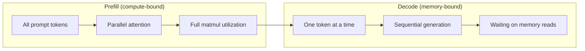
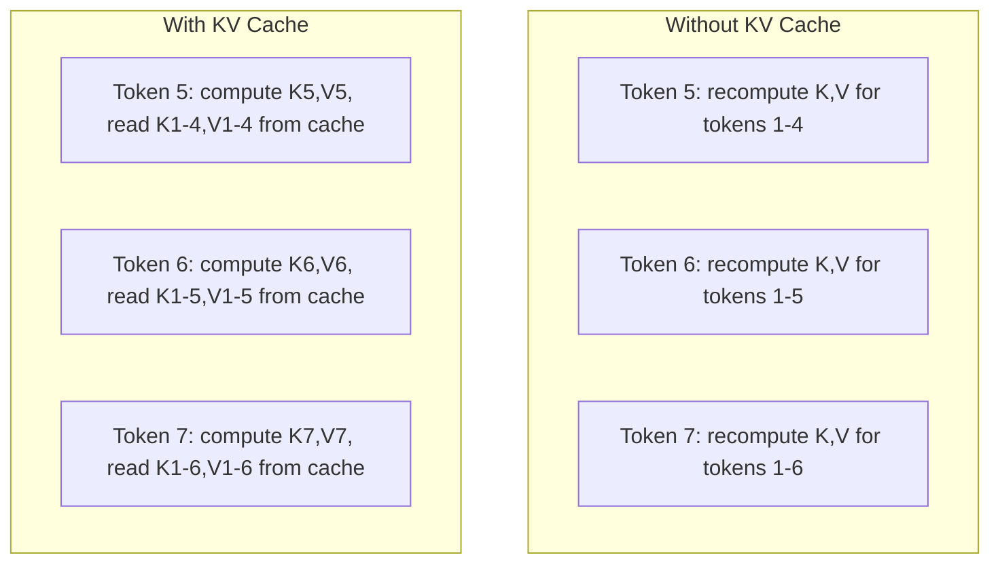
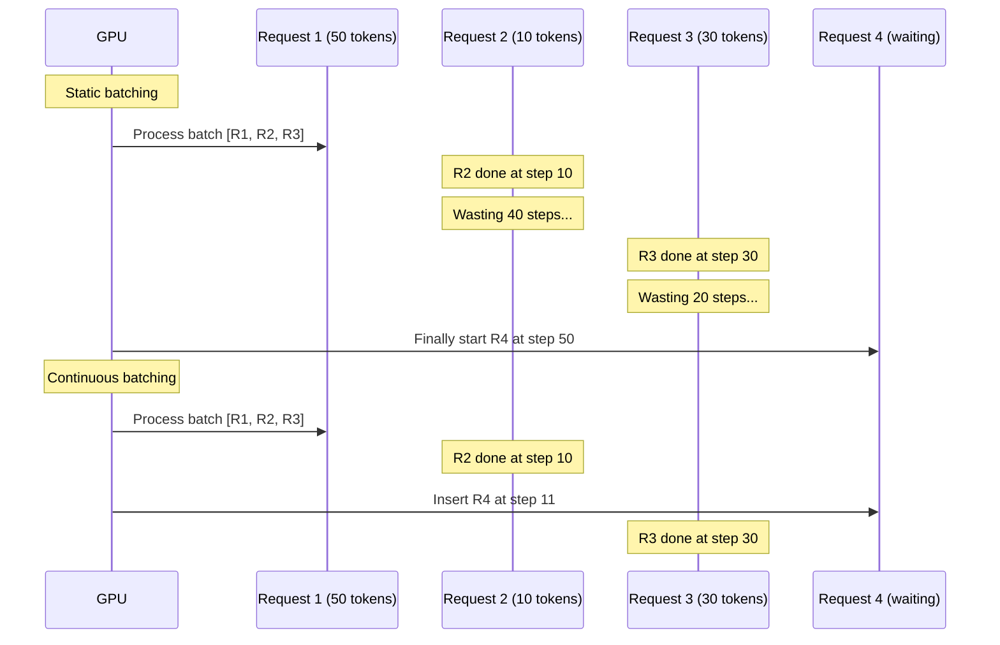
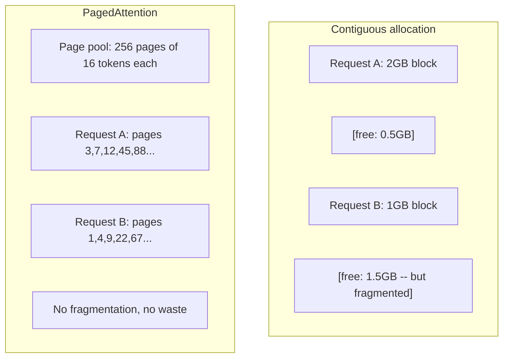
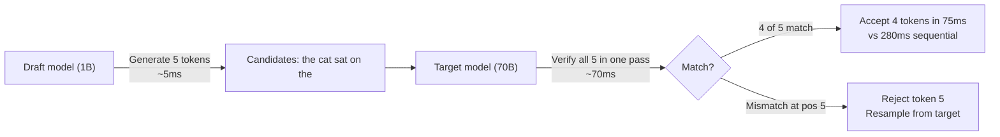

# Inference Optimization · 推理优化

> LLM 推理由两个阶段定义。Prefill 并行处理你的 prompt——计算受限（compute-bound）。Decode 一次生成一个 token——内存受限（memory-bound）。每一项优化都瞄准其中一个或两者。

> Two phases define LLM inference. Prefill processes your prompt in parallel -- compute-bound. Decode generates tokens one at a time -- memory-bound. Every optimization targets one or both.

**Type:** Build
**Languages:** Python
**Prerequisites:** Phase 10, Lessons 01-08 (Transformer architecture, attention)
**Time:** ~120 minutes

## Learning Objectives · 学习目标

- 实现 KV 缓存（KV-cache），消除自回归 token 生成中的重复计算
- 解释 LLM 推理的 prefill 与 decode 两个阶段，以及为什么两者的瓶颈不同（计算受限 vs 内存受限）
- 实现 continuous batching 与 PagedAttention 的核心思想，在并发请求下最大化 GPU 利用率
- 对比各种推理优化技术（KV 缓存、投机解码、flash attention）及其吞吐/延迟权衡

> Implement KV-cache to eliminate redundant computation during autoregressive token generation
> Explain the prefill vs decode phases of LLM inference and why each has different bottlenecks (compute-bound vs memory-bound)
> Implement continuous batching and PagedAttention concepts to maximize GPU utilization under concurrent requests
> Compare inference optimization techniques (KV-cache, speculative decoding, flash attention) and their throughput/latency tradeoffs

## The Problem · 问题在哪

你把 Llama 3 70B 部署在 4 张 A100 上。单个用户能拿到约 50 tokens per second，感觉挺快。然后 100 个用户同时打到端点上，吞吐掉到每用户 3 tokens/second。你每月 25,000 美元的 GPU 账单，出答案的速度比人打字还慢。

从 1 个用户到 100 个用户，模型本身没有任何变化：同样的权重、同样的架构、同样的数学。变化的是你调度工作的方式。朴素的推理浪费了 90% 以上的可用 GPU 算力——一个等待第 47 个 token 的用户占着整个 batch 槽位，而 GPU 的内存总线在矩阵乘法之间闲置。与此同时，另一个新用户 2,000 token 的 prompt 本可以用有用的计算填满这段死时间。

这不是扩容问题，是调度问题。本课的这些技术——KV 缓存、continuous batching、PagedAttention、投机解码（speculative decoding）、前缀缓存（prefix caching）——正是「每月 2.5 万美元的推理账单」和「同样流量每月 5 千美元」之间的差别。

vLLM 在 4xA100-80GB 上服务 Llama 3 70B：低并发时约 50 tokens/second/user，在 100 并发请求下靠 continuous batching 和 PagedAttention 仍能维持 15-25 TPS/user。没有这些优化，同样的硬件在那个并发度只能给到 5 TPS/user。同样的 GPU、同样的模型，4 倍吞吐。

> You deploy Llama 3 70B on 4xA100 GPUs. A single user gets ~50 tokens per second. Feels fast. Then 100 users hit the endpoint simultaneously. Throughput drops to 3 tokens/second/user. Your $25,000/month GPU bill is serving responses slower than a human types. ... The model itself does not change between 1 user and 100 users. Same weights, same architecture, same math. What changes is how you schedule the work. Naive inference wastes 90%+ of available GPU compute. ... This is not a scaling problem. It is a scheduling problem. ... Same GPUs, same model, 4x the throughput.

## The Concept · 概念

### Prefill vs Decode · Prefill 对比 Decode

每个 LLM 推理请求都有两个截然不同的阶段。

**Prefill** 处理整个输入 prompt。所有 token 都是已知的，所以注意力可以沿整个序列并行计算。这是一次大型矩阵乘法——GPU 核心保持忙碌。瓶颈是计算（compute）：硬件每秒能交付多少 FLOPS。一张 A100 有 312 TFLOPS（BF16）。70B 模型对 4,096 token 的 prompt 做 prefill，单张 A100 约 400ms。

**Decode** 一次生成一个输出 token。每个新 token 都要关注之前所有的 token，但每次前向传播只产出一个 token。权重矩阵和 prefill 时一样大，但你是在用单个向量去乘它们，而不是矩阵。GPU 核心微秒级就算完了，然后等待下一批权重从内存到达。瓶颈是内存带宽（memory bandwidth）：把模型权重从 HBM 流式送到计算单元的速度。A100 带宽 2 TB/s，FP16 的 70B 模型有 140 GB，完整读一遍模型要 70ms——这就是单个 decode 步的下限。



**ops:byte 比**（也叫算术强度，arithmetic intensity）刻画了这个权衡：它度量你从内存每加载一个字节，执行了多少操作。

```
ops:byte ratio = FLOPs per token / bytes read from memory
```

prefill 一个 4,096 token 的 batch 时，每加载一份权重大约执行 4,096 次乘加，比值高——你是计算受限。decode 且 batch size 为 1 时，每加载一份权重只执行约 1 次操作，比值低——你是内存受限。

根本洞见：*decode 是内存受限的，因为你读完整个模型只为产出一个 token*。下面的每一项优化，要么减少你要读的东西，要么增大每次读取所处理的 token 批量，要么干脆避免读取。

> Every LLM inference request has two distinct phases. ... **Prefill** processes the entire input prompt. All tokens are known, so attention can be computed in parallel across the full sequence. ... The bottleneck is compute: how many FLOPS your hardware can deliver per second. ... **Decode** generates output tokens one at a time. ... The bottleneck is memory bandwidth: how fast you can stream model weights from HBM to the compute units. ... The fundamental insight: *decode is memory-bound because you read the entire model to produce a single token*. Every optimization below either reduces what you read, increases the batch of tokens processed per read, or avoids reads entirely.

### KV Cache · KV 缓存

注意力计算中，每个 token 的 query 要关注之前每个 token 的 key 和 value 向量。不缓存的话，生成第 N 个 token 需要为之前 N-1 个 token 重算 key、value 投影：生成 token 2 时投影一遍 token 1，生成 token 3 时再来一遍，token 4 又一遍。到第 1,000 个 token 时，token 1 已经被投影了 999 次。

KV 缓存把所有之前 token 的 key、value 投影存下来。生成第 N 个 token 时，只计算 token N 的 key 和 value，再把它们与缓存的 token 1 到 N-1 的 K/V 拼接。



**KV 缓存的内存公式：**

```
KV cache size = 2 * num_layers * num_kv_heads * head_dim * seq_len * bytes_per_param
```

以 Llama 3 70B（80 层，GQA 下 8 个 KV 头，head_dim=128，BF16）为例：

```
per token: 2 * 80 * 8 * 128 * 2 bytes = 327,680 bytes = 320 KB
at 4,096 tokens: 320 KB * 4,096 = 1.28 GB
at 128K tokens: 320 KB * 131,072 = 40 GB
```

Llama 3 70B 的一段 128K 上下文对话要吃掉 40 GB KV 缓存——半张 A100 的内存。100 个并发用户每人 4K token，光 KV 缓存就要 128 GB。这就是为什么 KV 缓存管理是推理优化的核心挑战。

> During attention, each token's query attends to every previous token's key and value vectors. Without caching, generating token N requires recomputing the key and value projections for all N-1 preceding tokens. ... The KV cache stores the key and value projections from all previous tokens. ... A single 128K-context conversation for Llama 3 70B consumes 40 GB of KV cache -- half an A100's memory. ... This is why KV cache management is the central challenge of inference optimization.

### Continuous Batching · 连续批处理

静态批处理（static batching）等凑够 N 个请求，一起处理，然后等*所有*请求都结束才接受新请求。如果一个请求要 500 个 token、另一个只要 10 个，短的那个在自己完成后的 490 个 decode 步里干坐着。

连续批处理（continuous batching，也叫 iteration-level batching）在任何请求完成的瞬间就把新请求插进 batch。batch 在每个 decode 步都重新评估。一个 10 个 token 就结束的请求，立刻被等待中的请求顶替。



吞吐提升取决于输出长度差异有多大。长度均匀时，continuous batching 与 static batching 打平。长度参差时（常见情况），continuous batching 能带来 2-5 倍的吞吐，因为 GPU 槽位从不空转。

> Static batching waits until a batch of N requests arrives, processes them together, and waits until *all* finish before accepting new requests. ... Continuous batching (also called iteration-level batching) inserts new requests into the batch as soon as any request completes. ... With variable lengths (the common case), continuous batching can deliver 2-5x higher throughput because GPU slots never sit empty.

### PagedAttention · 分页注意力

每个请求的 KV 缓存是一块连续内存。请求来了又走，内存就碎片化了——和操作系统里的 RAM 碎片一模一样。一个 4K token 的请求需要 1.28 GB 连续内存。哪怕你总共有 2 GB 空闲，也未必有 1.28 GB *连续*空间。你要么浪费内存，要么拒绝请求。

PagedAttention（来自 vLLM）把操作系统式的虚拟内存搬到 KV 缓存上：不再给每个请求分配一整块连续内存，而是分配固定大小的「页」（page，通常每页 16 个 token）。页可以散布在物理显存的任何位置，页表（page table）把每个请求的逻辑序列位置映射到物理页位置。



PagedAttention 还为共享前缀启用了**写时复制**（copy-on-write）。如果 50 个请求共享同一个 system prompt，这个 system prompt 的 KV 缓存页只存一份，被 50 个请求共同引用；只有当某个请求分叉（用户消息不同）时，它才拿到自己的页。对共享 system prompt 的应用，这能把内存占用砍掉一大截。

vLLM 报告 PagedAttention 带来接近零的内存浪费（约 4%，朴素分配则是 60-80%）。

> The KV cache for each request is a contiguous block of memory. As requests arrive and depart, memory fragments -- exactly like RAM fragmentation in operating systems. ... PagedAttention (from vLLM) applies OS-style virtual memory to KV cache. ... PagedAttention also enables **copy-on-write** for shared prefixes. ... vLLM reports near-zero memory waste (~4% vs ~60-80% in naive allocation) through PagedAttention.

### Speculative Decoding · 投机解码

decode 慢，因为它是串行的——生成一个 token，喂回去，再生成下一个。但如果你能廉价地猜出接下来的 5 个 token，然后一次性全部验证呢？

投机解码（speculative decoding）用一个小的、快的**草稿模型**（draft model）生成 K 个候选 token，然后大的**目标模型**（target model）在一次前向传播里处理全部 K 个候选（这看起来像一次 prefill——并行、计算受限、高效）。如果目标模型认同草稿模型的预测，你在一次目标前向传播的时间里收下全部 K 个 token；如果在第 j 位不一致，就接受前 j-1 个 token，丢弃其余。



加速比取决于**接受率**（acceptance rate）——草稿模型的预测与目标一致的概率。用 Llama 3 8B 给 Llama 3 70B 做草稿，自然语言上 70-85% 的接受率很典型，折算成 2-3 倍的 decode 加速。

投机解码的三种路线：

| 方法 | 草稿来源 | 接受率 | 开销 |
|------|---------|--------|------|
| Draft-target（Leviathan 等人） | 单独的小模型 | 70-85% | 草稿模型的内存 |
| EAGLE（Li 等人） | 目标模型上的轻量头 | 75-90% | 约 1% 的额外参数 |
| N-gram lookup | token n-gram 表 | 40-60% | 可忽略 |

**EAGLE** 在目标模型的隐藏态之上训练一个小的自回归头，用目标模型倒数第二层的特征预测下一个 token 的 embedding。因为它工作在目标模型自己的表示上（而不是另一个模型的），能用极小的额外内存拿到更高的接受率。EAGLE-2 增加了动态草稿树，根据上下文调整候选数量。

**N-gram 投机解码**维护一张 n-gram 延续表，内容来自当前上下文或预构建的语料。如果草稿匹配到同一对话里之前出现过的内容（重复模式、代码、结构化输出），它以零神经网络开销触发。平均接受率更低，但每次猜测的成本几乎为零。

投机解码在*数学上是精确的*——输出分布与目标模型的分布完全一致。它不是近似。验证步保证每个被接受的 token 恰好具有目标模型会赋予的概率。

> Decode is slow because it is sequential -- you generate one token, feed it back, generate the next. ... Speculative decoding uses a small, fast **draft model** to generate K candidate tokens. ... The speedup depends on the **acceptance rate** -- how often the draft model's predictions match the target. ... Speculative decoding is *mathematically exact* -- the output distribution is identical to the target model's distribution. It is not an approximation.

### Prefix Caching · 前缀缓存

很多请求共享相同的前缀：聊天机器人的 system prompt、RAG 上下文块、few-shot 示例组。没有前缀缓存，每个请求都要从零重算这些共享 token 的 KV 缓存。

前缀缓存（prefix caching）把公共前缀的 KV 缓存存下来，跨请求复用。带已知前缀的新请求到达时，系统直接复制（或引用）缓存的 KV 条目，只为独有的后缀计算 KV。

对一个被所有请求共享的 2,000 token system prompt，前缀缓存为每个请求省掉约 400ms 的 prefill。每秒 100 个请求时，每秒省下 40 秒 GPU 计算——超过一张 GPU 的工作量。

SGLang 的 RadixAttention 用基数树（radix tree，即 trie）按 token 内容索引前缀，实现前缀缓存。任何匹配到已存前缀的请求都免费获得其 KV 缓存。这棵树支持部分前缀匹配：如果你与某个缓存条目共享 2,000 个前缀 token 中的 1,500 个，你复用那 1,500 个，只重算 500 个。

> Many requests share the same prefix. A chatbot system prompt. A RAG context block. A few-shot example set. Without prefix caching, every request recomputes the KV cache for these shared tokens from scratch. ... Prefix caching stores the KV cache for common prefixes and reuses it across requests. ... For a 2,000-token system prompt shared across all requests, prefix caching eliminates ~400ms of prefill per request. ... Any request matching a stored prefix gets its KV cache for free.

### Inference Engines · 推理引擎

三个引擎主导生产级 LLM 服务：

| 引擎 | 关键创新 | 最适合 |
|------|---------|--------|
| vLLM | PagedAttention、continuous batching | 通用部署，兼容性最广 |
| SGLang | RadixAttention（前缀缓存）、结构化生成 | 多轮聊天机器人、受限解码 |
| TensorRT-LLM | NVIDIA 算子融合、FP8 量化 | NVIDIA 硬件上的单卡最高吞吐 |

**vLLM** 是默认起点。它支持的模型范围最广，能跑在任何 GPU 厂商上（NVIDIA、AMD、Intel），靠 PagedAttention + continuous batching 实现高吞吐。它的 OpenAI 兼容 API 意味着你可以直接把它当成任何 OpenAI API 调用的替代品。

**SGLang** 建立在与 vLLM 相同的基座上，但为前缀缓存加了 RadixAttention，并为结构化 LLM 程序提供了一门领域特定语言。如果你的负载涉及多轮对话、工具使用或受限解码（JSON 输出、正则引导生成），SGLang 靠前缀复用常常比 vLLM 快 2-5 倍。

**TensorRT-LLM** 把模型编译成优化过的 NVIDIA GPU kernel。它融合算子（attention + linear + activation 融进一个 kernel），在 H100 上使用 FP8，并与 NVIDIA Triton Inference Server 集成做生产部署。它在 NVIDIA 硬件上达到最高的单卡吞吐，但需要更多配置，而且只能在 NVIDIA GPU 上用。

Llama 3 70B（4xA100-80GB，BF16）的实测数字：

| 指标 | vLLM | SGLang | TensorRT-LLM |
|------|------|--------|---------------|
| 吞吐（1 用户） | ~50 TPS | ~55 TPS | ~65 TPS |
| 吞吐（100 用户） | ~2,500 总 TPS | ~3,200 总 TPS | ~3,000 总 TPS |
| 首 token 时间 | ~400ms | ~300ms（前缀命中） | ~350ms |
| 最大上下文 | 128K | 128K | 128K |

> Three engines dominate production LLM serving: ... **vLLM** is the default starting point. ... If your workload involves multi-turn conversations, tool use, or constrained decoding (JSON output, regex-guided generation), SGLang often outperforms vLLM by 2-5x through prefix reuse. ... It achieves the highest single-GPU throughput on NVIDIA hardware but requires more setup and only works on NVIDIA GPUs.

### The Ops:Byte Framework · ops:byte 框架

你无法优化你没有度量的东西。ops:byte 比告诉你现在是计算受限还是内存受限，这决定了哪些优化才有意义。

```
Compute roof: peak FLOPS of the GPU
Memory roof:  peak bandwidth * ops:byte ratio
```

ops:byte 低时（decode、小 batch），你撞的是内存带宽天花板：加更多算力（提频率、加核心）没有用。你需要减少内存读取（量化、KV 缓存压缩），或者增大 batch 把读取摊到更多有用工作上。

ops:byte 高时（prefill、大 batch），你撞的是算力天花板：内存带宽优化没有用。你需要更快的 GPU、算子融合（kernel fusion）或更低精度，去榨出更多 FLOPS。

| 场景 | ops:byte | 瓶颈 | 优化手段 |
|------|----------|------|----------|
| Prefill，batch=1 | ~4,096 | 计算 | 算子融合、FP8 |
| Decode，batch=1 | ~1 | 内存 | 量化、KV 压缩 |
| Decode，batch=32 | ~32 | 内存 | 更大 batch、continuous batching |
| Decode，batch=256 | ~256 | 过渡区 | 两者都重要 |
| Decode，batch=1024 | ~1,024 | 计算 | 算子融合、张量并行 |

A100 上的交叉点大约在 ops:byte = 156（312 TFLOPS / 2 TB/s）。低于 156，你是内存受限；高于 156，你是计算受限。Continuous batching 通过在每次迭代塞进更多 token，把 decode 推向这个交叉点。

```figure
context-window-slide
```

> You cannot optimize what you do not measure. ... When ops:byte is low (decode, small batches), you hit the memory bandwidth roof. ... When ops:byte is high (prefill, large batches), you hit the compute roof. ... The crossover point on A100 is around ops:byte = 156 (312 TFLOPS / 2 TB/s). Below 156, you are memory-bound. Above 156, you are compute-bound.

## Build It · 动手造

### Step 1: KV Cache from Scratch · 第 1 步：从零构建 KV 缓存

我们构建一个多头 KV 缓存，按层、按头存储 key 和 value 投影，并演示内存随长度的增长模式。

```python
import numpy as np

class KVCache:
    def __init__(self, num_layers, num_heads, head_dim, max_seq_len, dtype=np.float16):
        self.num_layers = num_layers
        self.num_heads = num_heads
        self.head_dim = head_dim
        self.max_seq_len = max_seq_len
        self.dtype = dtype

        self.k_cache = np.zeros(
            (num_layers, num_heads, max_seq_len, head_dim), dtype=dtype
        )
        self.v_cache = np.zeros(
            (num_layers, num_heads, max_seq_len, head_dim), dtype=dtype
        )
        self.seq_len = 0

    def update(self, layer_idx, new_keys, new_values):
        num_new = new_keys.shape[1]
        end = self.seq_len + num_new
        self.k_cache[layer_idx, :, self.seq_len:end, :] = new_keys
        self.v_cache[layer_idx, :, self.seq_len:end, :] = new_values
        return (
            self.k_cache[layer_idx, :, :end, :],
            self.v_cache[layer_idx, :, :end, :]
        )

    def advance(self, num_tokens):
        self.seq_len += num_tokens

    def memory_bytes(self):
        return self.k_cache.nbytes + self.v_cache.nbytes

    def used_bytes(self):
        per_token = 2 * self.num_layers * self.num_heads * self.head_dim * np.dtype(self.dtype).itemsize
        return per_token * self.seq_len
```

> We build a multi-head KV cache that stores key and value projections per layer, per head, and demonstrates the memory growth pattern.

### Step 2: Attention with KV Cache · 第 2 步：带 KV 缓存的注意力

一个使用 KV 缓存执行 decode 步的简化多头注意力。

```python
def scaled_dot_product_attention(query, keys, values):
    head_dim = query.shape[-1]
    scores = np.matmul(query, keys.transpose(0, 1, 3, 2)) / np.sqrt(head_dim)
    seq_len_q = scores.shape[-2]
    seq_len_k = scores.shape[-1]
    if seq_len_q > 1:
        mask = np.triu(np.ones((seq_len_q, seq_len_k), dtype=np.float32), k=seq_len_k - seq_len_q + 1)
        scores = scores + mask * (-1e9)
    max_scores = np.max(scores, axis=-1, keepdims=True)
    exp_scores = np.exp(scores - max_scores)
    attn_weights = exp_scores / np.sum(exp_scores, axis=-1, keepdims=True)
    return np.matmul(attn_weights, values)


class MultiHeadAttention:
    def __init__(self, d_model, num_heads):
        self.num_heads = num_heads
        self.head_dim = d_model // num_heads
        scale = np.sqrt(2.0 / d_model)
        self.W_q = np.random.randn(d_model, d_model).astype(np.float32) * scale
        self.W_k = np.random.randn(d_model, d_model).astype(np.float32) * scale
        self.W_v = np.random.randn(d_model, d_model).astype(np.float32) * scale
        self.W_o = np.random.randn(d_model, d_model).astype(np.float32) * scale

    def forward(self, x, kv_cache=None, layer_idx=0):
        batch, seq_len, d_model = x.shape
        Q = np.matmul(x, self.W_q).reshape(batch, seq_len, self.num_heads, self.head_dim).transpose(0, 2, 1, 3)
        K = np.matmul(x, self.W_k).reshape(batch, seq_len, self.num_heads, self.head_dim).transpose(0, 2, 1, 3)
        V = np.matmul(x, self.W_v).reshape(batch, seq_len, self.num_heads, self.head_dim).transpose(0, 2, 1, 3)

        if kv_cache is not None:
            K_full, V_full = kv_cache.update(layer_idx, K[0], V[0])
            K = K_full[np.newaxis, :, :, :]
            V = V_full[np.newaxis, :, :, :]
            if seq_len == 1:
                kv_cache.advance(1)

        attn_out = scaled_dot_product_attention(Q, K, V)
        attn_out = attn_out.transpose(0, 2, 1, 3).reshape(batch, -1, d_model)
        return np.matmul(attn_out, self.W_o)
```

> A simplified multi-head attention that uses the KV cache for decode steps.

### Step 3: Continuous Batching Simulator · 第 3 步：连续批处理模拟器

这个模拟器复现了静态批处理与连续批处理之间的调度差异。

```python
import heapq

class Request:
    def __init__(self, request_id, prompt_tokens, output_tokens, arrival_step):
        self.request_id = request_id
        self.prompt_tokens = prompt_tokens
        self.output_tokens = output_tokens
        self.arrival_step = arrival_step
        self.tokens_generated = 0
        self.start_step = None
        self.end_step = None

    def is_done(self):
        return self.tokens_generated >= self.output_tokens


def simulate_static_batching(requests, batch_size):
    step = 0
    completed = []
    queue = list(requests)
    queue.sort(key=lambda r: r.arrival_step)

    while queue:
        batch = []
        while queue and len(batch) < batch_size:
            r = queue.pop(0)
            r.start_step = max(step, r.arrival_step)
            batch.append(r)

        if batch:
            step = max(step, max(r.start_step for r in batch))
            max_output = max(r.output_tokens for r in batch)
            for r in batch:
                r.tokens_generated = r.output_tokens
                r.end_step = step + max_output
            step += max_output
            completed.extend(batch)

    return completed


def simulate_continuous_batching(requests, batch_size):
    step = 0
    completed = []
    queue = sorted(requests, key=lambda r: r.arrival_step)
    queue_idx = 0
    active = []
    waiting = []

    while queue_idx < len(queue) or active or waiting:
        while queue_idx < len(queue) and queue[queue_idx].arrival_step <= step:
            waiting.append(queue[queue_idx])
            queue_idx += 1

        while waiting and len(active) < batch_size:
            r = waiting.pop(0)
            r.start_step = step
            active.append(r)

        if not active:
            if waiting:
                step += 1
                continue
            elif queue_idx < len(queue):
                step = queue[queue_idx].arrival_step
                continue
            else:
                break

        for r in active:
            r.tokens_generated += 1

        done = [r for r in active if r.is_done()]
        for r in done:
            r.end_step = step + 1
            completed.append(r)
        active = [r for r in active if not r.is_done()]

        step += 1

    return completed


def batching_stats(completed):
    latencies = [r.end_step - r.arrival_step for r in completed]
    total_time = max(r.end_step for r in completed) - min(r.arrival_step for r in completed)
    total_tokens = sum(r.output_tokens for r in completed)
    return {
        "avg_latency": np.mean(latencies),
        "p50_latency": np.median(latencies),
        "p99_latency": np.percentile(latencies, 99),
        "total_time": total_time,
        "throughput": total_tokens / total_time if total_time > 0 else 0,
    }
```

> This simulates the scheduling difference between static and continuous batching.

### Step 4: Prefix Cache · 第 4 步：前缀缓存

一个基于 trie 的前缀缓存，为共享前缀存储 KV 条目。

```python
class TrieNode:
    def __init__(self):
        self.children = {}
        self.kv_data = None
        self.hit_count = 0


class PrefixCache:
    def __init__(self, max_entries=1000):
        self.root = TrieNode()
        self.max_entries = max_entries
        self.total_entries = 0
        self.hits = 0
        self.misses = 0

    def _walk(self, token_ids):
        node = self.root
        depth = 0
        for tid in token_ids:
            if tid not in node.children:
                break
            node = node.children[tid]
            depth += 1
        return node, depth

    def lookup(self, token_ids):
        node, depth = self._walk(token_ids)
        if depth > 0:
            self.hits += 1
            current = self.root
            for tid in token_ids[:depth]:
                current = current.children[tid]
                current.hit_count += 1
            kv_entries = []
            current = self.root
            for tid in token_ids[:depth]:
                current = current.children[tid]
                if current.kv_data is not None:
                    kv_entries.append(current.kv_data)
            return depth, kv_entries
        self.misses += 1
        return 0, []

    def insert(self, token_ids, kv_per_token):
        node = self.root
        for i, tid in enumerate(token_ids):
            if tid not in node.children:
                if self.total_entries >= self.max_entries:
                    return i
                node.children[tid] = TrieNode()
                self.total_entries += 1
            node = node.children[tid]
            if i < len(kv_per_token):
                node.kv_data = kv_per_token[i]
        return len(token_ids)

    def hit_rate(self):
        total = self.hits + self.misses
        return self.hits / total if total > 0 else 0.0
```

> A trie-based prefix cache that stores KV entries for shared prefixes.

### Step 5: Speculative Decoding Simulator · 第 5 步：投机解码模拟器

我们模拟 draft-target 式的投机解码，接受率可以配置。

```python
class DraftModel:
    def __init__(self, vocab_size, acceptance_rate=0.8):
        self.vocab_size = vocab_size
        self.acceptance_rate = acceptance_rate

    def generate(self, context, num_tokens):
        tokens = np.random.randint(0, self.vocab_size, size=num_tokens)
        return tokens

    def get_probs(self, context, token):
        probs = np.random.dirichlet(np.ones(self.vocab_size))
        return probs


class TargetModel:
    def __init__(self, vocab_size):
        self.vocab_size = vocab_size

    def get_probs(self, context, tokens=None):
        if tokens is not None:
            return [np.random.dirichlet(np.ones(self.vocab_size)) for _ in tokens]
        return np.random.dirichlet(np.ones(self.vocab_size))


def speculative_decode(draft_model, target_model, context, num_speculative=5,
                       draft_cost=1.0, target_cost=10.0, verify_cost=12.0):
    total_tokens = 0
    total_cost = 0.0
    accepted_counts = []
    context = list(context)

    max_tokens = 100

    while total_tokens < max_tokens:
        draft_tokens = draft_model.generate(context, num_speculative)
        total_cost += draft_cost * num_speculative

        target_probs = target_model.get_probs(context, draft_tokens)
        total_cost += verify_cost

        accepted = 0
        for i, token in enumerate(draft_tokens):
            draft_p = draft_model.get_probs(context + list(draft_tokens[:i]), token)
            target_p = target_probs[i]

            r = np.random.random()
            acceptance_prob = min(1.0, target_p[token] / (draft_p[token] + 1e-10))

            if r < draft_model.acceptance_rate:
                accepted += 1
                context.append(token)
                total_tokens += 1
            else:
                new_token = np.random.choice(draft_model.vocab_size, p=target_p)
                context.append(new_token)
                total_tokens += 1
                break

        accepted_counts.append(accepted)

        if accepted == num_speculative:
            bonus_probs = target_model.get_probs(context)
            bonus_token = np.random.choice(draft_model.vocab_size, p=bonus_probs)
            context.append(bonus_token)
            total_tokens += 1

    sequential_cost = total_tokens * target_cost
    return {
        "total_tokens": total_tokens,
        "speculative_cost": total_cost,
        "sequential_cost": sequential_cost,
        "speedup": sequential_cost / total_cost if total_cost > 0 else 1.0,
        "avg_accepted": np.mean(accepted_counts),
        "acceptance_rate": np.mean(accepted_counts) / num_speculative,
    }


def compare_speculation_strategies(vocab_size=1000, num_trials=20):
    results = {}

    for name, acceptance_rate, spec_tokens in [
        ("Draft-target (8B->70B)", 0.78, 5),
        ("EAGLE", 0.85, 6),
        ("N-gram", 0.50, 4),
        ("No speculation", 0.0, 0),
    ]:
        if spec_tokens == 0:
            results[name] = {
                "speedup": 1.0,
                "acceptance_rate": 0.0,
                "avg_accepted": 0.0,
            }
            continue

        trial_results = []
        for _ in range(num_trials):
            draft = DraftModel(vocab_size, acceptance_rate=acceptance_rate)
            target = TargetModel(vocab_size)
            context = list(np.random.randint(0, vocab_size, size=10))
            result = speculative_decode(draft, target, context, num_speculative=spec_tokens)
            trial_results.append(result)

        results[name] = {
            "speedup": np.mean([r["speedup"] for r in trial_results]),
            "acceptance_rate": np.mean([r["acceptance_rate"] for r in trial_results]),
            "avg_accepted": np.mean([r["avg_accepted"] for r in trial_results]),
        }

    return results
```

> We simulate draft-target speculative decoding with configurable acceptance rates.

### Step 6: KV Cache Memory Profiler · 第 6 步：KV 缓存内存分析器

为真实模型配置计算 KV 缓存的内存需求。

```python
MODEL_CONFIGS = {
    "Llama-3-8B": {
        "num_layers": 32, "num_kv_heads": 8, "head_dim": 128,
        "model_params_b": 8, "gqa": True,
    },
    "Llama-3-70B": {
        "num_layers": 80, "num_kv_heads": 8, "head_dim": 128,
        "model_params_b": 70, "gqa": True,
    },
    "Llama-3-405B": {
        "num_layers": 126, "num_kv_heads": 8, "head_dim": 128,
        "model_params_b": 405, "gqa": True,
    },
    "Mistral-7B": {
        "num_layers": 32, "num_kv_heads": 8, "head_dim": 128,
        "model_params_b": 7, "gqa": True,
    },
    "GPT-4-est": {
        "num_layers": 120, "num_kv_heads": 96, "head_dim": 128,
        "model_params_b": 1800, "gqa": False,
    },
}


def kv_cache_memory(config, seq_len, dtype_bytes=2):
    per_token = 2 * config["num_layers"] * config["num_kv_heads"] * config["head_dim"] * dtype_bytes
    total = per_token * seq_len
    return {
        "per_token_bytes": per_token,
        "per_token_kb": per_token / 1024,
        "total_bytes": total,
        "total_mb": total / (1024 ** 2),
        "total_gb": total / (1024 ** 3),
    }


def memory_budget(config, gpu_memory_gb, model_dtype_bytes=2, kv_dtype_bytes=2):
    model_memory_gb = config["model_params_b"] * 1e9 * model_dtype_bytes / (1024 ** 3)
    overhead_gb = gpu_memory_gb * 0.1
    available_for_kv = gpu_memory_gb - model_memory_gb - overhead_gb

    if available_for_kv <= 0:
        return {"error": "Model does not fit in GPU memory", "model_memory_gb": model_memory_gb}

    per_token = 2 * config["num_layers"] * config["num_kv_heads"] * config["head_dim"] * kv_dtype_bytes
    max_tokens = int(available_for_kv * (1024 ** 3) / per_token)

    return {
        "gpu_memory_gb": gpu_memory_gb,
        "model_memory_gb": round(model_memory_gb, 1),
        "overhead_gb": round(overhead_gb, 1),
        "available_for_kv_gb": round(available_for_kv, 1),
        "max_total_tokens": max_tokens,
        "max_users_at_2k": max_tokens // 2048,
        "max_users_at_4k": max_tokens // 4096,
        "max_users_at_32k": max_tokens // 32768,
    }
```

> Compute KV cache memory requirements for real model configurations.

## Use It · 实战用法

配合 vLLM：

```python
from vllm import LLM, SamplingParams

llm = LLM(
    model="meta-llama/Meta-Llama-3-70B-Instruct",
    tensor_parallel_size=4,
    enable_prefix_caching=True,
    max_model_len=8192,
    gpu_memory_utilization=0.9,
)

params = SamplingParams(temperature=0.7, max_tokens=256)
outputs = llm.generate(["Explain inference optimization in one paragraph."], params)
```

> With vLLM:

配合 SGLang 做前缀缓存 + 结构化输出：

```python
import sglang as sgl

@sgl.function
def classify(s, text):
    s += sgl.system("You are a classifier. Output JSON only.")
    s += sgl.user(f"Classify this text: {text}")
    s += sgl.assistant(sgl.gen("result", regex=r'\{"label": "(positive|negative|neutral)"\}'))

runtime = sgl.Runtime(model_path="meta-llama/Meta-Llama-3-70B-Instruct", tp_size=4)
sgl.set_default_backend(runtime)

results = classify.run_batch([
    {"text": "This product is amazing!"},
    {"text": "Terrible experience."},
    {"text": "It was okay I guess."},
])
```

> With SGLang for prefix caching + structured output:

配合 TensorRT-LLM：

```python
import tensorrt_llm
from tensorrt_llm.runtime import ModelRunner

runner = ModelRunner.from_dir("./llama-70b-trt-engine/", rank=0)

outputs = runner.generate(
    batch_input_ids=[tokenizer.encode("Explain KV caching.")],
    max_new_tokens=256,
    temperature=0.7,
)
```

> With TensorRT-LLM:

## Ship It · 交付

本课产出：
- `outputs/skill-inference-optimization.md` —— 一个诊断和优化 LLM 推理服务的技能（skill）

> This lesson produces:
> - `outputs/skill-inference-optimization.md` -- a skill for diagnosing and optimizing LLM inference serving

## Exercises · 练习

1. 修改 KV 缓存分析器，比较 FP16、FP8、INT4 三种 KV 缓存量化。对 4K 上下文的 Llama 3 70B，在 4xA100-80GB 上分别算出最大并发用户数。KV 量化到 INT4 应该让用户容量大约翻 4 倍。

2. 扩展连续批处理模拟器，跟踪 GPU 利用率（每步被填满的 batch 槽位比例）。对 50 个输出长度服从 Pareto 分布（shape=1.5, scale=20）的请求，画出两种批处理方式下利用率随时间的变化。Continuous batching 应能保持 >80% 的利用率。

3. 实现分组查询注意力（grouped-query attention, GQA）版的 KV 缓存，其中 `num_kv_heads < num_query_heads`。Llama 3 70B 用 64 个 query 头但只有 8 个 KV 头。计算相对完整多头注意力的内存节省（KV 缓存大小降为 1/8）。

4. 构建一个使用 LRU 淘汰的前缀缓存。把 max_entries 设为 500，生成 1,000 个请求，其中 60% 共享 5 个公共前缀之一。测量命中率并与无上限缓存对比。淘汰策略得当时，命中率应保持在 55% 以上。

5. 扩展投机解码模拟器，实现树状投机（EAGLE-2 风格）：不是单链的 K 个草稿 token，而是生成一棵候选树（例如 3 层、每层 2 个分支 = 8 个叶子候选）。比较每轮验证接受的 token 总数与线性投机。

## Key Terms · 术语表

| 术语 | 大家怎么说 | 实际含义 |
|------|----------------|----------------------|
| Prefill | 「处理 prompt」 | 对所有输入 token 并行计算注意力——计算受限，因为完整的矩阵乘法让 GPU 核心保持忙碌 |
| Decode | 「生成 token」 | 每次前向传播产出一个 token，每次都要读完整的模型权重——内存受限，因为计算在下批权重到达之前就结束了 |
| KV cache | 「缓存注意力状态」 | 存下所有之前 token 的 key 和 value 投影，decode 每步不用重算——用内存换计算 |
| Continuous batching | 「动态批处理」 | 任何请求一完成就把新请求插进运行中的 batch，每个 decode 迭代都重新评估，而不是等整批结束 |
| PagedAttention | 「KV 缓存的虚拟内存」 | 用固定大小的页而非连续块来分配 KV 缓存，消除内存碎片，并为共享前缀启用写时复制 |
| Speculative decoding | 「先草稿再验证」 | 用快的草稿模型提出多个 token，目标模型一次前向传播全部验证——数学上精确，2-3 倍加速 |
| EAGLE | 「自投机解码」 | 在目标模型自己的隐藏态上训练轻量头的投机解码变体，接受率高于独立的草稿模型 |
| Prefix caching | 「复用 system prompt 的 KV」 | 为公共前缀（system prompt、few-shot 示例）存下算好的 KV 缓存条目，跨请求复用，跳过冗余 prefill |
| Ops:byte ratio | 「算术强度」 | 计算操作数与内存读取字节数之比——决定负载是计算受限（比值高）还是内存受限（比值低） |
| Time to first token | 「TTFT」 | 从收到请求到产出第一个输出 token 的延迟——长 prompt 时由 prefill 时间主导 |

## Further Reading · 延伸阅读

- Kwon et al., "Efficient Memory Management for Large Language Model Serving with PagedAttention" (2023) —— 提出 paged KV 缓存管理的 vLLM 论文，如今是推理服务的行业标准
- Leviathan et al., "Fast Inference from Transformers via Speculative Decoding" (2023) —— 奠基论文，证明 draft-verify 式投机能产出精确的目标模型分布并拿到 2-3 倍加速
- Li et al., "EAGLE: Speculative Sampling Requires Rethinking Feature Uncertainty" (2024) —— 在目标模型自己的特征上训练一个头（而非独立的草稿模型），拿到更高的接受率
- Zheng et al., "SGLang: Efficient Execution of Structured Language Model Programs" (2024) —— 提出用于前缀缓存的 RadixAttention，以及多调用 LLM 程序的编程模型
- Williams et al., "Roofline: An Insightful Visual Performance Model for Multicore Architectures" (2009) —— roofline 原始论文，把 ops:byte 框架形式化，用于推断计算与内存瓶颈
