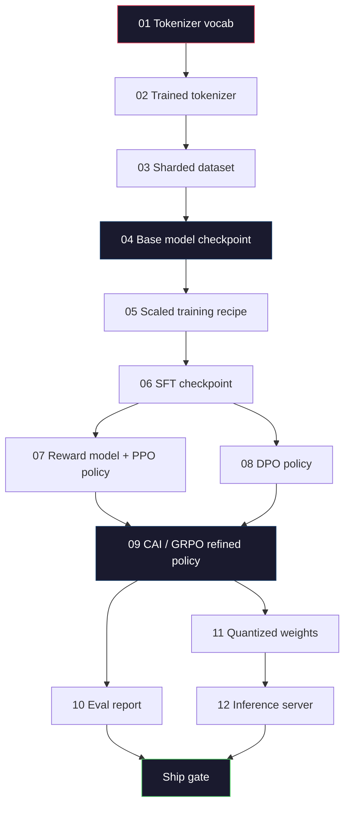
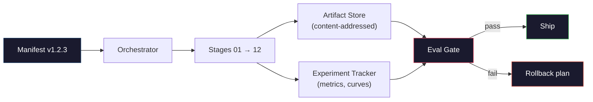

# Building a Complete LLM Pipeline · 构建完整的 LLM 流水线

> 第 01 到 12 课的每一样东西，都只是同一条流水线里的一个阶段。本课是把这些阶段拼成一次端到端运行的脚手架：分词、预训练、扩展、SFT、对齐、评测、量化、服务。你不会在笔记本上训练一个 70B 模型。你要做出的是一个 2026 年前沿团队用来决定「什么能上线」的编排层、清单文件、评测门禁和回滚计划。这是毕业课（capstone）。

> Everything from Lessons 01 to 12 is one stage of one pipeline. This lesson is the scaffold that turns those stages into a single end-to-end run: tokenize, pre-train, scale, SFT, align, evaluate, quantize, serve. You will not train a 70B model on a laptop. You will produce the orchestration layer, the manifest, the eval gate, and the rollback plan that a 2026 frontier team uses to decide what gets shipped. This is the capstone.

**Type:** Build
**Languages:** Python (stdlib)
**Prerequisites:** All Phase 10 lessons 01-12
**Time:** ~120 minutes

## Learning Objectives · 学习目标

- 把前 11 课（分词器、数据、预训练、扩展、SFT、RLHF、DPO、CAI、评测、量化、推理）组合成一份单一、可复现的流水线规范
- 定义阶段之间的工件契约（artifact contract）：每个阶段消费什么、产出什么、下一个阶段如何校验输入
- 构建一个编排器（orchestrator）：追踪实验、为工件计算哈希、用评测阈值把关上线决定
- 设计回滚计划：哪些工件重跑便宜、哪些昂贵、一个损坏的 checkpoint 代价是什么

> Compose the eleven prior lessons (tokenizer, data, pre-training, scaling, SFT, RLHF, DPO, CAI, eval, quantization, inference) into a single reproducible pipeline spec
> Define the artifact contract between stages: what each stage consumes, what it produces, and how the next stage verifies the input
> Build an orchestrator that tracks experiments, hashes artifacts, and gates ship decisions on eval thresholds
> Design the rollback plan: which artifacts are cheap to re-run, which are expensive, and what a corrupted checkpoint costs

## The Problem · 问题在哪

前面每一课单独都能跑通。分词器训练好了。Tiny GPT 预训练完了。SFT 数据集组装好了。奖励模型训练完了。DPO 跑过了。评测测完了。量化权重导出了。推理服务器起起来了。每一个都是一本 notebook，各自有自己的约定、自己的输出路径、自己的随机种子。

前沿训练运行不是 notebook。Llama 3 405B 花了大约 3000 万 H100 小时、历时约 54 天。DeepSeek-V3 用了约 280 万 H800 小时。在这段时间里，一个损坏的 checkpoint、一次数据污染、一次评测回退，就可能让团队赔上一周的墙钟时间和一个月的 GPU 预算。团队能活下来靠的是流水线卫生（pipeline hygiene）：每个阶段都有确定性的输入、确定性的输出、一份清单（manifest）、一个哈希和一道门禁（gate）。

这就是毕业课。你不会在笔记本上端到端跑完这条流水线。你要写的是协调各阶段的编排器、描述这次运行的清单、把关上线决定的校验器，以及让第三方只凭一个文件就能重放你工作的重放计划。代码很小，纪律很大。

这套模式从 1 亿（100M）到 1 万亿（1T）参数原封不动地扩展。同样的四个组件——清单、编排器、评测门禁、工件仓库——既能跑 Llama 3，也能跑你的玩具 GPT。差别只是每个阶段配置里数字的大小，而不是流水线的形状。

> The previous lessons each work. Tokenizer trained. Tiny GPT pre-trained. SFT dataset assembled. Reward model trained. DPO run. Evals measured. Quantized weights exported. Inference server spun up. Each one is a notebook. Each one has its own conventions, its own output paths, its own seed.
> A frontier training run is not a notebook. ... During that time, one corrupted checkpoint, one data contamination, one eval regression can cost a team a week of wall-clock and a month of GPU budget. The way teams survive this is through pipeline hygiene: every stage has a deterministic input, a deterministic output, a manifest, a hash, and a gate.
> This is the capstone. ... You will write the orchestrator that coordinates the stages, the manifest that describes the run, the verifier that gates ship decisions, and the replay plan that lets a third party re-run your work from a single file. The code is small; the discipline is large.
> The pattern scales from 100M to 1T parameters unchanged. The same four components -- manifest, orchestrator, eval gate, artifact store -- run Llama 3 and also run your hobby GPT. The difference is the size of the numbers inside each stage's config, not the shape of the pipeline.

## The Concept · 概念

### The Twelve Stages · 十二个阶段

Phase 10 的每一课都是一个阶段。下面是完整的依赖图。



阶段 07 和 08 可以并行。其余一切都是硬依赖。阶段 02（分词器）的改动会让所有下游工件失效；阶段 10（评测）的改动只让上线决定失效。

> Every Phase 10 lesson is a stage. Here is the full dependency graph.
> Stages 07 and 08 can run in parallel. Everything else is a hard dependency. A change in stage 02 (tokenizer) invalidates every downstream artifact. A change in stage 10 (eval) invalidates only the ship decision.

### The Manifest · 清单文件

清单（manifest）是一个文件，它对一次运行的描述完整到足以重放。流水线产出的任何东西都不应该依赖清单之外的状态。这些字段无聊但必须。

```
pipeline_version: 1.2.3
seed: 42
git_commit: a1b2c3d4
stages:
  01_tokenizer:
    recipe: bpe_32k
    input_hash: sha256:...
    output_hash: sha256:...
    wall_clock_sec: 3600
    cost_usd: 12
```

阶段 N 的输出哈希就是阶段 N+1 的输入哈希。任何偏差都会让流水线停机。这就是你及早抓到数据损坏的方式，也是另一个大洲的同事验证「他们的重放产出了和你相同的工件」的方式。

实践中团队用一个小 YAML schema，外加一个对照上次成功运行做 diff 的清单检查器。任何超出预期字段（成本、墙钟时间）的偏差都是红旗。

> A manifest is a single file that describes a run completely enough to replay it. Nothing the pipeline produces should depend on state that is not in the manifest. The fields are boring and mandatory.
> The output hash of stage N is the input hash of stage N+1. Any deviation and the pipeline halts. This is how you catch data corruption early. It is also how a teammate on a different continent verifies that their replay produced the same artifact as yours.
> In practice teams use a small YAML schema plus a manifest checker that diffs against the previous successful run. Any delta outside the expected fields (cost, wall clock) is a red flag.

### Artifact Typing · 工件类型

每个阶段的输出都是一个有类型的工件。不是目录大杂烩，不是 pickle，而是一个有名字、有已知 schema 的类型。

| Stage | Artifact Type | Key Fields |
|-------|--------------|-----------|
| 01-02 | Tokenizer | vocab.json, merges.txt, config.json, hash |
| 03 | Dataset | shards[], row count, token count, dedup stats |
| 04-05 | Checkpoint | weights.safetensors, config.json, optimizer state, step count |
| 06 | SFT Model | checkpoint + SFT recipe + data mix |
| 07 | Reward Model | RM checkpoint + preference data hash |
| 08-09 | Policy | checkpoint + reference hash + beta + KL budget consumed |
| 10 | Eval Report | benchmark scores + regression diffs + eval data hash |
| 11 | Quantized Model | quantized weights + calibration data + accuracy delta vs FP16 |
| 12 | Server Spec | endpoint + model hash + config + observability hooks |

类型化防住了最常见的失败模式：把阶段 08 的输出当成阶段 06 的输入，让一个 DPO 训练出来的模型走 SFT 的路径。有类型的工件加有类型的阶段签名，让这类错误变成编译期失败，而不是第五天（day-five）才爆发的线上事故。

> Each stage's output is a typed artifact. Not a directory blob, not a pickle, but a named type with a known schema.
> The typing prevents the most common failure mode: using a stage 08 output as a stage 06 input, shipping a DPO-trained model through the SFT path. Typed artifacts and typed stage signatures make these errors compile-time failures, not day-five failures.

### The Eval Gate · 评测门禁

上线不是「训练结束了」。上线是「训练结束且评测门禁通过」。门禁在运行开始之前就定义好。

```
gates:
  mmlu:      >= baseline + 0.5   # no regression
  humaneval: >= baseline + 1.0
  truthfulqa: >= baseline         # no drop
  safety_refusal_rate: <= 0.05
  kl_from_reference: <= 25.0
  cost_total_usd: <= 50000
```

每道门禁都是数值阈值。没有「看起来不错」式的门禁，没有主观签字。所有门禁通过，工件被标记为可上线；任何一道失败，运行被挂起，等待一位具名审核人显式覆盖（override）——这次覆盖本身也会记入清单。

两道门禁能拦住大多数灾难。回归（regression）门禁——新模型在核心基准上至少不能比上一版差——抓训练 bug。KL 预算门禁——对齐后的策略偏离其参考模型的距离不得超过 X——抓对齐过火。每条生产流水线都同时有这两道。

> Shipping is not "training finished." Shipping is "training finished and the eval gate passed." The gate is defined before the run starts.
> Every gate is a numeric threshold. No "looks good" gates. No subjective sign-offs. If every gate passes, the artifact is marked shippable. If any gate fails, the run is held pending explicit override by a named reviewer, which itself is logged in the manifest.
> Two gates catch most disasters. A *regression* gate (the new model must be at least as good as the previous on core benchmarks) catches training bugs. A *KL budget* gate (the aligned policy must not have drifted further than X from its reference) catches alignment overcooking. Every production pipeline has both.

### The Orchestrator · 编排器

一小段代码：读清单、派发阶段、追踪工件、在任何契约违例时停机。这不是 Airflow，也不是 Kubeflow。为了流水线卫生，你要的是一个你自己写的、足够无聊的东西。

编排器的职责很窄：

1. 从清单解析出 DAG。
2. 对每个阶段，检查期望输出是否已经以正确的哈希存在（存在则跳过）。
3. 运行阶段，捕获 stdout/stderr，测量墙钟时间和成本。
4. 将输出哈希与下游阶段期望的输入哈希比对。
5. 失败时，写出带有精确失败阶段的局部清单，并以非零码退出。

这就是 200 行 Python。它长什么样，看本课的 `code/main.py` 就知道。底层真正的流水线用 `torchrun` 或 `ray` 在集群上执行单个阶段，但编排器本身跑在一台机器上。

> A small piece of code that reads the manifest, dispatches stages, tracks artifacts, and halts on any contract violation. This is not Airflow. This is not Kubeflow. For pipeline hygiene you want something boring that you wrote.
> The orchestrator's job is narrow:
> 1. Resolve the DAG from the manifest.
> 2. For each stage, check if the expected output already exists at the correct hash (skip if so).
> 3. Run the stage, capture stdout/stderr, measure wall clock and cost.
> 4. Verify the output hash against the downstream stage's expected input hash.
> 5. On failure, write a partial manifest with the exact failing stage and exit nonzero.
> That is 200 lines of Python. It will look like the file `code/main.py` in this lesson. Under the hood, the real pipeline uses `torchrun` or `ray` to execute individual stages on clusters, but the orchestrator itself runs on a single box.

### Experiment Tracking and Artifact Storage · 实验追踪与工件存储

两个外部系统给流水线打锚。

**实验追踪器（wandb、neptune、mlflow）。** 记录每个阶段的 loss 曲线、评测指标、系统遥测。当你三周后要比对 run A 和 run B 时，你去的就是追踪器。团队几乎总是用托管的追踪器——自己造会浪费本该花在训练上的时间。

**工件仓库（S3、R2、GCS）。** 存放 checkpoint、数据集、分词器、评测报告的不可变对象存储。工件按哈希寻址，不按文件名。`latest.pt` 这样的文件名是 foot-gun；`ckpt-7b-step-20000-sha256:abc123.safetensors` 才是一份契约。

编排器两者都写。追踪器是给人看图表的；工件仓库是给下一个阶段查输入的。

> Two external systems anchor the pipeline.
> **Experiment tracker (wandb, neptune, mlflow).** Logs loss curves, eval metrics, system telemetry per stage. The tracker is where you go when you need to compare run A against run B three weeks later. Teams almost always use a hosted tracker for this -- writing your own loses time that should go into training.
> **Artifact store (S3, R2, GCS).** Immutable object store for checkpoints, datasets, tokenizers, eval reports. Artifacts are addressed by hash, not by filename. A filename like `latest.pt` is a foot-gun; `ckpt-7b-step-20000-sha256:abc123.safetensors` is a contract.
> The orchestrator writes to both. The tracker is for humans looking at charts. The artifact store is for the next stage looking up inputs.

### Costing · 成本核算

前沿运行背后挂着一个美元数字。预算纪律发生在两个地方。

**运行前估算。** 从清单算出预期 FLOPs（预训练是 6 x params x tokens）、预期 GPU 小时（FLOPs / 峰值吞吐 / 利用率），以及按当前租用价折算的美元成本。如果估算超过预算门禁，流水线拒绝启动。

**运行中跟踪。** 每个阶段的墙钟时间和成本记入清单。每个阶段结束后检查剩余预算。如果某个阶段超支，下一个阶段的门禁就按新的剩余预算评估。你不会等到 VC 打电话来才发现自己没钱了。

Llama 3 公布的成本是 6100 万美元。DeepSeek-V3 主预训练运行公布 560 万美元。这个比率主要来自硬件效率加混合专家（mixture-of-experts）——但具体成本之所以可见，是因为两个团队都按阶段、而不是按运行来追踪。

> A frontier run has a dollar number attached. Budget discipline happens in two places.
> **Pre-run estimate.** From the manifest, compute expected FLOPs (for pre-training: 6 x params x tokens), expected GPU hours (FLOPs / peak throughput / utilization), and dollar cost at the current rental rate. If the estimate exceeds the budget gate, the pipeline refuses to start.
> **In-run tracking.** Stage-by-stage wall clock and cost are logged to the manifest. After every stage, the remaining budget is checked. If a stage overran, the next stage's gate is evaluated with the new remaining budget. You do not find out you are out of money when the VC calls.
> Llama 3's reported cost was $61M. DeepSeek-V3 reported $5.6M for the main pre-training run. The ratio is mostly hardware efficiency plus mixture-of-experts -- but the specific cost is visible because both teams tracked it per stage, not per run.

### Reproducibility vs Determinism · 可复现 vs 确定性

这两者不是一回事。可复现（reproducible）指同一份清单加同一份代码加同一套基础设施，能产出一个下游指标等价的 checkpoint。确定（deterministic）指输出逐位相同。

现代 LLM 训练是可复现的，但不是确定的。分布式训练的归约顺序、GPU kernel 的非确定性（cuBLAS、flash-attn）、混合精度的舍入，叠在一起让两次运行的浮点数在 1e-5 量级上不同。这对最终指标无所谓——它们不会动。但如果你想用逐位 diff 来调试，这就是致命的。解药是记录每个阶段的输入哈希、输出哈希和头部指标——只要这些对上，这次运行就算「复现」了，哪怕权重并非逐位相同。



> These are not the same. *Reproducible* means the same manifest plus the same code plus the same infrastructure produces a checkpoint with equivalent downstream metrics. *Deterministic* means bit-identical output.
> Modern LLM training is reproducible but not deterministic. ... The cure is to log every stage's input hash, output hash, and headline metrics -- if those match, the run is "reproduced" even if the weights are not bit-identical.

### Rollback Plan · 回滚计划

运行开始之前，写下每个阶段失败时怎么办。分三类。

- **重跑便宜**（小时级）：分词器、评测、量化、推理服务器。直接重跑。
- **中等**（天级）：SFT、DPO、CAI。保住基座模型，只重跑对齐阶段。
- **昂贵**（周级、数百万美元）：预训练。这里的回滚计划不是「重跑」，而是「用最后一个好 checkpoint，用修订过的数据重跑更便宜的下游阶段」。

因为阶段依赖是有类型、有哈希的，编排器可以自动算出回滚集合：让失败阶段连同它的所有后代一起失效。阶段 06（SFT）失败会让 06、07、08、09、10、11、12 全部失效；阶段 11（量化）失败只影响 11 和 12。提前把这套方案写清楚，免得团队在凌晨 4 点精疲力尽时临场发挥。

> Before the run starts, write down what happens on failure of each stage. Three categories.
> Because stage dependencies are typed and hashed, the orchestrator can compute the rollback set automatically: invalidate the failed stage plus every descendant. A failure at stage 06 (SFT) invalidates 06, 07, 08, 09, 10, 11, 12. A failure at stage 11 (quantization) invalidates only 11 and 12. Naming this up front avoids improvising while the team is exhausted at 4am.

### Production Recipes Observed in 2026 · 2026 年观察到的一线配方

大多数前沿团队收敛到了同一副骨架。

- 分词器：128k BPE 加字节回退（byte fallback）。在一小份均衡的多语言切片上训练。
- 预训练：10-20T token，主要是网页加代码加合成数据。Muon 或 AdamW 优化器。FSDP2 或 DeepSpeed ZeRO-3。梯度 checkpointing。BF16 权重、FP32 主权重。
- SFT：50 万-200 万条指令对，人类与合成数据混合，与评测集做严格去重。
- 对齐：DPO 或 CAI + GRPO。只有当偏好信号对 DPO 来说维度太高时才用 RLHF。
- 评测：MMLU-Pro、MATH、HumanEval+、GPQA、SWE-Bench Verified、LiveBench，外加一份公众永远看不到的私有保留集。
- 量化：上线用 4-bit GPTQ 或 AWQ；精度差敏感的安全评测用 8-bit。
- 服务：vLLM、TensorRT-LLM 或自研。连续批处理（continuous batching）。投机解码（speculative decoding）。KV cache 驱逐。

数字每六个月变一次。骨架不变。

```figure
beam-search
```

> Most frontier teams converged on the same skeleton.
> The numbers change every six months. The skeleton does not.

## Build It · 动手造

本课的代码是一个编排器加一个清单检查器，不是十二个训练脚本。每个阶段用一个占位实现来模拟，它产出形状和哈希都正确的输出工件。在把真金白银的 GPU 烧到真实阶段之前，先端到端跑一遍编排器，证明流水线的管道是通的。

完整实现见 `code/main.py`。关键部件：

- `Manifest` dataclass：流水线版本、种子、git commit、阶段、门禁。
- `Stage` dataclass：名称、类型、输入（哈希）、输出（哈希）、墙钟时间、成本。
- `Orchestrator.run()`：解析 DAG、派发阶段、校验哈希、更新清单。
- `EvalGate.check()`：读取阈值、与最新评测报告比对、返回通过/失败。
- `ArtifactStore`（内存桩）：按哈希 put/get，模拟 S3。
- `CostTracker`：按阶段和累计记账，超过上限就停机。

`main.py` 里的流水线会跑十二个占位阶段，产出一份清单，并故意触发一次失败的评测门禁，让你看到「被挂起的运行」长什么样。把每个占位换成对应课程的真实训练脚本，你就得到了一条真实前沿流水线所用的骨架。

> The lesson's code is an orchestrator and a manifest checker, not twelve training scripts. Each stage is simulated with a placeholder that produces an output artifact with the correct shape and hash. Running the orchestrator end-to-end proves the pipeline's plumbing works before you burn GPU money on the real stages.
> See `code/main.py` for the full implementation. The key pieces:
> - `Manifest` dataclass: pipeline version, seed, git commit, stages, gates.
> - `Stage` dataclass: name, type, inputs (hashes), output (hash), wall clock, cost.
> - `Orchestrator.run()`: resolves DAG, dispatches stages, verifies hashes, updates manifest.
> - `EvalGate.check()`: reads thresholds, compares against latest eval report, returns pass/fail.
> - `ArtifactStore` (in-memory stub): put/get by hash, simulates S3.
> - `CostTracker`: per-stage and cumulative, halts when cap exceeded.
> The pipeline in `main.py` runs twelve placeholder stages, produces a manifest, and exercises a failing eval gate to show what a held run looks like. Swap each placeholder for the real training script from the corresponding lesson and you have the skeleton a real frontier pipeline uses.

## Use It · 实战用法

标准工作流是三条命令。

```
python code/main.py plan    # validate manifest, compute cost estimate, print DAG
python code/main.py run     # execute stages, writing to manifest.out.yaml
python code/main.py gate    # read manifest.out.yaml, apply eval gates, ship-or-hold
```

每次都先跑 `plan`。大多数流水线 bug 在 plan 阶段就现形——缺失的门禁阈值、过期的哈希、超支的预算。跑 `plan` 是免费的，跑 `run` 是烧钱的。在便宜的那一侧把 bug 抓掉，省钱。

`gate` 的输出要么是 `SHIP`，要么是 `HOLD: <原因>`。被挂起的运行不是失败；它是一个决策点。具名审核人要么覆盖（且覆盖被记录在案），要么批准回滚。

> The canonical workflow has three commands.
> Run `plan` first every time. Most pipeline bugs show up at plan time -- missing gate thresholds, stale hashes, budget overruns. Running `plan` is free. Running `run` is expensive. Save money by catching bugs on the cheap side.
> The output of `gate` is either `SHIP` or `HOLD: <reason>`. A held run is not a failure; it is a decision point. A named reviewer either overrides (and the override is logged), or they approve the rollback.

## Ship It · 交付

本课产出 `outputs/skill-llm-pipeline-reviewer.md`。喂给它一份拟议的流水线清单，它会检查所有契约：阶段类型、哈希链、门禁、回滚计划、成本估算。它拒绝批准缺少评测门禁、KL 预算无上限、或将评测数据与训练数据混用的清单。

> This lesson produces `outputs/skill-llm-pipeline-reviewer.md`. Feed it a proposed pipeline manifest and it checks all the contracts: stage typing, hash chain, gates, rollback plan, cost estimate. It refuses to approve a manifest with a missing eval gate, an unbounded KL budget, or a run that mixes eval and training data.

## Exercises · 练习

1. 扩展编排器，支持阶段 07 和 08 并行执行。使用标准库 `concurrent.futures` 模块。确认最终清单记录了两个阶段的输出，并且阶段 09 的输入哈希是两者的确定性组合。

2. 加一道「污染检查」门禁。给定评测数据集哈希和训练数据集分片，计算重叠（精确字符串匹配或 13-gram 匹配）。重叠超过 0.1% 则门禁失败。喂给它一个被污染的训练集，确认门禁挂起这次运行。

3. 从第一性原理实现一个成本估算器。对阶段 04（预训练），把 FLOPs 估算为 6 x params x tokens，假设 H100 上 40% MFU（model FLOPs utilization，989 TFLOPs BF16），单价 $2.50/GPU 小时。报告一个 7B 模型在 2T token 上训练的估算值，并与公开的 Llama 2 数字比较。

4. 构建部分回滚。模拟阶段 09（CAI）失败，然后在 01-08 保持缓存的情况下重跑阶段 09 到 12。编排器应能按哈希发现缓存工件并跳过它们。测量相比全量重跑节省的墙钟时间。

5. 加可观测性。为每个阶段发送 OpenTelemetry span，附带 params、已见 token 数、loss、成本等属性。把 span 接到本地 collector。重点不是仪表盘；重点是每个阶段的健康状态都能从一个 trace ID 追溯。

## Key Terms · 术语表

| Term | What people say | What it actually means |
|------|----------------|----------------------|
| Manifest | 「配方文件」 | 描述流水线版本、随机种子、各阶段配置和门禁阈值的 YAML 或 JSON——足以重放一次运行 |
| Content-addressed | 「按哈希不按名字」 | 工件按其内容的 SHA-256 存储，因此你永远不会把版本 A 和版本 B 搞混 |
| Eval gate | 「上线标准」 | 基准指标和安全分数上必须通过的数值阈值，通过后工件才会被标记为可上线 |
| KL budget | 「对齐漂了多远」 | 跨对齐阶段的累计 KL(policy \|\| reference) 上限，作为门禁强制执行 |
| MFU | 「你用了多少 GPU」 | Model FLOPs Utilization——实际 FLOPs 除以理论峰值。70B 规模典型为 40%，7B 为 55% |
| Rollback plan | 「坏了怎么办」 | 预先写好的、按阶段划分的失败应对动作集合：重跑、回退、用修订后的输入重训 |
| Orchestrator | 「指挥」 | 读取清单、派发阶段、校验哈希、在任何契约违例时停机的进程 |
| Artifact store | 「带版本管理的权重 S3」 | 不可变的、按内容寻址的对象存储——checkpoint、数据集、评测报告的唯一事实来源 |
| Reproducible | 「重放后指标相同」 | 逐位不同的权重但下游指标等价——分布式 LLM 训练的现实目标 |
| Cost gate | 「你不能超过 X」 | 运行前成本估算加运行中跟踪——估算超过预算时流水线拒绝启动 |

## Further Reading · 延伸阅读

- [Dubey et al., 2024 -- "The Llama 3 Herd of Models"](https://arxiv.org/abs/2407.21783) —— 对一条前沿流水线（含数据、训练、对齐、评测）最详尽的公开描述
- [DeepSeek-AI, 2024 -- "DeepSeek-V3 Technical Report"](https://arxiv.org/abs/2412.19437) —— 效率优先的流水线，成本约为 Llama 3 级训练的十分之一
- [Kaplan et al., 2020 -- "Scaling Laws for Neural Language Models"](https://arxiv.org/abs/2001.08361) —— 算力-数据-参数缩放关系的开山之作
- [Hoffmann et al., 2022 -- "Training Compute-Optimal Large Language Models (Chinchilla)"](https://arxiv.org/abs/2203.15556) —— 对 Kaplan 的修正，重新校准了现代数据预算
- [PyTorch FSDP2 documentation](https://pytorch.org/docs/stable/fsdp.html) —— PyTorch 2.4+ 中取代 FSDP1 的分布式训练原语
- [Weights & Biases LLM Reports](https://wandb.ai/site/solutions/llms/) —— 开源 LLM 运行的真实清单与实验追踪输出，可以直接当模板抄
