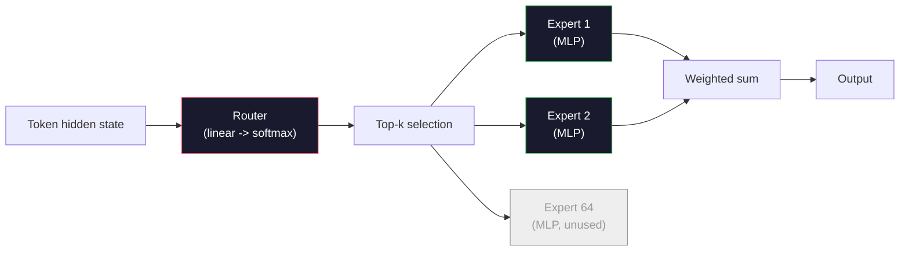

# Open Models: Architecture Walkthroughs · 开源模型：架构走读

> 你在第 04 课从零写出了一个 GPT-2 Small。2026 年的前沿开源模型属于同一家族，只是多了五六个具体改动。RMSNorm 取代 LayerNorm。SwiGLU 取代 GELU。RoPE 取代学习式位置。GQA 或 MLA 取代全量 MHA。规模化的混合专家（MoE）。你已经掌握的数学覆盖了其中的 95%。本课并排阅读 Llama 3、DeepSeek-V3、Mixtral、Qwen、Gemma，指出每个架构具体在哪一行代码上分道扬镳。

> You built a GPT-2 Small from scratch in Lesson 04. Frontier open models in 2026 are the same family with five or six concrete changes. RMSNorm instead of LayerNorm. SwiGLU instead of GELU. RoPE instead of learned positions. GQA or MLA instead of full MHA. Mixture-of-Experts at scale. The math you already know covers 95% of them. This lesson reads Llama 3, DeepSeek-V3, Mixtral, Qwen, and Gemma side by side and names the exact line where each architecture diverges.

**Type:** Learn
**Languages:** Python (stdlib)
**Prerequisites:** Phase 10, Lessons 04, 05, 12 (Pre-training, Scaling, Inference)
**Time:** ~45 minutes

## Learning Objectives · 学习目标

- 读懂 Llama 3、Mistral、Mixtral、Gemma 2、Qwen 2.5、DeepSeek-V3 的 config.json，并解释其中每一个字段
- 说出每个模型相对 GPT-2 Small 做出的具体架构改动，并从第一性原理论证其合理性
- 只凭 config 就能算出任何开源模型的参数量、KV cache 大小和激活内存
- 在给定延迟、显存、能力约束的部署目标下，选出合适的开源模型

> Read the config.json of Llama 3, Mistral, Mixtral, Gemma 2, Qwen 2.5, and DeepSeek-V3 and explain every field
> Name the specific architectural change each model made versus GPT-2 Small and justify it from first principles
> Compute parameter count, KV cache size, and activation memory for any open model from its config alone
> Pick the right open model for a deployment target given latency, memory, and capability constraints

## The Problem · 问题在哪

第 04 课里，你写了 350 行 numpy，得到了一个 GPT-2 形状的模型。Llama 3 405B 有一份 200 页的技术报告。你的直觉会说这是两种不同的野兽。并不是。那 200 页描述的是同一个东西，加上五六个动机充分的改动，再加上关于扩展的一千个实现细节。骨架——嵌入、transformer 块、注意力、MLP、归一化、输出头——原封未动。

本课是一份 diff。对每个主要开源模型家族，我们精确列出它从 GPT-2 改了什么、为什么改、付出了什么代价。读完之后，你看到一张新的模型卡，就能在脑中把它翻译回 GPT-2 基线。

实际的回报是：当 Meta 发布 Llama 5 或 DeepSeek 发布 V4 时，你不需要新的心智模型。你会看一眼配置，看出哪个熟悉的旋钮动了，并知道下游影响是什么。2026 年的架构是一个有限的工具箱，每个新模型只是选了不同的子集。

> In Lesson 04 you wrote 350 lines of numpy and had a GPT-2-shaped model. Llama 3 405B has a 200-page technical report. Your instinct is that these are different beasts. They are not. The 200 pages describe the same object with five or six well-motivated modifications, plus a thousand implementation details about scaling. The skeleton -- embedding, transformer blocks, attention, MLP, norm, head -- is unchanged.
> This lesson is a diff. For each major open model family, we list exactly what changed from GPT-2, why, and what it cost. When you are done you can read a fresh model card and mentally translate it back to the GPT-2 baseline.
> The practical payoff is that when Meta releases Llama 5 or DeepSeek releases V4, you will not need a new mental model. You will look at the config, see which of the well-known knobs moved, and know what the downstream implications are. The 2026 architectures are a finite toolbox. Each new model picks a different subset.

## The Concept · 概念

### The Invariant Core · 不变的核心

所有自回归开源模型共享：

- token 嵌入矩阵（vocab_size x hidden_dim）。
- N 个 decoder 块的堆叠：norm、自注意力、残差、norm、MLP、残差。
- 最终的 norm 和投影到 vocab_size 的线性头（常与嵌入做权重绑定）。
- 因果掩码、下一 token 交叉熵损失。

这就是形状。其余全是旋钮。

> All autoregressive open models share:
> - Token embedding matrix (vocab_size x hidden_dim).
> - Stack of N decoder blocks: norm, self-attention, residual, norm, MLP, residual.
> - Final norm and linear head projecting to vocab_size (often weight-tied with embeddings).
> - Causal mask, next-token cross-entropy loss.
> That is the shape. The rest is knobs.

### The Six Knobs That Actually Move · 真正在动的六个旋钮

纵观 2024-2026 的每一个前沿开源模型，同样六个设计选择被反复选中：

1. **归一化。** LayerNorm -> RMSNorm。
2. **位置编码。** 学习式绝对位置 -> RoPE（外加变体：YaRN、NTK）。
3. **激活函数。** GELU -> SwiGLU（或 GeGLU）。
4. **注意力头共享。** MHA -> GQA -> MQA -> MLA。
5. **稠密 vs 稀疏 MLP。** 稠密 -> 混合专家（Mixture-of-Experts）。
6. **Pre-norm 位置。** Pre-norm 留下了。Post-norm 消失了。

其余一切（学习率调度、数据配比、批量大小、上下文长度）都住在训练配置里，不住在架构里。就六个旋钮。

> Across every 2024-2026 frontier open model, the same six design choices get picked over and over:
> 1. **Normalization.** LayerNorm -> RMSNorm.
> 2. **Positional encoding.** Learned absolute -> RoPE (plus variants: YaRN, NTK).
> 3. **Activation.** GELU -> SwiGLU (or GeGLU).
> 4. **Attention head sharing.** MHA -> GQA -> MQA -> MLA.
> 5. **Dense vs sparse MLP.** Dense -> Mixture-of-Experts.
> 6. **Pre-norm placement.** Pre-norm stays. Post-norm is gone.
> Everything else (learning rate schedule, data mix, batch size, context length) lives in the training config, not the architecture. Six knobs.

### Knob 1: RMSNorm · 旋钮 1：RMSNorm

LayerNorm 减均值、除标准差、缩放、再平移。RMSNorm 只保留缩放：

```
RMSNorm(x) = x / sqrt(mean(x^2) + eps) * gamma
```

不减均值。没有偏置。每个 token 少做一次矩阵乘。Zhang 和 Sennrich（2019）论证了它在机器翻译上与 LayerNorm 表现相当，同时快 10%。每个现代开源模型都在用它。

成本：零。收益：小幅的吞吐提升，更简单的代码。

> LayerNorm subtracts mean, divides by std, scales, and shifts. RMSNorm keeps only the scale:
> No mean subtraction. No bias. One matmul fewer per token. Zhang and Sennrich (2019) argued it matched LayerNorm on machine translation while being 10% faster. Every modern open model runs it.
> Cost: none. Benefit: small throughput win, simpler code.

### Knob 2: RoPE · 旋钮 2：RoPE

学习式位置嵌入在 GPT-2 里是一张 1024 槽的查找表。上下文一到 1025 就出表了。模型无法外推超过训练长度。

旋转位置编码（RoPE，Su et al. 2021）在注意力点积之前，把每个 Q 和 K 向量成对旋转，以此注入位置信息。旋转角度是位置的确定性函数，所以没有需要学习的东西，也没有会用光的东西。配合缩放技巧（NTK-aware 插值、YaRN），一个用 8k 上下文训练的模型可以在推理时拉伸到 128k，精度损失温和。

```
q_rotated = rotate(q, angle(pos))
k_rotated = rotate(k, angle(pos))
score = q_rotated . k_rotated
```

每一家 Llama、Mistral、Qwen、DeepSeek、Gemma 都用 RoPE。Gemma 2 用的是混合方案（大多数层用 RoPE，其他层用局部滑窗注意力）。

> Learned position embeddings were a 1024-slot lookup table in GPT-2. Context 1025 is off the end of the table. Models cannot extrapolate beyond their training length.
> Rotary Position Embedding (RoPE, Su et al. 2021) injects position by rotating each Q and K vector in pairs before the attention dot product. The angle of rotation is a deterministic function of position, so there is nothing learned and nothing to run out of. With scaling tricks (NTK-aware interpolation, YaRN), a model trained on 8k context can stretch to 128k at inference with modest accuracy loss.
> Every Llama, Mistral, Qwen, DeepSeek, and Gemma uses RoPE. Gemma 2 uses a hybrid (RoPE on most layers, local sliding-window attention on others).

### Knob 3: SwiGLU · 旋钮 3：SwiGLU

GPT-2 的 MLP 是 `x -> gelu(xW1 + b1) -> (...)W2 + b2`。SwiGLU（Shazeer 2020）把激活函数换成一个门控乘积：

```
SwiGLU(x) = (xW1) * sigmoid(xW1) * xV
```

两个并行投影取代一个，由 Swish 激活做门控。经验上每个参数的困惑度表现更强。Llama 2 采用了它，随后所有人跟进。MLP 的隐藏宽度通常设成让总参数量与原稠密 MLP 持平：如果 GPT-2 用 `ff_dim = 4 * hidden`，SwiGLU 就用 `ff_dim = (2/3) * 4 * hidden = 8/3 * hidden`。

> GPT-2's MLP is `x -> gelu(xW1 + b1) -> (...)W2 + b2`. SwiGLU (Shazeer 2020) replaces the activation with a gated product:
> Two projections in parallel instead of one, gated by the Swish activation. Empirically stronger on perplexity per parameter. Llama 2 adopted it, everyone followed. The MLP's hidden size is usually set so that total parameter count matches the original dense MLP: if GPT-2 used `ff_dim = 4 * hidden`, SwiGLU uses `ff_dim = (2/3) * 4 * hidden = 8/3 * hidden`.

### Knob 4: Attention Head Sharing · 旋钮 4：注意力头共享

GPT-2 用的是**多头注意力（Multi-Head Attention, MHA）**：每个头有自己的 Q、K、V 投影。

**多查询注意力（MQA，Shazeer 2019）** 让所有头共享一份 K 和一份 V。KV cache 缩小 num_heads 倍——在典型模型上是 12 到 32 倍的缩减。在困难基准上精度略有下降。

**分组查询注意力（GQA，Ainslie et al. 2023）** 是折中方案：G 组 Q 头共享一份 K 和一份 V。Llama 3 8B 使用 GQA，32 个 Q 头、8 个 KV 头（G=8），KV cache 相对全量 MHA 缩小 4 倍。

**多头潜在注意力（MLA，DeepSeek 2024）** 把 K 和 V 压缩进一个共享的低秩潜在向量，再按头投影回去。在进一步缩小 KV cache 的同时保住每头的表达力。DeepSeek-V2 和 V3 靠它拿到长上下文性能。

| Scheme | KV Heads | KV Cache | Accuracy |
|--------|----------|----------|----------|
| MHA    | num_heads | 全量 | 最好 |
| GQA    | num_groups (G < num_heads) | 缩减 num_heads / G | 接近 MHA |
| MQA    | 1 | 缩减 num_heads 倍 | 略有损失 |
| MLA    | 潜在向量，按头解压 | 比 MQA 更小 | 接近 MHA |

对任何 ~13B 参数以上的模型，GQA 或 MLA 实际上是必选项。规模化的全量 MHA 是一场 KV cache 灾难。

> GPT-2 used **Multi-Head Attention (MHA)**: every head has its own Q, K, V projection.
> **Multi-Query Attention (MQA, Shazeer 2019)** shares one K and one V across all heads. Cuts the KV cache by num_heads, which is a 12x to 32x reduction on a typical model. Accuracy drops slightly on hard benchmarks.
> **Grouped-Query Attention (GQA, Ainslie et al. 2023)** is the middle ground: G groups of Q heads share one K and one V. Llama 3 8B uses GQA with 32 Q heads and 8 KV heads (G=8), so the KV cache shrinks 4x versus full MHA.
> **Multi-Head Latent Attention (MLA, DeepSeek 2024)** compresses K and V into a shared low-rank latent, projecting them back up per head. Further reduces KV cache while preserving per-head expressiveness. DeepSeek-V2 and V3 rely on this for their long-context performance.
> For any model above ~13B parameters, GQA or MLA is effectively mandatory. Full MHA at scale is a KV cache disaster.

### Knob 5: Mixture of Experts · 旋钮 5：混合专家

稠密 MLP 对每个 token 激活它的全部参数。MoE MLP 每个 block 拥有 K 个专家和一个路由器（router），由路由器为每个 token 选出 top-k 个专家（通常 top-2）。只有被选中专家的权重参与该 token 的前向计算。

```
router_logits = xW_r
indices, weights = top_k(router_logits, k=2)
output = sum_i weights[i] * expert[indices[i]](x)
```

它的吸引力在于：你可以拥有 64 个每个 7B 的专家（于是总参数量巨大），而每个 token 只跑其中 2 个（于是每 token 计算量与稠密 7B 模型持平）。Mixtral 8x7B 总参数 47B，但每个 token 只激活 13B。DeepSeek-V3 总参数 671B，但每个 token 只激活 37B。



优点：同样的计算量、更多的参数、更强的容量。缺点：专家的显存仍然得找个地方放着（所以服务所需的 VRAM 比稠密等价物更多）、路由器的负载均衡很难做、在对齐阶段微调路由器本身就是一门研究课题。

> A dense MLP activates all its parameters for every token. An MoE MLP has K experts per block and a router that picks the top-k experts per token (typically top-2). Only those experts' weights see a forward pass for that token.
> The appeal: you can have 64 experts of size 7B each (so total param count is huge) while only running 2 of them per token (so per-token compute matches a dense 7B model). Mixtral 8x7B has 47B total parameters but activates only 13B per token. DeepSeek-V3 has 671B total parameters but activates only 37B per token.
> Pros: same compute, more parameters, better capacity. Cons: the expert memory still has to live somewhere (so serving needs more VRAM than a dense equivalent), load-balancing the router is hard, and fine-tuning the router during alignment is its own research area.

### Knob 6: Pre-norm stays · 旋钮 6：Pre-norm 留下了

原始 transformer 把 layer norm 放在每个子层之后。GPT-2 以来的每一个开源模型都把它放在每个子层*之前*。Pre-norm 在深层严格更好训练。这没什么好争的。

> The original transformer applied layer norm after each sublayer. Every open model since GPT-2 puts it *before* each sublayer. Pre-norm is strictly easier to train at depth. Nothing to argue about.

### Model-by-Model Diff · 逐模型 diff

一张表把以上一切落到实处。

| Model | Year | Total Params | Active Params | Norm | Activation | Position | Attention | MoE | Context |
|-------|------|-------------|---------------|------|-----------|----------|-----------|-----|---------|
| GPT-2 Small | 2019 | 124M | 124M | LayerNorm | GELU | Learned | MHA (12 heads) | no | 1k |
| Llama 3 8B | 2024 | 8B | 8B | RMSNorm | SwiGLU | RoPE | GQA (32/8) | no | 128k |
| Llama 3 70B | 2024 | 70B | 70B | RMSNorm | SwiGLU | RoPE | GQA (64/8) | no | 128k |
| Llama 3 405B | 2024 | 405B | 405B | RMSNorm | SwiGLU | RoPE | GQA (128/16) | no | 128k |
| Mistral 7B | 2023 | 7.2B | 7.2B | RMSNorm | SwiGLU | RoPE | GQA | no | 32k |
| Mixtral 8x7B | 2023 | 47B | 13B | RMSNorm | SwiGLU | RoPE | GQA | yes (8 experts, top-2) | 32k |
| Gemma 2 9B | 2024 | 9B | 9B | RMSNorm (pre+post) | GeGLU | RoPE + sliding | GQA | no | 8k |
| Qwen 2.5 72B | 2024 | 72B | 72B | RMSNorm | SwiGLU | RoPE (YaRN) | GQA (64/8) | no | 128k |
| DeepSeek V2 236B | 2024 | 236B | 21B | RMSNorm | SwiGLU | RoPE | MLA | yes (160 experts, top-6) | 128k |
| DeepSeek V3 | 2024 | 671B | 37B | RMSNorm | SwiGLU | RoPE | MLA | yes (256 experts, top-8) | 128k |

扫一遍各列。RMSNorm 是普适的。SwiGLU 或它的表亲 GeGLU 是普适的。RoPE 是普适的。7B 以上 GQA 普适，除非被 MLA 取代。MoE 是顶端的差异化项。

> Here is the table that makes all of this concrete.
> Scan the columns. RMSNorm is universal. SwiGLU or its GeGLU cousin is universal. RoPE is universal. GQA is universal above 7B except when replaced by MLA. MoE is the differentiator at the top end.

### Reading a config.json · 读 config.json

Llama 3 8B 的配置：

```
{
  "hidden_size": 4096,
  "intermediate_size": 14336,
  "num_hidden_layers": 32,
  "num_attention_heads": 32,
  "num_key_value_heads": 8,
  "max_position_embeddings": 131072,
  "rope_theta": 500000.0,
  "rms_norm_eps": 1e-5,
  "vocab_size": 128256
}
```

每个字段都对应你已经实现过的东西。

- `hidden_size`：嵌入维度。
- `intermediate_size`：MLP 隐藏宽度（3.5 倍 hidden——SwiGLU 的数学）。
- `num_hidden_layers`：堆叠深度。
- `num_attention_heads`：Q 头数。
- `num_key_value_heads`：KV 头数（GQA）。
- `max_position_embeddings`：训练上下文长度。
- `rope_theta`：RoPE 基频。Meta 把它从默认的 10k 提到 500k，用于长上下文外推。
- `rms_norm_eps`：数值稳定性。
- `vocab_size`：词表大小。

只凭这些就能算出总参数量、KV cache 和峰值激活内存。精确公式见 `code/main.py`。

> Every field corresponds to something you have already implemented.
> - `hidden_size`: embedding dimension.
> - `intermediate_size`: MLP hidden size (3.5x hidden -- SwiGLU math).
> - `num_hidden_layers`: stack depth.
> - `num_attention_heads`: Q heads.
> - `num_key_value_heads`: KV heads (GQA).
> - `max_position_embeddings`: training context length.
> - `rope_theta`: RoPE base frequency. Meta scaled it from the default 10k to 500k for long-context extrapolation.
> - `rms_norm_eps`: numerical stability.
> - `vocab_size`: tokens.
> From these alone you compute total parameters, KV cache, and peak activation memory. See `code/main.py` for the exact formulas.

### Activation memory budget · 激活内存预算

参数量过了几十亿之后，激活值主导训练内存。预训练的经验公式（带梯度 checkpointing）：

```
activation_mem ~ batch_size * seq_len * hidden_size * num_layers * bytes_per_element
```

以 Llama 3 8B 为例：batch 1、seq 8192、BF16、32 层、hidden 4096，带上 checkpointing 光激活就要约 8 GB，不带约 40 GB。这就是 flash-attention 和 ring-attention 重要的原因——它们重写注意力计算，好让激活装得下。

> Activations dominate training memory above a few billion parameters. The rule of thumb for pre-training (with gradient checkpointing):
> For Llama 3 8B at batch 1, seq 8192, BF16, 32 layers, hidden 4096: roughly 8 GB just for activations with checkpointing, 40 GB without. This is why flash-attention and ring-attention matter -- they rewrite the attention computation so activations fit.

### KV Cache budget · KV cache 预算

在最大上下文下做推理时：

```
kv_cache = 2 * num_layers * num_kv_heads * head_dim * max_seq_len * bytes_per_element
```

Llama 3 8B 在 128k 上下文、BF16、head_dim = hidden / num_heads = 128 时：
每条序列 `2 * 32 * 8 * 128 * 131072 * 2 = 17.2 GB`。

8B 的权重在 BF16 下是 16 GB。单条 128k 序列的 KV cache 比权重还大。这正是推动 GQA、MLA 和 KV cache 量化研究的显存压力来源。

> For inference at max context:
> Llama 3 8B at 128k context, BF16, head_dim = hidden / num_heads = 128:
> `2 * 32 * 8 * 128 * 131072 * 2 = 17.2 GB` per sequence.
> The 8B weights are 16 GB in BF16. The KV cache for a single 128k sequence is larger than the weights. This is the memory pressure driving GQA, MLA, and KV cache quantization research.

### When Each Model Wins · 什么场景选什么模型

- **单张 80GB GPU、不要 MoE**：Llama 3 8B、Mistral 7B、Gemma 2 9B。部署省心，工具链广。
- **单机（8x80GB）、要大容量**：Llama 3 70B、Qwen 2.5 72B。最强的稠密开源能力。
- **要最强开源能力、能接受 MoE 复杂度**：DeepSeek V3、Mixtral 8x22B。单位激活 FLOP 的能力最强。
- **长上下文需求**：Llama 3（RoPE 缩放到 128k）、DeepSeek（MLA 优势）。
- **低延迟服务**：Gemma 2 9B（滑窗砍掉长上下文计算量）。

```figure
rmsnorm-vs-layernorm
```

> - **Single 80GB GPU, no MoE**: Llama 3 8B, Mistral 7B, Gemma 2 9B. Easy to serve, wide tooling.
> - **Single node (8x80GB), big capacity**: Llama 3 70B, Qwen 2.5 72B. Highest dense open capability.
> - **Biggest open capability, accept MoE complexity**: DeepSeek V3, Mixtral 8x22B. Best capability per active FLOP.
> - **Long-context needs**: Llama 3 (128k with RoPE scaling), DeepSeek (MLA advantage).
> - **Low-latency serving**: Gemma 2 9B (sliding window cuts long-context compute).

## Build It · 动手造

本课的代码是一个计算器。给它任意 config.json，它会按组件打印参数量、最大上下文下的 KV cache、SwiGLU MLP 比例，以及一段架构短评（稠密 / GQA / MLA / MoE）。

```python
config = {
    "hidden_size": 4096, "intermediate_size": 14336,
    "num_hidden_layers": 32, "num_attention_heads": 32,
    "num_key_value_heads": 8, "vocab_size": 128256,
    "max_position_embeddings": 131072,
}
```

脚本逐字段走一遍架构，算出嵌入、注意力（含 GQA 缩减）、MLP（含 SwiGLU 扩展）、layernorm 和输出头的参数量，然后算出给定上下文长度下的 KV cache 并打印摘要。

实现见 `code/main.py`。

> The lesson's code is a calculator. Given any config.json, it prints parameter count by component, KV cache at max context, SwiGLU MLP ratio, and a short verdict on the architecture (dense / GQA / MLA / MoE).
> The script walks the architecture field by field, computes param counts for embedding, attention (with GQA reduction), MLP (with SwiGLU expansion), layernorms, and the head. It then computes the KV cache at the stated context length and prints a summary.
> See `code/main.py` for the implementation.

## Use It · 实战用法

对脚本内置的 Llama 3 8B、Mistral 7B、Mixtral 8x7B、DeepSeek V3 配置运行这个计算器。比较各家的参数分解。注意 MoE 模型的总参数量碾压稠密模型，但激活参数量往往更小。注意 DeepSeek V3 的 KV cache 比 Llama 3 405B 还小，尽管总参数更多——那就是 MLA 在起作用。

然后把你本地任何模型的配置塞进去，读一读摘要，判断它是否装得进你的 GPU。

> Run the calculator on Llama 3 8B, Mistral 7B, Mixtral 8x7B, and DeepSeek V3 configs bundled in the script. Compare the parameter breakdowns. Notice that the MoE models have a total param count that dwarfs the dense models but an active param count that is often smaller. Notice that DeepSeek V3's KV cache is smaller than Llama 3 405B's despite having more total parameters -- that is MLA in action.
> Then plug in a config for any model you have locally, read the summary, and decide whether it fits your GPU.

## Ship It · 交付

本课产出 `outputs/skill-open-model-picker.md`。给定一个部署目标（GPU 型号、VRAM、上下文长度、延迟预算）和一个任务画像（聊天、代码、推理、长上下文），它会推荐一个开源模型、一个来自第 11 课的量化方案和一个来自第 12 课的推理栈，并围绕六个架构旋钮给出明确的理由。

> This lesson produces `outputs/skill-open-model-picker.md`. Given a deployment target (GPU type, VRAM, context length, latency budget) and a task profile (chat, code, reasoning, long-context), it recommends an open model, a quantization scheme from Lesson 11, and an inference stack from Lesson 12, with explicit reasoning about the six architectural knobs.

## Exercises · 练习

1. 从 HuggingFace 读出 Qwen 2.5 72B 的配置。从零算出总参数量。与 HF 公布的值比较，并找出任何差异的来源（head dim 取整、KV 共享系数等）。

2. DeepSeek V3 使用 256 个专家、top-8 路由。计算激活专家占总专家的比例，并与 Mixtral 8x7B 的 8 选 2 比较。从稀疏（25%）到更稀疏（3%）的转变，对单位 FLOP 容量意味着什么？

3. 分别在 FP8 和 BF16 下计算 Llama 3 405B 在 128k 上下文下的 KV cache。FP8 是 BF16 数字的一半。一台 8xH100 节点（每卡 80GB，共 640GB，减去权重显存）能同时服务多少条并行序列？

4. Gemma 2 交替使用全注意力层和滑窗注意力层。写出一半层改用 4096-token 滑窗替代全上下文时的 KV cache 数学。在 8k 总上下文下能省多少内存？

5. 找一个在本课写完之后发布的新前沿开源模型。指出它六个旋钮各选了什么，以及它是否引入了第七个旋钮。新架构一发布，本课程就会显得过时——目标是更新你的表格，而不是重建你的心智模型。

## Key Terms · 术语表

| Term | What people say | What it actually means |
|------|----------------|----------------------|
| RMSNorm | 「没有均值的 LayerNorm」 | 只用均方根做归一化，外加一个可学习的缩放——更便宜，效果与 LayerNorm 相当 |
| RoPE | 「旋转式位置」 | 把每个 Q、K 向量成对旋转一个依赖位置的角度——配合缩放技巧可外推超过训练长度 |
| SwiGLU | 「新一代 MLP 激活」 | 带 Swish 的门控线性单元：`(xW1) * sigmoid(xW1) * xV`——2024 年以来每个开源模型的标准配置 |
| GQA | 「折中的注意力」 | Grouped-Query Attention：G 组 Q 头共享一个 K 头和一个 V 头——缩小 KV cache，又没有 MQA 的精度损失 |
| MLA | 「DeepSeek 的注意力」 | Multi-Head Latent Attention：把 K/V 压缩进共享低秩潜在向量、再按头解压——大模型里最小的 KV cache |
| MoE | 「稀疏专家」 | Mixture of Experts：每个 block 有 N 个 MLP，路由器按 token 选 top-k——总参数巨大、激活参数很小 |
| Top-k routing | 「每个 token 选 k 个专家」 | 路由器给每个专家打分并激活最高的 k 个——k 典型为 2（Mixtral）到 8（DeepSeek） |
| YaRN | 「拉伸 RoPE」 | 又一种 RoPE 扩展——插值旋转角度，在推理时把上下文从 8k 延伸到 128k+ |
| Sliding-window attention | 「不必关注一切」 | 每个 token 只关注最近 W 个 token——把每 token 注意力成本封顶在 O(W)，Gemma 2 和早期 Mistral 采用 |
| Active params | 「每个 token 真正跑的参数」 | 对 MoE 模型，每 token 参与前向的参数量（远小于总参数量）——决定每 token 的 FLOPs |

## Further Reading · 延伸阅读

- [Dubey et al., 2024 -- "The Llama 3 Herd of Models"](https://arxiv.org/abs/2407.21783) —— 稠密 Llama 3 家族的架构与训练参考
- [DeepSeek-AI, 2024 -- "DeepSeek-V3 Technical Report"](https://arxiv.org/abs/2412.19437) —— MLA、无辅助损失的负载均衡，外加 671B MoE
- [Jiang et al., 2024 -- "Mixtral of Experts"](https://arxiv.org/abs/2401.04088) —— MoE 开源模型的标杆论文
- [Su et al., 2021 -- "RoFormer: Enhanced Transformer with Rotary Position Embedding"](https://arxiv.org/abs/2104.09864) —— RoPE 原始论文
- [Shazeer, 2020 -- "GLU Variants Improve Transformer"](https://arxiv.org/abs/2002.05202) —— SwiGLU、GeGLU 及其伙伴们
- [Ainslie et al., 2023 -- "GQA: Training Generalized Multi-Query Transformer Models"](https://arxiv.org/abs/2305.13245) —— GQA 论文
- [Gemma 2 Team, 2024 -- "Gemma 2: Improving Open Language Models at a Practical Size"](https://arxiv.org/abs/2408.00118) —— 全注意力+滑窗混合，pre+post-norm
- [Qwen Team, 2024 -- "Qwen 2.5 Technical Report"](https://arxiv.org/abs/2412.15115) —— YaRN 上下文扩展与长上下文训练配方
