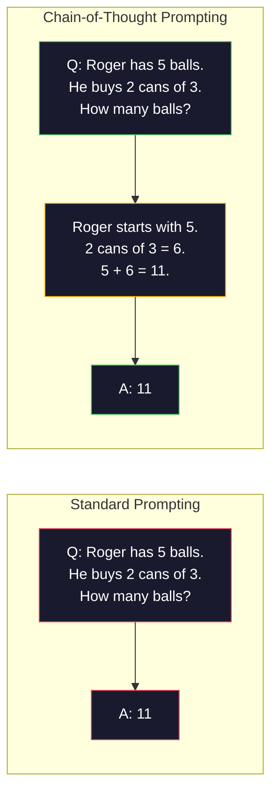
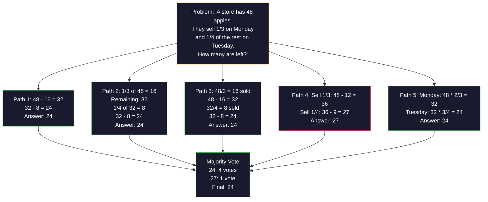
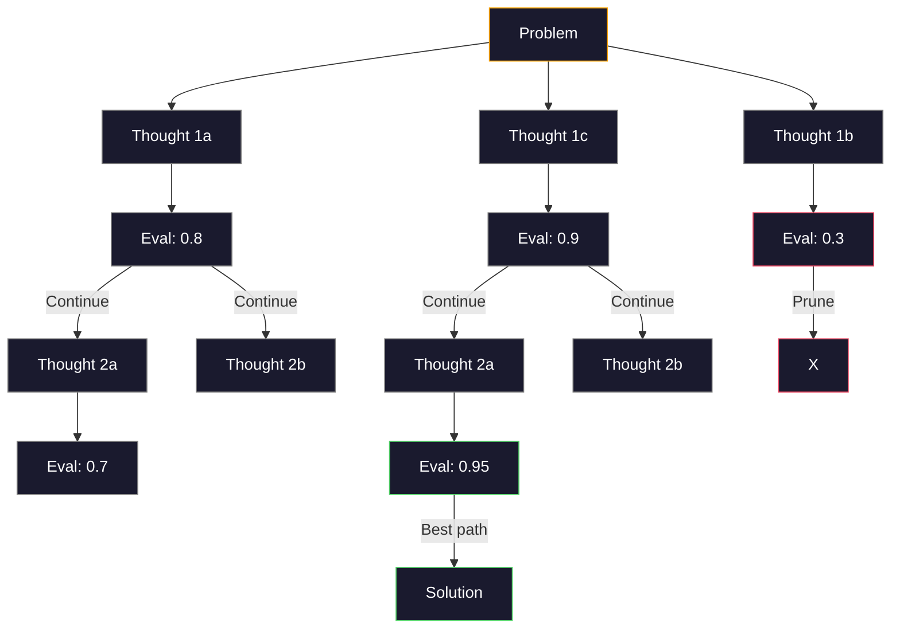

# Few-Shot, Chain-of-Thought, Tree-of-Thought · 少样本提示、思维链、思维树

> 告诉模型「做什么」只是提示词；展示它「怎么想」才是工程。同一个模型、同一个任务、同一份数据，78% 与 91% 准确率之间的差距靠的不是更好的模型，而是更好的推理策略。

**Type:** Build
**Languages:** Python
**Prerequisites:** Lesson 11.01 (Prompt Engineering)
**Time:** ~45 minutes

> Telling a model what to do is prompting. Showing it how to think is engineering. The gap between 78% and 91% accuracy on the same model, same task, same data is not a better model. It is a better reasoning strategy.

## Learning Objectives · 学习目标

- 通过挑选并排版能最大化任务准确率的示例演示（example demonstrations），实现少样本提示（few-shot prompting）
- 应用思维链（chain-of-thought, CoT）推理，提升数学应用题这类多步问题的准确率
- 构建一个思维树（tree-of-thought）提示，探索多条推理路径并选出最好的一条
- 在标准基准上测量零样本 vs 少样本 vs CoT 带来的准确率提升

> Implement few-shot prompting by selecting and formatting example demonstrations that maximize task accuracy
> Apply chain-of-thought (CoT) reasoning to improve accuracy on multi-step problems like math word problems
> Build a tree-of-thought prompt that explores multiple reasoning paths and selects the best one
> Measure the accuracy improvement from zero-shot vs few-shot vs CoT on a standard benchmark

## The Problem · 问题在哪

你在做一个数学辅导应用。提示词写着：「解出这道应用题。」GPT-5 在 GSM8K（标准小学数学基准）上能做对 94%。你以为已经到顶了——并没有，思维链还能再加 3-4 个点。

再加五个词——「Let's think step by step」（我们一步一步思考）——准确率跳到 91%。再加几个带完整解题过程的示例，就到 95%。同一个模型。同样的 temperature。同样的 API 成本。唯一的区别是：你给了模型一张草稿纸。

这不是什么 hack。这就是推理的运作方式。人类不会靠一次心理跃迁解出多步问题，Transformer 也不会。当你强迫模型生成中间 token，这些 token 就会成为下一个 token 上下文的一部分。每一步推理喂养下一步。模型是真的一路「算」出答案的。

但「一步一步思考」只是起点，不是终点。如果你采样五条推理路径再做多数投票呢？如果让模型探索一棵可能性之树、评估并剪掉枝条呢？如果把推理和工具使用交织起来呢？这些都不是空想——它们是有实测提升的已发表技术，而本课你会把它们全部造出来。

> You build a math tutoring app. Your prompt says: "Solve this word problem." GPT-5 gets it right 94% of the time on GSM8K, the standard grade-school math benchmark. You think you already peaked. You do not — chain-of-thought still adds 3-4 points.
> Add five words -- "Let's think step by step" -- and accuracy jumps to 91%. Add a few worked examples and it reaches 95%. Same model. Same temperature. Same API cost. The only difference is that you gave the model scratch paper.
> This is not a hack. It is how reasoning works. Humans do not solve multi-step problems in one mental leap. Neither do transformers. When you force a model to generate intermediate tokens, those tokens become part of the context for the next token. Each reasoning step feeds the next. The model literally computes its way to the answer.
> But "think step by step" is the beginning, not the end. What if you sampled five reasoning paths and took a majority vote? What if you let the model explore a tree of possibilities, evaluating and pruning branches? What if you interleaved reasoning with tool use? These are not hypotheticals. They are published techniques with measured improvements, and you will build all of them in this lesson.

## The Concept · 概念

### Zero-Shot vs Few-Shot: When Examples Beat Instructions · 零样本 vs 少样本：什么时候示例胜过指令

零样本提示（zero-shot prompting）只给模型任务本身，别的什么都不给。少样本提示（few-shot prompting）先给示例。

Wei et al. (2022) 在 8 个基准上测量了这一点。对情感分类这类简单任务，零样本和少样本的差距在 2% 以内。对多步算术和符号推理这类复杂任务，少样本把准确率提升了 10-25%。

直觉是：示例就是压缩过的指令。与其描述输出格式，不如直接展示；与其解释推理过程，不如直接演示。模型对示例做模式匹配，比它解释抽象指令可靠得多。


**少样本赢的场景**：格式敏感的任务、分类、结构化抽取（structured extraction）、领域术语，以及任何需要模型匹配特定模式的任务。

**零样本赢的场景**：简单的 factual 问答、示例反而束缚创造力的创意任务，以及找到好示例比写好指令更难的任务。

> Zero-shot prompting gives the model a task and nothing else. Few-shot prompting gives it examples first.
> Wei et al. (2022) measured this across 8 benchmarks. For simple tasks like sentiment classification, zero-shot and few-shot performed within 2% of each other. For complex tasks like multi-step arithmetic and symbolic reasoning, few-shot improved accuracy by 10-25%.
> The intuition: examples are compressed instructions. Instead of describing the output format, you show it. Instead of explaining the reasoning process, you demonstrate it. The model pattern-matches on the examples more reliably than it interprets abstract instructions.

### Example Selection: Similar Beats Random · 示例选择：相似胜过随机

示例和示例并不平等。在分类任务上，选择与目标输入相似的示例比随机挑选高出 5-15%（Liu et al., 2022）。三条原则：

1. **语义相似（semantic similarity）**：在嵌入空间（embedding space）里挑离输入最近的示例
2. **标签多样性（label diversity）**：示例要覆盖所有输出类别
3. **难度匹配（difficulty matching）**：复杂度与目标问题相当

对大多数任务，最优示例数是 3-5 个。少于 3 个，模型没有足够的信号去提取模式；超过 5 个，收益递减，还浪费上下文窗口的 token。对多标签分类，每个标签给一个示例。

> Not all examples are equal. Choosing examples similar to the target input outperforms random selection by 5-15% on classification tasks (Liu et al., 2022). Three principles:
> 1. **Semantic similarity**: pick examples closest to the input in embedding space
> 2. **Label diversity**: cover all output categories in your examples
> 3. **Difficulty matching**: match the complexity level of the target problem
> The optimal number of examples for most tasks is 3-5. Below 3, the model does not have enough signal to extract the pattern. Above 5, you hit diminishing returns and waste context window tokens. For classification with many labels, use one example per label.

### Chain-of-Thought: Giving Models Scratch Paper · 思维链：给模型一张草稿纸

思维链（Chain-of-Thought, CoT）提示由 Google Brain 的 Wei et al. (2022) 提出。想法很简单：不要只要答案，而是让模型先展示它的推理步骤。



机械层面为什么有效？Transformer 生成的每个 token 都会成为下一个 token 的上下文。没有 CoT 时，模型必须把全部推理压缩进单次前向传播的隐藏状态里。有了 CoT，模型把中间计算外化成 token。每个推理 token 都扩展了有效计算深度。

**GSM8K 基准（小学数学，8.5K 道题）：**

| 模型 | 零样本 | 零样本 CoT | 少样本 CoT |
|-------|-----------|---------------|--------------|
| GPT-4o | 78% | 91% | 95% |
| GPT-5 | 94% | 97% | 98% |
| o4-mini（推理模型） | 97% | — | — |
| Claude Opus 4.7 | 93% | 97% | 98% |
| Gemini 3 Pro | 92% | 96% | 98% |
| Llama 4 70B | 80% | 89% | 94% |
| DeepSeek-V3.1 | 89% | 94% | 96% |

**关于推理模型（reasoning models）的说明。** OpenAI 的 o 系列（o3、o4-mini）和 DeepSeek-R1 这类模型会在给出答案之前在内部运行思维链。给推理模型加「Let's think step by step」是多余的，有时甚至适得其反——它们已经做过了。

CoT 的两种口味：

**零样本 CoT**：在提示后面附加一句「Let's think step by step」。不需要示例。Kojima et al. (2022) 证明，单这一句话就能提升算术、常识和符号推理任务的准确率。

**少样本 CoT**：提供的示例里包含推理步骤。比零样本 CoT 更有效，因为模型能看到你期望的确切推理格式。

**CoT 有害的场景**：简单的 factual 回忆（「法国的首都是哪里？」）、单步分类，以及速度比准确率更重要的任务。CoT 每次查询要多花 50-200 个 token 的推理开销。对高吞吐、低复杂度的任务，这是纯浪费的成本。

> Chain-of-Thought (CoT) prompting was introduced by Wei et al. (2022) at Google Brain. The idea is simple: instead of asking the model for just the answer, ask it to show its reasoning steps first.
> Why does this work mechanically? Each token a transformer generates becomes context for the next token. Without CoT, the model must compress all reasoning into the hidden state of a single forward pass. With CoT, the model externalizes intermediate computations as tokens. Each reasoning token extends the effective computation depth.
> Note on reasoning models. Models like OpenAI's o-series (o3, o4-mini) and DeepSeek-R1 run chain-of-thought internally before emitting their answer. Adding "Let's think step by step" to a reasoning model is redundant and sometimes counterproductive — they have already done it.
> Zero-shot CoT: append "Let's think step by step" to the prompt. No examples needed. Kojima et al. (2022) showed this single sentence improves accuracy across arithmetic, commonsense, and symbolic reasoning tasks.
> Few-shot CoT: provide examples that include reasoning steps. More effective than zero-shot CoT because the model sees the exact reasoning format you expect.
> When CoT hurts: simple factual recall ("What is the capital of France?"), single-step classification, tasks where speed matters more than accuracy. CoT adds 50-200 tokens of reasoning overhead per query. For high-throughput, low-complexity tasks, that is wasted cost.

### Self-Consistency: Sample Many, Vote Once · 自一致性：多次采样，一次投票

Wang et al. (2023) 提出了自一致性（self-consistency）。洞见是：单条 CoT 路径可能含有推理错误。但如果你采样 N 条独立的推理路径（用 temperature > 0）并对最终答案做多数投票，错误会相互抵消。



在最初的 PaLM 540B 实验中，自一致性把 GSM8K 准确率从 56.5%（单条 CoT）提升到 74.4%（N=40）。在 GPT-5 上提升很小（97% 到 98%），因为基础准确率已经饱和。这项技术在基础 CoT 准确率 60-85% 的模型上效果最显著——那是单路径错误频繁但不成体系的甜蜜点。对推理模型（o 系列、R1），自一致性已被内建的内部采样所涵盖。

代价是：N 次采样意味着 N 倍的 API 成本和延迟。实践中，N=5 就能拿到大部分收益。N=3 是做出有意义投票的最低要求。N > 10 对大多数任务收益递减。

> Wang et al. (2023) introduced self-consistency. The insight: a single CoT path might contain reasoning errors. But if you sample N independent reasoning paths (using temperature > 0) and take the majority vote on the final answer, errors cancel out.
> Self-consistency improved GSM8K accuracy from 56.5% (single CoT) to 74.4% with N=40 on the original PaLM 540B experiments. On GPT-5 the improvement is small (97% to 98%) because base accuracy is already saturated. The technique shines most on models with 60-85% base CoT accuracy -- the sweet spot where single-path errors are frequent but not systematic. For reasoning models (o-series, R1) self-consistency is subsumed by the built-in internal sampling.
> The tradeoff: N samples means Nx the API cost and latency. In practice, N=5 captures most of the benefit. N=3 is the minimum for a meaningful vote. N > 10 has diminishing returns for most tasks.

### Tree-of-Thought: Branching Exploration · 思维树：分支探索

Yao et al. (2023) 提出了思维树（Tree-of-Thought, ToT）。CoT 沿一条线性推理路径走，ToT 则探索多个分支，并在继续之前评估哪些分支最有希望。



ToT 有三个组件：

1. **思维生成（thought generation）**：产出多个候选的下一步
2. **状态评估（state evaluation）**：给每个候选打分（可以让 LLM 自己当评估器）
3. **搜索算法（search algorithm）**：用 BFS 或 DFS 遍历这棵树，剪掉低分分支

在 Game of 24 任务（用四则运算把 4 个数凑成 24）上，GPT-4 用标准提示只能解出 7.3% 的题。用 CoT 是 4.0%（这里 CoT 反而有害，因为搜索空间太宽）。用 ToT 是 74%。

ToT 很贵。树上的每个节点都需要一次 LLM 调用。分支因子为 3、深度为 3 的树最多需要 39 次 LLM 调用。只把它用在「搜索空间大但可评估」的问题上——规划、解谜、带约束的创意问题求解。

> Yao et al. (2023) introduced Tree-of-Thought (ToT). Where CoT follows one linear reasoning path, ToT explores multiple branches and evaluates which are most promising before continuing.
> ToT has three components:
> 1. **Thought generation**: produce multiple candidate next-steps
> 2. **State evaluation**: score each candidate (can use the LLM itself as evaluator)
> 3. **Search algorithm**: BFS or DFS through the tree, pruning low-scoring branches
> On the Game of 24 task (combine 4 numbers using arithmetic to make 24), GPT-4 with standard prompting solves 7.3% of problems. With CoT, 4.0% (CoT actually hurts here because the search space is wide). With ToT, 74%.
> ToT is expensive. Each node in the tree requires an LLM call. A tree with branching factor 3 and depth 3 requires up to 39 LLM calls. Use it only for problems where the search space is large but evaluatable -- planning, puzzle solving, creative problem-solving with constraints.

### ReAct: Thinking + Doing · ReAct：思考 + 行动

Yao et al. (2022) 把推理轨迹和行动结合起来。模型在思考（生成推理）和行动（调用工具、搜索、计算）之间交替。

```mermaid
graph LR
    Q["Question:\nWhat is the\npopulation of the\ncountry where\nthe Eiffel Tower\nis located?"]
    T1["Thought: I need to\nfind which country\nhas the Eiffel Tower"]
    A1["Action: search\n'Eiffel Tower location'"]
    O1["Observation:\nParis, France"]
    T2["Thought: Now I need\nFrance's population"]
    A2["Action: search\n'France population 2024'"]
    O2["Observation:\n68.4 million"]
    T3["Thought: I have\nthe answer"]
    F["Answer:\n68.4 million"]

    Q --> T1 --> A1 --> O1 --> T2 --> A2 --> O2 --> T3 --> F

    style Q fill:#1a1a2e,stroke:#ffa500,color:#fff
    style T1 fill:#1a1a2e,stroke:#51cf66,color:#fff
    style A1 fill:#1a1a2e,stroke:#e94560,color:#fff
    style O1 fill:#1a1a2e,stroke:#808080,color:#fff
    style T2 fill:#1a1a2e,stroke:#51cf66,color:#fff
    style A2 fill:#1a1a2e,stroke:#e94560,color:#fff
    style O2 fill:#1a1a2e,stroke:#808080,color:#fff
    style T3 fill:#1a1a2e,stroke:#51cf66,color:#fff
    style F fill:#1a1a2e,stroke:#51cf66,color:#fff
```



在知识密集型任务上，ReAct 胜过纯 CoT，因为它能把推理锚定在真实数据上。在 HotpotQA（多跳问答）上，ReAct + GPT-4 达到 35.1% 的精确匹配，纯 CoT 只有 29.4%。真正的威力在于推理错误会被观察结果纠正——模型可以在执行中途更新计划。

ReAct 是现代 AI agent 的基石。每个 agent 框架（LangChain、CrewAI、AutoGen）实现的都是 Thought-Action-Observation 循环的某种变体。你会在 Phase 14 造出完整的 agent。本课只覆盖这个提示模式。

> Yao et al. (2022) combined reasoning traces with actions. The model alternates between thinking (generating reasoning) and acting (calling tools, searching, computing).
> ReAct outperforms pure CoT on knowledge-intensive tasks because it can ground its reasoning in real data. On HotpotQA (multi-hop question answering), ReAct with GPT-4 achieves 35.1% exact match vs 29.4% for CoT alone. The real power is that reasoning errors get corrected by observations -- the model can update its plan mid-execution.
> ReAct is the foundation of modern AI agents. Every agent framework (LangChain, CrewAI, AutoGen) implements some variant of the Thought-Action-Observation loop. You will build full agents in Phase 14. This lesson covers the prompting pattern.

### Structured Prompting: XML Tags, Delimiters, Headers · 结构化提示：XML 标签、分隔符、标题

提示变复杂之后，结构能防止模型混淆各个部分。三种做法：

**XML 标签**（对 Claude 效果最好，其他模型上也表现扎实）：
```
<context>
You are reviewing a pull request.
The codebase uses TypeScript and React.
</context>

<task>
Review the following diff for bugs, security issues, and style violations.
</task>

<diff>
{diff_content}
</diff>

<output_format>
List each issue with: file, line, severity (critical/warning/info), description.
</output_format>
```

**Markdown 标题**（通用）：
```
## Role
Senior security engineer at a fintech company.

## Task
Analyze this API endpoint for vulnerabilities.

## Input
{api_code}

## Rules
- Focus on OWASP Top 10
- Rate each finding: critical, high, medium, low
- Include remediation steps
```

**分隔符**（极简但有效）：
```
---INPUT---
{user_text}
---END INPUT---

---INSTRUCTIONS---
Summarize the above in 3 bullet points.
---END INSTRUCTIONS---
```

> As prompts get complex, structure prevents the model from confusing sections. Three approaches:
> XML tags (works best with Claude, solid everywhere):
> Markdown headers (universal):
> Delimiters (minimal but effective):

### Prompt Chaining: Sequential Decomposition · 提示链：顺序分解

有些任务对单个提示来说太复杂。提示链（prompt chaining）把任务拆成多步，前一个提示的输出成为下一个提示的输入。


链式优于单提示的三个理由：

1. **每一步更简单**：模型处理一个聚焦的任务，而不是同时应付所有事
2. **中间输出可检查**：你可以在步骤之间做校验和纠错
3. **不同步骤可以用不同模型**：抽取用便宜的模型，推理用贵的模型

> Some tasks are too complex for a single prompt. Prompt chaining breaks them into steps, where the output of one prompt becomes the input of the next.
> Chaining beats single-prompt for three reasons:
> 1. **Each step is simpler**: the model handles one focused task instead of juggling everything
> 2. **Intermediate outputs are inspectable**: you can validate and correct between steps
> 3. **Different steps can use different models**: use a cheap model for extraction, an expensive one for reasoning

### Performance Comparison · 性能对比

| 技术 | 最适合 | GSM8K 准确率 (GPT-5) | API 调用次数 | Token 开销 | 复杂度 |
|-----------|----------|------------------------|-----------|----------------|------------|
| 零样本 | 简单任务 | 94% | 1 | 无 | 极低 |
| 少样本 | 格式匹配 | 96% | 1 | 200-500 tokens | 低 |
| 零样本 CoT | 快速推理提升 | 97% | 1 | 50-200 tokens | 极低 |
| 少样本 CoT | 单次调用的最高准确率 | 98% | 1 | 300-600 tokens | 低 |
| 自一致性 (N=5) | 高风险推理 | 98.5% | 5 | 5 倍 token 成本 | 中 |
| 推理模型 (o4-mini) | CoT 的直接替代 | 97% | 1 | 隐藏（内部 2-10 倍） | 极低 |
| 思维树 | 搜索/规划问题 | N/A（Game of 24 上 74%） | 10-40+ | 10-40 倍 token 成本 | 高 |
| ReAct | 知识锚定的推理 | N/A（HotpotQA 上 35.1%） | 3-10+ | 不定 | 高 |
| 提示链 | 复杂多步任务 | 96%（流水线） | 2-5 | 2-5 倍 token 成本 | 中 |

选哪种技术取决于三个因素：准确率要求、延迟预算和成本容忍度。对大多数生产系统，「少样本 CoT + 3 采样自一致性兜底」能覆盖 90% 的用例。

```figure
few-shot-curve
```

> The right technique depends on three factors: accuracy requirement, latency budget, and cost tolerance. For most production systems, few-shot CoT with a 3-sample self-consistency fallback covers 90% of use cases.

## Build It · 动手造

我们要造一个数学解题器，把少样本提示、思维链推理和自一致性投票组合成一条流水线。然后再加思维树来处理难题。

完整实现在 `code/advanced_prompting.py`。下面是关键组件。

> We will build a math problem solver that combines few-shot prompting, chain-of-thought reasoning, and self-consistency voting into a single pipeline. Then we will add tree-of-thought for hard problems.
> The full implementation is in `code/advanced_prompting.py`. Here are the key components.

### Step 1: Few-Shot Example Store · 少样本示例库

第一个组件管理少样本示例，并为给定问题挑选最相关的示例。

```python
GSM8K_EXAMPLES = [
    {
        "question": "Janet's ducks lay 16 eggs per day. She eats three for breakfast every morning and bakes muffins for her friends every day with four. She sells every egg at the farmers' market for $2. How much does she make every day at the farmers' market?",
        "reasoning": "Janet's ducks lay 16 eggs per day. She eats 3 and bakes 4, using 3 + 4 = 7 eggs. So she has 16 - 7 = 9 eggs left. She sells each for $2, so she makes 9 * 2 = $18 per day.",
        "answer": "18"
    },
    ...
]
```

每个示例有三个部分：问题、推理链、最终答案。推理链正是把普通少样本示例变成 CoT 少样本示例的东西。

> The first component manages few-shot examples and selects the most relevant ones for a given problem.
> Each example has three parts: the question, the reasoning chain, and the final answer. The reasoning chain is what transforms a regular few-shot example into a CoT few-shot example.

### Step 2: Chain-of-Thought Prompt Builder · 思维链提示构建器

提示构建器把系统消息、带推理链的少样本示例和目标问题组装成一个提示。

```python
def build_cot_prompt(question, examples, num_examples=3):
    system = (
        "You are a math problem solver. "
        "For each problem, show your step-by-step reasoning, "
        "then give the final numerical answer on the last line "
        "in the format: 'The answer is [number]'."
    )

    example_text = ""
    for ex in examples[:num_examples]:
        example_text += f"Q: {ex['question']}\n"
        example_text += f"A: {ex['reasoning']} The answer is {ex['answer']}.\n\n"

    user = f"{example_text}Q: {question}\nA:"
    return system, user
```

格式约束（"The answer is [number]"）至关重要。没有它，自一致性就无法在多个样本之间提取并比较答案。

> The prompt builder assembles a system message, few-shot examples with reasoning chains, and the target question into a single prompt.
> The format constraint ("The answer is [number]") is critical. Without it, self-consistency cannot extract and compare answers across samples.

### Step 3: Self-Consistency Voting · 自一致性投票

采样 N 条推理路径，取多数答案。

```python
def self_consistency_solve(question, examples, client, model, n_samples=5):
    system, user = build_cot_prompt(question, examples)

    answers = []
    reasonings = []
    for _ in range(n_samples):
        response = client.chat.completions.create(
            model=model,
            messages=[
                {"role": "system", "content": system},
                {"role": "user", "content": user}
            ],
            temperature=0.7
        )
        text = response.choices[0].message.content
        reasonings.append(text)
        answer = extract_answer(text)
        if answer is not None:
            answers.append(answer)

    vote_counts = Counter(answers)
    best_answer = vote_counts.most_common(1)[0][0] if vote_counts else None
    confidence = vote_counts[best_answer] / len(answers) if best_answer else 0

    return best_answer, confidence, reasonings, vote_counts
```

Temperature 0.7 很重要。在 temperature 0.0 下，N 个样本会完全相同，采样就失去了意义。你需要足够的随机性来产生多样的推理路径，但又不能大到让模型产出乱码。

> Sample N reasoning paths and take the majority answer.
> Temperature 0.7 is important. At temperature 0.0, all N samples would be identical, defeating the purpose. You need enough randomness for diverse reasoning paths but not so much that the model produces gibberish.

### Step 4: Tree-of-Thought Solver · 思维树求解器

对线性推理会失效的问题，ToT 探索多种思路并评估哪个方向最有希望。

```python
def tree_of_thought_solve(question, client, model, breadth=3, depth=3):
    thoughts = generate_initial_thoughts(question, client, model, breadth)
    scored = [(t, evaluate_thought(t, question, client, model)) for t in thoughts]
    scored.sort(key=lambda x: x[1], reverse=True)

    for current_depth in range(1, depth):
        next_thoughts = []
        for thought, score in scored[:2]:
            extensions = extend_thought(thought, question, client, model, breadth)
            for ext in extensions:
                ext_score = evaluate_thought(ext, question, client, model)
                next_thoughts.append((ext, ext_score))
        scored = sorted(next_thoughts, key=lambda x: x[1], reverse=True)

    best_thought = scored[0][0] if scored else ""
    return extract_answer(best_thought), best_thought
```

评估器本身就是一次 LLM 调用。你问模型：「按 0.0 到 1.0 打分，这条推理路径对解决问题的前景如何？」这就是 ToT 的关键洞见——模型评估它自己的部分解。

> For problems where linear reasoning fails, ToT explores multiple approaches and evaluates which direction is most promising.
> The evaluator is itself an LLM call. You ask the model: "On a scale of 0.0 to 1.0, how promising is this reasoning path for solving the problem?" This is the key insight of ToT -- the model evaluates its own partial solutions.

### Step 5: Full Pipeline · 完整流水线

流水线用升级策略组合所有技术。

```python
def solve_with_escalation(question, examples, client, model):
    single_answer, _ = few_shot_cot_solve(question, examples, client, model)

    sc_answer, confidence, _, _ = self_consistency_solve(
        question, examples, client, model, n_samples=5
    )

    if confidence >= 0.8 and single_answer == sc_answer:
        return sc_answer, "self_consistency", confidence

    tot_answer, _ = tree_of_thought_solve(question, client, model)
    return tot_answer, "tree_of_thought", None
```

升级逻辑：先试便宜的（单条 CoT）。单条确定性路径没有投票份额，所以它的质量检查靠「一致性」：temperature-0 的答案必须与采样路径的多数答案吻合。如果不吻合，或者自一致性置信度低于 0.8（5 个样本中少于 4 个一致），就升级到 ToT。这在成本和准确率之间取得平衡——大多数问题被便宜地解决，难题拿到更多算力。

> The pipeline combines all techniques with an escalation strategy.
> The escalation logic: try cheap (single CoT) first. A single deterministic path gives no vote share, so its quality check is agreement: the temperature-0 answer has to match the majority answer from the sampled paths. If it does not, or if self-consistency confidence is below 0.8 (less than 4 of 5 samples agree), escalate to ToT. This balances cost and accuracy -- most problems are solved cheaply, hard problems get more compute.

## Use It · 实战用法

### Template-Driven Few-Shot Prompts · 模板驱动的少样本提示

LangChain 内置了提示模板和输出解析支持，可以简化少样本和 CoT 模式：

```python
from langchain_core.prompts import FewShotPromptTemplate, PromptTemplate
from langchain_openai import ChatOpenAI

example_prompt = PromptTemplate(
    input_variables=["question", "reasoning", "answer"],
    template="Q: {question}\nA: {reasoning} The answer is {answer}."
)

few_shot_prompt = FewShotPromptTemplate(
    examples=examples,
    example_prompt=example_prompt,
    suffix="Q: {input}\nA: Let's think step by step.",
    input_variables=["input"]
)

llm = ChatOpenAI(model="gpt-4o", temperature=0.7)
chain = few_shot_prompt | llm
result = chain.invoke({"input": "If a train travels 120 km in 2 hours..."})
```

LangChain 还有用于语义相似度选择的 `ExampleSelector` 类：

```python
from langchain_core.example_selectors import SemanticSimilarityExampleSelector
from langchain_openai import OpenAIEmbeddings

selector = SemanticSimilarityExampleSelector.from_examples(
    examples,
    OpenAIEmbeddings(),
    k=3
)
```

> LangChain provides built-in support for prompt templates and output parsing that simplify few-shot and CoT patterns:
> LangChain also has `ExampleSelector` classes for semantic similarity selection:

### Compiled Prompts · 编译式提示

DSPy 把提示策略当作可优化的模块。不用手工打磨 CoT 提示，你定义一个签名（signature），让 DSPy 去优化提示：

```python
import dspy

dspy.configure(lm=dspy.LM("openai/gpt-4o", temperature=0.7))

class MathSolver(dspy.Module):
    def __init__(self):
        self.solve = dspy.ChainOfThought("question -> answer")

    def forward(self, question):
        return self.solve(question=question)

solver = MathSolver()
result = solver(question="Janet's ducks lay 16 eggs per day...")
```

DSPy 的 `ChainOfThought` 会自动添加推理轨迹。`dspy.majority` 实现自一致性：

```python
result = dspy.majority(
    [solver(question=q) for _ in range(5)],
    field="answer"
)
```

> DSPy treats prompting strategies as optimizable modules. Instead of handcrafting CoT prompts, you define a signature and let DSPy optimize the prompt:
> DSPy's `ChainOfThought` automatically adds reasoning traces. `dspy.majority` implements self-consistency:

### Comparison: From-Scratch vs Frameworks · 对比：从零实现 vs 框架

| 特性 | 从零实现（本课） | LangChain | DSPy |
|---------|--------------------------|-----------|------|
| 对提示格式的控制 | 完全 | 基于模板 | 自动 |
| 自一致性 | 手动投票 | 手动 | 内置（`dspy.majority`） |
| 示例选择 | 自定义逻辑 | `ExampleSelector` | `dspy.BootstrapFewShot` |
| 思维树 | 自定义树搜索 | 社区 chains | 未内置 |
| 提示优化 | 手动迭代 | 手动 | 自动编译 |
| 最适合 | 学习、自定义流水线 | 标准工作流 | 研究、优化 |

## Ship It · 交付

本课产出两个 artifact。

**1. 推理链提示**（`outputs/prompt-reasoning-chain.md`）：一个生产可用的少样本 CoT + 自一致性提示模板。接入你自己的示例和问题领域即可使用。

**2. CoT 模式选择技能**（`outputs/skill-cot-patterns.md`）：一个决策框架，根据任务类型、准确率要求和成本约束选择合适的推理技术。

> This lesson produces two artifacts.
> 1. Reasoning Chain Prompt (`outputs/prompt-reasoning-chain.md`): a production-ready prompt template for few-shot CoT with self-consistency. Plug in your examples and problem domain.
> 2. CoT Pattern Selection Skill (`outputs/skill-cot-patterns.md`): a decision framework for choosing the right reasoning technique based on task type, accuracy requirements, and cost constraints.

## Exercises · 练习

1. **测量差距**：取 10 道 GSM8K 题。分别用零样本、少样本、零样本 CoT、少样本 CoT 解题，并记录各自的准确率。哪种技术在你的模型上提升最大？

2. **示例选择实验**：同样这 10 道题，对比随机选示例和手工挑选的相似示例。测量准确率差异。到什么程度，示例质量比示例数量更重要？

3. **自一致性成本曲线**：在 20 道 GSM8K 题上用 N=1、3、5、7、10 跑自一致性。画出准确率 vs 成本（总 token 数）的曲线。在你的模型上，曲线的拐点在哪？

4. **造一个 ReAct 循环**：给流水线加一个计算器工具。当模型生成数学表达式时，用 Python 的 `eval()`（在沙箱里）执行它，并把结果反馈回去。测量工具锚定的推理是否胜过纯 CoT。

5. **创意任务的 ToT**：把思维树求解器改造成创意写作任务：「写一个既好笑又悲伤的六词故事。」用 LLM 当评估器。分支探索能产出比单次生成更好的创意结果吗？

## Key Terms · 术语表

| 术语 | 人们怎么说 | 实际含义 |
|------|----------------|----------------------|
| Few-shot prompting | 「给它几个示例」 | 在提示中包含输入-输出演示，用来锚定模型的输出格式和行为 |
| Chain-of-Thought | 「让它一步步想」 | 引出中间推理 token，在产出最终答案之前扩展模型的有效计算 |
| Self-Consistency | 「多跑几次」 | 在 temperature > 0 下采样 N 条多样的推理路径，按多数投票选出最常见的最终答案 |
| Tree-of-Thought | 「让它探索选项」 | 对推理分支做结构化搜索，每个部分解都被评估，只扩展有希望的路径 |
| ReAct | 「思考 + 工具使用」 | 在 Thought-Action-Observation 循环中，把推理轨迹与外部动作（搜索、计算、API 调用）交织 |
| Prompt chaining | 「拆成几步」 | 把复杂任务分解成顺序执行的提示，每个输出喂养下一个输入 |
| Zero-shot CoT | 「加上『think step by step』就行」 | 在提示后附加一句推理触发短语，不用任何示例，依赖模型潜藏的推理能力 |

## Further Reading · 延伸阅读

- [Chain-of-Thought Prompting Elicits Reasoning in Large Language Models](https://arxiv.org/abs/2201.11903) —— Wei et al. 2022。Google Brain 的 CoT 原始论文。核心结果看第 2-3 节。
- [Self-Consistency Improves Chain of Thought Reasoning in Language Models](https://arxiv.org/abs/2203.11171) —— Wang et al. 2023。自一致性论文。表 1 有你需要的全部数字。
- [Tree of Thoughts: Deliberate Problem Solving with Large Language Models](https://arxiv.org/abs/2305.10601) —— Yao et al. 2023。ToT 论文。第 4 节的 Game of 24 结果是最大亮点。
- [ReAct: Synergizing Reasoning and Acting in Language Models](https://arxiv.org/abs/2210.03629) —— Yao et al. 2022。现代 AI agent 的基石。第 3 节解释了 Thought-Action-Observation 循环。
- [Large Language Models are Zero-Shot Reasoners](https://arxiv.org/abs/2205.11916) —— Kojima et al. 2022。就是「Let's think step by step」那篇论文。简单到令人惊讶，却出奇有效。
- [DSPy: Compiling Declarative Language Model Calls into Self-Improving Pipelines](https://arxiv.org/abs/2310.03714) —— Khattab et al. 2023。把提示当作编译问题。想超越手动提示工程就读它。
- [OpenAI — Reasoning models guide](https://platform.openai.com/docs/guides/reasoning) —— 厂商指南：讲思维链何时变成内部的、按 token 计费的「推理」模式，而不是提示层面的技巧。
- [Lightman et al., "Let's Verify Step by Step" (2023)](https://arxiv.org/abs/2305.20050) —— 过程奖励模型（PRM），给思维链的每一步打分；这是取代「只看结果」奖励的推理监督信号。
- [Snell et al., "Scaling LLM Test-Time Compute Optimally" (2024)](https://arxiv.org/abs/2408.03314) —— 对 CoT 长度、自一致性采样和 MCTS 的系统研究；当准确率比延迟更重要时，「think step by step」最终的去处。
