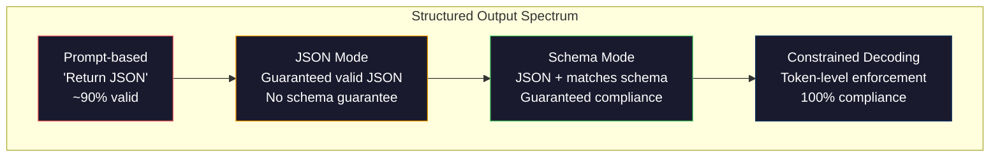
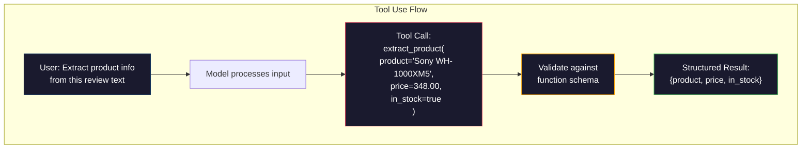

# Structured Outputs: JSON, Schema Validation, Constrained Decoding · 结构化输出：JSON、Schema 校验、约束解码

> 你的 LLM 返回一个字符串，而你的应用需要 JSON。这道鸿沟搞垮的生产系统比任何模型幻觉都多。结构化输出（structured output）是自然语言与类型化数据之间的桥梁。做对了，你的 LLM 就是一个可靠的 API；做错了，你就得在凌晨三点用正则去解析自由文本。

**Type:** Build
**Languages:** Python
**Prerequisites:** Phase 10, Lessons 01-05 (LLMs from Scratch)
**Time:** ~90 minutes
**Related:** Phase 5 · 20（Structured Outputs & Constrained Decoding）讲解码器层面的理论（FSM/CFG logit 处理器、Outlines、XGrammar）。本课聚焦生产 SDK 表面（OpenAI 的 `response_format`、Anthropic 工具使用、Instructor）——想理解 API 底下发生了什么，请先读 Phase 5 · 20。

> Your LLM returns a string. Your application needs JSON. That gap has crashed more production systems than any model hallucination. Structured output is the bridge between natural language and typed data. Get it right and your LLM becomes a reliable API. Get it wrong and you're parsing free-text with regex at 3am.

## Learning Objectives · 学习目标

- 使用 OpenAI 和 Anthropic 的 API 参数实现 JSON 模式（JSON mode）与 schema 约束输出
- 构建一个 Pydantic 校验层，拒绝畸形的 LLM 输出，并携带错误反馈重试
- 解释约束解码（constrained decoding）如何在 token 层面强制产出合法 JSON，无需后处理
- 设计稳健的抽取提示，把非结构化文本可靠地转换成类型化数据结构

> Implement JSON-mode and schema-constrained outputs using OpenAI and Anthropic API parameters
> Build a Pydantic validation layer that rejects malformed LLM outputs and retries with error feedback
> Explain how constrained decoding forces valid JSON at the token level without post-processing
> Design robust extraction prompts that reliably convert unstructured text into typed data structures

## The Problem · 问题在哪

你让 LLM：「从这段文本里抽出产品名、价格和库存状态。」它回答：

```
The product is the Sony WH-1000XM5 headphones, which cost $348.00 and are currently in stock.
```

这是一个完全正确的答案，但对你的应用毫无用处。你的库存系统需要 `{"product": "Sony WH-1000XM5", "price": 348.00, "in_stock": true}`。你需要的是一个带特定键、特定类型、特定取值约束的 JSON 对象。你不需要一个句子。

天真的解法：在提示里加一句「Respond in JSON」。这招 90% 的时候管用。另外 10% 的时候，模型会把 JSON 包进 markdown 代码围栏，或者加一句「Here's the JSON:」之类的前言，或者因为提前闭合了一个括号而产出语法非法的 JSON。你的 JSON 解析器崩了。你的流水线断了。你加上 try/except 和重试循环。重试有时会产出不一样的数据。现在你在解析问题之上又多了一个一致性问题。

这不是提示工程问题，是解码问题。模型从左到右生成 token。在每个位置，它从 10 万+ 选项的词表里挑出最可能的下一个 token。其中大多数选项在任意给定位置都会产出非法 JSON。如果模型刚输出 `{"price":`，下一个 token 必须是数字、引号（字符串）、`null`、`true`、`false` 或负号。其他任何东西都会产出非法 JSON。没有约束时，模型可能挑出一个「完全合理的英文单词」，却在语法上酿成灾难。

> You ask an LLM: "Extract the product name, price, and availability from this text." It responds: ... That is a perfectly correct answer. It is also completely useless to your application. ... The naive solution: add "Respond in JSON" to your prompt. This works 90% of the time. ... This is not a prompt engineering problem. It is a decoding problem. ... Without constraints, the model might pick a perfectly reasonable English word that is catastrophically wrong syntactically.

## The Concept · 概念

### The Structured Output Spectrum · 结构化输出光谱

结构化输出控制有四个层级，一层比一层可靠。



**基于提示（prompt-based）**（「Respond in valid JSON」）：没有任何强制。模型通常遵守，但有时不。可靠性：约 90%。失败模式：markdown 围栏、前言文本、输出被截断、结构不对。

**JSON 模式（JSON mode）**：API 保证输出是合法 JSON。OpenAI 的 `response_format: { type: "json_object" }` 开启的就是这个。输出可以无错解析。但它未必符合你期望的 schema——可能有多余的键、错误的类型、缺失的字段。

**Schema 模式（schema mode）**：API 接收一个 JSON Schema，并保证输出符合它。2026 年，所有主流提供商都原生支持这一点：OpenAI 的 `response_format: { type: "json_schema", json_schema: {...} }`（也可以用 `tool_choice="required"`）、Anthropic 的带 `input_schema` 的工具使用，以及 Gemini 的 `response_schema` + `response_mime_type: "application/json"`。输出拥有你指定的精确键、类型和约束。

**约束解码（constrained decoding）**：在生成过程中的每个 token 位置上，解码器把所有会产出非法输出的 token 屏蔽掉。如果 schema 要求一个数字，而模型正要吐出一个字母，这个 token 的概率就被设为零。模型只能产出通向合法输出的 token。这就是 OpenAI 的结构化输出模式以及 Outlines、Guidance 这类库在底层实现的东西。

> There are four levels of structured output control, each more reliable than the last.
> Prompt-based ("Respond in valid JSON"): no enforcement. The model usually complies but sometimes does not. Reliability: ~90%. Failure mode: markdown fences, preamble text, truncated output, wrong structure.
> JSON mode: the API guarantees the output is valid JSON. ... But it may not match your expected schema -- extra keys, wrong types, missing fields.
> Schema mode: the API takes a JSON Schema and guarantees the output matches it. ... The output has the exact keys, types, and constraints you specified.
> Constrained decoding: at each token position during generation, the decoder masks out all tokens that would produce invalid output. ... The model can only produce tokens that lead to valid output.

### JSON Schema: The Contract Language · JSON Schema：契约语言

JSON Schema 就是你告诉模型（或校验层）「输出必须长什么形状」的方式。每个主流结构化输出系统都在用它。

```json
{
  "type": "object",
  "properties": {
    "product": { "type": "string" },
    "price": { "type": "number", "minimum": 0 },
    "in_stock": { "type": "boolean" },
    "categories": {
      "type": "array",
      "items": { "type": "string" }
    }
  },
  "required": ["product", "price", "in_stock"]
}
```

这个 schema 说的是：输出必须是一个对象，包含一个字符串 `product`、一个非负数 `price`、一个布尔值 `in_stock`，以及一个可选的字符串数组 `categories`。任何不匹配的输出都会被拒绝。

Schema 能处理困难情况：嵌套对象、带类型化元素的数组、枚举（enum，把字符串约束到特定取值）、模式匹配（对字符串做 regex），以及组合器（oneOf、anyOf、allOf，用于多态输出）。

> JSON Schema is how you tell the model (or validation layer) what shape the output must have. Every major structured output system uses it.
> This schema says: the output must be an object with a string `product`, a non-negative number `price`, a boolean `in_stock`, and an optional array of string `categories`. Any output that does not match gets rejected.
> Schemas handle the hard cases: nested objects, arrays with typed items, enums (constrain a string to specific values), pattern matching (regex on strings), and combinators (oneOf, anyOf, allOf for polymorphic outputs).

### The Pydantic Pattern · Pydantic 模式

在 Python 里，你不需要手写 JSON Schema。你定义一个 Pydantic 模型，它替你生成 schema。

```python
from pydantic import BaseModel

class Product(BaseModel):
    product: str
    price: float
    in_stock: bool
    categories: list[str] = []
```

这会产出和上面相同的 JSON Schema。Instructor 库（以及 OpenAI 的 SDK）直接接受 Pydantic 模型：传入模型类，拿回一个校验过的实例。如果 LLM 输出不匹配，Instructor 会自动重试。

> In Python, you do not write JSON Schema by hand. You define a Pydantic model and it generates the schema for you.
> This produces the same JSON Schema as above. The Instructor library (and OpenAI's SDK) accept Pydantic models directly: pass the model class, get back a validated instance. If the LLM output does not match, Instructor retries automatically.

### Function Calling / Tool Use · 函数调用 / 工具使用

这是同一个问题的另一种接口。你不是让模型直接产出 JSON，而是定义带类型参数的「工具」（函数）。模型输出一个带结构化参数的函数调用。OpenAI 管这叫「function calling」，Anthropic 管它叫「tool use」。结果是一样的：结构化数据。



当模型需要选择调用哪个函数、而不只是填参数时，工具使用是更好的选择。如果你有 10 套不同的抽取 schema，而模型必须根据输入挑出对的那一套，工具使用就同时给了你 schema 选择和结构化输出。

> An alternative interface for the same problem. Instead of asking the model to produce JSON directly, you define "tools" (functions) with typed parameters. The model outputs a function call with structured arguments. OpenAI calls this "function calling." Anthropic calls it "tool use." The result is the same: structured data.
> Tool use is preferred when the model needs to choose which function to call, not just fill in parameters. If you have 10 different extraction schemas and the model must pick the right one based on the input, tool use gives you both the schema selection and the structured output.

### Common Failure Modes · 常见失败模式

即使有 schema 强制，结构化输出仍可能以微妙的方式失败。

**幻觉值（hallucinated values）**：输出符合 schema，但里面是编造的数据。文本写的是 $348，模型却产出 `{"price": 299.99}`。Schema 校验抓不住这个——类型是对的，值是错的。

**枚举混淆（enum confusion）**：你把一个字段约束到 `["in_stock", "out_of_stock", "preorder"]`，模型却输出 `"available"`——语义正确，但不在允许集合里。好的约束解码能防止这种情况，基于提示的方法不能。

**嵌套对象深度（nested object depth）**：深层嵌套的 schema（4 层以上）产生更多错误。每一层嵌套都是模型可能迷失结构的地方。

**数组长度（array length）**：模型产出的数组可能太多或太少。Schema 支持 `minItems` 和 `maxItems`，但并非所有提供商都在解码层面强制它们。

**可选字段省略（optional field omission）**：模型省略了技术上可选、但对你的用例语义上重要的字段。即使数据有时缺失，也要在 schema 里把它们设为必需——强迫模型显式产出 `null`。

```figure
mx-schema-funnel
```

> Even with schema enforcement, structured outputs can fail in subtle ways.
> Hallucinated values: the output matches the schema but contains invented data. The model produces `{"price": 299.99}` when the text says $348. Schema validation cannot catch this -- the type is correct, the value is wrong.
> Enum confusion: you constrain a field to `["in_stock", "out_of_stock", "preorder"]`. The model outputs `"available"` -- semantically correct, but not in the allowed set. Good constrained decoding prevents this. Prompt-based approaches do not.
> Nested object depth: deeply nested schemas (4+ levels) produce more errors. Each level of nesting is another place where the model can lose track of structure.
> Array length: the model may produce too many or too few items in an array. Schemas support `minItems` and `maxItems` but not all providers enforce them at the decoding level.
> Optional field omission: the model omits fields that are technically optional but semantically important for your use case. Set them as required in the schema even if the data is sometimes missing -- force the model to produce `null` explicitly.

## Build It · 动手造

### Step 1: JSON Schema Validator · JSON Schema 校验器

从零造一个校验器，检查 Python 对象是否符合 JSON Schema。这就是在输出侧运行、用来验证合规性的东西。

```python
import json

def validate_schema(data, schema):
    errors = []
    _validate(data, schema, "", errors)
    return errors

def _validate(data, schema, path, errors):
    schema_type = schema.get("type")

    if schema_type == "object":
        if not isinstance(data, dict):
            errors.append(f"{path}: expected object, got {type(data).__name__}")
            return
        for key in schema.get("required", []):
            if key not in data:
                errors.append(f"{path}.{key}: required field missing")
        properties = schema.get("properties", {})
        for key, value in data.items():
            if key in properties:
                _validate(value, properties[key], f"{path}.{key}", errors)

    elif schema_type == "array":
        if not isinstance(data, list):
            errors.append(f"{path}: expected array, got {type(data).__name__}")
            return
        min_items = schema.get("minItems", 0)
        max_items = schema.get("maxItems", float("inf"))
        if len(data) < min_items:
            errors.append(f"{path}: array has {len(data)} items, minimum is {min_items}")
        if len(data) > max_items:
            errors.append(f"{path}: array has {len(data)} items, maximum is {max_items}")
        items_schema = schema.get("items", {})
        for i, item in enumerate(data):
            _validate(item, items_schema, f"{path}[{i}]", errors)

    elif schema_type == "string":
        if not isinstance(data, str):
            errors.append(f"{path}: expected string, got {type(data).__name__}")
            return
        enum_values = schema.get("enum")
        if enum_values and data not in enum_values:
            errors.append(f"{path}: '{data}' not in allowed values {enum_values}")

    elif schema_type == "number":
        if not isinstance(data, (int, float)):
            errors.append(f"{path}: expected number, got {type(data).__name__}")
            return
        minimum = schema.get("minimum")
        maximum = schema.get("maximum")
        if minimum is not None and data < minimum:
            errors.append(f"{path}: {data} is less than minimum {minimum}")
        if maximum is not None and data > maximum:
            errors.append(f"{path}: {data} is greater than maximum {maximum}")

    elif schema_type == "boolean":
        if not isinstance(data, bool):
            errors.append(f"{path}: expected boolean, got {type(data).__name__}")

    elif schema_type == "integer":
        if not isinstance(data, int) or isinstance(data, bool):
            errors.append(f"{path}: expected integer, got {type(data).__name__}")
```

> Build a validator from scratch that checks whether a Python object matches a JSON Schema. This is what runs on the output side to verify compliance.

### Step 2: Pydantic-Style Model to Schema · Pydantic 风格的模型转 Schema

造一个最小化的「类到 schema」转换器。定义一个 Python 类，自动生成它的 JSON Schema。

```python
class SchemaField:
    def __init__(self, field_type, required=True, default=None, enum=None, minimum=None, maximum=None):
        self.field_type = field_type
        self.required = required
        self.default = default
        self.enum = enum
        self.minimum = minimum
        self.maximum = maximum

def python_type_to_schema(field):
    type_map = {
        str: "string",
        int: "integer",
        float: "number",
        bool: "boolean",
    }

    schema = {}

    if field.field_type in type_map:
        schema["type"] = type_map[field.field_type]
    elif field.field_type == list:
        schema["type"] = "array"
        schema["items"] = {"type": "string"}
    elif isinstance(field.field_type, dict):
        schema = field.field_type

    if field.enum:
        schema["enum"] = field.enum
    if field.minimum is not None:
        schema["minimum"] = field.minimum
    if field.maximum is not None:
        schema["maximum"] = field.maximum

    return schema

def model_to_schema(name, fields):
    properties = {}
    required = []

    for field_name, field in fields.items():
        properties[field_name] = python_type_to_schema(field)
        if field.required:
            required.append(field_name)

    return {
        "type": "object",
        "properties": properties,
        "required": required,
    }
```

> Build a minimal class-to-schema converter. Define a Python class and generate its JSON Schema automatically.

### Step 3: Constrained Token Filter · 约束 token 过滤器

模拟约束解码。给定一个部分 JSON 字符串和一个 schema，判断当前位置哪些 token 类别是合法的。

```python
def next_valid_tokens(partial_json, schema):
    stripped = partial_json.strip()

    if not stripped:
        return ["{"]

    try:
        json.loads(stripped)
        return ["<EOS>"]
    except json.JSONDecodeError:
        pass

    last_char = stripped[-1] if stripped else ""

    if last_char == "{":
        return ['"', "}"]
    elif last_char == '"':
        if stripped.endswith('":'):
            return ['"', "0-9", "true", "false", "null", "[", "{"]
        return ["a-z", '"']
    elif last_char == ":":
        return [" ", '"', "0-9", "true", "false", "null", "[", "{"]
    elif last_char == ",":
        return [" ", '"', "{", "["]
    elif last_char in "0123456789":
        return ["0-9", ".", ",", "}", "]"]
    elif last_char == "}":
        return [",", "}", "]", "<EOS>"]
    elif last_char == "]":
        return [",", "}", "<EOS>"]
    elif last_char == "[":
        return ['"', "0-9", "true", "false", "null", "{", "[", "]"]
    else:
        return ["any"]

def demonstrate_constrained_decoding():
    partial_states = [
        '',
        '{',
        '{"product"',
        '{"product":',
        '{"product": "Sony"',
        '{"product": "Sony",',
        '{"product": "Sony", "price":',
        '{"product": "Sony", "price": 348',
        '{"product": "Sony", "price": 348}',
    ]

    print(f"{'Partial JSON':<45} {'Valid Next Tokens'}")
    print("-" * 80)
    for state in partial_states:
        valid = next_valid_tokens(state, {})
        display = state if state else "(empty)"
        print(f"{display:<45} {valid}")
```

> Simulate constrained decoding. Given a partial JSON string and a schema, determine which token categories are valid at the current position.

### Step 4: Extraction Pipeline · 抽取流水线

把所有东西组合成一条抽取流水线：定义 schema，模拟 LLM 产出结构化输出，校验输出，并处理重试。

```python
def simulate_llm_extraction(text, schema, attempt=0):
    if "headphones" in text.lower() or "sony" in text.lower():
        if attempt == 0:
            return '{"product": "Sony WH-1000XM5", "price": 348.00, "in_stock": true, "categories": ["audio", "headphones"]}'
        return '{"product": "Sony WH-1000XM5", "price": 348.00, "in_stock": true}'

    if "laptop" in text.lower():
        return '{"product": "MacBook Pro 16", "price": 2499.00, "in_stock": false, "categories": ["computers"]}'

    return '{"product": "Unknown", "price": 0, "in_stock": false}'

def extract_with_retry(text, schema, max_retries=3):
    for attempt in range(max_retries):
        raw = simulate_llm_extraction(text, schema, attempt)

        try:
            data = json.loads(raw)
        except json.JSONDecodeError as e:
            print(f"  Attempt {attempt + 1}: JSON parse error -- {e}")
            continue

        errors = validate_schema(data, schema)
        if not errors:
            return data

        print(f"  Attempt {attempt + 1}: Schema validation errors -- {errors}")

    return None

product_schema = {
    "type": "object",
    "properties": {
        "product": {"type": "string"},
        "price": {"type": "number", "minimum": 0},
        "in_stock": {"type": "boolean"},
        "categories": {"type": "array", "items": {"type": "string"}},
    },
    "required": ["product", "price", "in_stock"],
}
```

> Combine everything into an extraction pipeline: define a schema, simulate an LLM producing structured output, validate the output, and handle retries.

### Step 5: Run the Full Pipeline · 运行完整流水线

```python
def run_demo():
    print("=" * 60)
    print("  Structured Output Pipeline Demo")
    print("=" * 60)

    print("\n--- Schema Definition ---")
    product_fields = {
        "product": SchemaField(str),
        "price": SchemaField(float, minimum=0),
        "in_stock": SchemaField(bool),
        "categories": SchemaField(list, required=False),
    }
    generated_schema = model_to_schema("Product", product_fields)
    print(json.dumps(generated_schema, indent=2))

    print("\n--- Schema Validation ---")
    test_cases = [
        ({"product": "Test", "price": 10.0, "in_stock": True}, "Valid object"),
        ({"product": "Test", "price": -5.0, "in_stock": True}, "Negative price"),
        ({"product": "Test", "in_stock": True}, "Missing price"),
        ({"product": "Test", "price": "ten", "in_stock": True}, "String as price"),
        ("not an object", "String instead of object"),
    ]

    for data, label in test_cases:
        errors = validate_schema(data, product_schema)
        status = "PASS" if not errors else f"FAIL: {errors}"
        print(f"  {label}: {status}")

    print("\n--- Constrained Decoding Simulation ---")
    demonstrate_constrained_decoding()

    print("\n--- Extraction Pipeline ---")
    texts = [
        "The Sony WH-1000XM5 headphones are priced at $348 and currently available.",
        "The new MacBook Pro 16-inch laptop costs $2499 but is sold out.",
        "This is a random sentence with no product info.",
    ]

    for text in texts:
        print(f"\n  Input: {text[:60]}...")
        result = extract_with_retry(text, product_schema)
        if result:
            print(f"  Output: {json.dumps(result)}")
        else:
            print(f"  Output: FAILED after retries")
```

## Use It · 实战用法

### OpenAI Structured Outputs · OpenAI 结构化输出

```python
# from openai import OpenAI
# from pydantic import BaseModel
#
# client = OpenAI()
#
# class Product(BaseModel):
#     product: str
#     price: float
#     in_stock: bool
#
# response = client.beta.chat.completions.parse(
#     model="gpt-5-mini",
#     messages=[
#         {"role": "system", "content": "Extract product information."},
#         {"role": "user", "content": "Sony WH-1000XM5, $348, in stock"},
#     ],
#     response_format=Product,
# )
#
# product = response.choices[0].message.parsed
# print(product.product, product.price, product.in_stock)
```

OpenAI 的结构化输出模式在内部使用约束解码。模型生成的每个 token 都被保证产出符合 Pydantic schema 的输出。不需要重试，不需要校验。约束直接烤进了解码过程。

> OpenAI's structured output mode uses constrained decoding internally. Every token the model generates is guaranteed to produce output matching the Pydantic schema. No retries needed. No validation needed. The constraint is baked into the decoding process.

### Anthropic Tool Use · Anthropic 工具使用

```python
# import anthropic
#
# client = anthropic.Anthropic()
#
# response = client.messages.create(
#     model="claude-opus-4-7",
#     max_tokens=1024,
#     tools=[{
#         "name": "extract_product",
#         "description": "Extract product information from text",
#         "input_schema": {
#             "type": "object",
#             "properties": {
#                 "product": {"type": "string"},
#                 "price": {"type": "number"},
#                 "in_stock": {"type": "boolean"},
#             },
#             "required": ["product", "price", "in_stock"],
#         },
#     }],
#     messages=[{"role": "user", "content": "Extract: Sony WH-1000XM5, $348, in stock"}],
# )
```

Anthropic 通过工具使用实现结构化输出。模型发出一个工具调用，其结构化参数符合 input_schema。同样的结果，不同的 API 表面。

> Anthropic achieves structured output through tool use. The model emits a tool call with structured arguments that match the input_schema. Same result, different API surface.

### Instructor Library · Instructor 库

```python
# pip install instructor
# import instructor
# from openai import OpenAI
# from pydantic import BaseModel
#
# client = instructor.from_openai(OpenAI())
#
# class Product(BaseModel):
#     product: str
#     price: float
#     in_stock: bool
#
# product = client.chat.completions.create(
#     model="gpt-5-mini",
#     response_model=Product,
#     messages=[{"role": "user", "content": "Sony WH-1000XM5, $348, in stock"}],
# )
```

Instructor 包装任意 LLM 客户端，并加上带校验的自动重试。第一次尝试校验失败时，它把错误作为上下文发回给模型，要求它修复输出。这对任何提供商都有效，不只 OpenAI。

> Instructor wraps any LLM client and adds automatic retries with validation. If the first attempt fails validation, it sends the errors back to the model as context and asks it to fix the output. This works with any provider, not just OpenAI.

## Ship It · 交付

本课产出 `outputs/prompt-structured-extractor.md` —— 一个可复用的提示模板：给定 schema 定义，就能从任何文本中抽取结构化数据。喂给它一个 JSON Schema 和非结构化文本，它返回校验过的 JSON。

它还产出 `outputs/skill-structured-outputs.md` —— 一个决策框架：根据你的提供商、可靠性要求和 schema 复杂度，选择合适的结构化输出策略。

> This lesson produces `outputs/prompt-structured-extractor.md` -- a reusable prompt template that extracts structured data from any text given a schema definition. Feed it a JSON Schema and unstructured text, and it returns validated JSON.
> It also produces `outputs/skill-structured-outputs.md` -- a decision framework for choosing the right structured output strategy based on your provider, reliability requirements, and schema complexity.

## Exercises · 练习

1. 扩展 schema 校验器，支持 `oneOf`（数据必须恰好匹配几个 schema 中的一个）。这能处理多态输出——比如一个字段可以是 `Product` 或 `Service` 对象，两者形状不同。

2. 造一个「schema diff」工具，对比两个 schema，区分破坏性变更（删除了必需字段、改了类型）和非破坏性变更（新增可选字段、放宽约束）。在生产环境中为抽取 schema 做版本管理时，这是必备工具。

3. 实现一个更真实的约束解码模拟器。给定一个 JSON Schema 和一个 100 个 token 的词表（字母、数字、标点、关键字），逐步走一遍生成过程，在每个位置屏蔽非法 token。测量每一步词表中有多少百分比的 token 是合法的。

4. 造一个抽取评测套件。创建 50 条带人工标注 JSON 输出的产品描述。在全部 50 条上运行你的抽取流水线，测量精确匹配率、字段级准确率和类型合规率。找出哪些字段最难正确抽取。

5. 给抽取流水线加「置信度分数」。对每个抽取出的字段，估计模型有多自信（基于 token 概率，或者跑 3 次抽取并测一致性）。把低置信度字段标记出来，供人工复核。

## Key Terms · 术语表

| 术语 | 人们怎么说 | 实际含义 |
|------|----------------|----------------------|
| JSON mode | 「返回 JSON」 | 一个 API 开关，保证输出是语法合法的 JSON，但不强制任何特定 schema |
| Structured output | 「类型化 JSON」 | 符合特定 JSON Schema 的输出，键、类型和约束都正确 |
| Constrained decoding | 「引导生成」 | 在每个 token 位置屏蔽会产出非法输出的 token —— 保证 100% schema 合规 |
| JSON Schema | 「一份 JSON 模板」 | 一种声明式语言，描述 JSON 数据的结构、类型和约束（OpenAPI、JSON Forms 等都在用） |
| Pydantic | 「Python dataclasses 加强版」 | 一个 Python 库，定义带类型校验的数据模型；FastAPI 和 Instructor 用它生成 JSON Schema |
| Function calling | 「工具使用」 | LLM 输出结构化的函数调用（函数名 + 类型化参数）而不是自由文本 —— OpenAI 和 Anthropic 都支持 |
| Instructor | 「LLM 版 Pydantic」 | 一个 Python 库，包装 LLM 客户端使其返回校验过的 Pydantic 实例，校验失败时自动重试 |
| Token masking | 「过滤词表」 | 在生成时把特定 token 的概率设为零，让模型无法产出它们 |
| Schema compliance | 「形状对得上」 | 输出拥有每个必需字段、类型正确、值在约束之内，且没有多余的不允许字段 |
| Retry loop | 「不行就再试」 | 把校验错误发回给模型并要求修复输出 —— Instructor 自动做这件事，重试上限可配置 |

## Further Reading · 延伸阅读

- [OpenAI Structured Outputs Guide](https://platform.openai.com/docs/guides/structured-outputs) —— OpenAI API 中基于 JSON Schema 的约束解码官方文档
- [Willard & Louf, 2023 -- "Efficient Guided Generation for Large Language Models"](https://arxiv.org/abs/2307.09702) —— Outlines 论文，讲如何把 JSON Schema 编译成有限状态机以实现 token 级约束
- [Instructor documentation](https://python.useinstructor.com/) —— 从任何 LLM 获取结构化输出的事实标准库，带 Pydantic 校验和重试
- [Anthropic Tool Use Guide](https://docs.anthropic.com/en/docs/tool-use) —— Claude 如何通过带 JSON Schema input_schema 的工具使用实现结构化输出
- [JSON Schema specification](https://json-schema.org/) —— 每个主流结构化输出系统所用 schema 语言的完整规范
- [Outlines library](https://github.com/outlines-dev/outlines) —— 开源约束生成库，把 regex 和 JSON Schema 编译成有限状态机
- [Dong et al., "XGrammar: Flexible and Efficient Structured Generation Engine for Large Language Models" (MLSys 2025)](https://arxiv.org/abs/2411.15100) —— 当前最先进的语法引擎；下推自动机编译，每个 token 的屏蔽耗时约 100 ns。
- [Beurer-Kellner et al., "Prompting Is Programming: A Query Language for Large Language Models" (LMQL)](https://arxiv.org/abs/2212.06094) —— LMQL 论文，把约束解码框定成一种带类型和值约束的查询语言。
- [Microsoft Guidance (framework docs)](https://github.com/guidance-ai/guidance) —— 模板驱动的约束生成；Outlines 和 XGrammar 的厂商中立补充。
