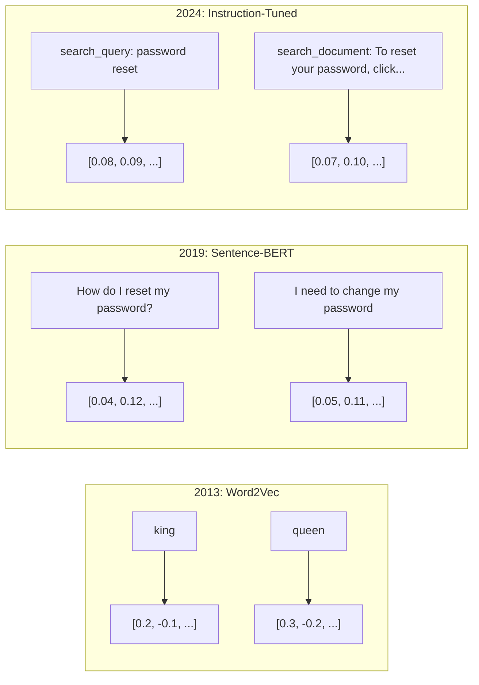
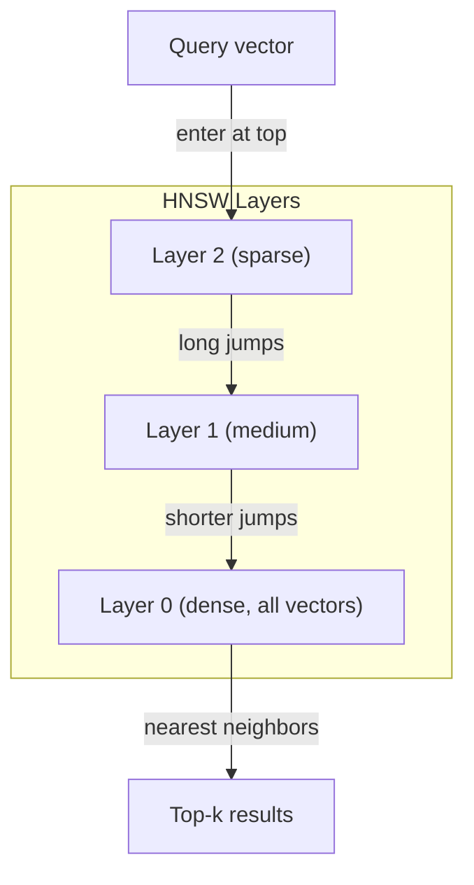
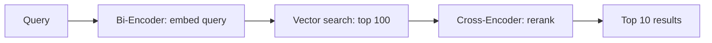

# Embeddings & Vector Representations · 嵌入与向量表示

> 文本是离散的，数学是连续的。每当你让 LLM 查找「相似」的文档、比较语义，或者做超越关键词的搜索时，你都在依赖这两个世界之间的一座桥。这座桥就是嵌入（embedding）。不懂嵌入，就不算懂现代 AI——你只是在「用」它而已。

> Text is discrete. Math is continuous. Every time you ask an LLM to find "similar" documents, compare meanings, or search beyond keywords, you're relying on a bridge between these two worlds. That bridge is an embedding. If you don't understand embeddings, you don't understand modern AI. You just use it.

**Type:** Build
**Languages:** Python
**Prerequisites:** Phase 11, Lesson 01 (Prompt Engineering)
**Time:** ~75 minutes
**Related:** Phase 5 · 22（Embedding Models Deep Dive）讲解 dense vs sparse vs multi-vector、Matryoshka 截断和按维度选型；本课聚焦生产管线（向量数据库、HNSW、相似度数学）。选模型之前先读 Phase 5 · 22。

## Learning Objectives · 学习目标

- 使用 API 提供商和开源模型生成文本嵌入（embeddings），并计算它们之间的余弦相似度（cosine similarity）
- 解释为什么嵌入能解决关键词搜索无法处理的词汇不匹配（vocabulary mismatch）问题
- 构建一个按语义而非精确关键词匹配来检索文档的语义搜索索引
- 使用检索基准（precision@k、recall）评估嵌入质量，并为你的任务选对嵌入模型

> Generate text embeddings using API providers and open-source models, and compute cosine similarity between them
> Explain why embeddings solve the vocabulary mismatch problem that keyword search cannot handle
> Build a semantic search index that retrieves documents by meaning rather than exact keyword match
> Evaluate embedding quality using retrieval benchmarks (precision@k, recall) and choose the right embedding model for your task

## The Problem · 问题在哪

你有 10,000 张客服工单。一位客户写道「my payment didn't go through」（我的付款没有成功）。你要找出以往相似的工单。关键词搜索只能找到包含 "payment" 和 "didn't go through" 的工单，却会漏掉 "transaction failed"（交易失败）、"charge was declined"（扣款被拒）和 "billing error"（账单出错）。这些工单用词完全不同，描述的却是同一个问题。

这就是词汇不匹配（vocabulary mismatch）问题。人类语言表达同一件事有几十种说法，而关键词搜索把每个词都当作互不相干、没有意义的符号。它不可能知道 "declined" 和 "didn't go through" 指的是同一个概念。

你需要一种文本表示，让语义（而不是拼写）决定相似度。你需要一种办法，把「my payment didn't go through」和「transaction was declined」在某个数学空间里放得很近，同时把「my payment arrived on time」推得远远的——尽管它也共享 "payment" 这个词。

这种表示就是嵌入（embedding）。

> You have 10,000 support tickets. A customer writes "my payment didn't go through." You need to find similar past tickets. Keyword search finds tickets containing "payment" and "didn't go through." It misses "transaction failed," "charge was declined," and "billing error." These tickets describe the exact same problem with completely different words.
> This is the vocabulary mismatch problem. Human language has dozens of ways to say the same thing. Keyword search treats each word as an independent symbol with no meaning. It cannot know that "declined" and "didn't go through" refer to the same concept.
> You need a representation of text where meaning, not spelling, determines similarity. You need a way to place "my payment didn't go through" and "transaction was declined" close together in some mathematical space, while pushing "my payment arrived on time" far away despite sharing the word "payment."
> That representation is an embedding.

## The Concept · 核心概念

### What Is an Embedding? · 什么是嵌入？

嵌入（embedding）是一个表示文本语义的稠密浮点数向量。「稠密」这个词很关键——每一个维度都携带信息，不像稀疏表示（词袋、TF-IDF）里大多数维度都是零。

"The cat sat on the mat" 会变成类似 `[0.023, -0.041, 0.087, ..., 0.012]` 的东西——一串 768 到 3072 个数字，具体取决于模型。这些数字编码了语义。你永远不会直接去检视它们，你只会去比较它们。

> An embedding is a dense vector of floating-point numbers that represents the meaning of text. The word "dense" matters -- every dimension carries information, unlike sparse representations (bag-of-words, TF-IDF) where most dimensions are zero.
> "The cat sat on the mat" becomes something like `[0.023, -0.041, 0.087, ..., 0.012]` -- a list of 768 to 3072 numbers depending on the model. These numbers encode meaning. You never inspect them directly. You compare them.

### The Word2Vec Breakthrough · Word2Vec 的突破

2013 年，Google 的 Tomas Mikolov 及同事发表了 Word2Vec。核心洞见：训练一个神经网络，用词的邻居来预测这个词（或者用这个词预测它的邻居），隐藏层的权重就会成为有意义的向量表示。

著名的结果：

```
king - man + woman = queen
```

对词嵌入做向量算术能捕捉语义关系。从 "man" 到 "woman" 的方向，与从 "king" 到 "queen" 的方向大致相同。正是这一刻，整个领域意识到：几何可以编码语义。

Word2Vec 产生的是 300 维向量。无论上下文如何，每个词只有一个向量。"river bank"（河岸）里的 "bank" 和 "bank account"（银行账户）里的 "bank" 共享同一个嵌入。这个局限驱动了此后十年的研究。

> In 2013, Tomas Mikolov and colleagues at Google published Word2Vec. The core insight: train a neural network to predict a word from its neighbors (or neighbors from a word), and the hidden layer weights become meaningful vector representations.
> Vector arithmetic on word embeddings captures semantic relationships. The direction from "man" to "woman" is roughly the same as the direction from "king" to "queen." This was the moment the field realized that geometry could encode meaning.
> Word2Vec produced 300-dimensional vectors. Each word got one vector regardless of context. "Bank" in "river bank" and "bank account" had the same embedding. This limitation drove the next decade of research.

### From Words to Sentences · 从词到句子

词嵌入表示的是单个词元（token）。生产系统需要嵌入整句、整段甚至整个文档。四种方案应运而生：

**平均池化（Averaging）**：取句中所有词向量的均值。便宜、有损，对短文本效果出奇地不错。完全丢失词序——"dog bites man" 和 "man bites dog" 会得到完全相同的嵌入。

**CLS token**：Transformer 模型（BERT，2018）输出一个特殊的 [CLS] token 嵌入来表示整个输入。比平均池化好，但 [CLS] token 的训练目标是「下一句预测」，不是相似度。

**对比学习（Contrastive learning）**：显式训练模型把相似样本对拉近、不相似样本对推远。Sentence-BERT（Reimers & Gurevych, 2019）采用这一路线，成为现代嵌入模型的基石。给定 "How do I reset my password?" 和 "I need to change my password"，模型学到这两句应该有几乎相同的向量。

**指令调优嵌入（Instruction-tuned embeddings）**：最新方案。E5、GTE 这类模型接受一个任务前缀（"search_query:"、"search_document:"），告诉模型要产出哪种嵌入。这让一个模型可以服务多个任务。



> Word embeddings represent single tokens. Production systems need to embed entire sentences, paragraphs, or documents. Four approaches emerged... **Contrastive learning**: train the model explicitly to push similar pairs together and dissimilar pairs apart. Sentence-BERT (Reimers & Gurevych, 2019) used this approach and became the foundation for modern embedding models... **Instruction-tuned embeddings**: the latest approach. Models like E5 and GTE accept a task prefix ("search_query:", "search_document:") that tells the model what kind of embedding to produce. This lets one model serve multiple tasks.

### Modern Embedding Models · 现代嵌入模型

市场已经收敛到少数几个生产级选项（2026 年初的 MTEB 分数，MTEB v2）：

| 模型 | 提供商 | 维度 | MTEB | 上下文 | 成本 / 1M tokens |
|-------|----------|-----------|------|---------|------------------|
| Gemini Embedding 2 | Google | 3072 (Matryoshka) | 67.7 (retrieval) | 8192 | $0.15 |
| embed-v4 | Cohere | 1024 (Matryoshka) | 65.2 | 128K | $0.12 |
| voyage-4 | Voyage AI | 1024/2048 (Matryoshka) | 66.8 | 32K | $0.12 |
| text-embedding-3-large | OpenAI | 3072 (Matryoshka) | 64.6 | 8192 | $0.13 |
| text-embedding-3-small | OpenAI | 1536 (Matryoshka) | 62.3 | 8192 | $0.02 |
| BGE-M3 | BAAI | 1024 (dense+sparse+ColBERT) | 63.0 multilingual | 8192 | 开放权重 |
| Qwen3-Embedding | Alibaba | 4096 (Matryoshka) | 66.9 | 32K | 开放权重 |
| Nomic-embed-v2 | Nomic | 768 (Matryoshka) | 63.1 | 8192 | 开放权重 |

MTEB（Massive Text Embedding Benchmark）v2 涵盖检索、分类、聚类、重排（reranking）、摘要等 100+ 任务，分数越高越好。到 2026 年，开放权重模型（Qwen3-Embedding、BGE-M3）在大多数维度上已追平甚至超越闭源托管模型。Gemini Embedding 2 在纯检索上领先；Voyage/Cohere 在特定领域（金融、法律、代码）领先。在拍板之前，一定要在你自己的查询上做基准测试。

> The market has settled into a handful of production-grade options (MTEB scores as of early 2026, MTEB v2)... MTEB (Massive Text Embedding Benchmark) v2 covers 100+ tasks across retrieval, classification, clustering, reranking, and summarization. Higher is better. By 2026, open-weight models (Qwen3-Embedding, BGE-M3) match or beat closed hosted models on most axes. Gemini Embedding 2 leads pure retrieval; Voyage/Cohere lead specific domains (finance, law, code). Always benchmark on your own queries before committing.

### Similarity Metrics · 相似度度量

给定两个嵌入向量，有三种衡量相似度的方法：

**余弦相似度（Cosine similarity）**：两个向量夹角的余弦。取值范围从 -1（方向相反）到 1（方向相同）。忽略模长——一句 10 个词的话和一篇 500 词的文档，只要方向一致就能得 1.0。这是 90% 使用场景的默认选择。

```
cosine_sim(a, b) = dot(a, b) / (||a|| * ||b||)
```

**点积（Dot product）**：两个向量的原始内积。当向量已归一化（单位长度）时，与余弦相似度等价。计算更快。OpenAI 的嵌入已做归一化，所以点积和余弦给出相同的排序。

```
dot(a, b) = sum(a_i * b_i)
```

**欧氏距离（Euclidean / L2 距离）**：向量空间中的直线距离。越小越相似。对模长差异敏感。当向量在空间中的绝对位置（而不仅是方向）有意义时使用。

```
L2(a, b) = sqrt(sum((a_i - b_i)^2))
```

何时用哪个：

| 度量 | 何时使用 | 何时避免 |
|--------|----------|------------|
| 余弦相似度 | 比较不同长度的文本；大多数检索任务 | 模长本身携带信息时 |
| 点积 | 嵌入已归一化；追求最快速度 | 向量模长差异大时 |
| 欧氏距离 | 聚类；空间最近邻问题 | 比较长度悬殊的文档时 |

> Given two embedding vectors, three ways to measure how similar they are:
> **Cosine similarity**: the cosine of the angle between two vectors. Ranges from -1 (opposite) to 1 (identical direction). Ignores magnitude -- a 10-word sentence and a 500-word document can score 1.0 if they point the same direction. This is the default for 90% of use cases.
> **Dot product**: the raw inner product of two vectors. Identical to cosine similarity when vectors are normalized (unit length). Faster to compute. OpenAI's embeddings are normalized, so dot product and cosine give the same ranking.
> **Euclidean (L2) distance**: straight-line distance in the vector space. Smaller = more similar. Sensitive to magnitude differences. Use when the absolute position in space matters, not just the direction.

### Vector Databases and HNSW · 向量数据库与 HNSW

暴力相似度搜索要把查询向量与每一条存储向量都比较一遍。100 万条 1536 维向量，意味着每次查询要做 15 亿次乘加运算。太慢了。

向量数据库用近似最近邻（ANN, Approximate Nearest Neighbor）算法解决这个问题。主流算法是 HNSW（Hierarchical Navigable Small World，分层可导航小世界图）：

1. 构建一个多层的向量图
2. 顶层稀疏——相距很远的簇之间有长程连接
3. 底层稠密——相邻向量之间有细粒度连接
4. 搜索从顶层开始，贪心逐层下降精细化
5. 以 O(log n) 时间返回近似 top-k 结果，而不是 O(n)

HNSW 用很小的精度损失（通常 95-99% 召回率）换取巨大的速度提升。在 1000 万向量规模下，暴力搜索要花数秒，HNSW 只要几毫秒。



生产可选方案：

| 数据库 | 类型 | 最适合 | 最大规模 |
|----------|------|----------|-----------|
| Pinecone | 托管 SaaS | 零运维生产环境 | 十亿级 |
| Weaviate | 开源 | 自托管、混合搜索 | 1 亿+ |
| Qdrant | 开源 | 高性能、带过滤 | 1 亿+ |
| ChromaDB | 嵌入式 | 原型验证、本地开发 | 100 万 |
| pgvector | Postgres 扩展 | 已在用 Postgres | 1000 万 |
| FAISS | 库 | 进程内、研究 | 10 亿+ |

> A brute-force similarity search compares the query against every stored vector. At 1 million vectors with 1536 dimensions, that is 1.5 billion multiply-add operations per query. Too slow.
> Vector databases solve this with Approximate Nearest Neighbor (ANN) algorithms. The dominant algorithm is HNSW (Hierarchical Navigable Small World)... HNSW trades a small accuracy loss (typically 95-99% recall) for massive speed gains. At 10 million vectors, brute force takes seconds. HNSW takes milliseconds.

### Chunking Strategies · 分块策略

文档太长，没法作为单个向量来嵌入。一份 50 页的 PDF 涵盖几十个主题——它的嵌入成了「一切的均值」，和任何具体内容都不像。你要把文档切成块（chunk），逐块嵌入。

**固定大小分块（Fixed-size）**：每 N 个 token 切一刀，保留 M 个 token 的重叠。简单、可预测。文档没有明显结构时很好用。例如 512 token 的块加 50 token 重叠：块 1 是 token 0-511，块 2 是 token 462-973。

**按句分块（Sentence-based）**：在句子边界切分，把句子攒到 token 上限为止。每个块至少包含一个完整句子。比固定大小更好，因为你永远不会把一个思路切成两半。

**递归分块（Recursive）**：先尝试在最大的边界切（章节标题），如果还是太大，再试段落边界，然后是句子边界，最后是字符数限制。这就是 LangChain 的 `RecursiveCharacterTextSplitter`，对混合格式的语料很好用。

**语义分块（Semantic）**：先嵌入每个句子，再把嵌入相近的连续句子归为一组。当嵌入相似度跌破阈值时，开启一个新块。成本高（要逐句嵌入），但产出的块最连贯。

| 策略 | 复杂度 | 质量 | 最适合 |
|----------|-----------|---------|----------|
| 固定大小 | 低 | 尚可 | 非结构化文本、日志 |
| 按句 | 低 | 良好 | 文章、邮件 |
| 递归 | 中 | 良好 | Markdown、HTML、混合文档 |
| 语义 | 高 | 最佳 | 对检索质量要求苛刻的场景 |

多数系统的最佳平衡点：256-512 token 的块，加 50 token 重叠。

> Documents are too long to embed as single vectors. A 50-page PDF covers dozens of topics -- its embedding becomes an average of everything, similar to nothing specific. You split documents into chunks and embed each one... **Recursive chunking**: try splitting at the largest boundary first (section headers). If still too large, try paragraph boundaries. Then sentence boundaries. Then character limits... The sweet spot for most systems: 256-512 token chunks with 50-token overlap.

### Bi-Encoders vs Cross-Encoders · 双编码器 vs 交叉编码器

双编码器（bi-encoder）独立嵌入查询和文档，再比较向量。快——查询只需嵌入一次，就可以与预先算好的文档嵌入比较。检索就用它。

交叉编码器（cross-encoder）把查询和一个文档拼成单个输入，输出一个相关度分数。慢——每个「查询-文档」对都要过一遍完整模型。但准确得多，因为它能同时注意到查询与文档的词元。

生产的标准组合：双编码器检索出 top-100 候选，交叉编码器重排（rerank）出 top-10。这就是「先检索后重排」（retrieve-then-rerank）管线。



重排模型：Cohere Rerank 3.5（每 1000 次查询 $2）、BGE-reranker-v2（免费开源）、Jina Reranker v2（免费开源）。

> A bi-encoder embeds the query and documents independently, then compares vectors. Fast -- you embed the query once and compare against pre-computed document embeddings. This is what you use for retrieval.
> A cross-encoder takes the query and a document as a single input and outputs a relevance score. Slow -- it processes each query-document pair through the full model. But far more accurate because it can attend across query and document tokens simultaneously.
> The production pattern: bi-encoder retrieves top-100 candidates, cross-encoder reranks them to top-10. This is the retrieve-then-rerank pipeline.

### Matryoshka Embeddings · Matryoshka 嵌入（可截断的向量）

传统嵌入是「一锤子买卖」：1536 维向量就得用 1536 个浮点数存着，想截断到 256 维就得重新训练。

Matryoshka Representation Learning（Kusupati et al., 2022）解决了这个问题。模型经过特殊训练，让前 N 维承载最重要的信息，就像俄罗斯套娃。把 1536 维的 Matryoshka 嵌入截断到 256 维会损失一点精度，但依然可用。

OpenAI 的 text-embedding-3-small 和 text-embedding-3-large 通过 `dimensions` 参数支持 Matryoshka 截断。请求 256 维而不是 1536 维，存储省 6 倍，MTEB 基准上的精度损失大约 3-5%。

> Traditional embeddings are all-or-nothing. A 1536-dimensional vector uses 1536 floats. You cannot truncate to 256 dimensions without retraining.
> Matryoshka Representation Learning (Kusupati et al., 2022) fixes this. The model is trained so that the first N dimensions capture the most important information, like a Russian nesting doll. Truncating a 1536-d Matryoshka embedding to 256 dimensions loses some accuracy but remains functional.
> OpenAI's text-embedding-3-small and text-embedding-3-large support Matryoshka truncation via the `dimensions` parameter. Requesting 256 dimensions instead of 1536 cuts storage by 6x with roughly 3-5% accuracy loss on MTEB benchmarks.

### Binary Quantization · 二值量化

一个 1536 维嵌入用 float32 存储要占 6,144 字节。乘以 1000 万文档：光向量就要 61 GB。

二值量化（binary quantization）把每个浮点数变成一个比特：正数变 1，负数变 0。存储从 6,144 字节降到 192 字节——32 倍压缩。相似度用汉明距离（Hamming distance，数不同的比特数）计算，CPU 单条指令就能完成。

召回率损失大约 5-10%。常见做法是：第一遍在百万级向量上用二值量化搜索，再用全精度向量对 top-1000 重新打分。这样能用 1/32 的内存拿到全精度 95% 以上的效果。

```figure
cosine-similarity
```

> A 1536-dimensional embedding stored as float32 uses 6,144 bytes. Multiply by 10 million documents: 61 GB just for vectors.
> Binary quantization converts each float to a single bit: positive values become 1, negative values become 0. Storage drops from 6,144 bytes to 192 bytes -- a 32x reduction. Similarity is computed using Hamming distance (count differing bits), which CPUs can do in a single instruction.
> The accuracy hit is around 5-10% on retrieval recall. The common pattern: binary quantization for the first-pass search over millions of vectors, then rescore the top-1000 with full-precision vectors. This gets you 95%+ of full-precision accuracy at 32x less memory.

## Build It · 动手造

我们从零构建一个语义搜索引擎。不用向量数据库，不调用外部嵌入 API，纯 Python 加 numpy 做数学。

> We build a semantic search engine from scratch. No vector database. No external embedding API. Pure Python with numpy for the math.

### Step 1: Text Chunking · 文本分块

```python
def chunk_text(text, chunk_size=200, overlap=50):
    words = text.split()
    chunks = []
    start = 0
    while start < len(words):
        end = start + chunk_size
        chunk = " ".join(words[start:end])
        chunks.append(chunk)
        start += chunk_size - overlap
    return chunks


def chunk_by_sentences(text, max_chunk_tokens=200):
    sentences = text.replace("\n", " ").split(".")
    sentences = [s.strip() + "." for s in sentences if s.strip()]
    chunks = []
    current_chunk = []
    current_length = 0
    for sentence in sentences:
        sentence_length = len(sentence.split())
        if current_length + sentence_length > max_chunk_tokens and current_chunk:
            chunks.append(" ".join(current_chunk))
            current_chunk = []
            current_length = 0
        current_chunk.append(sentence)
        current_length += sentence_length
    if current_chunk:
        chunks.append(" ".join(current_chunk))
    return chunks
```

### Step 2: Building Embeddings from Scratch · 从零构建嵌入

我们用 TF-IDF 加 L2 归一化实现一个简单的稠密嵌入。它不是神经嵌入，但遵循同样的契约：文本进、定长向量出，相似文本产出相似向量。

```python
import math
import numpy as np
from collections import Counter

class SimpleEmbedder:
    def __init__(self):
        self.vocab = []
        self.idf = []
        self.word_to_idx = {}

    def fit(self, documents):
        vocab_set = set()
        for doc in documents:
            vocab_set.update(doc.lower().split())
        self.vocab = sorted(vocab_set)
        self.word_to_idx = {w: i for i, w in enumerate(self.vocab)}
        n = len(documents)
        self.idf = np.zeros(len(self.vocab))
        for i, word in enumerate(self.vocab):
            doc_count = sum(1 for doc in documents if word in doc.lower().split())
            self.idf[i] = math.log((n + 1) / (doc_count + 1)) + 1

    def embed(self, text):
        words = text.lower().split()
        count = Counter(words)
        total = len(words) if words else 1
        vec = np.zeros(len(self.vocab))
        for word, freq in count.items():
            if word in self.word_to_idx:
                tf = freq / total
                vec[self.word_to_idx[word]] = tf * self.idf[self.word_to_idx[word]]
        norm = np.linalg.norm(vec)
        if norm > 0:
            vec = vec / norm
        return vec
```

> We implement a simple dense embedding using TF-IDF with L2 normalization. This is not a neural embedding, but it follows the same contract: text in, fixed-size vector out, similar texts produce similar vectors.

### Step 3: Similarity Functions · 相似度函数

```python
def cosine_similarity(a, b):
    dot = np.dot(a, b)
    norm_a = np.linalg.norm(a)
    norm_b = np.linalg.norm(b)
    if norm_a == 0 or norm_b == 0:
        return 0.0
    return float(dot / (norm_a * norm_b))


def dot_product(a, b):
    return float(np.dot(a, b))


def euclidean_distance(a, b):
    return float(np.linalg.norm(a - b))
```

### Step 4: Vector Index with Brute-Force Search · 暴力搜索向量索引

```python
class VectorIndex:
    def __init__(self):
        self.vectors = []
        self.texts = []
        self.metadata = []

    def add(self, vector, text, meta=None):
        self.vectors.append(vector)
        self.texts.append(text)
        self.metadata.append(meta or {})

    def search(self, query_vector, top_k=5, metric="cosine"):
        scores = []
        for i, vec in enumerate(self.vectors):
            if metric == "cosine":
                score = cosine_similarity(query_vector, vec)
            elif metric == "dot":
                score = dot_product(query_vector, vec)
            elif metric == "euclidean":
                score = -euclidean_distance(query_vector, vec)
            else:
                raise ValueError(f"Unknown metric: {metric}")
            scores.append((i, score))
        scores.sort(key=lambda x: x[1], reverse=True)
        results = []
        for idx, score in scores[:top_k]:
            results.append({
                "text": self.texts[idx],
                "score": score,
                "metadata": self.metadata[idx],
                "index": idx
            })
        return results

    def size(self):
        return len(self.vectors)
```

### Step 5: The Semantic Search Engine · 语义搜索引擎

```python
class SemanticSearchEngine:
    def __init__(self, chunk_size=200, overlap=50):
        self.embedder = SimpleEmbedder()
        self.index = VectorIndex()
        self.chunk_size = chunk_size
        self.overlap = overlap

    def index_documents(self, documents, source_names=None):
        all_chunks = []
        all_sources = []
        for i, doc in enumerate(documents):
            chunks = chunk_text(doc, self.chunk_size, self.overlap)
            all_chunks.extend(chunks)
            name = source_names[i] if source_names else f"doc_{i}"
            all_sources.extend([name] * len(chunks))
        self.embedder.fit(all_chunks)
        for chunk, source in zip(all_chunks, all_sources):
            vec = self.embedder.embed(chunk)
            self.index.add(vec, chunk, {"source": source})
        return len(all_chunks)

    def search(self, query, top_k=5, metric="cosine"):
        query_vec = self.embedder.embed(query)
        return self.index.search(query_vec, top_k, metric)

    def search_with_scores(self, query, top_k=5):
        results = self.search(query, top_k)
        return [
            {
                "text": r["text"][:200],
                "source": r["metadata"].get("source", "unknown"),
                "score": round(r["score"], 4)
            }
            for r in results
        ]
```

### Step 6: Comparing Similarity Metrics · 对比相似度度量

```python
def compare_metrics(engine, query, top_k=3):
    results = {}
    for metric in ["cosine", "dot", "euclidean"]:
        hits = engine.search(query, top_k=top_k, metric=metric)
        results[metric] = [
            {"score": round(h["score"], 4), "preview": h["text"][:80]}
            for h in hits
        ]
    return results
```

## Use It · 实战用法

换到生产级嵌入 API，架构完全不变，换掉的只有嵌入器（embedder）：

```python
from openai import OpenAI

client = OpenAI()

def openai_embed(texts, model="text-embedding-3-small", dimensions=None):
    kwargs = {"model": model, "input": texts}
    if dimensions:
        kwargs["dimensions"] = dimensions
    response = client.embeddings.create(**kwargs)
    return [item.embedding for item in response.data]
```

用 OpenAI 做 Matryoshka 截断——同一个模型，更少维度，更低存储：

```python
full = openai_embed(["semantic search query"], dimensions=1536)
compact = openai_embed(["semantic search query"], dimensions=256)
```

256 维向量的存储省 6 倍。对 1000 万文档来说，就是 10 GB 对 61 GB。在标准基准上精度损失约 3-5%。

用 Cohere 做重排：

```python
import cohere

co = cohere.ClientV2()

results = co.rerank(
    model="rerank-v3.5",
    query="What is the refund policy?",
    documents=["Full refund within 30 days...", "No refunds after 90 days..."],
    top_n=3
)
```

用本地嵌入、不依赖任何 API：

```python
from sentence_transformers import SentenceTransformer

model = SentenceTransformer("BAAI/bge-small-en-v1.5")
embeddings = model.encode(["semantic search query", "another document"])
```

我们构建的 VectorIndex 类可以搭配以上任何一种。换嵌入函数，保留搜索逻辑。

> With a production embedding API, the architecture stays identical. Only the embedder changes...
> The 256-d vector uses 6x less storage. For 10 million documents, that is 10 GB vs 61 GB. The accuracy loss is roughly 3-5% on standard benchmarks.
> The VectorIndex class from our build works with any of these. Swap the embedding function, keep the search logic.

## Ship It · 交付

本课产出：
- `outputs/prompt-embedding-advisor.md` —— 一个帮你在具体场景下选择嵌入模型与策略的提示词
- `outputs/skill-embedding-patterns.md` —— 一个教 agent 在生产中高效使用嵌入的技能

> This lesson produces:
> - `outputs/prompt-embedding-advisor.md` -- a prompt for choosing embedding models and strategies for specific use cases
> - `outputs/skill-embedding-patterns.md` -- a skill that teaches agents how to use embeddings effectively in production

## Exercises · 练习

1. **度量对比**：用余弦相似度、点积和欧氏距离对示例文档跑同样的 5 个查询，记录各自的 top-3 结果。哪些查询上不同度量给出了不同结果？为什么？

2. **块大小实验**：分别用 50、100、200、500 词的块大小索引示例文档。每种大小跑 5 个查询，记录 top-1 相似度分数。画出块大小与检索质量的关系，找出更大的块开始变差的拐点。

3. **Matryoshka 模拟**：构建一个产出 500 维向量的 SimpleEmbedder，分别截断到 50、100、200、500 维，测量每次截断后检索召回率的衰减。这在不使用真实训练技巧的情况下模拟了 Matryoshka 行为。

4. **二值量化**：把搜索引擎的嵌入转成二值（正数为 1，负数为 0），实现汉明距离搜索。把 top-10 结果与全精度余弦相似度对比，测量重合百分比。

5. **按句分块**：把固定大小分块换成 `chunk_by_sentences`，跑同样的查询并比较检索分数。尊重句子边界是否改善了结果？

## Key Terms · 术语表

| 术语 | 大家怎么说 | 实际含义 |
|------|----------------|----------------------|
| Embedding | "文本变数字" | 一个稠密向量，用几何上的接近编码语义上的相似 |
| Word2Vec | "嵌入的鼻祖" | 2013 年的模型，通过预测上下文词学习词向量；证明了向量算术可以编码语义 |
| Cosine similarity | "两个向量有多相似" | 两向量夹角的余弦；1 = 同向，0 = 正交，-1 = 反向 |
| HNSW | "快速向量搜索" | 分层可导航小世界图——多层结构，支持 O(log n) 的近似最近邻搜索 |
| Bi-encoder | "分开嵌入，快速比较" | 把查询和文档独立编码成向量；支持预计算和快速检索 |
| Cross-encoder | "慢但准的重排器" | 把查询-文档对一起送入完整模型处理；精度更高，无法预计算 |
| Matryoshka embeddings | "可截断的向量" | 经训练让前 N 维承载最重要信息的嵌入，支持可变大小的存储 |
| Binary quantization | "1 比特嵌入" | 把浮点向量转成二值（只留符号位），存储压缩 32 倍，用汉明距离搜索 |
| Chunking | "把文档切块再嵌入" | 把文档切成 256-512 token 的片段，使每块都能独立嵌入和检索 |
| Vector database | "嵌入的搜索引擎" | 为存储向量和大规模近似最近邻搜索优化的数据存储 |
| Contrastive learning | "靠比较来训练" | 一种训练方式：把相似对的嵌入拉近，把不相似对的嵌入推远 |
| MTEB | "嵌入基准" | Massive Text Embedding Benchmark——8 类任务共 56 个数据集；比较嵌入模型的标准 |

## Further Reading · 延伸阅读

- Mikolov et al., "Efficient Estimation of Word Representations in Vector Space" (2013) —— 开启嵌入革命的 Word2Vec 论文，king-queen 类比即出自于此
- Reimers & Gurevych, "Sentence-BERT: Sentence Embeddings using Siamese BERT-Networks" (2019) —— 如何训练双编码器做句子级相似度，现代嵌入模型的基石
- Kusupati et al., "Matryoshka Representation Learning" (2022) —— 可变维度嵌入背后的技术，OpenAI 已将其用于 text-embedding-3
- Malkov & Yashunin, "Efficient and Robust Approximate Nearest Neighbor using Hierarchical Navigable Small World Graphs" (2018) —— HNSW 论文，多数生产级向量搜索背后的算法
- OpenAI Embeddings Guide (platform.openai.com/docs/guides/embeddings) —— text-embedding-3 系列的实用参考，含 Matryoshka 降维
- MTEB Leaderboard (huggingface.co/spaces/mteb/leaderboard) —— 跨任务、跨语言比较所有嵌入模型的实时榜单
- [Muennighoff et al., "MTEB: Massive Text Embedding Benchmark" (EACL 2023)](https://arxiv.org/abs/2210.07316) —— 定义了 8 大任务类别（分类、聚类、对分类、重排、检索、STS、摘要、bitext 挖掘）的基准论文；在轻信任何单一 MTEB 分数之前先读它。
- [Sentence Transformers documentation](https://www.sbert.net/) —— 双编码器 vs 交叉编码器、池化策略以及本课实现的 ingest-split-embed-store RAG 管线的权威参考。
