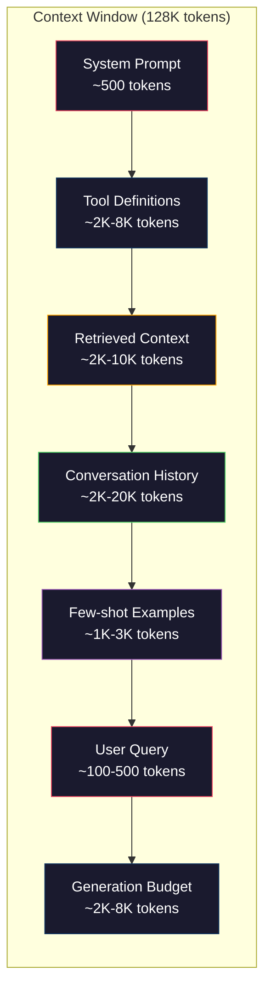
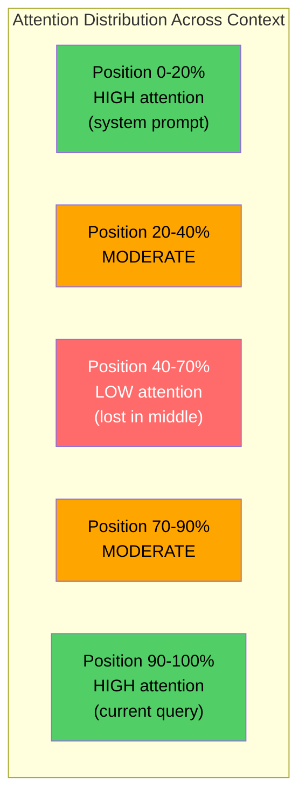
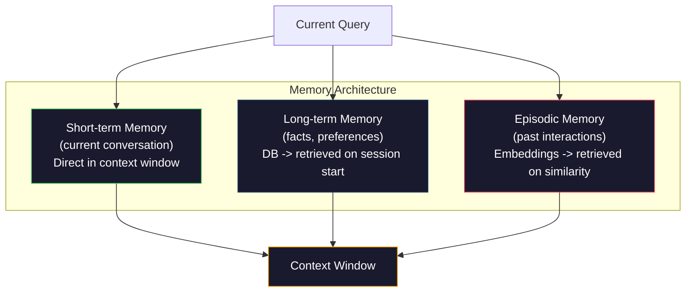

# Context Engineering: Windows, Budgets, Memory, and Retrieval · 上下文工程：窗口、预算、记忆与检索

> 提示词工程只是一个子集，上下文工程（context engineering）才是整盘棋。提示词是你敲进去的一串字符串；上下文是进入模型窗口的一切：系统指令、检索到的文档、工具定义、对话历史、few-shot 示例，以及提示词本身。2026 年最好的 AI 工程师都是上下文工程师：他们决定什么进来、什么不进、按什么顺序进。

> Prompt engineering is a subset. Context engineering is the whole game. A prompt is a string you type. Context is everything that goes into the model's window: system instructions, retrieved documents, tool definitions, conversation history, few-shot examples, and the prompt itself. The best AI engineers in 2026 are context engineers. They decide what goes in, what stays out, and in what order.

**Type:** Build
**Languages:** Python
**Prerequisites:** Phase 10 (LLMs from Scratch), Phase 11 Lesson 01-02
**Time:** ~90 minutes
**Related:** Phase 11 · 15（Prompt Caching）—— 缓存友好的布局是上下文工程的延伸。Phase 5 · 28（Long-Context Evaluation）讲解如何用 NIAH/RULER 测量 lost-in-the-middle。

## Learning Objectives · 学习目标

- 计算上下文窗口各组成部分的 token 预算（系统提示词、工具、历史、检索文档、生成预留）
- 实现上下文窗口管理策略：对话历史的截断（truncation）、摘要（summarization）与滑动窗口（sliding window）
- 对上下文组件排定优先级和顺序，使模型的注意力最大化落在最相关的信息上
- 构建一个根据查询类型和可用窗口空间动态分配 token 的上下文组装器

> Calculate token budgets across all context window components (system prompt, tools, history, retrieved docs, generation headroom)
> Implement context window management strategies: truncation, summarization, and sliding window for conversation history
> Prioritize and order context components to maximize the model's attention on the most relevant information
> Build a context assembler that dynamically allocates tokens based on query type and available window space

## The Problem · 问题在哪

Claude Opus 4.7 有 200K token 窗口（beta 1M）。GPT-5 有 400K。Gemini 3 Pro 有 2M。Llama 4 宣称 10M。这些数字听上去巨大——直到你把它们填满。

这是一个编码助手的真实分解。系统提示词：500 token。50 个工具的定义：8,000 token。检索到的文档：4,000 token。对话历史（10 轮）：6,000 token。当前用户查询：200 token。生成预算（最大输出）：4,000 token。合计：22,700 token——只占 128K 窗口的 18%。

但注意力并不随上下文长度线性扩展。拥有 128K token 上下文的模型要付出二次方的注意力成本（原生 transformer 是 O(n^2)，尽管多数生产模型使用高效注意力变体）。更重要的是，检索准确率会退化。「大海捞针」（Needle in a Haystack）测试表明，模型很难找到放在长上下文中部位置的信息。Liu et al. (2023) 的研究显示，LLM 对长上下文开头和结尾的信息检索准确率接近满分，而对放在中部（上下文 40-70% 位置）的信息准确率下降 10-20%。这种「lost-in-the-middle」（中间迷失）效应因模型而异，但影响当前所有架构。

实战教训：有 200K token 可用，不意味着用满 200K token 是有效的。一条精心策划的 10K token 上下文往往胜过一股脑塞进去的 100K token。上下文工程就是在上下文窗口内最大化信噪比的学科。

你放进窗口的每一个 token，都会挤掉一个本可承载更相关信息的 token。每一条无关的工具定义、每一段过期的对话、每一段没回答问题的检索文本——每一个都在让模型在任务上略微变差。

> Claude Opus 4.7 has a 200K token window (1M in beta). GPT-5 has 400K. Gemini 3 Pro has 2M. Llama 4 claims 10M. These numbers sound enormous until you fill them.
> But attention does not scale linearly with context length... The "Needle in a Haystack" test shows that models struggle to find information placed in the middle of long contexts. Research by Liu et al. (2023) showed that LLMs retrieve information at the start and end of long contexts with near-perfect accuracy, but accuracy drops 10-20% for information placed in the middle (positions 40-70% of the context). This "lost-in-the-middle" effect varies by model but affects all current architectures.
> The practical lesson: having 200K tokens available does not mean using 200K tokens is effective. A carefully curated 10K token context often outperforms a dumped 100K token context. Context engineering is the discipline of maximizing signal-to-noise ratio within the context window.
> Every token you put in the window displaces a token that could carry more relevant information. Every irrelevant tool definition, every stale conversation turn, every chunk of retrieved text that does not answer the question -- each one makes the model slightly worse at the task.

## The Concept · 核心概念

### The Context Window is a Scarce Resource · 上下文窗口是稀缺资源

把上下文窗口当作内存（RAM），而不是磁盘。它快、可直接访问，但容量有限。你装不下所有东西，必须做选择。



每个组件都在争夺空间。工具定义越多，留给对话历史的空间就越少；检索内容越多，留给 few-shot 示例的空间就越少。上下文工程就是把这份预算分配好、让任务表现最大化的艺术。

> Think of the context window as RAM, not disk. It is fast and directly accessible, but limited. You cannot fit everything. You must choose.
> Each component competes for space. Adding more tool definitions means less room for conversation history. Adding more retrieved context means less room for few-shot examples. Context engineering is the art of allocating this budget to maximize task performance.

### Lost-in-the-Middle · 中间迷失

这是上下文工程里最重要的实证发现。模型对上下文开头和结尾的信息注意力更强；中部的信息注意力分数更低，更容易被忽略。

Liu et al. (2023) 做了系统实验：把一篇相关文档混进 20 篇无关文档的不同位置，测量回答准确率。相关文档放在第一或最后时，准确率是 85-90%；放在中间（20 篇中的第 10 篇）时，准确率掉到 60-70%。

这直接指向几条工程准则：

- 最重要的信息放最前（系统提示词、关键指令）
- 当前查询和最相关的上下文放最后（近因偏置会帮你）
- 把上下文中部当作最低优先级区域
- 如果必须把信息放在中部，就在结尾重复一遍要点



> The most important empirical finding in context engineering. Models attend better to information at the beginning and end of the context. Information in the middle gets lower attention scores and is more likely to be ignored.
> Liu et al. (2023) tested this systematically. They placed a relevant document among 20 irrelevant documents at various positions and measured answer accuracy. When the relevant document was first or last, accuracy was 85-90%. When it was in the middle (position 10 of 20), accuracy dropped to 60-70%.

### Context Components · 上下文组件

**系统提示词（System prompt）**：设定人设、约束和行为规则。它放在最前，且跨轮次保持不变。Claude Code 的系统提示词（含工具定义和行为指令）大约占 6,000 token。保持精炼——系统提示词里的每个词在每次 API 调用时都会重复一遍。

**工具定义（Tool definitions）**：每个工具占 50-200 token（名称、描述、参数 schema）。50 个工具、每个 150 token，还没开始对话就是 7,500 token。动态工具选择——只包含与当前查询相关的工具——可以把这项开销削减 60-80%。

**检索上下文（Retrieved context）**：来自向量数据库的文档、搜索结果、文件内容。检索质量直接决定回答质量。坏的检索比没有检索更糟——它用噪声填满窗口，还会主动误导模型。

**对话历史（Conversation history）**：此前每条用户消息和助手回复。随对话长度线性增长。50 轮对话、每轮 200 token，就是 10,000 token 的历史，其中大部分与当前查询无关。

**Few-shot 示例**：示范期望行为的输入/输出对。两三个精心挑选的示例，往往比几千 token 的指令更能提升输出质量，但它们占空间。

**生成预算（Generation budget）**：预留给模型回复的 token。如果你把窗口填到满，模型就没有空间回答。至少预留 2,000-4,000 token 给生成。

> **System prompt**: sets the persona, constraints, and behavioral rules. This goes first and stays constant across turns... Keep it tight. Every word in the system prompt is repeated on every API call.
> **Tool definitions**: each tool adds 50-200 tokens (name, description, parameter schema)... Dynamic tool selection -- only including tools relevant to the current query -- can reduce this by 60-80%.
> **Retrieved context**: documents from a vector database, search results, file contents. The quality of retrieval directly determines the quality of the response. Bad retrieval is worse than no retrieval -- it fills the window with noise and actively misleads the model.
> **Few-shot examples**: input/output pairs that demonstrate the desired behavior. Two to three well-chosen examples often improve output quality more than thousands of tokens of instructions. But they cost space.
> **Generation budget**: the tokens reserved for the model's response. If you fill the window to capacity, the model has no room to answer. Reserve at least 2,000-4,000 tokens for generation.

### Context Compression Strategies · 上下文压缩策略

**历史摘要（History summarization）**：不再逐字保留所有历史轮次，而是定期总结对话。用 100 token 的「我们讨论了 X、决定了 Y、用户想要 Z」，替换掉占 2,000 token 的 10 轮对话。当历史超过阈值（比如 5,000 token）时运行摘要。

**相关性过滤（Relevance filtering）**：对每篇检索文档按当前查询打分，低于阈值的丢弃。如果你检索到 10 块但只有 3 块相关，就丢掉另外 7 块。3 块高度相关的块，好过 10 块平庸的。

**工具剪枝（Tool pruning）**：对用户查询的意图做分类，只包含与该意图相关的工具。代码问题不需要日历工具，日程问题不需要文件系统工具。这可以把工具定义从 8,000 token 压到 1,000。

**递归摘要（Recursive summarization）**：对很长的文档分段总结：先总结每一节，再总结这些总结。50 页的文档变成一份 500 token、抓住要点的摘要。

> **History summarization**: instead of keeping all previous turns verbatim, periodically summarize the conversation... Run summarization when history exceeds a threshold (e.g., 5,000 tokens).
> **Relevance filtering**: score each retrieved document against the current query and drop documents below a threshold... Better to have 3 highly relevant chunks than 10 mediocre ones.
> **Tool pruning**: classify the user's query intent and only include tools relevant to that intent... This can reduce tool definitions from 8,000 tokens to 1,000.
> **Recursive summarization**: for very long documents, summarize in stages. First summarize each section, then summarize the summaries. A 50-page document becomes a 500-token digest that captures the key points.

### Memory Systems · 记忆系统

上下文工程横跨三个时间尺度。

**短期记忆（Short-term memory）**：当前对话。直接存在上下文窗口里，随轮次增长，靠摘要和截断管理。

**长期记忆（Long-term memory）**：跨对话持久的事实和偏好。「用户偏好 TypeScript。」「项目用 PostgreSQL。」存在数据库里，会话开始时检索。Claude Code 把它存在 CLAUDE.md 文件里；ChatGPT 用它的 memory 功能存。

**情节记忆（Episodic memory）**：可能相关的具体过往交互。「上周二我们在 auth 模块调试过类似问题。」存成嵌入，当前对话匹配到过去的情节时检索出来。



> Context engineering spans three time horizons.
> **Short-term memory**: the current conversation. Stored in the context window directly. Grows with each turn. Managed by summarization and truncation.
> **Long-term memory**: facts and preferences that persist across conversations... Stored in a database, retrieved on session start. Claude Code stores this in CLAUDE.md files. ChatGPT stores it in its memory feature.
> **Episodic memory**: specific past interactions that might be relevant... Stored as embeddings, retrieved when the current conversation matches a past episode.

### Dynamic Context Assembly · 动态上下文组装

关键洞见：不同的查询需要不同的上下文。静态系统提示词 + 静态工具 + 静态历史是一种浪费。最好的系统按查询动态组装上下文。

1. 对查询意图分类
2. 挑选相关工具（不是全部工具）
3. 检索相关文档（不是固定集合）
4. 挑选相关历史轮次（不是全部历史）
5. 添加与任务类型匹配的 few-shot 示例
6. 按重要性排序：关键的放最前，重要的放最后，可选的放中间

这正是好的 AI 应用和伟大的 AI 应用之间的分界线。模型是同一个，上下文才是差异所在。

```figure
lost-in-the-middle
```

> The key insight: different queries need different context. A static system prompt + static tools + static history is wasteful. The best systems dynamically assemble context per query... This is what separates a good AI application from a great one. The model is the same. The context is the differentiator.

## Build It · 动手造

### Step 1: Token Counter · Token 计数器

你无法预算你无法度量的东西。构建一个简单的 token 计数器（用空格切分做近似，因为精确计数取决于分词器）。

```python
import json
import numpy as np
from collections import OrderedDict

def count_tokens(text):
    if not text:
        return 0
    return int(len(text.split()) * 1.3)

def count_tokens_json(obj):
    return count_tokens(json.dumps(obj))
```

> You cannot budget what you cannot measure. Build a simple token counter (approximation using whitespace splitting, since the exact count depends on the tokenizer).

### Step 2: Context Budget Manager · 上下文预算管理器

核心抽象。预算管理器跟踪每个组件用了多少 token，并强制执行限额。

```python
class ContextBudget:
    def __init__(self, max_tokens=128000, generation_reserve=4000):
        self.max_tokens = max_tokens
        self.generation_reserve = generation_reserve
        self.available = max_tokens - generation_reserve
        self.allocations = OrderedDict()

    def allocate(self, component, content, max_tokens=None):
        tokens = count_tokens(content)
        if max_tokens and tokens > max_tokens:
            words = content.split()
            target_words = int(max_tokens / 1.3)
            content = " ".join(words[:target_words])
            tokens = count_tokens(content)

        used = sum(self.allocations.values())
        if used + tokens > self.available:
            allowed = self.available - used
            if allowed <= 0:
                return None, 0
            words = content.split()
            target_words = int(allowed / 1.3)
            content = " ".join(words[:target_words])
            tokens = count_tokens(content)

        self.allocations[component] = tokens
        return content, tokens

    def remaining(self):
        used = sum(self.allocations.values())
        return self.available - used

    def utilization(self):
        used = sum(self.allocations.values())
        return used / self.max_tokens

    def report(self):
        total_used = sum(self.allocations.values())
        lines = []
        lines.append(f"Context Budget Report ({self.max_tokens:,} token window)")
        lines.append("-" * 50)
        for component, tokens in self.allocations.items():
            pct = tokens / self.max_tokens * 100
            bar = "#" * int(pct / 2)
            lines.append(f"  {component:<25} {tokens:>6} tokens ({pct:>5.1f}%) {bar}")
        lines.append("-" * 50)
        lines.append(f"  {'Used':<25} {total_used:>6} tokens ({total_used/self.max_tokens*100:.1f}%)")
        lines.append(f"  {'Generation reserve':<25} {self.generation_reserve:>6} tokens")
        lines.append(f"  {'Remaining':<25} {self.remaining():>6} tokens")
        return "\n".join(lines)
```

> The core abstraction. A budget manager tracks how many tokens each component uses and enforces limits.

### Step 3: Lost-in-the-Middle Reordering · 中间迷失重排

实现重排策略：最重要的条目放最前和最后，最不重要的放中间。

```python
def reorder_lost_in_middle(items, scores):
    paired = sorted(zip(scores, items), reverse=True)
    sorted_items = [item for _, item in paired]

    if len(sorted_items) <= 2:
        return sorted_items

    first_half = sorted_items[::2]
    second_half = sorted_items[1::2]
    second_half.reverse()

    return first_half + second_half

def score_relevance(query, documents):
    query_words = set(query.lower().split())
    scores = []
    for doc in documents:
        doc_words = set(doc.lower().split())
        if not query_words:
            scores.append(0.0)
            continue
        overlap = len(query_words & doc_words) / len(query_words)
        scores.append(round(overlap, 3))
    return scores
```

> Implement the reordering strategy: most important items go first and last, least important go in the middle.

### Step 4: Conversation History Compressor · 对话历史压缩器

总结旧的对话轮次，收回 token 预算。

```python
class ConversationManager:
    def __init__(self, max_history_tokens=5000):
        self.turns = []
        self.summaries = []
        self.max_history_tokens = max_history_tokens

    def add_turn(self, role, content):
        self.turns.append({"role": role, "content": content})
        self._compress_if_needed()

    def _compress_if_needed(self):
        total = sum(count_tokens(t["content"]) for t in self.turns)
        if total <= self.max_history_tokens:
            return

        while total > self.max_history_tokens and len(self.turns) > 4:
            old_turns = self.turns[:2]
            summary = self._summarize_turns(old_turns)
            self.summaries.append(summary)
            self.turns = self.turns[2:]
            total = sum(count_tokens(t["content"]) for t in self.turns)

    def _summarize_turns(self, turns):
        parts = []
        for t in turns:
            content = t["content"]
            if len(content) > 100:
                content = content[:100] + "..."
            parts.append(f"{t['role']}: {content}")
        return "Previous: " + " | ".join(parts)

    def get_context(self):
        parts = []
        if self.summaries:
            parts.append("[Conversation Summary]")
            for s in self.summaries:
                parts.append(s)
        parts.append("[Recent Conversation]")
        for t in self.turns:
            parts.append(f"{t['role']}: {t['content']}")
        return "\n".join(parts)

    def token_count(self):
        return count_tokens(self.get_context())
```

> Summarize old conversation turns to reclaim token budget.

### Step 5: Dynamic Tool Selector · 动态工具选择器

只包含与当前查询相关的工具。先分类意图，再过滤。

```python
TOOL_REGISTRY = {
    "read_file": {
        "description": "Read contents of a file",
        "tokens": 120,
        "categories": ["code", "files"],
    },
    "write_file": {
        "description": "Write content to a file",
        "tokens": 150,
        "categories": ["code", "files"],
    },
    "search_code": {
        "description": "Search for patterns in codebase",
        "tokens": 130,
        "categories": ["code"],
    },
    "run_command": {
        "description": "Execute a shell command",
        "tokens": 140,
        "categories": ["code", "system"],
    },
    "create_calendar_event": {
        "description": "Create a new calendar event",
        "tokens": 180,
        "categories": ["calendar"],
    },
    "list_emails": {
        "description": "List recent emails",
        "tokens": 160,
        "categories": ["email"],
    },
    "send_email": {
        "description": "Send an email message",
        "tokens": 200,
        "categories": ["email"],
    },
    "web_search": {
        "description": "Search the web for information",
        "tokens": 140,
        "categories": ["research"],
    },
    "query_database": {
        "description": "Run a SQL query on the database",
        "tokens": 170,
        "categories": ["code", "data"],
    },
    "generate_chart": {
        "description": "Generate a chart from data",
        "tokens": 190,
        "categories": ["data", "visualization"],
    },
}

def classify_intent(query):
    query_lower = query.lower()

    intent_keywords = {
        "code": ["code", "function", "bug", "error", "file", "implement", "refactor", "debug", "test"],
        "calendar": ["meeting", "schedule", "calendar", "appointment", "event"],
        "email": ["email", "mail", "send", "inbox", "message"],
        "research": ["search", "find", "what is", "how does", "explain", "look up"],
        "data": ["data", "query", "database", "chart", "graph", "analytics", "sql"],
    }

    scores = {}
    for intent, keywords in intent_keywords.items():
        score = sum(1 for kw in keywords if kw in query_lower)
        if score > 0:
            scores[intent] = score

    if not scores:
        return ["code"]

    max_score = max(scores.values())
    return [intent for intent, score in scores.items() if score >= max_score * 0.5]

def select_tools(query, token_budget=2000):
    intents = classify_intent(query)
    relevant = {}
    total_tokens = 0

    for name, tool in TOOL_REGISTRY.items():
        if any(cat in intents for cat in tool["categories"]):
            if total_tokens + tool["tokens"] <= token_budget:
                relevant[name] = tool
                total_tokens += tool["tokens"]

    return relevant, total_tokens
```

> Only include tools relevant to the current query. Classify intent, then filter.

### Step 6: Full Context Assembly Pipeline · 完整上下文组装管线

把所有组件接起来。给定一个查询，动态组装出最优上下文。

```python
class ContextEngine:
    def __init__(self, max_tokens=128000, generation_reserve=4000):
        self.budget = ContextBudget(max_tokens, generation_reserve)
        self.conversation = ConversationManager(max_history_tokens=5000)
        self.system_prompt = (
            "You are a helpful AI assistant. You have access to tools for "
            "code editing, file management, web search, and data analysis. "
            "Use the appropriate tools for each task. Be concise and accurate."
        )
        self.knowledge_base = [
            "Python 3.12 introduced type parameter syntax for generic classes using bracket notation.",
            "The project uses PostgreSQL 16 with pgvector for embedding storage.",
            "Authentication is handled by Supabase Auth with JWT tokens.",
            "The frontend is built with Next.js 15 using the App Router.",
            "API rate limits are set to 100 requests per minute per user.",
            "The deployment pipeline uses GitHub Actions with Docker multi-stage builds.",
            "Test coverage must be above 80% for all new modules.",
            "The codebase follows the repository pattern for data access.",
        ]

    def assemble(self, query):
        self.budget = ContextBudget(self.budget.max_tokens, self.budget.generation_reserve)

        system_content, _ = self.budget.allocate("system_prompt", self.system_prompt, max_tokens=1000)

        tools, tool_tokens = select_tools(query, token_budget=2000)
        tool_text = json.dumps(list(tools.keys()))
        tool_content, _ = self.budget.allocate("tools", tool_text, max_tokens=2000)

        relevance = score_relevance(query, self.knowledge_base)
        threshold = 0.1
        relevant_docs = [
            doc for doc, score in zip(self.knowledge_base, relevance)
            if score >= threshold
        ]

        if relevant_docs:
            doc_scores = [s for s in relevance if s >= threshold]
            reordered = reorder_lost_in_middle(relevant_docs, doc_scores)
            doc_text = "\n".join(reordered)
            doc_content, _ = self.budget.allocate("retrieved_context", doc_text, max_tokens=3000)

        history_text = self.conversation.get_context()
        if history_text.strip():
            history_content, _ = self.budget.allocate("conversation_history", history_text, max_tokens=5000)

        query_content, _ = self.budget.allocate("user_query", query, max_tokens=500)

        return self.budget

    def chat(self, query):
        self.conversation.add_turn("user", query)
        budget = self.assemble(query)
        response = f"[Response to: {query[:50]}...]"
        self.conversation.add_turn("assistant", response)
        return budget


def run_demo():
    print("=" * 60)
    print("  Context Engineering Pipeline Demo")
    print("=" * 60)

    engine = ContextEngine(max_tokens=128000, generation_reserve=4000)

    print("\n--- Query 1: Code task ---")
    budget = engine.chat("Fix the bug in the authentication module where JWT tokens expire too early")
    print(budget.report())

    print("\n--- Query 2: Research task ---")
    budget = engine.chat("What is the best approach for implementing vector search in PostgreSQL?")
    print(budget.report())

    print("\n--- Query 3: After conversation history builds up ---")
    for i in range(8):
        engine.conversation.add_turn("user", f"Follow-up question number {i+1} about the implementation details of the system")
        engine.conversation.add_turn("assistant", f"Here is the response to follow-up {i+1} with technical details about the architecture")

    budget = engine.chat("Now implement the changes we discussed")
    print(budget.report())

    print("\n--- Tool Selection Examples ---")
    test_queries = [
        "Fix the bug in auth.py",
        "Schedule a meeting with the team for Tuesday",
        "Show me the database query performance stats",
        "Search for best practices on error handling",
    ]

    for q in test_queries:
        tools, tokens = select_tools(q)
        intents = classify_intent(q)
        print(f"\n  Query: {q}")
        print(f"  Intents: {intents}")
        print(f"  Tools: {list(tools.keys())} ({tokens} tokens)")

    print("\n--- Lost-in-the-Middle Reordering ---")
    docs = ["Doc A (most relevant)", "Doc B (somewhat relevant)", "Doc C (least relevant)",
            "Doc D (relevant)", "Doc E (moderately relevant)"]
    scores = [0.95, 0.60, 0.20, 0.80, 0.50]
    reordered = reorder_lost_in_middle(docs, scores)
    print(f"  Original order: {docs}")
    print(f"  Scores:         {scores}")
    print(f"  Reordered:      {reordered}")
    print(f"  (Most relevant at start and end, least relevant in middle)")
```

> Wire everything together. Given a query, dynamically assemble the optimal context.

## Use It · 实战用法

### Harness-Managed Context · 框架托管上下文

Claude Code 用分层方式管理上下文。系统提示词包含行为规则和工具定义（约 6K token）。你打开文件时，其内容作为上下文注入；你搜索时，结果被添加进来；旧的对话轮次被摘要。CLAUDE.md 提供跨会话持久的长期记忆。

关键的工程决策：Claude Code 不会把整个代码库一股脑塞进上下文，而是按需检索相关文件。这就是实践中的上下文工程。

> Claude Code manages context with a layered approach. The system prompt includes behavioral rules and tool definitions (~6K tokens). When you open a file, its contents are injected as context. When you search, results are added. Old conversation turns are summarized. CLAUDE.md provides long-term memory that persists across sessions.
> The key engineering decision: Claude Code does not dump your entire codebase into the context. It retrieves relevant files on demand. This is context engineering in practice.

### Dynamic Context Loading · 动态上下文加载

Cursor 把你的整个代码库索引进嵌入。你输入查询时，它用向量相似度检索最相关的文件和代码块，只有这些片段进入上下文窗口。一个 50 万行的代码库，被压缩成最相关的 5-10 个代码块。

这就是那个模式：全部嵌入，按需检索，只放重要的。

> Cursor indexes your entire codebase into embeddings. When you type a query, it retrieves the most relevant files and code blocks using vector similarity. Only those pieces go into the context window. A 500K-line codebase is compressed into the 5-10 most relevant code blocks.
> This is the pattern: embed everything, retrieve on demand, include only what matters.

### Assistant Long-Term Memory · 助手的长期记忆

ChatGPT 把用户偏好和事实存为长期记忆。每次会话开始时，检索相关记忆并放进系统提示词。「用户偏好 Python」只花 5 个 token，却省下了跨对话反复说明的成百上千 token。

> ChatGPT stores user preferences and facts as long-term memory. On each conversation start, relevant memories are retrieved and included in the system prompt. "The user prefers Python" costs 5 tokens but saves hundreds of tokens of repeated instructions across conversations.

### RAG as Context Engineering · 作为上下文工程的 RAG

检索增强生成（RAG）是形式化的上下文工程。与其把知识塞进模型权重（训练）或系统提示词（静态上下文），不如在查询时检索相关文档，注入上下文窗口。整个 RAG 管线——分块、嵌入、检索、重排——只为解决一个问题：把正确的信息放进上下文窗口。

> Retrieval-Augmented Generation is context engineering formalized. Instead of stuffing knowledge into the model's weights (training) or the system prompt (static context), you retrieve relevant documents at query time and inject them into the context window. The entire RAG pipeline -- chunking, embedding, retrieval, reranking -- exists to solve one problem: putting the right information in the context window.

## Ship It · 交付

本课产出 `outputs/prompt-context-optimizer.md` —— 一个可复用的提示词，用于审计上下文组装策略并给出优化建议。把你的系统提示词、工具数量、平均历史长度和检索策略喂给它，它会找出 token 浪费并提出改进。

它还产出 `outputs/skill-context-engineering.md` —— 一个决策框架，基于任务类型、上下文窗口大小和延迟预算来设计上下文组装管线。

> This lesson produces `outputs/prompt-context-optimizer.md` -- a reusable prompt that audits a context assembly strategy and recommends optimizations. Feed it your system prompt, tool count, average history length, and retrieval strategy, and it identifies token waste and suggests improvements.
> It also produces `outputs/skill-context-engineering.md` -- a decision framework for designing context assembly pipelines based on task type, context window size, and latency budget.

## Exercises · 练习

1. 给 ContextBudget 类加一个「token 浪费检测器」。它应标记占用超过预算 30% 的组件，并针对组件类型给出具体的压缩建议（摘要历史、剪枝工具、重排文档）。

2. 为检索上下文实现语义去重。如果两篇检索文档的相似度超过 80%（按词重合或嵌入的余弦相似度），只保留得分更高的那篇。测量这样能收回多少 token 预算。

3. 构建一个「上下文回放」工具。给定一段对话记录，把它回放进 ContextEngine，可视化预算分配如何逐轮变化。画出每个组件 token 用量随时间的变化，找出上下文开始被压缩的那一轮。

4. 实现基于优先级的工具选择器。不做二元的包含/排除，而是给每个工具一个相对当前查询的相关度分数，按相关度降序包含工具，直到工具预算耗尽。分别在包含 5、10、20、50 个工具时比较任务表现。

5. 构建一个多策略上下文压缩器。实现三种压缩策略（截断、摘要、关键句抽取），在 20 篇文档上做基准测试，测量压缩率与信息保留之间的权衡（压缩后的版本还包含查询的答案吗？）。

## Key Terms · 术语表

| 术语 | 大家怎么说 | 实际含义 |
|------|----------------|----------------------|
| Context window | "模型能读多少" | 模型单次前向传播能处理的最大 token 数（输入+输出）——GPT-5 为 400K，Claude Opus 4.7 为 200K（beta 1M），Gemini 3 Pro 为 2M |
| Context engineering | "高级版提示词工程" | 决定什么进入上下文窗口、按什么顺序、以什么优先级的学科——涵盖检索、压缩、工具选择和记忆管理 |
| Lost-in-the-middle | "模型忘掉中间的东西" | 实证发现：LLM 对上下文开头和结尾的注意力更好，放在中部的信息准确率下降 10-20% |
| Token budget | "你还剩多少 token" | 显式地把上下文窗口容量分配给各组件（系统提示词、工具、历史、检索、生成），并为每个组件设上限 |
| Dynamic context | "运行时动态加载" | 基于意图分类、相关工具选择和检索结果，为每个查询以不同方式组装上下文窗口 |
| History summarization | "压缩对话" | 用简洁摘要替换逐字保留的旧对话轮次，在保留关键信息的同时降低 token 成本 |
| Tool pruning | "只放相关工具" | 对查询意图分类，只包含匹配的工具定义，把工具 token 成本削减 60-80% |
| Long-term memory | "跨会话记忆" | 存在数据库里、会话开始时检索的事实与偏好——CLAUDE.md、ChatGPT Memory 等系统 |
| Episodic memory | "记住具体的过往事件" | 过往交互存成嵌入，当前查询与过去对话相似时检索出来 |
| Generation budget | "留给答案的空间" | 预留给模型输出的 token——如果上下文把窗口填满，模型就没有空间回答 |

## Further Reading · 延伸阅读

- [Liu et al., 2023 -- "Lost in the Middle: How Language Models Use Long Contexts"](https://arxiv.org/abs/2307.03172) —— 关于位置相关注意力的权威研究，表明模型难以处理长上下文中部的信息
- [Anthropic's Contextual Retrieval blog post](https://www.anthropic.com/news/contextual-retrieval) —— Anthropic 如何做上下文感知的分块检索，把检索失败率降低 49%
- [Simon Willison's "Context Engineering"](https://simonwillison.net/2025/Jun/27/context-engineering/) —— 为这门学科命名、并将其与提示词工程区分开的那篇博文
- [LangChain documentation on RAG](https://python.langchain.com/docs/tutorials/rag/) —— 把检索增强生成作为上下文工程模式的实用实现
- [Greg Kamradt's Needle in a Haystack test](https://github.com/gkamradt/LLMTest_NeedleInAHaystack) —— 揭示所有主流模型都存在位置相关检索失败的基准
- [Pope et al., "Efficiently Scaling Transformer Inference" (2022)](https://arxiv.org/abs/2211.05102) —— 为什么上下文长度决定内存和延迟，以及 KV cache、MQA、GQA 如何改变预算计算。
- [Agrawal et al., "SARATHI: Efficient LLM Inference by Piggybacking Decodes with Chunked Prefills" (2023)](https://arxiv.org/abs/2308.16369) —— 推理的两个阶段让长提示词在 TTFT 上昂贵、在 TPOT 上便宜；上下文打包权衡背后的真相。
- [Ainslie et al., "GQA: Training Generalized Multi-Query Transformer Models from Multi-Head Checkpoints" (EMNLP 2023)](https://arxiv.org/abs/2305.13245) —— 分组查询注意力论文，在生产解码器中把 KV 内存砍掉 8 倍且无质量损失。
