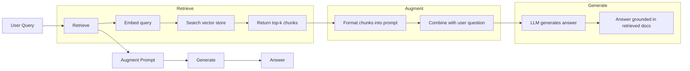
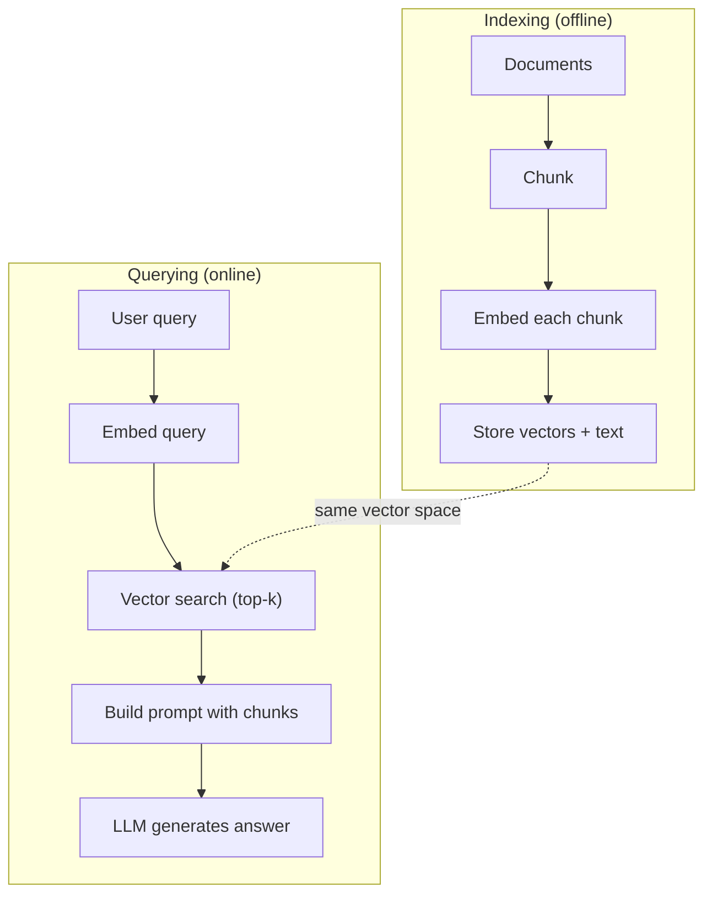

# RAG (Retrieval-Augmented Generation) · 检索增强生成（RAG）

> 你的 LLM 只知道它训练截止日之前的一切。它对你的公司文档、你的代码库、上周的会议记录一无所知。RAG 的解法是：检索相关文档，把它们塞进提示词。这是生产级 AI 中部署最广泛的模式。如果这门课你只打算做一件事，那就做一个 RAG 管线。

> Your LLM knows everything up to its training cutoff. It knows nothing about your company's docs, your codebase, or last week's meeting notes. RAG solves this by retrieving relevant documents and stuffing them into the prompt. It's the most deployed pattern in production AI. If you build one thing from this course, build a RAG pipeline.

**Type:** Build
**Languages:** Python
**Prerequisites:** Phase 10 (LLMs from Scratch), Phase 11 Lessons 01-05
**Time:** ~90 minutes
**Related:** Phase 5 · 23（Chunking Strategies for RAG）讲解六种分块算法及各自何时胜出。Phase 5 · 22（Embedding Models Deep Dive）讲如何挑嵌入器。Phase 11 · 07（Advanced RAG）讲混合搜索、重排和查询变换。

## Learning Objectives · 学习目标

- 构建完整的 RAG 管线：文档加载、分块（chunking）、嵌入（embedding）、向量存储、检索与生成
- 使用向量数据库（ChromaDB、FAISS 或 Pinecone）配以正确索引实现语义搜索
- 解释为什么对知识型应用来说 RAG 优于微调（fine-tuning）：成本、时效、可归因
- 用检索指标（precision、recall）和生成指标（faithfulness、relevance）评估 RAG 质量

> Build a complete RAG pipeline: document loading, chunking, embedding, vector storage, retrieval, and generation
> Implement semantic search using a vector database (ChromaDB, FAISS, or Pinecone) with proper indexing
> Explain why RAG is preferred over fine-tuning for knowledge-grounded applications (cost, freshness, attribution)
> Evaluate RAG quality using retrieval metrics (precision, recall) and generation metrics (faithfulness, relevance)

## The Problem · 问题在哪

你为公司做了一个聊天机器人。客户问「企业版的退款政策是什么？」LLM 给出一段关于典型 SaaS 退款政策的泛泛回答。而真正的政策埋在 200 页的内部 wiki 里：企业客户享有 60 天窗口、按比例退款。LLM 从没见过这份文档——它不可能知道自己没被训练过的东西。

微调是一种解法。拿 LLM 在你的内部文档上训练，再部署更新后的模型。可行，但问题严重：微调要花数千美元的计算成本；文档一改，模型立刻过时；你无法知道模型的答案出自哪个来源；下个月公司再收购一条产品线，你就得再微调一次。

RAG 是另一种解法。模型一个字都不动。问题来了，先在你的文档库里搜索相关段落，把它们粘贴到提示词里、放在问题前面，让模型把这些段落当作上下文来回答。文档库几分钟就能更新。你能确切看到检索到了哪些文档。模型本身永远不变。这就是 RAG 成为生产主导模式的原因：更便宜、更新鲜、更可审计，而且配任何 LLM 都能用。

> You build a chatbot for your company. A customer asks "What's the refund policy for enterprise plans?" The LLM responds with a generic answer about typical SaaS refund policies. The actual policy, buried in a 200-page internal wiki, says enterprise customers get a 60-day window with pro-rated refunds. The LLM has never seen this document. It cannot know what it was not trained on.
> Fine-tuning is one solution. Take the LLM, train it on your internal docs, and deploy the updated model. This works but has serious problems... And if the company acquires another product line next month, you fine-tune again.
> RAG is the other solution. Leave the model untouched. When a question comes in, search your document store for relevant passages, paste them into the prompt before the question, and let the model answer using those passages as context... This is why RAG is the dominant pattern in production: it's cheaper, fresher, more auditable, and works with any LLM.

## The Concept · 核心概念

### The RAG Pattern · RAG 模式

整个模式四步就走完：



查询 -> 检索 -> 增强提示词 -> 生成。每个 RAG 系统都遵循这个模式。生产级 RAG 系统之间的差异在每一步的细节里：怎么分块、怎么嵌入、怎么搜索、怎么构建提示词。

> The entire pattern fits in four steps... Query -> Retrieve -> Augment prompt -> Generate. Every RAG system follows this pattern. The differences between production RAG systems are in the details of each step: how you chunk, how you embed, how you search, and how you construct the prompt.

### Why RAG Beats Fine-Tuning · 为什么 RAG 胜过微调

| 关注点 | 微调 | RAG |
|---------|------------|-----|
| 成本 | 每次训练 $1,000-$100,000+ | 每次查询 $0.01-$0.10（嵌入 + LLM） |
| 时效 | 重新训练前一直过时 | 重建索引，几分钟即更新 |
| 可审计性 | 无法把答案溯源到出处 | 能展示确切检索到的段落 |
| 幻觉 | 依然自由幻觉 | 锚定在检索到的文档上 |
| 数据隐私 | 训练数据烧进权重 | 文档留在你自己的向量库里 |

微调永久地改变模型权重，RAG 临时地改变模型上下文。对多数应用来说，临时上下文才是你想要的。

微调胜出的唯一场景：你需要模型采纳某种特定的风格、语气或推理模式，而仅靠提示词无法达成。至于事实知识检索，RAG 每次都赢。

> Fine-tuning changes the model's weights permanently. RAG changes the model's context temporarily. For most applications, temporary context is what you want.
> The one case where fine-tuning wins: when you need the model to adopt a specific style, tone, or reasoning pattern that cannot be achieved through prompting alone. For factual knowledge retrieval, RAG wins every time.

### Embedding Models · 嵌入模型

嵌入模型把文本转成稠密向量。相似的文本在这个高维空间里产生彼此接近的向量。"How do I reset my password?" 和 "I need to change my password" 共享的词很少，却产生几乎相同的向量；"The cat sat on the mat" 产生的向量则截然不同。

常见嵌入模型（2026 阵容——完整分析见 Phase 5 · 22）：

| 模型 | 维度 | 提供商 | 备注 |
|-------|-----------|----------|-------|
| text-embedding-3-small | 1536 (Matryoshka) | OpenAI | 大多数场景下性价比最好 |
| text-embedding-3-large | 3072 (Matryoshka) | OpenAI | 精度更高，可截断到 256/512/1024 |
| Gemini Embedding 2 | 3072 (Matryoshka) | Google | MTEB 检索第一；8K 上下文 |
| voyage-4 | 1024/2048 (Matryoshka) | Voyage AI | 有领域变体（代码、金融、法律） |
| Cohere embed-v4 | 1024 (Matryoshka) | Cohere | 多语言强，128K 上下文 |
| BGE-M3 | 1024 (dense + sparse + ColBERT) | BAAI（开放权重） | 一个模型三种视图 |
| Qwen3-Embedding | 4096 (Matryoshka) | Alibaba（开放权重） | 开放权重中检索分数最高 |
| all-MiniLM-L6-v2 | 384 | 开放权重（Sentence Transformers） | 原型基线 |

本课我们用 TF-IDF 自建一个简单的嵌入。不是因为生产系统在用 TF-IDF，而是因为它把概念变得具体：文本进去，向量出来，相似文本产出相似向量。

> An embedding model converts text into a dense vector. Similar texts produce vectors that are close together in this high-dimensional space... For this lesson, we build our own simple embedding using TF-IDF. Not because TF-IDF is what production systems use, but because it makes the concept concrete: text goes in, a vector comes out, similar texts produce similar vectors.

### Vector Similarity · 向量相似度

给定两个向量，怎么衡量相似度？三个选项：

**余弦相似度（Cosine similarity）**：两个向量夹角的余弦。取值从 -1（相反）到 1（相同）。忽略模长，只关心方向。这是 RAG 的默认选择。

```
cosine_sim(a, b) = dot(a, b) / (||a|| * ||b||)
```

**点积（Dot product）**：原始内积。模长更大的向量得分更高。当模长本身携带信息时有用（更长的文档可能更相关）。

```
dot(a, b) = sum(a_i * b_i)
```

**L2（欧氏）距离**：向量空间中的直线距离。距离越小越相似。对模长差异敏感。

```
L2(a, b) = sqrt(sum((a_i - b_i)^2))
```

余弦相似度是标准。它按模长归一化，因此能优雅地处理不同长度的文档。当有人说「向量搜索」时，几乎总是指余弦相似度。

> Given two vectors, how do you measure similarity? Three options:
> **Cosine similarity**: the cosine of the angle between two vectors. Ranges from -1 (opposite) to 1 (identical). Ignores magnitude, only cares about direction. This is the default for RAG.
> **Dot product**: the raw inner product. Larger vectors get higher scores. Useful when magnitude carries information (longer documents might be more relevant).
> **L2 (Euclidean) distance**: straight-line distance in the vector space. Smaller distance = more similar. Sensitive to magnitude differences.
> Cosine similarity is the standard. It handles documents of different lengths gracefully because it normalizes by magnitude. When someone says "vector search," they almost always mean cosine similarity.

### Chunking Strategies · 分块策略

文档太长，没法作为单个向量来嵌入。一份 50 页的 PDF 可能产生一个糟糕的嵌入，因为它包含几十个主题。所以你要把文档切成块（chunk），逐块嵌入。

**固定大小分块（Fixed-size）**：每 N 个 token 切一刀。简单、可预测。512 token 的块加 50 token 重叠意味着块 1 是 token 0-511，块 2 是 token 462-973，以此类推。重叠保证了你不会恰好在句子的半中间切一刀。

**语义分块（Semantic）**：在自然边界切分：段落、小节或 markdown 标题。每个块是一个连贯的意义单元。实现更复杂，但检索效果更好。

**递归分块（Recursive）**：先尝试在最大的边界切（章节标题）；如果一节还是太大，就在段落边界切；如果一段还是太大，就在句子边界切。这就是 LangChain RecursiveCharacterTextSplitter 的做法，实践中很好用。

块的大小比人们以为的更重要：

- 太小（64-128 token）：每块缺乏上下文。「它上季度增长了 15%」——不知道「它」指什么，这句话毫无意义。
- 太大（2048+ token）：每块覆盖多个主题，稀释相关性。当你搜索收入数据时，拿到的是一块 10% 讲收入、90% 讲人员编制的内容。
- 甜蜜点（256-512 token）：足够自含，又足够聚焦相关。

多数生产 RAG 系统用 256-512 token 的块加 50 token 重叠。Anthropic 的 RAG 指南也推荐这个范围。

> Documents are too long to embed as single vectors. A 50-page PDF might produce a terrible embedding because it contains dozens of topics. Instead, you split documents into chunks and embed each chunk separately... **Recursive chunking**: try to split at the largest boundary first (section headers)... This is the LangChain RecursiveCharacterTextSplitter approach and it works well in practice.
> Chunk size matters more than people think:
> - Too small (64-128 tokens): each chunk lacks context. "It increased 15% last quarter" means nothing without knowing what "it" refers to.
> - Too large (2048+ tokens): each chunk covers multiple topics, diluting relevance. When you search for revenue data, you get a chunk that's 10% about revenue and 90% about headcount.
> - Sweet spot (256-512 tokens): enough context to be self-contained, focused enough to be relevant.
> Most production RAG systems use 256-512 token chunks with 50-token overlap. Anthropic's RAG guidelines recommend this range.

### Vector Databases · 向量数据库

有了嵌入，你就需要一个地方来存储和搜索它们。选项：

| 数据库 | 类型 | 最适合 |
|----------|------|----------|
| FAISS | 库（进程内） | 原型验证、中小数据集 |
| Chroma | 轻量级数据库 | 本地开发、小规模部署 |
| Pinecone | 托管服务 | 无运维负担的生产环境 |
| Weaviate | 开源数据库 | 自托管生产环境 |
| pgvector | Postgres 扩展 | 已在用 Postgres |
| Qdrant | 开源数据库 | 高性能自托管 |

本课我们构建一个简单的内存向量存储：向量存在列表里，做暴力余弦相似度搜索。这等价于 FAISS 的 flat 索引，大概撑到 10 万向量才会变慢。生产系统用 HNSW 这类近似最近邻（ANN）算法，在毫秒级搜索百万级向量。

> Once you have embeddings, you need somewhere to store and search them. Options...
> For this lesson, we build a simple in-memory vector store. It stores vectors in a list and does brute-force cosine similarity search. This is equivalent to FAISS with a flat index. It scales to maybe 100,000 vectors before getting slow. Production systems use approximate nearest neighbor (ANN) algorithms like HNSW to search millions of vectors in milliseconds.

### The Full Pipeline · 完整管线



索引阶段每个文档只跑一次（或文档更新时）。查询阶段在每个用户请求上都要跑。生产中，索引可能要花几个小时处理上百万文档；查询必须在一秒内响应。

> The indexing phase runs once per document (or when documents update). The querying phase runs on every user request. In production, indexing might process millions of documents over hours. Querying must respond in under a second.

### Real Numbers · 真实数字

多数生产 RAG 系统使用这些参数：

- **k = 5 到 10**：每次查询检索的块数
- **块大小 = 256 到 512 token**，加 50 token 重叠
- **上下文预算**：每次查询 2,500-5,000 token 的检索内容
- **总提示词**：约 8,000-16,000 token（系统提示词 + 检索块 + 对话历史 + 用户查询）
- **嵌入维度**：384-3072，取决于模型
- **索引吞吐**：API 嵌入下每秒 100-1,000 篇文档
- **查询延迟**：检索 50-200ms，生成 500-3000ms

```figure
rag-chunking
```

> Most production RAG systems use these parameters:
> - **k = 5 to 10** retrieved chunks per query
> - **Chunk size = 256 to 512 tokens** with 50-token overlap
> - **Context budget**: 2,500-5,000 tokens of retrieved content per query
> - **Total prompt**: ~8,000-16,000 tokens (system prompt + retrieved chunks + conversation history + user query)
> - **Query latency**: 50-200ms for retrieval, 500-3000ms for generation

## Build It · 动手造

### Step 1: Document Chunking · 文档分块

```python
def chunk_text(text, chunk_size=200, overlap=50):
    words = text.split()
    chunks = []
    start = 0
    while start < len(words):
        end = start + chunk_size
        chunk = " ".join(words[start:end])
        chunks.append(chunk)
        start += chunk_size - overlap
    return chunks
```

### Step 2: TF-IDF Embeddings · TF-IDF 嵌入

我们构建一个简单的嵌入函数。TF-IDF（Term Frequency-Inverse Document Frequency，词频-逆文档频率）不是神经嵌入，但它把文本转成向量的方式能捕捉词的重要性。在一篇文档里高频出现的词得到更高的 TF；在整个语料中罕见的词得到更高的 IDF。两者相乘，得到的向量里重要且有区分度的词拥有高值。

```python
import math
from collections import Counter

def build_vocabulary(documents):
    vocab = set()
    for doc in documents:
        vocab.update(doc.lower().split())
    return sorted(vocab)

def compute_tf(text, vocab):
    words = text.lower().split()
    count = Counter(words)
    total = len(words)
    return [count.get(word, 0) / total for word in vocab]

def compute_idf(documents, vocab):
    n = len(documents)
    idf = []
    for word in vocab:
        doc_count = sum(1 for doc in documents if word in doc.lower().split())
        idf.append(math.log((n + 1) / (doc_count + 1)) + 1)
    return idf

def tfidf_embed(text, vocab, idf):
    tf = compute_tf(text, vocab)
    return [t * i for t, i in zip(tf, idf)]
```

> We build a simple embedding function. TF-IDF (Term Frequency-Inverse Document Frequency) is not a neural embedding, but it converts text to vectors in a way that captures word importance. Frequent words in a document get higher TF. Rare words across the corpus get higher IDF. The product gives a vector where important, distinctive words have high values.

### Step 3: Cosine Similarity Search · 余弦相似度搜索

```python
def cosine_similarity(a, b):
    dot = sum(x * y for x, y in zip(a, b))
    norm_a = math.sqrt(sum(x * x for x in a))
    norm_b = math.sqrt(sum(x * x for x in b))
    if norm_a == 0 or norm_b == 0:
        return 0.0
    return dot / (norm_a * norm_b)

def search(query_embedding, stored_embeddings, top_k=5):
    scores = []
    for i, emb in enumerate(stored_embeddings):
        sim = cosine_similarity(query_embedding, emb)
        scores.append((i, sim))
    scores.sort(key=lambda x: x[1], reverse=True)
    return scores[:top_k]
```

### Step 4: Prompt Construction · 提示词构建

RAG 里的「A」（augmented，增强）就发生在这一步。取出检索到的块，格式化成提示词，让 LLM 基于给定的上下文回答。

```python
def build_rag_prompt(query, retrieved_chunks):
    context = "\n\n---\n\n".join(
        f"[Source {i+1}]\n{chunk}"
        for i, chunk in enumerate(retrieved_chunks)
    )
    return f"""Answer the question based ONLY on the following context.
If the context doesn't contain enough information, say "I don't have enough information to answer that."

Context:
{context}

Question: {query}

Answer:"""
```

> This is where the "augmented" in RAG happens. Take the retrieved chunks, format them into a prompt, and ask the LLM to answer based on the provided context.

### Step 5: The Complete RAG Pipeline · 完整 RAG 管线

```python
class RAGPipeline:
    def __init__(self):
        self.chunks = []
        self.embeddings = []
        self.vocab = []
        self.idf = []

    def index(self, documents):
        all_chunks = []
        for doc in documents:
            all_chunks.extend(chunk_text(doc))
        self.chunks = all_chunks
        self.vocab = build_vocabulary(all_chunks)
        self.idf = compute_idf(all_chunks, self.vocab)
        self.embeddings = [
            tfidf_embed(chunk, self.vocab, self.idf)
            for chunk in all_chunks
        ]

    def query(self, question, top_k=5):
        query_emb = tfidf_embed(question, self.vocab, self.idf)
        results = search(query_emb, self.embeddings, top_k)
        retrieved = [(self.chunks[i], score) for i, score in results]
        prompt = build_rag_prompt(
            question, [chunk for chunk, _ in retrieved]
        )
        return prompt, retrieved
```

### Step 6: Generation (simulated) · 生成（模拟）

生产中，这一步是调用 LLM API。本课我们用「从检索上下文里抽出最相关的句子」来模拟生成。

```python
def simple_generate(prompt, retrieved_chunks):
    query_words = set(prompt.lower().split("question:")[-1].split())
    best_sentence = ""
    best_score = 0
    for chunk in retrieved_chunks:
        for sentence in chunk.split("."):
            sentence = sentence.strip()
            if not sentence:
                continue
            words = set(sentence.lower().split())
            overlap = len(query_words & words)
            if overlap > best_score:
                best_score = overlap
                best_sentence = sentence
    return best_sentence if best_sentence else "I don't have enough information."
```

> In production, this is where you call the LLM API. For this lesson, we simulate generation by extracting the most relevant sentence from the retrieved context.

## Use It · 实战用法

换上真实的嵌入模型和 LLM，代码几乎不用改：

```python
from openai import OpenAI

client = OpenAI()

def embed(text):
    response = client.embeddings.create(
        model="text-embedding-3-small",
        input=text
    )
    return response.data[0].embedding

def generate(prompt):
    response = client.chat.completions.create(
        model="gpt-4o-mini",
        messages=[{"role": "user", "content": prompt}],
        temperature=0
    )
    return response.choices[0].message.content
```

或者用 Anthropic：

```python
import anthropic

client = anthropic.Anthropic()

def generate(prompt):
    response = client.messages.create(
        model="claude-sonnet-5",
        max_tokens=1024,
        messages=[{"role": "user", "content": prompt}]
    )
    return response.content[0].text
```

管线是一样的。换嵌入函数，换生成函数。检索逻辑、分块、提示词构建——不管你用哪家的模型，全都原封不动。

规模化的向量存储，把暴力搜索换成正经的向量数据库：

```python
import chromadb

client = chromadb.Client()
collection = client.create_collection("my_docs")

collection.add(
    documents=chunks,
    ids=[f"chunk_{i}" for i in range(len(chunks))]
)

results = collection.query(
    query_texts=["What is the refund policy?"],
    n_results=5
)
```

Chroma 在内部处理嵌入（默认用 all-MiniLM-L6-v2），并把向量存进本地数据库。同一模式，不同的管道。

> The pipeline is the same. Swap the embedding function. Swap the generation function. The retrieval logic, chunking, prompt construction -- all identical regardless of which models you use.
> Chroma handles the embedding internally (it uses all-MiniLM-L6-v2 by default) and stores the vectors in a local database. Same pattern, different plumbing.

## Ship It · 交付

本课产出：
- `outputs/prompt-rag-architect.md` —— 一个为具体场景设计 RAG 系统的提示词
- `outputs/skill-rag-pipeline.md` —— 一个教 agent 构建和调试 RAG 管线的技能

> This lesson produces:
> - `outputs/prompt-rag-architect.md` -- a prompt for designing RAG systems for specific use cases
> - `outputs/skill-rag-pipeline.md` -- a skill that teaches agents how to build and debug RAG pipelines

## Exercises · 练习

1. 把 TF-IDF 嵌入换成简单的词袋（bag-of-words）方案（二值：词出现为 1，不出现为 0）。在示例文档上比较检索质量。TF-IDF 应该更好，因为它给罕见词更高的权重。

2. 实验块大小：在同一批文档上分别试 50、100、200、500 词。每种大小跑同样的 5 个查询，数一数有多少查询在 top-3 里返回了相关块。找出检索质量峰值所在的甜蜜点。

3. 给每个块加元数据（来源文档名、块位置）。修改提示词模板，加入来源归属，让 LLM 标注它引用的出处。

4. 实现一个简单的评估：给定 10 组问答对，把每个问题跑一遍 RAG 管线，统计检索到的块中有多少比例包含答案。这就是 recall@k（检索召回率）。

5. 构建一个对话感知的 RAG 管线：维护最近 3 轮对话的历史，把它们和检索块一起放进提示词。用追问测试，比如在问完定价之后问「那企业版呢？」。

## Key Terms · 术语表

| 术语 | 大家怎么说 | 实际含义 |
|------|----------------|----------------------|
| RAG | "会读你文档的 AI" | 检索相关文档，粘贴进提示词，生成一个锚定在这些文档上的回答 |
| Embedding | "把文本变成数字" | 文本的稠密向量表示，相似的含义产生相似的向量 |
| Vector database | "AI 的搜索引擎" | 为存储向量和按相似度找最近邻而优化的数据存储 |
| Chunking | "把文档切成小块" | 把文档切成更小的片段（通常 256-512 token），使每块都能独立嵌入和检索 |
| Cosine similarity | "两个向量有多相似" | 两向量夹角的余弦；1 = 同向，0 = 正交，-1 = 反向 |
| Top-k retrieval | "取 k 个最佳匹配" | 从向量库里返回与查询最相似的 k 个块 |
| Context window | "LLM 能看多少文本" | LLM 单次请求能处理的最大 token 数；检索到的块必须装得进这个窗口 |
| Augmented generation | "基于给定上下文回答" | 用检索到的文档作为上下文来生成回答，而不是只依赖训练时学到的知识 |
| TF-IDF | "词重要性打分" | 词频乘以逆文档频率；按一个词在语料中的区分度给它加权 |
| Indexing | "为搜索准备文档" | 离线完成分块、嵌入和存储文档的过程，这样查询时才能搜索 |

## Further Reading · 延伸阅读

- Lewis et al., "Retrieval-Augmented Generation for Knowledge-Intensive NLP Tasks" (2020) —— Facebook AI Research 的 RAG 原始论文，形式化了「先检索后生成」模式
- Anthropic's RAG documentation (docs.anthropic.com) —— 关于块大小、提示词构建和评估的实用指南
- Pinecone Learning Center, "What is RAG?" —— 用清晰的可视化讲解 RAG 管线，并覆盖生产注意事项
- Sentence-BERT: Reimers & Gurevych (2019) —— all-MiniLM 嵌入模型背后的论文，讲解如何训练双编码器做语义相似度
- [Karpukhin et al., "Dense Passage Retrieval for Open-Domain Question Answering" (EMNLP 2020)](https://arxiv.org/abs/2004.04906) —— DPR 论文，证明了稠密双编码器检索在开放域问答上胜过 BM25，奠定了现代 RAG 检索器的模式。
- [LlamaIndex High-Level Concepts](https://docs.llamaindex.ai/en/stable/getting_started/concepts.html) —— 构建 RAG 管线需要知道的核心概念：数据加载器、节点解析器、索引、检索器、响应合成器。
- [LangChain RAG tutorial](https://python.langchain.com/docs/tutorials/rag/) —— 另一种风味的编排器；用 runnable 链的视角看同一个「先检索后生成」模式。
