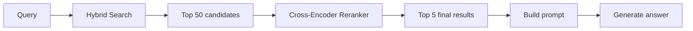
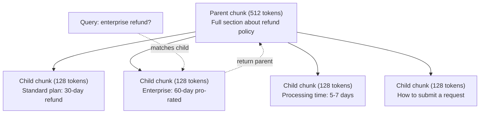
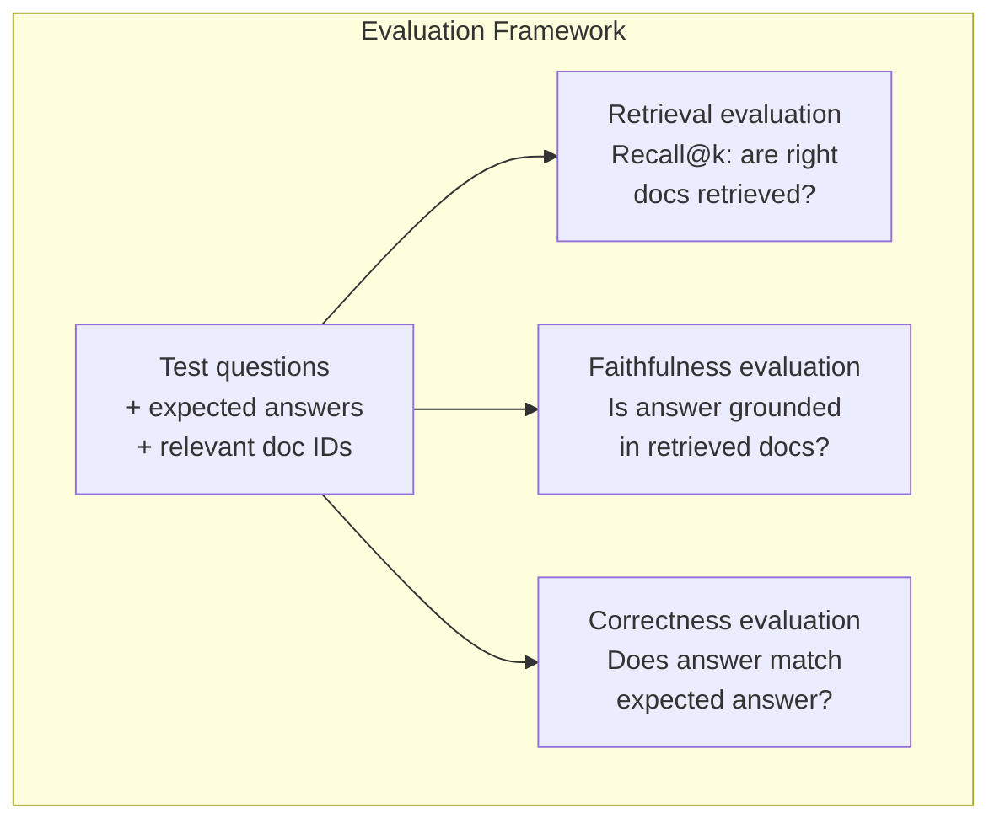

# Advanced RAG (Chunking, Reranking, Hybrid Search) · 高级 RAG（分块、重排序、混合检索）

> 基础 RAG 只会取 top-k 最相似的文本块（chunk）。简单问题它够用；碰到多跳推理（multi-hop reasoning）、歧义查询和大规模语料就会崩。高级 RAG 决定了你拥有的只是能在 10 篇文档上跑的 demo，还是一个能扛住 1000 万文档的系统。

> Basic RAG retrieves the top-k most similar chunks. That works for simple questions. It falls apart for multi-hop reasoning, ambiguous queries, and large corpora. Advanced RAG is the difference between a demo that works on 10 documents and a system that works on 10 million.

**Type:** Build
**Languages:** Python
**Prerequisites:** Phase 11, Lesson 06 (RAG)
**Time:** ~90 minutes
**Related:** Phase 5 · 23（面向 RAG 的分块策略）覆盖全部六种分块算法——递归（recursive）、语义（semantic）、句子（sentence）、父文档（parent-document）、late chunking、contextual retrieval——并附 Vectara/Anthropic 基准。本课在其之上继续：混合检索、重排序、查询变换。

## Learning Objectives · 学习目标

- 实现保住文档结构与上下文的高级分块策略（语义、递归、父子）
- 搭建混合检索（hybrid search）流水线：BM25 关键词匹配 + 语义向量检索 + 交叉编码器（cross-encoder）重排序（reranking）
- 应用查询变换（query transformation）技术（HyDE、多查询、step-back）改善歧义或复杂问题的检索
- 诊断并修复常见 RAG 故障：检索到错误的块、答案不在上下文里、多跳推理失效

> Implement advanced chunking strategies (semantic, recursive, parent-child) that preserve document structure and context
> Build a hybrid search pipeline combining BM25 keyword matching with semantic vector search and a cross-encoder reranker
> Apply query transformation techniques (HyDE, multi-query, step-back) to improve retrieval on ambiguous or complex questions
> Diagnose and fix common RAG failures: wrong chunk retrieved, answer not in context, multi-hop reasoning breakdown

## The Problem · 问题在哪

你在第 06 课搭过一条基础 RAG 流水线。小语料上的直白问题它能应付。现在试试这几个：

**歧义查询**：「上个季度营收是多少？」语义检索返回的是讲营收战略、营收预测、CFO 对营收增长看法的块——全都和「revenue」这个词语义相近，却没有一个装着真正的数字。正确的那个块写的是「$47.2M in Q3 2025」，用的词却是 "earnings"（收益）而不是 "revenue"（营收）。嵌入（embedding）模型认为「revenue strategy」比「Q3 earnings were $47.2M」离查询更近。

**多跳问题**：「哪个团队的客户满意度分数提升最大？」这需要先找到每个团队的满意度分数，再做比较，再挑出最大值。没有任何单个块装着答案，信息散落在各个团队报告里。

**大规模语料问题**：你有 200 万个块，正确答案在 #1,847,293 号块。你的 top-5 检索拉回来的是 #14、#89,201、#1,200,000、#44 和 #901,333——在嵌入空间里都很接近，但没有一个含答案。到了这个规模，近似最近邻（approximate nearest neighbor）检索引入的误差足以把相关结果挤出 top-k。

基础 RAG 失败的根源：向量相似度不等于相关性。一个块可以和查询语义相似，却对回答它毫无用处。高级 RAG 用四种技术解决：混合检索（加上关键词匹配）、重排序（更仔细地给候选打分）、查询变换（搜索前先修好查询）、更好的分块（以正确的粒度检索）。

> Basic RAG fails because vector similarity is not the same as relevance. A chunk can be semantically similar to a query without being useful for answering it. Advanced RAG addresses this with four techniques: hybrid search (add keyword matching), reranking (score candidates more carefully), query transformation (fix the query before searching), and better chunking (retrieve at the right granularity). ... At this scale, approximate nearest neighbor search introduces enough error that relevant results get pushed out of the top-k.

## The Concept · 概念

### Hybrid Search: Semantic + Keyword · 混合检索：语义 + 关键词

语义检索（向量相似度）擅长理解含义。「How do I cancel my subscription?」能匹配「Steps to terminate your plan」，尽管两者没有共同的词。但它抓不住精确匹配：如果嵌入模型把「E-4021」当成噪声，「Error code E-4021」可能匹配不到含有「E-4021」的块。

关键词检索（BM25）正相反。精确匹配是它的强项，「E-4021」完美命中。但当文档写的是「terminate your plan」时，「cancel my subscription」一个结果也搜不到。

混合检索（hybrid search）两个都跑，然后合并结果。

**BM25**（Best Matching 25）是标准的关键词检索算法，从 1990 年代起就是搜索引擎的骨干。公式：

```
BM25(q, d) = sum over terms t in q:
    IDF(t) * (tf(t,d) * (k1 + 1)) / (tf(t,d) + k1 * (1 - b + b * |d| / avgdl))
```

其中 tf(t,d) 是词 t 在文档 d 中的词频（term frequency），IDF(t) 是逆文档频率（inverse document frequency），|d| 是文档长度，avgdl 是平均文档长度，k1 控制词频饱和（默认 1.2），b 控制长度归一化（默认 0.75）。

用大白话说：文档包含查询词（尤其是稀有词）时，BM25 给它更高的分数，但重复出现的词收益递减。「revenue」出现 50 次的文档，相关性并不会是只出现一次的文档的 50 倍。

> Semantic search (vector similarity) is good at understanding meaning. But it misses exact matches. ... Keyword search (BM25) is the opposite. It excels at exact matches. ... Hybrid search runs both, then merges the results. ... In plain terms: BM25 scores documents higher when they contain query terms (especially rare ones), but with diminishing returns for repeated terms.

### Reciprocal Rank Fusion (RRF) · 倒数排名融合（RRF）

你手里有两份排序列表：一份来自向量检索，一份来自 BM25。怎么合并？倒数排名融合（Reciprocal Rank Fusion）是标准做法。

```
RRF_score(d) = sum over rankings R:
    1 / (k + rank_R(d))
```

其中 k 是常数（通常取 60），防止排名第一的结果独霸总分。

一个在向量检索排 #1、在 BM25 排 #5 的文档得到：1/(60+1) + 1/(60+5) = 0.0164 + 0.0154 = 0.0318

一个在向量检索排 #3、在 BM25 排 #2 的文档得到：1/(60+3) + 1/(60+2) = 0.0159 + 0.0161 = 0.0320

RRF 天然平衡两种信号。两份列表里都靠前的文档拿到最高分；一份列表里排 #1 但另一份里缺席的文档拿到中等分。它稳健，是因为用的是排名而不是原始分数——两套系统分数分布的差异根本不影响结果。

> You have two ranked lists: one from vector search, one from BM25. How do you combine them? Reciprocal Rank Fusion is the standard approach. ... RRF naturally balances the two signals. ... This is robust because it uses ranks, not raw scores, so differences in score distributions between the two systems do not matter.

### Reranking · 重排序

检索（无论向量、关键词还是混合）快但不精确。它用的是双编码器（bi-encoder）：查询和每个文档各自独立嵌入，然后再比较。嵌入只需算一次就能缓存，因此能扩展到数百万文档。

重排序（reranking）用的是交叉编码器（cross-encoder）：查询和候选文档一起喂进一个输出相关性分数的模型。模型同时看到两段文本，能捕捉二者之间细粒度的交互。交叉编码器能理解「What were Q3 earnings?」与含有「$47.2M in Q3」的块高度相关，哪怕双编码器漏掉了这层联系。

代价是：交叉编码器比双编码器慢 100-1000 倍，因为它要联合处理「查询-文档」对。你不可能预先给一百万个文档算好交叉编码器分数。解决方案：先取回一个更大的候选集（混合检索的 top-50），再用交叉编码器重排出最终的 top-5。



常见重排序模型（2026 年阵容）：
- Cohere Rerank 3.5：托管 API，多语言，混合语料上的召回提升最佳
- Voyage rerank-2.5：托管 API，托管选项中延迟最低
- Jina-Reranker-v2 Multilingual：开放权重，支持 100+ 语言
- bge-reranker-v2-m3：开放权重，强基线
- cross-encoder/ms-marco-MiniLM-L-6-v2：开放权重，能在 CPU 上跑，适合做原型
- ColBERTv2 / Jina-ColBERT-v2：晚期交互（late-interaction）多向量重排器——打分时复杂度是 O(tokens) 而不是 O(docs)

> Retrieval (whether vector, keyword, or hybrid) is fast but imprecise. ... Reranking uses cross-encoders: the query and a candidate document are fed together into a model that outputs a relevance score. ... The trade-off: cross-encoders are 100-1000x slower than bi-encoders because they process the query-document pair jointly. ... The solution: retrieve a larger candidate set (top-50 from hybrid search), then rerank with a cross-encoder to get the final top-5.

### Query Transformation · 查询变换

有时问题不在检索，而在查询本身。「What was that thing about the new policy change?」是个糟糕的搜索查询：不含任何具体词，嵌入也是含混的。任何检索系统都没法靠它找对文档。

**查询重写（query rewriting）**：把用户的查询改写成一条更好的搜索查询。LLM 就能干这件事：

```
User: "What was that thing about the new policy change?"
Rewritten: "Recent policy changes and updates"
```

**HyDE（Hypothetical Document Embeddings，假设文档嵌入）**：不用查询去搜，而是先生成一个假设性答案，嵌入它，再搜与之相似的真实文档。

```
Query: "What is the refund policy for enterprise?"
Hypothetical answer: "Enterprise customers are eligible for a full refund
within 60 days of purchase. Refunds are pro-rated based on the remaining
subscription period and processed within 5-7 business days."
```

把假设答案嵌入后，搜索与它相似的真实文档。直觉是：在嵌入空间里，假设答案比原始问题离真实答案更近。问题和答案的语言结构不同；生成一个假设答案，你就把嵌入空间里「问题空间」和「答案空间」之间的鸿沟架上了桥。

HyDE 在检索前多一次 LLM 调用，延迟增加 500-2000ms。当原始查询的检索质量很差时，值得。

> Sometimes the problem is not retrieval but the query itself. ... HyDE (Hypothetical Document Embeddings): instead of searching with the query, generate a hypothetical answer, embed that, and search for similar real documents. ... The intuition: the hypothetical answer lives closer in embedding space to the real answer than the original question does. ... HyDE adds one LLM call before retrieval. This increases latency by 500-2000ms. Worth it when retrieval quality is poor on raw queries.

### Parent-Child Chunking · 父子分块

标准分块强迫你二选一：块小检索才精准，块大上下文才够。父子分块（parent-child chunking）把这个取舍直接取消。

索引用小块（128 token）做检索。小块被命中时，把它的父块（512 token）返回给提示词。小块精准匹配查询，父块给 LLM 足够的上下文生成好答案。



查询「enterprise refund?」精准命中子块 C2。但进入提示词的是完整父块 P，里面带着处理时长和提交流程等上下文。

> Standard chunking forces a trade-off: small chunks for precise retrieval, large chunks for sufficient context. Parent-child chunking eliminates this trade-off. ... Index small chunks (128 tokens) for retrieval. When a small chunk is retrieved, return its parent chunk (512 tokens) for the prompt. ... The query "enterprise refund?" matches child chunk C2 precisely. But the prompt receives the full parent chunk P, which includes the surrounding context about processing time and submission process.

### Metadata Filtering · 元数据过滤

跑向量检索之前，先按元数据过滤语料：日期、来源、类别、作者、语言。这能缩小搜索空间，挡掉无关结果。

「上个月安全策略改了什么？」只应该搜最近 30 天、security 类别里的文档。没有元数据过滤，你搜的是全库，可能捞回一份只是碰巧语义相似的两年前的安全文档。

生产级 RAG 系统在每个块旁边存元数据：来源文档、创建日期、类别、作者、版本。向量数据库支持在相似度搜索前按元数据预过滤（pre-filtering），这在大规模场景下对性能至关重要。

> Before running vector search, filter the corpus by metadata: date, source, category, author, language. This reduces the search space and prevents irrelevant results. ... Production RAG systems store metadata alongside each chunk: source document, creation date, category, author, version. Vector databases support pre-filtering by metadata before similarity search, which is critical for performance at scale.

### Evaluation · 评估

RAG 系统搭好了，怎么知道它行不行？三个指标：

**检索相关性（Recall@k）**：对一组已知相关文档的测试问题，top-k 结果里命中了多少比例的相关文档？如果某问题的答案在 #47 号块，top-5 里有没有 #47？

**忠实度（faithfulness）**：生成的答案是否扎根于检索到的文档？检索块说的是「60 天退款窗口」，模型却答「90 天退款窗口」——这就是忠实度失败：模型明明拿到了正确上下文，还是产生了幻觉（hallucination）。

**答案正确性**：生成的答案与期望答案是否一致？这是端到端指标，综合了检索质量和生成质量。

一个简单的忠实度检查：取生成答案里的每一条断言，验证它（实质上）出现在检索块中。答案里出现任何检索块都没有的事实时，它八成是幻觉。



> Retrieval relevance (Recall@k): for a set of test questions with known relevant documents, what percentage of relevant documents appear in the top-k results? ... Faithfulness: is the generated answer grounded in the retrieved documents? ... Answer correctness: does the generated answer match the expected answer? This is the end-to-end metric. It combines retrieval quality and generation quality.

```figure
agentic-rag-loop
```

## Build It · 动手造

### Step 1: BM25 Implementation · BM25 实现

```python
import math
from collections import Counter

class BM25:
    def __init__(self, k1=1.2, b=0.75):
        self.k1 = k1
        self.b = b
        self.docs = []
        self.doc_lengths = []
        self.avg_dl = 0
        self.doc_freqs = {}
        self.n_docs = 0

    def index(self, documents):
        self.docs = documents
        self.n_docs = len(documents)
        self.doc_lengths = []
        self.doc_freqs = {}

        for doc in documents:
            words = doc.lower().split()
            self.doc_lengths.append(len(words))
            unique_words = set(words)
            for word in unique_words:
                self.doc_freqs[word] = self.doc_freqs.get(word, 0) + 1

        self.avg_dl = sum(self.doc_lengths) / self.n_docs if self.n_docs else 1

    def score(self, query, doc_idx):
        query_words = query.lower().split()
        doc_words = self.docs[doc_idx].lower().split()
        doc_len = self.doc_lengths[doc_idx]
        word_counts = Counter(doc_words)
        score = 0.0

        for term in query_words:
            if term not in word_counts:
                continue
            tf = word_counts[term]
            df = self.doc_freqs.get(term, 0)
            idf = math.log((self.n_docs - df + 0.5) / (df + 0.5) + 1)
            numerator = tf * (self.k1 + 1)
            denominator = tf + self.k1 * (1 - self.b + self.b * doc_len / self.avg_dl)
            score += idf * numerator / denominator

        return score

    def search(self, query, top_k=10):
        scores = [(i, self.score(query, i)) for i in range(self.n_docs)]
        scores.sort(key=lambda x: x[1], reverse=True)
        return scores[:top_k]
```

### Step 2: Reciprocal Rank Fusion · 倒数排名融合

```python
def reciprocal_rank_fusion(ranked_lists, k=60):
    scores = {}
    for ranked_list in ranked_lists:
        for rank, (doc_id, _) in enumerate(ranked_list):
            if doc_id not in scores:
                scores[doc_id] = 0.0
            scores[doc_id] += 1.0 / (k + rank + 1)
    fused = sorted(scores.items(), key=lambda x: x[1], reverse=True)
    return fused
```

### Step 3: Hybrid Search Pipeline · 混合检索流水线

```python
def hybrid_search(query, chunks, vector_embeddings, vocab, idf, bm25_index, top_k=5, fusion_k=60):
    query_emb = tfidf_embed(query, vocab, idf)
    vector_results = search(query_emb, vector_embeddings, top_k=top_k * 3)
    bm25_results = bm25_index.search(query, top_k=top_k * 3)
    fused = reciprocal_rank_fusion([vector_results, bm25_results], k=fusion_k)
    return fused[:top_k]
```

### Step 4: Simple Reranker · 简易重排器

生产环境你会用一个真正的交叉编码器模型。这里我们造的重排器，用词重叠、词项重要性和短语匹配来给「查询-文档」相关性打分。

```python
def rerank(query, candidates, chunks):
    query_words = set(query.lower().split())
    stop_words = {"the", "a", "an", "is", "are", "was", "were", "what", "how",
                  "why", "when", "where", "do", "does", "for", "of", "in", "to",
                  "and", "or", "on", "at", "by", "it", "its", "this", "that",
                  "with", "from", "be", "has", "have", "had", "not", "but"}
    query_terms = query_words - stop_words

    scored = []
    for doc_id, initial_score in candidates:
        chunk = chunks[doc_id].lower()
        chunk_words = set(chunk.split())

        term_overlap = len(query_terms & chunk_words)

        query_bigrams = set()
        q_list = [w for w in query.lower().split() if w not in stop_words]
        for i in range(len(q_list) - 1):
            query_bigrams.add(q_list[i] + " " + q_list[i + 1])
        bigram_matches = sum(1 for bg in query_bigrams if bg in chunk)

        position_boost = 0
        for term in query_terms:
            pos = chunk.find(term)
            if pos != -1 and pos < len(chunk) // 3:
                position_boost += 0.5

        rerank_score = (
            term_overlap * 1.0
            + bigram_matches * 2.0
            + position_boost
            + initial_score * 5.0
        )
        scored.append((doc_id, rerank_score))

    scored.sort(key=lambda x: x[1], reverse=True)
    return scored
```

> In production, you would use a cross-encoder model. Here we build a reranker that scores query-document relevance using word overlap, term importance, and phrase matching.

### Step 5: HyDE (Hypothetical Document Embeddings) · HyDE（假设文档嵌入）

```python
def hyde_generate_hypothesis(query):
    templates = {
        "what": "The answer to '{query}' is as follows: Based on our documentation, {topic} involves specific policies and procedures that define how the process works.",
        "how": "To address '{query}': The process involves several steps. First, you need to initiate the request. Then, the system processes it according to the defined rules.",
        "default": "Regarding '{query}': Our records indicate specific details and policies related to this topic that provide a comprehensive answer."
    }
    query_lower = query.lower()
    if query_lower.startswith("what"):
        template = templates["what"]
    elif query_lower.startswith("how"):
        template = templates["how"]
    else:
        template = templates["default"]

    topic_words = [w for w in query.lower().split()
                   if w not in {"what", "is", "the", "how", "do", "does", "a", "an",
                                "for", "of", "to", "in", "on", "at", "by", "and", "or"}]
    topic = " ".join(topic_words) if topic_words else "this topic"

    return template.format(query=query, topic=topic)


def hyde_search(query, chunks, vector_embeddings, vocab, idf, top_k=5):
    hypothesis = hyde_generate_hypothesis(query)
    hypothesis_emb = tfidf_embed(hypothesis, vocab, idf)
    results = search(hypothesis_emb, vector_embeddings, top_k)
    return results, hypothesis
```

### Step 6: Parent-Child Chunking · 父子分块

```python
def create_parent_child_chunks(text, parent_size=200, child_size=50):
    words = text.split()
    parents = []
    children = []
    child_to_parent = {}

    parent_idx = 0
    start = 0
    while start < len(words):
        parent_end = min(start + parent_size, len(words))
        parent_text = " ".join(words[start:parent_end])
        parents.append(parent_text)

        child_start = start
        while child_start < parent_end:
            child_end = min(child_start + child_size, parent_end)
            child_text = " ".join(words[child_start:child_end])
            child_idx = len(children)
            children.append(child_text)
            child_to_parent[child_idx] = parent_idx
            child_start += child_size

        parent_idx += 1
        start += parent_size

    return parents, children, child_to_parent
```

### Step 7: Faithfulness Evaluation · 忠实度评估

```python
def evaluate_faithfulness(answer, retrieved_chunks):
    answer_sentences = [s.strip() for s in answer.split(".") if len(s.strip()) > 10]
    if not answer_sentences:
        return 1.0, []

    grounded = 0
    ungrounded = []
    context = " ".join(retrieved_chunks).lower()

    for sentence in answer_sentences:
        words = set(sentence.lower().split())
        stop_words = {"the", "a", "an", "is", "are", "was", "were", "and", "or",
                      "to", "of", "in", "for", "on", "at", "by", "it", "this", "that"}
        content_words = words - stop_words
        if not content_words:
            grounded += 1
            continue

        matched = sum(1 for w in content_words if w in context)
        ratio = matched / len(content_words) if content_words else 0

        if ratio >= 0.5:
            grounded += 1
        else:
            ungrounded.append(sentence)

    score = grounded / len(answer_sentences) if answer_sentences else 1.0
    return score, ungrounded


def evaluate_retrieval_recall(queries_with_relevant, retrieval_fn, k=5):
    total_recall = 0.0
    results = []

    for query, relevant_indices in queries_with_relevant:
        retrieved = retrieval_fn(query, k)
        retrieved_indices = set(idx for idx, _ in retrieved)
        relevant_set = set(relevant_indices)
        hits = len(retrieved_indices & relevant_set)
        recall = hits / len(relevant_set) if relevant_set else 1.0
        total_recall += recall
        results.append({
            "query": query,
            "recall": recall,
            "hits": hits,
            "total_relevant": len(relevant_set)
        })

    avg_recall = total_recall / len(queries_with_relevant) if queries_with_relevant else 0
    return avg_recall, results
```

## Use It · 实战用法

用真正的交叉编码器做重排序：

```python
from sentence_transformers import CrossEncoder

reranker = CrossEncoder("cross-encoder/ms-marco-MiniLM-L-6-v2")

def rerank_with_cross_encoder(query, candidates, chunks, top_k=5):
    pairs = [(query, chunks[doc_id]) for doc_id, _ in candidates]
    scores = reranker.predict(pairs)
    scored = list(zip([doc_id for doc_id, _ in candidates], scores))
    scored.sort(key=lambda x: x[1], reverse=True)
    return scored[:top_k]
```

用 Cohere 的托管重排器：

```python
import cohere

co = cohere.Client()

def rerank_with_cohere(query, candidates, chunks, top_k=5):
    docs = [chunks[doc_id] for doc_id, _ in candidates]
    response = co.rerank(
        model="rerank-english-v3.0",
        query=query,
        documents=docs,
        top_n=top_k
    )
    return [(candidates[r.index][0], r.relevance_score) for r in response.results]
```

用真实 LLM 做 HyDE：

```python
import anthropic

client = anthropic.Anthropic()

def hyde_with_llm(query):
    response = client.messages.create(
        model="claude-sonnet-5",
        max_tokens=256,
        messages=[{
            "role": "user",
            "content": f"Write a short paragraph that would be a good answer to this question. Do not say you don't know. Just write what the answer would look like.\n\nQuestion: {query}"
        }]
    )
    return response.content[0].text
```

用 Weaviate 做生产级混合检索：

```python
import weaviate

client = weaviate.connect_to_local()

collection = client.collections.get("Documents")
response = collection.query.hybrid(
    query="enterprise refund policy",
    alpha=0.5,
    limit=10
)
```

alpha 参数控制两者的平衡：0.0 = 纯关键词（BM25），1.0 = 纯向量，0.5 = 等权。多数生产系统把 alpha 设在 0.3 到 0.7 之间。

> The alpha parameter controls the balance: 0.0 = pure keyword (BM25), 1.0 = pure vector, 0.5 = equal weight. Most production systems use alpha between 0.3 and 0.7.

## Ship It · 交付

本课产出：
- `outputs/prompt-advanced-rag-debugger.md` —— 一个诊断并修复 RAG 质量问题的提示词
- `outputs/skill-advanced-rag.md` —— 一个教人用混合检索和重排序搭生产级 RAG 的技能

> This lesson produces:
> - `outputs/prompt-advanced-rag-debugger.md` -- a prompt for diagnosing and fixing RAG quality issues
> - `outputs/skill-advanced-rag.md` -- a skill for building production-grade RAG with hybrid search and reranking

## Exercises · 练习

1. 在样例文档上对比 BM25、向量检索、混合检索。对 5 条测试查询逐一记录：哪种方法把最相关的块排在了第 1 位。混合检索至少应在 5 条里赢 3 条。

2. 实现一个元数据过滤器。给每个文档加一个 "category" 字段（security、billing、api、product）。跑向量检索前，先把块过滤到相关类别。用「What encryption is used?」测试，验证它只搜 security 类别的块。

3. 用第 06 课的简易生成函数搭一条完整的 HyDE 流水线。在全部 5 条测试查询上，对比直接查询检索与 HyDE 检索的质量（top-3 相关性）。HyDE 应改善模糊查询的结果。

4. 在样例文档上实现父子分块策略，取 child_size=30、parent_size=100。用子块检索，但把父块放进提示词。与 chunk_size=50 的标准分块对比生成答案。

5. 建一个评估数据集：10 个已知答案块的问题。对 (a) 纯向量检索、(b) 纯 BM25、(c) 混合检索、(d) 混合 + 重排序，分别测 Recall@3、Recall@5、Recall@10。画出结果，找出重排序帮助最大的地方。

> Compare BM25 vs vector search vs hybrid search on the sample documents. ... Hybrid search should win on at least 3 out of 5. ... HyDE should improve results for vague queries. ... Plot the results and identify where reranking helps most.

## Key Terms · 术语表

| 术语 | 大家怎么说 | 实际含义 |
|------|----------------|----------------------|
| BM25 | "关键词检索" | 一种概率排序算法，按词频、逆文档频率和文档长度归一化给文档打分 |
| Hybrid search | "两全其美" | 并行运行语义（向量）检索与关键词（BM25）检索，再用排名融合合并结果 |
| Reciprocal Rank Fusion | "合并排序列表" | 把每个文档在所有列表中的 1/(k + rank) 累加，合并多份排序列表 |
| Reranking | "第二轮打分" | 用更昂贵的交叉编码器模型，对初始检索的候选集重新打分 |
| Cross-encoder | "查询-文档联合模型" | 把查询和文档拼成单个输入、输出相关性分数的模型；比双编码器准，但太慢，扫不动全库 |
| Bi-encoder | "独立嵌入模型" | 独立嵌入查询和文档的模型；嵌入可预计算所以快，但不如交叉编码器准 |
| HyDE | "拿假答案去搜" | 为查询生成一个假设答案，嵌入它，再搜与之相似的真实文档 |
| Parent-child chunking | "小块搜索，大块上下文" | 索引小块保证检索精准，但返回更大的父块提供足够上下文 |
| Metadata filtering | "先收窄再搜" | 跑向量检索前按属性（日期、来源、类别）过滤文档，缩小搜索空间 |
| Faithfulness | "有没有贴着文档说" | 生成的答案是否被检索到的文档支持，而不是从模型训练数据里幻觉出来的 |

## Further Reading · 延伸阅读

- Robertson & Zaragoza, "The Probabilistic Relevance Framework: BM25 and Beyond" (2009) —— BM25 的权威参考，讲透公式背后的概率基础
- Cormack et al., "Reciprocal Rank Fusion Outperforms Condorcet and Individual Rank Learning Methods" (2009) —— RRF 原始论文，证明它胜过更复杂的融合方法
- Gao et al., "Precise Zero-Shot Dense Retrieval without Relevance Labels" (2022) —— HyDE 论文：假设文档嵌入不需要任何训练数据就能改善检索
- Nogueira & Cho, "Passage Re-ranking with BERT" (2019) —— 证明在 BM25 之上加交叉编码器重排序能显著提升检索质量
- [Khattab et al., "DSPy: Compiling Declarative Language Model Calls into Self-Improving Pipelines" (2023)](https://arxiv.org/abs/2310.03714) —— 把提示词构造和权重选择当成检索流水线上的优化问题；读它是为了「program LLMs」而不是「prompt LLMs」。
- [Edge et al., "From Local to Global: A Graph RAG Approach to Query-Focused Summarization" (Microsoft Research 2024)](https://arxiv.org/abs/2404.16130) —— GraphRAG 论文：实体关系抽取 + Leiden 社区发现，做面向查询的摘要；重点是全球 vs 本地检索之分。
- [Asai et al., "Self-RAG: Learning to Retrieve, Generate, and Critique through Self-Reflection" (ICLR 2024)](https://arxiv.org/abs/2310.11511) —— 用反思 token 做自评估的 RAG；静态「先检索后生成」之后的 agentic 前沿。
- [LangChain Query Construction blog](https://blog.langchain.dev/query-construction/) —— 如何把自然语言查询转成结构化数据库查询（Text-to-SQL、Cypher），作为检索前的预处理步骤。
