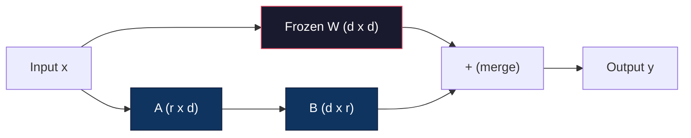
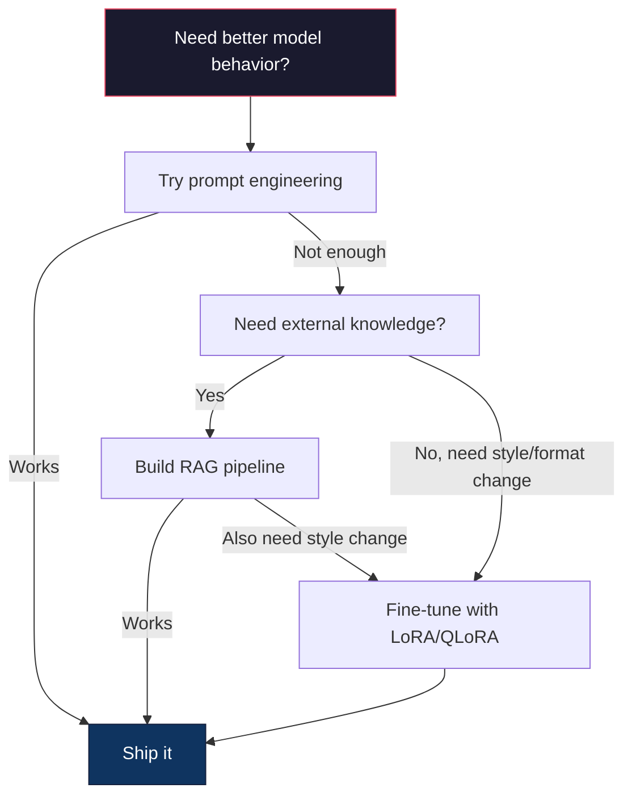

# Fine-Tuning with LoRA & QLoRA · 用 LoRA 与 QLoRA 微调

> 全量微调一个 7B 模型需要 56GB 显存。你没有，多数公司也没有。LoRA 让你用 6GB 微调同一个模型，只训练不到 1% 的参数。这不是妥协——在多数任务上它达到全量微调的质量。整个开源微调生态都跑在这一个技巧上。

> Full fine-tuning a 7B model requires 56GB of VRAM. You don't have that. Neither do most companies. LoRA lets you fine-tune the same model in 6GB by training less than 1% of the parameters. This isn't a compromise -- it matches full fine-tuning quality on most tasks. The entire open-source fine-tuning ecosystem runs on this one trick.

**Type:** Build
**Languages:** Python
**Prerequisites:** Phase 10, Lesson 06 (Instruction Tuning / SFT)
**Time:** ~75 minutes
**Related:** Phase 10 从零覆盖了 SFT/DPO 循环。本课把它们接入 2026 年的 PEFT 工具链（PEFT、TRL、Unsloth、Axolotl、LLaMA-Factory）。

## Learning Objectives · 学习目标

- 通过向预训练模型的注意力层注入低秩适配器矩阵（A 与 B）来实现 LoRA
- 计算 LoRA 相对全量微调的参数节省：秩为 r、维度为 d_model 时训练 2*r*d 个参数而不是 d^2
- 用 QLoRA（4 比特量化基座 + LoRA 适配器）微调模型，塞进消费级 GPU 显存
- 把 LoRA 权重合并（merge）回基座模型以便部署，并对比带与不带适配器的推理速度

> Implement LoRA by injecting low-rank adapter matrices (A and B) into a pretrained model's attention layers
> Calculate the parameter savings of LoRA vs full fine-tuning: rank r with d_model dimensions trains 2*r*d parameters instead of d^2
> Fine-tune a model using QLoRA (4-bit quantized base + LoRA adapters) to fit within consumer GPU memory
> Merge LoRA weights back into the base model for deployment and compare inference speed with and without adapters

## The Problem · 问题在哪

你有一个基座模型：Llama 3 8B。你想让它用你公司的口吻回答客服工单。SFT（监督微调）是答案。但 SFT 有成本问题。

全量微调（full fine-tuning）更新模型里的每一个参数。Llama 3 8B 有 80 亿参数，fp16 下每个参数占 2 字节，光加载权重就要 16GB。训练时你还需要梯度（16GB）、Adam 的优化器状态（momentum + 方差共 32GB）和激活值。总计：单个 8B 模型大约要 56GB 显存。

一张 A100 80GB 勉强装得下。两张 A100 在云厂商那里每小时 $3-4。在 5 万条样本上训 3 个 epoch 要 6-10 小时。一个实验就是 $30-40。调超参跑 10 个实验，还没部署任何东西就花掉 $400。

放大到 Llama 3 70B，数字就离谱了：光权重就 140GB。你需要一个集群，一个实验 $100 起步。

还有个更深的问题。全量微调改动模型里的每一个权重。用客服数据微调，可能损害模型的通用能力。这叫灾难性遗忘（catastrophic forgetting）：模型在你的任务上变好，在其余所有事情上变差。

你需要一种方法：训练更少的参数、用更少的显存、还不毁掉模型已有的知识。

> Full fine-tuning updates every parameter in the model. ... Total: roughly 56GB of VRAM for a single 8B model. ... If you fine-tune on customer support data, you might degrade the model's general capabilities. It's called catastrophic forgetting. ... You need a method that trains fewer parameters, uses less memory, and doesn't destroy the model's existing knowledge.

## The Concept · 概念

### LoRA: Low-Rank Adaptation · LoRA：低秩适配

Edward Hu 和微软的同事在 2021 年 6 月发表了 LoRA。论文的洞见：微调期间的权重更新具有低内在秩（low intrinsic rank）。你不需要更新 4096x4096 权重矩阵里全部 1670 万个参数——更新中有用的信息可以被一个秩为 16 或 32 的矩阵捕获。

数学是这样的。一个标准线性层计算：

```
y = Wx
```

其中 W 是 d_out x d_in 矩阵。对 4096x4096 的注意力投影来说，那是 16,777,216 个参数。

LoRA 冻结 W，加一个低秩分解：

```
y = Wx + BAx
```

其中 B 是 (d_out x r)，A 是 (r x d_in)。秩 r 远小于 d——典型取 8、16 或 32。

r=16 作用在一个 4096x4096 层上：
- 原始参数：4096 x 4096 = 16,777,216
- LoRA 参数：(4096 x 16) + (16 x 4096) = 65,536 + 65,536 = 131,072
- 缩减：131,072 / 16,777,216 = 0.78%

你只训练 0.78% 的参数，却拿到 95-100% 的质量。



A 用随机高斯初始化，B 初始化为零。这意味着 LoRA 的贡献从零开始——模型从自己的原始行为起步训练，逐渐学会这次适配。

> Edward Hu and colleagues at Microsoft published LoRA in June 2021. The paper's insight: the weight updates during fine-tuning have low intrinsic rank. ... You're training 0.78% of the parameters and getting 95-100% of the quality. ... A is initialized with a random Gaussian. B is initialized to zero. This means the LoRA contribution starts at zero -- the model begins training from its original behavior and gradually learns the adaptation.

### The Scaling Factor: Alpha · 缩放因子 Alpha

LoRA 引入一个缩放因子 alpha，控制低秩更新对输出影响的强度：

```
y = Wx + (alpha / r) * BAx
```

alpha = r 时缩放是 1x；alpha = 2r（常见默认）时是 2x。这个超参数让 LoRA 路径的学习率独立于基座学习率。

实践建议：
- alpha = 2 * rank 是社区常见约定（原论文多数实验用 alpha = rank）
- alpha = rank 给出 1x 缩放，保守但稳定
- alpha 越大，每步更新越大，可能加速收敛，也可能引发不稳定

> LoRA introduces a scaling factor alpha that controls how much the low-rank update affects the output. ... When alpha = 2r (the common default), the scaling is 2x. This hyperparameter controls the learning rate of the LoRA path independently of the base learning rate. ... Higher alpha means larger updates per step, which can speed convergence or cause instability.

### Where to Apply LoRA · 把 LoRA 加在哪些层

一个 Transformer 有很多线性层。你不必给所有层都加 LoRA。原论文测过不同组合：

| 目标层 | 可训练参数（7B） | 质量 |
|--------------|----------------------|---------|
| 仅 q_proj | 4.7M | 良好 |
| q_proj + v_proj | 9.4M | 更好 |
| q_proj + k_proj + v_proj + o_proj | 18.9M | 注意力部分最佳 |
| 全部线性层（attention + MLP） | 37.7M | 边际收益，参数翻倍 |

多数任务的最佳平衡点：q_proj + v_proj。它瞄准自注意力中的 query 和 value 投影——这两个投影决定模型关注什么、提取什么信息。加上 MLP 层对代码生成这类复杂任务有帮助，但参数量翻倍，在简单任务上收益递减。

> A transformer has many linear layers. You don't need to add LoRA to all of them. ... The sweet spot for most tasks: q_proj + v_proj. ... Adding MLP layers helps for complex tasks like code generation but doubles the parameter count for diminishing returns on simpler tasks.

### Rank Selection · 秩的选择

秩 r 控制这次适配的表达能力：

| 秩 | 可训练参数（每层） | 最适合 |
|------|---------------------------|----------|
| 4 | 32,768 | 简单分类、情感分析 |
| 8 | 65,536 | 单领域问答、摘要 |
| 16 | 131,072 | 多领域任务、指令遵循 |
| 32 | 262,144 | 复杂推理、代码生成 |
| 64 | 524,288 | 对多数任务已收益递减 |
| 128 | 1,048,576 | 很少有正当理由 |

Hu 等人证明，对简单任务 r=4 就已捕获大部分适配。实践中 r=8 和 r=16 最常见。超过 r=64 很少再提升质量，反而开始丢掉 LoRA 的显存优势。

> Hu et al. showed that r=4 already captures most of the adaptation for simple tasks. ... Going beyond r=64 rarely improves quality and starts to lose LoRA's memory advantage.

### QLoRA: 4-Bit Quantization + LoRA · QLoRA：4 比特量化 + LoRA

Tim Dettmers 和华盛顿大学的同事在 2023 年 5 月发表了 QLoRA。思路：把冻结的基座模型量化到 4 比特精度，再在顶上挂 fp16 的 LoRA 适配器。

这彻底改写了显存公式：

| 方法 | 权重显存（7B） | 训练显存（7B） | 所需 GPU |
|--------|-------------------|---------------------|-------------|
| 全量微调（fp16） | 14GB | ~56GB | 1x A100 80GB |
| LoRA（fp16 基座） | 14GB | ~18GB | 1x A100 40GB |
| QLoRA（4 比特基座） | 3.5GB | ~6GB | 1x RTX 3090 24GB |

QLoRA 有三项技术贡献：

**NF4（Normal Float 4-bit）**：一种专为神经网络权重设计的新数据类型。神经网络权重近似服从正态分布，NF4 把它的 16 个量化级放在标准正态分布的分位数上——这对正态分布数据是信息论最优的。它比均匀 4 比特量化（INT4）或标准 Float4 损失的信息更少。

**双重量化（double quantization）**：量化常数本身也占显存。每 64 个权重的块需要一个 fp32 缩放因子（4 字节）。对 7B 模型来说，这额外多出 0.4GB。双重量化把这些常数再量化到 fp8，把开销降到 0.1GB。不大，但积少成多。

**分页优化器（paged optimizers）**：训练时，优化器状态（Adam 的 momentum 和方差）在长序列下可能超出 GPU 显存。分页优化器用 NVIDIA 统一内存，在显存耗尽时自动把优化器状态分页到 CPU 内存，需要时再分页回来。代价是损失一些吞吐，换来不 OOM。

> The idea: quantize the frozen base model to 4-bit precision, then attach LoRA adapters in fp16 on top. ... QLoRA makes three technical contributions: ... NF4 places its 16 quantization levels at the quantiles of a standard normal distribution. ... Paged optimizers use NVIDIA's unified memory to automatically page optimizer states to CPU RAM when GPU memory is exhausted, and page them back when needed. This prevents OOM crashes at the cost of some throughput.

### The Quality Question · 质量问题

减少参数或量化基座会伤质量吗？多篇论文给出的结果：

| 方法 | MMLU (5-shot) | MT-Bench | HumanEval |
|--------|--------------|----------|-----------|
| 全量微调 (Llama 2 7B) | 48.3 | 6.72 | 14.6 |
| LoRA r=16 | 47.9 | 6.68 | 14.0 |
| QLoRA r=16 (NF4) | 47.5 | 6.61 | 13.4 |
| QLoRA r=64 (NF4) | 48.1 | 6.70 | 14.2 |

r=16 的 LoRA 在多数基准上与全量微调的差距在 1% 以内。r=16 的 QLoRA 再让出零点几个百分点。r=64 的 QLoRA 基本追平全量微调，同时省下 90% 显存。

> LoRA at r=16 is within 1% of full fine-tuning on most benchmarks. ... QLoRA at r=64 essentially matches full fine-tuning while using 90% less memory.

### Real-World Costs · 真实成本

在 5 万条样本上微调 Llama 3 8B（3 个 epoch）：

| 方法 | GPU | 时间 | 成本 |
|--------|-----|------|------|
| 全量微调 | 2x A100 80GB | 8 小时 | ~$32 |
| LoRA r=16 | 1x A100 40GB | 4 小时 | ~$8 |
| QLoRA r=16 | 1x RTX 4090 24GB | 6 小时 | ~$5 |
| QLoRA r=16 (Unsloth) | 1x RTX 4090 24GB | 2.5 小时 | ~$2 |
| QLoRA r=16 | 1x T4 16GB | 12 小时 | ~$4 |

单张消费级 GPU 上的 QLoRA，成本不到一顿午饭。这就是 2023 年开放权重微调社区爆发的原因，也是 2026 年下面每个训练框架都默认内置 QLoRA 的原因。

> QLoRA on a single consumer GPU costs less than a lunch. This is why the open-weight fine-tuning community exploded in 2023 and why every training framework below ships QLoRA by default in 2026.

### The 2026 PEFT stack · 2026 年的 PEFT 工具链

| 框架 | 它是什么 | 什么时候选它 |
|-----------|-----------|-----------|
| **Hugging Face PEFT** | 标准的 LoRA/QLoRA/DoRA/IA3 库 | 想要底层控制，而且训练循环已经跑在 `transformers.Trainer` 上 |
| **TRL** | HF 的反馈强化训练器（SFT、DPO、GRPO、PPO、ORPO） | SFT 之后还要做 DPO/GRPO；构建在 PEFT 之上 |
| **Unsloth** | 用 Triton 内核重写的前向/反向传播 | 想要 2-5x 提速 + 显存减半且不掉精度；Llama/Mistral/Qwen 系列 |
| **Axolotl** | PEFT + TRL + DeepSpeed + Unsloth 之上的 YAML 配置封装 | 想要可复现、可版本管理的训练 |
| **LLaMA-Factory** | PEFT + TRL 之上的 GUI/CLI/API | 想要零代码微调；支持 100+ 模型家族 |
| **torchtune** | 原生 PyTorch 配方，不依赖 `transformers` | 想要最少依赖，而且团队已统一在 PyTorch 上 |

经验法则：研究用途或一次性实验 → PEFT。可复现的生产流水线 → Axolotl 并启用 Unsloth 内核。随手原型 → LLaMA-Factory。

> Rule of thumb: research use or one-off experiment → PEFT. Repeatable production pipeline → Axolotl with Unsloth kernels enabled. Throwaway prototyping → LLaMA-Factory.

### Merging Adapters · 合并适配器

训练结束后你手里有两样东西：冻结的基座模型，和一个小的 LoRA 适配器（典型 10-100MB）。你可以二选一：

1. **分开保存**：加载基座模型，再把适配器加载上去。不同任务换不同适配器。一个基座服务多个微调变体，就是这么做的。

2. **永久合并**：计算 W' = W + (alpha/r) * BA，把结果存成一个完整的新模型。合并后的模型与原模型同尺寸。零推理开销，也不用再管适配器。

要服务多个任务（客服适配器、代码适配器、翻译适配器），就分开保存。要部署单个专用模型，就合并。

组合多个适配器的高级合并技术：

- **TIES-Merging**（Yadav et al. 2023）：先裁掉小幅值参数，解决符号冲突，再合并。减少适配器之间的相互干扰。
- **DARE**（Yu et al. 2023）：合并前随机丢弃适配器参数，并重新缩放剩余部分。组合能力时出奇地有效。
- **任务算术（task arithmetic）**：直接加减适配器权重。加一个「代码」适配器再加一个「数学」适配器，常常得到一个两者都擅长的模型。

> After training, you have two things: the frozen base model and a small LoRA adapter (typically 10-100MB). ... This is how you serve multiple fine-tuned variants from one base model. ... The merged model is the same size as the original. No inference overhead. No adapter to manage. ... For serving multiple tasks (customer support adapter, code adapter, translation adapter), keep them separate. For deploying a single specialized model, merge.

### When NOT to Fine-Tune · 什么时候不要微调

微调是第三个选项，不是第一个。

**第一：提示词工程（prompt engineering）。** 写一个更好的系统提示词、加 few-shot 示例、用思维链（chain-of-thought）。零成本，几分钟搞定。如果提示词已经让你走完 80% 的路，多半就不需要微调了。

**第二：RAG。** 如果模型需要知道你的具体数据（文档、知识库、产品目录），检索比把知识烤进权重更便宜、更好维护。见第 06 课。

**第三：微调。** 当模型需要采纳提示词无法达成的特定风格、格式或推理模式时用它。需要稳定输出结构化内容时用它。需要把大模型蒸馏进小模型时用它。延迟敏感、负担不起 few-shot 提示的额外 token 时用它。



```figure
lora-params
```

> Fine-tuning is the third option, not the first. ... If prompting gets you 80% of the way there, you probably don't need to fine-tune. ... If the model needs to know about your specific data (documents, knowledge base, product catalog), retrieval is cheaper and more maintainable than baking it into weights.

## Build It · 动手造

我们用纯 PyTorch 从零实现 LoRA。不用任何库，没有魔法。你要亲手搭出 LoRA 层、把它注入模型、训练它，再把权重合并回去。

> We implement LoRA from scratch in pure PyTorch. No libraries. No magic. You'll build the LoRA layer, inject it into a model, train it, and merge the weights back.

### Step 1: The LoRA Layer · LoRA 层

```python
import torch
import torch.nn as nn
import math

class LoRALayer(nn.Module):
    def __init__(self, in_features, out_features, rank=8, alpha=16):
        super().__init__()
        self.rank = rank
        self.alpha = alpha
        self.scaling = alpha / rank

        self.A = nn.Parameter(torch.randn(in_features, rank) * (1 / math.sqrt(rank)))
        self.B = nn.Parameter(torch.zeros(rank, out_features))

    def forward(self, x):
        return (x @ self.A @ self.B) * self.scaling
```

A 用缩放后的随机值初始化，B 初始化为零。乘积 BA 从零开始，所以模型以自己的原始行为起步。

> A is initialized with scaled random values. B is initialized to zero. The product BA starts at zero, so the model begins with its original behavior.

### Step 2: LoRA-Wrapped Linear Layer · 包裹 LoRA 的线性层

```python
class LinearWithLoRA(nn.Module):
    def __init__(self, linear, rank=8, alpha=16):
        super().__init__()
        self.linear = linear
        self.lora = LoRALayer(
            linear.in_features, linear.out_features, rank, alpha
        )

        for param in self.linear.parameters():
            param.requires_grad = False

    def forward(self, x):
        return self.linear(x) + self.lora(x)
```

原线性层被冻结。只有 LoRA 参数（A 和 B）可训练。

> The original linear layer is frozen. Only the LoRA parameters (A and B) are trainable.

### Step 3: Inject LoRA into a Model · 把 LoRA 注入模型

```python
def inject_lora(model, target_modules, rank=8, alpha=16):
    for param in model.parameters():
        param.requires_grad = False

    lora_layers = {}
    for name, module in model.named_modules():
        if isinstance(module, nn.Linear):
            if any(t in name for t in target_modules):
                parent_name = ".".join(name.split(".")[:-1])
                child_name = name.split(".")[-1]
                parent = dict(model.named_modules())[parent_name]
                lora_linear = LinearWithLoRA(module, rank, alpha)
                setattr(parent, child_name, lora_linear)
                lora_layers[name] = lora_linear
    return lora_layers
```

先冻结模型里的每一个参数。然后遍历模型树，找到名字命中目标的线性层，替换成 LoRA 包裹版。整个模型里唯一可训练的参数就是 LoRA 的 A 和 B 矩阵。

> First, freeze every parameter in the model. Then walk the model tree, find linear layers matching your target names, and replace them with LoRA-wrapped versions. The LoRA A and B matrices are the only trainable parameters in the entire model.

### Step 4: Count Parameters · 统计参数

```python
def count_parameters(model):
    total = sum(p.numel() for p in model.parameters())
    trainable = sum(p.numel() for p in model.parameters() if p.requires_grad)
    frozen = total - trainable
    return {
        "total": total,
        "trainable": trainable,
        "frozen": frozen,
        "trainable_pct": 100 * trainable / total if total > 0 else 0
    }
```

### Step 5: Merge Weights Back · 合并权重

```python
def merge_lora_weights(model):
    for name, module in model.named_modules():
        if isinstance(module, LinearWithLoRA):
            with torch.no_grad():
                merged = (
                    module.lora.A @ module.lora.B
                ) * module.lora.scaling
                module.linear.weight.data += merged.T
            parent_name = ".".join(name.split(".")[:-1])
            child_name = name.split(".")[-1]
            if parent_name:
                parent = dict(model.named_modules())[parent_name]
            else:
                parent = model
            setattr(parent, child_name, module.linear)
```

合并之后，LoRA 层就消失了。模型与原模型同尺寸，适配已经烤进权重。零推理开销。

> After merging, the LoRA layers are gone. The model is the same size as the original with the adaptation baked into the weights. No inference overhead.

### Step 6: Simulated QLoRA Quantization · 模拟 QLoRA 量化

```python
def quantize_to_nf4(tensor, block_size=64):
    blocks = tensor.reshape(-1, block_size)
    scales = blocks.abs().max(dim=1, keepdim=True).values / 7.0
    scales = torch.clamp(scales, min=1e-8)
    quantized = torch.round(blocks / scales).clamp(-8, 7).to(torch.int8)
    return quantized, scales

def dequantize_from_nf4(quantized, scales, original_shape):
    dequantized = quantized.float() * scales
    return dequantized.reshape(original_shape)
```

这里把权重映射进每 64 个一组的 16 个离散量化级，以此模拟 4 比特量化。生产级 QLoRA 用 bitsandbytes 库在 GPU 上做真正的 NF4。

> This simulates 4-bit quantization by mapping weights into 16 discrete levels within blocks of 64. Production QLoRA uses the bitsandbytes library for true NF4 on GPU.

### Step 7: Training Loop · 训练循环

```python
def train_lora(model, data, epochs=5, lr=1e-3, batch_size=4):
    optimizer = torch.optim.AdamW(
        [p for p in model.parameters() if p.requires_grad], lr=lr
    )
    criterion = nn.MSELoss()

    losses = []
    for epoch in range(epochs):
        epoch_loss = 0.0
        n_batches = 0
        indices = torch.randperm(len(data["inputs"]))

        for i in range(0, len(indices), batch_size):
            batch_idx = indices[i:i + batch_size]
            x = data["inputs"][batch_idx]
            y = data["targets"][batch_idx]

            output = model(x)
            loss = criterion(output, y)

            optimizer.zero_grad()
            loss.backward()
            optimizer.step()

            epoch_loss += loss.item()
            n_batches += 1

        avg_loss = epoch_loss / n_batches
        losses.append(avg_loss)

    return losses
```

### Step 8: Full Demo · 完整演示

```python
def demo():
    torch.manual_seed(42)
    d_model = 256
    n_classes = 10

    model = nn.Sequential(
        nn.Linear(d_model, 512),
        nn.ReLU(),
        nn.Linear(512, 512),
        nn.ReLU(),
        nn.Linear(512, n_classes),
    )

    n_samples = 500
    x = torch.randn(n_samples, d_model)
    y = torch.randint(0, n_classes, (n_samples,))
    y_onehot = torch.zeros(n_samples, n_classes).scatter_(1, y.unsqueeze(1), 1.0)

    data = {"inputs": x, "targets": y_onehot}

    params_before = count_parameters(model)

    lora_layers = inject_lora(
        model, target_modules=["0", "2"], rank=8, alpha=16
    )

    params_after = count_parameters(model)

    losses = train_lora(model, data, epochs=20, lr=1e-3)

    merge_lora_weights(model)
    params_merged = count_parameters(model)

    return {
        "params_before": params_before,
        "params_after": params_after,
        "params_merged": params_merged,
        "losses": losses,
    }
```

这个 demo 创建一个小模型，往两层注入 LoRA，训练，再把权重合并回去。LoRA 训练期间，可训练参数占比从全部可训练掉到约 1%；合并之后恢复原始架构。

> The demo creates a small model, injects LoRA into two layers, trains it, and merges the weights back. The parameter count drops from full trainable to ~1% trainable during LoRA training, then returns to the original architecture after merging.

## Use It · 实战用法

有了 Hugging Face 生态，在真实模型上做 LoRA 只要 20 行左右：

```python
from transformers import AutoModelForCausalLM, AutoTokenizer
from peft import LoraConfig, get_peft_model, TaskType

model = AutoModelForCausalLM.from_pretrained("meta-llama/Llama-3.1-8B")
tokenizer = AutoTokenizer.from_pretrained("meta-llama/Llama-3.1-8B")

lora_config = LoraConfig(
    task_type=TaskType.CAUSAL_LM,
    r=16,
    lora_alpha=32,
    lora_dropout=0.05,
    target_modules=["q_proj", "v_proj"],
)

model = get_peft_model(model, lora_config)
model.print_trainable_parameters()
```

QLoRA 再加上 bitsandbytes 量化：

```python
from transformers import BitsAndBytesConfig

bnb_config = BitsAndBytesConfig(
    load_in_4bit=True,
    bnb_4bit_quant_type="nf4",
    bnb_4bit_compute_dtype=torch.bfloat16,
    bnb_4bit_use_double_quant=True,
)

model = AutoModelForCausalLM.from_pretrained(
    "meta-llama/Llama-3.1-8B",
    quantization_config=bnb_config,
    device_map="auto",
)

model = get_peft_model(model, lora_config)
```

就这样。训练循环不变，数据管道不变。基座模型以 4 比特常驻，LoRA 适配器以 fp16 训练，整套塞进 6GB。

用 Hugging Face Trainer 训练：

```python
from transformers import TrainingArguments, Trainer
from datasets import load_dataset

dataset = load_dataset("tatsu-lab/alpaca", split="train[:5000]")

training_args = TrainingArguments(
    output_dir="./lora-llama",
    num_train_epochs=3,
    per_device_train_batch_size=4,
    gradient_accumulation_steps=4,
    learning_rate=2e-4,
    fp16=True,
    logging_steps=10,
    save_strategy="epoch",
    optim="paged_adamw_8bit",
)

trainer = Trainer(
    model=model,
    args=training_args,
    train_dataset=dataset,
)

trainer.train()

model.save_pretrained("./lora-adapter")
```

保存下来的适配器只有 10-100MB。基座模型原封不动。你可以把适配器分享到 Hugging Face Hub，不必重新分发整个模型。

> That's it. Same training loop. Same data pipeline. The base model now lives in 4-bit, LoRA adapters train in fp16, and the whole thing fits in 6GB. ... The saved adapter is 10-100MB. The base model stays untouched. You can share adapters on the Hugging Face Hub without redistributing the full model.

## Ship It · 交付

本课产出：
- `outputs/prompt-lora-advisor.md` —— 一个帮你为具体任务决定 LoRA 秩、目标层和超参数的提示词
- `outputs/skill-fine-tuning-guide.md` —— 一个教 agent「何时以及如何微调」决策树的技能

> This lesson produces:
> - `outputs/prompt-lora-advisor.md` -- a prompt that helps you decide LoRA rank, target modules, and hyperparameters for your specific task
> - `outputs/skill-fine-tuning-guide.md` -- a skill that teaches agents the decision tree for when and how to fine-tune

## Exercises · 练习

1. **秩消融实验。** 用秩 2、4、8、16、32、64 各跑一遍 demo。画最终 loss 对秩的曲线，找到收益递减点——秩翻倍也不再让 loss 减半的地方。对 256 维特征上的简单分类任务，这个点应在 r=8-16 附近。

2. **目标层对比。** 修改 inject_lora，分别只瞄准 "0" 层、只瞄准 "2" 层、只瞄准 "4" 层，以及三层全要。每个变体训 20 个 epoch，对比收敛速度和最终 loss。这对应真实世界里选 q_proj、v_proj 还是全部线性层的决策。

3. **量化误差分析。** 取训练好的模型的权重矩阵，过一遍 quantize_to_nf4 / dequantize_from_nf4 前后。计算均方误差、最大绝对误差，以及原始权重与重建权重之间的相关性。试验 block_size 取 32、64、128、256。

4. **多适配器服务。** 在数据的两个不同子集（偶数索引 vs 奇数索引）上各训一个 LoRA 适配器，并把两者都保存。基座模型只加载一次，然后切换适配器，验证同一个输入产出不同的输出。生产系统用一个基座服务多个微调模型，就是这么做的。

5. **合并 vs 不合并的推理。** 对同样 100 个输入，对比 merge_lora_weights 之前和之后 LoRA 模型的输出。验证输出一致（浮点容差 1e-5 之内）。再给两者测推理速度——合并后应略快，因为一次矩阵乘法代替了两次。

> Run the demo with ranks 2, 4, 8, 16, 32, and 64. Find the point of diminishing returns where doubling the rank no longer halves the loss. ... Verify the outputs are identical (within floating-point tolerance of 1e-5). Then benchmark inference speed for both -- merged should be slightly faster since it's a single matrix multiply instead of two.

## Key Terms · 术语表

| 术语 | 大家怎么说 | 实际含义 |
|------|----------------|----------------------|
| LoRA | "高效微调" | 低秩适配（Low-Rank Adaptation）：冻结基座权重，只训练两个小矩阵 A 和 B，它们的乘积近似完整的权重更新 |
| QLoRA | "在笔记本上微调" | 量化 LoRA：以 4 比特 NF4 加载基座模型，在其上以 fp16 训练 LoRA 适配器，让 7B 微调塞进 6GB 显存 |
| Rank (r) | "模型能学多少" | A 和 B 矩阵的内层维度；在表达能力与参数量之间做权衡 |
| Alpha | "LoRA 学习率" | 作用于 LoRA 输出的缩放因子；alpha/r 决定这次适配对最终输出的贡献 |
| NF4 | "4 比特量化" | Normal Float 4：量化级放在正态分布分位数上的 4 比特数据类型，对神经网络权重最优 |
| Adapter | "训练出来的小文件" | 以单独文件保存的 LoRA A、B 矩阵（10-100MB），可加载到基座模型的任何副本之上 |
| Target modules | "给哪些层加 LoRA" | 注入 LoRA 适配器的具体线性层（q_proj、v_proj 等） |
| Merging | "烤进权重" | 计算 W + (alpha/r) * BA 并替换原权重，消除推理时的适配器开销 |
| Paged optimizers | "训练时别 OOM" | GPU 显存耗尽时，把优化器状态（Adam 的 momentum、方差）卸载到 CPU |
| Catastrophic forgetting | "微调把别的都搞坏了" | 更新全部权重导致模型丢失先前学会的能力 |

## Further Reading · 延伸阅读

- Hu et al., "LoRA: Low-Rank Adaptation of Large Language Models" (2021) —— 提出低秩分解方法的原始论文，在 GPT-3 175B 上用低至 4 的秩验证
- Dettmers et al., "QLoRA: Efficient Finetuning of Quantized Language Models" (2023) —— 引入 NF4、双重量化和分页优化器，让 65B 模型在单张 48GB GPU 上微调
- PEFT library documentation (huggingface.co/docs/peft) —— Hugging Face 生态里 LoRA、QLoRA 及其他参数高效方法的标准库
- Yadav et al., "TIES-Merging: Resolving Interference When Merging Models" (2023) —— 在不损失质量的前提下组合多个 LoRA 适配器的技术
- [Rafailov et al., "Direct Preference Optimization: Your Language Model is Secretly a Reward Model" (NeurIPS 2023)](https://arxiv.org/abs/2305.18290) —— DPO 推导；SFT 之后的偏好调优阶段，不需要奖励模型。
- [TRL documentation](https://huggingface.co/docs/trl/) —— `SFTTrainer`、`DPOTrainer`、`KTOTrainer` 的官方参考，以及与 PEFT/bitsandbytes/Unsloth 的集成面。
- [Unsloth documentation](https://docs.unsloth.ai/) —— 融合内核让微调吞吐翻倍、显存减半；TRL 之下的性能层。
- [Axolotl documentation](https://axolotl-ai-cloud.github.io/axolotl/) —— YAML 配置的多 GPU SFT/DPO/QLoRA 训练器；手写脚本的 config-as-code 替代品。
