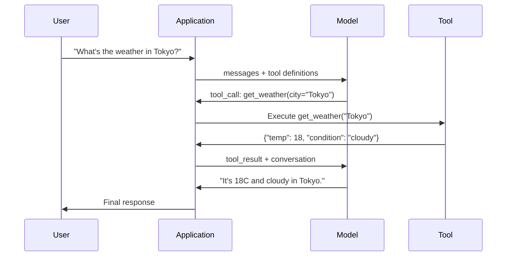

# Function Calling & Tool Use · 函数调用与工具使用

> LLMs cannot do anything. They generate text. That is the entire capability. They cannot check the weather, query a database, send an email, run code, or read a file. Every "AI agent" you have ever seen is an LLM generating JSON that says which function to call -- and then your code actually calling it. The model is the brain. Tools are the hands. Function calling is the nervous system connecting them.

**Type:** Build
**Languages:** Python
**Prerequisites:** Phase 11 Lesson 03 (Structured Outputs)
**Time:** ~75 minutes
**Related:** Phase 11 · 14 (Model Context Protocol) — when a tool is shared across hosts, graduate from inline function-calling to an MCP server. This lesson covers the inline case; MCP covers the protocol case.

## Learning Objectives · 学习目标

- 实现一个函数调用（function calling）循环：定义工具 schema、解析模型输出的工具调用 JSON、执行函数并返回结果
- 设计带清晰描述和类型化参数的工具 schema，让模型能够可靠地调用
- 构建多轮 agent 循环，把多次函数调用串联起来回答复杂查询
- 处理函数调用的边界情况：并行工具调用、错误传播，以及防止无限工具循环

> Implement a function calling loop: define tool schemas, parse the model's tool-call JSON, execute functions, and return results
> Design tool schemas with clear descriptions and typed parameters that the model can reliably invoke
> Build a multi-turn agent loop that chains multiple function calls to answer complex queries
> Handle function calling edge cases: parallel tool calls, error propagation, and preventing infinite tool loops

## The Problem · 问题在哪

你搭建了一个聊天机器人（chatbot）。用户问：「现在东京的天气怎么样？」

模型回答：「我无法访问实时天气数据，但根据季节判断，东京现在大概在 15 摄氏度左右……」

这是披着免责声明外衣的幻觉（hallucination）。模型不知道天气，而且永远不会知道。天气每小时都在变，而模型的训练数据是几个月前的。

正确的答案需要调用 OpenWeatherMap API、拿到当前温度、返回那个真实的数字。模型不能调用 API，你的代码可以。缺的那一环是：一个结构化协议（protocol），让模型能说「我需要带这些参数调用天气 API」，并让你的代码去执行它、把结果喂回对话。

这就是函数调用（function calling）。模型输出结构化的 JSON，描述要调用哪个函数、传什么参数。你的应用执行这个函数，结果回到对话里，模型基于结果产出最终回答。

没有函数调用，LLM 只是一本百科全书；有了它，LLM 才成为 agent。

> That is a hallucination dressed in a disclaimer. The model does not know the weather. It never will. ... The correct answer requires calling the OpenWeatherMap API, getting the current temperature, and returning the real number. The model cannot call APIs. Your code can. ... This is function calling. The model outputs structured JSON describing which function to invoke with what arguments. Your application executes the function. The result goes back into the conversation. The model uses the result to produce its final answer. ... Without function calling, LLMs are encyclopedias. With it, they become agents.

## The Concept · 概念

### The Function Calling Loop · 函数调用循环

每一次工具使用交互都遵循同一个 5 步循环。



第 1 步：用户发送一条消息。第 2 步：模型收到消息以及工具定义（描述可用函数的 JSON Schema）。第 3 步：模型不输出普通文本，而是输出一个工具调用（tool call）—— 一个带函数名和参数的结构化 JSON 对象。第 4 步：你的代码执行函数并捕获结果。第 5 步：结果送回模型，模型此刻手上有真实数据，可以产出最终回答。

模型从不执行任何东西。它只决定调用什么、用什么参数。你的代码才是执行者。

> Every tool-use interaction follows the same 5-step loop.
> Step 1: the user sends a message. Step 2: the model receives the message along with tool definitions (JSON Schema describing available functions). Step 3: instead of responding with text, the model outputs a tool call -- a structured JSON object with the function name and arguments. Step 4: your code executes the function and captures the result. Step 5: the result goes back to the model, which now has real data to produce its final answer.
> The model never executes anything. It only decides what to call and with what arguments. Your code is the executor.

### Tool Definitions: The JSON Schema Contract · 工具定义：JSON Schema 契约

每个工具由一个 JSON Schema 定义，它告诉模型：这个函数做什么、接受哪些参数、这些参数必须是什么类型。

```json
{
  "type": "function",
  "function": {
    "name": "get_weather",
    "description": "Get current weather for a city. Returns temperature in Celsius and conditions.",
    "parameters": {
      "type": "object",
      "properties": {
        "city": {
          "type": "string",
          "description": "City name, e.g. 'Tokyo' or 'San Francisco'"
        },
        "units": {
          "type": "string",
          "enum": ["celsius", "fahrenheit"],
          "description": "Temperature units"
        }
      },
      "required": ["city"]
    }
  }
}
```

`description` 字段至关重要。模型靠读它们来决定何时、如何使用这个工具。含糊的描述（比如 "gets weather"）产出的工具选择（tool selection）质量，会明显劣于 "Get current weather for a city. Returns temperature in Celsius and conditions."。描述本身就是一份用于工具选择的提示词（prompt）。

> Each tool is defined by a JSON Schema that tells the model what the function does, what arguments it takes, and what types those arguments must be.
> The `description` fields are critical. The model reads them to decide when and how to use the tool. A vague description like "gets weather" produces worse tool selection than "Get current weather for a city. Returns temperature in Celsius and conditions." The description is a prompt for tool selection.

### Provider Comparison · 各提供商对比

每家主要提供商都支持函数调用，但 API 表面（API surface）各不相同。

| 提供商 | API 参数 | 工具调用格式 | 并行调用 | 强制调用 |
|----------|--------------|-----------------|---------------|----------------|
| OpenAI (GPT-5, o4) | `tools` | `tool_calls[].function` | 支持（每轮多个） | `tool_choice="required"` |
| Anthropic (Claude 4.6/4.7) | `tools` | `content[].type="tool_use"` | 支持（多个 block） | `tool_choice={"type":"any"}` |
| Google (Gemini 3) | `function_declarations` | `functionCall` | 支持 | `function_calling_config` |
| 开源权重（Llama 4, Qwen3, DeepSeek-V3） | Llama 4 原生 `tools`；其余用 Hermes 或 ChatML | 混杂 | 取决于模型 | 提示词方式；支持时用 `tool_choice` |

到 2026 年，三家闭源提供商已经收敛到几乎一致的、基于 JSON Schema 的格式。Llama 4 自带与 OpenAI 形状一致的原生 `tools` 字段。开源权重的微调模型仍各不相同 —— Hermes 格式（NousResearch）是第三方微调中最常见的。如果工具要跨 host 共享，优先选 MCP（Phase 11 · 14）而不是内联函数调用 —— 同一个 server 对所有 client 都适用。

> Every major provider supports function calling, but the API surface differs.
> By 2026 the three closed providers have converged on near-identical JSON-Schema-based formats. Llama 4 ships with a native `tools` field that matches OpenAI's shape. Open-weight fine-tunes still vary — the Hermes format (NousResearch) is the most common for third-party fine-tunes. For shared tools across hosts, prefer MCP (Phase 11 · 14) over inline function-calling — the server is the same for all of them.

### Tool Choice: Auto, Required, Specific · 工具选择：Auto、Required、Specific

你可以控制模型何时使用工具。

**Auto**（默认）：模型自己决定是调用工具还是直接回答。「2+2 等于几？」—— 直接回答。「天气怎么样？」—— 调用工具。

**Required**：模型必须至少调用一个工具。当你确定用户意图需要工具时使用它，防止模型不去查真实数据而是凭空猜。

**Specific function**（指定函数）：强制模型调用某个特定的函数。`tool_choice={"type":"function", "function": {"name": "get_weather"}}` 保证天气工具被调用，无论查询内容是什么。用它做路由（routing）—— 当上游逻辑已经确定了该用哪个工具时。

> You control when the model uses tools.
> Auto (default): the model decides whether to call a tool or respond directly. "What's 2+2?" -- responds directly. "What's the weather?" -- calls the tool.
> Required: the model must call at least one tool. Use this when you know the user's intent requires a tool. Prevents the model from guessing instead of looking up real data.
> Specific function: force the model to call a particular function. `tool_choice={"type":"function", "function": {"name": "get_weather"}}` guarantees the weather tool is called, regardless of the query. Use this for routing -- when upstream logic already determined which tool is needed.

### Parallel Function Calling · 并行函数调用

GPT-4o 和 Claude 可以在单轮里调用多个函数。用户问：「东京和纽约的天气怎么样？」模型同时输出两个工具调用：

```json
[
  {"name": "get_weather", "arguments": {"city": "Tokyo"}},
  {"name": "get_weather", "arguments": {"city": "New York"}}
]
```

你的代码把两个都执行掉（理想情况下并发执行），把两个结果都返回，模型再综合成一个回答。这把往返次数从 2 次降到 1 次。对于单次查询要打 5-10 个工具调用的 agent，并行调用能把延迟降低 60-80%。

> GPT-4o and Claude can call multiple functions in a single turn. A user asks: "What's the weather in Tokyo and New York?" The model outputs two tool calls simultaneously:
> Your code executes both (ideally concurrently), returns both results, and the model synthesizes a single response. This cuts round trips from 2 to 1. For agents with 5-10 tool calls per query, parallel calling reduces latency by 60-80%.

### Structured Outputs vs Function Calling · 结构化输出 vs 函数调用

第 03 课讲过结构化输出（structured outputs）。函数调用用的是同一套 JSON Schema 机制，但目的不同。

**结构化输出**：强制模型产出特定形状的数据。输出本身就是最终产品。例：从文本中抽取商品信息，得到 `{name, price, in_stock}`。

**函数调用**：模型声明一个「要执行某个动作」的意图。输出只是中间步骤。例：`get_weather(city="Tokyo")` —— 模型在请求一个动作，而不是在产出最终答案。

要抽取数据，用结构化输出；要让模型与外部系统交互，用函数调用。

> Lesson 03 covered structured outputs. Function calling uses the same JSON Schema machinery, but for a different purpose.
> Structured outputs: force the model to produce data in a specific shape. The output is the final product. Example: extract product info from text as `{name, price, in_stock}`.
> Function calling: the model declares an intent to execute an action. The output is an intermediate step. Example: `get_weather(city="Tokyo")` -- the model is requesting an action, not producing the final answer.
> Use structured outputs when you want data extraction. Use function calling when you want the model to interact with external systems.

### Security: The Non-Negotiable Rules · 安全：不可妥协的规则

函数调用是你能交给 LLM 的最危险的能力。由模型决定执行什么。如果你的工具集里有数据库查询，查询语句就是模型构造的；如果有 shell 命令，命令就是模型写的。

**规则 1：永远不要把模型生成的 SQL 直接传给数据库。** 模型能够、也终会生成 DROP TABLE、UNION 注入，或者返回全部行的查询。永远参数化，永远校验，永远使用操作白名单（allowlist）。

**规则 2：给函数设白名单。** 模型只能调用你显式定义的函数。永远不要造一个「按名字执行任意函数」的通用工具。如果你有 50 个内部函数，只暴露用户需要的那 5 个。

**规则 3：校验参数。** 模型可能会把 `"; DROP TABLE users; --"` 当城市名传进来。执行之前，按预期的类型、范围和格式校验每一个参数。

**规则 4：净化工具结果。** 如果工具返回敏感数据（API 密钥、PII、内部报错），在送回模型之前先过滤掉。模型会把工具结果一字不差地复述进它的回答里。

**规则 5：给工具调用限流。** 陷入循环的模型可以把工具调用成百上千次。设一个上限（每个会话 10-20 次是合理的），打断无限循环。

> Function calling is the most dangerous capability you can give an LLM. The model chooses what to execute. If your tool set includes database queries, the model constructs the queries. If it includes shell commands, the model writes them.
> Rule 1: Never pass model-generated SQL directly to a database. ... Rule 2: Allowlist functions. ... Rule 3: Validate arguments. ... Rule 4: Sanitize tool results. ... Rule 5: Rate limit tool calls. ...

### Error Handling · 错误处理

工具会失败。API 会超时。数据库会宕机。文件不存在。模型需要知道工具何时失败、为何失败。

把错误作为结构化的工具结果返回，而不是抛异常：

```json
{
  "error": true,
  "message": "City 'Toky' not found. Did you mean 'Tokyo'?",
  "code": "CITY_NOT_FOUND"
}
```

模型读到这个结果，调整参数，重试。模型很擅长从结构化的错误信息里自我纠正；它们不擅长从空响应或笼统的「出了点问题」里恢复。

> Tools fail. APIs time out. Databases go down. Files do not exist. The model needs to know when a tool fails and why.
> Return errors as structured tool results, not exceptions:
> The model reads this, adjusts its arguments, and retries. Models are good at self-correcting from structured error messages. They are bad at recovering from empty responses or generic "something went wrong" errors.

### MCP: Model Context Protocol · MCP：模型上下文协议

MCP 是 Anthropic 推出的工具互操作开放标准。它不让每个应用各自定义工具，而是提供一套通用协议：工具由 MCP server 提供（serve），由 MCP client（比如 Claude Code、Cursor 或你的应用）消费。

一个 MCP server 可以把工具暴露给任何兼容的 client。一个 Postgres MCP server 让任何 MCP 兼容的 agent 获得数据库访问能力；一个 GitHub MCP server 让任何 agent 获得仓库访问能力。工具定义一次，处处可用。

MCP 之于函数调用，正如 HTTP 之于网络通信：它把传输层标准化，工具因此变得可移植。

```figure
mx-tool-call-loop
```

> MCP is Anthropic's open standard for tool interoperability. Instead of every application defining its own tools, MCP provides a universal protocol: tools are served by MCP servers, consumed by MCP clients (like Claude Code, Cursor, or your application).
> One MCP server can expose tools to any compatible client. ... MCP is to function calling what HTTP is to networking. It standardizes the transport layer so tools become portable.

## Build It · 动手造

### Step 1: Define the Tool Registry · 步骤 1：定义工具注册表

构建一个注册表（registry），存放工具定义和它们的实现。每个工具有两样东西：一个 JSON Schema 定义（模型看到的）和一个 Python 函数（你的代码执行的）。

```python
import ast
import json
import math
import time
import hashlib


TOOL_REGISTRY = {}


def register_tool(name, description, parameters, function):
    TOOL_REGISTRY[name] = {
        "definition": {
            "type": "function",
            "function": {
                "name": name,
                "description": description,
                "parameters": parameters,
            },
        },
        "function": function,
    }
```

> Build a registry that stores tool definitions and their implementations. Each tool has a JSON Schema definition (what the model sees) and a Python function (what your code executes).

### Step 2: Implement 5 Tools · 步骤 2：实现 5 个工具

构建一个计算器、一个天气查询、一个网页搜索模拟器、一个文件读取器和一个代码运行器。

```python
def calculator(expression, precision=2):
    allowed = set("0123456789+-*/.() ")
    if not all(c in allowed for c in expression):
        return {"error": True, "message": f"Invalid characters in expression: {expression}"}
    try:
        result = eval(expression, {"__builtins__": {}}, {"math": math})
        return {"result": round(float(result), precision), "expression": expression}
    except Exception as e:
        return {"error": True, "message": str(e)}


WEATHER_DB = {
    "tokyo": {"temp_c": 18, "condition": "cloudy", "humidity": 72, "wind_kph": 14},
    "new york": {"temp_c": 22, "condition": "sunny", "humidity": 45, "wind_kph": 8},
    "london": {"temp_c": 12, "condition": "rainy", "humidity": 88, "wind_kph": 22},
    "san francisco": {"temp_c": 16, "condition": "foggy", "humidity": 80, "wind_kph": 18},
    "sydney": {"temp_c": 25, "condition": "sunny", "humidity": 55, "wind_kph": 10},
}


def get_weather(city, units="celsius"):
    key = city.lower().strip()
    if key not in WEATHER_DB:
        suggestions = [c for c in WEATHER_DB if c.startswith(key[:3])]
        return {
            "error": True,
            "message": f"City '{city}' not found.",
            "suggestions": suggestions,
            "code": "CITY_NOT_FOUND",
        }
    data = WEATHER_DB[key].copy()
    if units == "fahrenheit":
        data["temp_f"] = round(data["temp_c"] * 9 / 5 + 32, 1)
        del data["temp_c"]
    data["city"] = city
    return data


SEARCH_DB = {
    "python function calling": [
        {"title": "OpenAI Function Calling Guide", "url": "https://platform.openai.com/docs/guides/function-calling", "snippet": "Learn how to connect LLMs to external tools."},
        {"title": "Anthropic Tool Use", "url": "https://docs.anthropic.com/en/docs/tool-use", "snippet": "Claude can interact with external tools and APIs."},
    ],
    "MCP protocol": [
        {"title": "Model Context Protocol", "url": "https://modelcontextprotocol.io", "snippet": "An open standard for connecting AI models to data sources."},
    ],
    "weather API": [
        {"title": "OpenWeatherMap API", "url": "https://openweathermap.org/api", "snippet": "Free weather API with current, forecast, and historical data."},
    ],
}


def web_search(query, max_results=3):
    key = query.lower().strip()
    for db_key, results in SEARCH_DB.items():
        if db_key in key or key in db_key:
            return {"query": query, "results": results[:max_results], "total": len(results)}
    return {"query": query, "results": [], "total": 0}


FILE_SYSTEM = {
    "data/config.json": '{"model": "gpt-4o", "temperature": 0.7, "max_tokens": 4096}',
    "data/users.csv": "name,email,role\nAlice,alice@example.com,admin\nBob,bob@example.com,user",
    "README.md": "# My Project\nA tool-use agent built from scratch.",
}


def read_file(path):
    if ".." in path or path.startswith("/"):
        return {"error": True, "message": "Path traversal not allowed.", "code": "FORBIDDEN"}
    if path not in FILE_SYSTEM:
        available = list(FILE_SYSTEM.keys())
        return {"error": True, "message": f"File '{path}' not found.", "available_files": available, "code": "NOT_FOUND"}
    content = FILE_SYSTEM[path]
    return {"path": path, "content": content, "size_bytes": len(content), "lines": content.count("\n") + 1}


def run_code(code, language="python"):
    if language != "python":
        return {"error": True, "message": f"Language '{language}' not supported. Only 'python' is available."}
    try:
        tree = ast.parse(code)
    except SyntaxError as e:
        return {"error": True, "message": f"SyntaxError: {e}", "code": "SYNTAX_ERROR"}
    unsafe_names = {"exec", "eval", "compile", "__import__", "open", "globals", "locals", "vars", "getattr", "setattr", "delattr"}
    for node in ast.walk(tree):
        if isinstance(node, (ast.Import, ast.ImportFrom)):
            return {"error": True, "message": "Forbidden operation: import is not allowed", "code": "SECURITY_VIOLATION"}
        if isinstance(node, ast.Attribute) and node.attr.startswith("__") and node.attr.endswith("__"):
            return {"error": True, "message": "Forbidden operation: dunder attribute access is not allowed", "code": "SECURITY_VIOLATION"}
        if isinstance(node, ast.Name) and node.id in unsafe_names:
            return {"error": True, "message": f"Forbidden operation: {node.id} is not allowed", "code": "SECURITY_VIOLATION"}
    try:
        local_vars = {}
        exec(code, {"__builtins__": {"print": print, "range": range, "len": len, "str": str, "int": int, "float": float, "list": list, "dict": dict, "sum": sum, "min": min, "max": max, "abs": abs, "round": round, "sorted": sorted, "enumerate": enumerate, "zip": zip, "map": map, "filter": filter, "math": math}}, local_vars)
        result = local_vars.get("result", None)
        return {"success": True, "result": result, "variables": {k: str(v) for k, v in local_vars.items() if not k.startswith("_")}}
    except Exception as e:
        return {"error": True, "message": f"{type(e).__name__}: {e}"}
```

子串黑名单把代码当纯文本来读，所以字符串匹配没有逐字拼出来的东西它一概看不见。把代码解析成语法树再遍历，守卫就能按结构（而不是拼写）拒绝 `import` 语句、dunder 属性访问（即能摸回真实解释器的 `__class__` 和 `__globals__` 链）以及不安全的内建函数名。即便如此，也请把它当作教学过滤器，而不是真正的安全边界。任何进程内守卫都与它运行的代码共享同一个解释器，存心的调用者仍然能找到可达对象。生产系统会在单独的进程或容器里运行不可信代码（降权运行的 subprocess、gVisor、Firecracker，或托管的代码运行服务），这样即使攻击者逃逸，落进的也是一次性沙箱，而不是你的服务。

> A substring blocklist reads the code as text, so it misses anything the string match does not literally spell. Parsing the code into a syntax tree and walking it lets the guard reject `import` statements, dunder attribute access (the `__class__` and `__globals__` chains that reach back to the real interpreter), and unsafe builtin names by structure rather than spelling. ... Even so, treat this as a teaching filter, not a real boundary. Any in-process guard shares the interpreter with the code it runs, and a determined caller can still find reachable objects. ... Production systems run untrusted code in a separate process or container (a subprocess with dropped privileges, gVisor, Firecracker, or a hosted code runner), where an escape lands the attacker in a throwaway box instead of your service.

### Step 3: Register All Tools · 步骤 3：注册所有工具

```python
def register_all_tools():
    register_tool(
        "calculator", "Evaluate a mathematical expression. Supports +, -, *, /, parentheses, and decimals. Returns the numeric result.",
        {"type": "object", "properties": {"expression": {"type": "string", "description": "Math expression, e.g. '(10 + 5) * 3'"}, "precision": {"type": "integer", "description": "Decimal places in result", "default": 2}}, "required": ["expression"]},
        calculator,
    )
    register_tool(
        "get_weather", "Get current weather for a city. Returns temperature, condition, humidity, and wind speed.",
        {"type": "object", "properties": {"city": {"type": "string", "description": "City name, e.g. 'Tokyo' or 'San Francisco'"}, "units": {"type": "string", "enum": ["celsius", "fahrenheit"], "description": "Temperature units, defaults to celsius"}}, "required": ["city"]},
        get_weather,
    )
    register_tool(
        "web_search", "Search the web for information. Returns a list of results with title, URL, and snippet.",
        {"type": "object", "properties": {"query": {"type": "string", "description": "Search query"}, "max_results": {"type": "integer", "description": "Maximum results to return", "default": 3}}, "required": ["query"]},
        web_search,
    )
    register_tool(
        "read_file", "Read the contents of a file. Returns the file content, size, and line count.",
        {"type": "object", "properties": {"path": {"type": "string", "description": "Relative file path, e.g. 'data/config.json'"}}, "required": ["path"]},
        read_file,
    )
    register_tool(
        "run_code", "Run a small Python snippet behind a static-analysis guard and a restricted interpreter. This is a teaching filter, not real isolation. Set a 'result' variable to return output.",
        {"type": "object", "properties": {"code": {"type": "string", "description": "Python code to execute"}, "language": {"type": "string", "enum": ["python"], "description": "Programming language"}}, "required": ["code"]},
        run_code,
    )
```

### Step 4: Build the Function Calling Loop · 步骤 4：构建函数调用循环

这是核心引擎。它模拟模型决定调用哪个工具，执行该工具，并把结果喂回去。

```python
def simulate_model_decision(user_message, tools, conversation_history):
    msg = user_message.lower()

    if any(word in msg for word in ["weather", "temperature", "forecast"]):
        cities = []
        for city in WEATHER_DB:
            if city in msg:
                cities.append(city)
        if not cities:
            for word in msg.split():
                if word.capitalize() in [c.title() for c in WEATHER_DB]:
                    cities.append(word)
        if not cities:
            cities = ["tokyo"]
        calls = []
        for city in cities:
            calls.append({"name": "get_weather", "arguments": {"city": city.title()}})
        return calls

    if any(word in msg for word in ["calculate", "compute", "math", "what is", "how much"]):
        for token in msg.split():
            if any(c in token for c in "+-*/"):
                return [{"name": "calculator", "arguments": {"expression": token}}]
        if "+" in msg or "-" in msg or "*" in msg or "/" in msg:
            expr = "".join(c for c in msg if c in "0123456789+-*/.() ")
            if expr.strip():
                return [{"name": "calculator", "arguments": {"expression": expr.strip()}}]
        return [{"name": "calculator", "arguments": {"expression": "0"}}]

    if any(word in msg for word in ["search", "find", "look up", "google"]):
        query = msg.replace("search for", "").replace("look up", "").replace("find", "").strip()
        return [{"name": "web_search", "arguments": {"query": query}}]

    if any(word in msg for word in ["read", "file", "open", "cat", "show"]):
        for path in FILE_SYSTEM:
            if path.split("/")[-1].split(".")[0] in msg:
                return [{"name": "read_file", "arguments": {"path": path}}]
        return [{"name": "read_file", "arguments": {"path": "README.md"}}]

    if any(word in msg for word in ["run", "execute", "code", "python"]):
        return [{"name": "run_code", "arguments": {"code": "result = 'Hello from the sandbox!'", "language": "python"}}]

    return []


def execute_tool_call(tool_call):
    name = tool_call["name"]
    args = tool_call["arguments"]

    if name not in TOOL_REGISTRY:
        return {"error": True, "message": f"Unknown tool: {name}", "code": "UNKNOWN_TOOL"}

    tool = TOOL_REGISTRY[name]
    func = tool["function"]
    start = time.time()

    try:
        result = func(**args)
    except TypeError as e:
        result = {"error": True, "message": f"Invalid arguments: {e}"}

    elapsed_ms = round((time.time() - start) * 1000, 2)
    return {"tool": name, "result": result, "execution_time_ms": elapsed_ms}


def run_function_calling_loop(user_message, max_iterations=5):
    conversation = [{"role": "user", "content": user_message}]
    tool_definitions = [t["definition"] for t in TOOL_REGISTRY.values()]
    all_tool_results = []

    for iteration in range(max_iterations):
        tool_calls = simulate_model_decision(user_message, tool_definitions, conversation)

        if not tool_calls:
            break

        results = []
        for call in tool_calls:
            result = execute_tool_call(call)
            results.append(result)

        conversation.append({"role": "assistant", "content": None, "tool_calls": tool_calls})

        for result in results:
            conversation.append({"role": "tool", "content": json.dumps(result["result"]), "tool_name": result["tool"]})

        all_tool_results.extend(results)
        break

    return {"conversation": conversation, "tool_results": all_tool_results, "iterations": iteration + 1 if tool_calls else 0}
```

> This is the core engine. It simulates the model deciding which tool to call, executes the tool, and feeds results back.

### Step 5: Argument Validation · 步骤 5：参数校验

构建一个校验器（validator），在执行之前根据 JSON Schema 检查工具调用的参数。

```python
def validate_tool_arguments(tool_name, arguments):
    if tool_name not in TOOL_REGISTRY:
        return [f"Unknown tool: {tool_name}"]

    schema = TOOL_REGISTRY[tool_name]["definition"]["function"]["parameters"]
    errors = []

    if not isinstance(arguments, dict):
        return [f"Arguments must be an object, got {type(arguments).__name__}"]

    for required_field in schema.get("required", []):
        if required_field not in arguments:
            errors.append(f"Missing required argument: {required_field}")

    properties = schema.get("properties", {})
    for arg_name, arg_value in arguments.items():
        if arg_name not in properties:
            errors.append(f"Unknown argument: {arg_name}")
            continue

        prop_schema = properties[arg_name]
        expected_type = prop_schema.get("type")

        type_checks = {"string": str, "integer": int, "number": (int, float), "boolean": bool, "array": list, "object": dict}
        if expected_type in type_checks:
            if not isinstance(arg_value, type_checks[expected_type]):
                errors.append(f"Argument '{arg_name}': expected {expected_type}, got {type(arg_value).__name__}")

        if "enum" in prop_schema and arg_value not in prop_schema["enum"]:
            errors.append(f"Argument '{arg_name}': '{arg_value}' not in {prop_schema['enum']}")

    return errors
```

> Build a validator that checks tool call arguments against the JSON Schema before execution.

### Step 6: Run the Demo · 步骤 6：运行演示

```python
def run_demo():
    register_all_tools()

    print("=" * 60)
    print("  Function Calling & Tool Use Demo")
    print("=" * 60)

    print("\n--- Registered Tools ---")
    for name, tool in TOOL_REGISTRY.items():
        desc = tool["definition"]["function"]["description"][:60]
        params = list(tool["definition"]["function"]["parameters"].get("properties", {}).keys())
        print(f"  {name}: {desc}...")
        print(f"    params: {params}")

    print(f"\n--- Argument Validation ---")
    validation_tests = [
        ("get_weather", {"city": "Tokyo"}, "Valid call"),
        ("get_weather", {}, "Missing required arg"),
        ("get_weather", {"city": "Tokyo", "units": "kelvin"}, "Invalid enum value"),
        ("calculator", {"expression": 123}, "Wrong type (int for string)"),
        ("unknown_tool", {"x": 1}, "Unknown tool"),
    ]
    for tool_name, args, label in validation_tests:
        errors = validate_tool_arguments(tool_name, args)
        status = "VALID" if not errors else f"ERRORS: {errors}"
        print(f"  {label}: {status}")

    print(f"\n--- Tool Execution ---")
    direct_tests = [
        {"name": "calculator", "arguments": {"expression": "(10 + 5) * 3 / 2"}},
        {"name": "get_weather", "arguments": {"city": "Tokyo"}},
        {"name": "get_weather", "arguments": {"city": "Mars"}},
        {"name": "web_search", "arguments": {"query": "python function calling"}},
        {"name": "read_file", "arguments": {"path": "data/config.json"}},
        {"name": "read_file", "arguments": {"path": "../etc/passwd"}},
        {"name": "run_code", "arguments": {"code": "result = sum(range(1, 101))"}},
        {"name": "run_code", "arguments": {"code": "import os; os.system('rm -rf /')"}},
    ]
    for call in direct_tests:
        result = execute_tool_call(call)
        print(f"\n  {call['name']}({json.dumps(call['arguments'])})")
        print(f"    -> {json.dumps(result['result'], indent=None)[:100]}")
        print(f"    time: {result['execution_time_ms']}ms")

    print(f"\n--- Full Function Calling Loop ---")
    test_queries = [
        "What's the weather in Tokyo?",
        "Calculate (100 + 250) * 0.15",
        "Search for MCP protocol",
        "Read the config file",
        "Run some Python code",
        "Tell me a joke",
    ]
    for query in test_queries:
        print(f"\n  User: {query}")
        result = run_function_calling_loop(query)
        if result["tool_results"]:
            for tr in result["tool_results"]:
                print(f"    Tool: {tr['tool']} ({tr['execution_time_ms']}ms)")
                print(f"    Result: {json.dumps(tr['result'], indent=None)[:90]}")
        else:
            print(f"    [No tool called -- direct response]")
        print(f"    Iterations: {result['iterations']}")

    print(f"\n--- Parallel Tool Calls ---")
    multi_city_query = "What's the weather in tokyo and london?"
    print(f"  User: {multi_city_query}")
    result = run_function_calling_loop(multi_city_query)
    print(f"  Tool calls made: {len(result['tool_results'])}")
    for tr in result["tool_results"]:
        city = tr["result"].get("city", "unknown")
        temp = tr["result"].get("temp_c", "N/A")
        print(f"    {city}: {temp}C, {tr['result'].get('condition', 'N/A')}")

    print(f"\n--- Security Checks ---")
    security_tests = [
        ("read_file", {"path": "../../etc/passwd"}),
        ("run_code", {"code": "import subprocess; subprocess.run(['ls'])"}),
        ("calculator", {"expression": "__import__('os').system('ls')"}),
    ]
    for tool_name, args in security_tests:
        result = execute_tool_call({"name": tool_name, "arguments": args})
        blocked = result["result"].get("error", False)
        print(f"  {tool_name}({list(args.values())[0][:40]}): {'BLOCKED' if blocked else 'ALLOWED'}")
```

## Use It · 实战用法

### OpenAI Function Calling · OpenAI 函数调用

```python
# from openai import OpenAI
#
# client = OpenAI()
#
# tools = [{
#     "type": "function",
#     "function": {
#         "name": "get_weather",
#         "description": "Get current weather for a city",
#         "parameters": {
#             "type": "object",
#             "properties": {
#                 "city": {"type": "string"},
#                 "units": {"type": "string", "enum": ["celsius", "fahrenheit"]}
#             },
#             "required": ["city"]
#         }
#     }
# }]
#
# response = client.chat.completions.create(
#     model="gpt-4o",
#     messages=[{"role": "user", "content": "Weather in Tokyo?"}],
#     tools=tools,
#     tool_choice="auto",
# )
#
# tool_call = response.choices[0].message.tool_calls[0]
# args = json.loads(tool_call.function.arguments)
# result = get_weather(**args)
#
# final = client.chat.completions.create(
#     model="gpt-4o",
#     messages=[
#         {"role": "user", "content": "Weather in Tokyo?"},
#         response.choices[0].message,
#         {"role": "tool", "tool_call_id": tool_call.id, "content": json.dumps(result)},
#     ],
# )
# print(final.choices[0].message.content)
```

OpenAI 把工具调用放在 `response.choices[0].message.tool_calls` 里返回。每个调用带有一个 `id`，你在返回结果时必须带上它 —— 模型用这个 ID 把结果和调用一一配对。GPT-4o 可以在单个响应里返回多个工具调用 —— 遍历并执行全部。

> OpenAI returns tool calls as `response.choices[0].message.tool_calls`. Each call has an `id` you must include when returning the result. The model uses this ID to match results to calls. GPT-4o can return multiple tool calls in a single response -- iterate and execute all of them.

### Anthropic Tool Use · Anthropic 工具使用

```python
# import anthropic
#
# client = anthropic.Anthropic()
#
# response = client.messages.create(
#     model="claude-sonnet-5",
#     max_tokens=1024,
#     tools=[{
#         "name": "get_weather",
#         "description": "Get current weather for a city",
#         "input_schema": {
#             "type": "object",
#             "properties": {
#                 "city": {"type": "string"},
#                 "units": {"type": "string", "enum": ["celsius", "fahrenheit"]}
#             },
#             "required": ["city"]
#         }
#     }],
#     messages=[{"role": "user", "content": "Weather in Tokyo?"}],
# )
#
# tool_block = next(b for b in response.content if b.type == "tool_use")
# result = get_weather(**tool_block.input)
#
# final = client.messages.create(
#     model="claude-sonnet-5",
#     max_tokens=1024,
#     tools=[...],
#     messages=[
#         {"role": "user", "content": "Weather in Tokyo?"},
#         {"role": "assistant", "content": response.content},
#         {"role": "user", "content": [{"type": "tool_result", "tool_use_id": tool_block.id, "content": json.dumps(result)}]},
#     ],
# )
```

Anthropic 把工具调用作为 `type: "tool_use"` 的内容块（content block）返回。工具结果放在一条带 `type: "tool_result"` 的 user 消息里。注意一个关键区别：Anthropic 用 `input_schema` 定义工具参数，而 OpenAI 用 `parameters`。

> Anthropic returns tool calls as content blocks with `type: "tool_use"`. The tool result goes in a user message with `type: "tool_result"`. Note the key difference: Anthropic uses `input_schema` for tool parameter definitions, while OpenAI uses `parameters`.

### MCP Integration · MCP 集成

```python
# MCP servers expose tools over a standardized protocol.
# Any MCP-compatible client can discover and call these tools.
#
# Example: connecting to a Postgres MCP server
#
# from mcp import ClientSession, StdioServerParameters
# from mcp.client.stdio import stdio_client
#
# server_params = StdioServerParameters(
#     command="npx",
#     args=["-y", "@modelcontextprotocol/server-postgres", "postgresql://localhost/mydb"],
# )
#
# async with stdio_client(server_params) as (read, write):
#     async with ClientSession(read, write) as session:
#         await session.initialize()
#         tools = await session.list_tools()
#         result = await session.call_tool("query", {"sql": "SELECT count(*) FROM users"})
```

MCP 把工具的实现和工具的消费解耦。Postgres server 懂 SQL，GitHub server 懂它自己的 API，你的 agent 只负责发现并调用工具 —— 不需要为每个集成编写特定提供商的代码。

> MCP decouples tool implementation from tool consumption. The Postgres server knows SQL. The GitHub server knows the API. Your agent just discovers and calls tools -- it does not need provider-specific code for each integration.

## Ship It · 交付

本课产出 `outputs/prompt-tool-designer.md` —— 一个可复用的提示词模板，用于设计工具定义。给它一段「你想让工具做什么」的描述，它就产出完整的 JSON Schema 定义，包含描述、类型和约束。

它还产出 `outputs/skill-function-calling-patterns.md` —— 一套在生产环境中实现函数调用的决策框架，覆盖工具设计、错误处理、安全以及各提供商的特定模式。

> This lesson produces `outputs/prompt-tool-designer.md` -- a reusable prompt template for designing tool definitions. Give it a description of what you want a tool to do, and it produces the complete JSON Schema definition with descriptions, types, and constraints.
> It also produces `outputs/skill-function-calling-patterns.md` -- a decision framework for implementing function calling in production, covering tool design, error handling, security, and provider-specific patterns.

## Exercises · 练习

1. **添加第 6 个工具：数据库查询。** 实现一个模拟 SQL 工具，带一张内存中的表。该工具接受表名和过滤条件（不是原始 SQL）。校验表名在白名单里、过滤运算符限定为 `=`、`>`、`<`、`>=`、`<=`。以 JSON 返回匹配的行。

2. **实现带错误反馈的重试。** 当工具调用失败（例如城市没找到），把错误信息喂回模型决策函数，让它修正自己的参数。记录每次调用重试了多少次。每次工具调用最多重试 3 次。

3. **构建多步 agent。** 有些查询需要串联多次工具调用：「读配置文件，告诉我配置的是哪个模型，然后去网上搜这个模型的定价。」实现一个循环，一直跑到模型判断不再需要工具为止，把累积的结果传入每一步决策。限制 10 次迭代以防无限循环。

4. **测量工具选择准确率。** 创建 30 条带期望工具名的测试查询。在全部 30 条上运行你的决策函数，统计它选对工具的百分比。找出最容易在工具之间引起混淆的查询。

5. **实现工具调用缓存。** 如果同一个工具在 60 秒内用完全相同的参数被再次调用，直接返回缓存结果，而不是重新执行。用一个以 `(tool_name, frozenset(args.items()))` 为键的字典。在一个包含 20 个查询的会话里测量缓存命中率。

## Key Terms · 术语表

| 术语 | 大家怎么说 | 实际含义 |
|------|----------------|----------------------|
| Function calling（函数调用） | "Tool use" | 模型输出结构化 JSON，描述要调用的函数和具体参数 —— 由你的代码执行，不是模型 |
| Tool definition（工具定义） | "Function schema" | 一个 JSON Schema 对象，描述工具的名称、用途、参数和类型 —— 模型读它来决定何时、如何使用这个工具 |
| Tool choice（工具选择模式） | "Calling mode" | 控制模型是必须调用工具（required）、可以调用工具（auto），还是必须调用指定的工具（named） |
| Parallel calling（并行调用） | "Multi-tool" | 模型在单轮里输出多个工具调用，减少往返次数 —— GPT-4o 和 Claude 都支持 |
| Tool result（工具结果） | "Function output" | 执行工具得到的返回值，作为消息送回模型，让它在回答里用上真实数据 |
| Argument validation（参数校验） | "Input checking" | 在执行工具之前，验证模型生成的参数符合预期的类型、范围和约束 |
| MCP | "Tool protocol" | Model Context Protocol —— Anthropic 的开放标准，通过 server 暴露工具，任何兼容的 client 都能发现并调用 |
| Agent loop（agent 循环） | "ReAct loop" | 「模型决定调用什么工具 → 代码执行工具 → 结果喂回」的迭代循环，直到模型有足够信息作出回答 |
| Tool poisoning（工具投毒） | "Prompt injection via tools" | 一种攻击：工具结果里藏着操纵模型行为的指令 —— 必须净化所有工具输出 |
| Rate limiting（限流） | "Call budget" | 给每个会话设置工具调用次数上限，防止无限循环和失控的 API 开销 |

## Further Reading · 延伸阅读

- [OpenAI Function Calling Guide](https://platform.openai.com/docs/guides/function-calling) —— GPT-4o 工具使用的权威参考，涵盖并行调用、强制调用和结构化参数
- [Anthropic Tool Use Guide](https://docs.anthropic.com/en/docs/tool-use) —— Claude 的工具使用实现：input_schema、多工具响应和 tool_choice 配置
- [Model Context Protocol Specification](https://modelcontextprotocol.io) —— AI 应用之间工具互操作的开放标准，含 server/client 架构
- [Schick et al., 2023 -- "Toolformer: Language Models Can Teach Themselves to Use Tools"](https://arxiv.org/abs/2302.04761) —— 训练 LLM 自主决定何时、如何调用外部工具的开山论文
- [Patil et al., 2023 -- "Gorilla: Large Language Model Connected with Massive APIs"](https://arxiv.org/abs/2305.15334) —— 在 1,645 个 API 上微调 LLM 做准确的 API 调用，并减少幻觉
- [Berkeley Function Calling Leaderboard](https://gorilla.cs.berkeley.edu/leaderboard.html) —— 实时基准，对比 GPT-4o、Claude、Gemini 和开源模型的函数调用准确率
- [Yao et al., "ReAct: Synergizing Reasoning and Acting in Language Models" (ICLR 2023)](https://arxiv.org/abs/2210.03629) —— Thought-Action-Observation 循环，它是包在每次工具调用外面的那层 agent 外循环；本课结束之处，正是 Phase 14 接手的地方。
- [Anthropic — Building effective agents (Dec 2024)](https://www.anthropic.com/research/building-effective-agents) —— 由单一工具使用原语组合出的五种可组合模式（prompt chaining、routing、parallelization、orchestrator-workers、evaluator-optimizer）。
